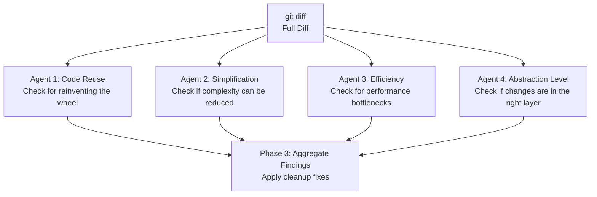

Hello, I'm Xiao G. Claude Code actually offers quite a few powerful commands, such as code review, code simplification, and scheduled tasks. However, I've noticed that many people who use Claude Code every day don't know about them or don't know how to use them.

Many developers think that simply chatting directly with Claude Code is enough and that there's no need to learn these commands. But having used it for a long time, I can assure you that understanding them will make your experience significantly better.

Of course, understanding them doesn't mean you need to memorize them by heart. It's enough just to know they exist! Whenever you need them, simply type `/` and pick from the command list.

> **Version Note**: This article is based on the official documentation and client behavior of Claude Code v2.1.218 (2026-07-25). Commands evolve quickly, so please always refer to `/help`, the `/` command menu, and the official Commands documentation as the ultimate source of truth.

## The `/` Menu Contains More Than Built-in Commands

When you type `/` in Claude Code, you see all entry points that can be invoked directly in your current environment. In addition to Claude Code's built-in commands, this menu also lists Bundled Skills, user-defined custom Skills, as well as commands provided by plugins and MCP Servers. Exactly which entries appear depends on your version, platform, subscription tier, and current environment.

The [official Commands documentation](https://code.claude.com/docs/en/commands) describes most built-in commands as those whose "behavior is directly implemented in the CLI," such as `/clear`, `/compact`, `/model`, `/diff`, `/context`, and `/permissions`. In contrast, [Bundled Skills](https://code.claude.com/docs/en/slash-commands#bundled-skills) work based on prompts: Claude loads corresponding instructions, then calls tools or coordinates subagents to accomplish the task. Commands like `/simplify`, `/batch`, `/debug`, `/loop`, `/run`, `/verify`, `/code-review`, and `/claude-api` all belong to this category. In the official command list, such items are tagged as `Skill`; the few capabilities that orchestrate multiple subagents in parallel and run in the background are marked as `Workflow`.

`/review` is a built-in command used to perform a fast, read-only, single-turn review of a GitHub Pull Request; when run without arguments, it first lists selectable Open PRs. To check the current diff for correctness issues and cleanup opportunities, use `/code-review`; to perform an adjustable-intensity multi-agent review on a PR, execute `/code-review <level> <PR number>`. When you need a deep cloud-based review, use `/code-review ultra` (`/ultrareview` currently serves as an alias).

## /simplify: Code Simplification and Refactoring

When a code change is already working correctly but might still harbor duplicate helpers, overly nested branches, or business logic placed at the wrong architectural layer, that's when you run `/simplify`. It inspects the current changes and attempts to apply cleanup-oriented fixes.

Starting with Claude Code v2.1.154, the official team positioned `/simplify` specifically as a **cleanup-only review**. Code reuse, simplification, efficiency, and abstraction levels are its responsibility; logical bugs should be handed over to `/code-review`.

### How It Processes a Change

When invoked without arguments, `/simplify` typically reads incremental changes from `git diff`. If the workspace has no uncommitted changes, it checks the most recent commit instead. You can also specify a class name, such as `/simplify MarketDataService`, to focus its attention on an entire file. The exact scope still depends on the client behavior of the version in use.

Once the diff is obtained, four agents inspect the same diff in parallel:



The Code Reuse Agent first searches the project for existing implementations. For instance, if you wrote a new `requireNonBlank()` that duplicates `InputValidator.requireNonBlank()`, it will suggest reusing the existing validator. The Simplification Agent tackles similar methods, redundant intermediate state, and overly deep branching; the Efficiency Agent watches for repeated object allocations inside loops, unnecessary concurrent containers, and redundant calculations.

The Abstraction Level Agent focuses on where code belongs. Business rules leaking into Controllers, common validation scattered across multiple Services, or low-level utilities inversely depending on domain business objects all fall into this category. After all four agents return their results, Claude Code filters out false positives and applies the cleanups it considers safe.

> **Risk Warning**: `/simplify` modifies code, but it does not guarantee business correctness. For transactional, security, concurrency, and financial critical paths, run `/code-review` or `/security-review` first, and always inspect the diff and run tests afterward.

### Specifying Areas of Focus

You can specify focus areas directly in the command arguments:

```bash
/simplify duplicate helpers
/simplify SQL performance
/simplify unnecessary abstraction
/simplify MarketDataService
```

When you already know roughly which file or what kind of code smell is involved, supplying arguments yields much more targeted results than running the command bare.

### Real Case: Spring Transaction Invalidation

This case dates back to earlier `/simplify` behavior, when it searched for correctness bugs more aggressively. Under the current official positioning, this type of issue should ideally be handled by `/code-review` or `/security-review`, followed by `/simplify` for cleanup and refactoring.

Once, after writing a user authentication module, I completed my manual testing and was ready to commit. Out of habit, I ran a review command first. It immediately flagged 6 potential issues for me, and after verification, all of them were genuine problems.


One issue was **Spring Transaction Invalidation**, where multiple review perspectives pointed to the exact same snippet of code.

An outer method in `WatchlistService` first acquired a Redis distributed lock and performed a double-check, then invoked a `protected` method to write to the database:

```java
public void initializeDefaultWatchlist(Long userId) {
    // Redis distributed lock + double-check (idempotency)
    // ...
    doInitializeDefaultWatchlist(userId);  // Internal call within the same class
    // ...
}

@Transactional(rollbackFor = Exception.class)
protected void doInitializeDefaultWatchlist(Long userId) {
    groupService.save(defaultGroup);        // INSERT group
    stockService.saveBatch(initialStocks);  // INSERT 5 stocks
}
```

Placing `@Transactional` on this method did not actually solve the transaction problem. By default, Spring uses proxy-based AOP. Calling `doInitializeDefaultWatchlist()` directly from within the same class bypasses the proxy, meaning the transaction interceptor never intercepts the call.

If `saveBatch` throws an exception halfway through, the group record already written by `save` will not roll back, leaving an empty group with no stocks in the database.

> **Prerequisite**: Under Spring's default proxy-based AOP, internal self-invocations bypass the proxy, so `@Transactional` will not take effect; if AspectJ weaving is used or the call is made via the proxy object, the outcome is different.

- The **Quality / correctness perspective** flagged the `@Transactional` invalidation caused by self-invocation, rating it as High severity.
- The **Efficiency Agent** ruled out the possibility of insufficient lock TTL, narrowing the issue down to transaction invalidation.
- The **Code Reuse Agent** confirmed that the handwritten distributed lock had no reusable alternative and was implemented reasonably.

The fix provided at the time was to replace the declarative transaction with a **programmatic transaction**, using `TransactionTemplate` to control the transaction boundary directly. Other alternative fixes include: moving the transactional method to another Spring Bean, invoking it via the proxy object, or hoisting the transaction boundary to the outer public method.

```java
@RequiredArgsConstructor
public class WatchlistService {

    private final TransactionTemplate transactionTemplate;

    private void doInitializeDefaultWatchlist(Long userId) {
        transactionTemplate.executeWithoutResult(status -> {
            groupService.save(defaultGroup);
            stockService.saveBatch(initialStocks);
        });
    }
}
```


This scan also uncovered 5 other issues spanning code reuse, security, and efficiency:

| Finding | Agent | Fix Approach |
| --- | --- | --- |
| Two Controllers each defined their own `requireNonBlank()`, duplicating existing `InputValidator` | Reuse | Deleted private methods, switched to `InputValidator.requireNonBlank()` |
| The regex in the exception handler recompiled on every `replaceAll`, and the character class lacked `+/=`, leaking desensitization for base64 tokens | Quality + Efficiency | Extracted into a `static final Pattern`, expanded character class to cover base64 |
| Using `ConcurrentHashMap` + `@Scheduled` to manually clean up tickets expiring after 30 seconds | Efficiency | Replaced with project's existing Caffeine cache (built-in TTL eviction) |
| A local `Map` inside a `@Bean` method used `ConcurrentHashMap` | Efficiency | Changed to `HashMap` (populated in a single thread, no concurrency safety needed) |
| Typo in comment: "兖底" should be "兜底" (fallback/safeguard) | Quality | Corrected typo |

Final result: 5 files modified, net reduction of 38 lines of code, 6 issues fixed, compilation passed on the first try.

### Real Case: Module-Specific Review

`/simplify` also allows you to target specific classes or modules for review:


```bash
/simplify MarketDataService
```

Earlier, I ran a dedicated review on our market data service `MarketDataService` (about 570 lines). This class aggregated multiple data sources, providing Caffeine local cache + Redis distributed cache + circuit breaker fallback. That review identified 8 issues, including two high-severity correctness bugs. Under current command positioning, such bugs should ideally be routed to `/code-review`.

**Bug: `year` period was silently downgraded to `month`.** Inside the `normalizePeriod` method, there was a switch statement:

```java
case "year", "yearly", "y" -> "month";  // Bug! Should be "year"
```

All other periods were mapped correctly (`day → "day"`, `week → "week"`, `month → "month"`), but `year` alone was mistakenly mapped to `month`. When callers requested yearly candlestick data, they actually received monthly candlesticks, without any errors or warnings.

### When to Use `/simplify`

Before submitting a PR, or right after finishing a round of multi-file refactoring, you can first use `/code-review` to check logic, then run `/simplify` to clean up duplicate implementations and local complexity. It provides suggestions tailored to the project's existing codebase—for example, switching to an existing helper or moving misplaced business logic from a Controller back to a Service.

It is not suitable as a replacement for full-project audits. When run bare, it primarily checks the current incremental diff; leave code formatting to dedicated formatters, and route correctness and security problems to `/code-review`, `/security-review`, and SAST tools.

## /code-review and /review: Code Review

When you have uncommitted changes in your local workspace, use `/code-review` first to inspect correctness, edge conditions, and potential bugs. If changes have already been submitted as a Pull Request, use `/review` to pick or specify a PR. For sensitive modules like login, payments, permissions, and file uploads, add `/security-review`.

`/simplify` solves a different class of problems: once the code logic is confirmed to work, you want to clean up duplicates, inefficient implementations, and misplaced abstraction levels. The standard workflow is `/code-review` first, followed by `/simplify`.

### How `/code-review` Generates Reports

`/code-review` reads changes from `git diff` or the specified PR, analyzes them in parallel, and filters findings by confidence. Reports are categorized into Critical, High, Medium, and Low severity. Each finding points to specific line numbers, accompanied by reasons and recommended fixes. By default, it only reports findings; when `--fix` is passed, it attempts to modify code to resolve a subset of the issues.

### How to Use

```bash
/code-review high    # Inspect high-severity issues only
/code-review --fix   # Review and automatically fix a subset of issues
/code-review ultra   # Deep cloud-based review
```

To review a specific PR, use `/review`:

```bash
/review              # List open PRs in the current repo for selection
/review 123          # Review specified PR
```

For file-level reviews, using natural language is recommended: for example, "review src/auth/login.service.ts".

Once the report is generated, you can follow up with "Fix all Critical issues" to let Claude modify the code based on the findings.

### Choosing Between /code-review, /review, and /security-review

- Current diff or local uncommitted changes: `/code-review`
- Already created Pull Request: `/review 123`
- Sensitive modules like login, payments, authorization, uploads, webhooks: `/security-review`
- Heavy cloud review before merging critical PRs: `/code-review ultra`

### /code-review ultra: Deep Cloud Review

`/code-review ultra` offloads the review into a cloud sandbox, where multiple agents analyze the same PR. It is well-suited as an extra safeguard before merging mission-critical PRs. The legacy command `/ultrareview` remains as an alias, but the official team currently recommends `/code-review ultra`.

```bash
/code-review ultra        # Deep review of the current diff / PR context
/code-review ultra 123    # Deep review of a specific target (check /help for current support)
```

Cloud execution does not depend on local resources, but the trade-offs are longer wait times and higher token consumption. Anthropic currently designates it as a research preview; refer to official docs and local `/help` for up-to-date features and pricing.

### Sequencing `/code-review` and `/simplify`

When dealing with a change whose correctness is not yet assured, run `/code-review` first. Once logic errors, boundary conditions, and security issues are resolved, run `/simplify` to remove redundant code. If you've just built a prototype and already have tests proving that behavior hasn't broken, you can jump straight into `/simplify` for cleanup.

### Practical Case

Once, I wrote a user authentication module and got ready to commit after manual testing passed. I routinely ran `/code-review`, and it highlighted three issues:

**Critical: The password reset endpoint had no rate limiting.** An attacker could trigger the reset endpoint infinitely, spamming users' inboxes. I never thought of this during my own testing—there was only one user in my dev environment, so rate limiting never came up.

**High: Token expiration was read from config without a fallback.** If the config key wasn't set, expiration would default to 0, causing tokens to expire the instant they were created. `/code-review` recommended adding `Math.max(config.tokenExpiry, 3600)` as a fallback guard.

**Medium: `userId` was logged in plain text.** While not sensitive secret material, desensitization is preferred in strictly compliant environments.

Two of the three issues were security-related. My own manual testing had covered neither password reset request frequency nor missing configurations.

### Do Not Use It as a Replacement for Static Analysis

By default, `/code-review` only offers advice; it will only alter code when explicitly passed `--fix`. It also reads `CLAUDE.md`: the more concrete your coding standards, tech stack choices, and security rules are, the more project constraints it can enforce during review.

Tools like SonarQube scan deterministically against fixed rules, whereas `/code-review` inspects contextual nuances like Spring proxies, transaction boundaries, and authorization chains. They cover different problems and cannot replace each other.

## `/loop` and `/goal`: Periodic Repetition vs. Completion Conditions

Boris Cherny has shared the usage of `/loop` on multiple occasions.


Checking a PR every half hour is focused on trigger frequency—use `/loop`. Starting now to fix failing tests and continuing until all pass is focused on acceptance criteria—use `/goal`.

`/loop` creates a recurring task within the current session; `/goal` starts working immediately, continuously planning, executing, and verifying around a completion condition. Mistakenly giving a migration task to `/loop` will likely result in a recurring job that runs periodically without a clear stopping point.

### Comparing the Three Scheduling Options

Currently available scheduling mechanisms include Cloud tasks, Desktop tasks, and `/loop`:

| Feature | **Cloud Tasks** | **Desktop Tasks** | **/loop** |
| --- | --- | --- | --- |
| Run Location | Anthropic Cloud | Your machine | Your machine |
| Machine Must Stay On | No | Yes | Yes |
| Needs Active Session | No | No | **Yes; keep in foreground or delegate to supervisor in background** |
| Survives Restart | Yes | Yes | Session-scoped; won't execute while closed; recurring tasks under 7 days can be resumed using `--resume` / `--continue` |
| Local File Access | No (fresh clone) | Yes | Yes |
| MCP Servers | Configured per task | Config files & connectors | Inherited from current session |
| Minimum Interval | 1 hour | 1 minute | 1 minute |

When your machine cannot stay online, choose Cloud tasks. When local files and MCP configurations must participate, Desktop tasks are better suited. Reserve `/loop` for ad-hoc polling within the current session; it is not suited for long-term reliable execution.

### `/loop`: Repeating Execution by Interval

Specify the task and interval clearly in the prompt:

```bash
/loop 30m "Review current diff and list correctness issues"      # Run review prompt every 30m
/loop 1h "Run unit tests and check if any failed"                # Check tests hourly
/loop 5m "Check open PR statuses on GitHub"                      # Monitor PR status every 5m
```

Do not write `/loop 30m /code-review`. Slash commands like `/code-review` cannot be invoked directly by the model; inside a recurring task, they will just be treated as plain text. When you need scheduled reviews, describe what to check in plain words, or use tools allowed in that environment.

The interval can be placed either at the front (e.g. `/loop 30m check build status`) or at the end of the prompt (e.g. `/loop check build status every 2 hours`). If the interval is omitted, Claude dynamically chooses the next execution time, typically between 1 minute and 1 hour; on Bedrock, Vertex AI, and Microsoft Foundry, it defaults to a fixed 10 minutes.

### `/goal`: Work Continuously Until Acceptance Criteria Are Met

Use `/goal` when you need Claude to "start now and keep fixing until tests pass." It will continuously plan, execute, and verify against the completion condition. You must still define clear stopping criteria, permission boundaries, and scenarios where it must pause and ask for human confirmation:

```bash
/goal "Fix all failing unit tests in auth module until all pass; stop and ask if production config is involved"
/goal "Migrate components under src/legacy to Tailwind CSS, done when existing visual regression tests pass"
/goal "Complete ESM migration, done when both build and test suites pass completely"
```

Actionable acceptance criteria determine when `/goal` finishes. High-risk actions like payments, deployment, deleting data, or altering production configuration should never be included in default authorizations; explicitly state "stop and ask" in your prompt.

### Applying to Real Tasks

PR statuses, test runs, and documentation syncs are ideal for time-based checks. Keep recurring tasks read-only at first, having them report issues upon detection:

```bash
/loop 5m "Use gh command to check open PR statuses, flagging conflicted ones and safe-to-merge ones"
/loop 2h "Run test suite and report new failures with related commits, do not modify code"
/loop 2h "Check recent code changes and update corresponding public documentation"
```

If tests fail and you want Claude to fix them immediately, launch a separate `/goal`. Large-scale technical migrations follow the same pattern, framing build and test passes as the completion criteria:

```bash
/goal "Convert all CommonJS require/module.exports in the project to ESM import/export, done when build and tests pass completely"
```

When a project requires several regular checks, you can gather `/loop` commands into a custom command file and instantiate them together after starting the project.

### Managing Tasks

Once created, you can query and stop tasks using natural language:

```bash
What scheduled tasks do I have right now?
Stop the task that checks deployments.
```

Under the hood, this corresponds to three tools:

| Tool | Purpose |
| --- | --- |
| `CronCreate` | Creates task, accepts cron expression, prompt to execute, and recurrence flag |
| `CronList` | Lists all running tasks, displaying ID, schedule time, and prompt |
| `CronDelete` | Deletes task by ID |

### Runtime Limitations

The scheduler checks due tasks every second, but if Claude is busy with the current conversation, tasks will not execute immediately and will queue up. Recurring Tasks also include jitter: currently up to 30 minutes of delay; when the interval is under 1 hour, the delay ceiling is half the interval. Never rely on `/loop` for schedules requiring minute-level precision.

Recurring tasks automatically expire 7 days after creation, running one final time before deletion. They depend on the active Session; if the Session is supervised in the background, it can continue after closing the terminal, but otherwise it will not execute or backfill missed runs while closed. When resuming the same session via `--resume` or `--continue`, non-expired tasks can be restored.

High-frequency `/loop` and long-running `/goal` executions continuously consume tokens. Commit a roll-backable checkpoint on critical branches first, keep scheduled checks read-only by default, and specify acceptance criteria, approval gates, and fallback exits for `/goal`. For reliable long-term execution, use Cloud or Desktop Scheduled Tasks instead of treating `/loop` as a CI/CD system.

## /debug: Troubleshooting Claude Code Runtime Issues

When an MCP Server won't connect, a Hook doesn't trigger, or a tool call is rejected, the issue usually lies in Claude Code's configuration or the active session. Check actual statuses first with dedicated commands: `/mcp` for connections and auth, `/hooks` for loaded hooks, and `/permissions` for active permission rules and their sources. When status information still doesn't explain the problem, run `/debug`.

`/debug` is a Bundled Skill. It enables debug logging for the current session, reads logs and configuration paths, and analyzes the cause based on your description:

```bash
/debug MCP Server shows connected, but no tools are available
/debug Why was this tool call rejected by permission rules?
/debug Why didn't the Hook trigger?
```

Debug logging is not enabled in advance by default. If you didn't pass `--debug` when starting Claude Code, you will need to reproduce the problem once after running `/debug` so it can analyze the new logs; errors that happened prior to running it are not retroactively logged. For startup-phase issues like MCP initialization, restart Claude Code from your shell using `claude --debug "mcp"` to capture complete startup logs.

`/debug` resolves operational and configuration issues with Claude Code itself. Application-level bugs in your business code should still be diagnosed with project debuggers, application logs, and unit tests.

## /run and /verify: Running and Verifying Changes

Claude Code v2.1.145+ introduced `/run` and `/verify` as Bundled Skills. The former starts the application and observes the outcome, while the latter focuses on build and execution checks.

### /run: Launch Application and Observe

```bash
/run
```

`/run` attempts to detect how the project starts and boots the application. After updating login logic, you can let it start the service and verify whether the login flow behaves as expected.

### /verify: Verify Changes via Build or Execution

```bash
/verify
```

`/verify` does not require stepping through a full interactive flow; it primarily executes build and sanity checks, making it ideal for weeding out compilation errors and obvious runtime failures early.

### /run-skill-generator: Record Project Startup Methods

```bash
/run-skill-generator
```

Claude typically infers launch methods from README, `package.json`, `Makefile`, and similar files. Multi-module projects, custom environment variables, or proprietary launch scripts can easily cause misjudgments. Run `/run-skill-generator` once to confirm and record the proper procedure, and subsequent `/run` and `/verify` calls will reuse this configuration.

## /batch: Parallel Multi-Task Orchestration

`/batch` is suited for delivering multiple relatively independent changes in one go. For example, a set of requirements touching pages, components, prompt management, and history records:

```bash
/batch  1. Remove watchlist screen, manage stocks directly in analysis screen; show options on the far right of each row, supporting delete and grouping.
  2. Extract a watchlist component, and extract candlestick display and discussion room into separate components.
  3. Optimize prompt management, such as supporting delete and rename.
  4. History currently supports 10 records; optimize the design of this section.
```

Claude first breaks requirements down into multiple Units of work (typically 5 to 30), waiting for your plan approval before launching background Workers. Each Worker operates inside an isolated Git Worktree, modifying its assigned module independently to prevent multiple agents from trampling the same workspace.


Once Workers complete their tasks, the primary process inspects each change, with each unit generally corresponding to an independent PR.

> **Risk Warning**: `/batch` is great for large tasks with clear boundaries and decoupled modules; it is not suited for sweeping simultaneous changes to tightly coupled core paths. Shared files (e.g., `package.json`, routing tables, common types, database migration scripts) easily conflict. Ensure your workspace is cleanly committed before use.


## Auxiliary Commands Before and After Execution

`/context`, `/permissions`, and `/diff` answer three essential questions: how much context remains, what operations Claude is allowed to execute, and what files it actually modified.

### Check /context First in Long Sessions

When long-running tasks begin omitting constraints or redundantly re-reading files, inspect context consumption first:

```bash
/context
```

`/context` breaks down space consumed by tool outputs, conversation history, and rule files. If the current session is worth continuing, run `/compact` with explicit retention requirements:

```bash
/compact Keep only the current refactoring objective, completed changes, remaining TODOs, and critical constraints
```

Running `/compact` bare risks compressing away active constraints. In the example above, explicitly preserving objectives, completed diffs, remaining TODOs, and critical constraints makes it far easier to continue smoothly.

### Tighten /permissions Before Automated Tasks

`/loop`, `/goal`, and `/batch` cause Claude to execute autonomously over prolonged periods. Before starting, run:

```bash
/permissions
```

This interactive UI lists active permission rules and shows which configuration file each rule originates from. Rules fall into three categories:

- `allow`: Executes immediately upon matching without prompting.
- `ask`: Requests confirmation every time a match occurs.
- `deny`: Blocks the operation outright.

Rules are evaluated in the order of `deny → ask → allow`, with `deny` holding the highest priority. Deterministic, low-risk operations like build and test can be placed under `allow` as needed; pushing to remote branches or executing deployment scripts are better kept under `ask`; production database writes and destructive operations outside the task scope must be configured as `deny`.

Permissions are enforced by the Claude Code client, independent of whether the model remembers your instructions. Prompts like "do not deploy" only serve as behavioral hints; operations that must strictly be prevented should be locked down with `deny` rules or PreToolUse Hooks.

### Check /diff First After Editing

Claude's text summaries might overlook incidental file changes. Run:

```bash
/diff
```

The interactive diff viewer displays the actual files and lines altered in your workspace. After `/simplify` or `/batch` runs, rely on this diff to decide whether to keep changes, iterate further, or revert.

Additionally, `/statusline` can persistently display the active model, directory, context usage, and costs on your status bar; use `/usage` or `/cost` before and after heavy tasks to track consumption.

## Combining Commands by Task Scale

Standard feature work does not require running through every command. First inspect the current diff with `/code-review`; once logic is verified, run `/simplify`; next run `/verify` for builds and sanity checks, and finally inspect changes manually with `/diff`.

Consider `/batch` only for multi-module requirements. Check `/permissions` before starting, review changes from each Worker separately, append `/security-review` for sensitive modules, and use `/review` for final pre-merge checks once PRs are created.

`/loop` and `/goal` do not belong in a fixed pipeline either. The former handles periodic checks, while the latter handles continuous tasks with explicit acceptance criteria. Check `/context` when sessions grow long, and run `/compact` with explicit retention boundaries when necessary.

## Non-Interactive Mode: Claude Code in Scripts and CI

Scripts and CI pipelines generally only need to execute a prompt once, capture output, and exit without maintaining an interactive session.

### `claude -p`: Non-Interactive Mode

```bash
claude -p "summarize this diff" --output-format json
```

`-p` accepts a prompt and prints the result directly upon completion. Adding `--output-format json` allows scripts to parse structured responses directly.

### `--bare`: Skip Auto-Loading

When one-off analysis does not rely on Hooks, Skills, MCP, Auto Memory, or `CLAUDE.md`, you can append `--bare`:

```bash
claude --bare -p "explain this function"
```

`--bare` eliminates the autoloading overhead, starting faster. However, because it lacks project context, it is not suitable for complex code modifications.

### `--teleport`: Pull Web Sessions to Local Terminal

```bash
claude --teleport
```

When a task in Claude Code on the web needs access to a local repository or command line, `--teleport` pulls the web session directly into your local terminal to continue execution.

## Appendix: Connecting Claude Code to Third-Party Models

Some providers offer Anthropic API-compatible endpoints, allowing Claude Code to connect to third-party models such as MiniMax or GLM. This requires strict Anthropic API compatibility, and capabilities such as tool calling, streaming responses, and long context windows must still be verified individually. Before connecting, verify terms of service, data processing locations, and key storage practices. Never use proxies from untrusted sources.

### 1. Obtain API Key

- MiniMax Open Platform: [https://platform.minimaxi.com/user-center/basic-information/interface-key](https://platform.minimaxi.com/user-center/basic-information/interface-key)
- GLM Open Platform: [https://www.bigmodel.cn/usercenter/proj-mgmt/apikeys](https://www.bigmodel.cn/usercenter/proj-mgmt/apikeys)


### 2. Using Provider Configuration Tools

**CC Switch** is a community configuration management tool for managing Claude Code provider configs, Skills, MCP, and prompts. Whether to adopt it depends on your team's security requirements regarding third-party tools, key storage, and proxy logging.

Project URL: [https://github.com/farion1231/cc-switch](https://github.com/farion1231/cc-switch)


Launch CC Switch, click `+` in the top right corner, select the preset MiniMax/GLM provider, enter your API Key and model, and click add.


### 3. Verify Functionality

Run `claude` in any directory to start Claude Code, and select **Trust This Folder**.


### 4. Integration Verification Checklist

A successful chat only proves basic connectivity. Claude Code relies on tool calling and multi-step execution. We recommend verifying these points in a test repository:

- [ ] Does it stream output stably?
- [ ] Can it call Bash / Read / Edit / Write tools?
- [ ] Can it execute subagents?
- [ ] Can it handle long context and compression?
- [ ] Does it support MCP tool calling?
- [ ] Can it complete a real-world closed loop of "modify code → run tests → fix"?

## Choosing Between Command Groups

Use `/code-review` to inspect the current diff, and `/review` to inspect an already created PR. Once logic is confirmed but duplicate or complex code remains, run `/simplify`.

`/loop` triggers on fixed time intervals, while `/goal` executes continuously against acceptance criteria. The former fits scheduled checks; the latter fits fixing failing tests or completing technical migrations.

`/run` launches applications to observe real-world behavior; `/verify` performs build and sanity checks first. For complex projects, let `/run-skill-generator` record the correct launch workflow first.

`/batch`, `/simplify`, and `/goal` can all introduce wide-ranging modifications. Check `/permissions` before execution, inspect `/diff`, and run tests afterward. When sessions grow too long, use `/context` to pinpoint space consumers before deciding whether to run `/compact`.

## References

- [Claude Code commands](https://code.claude.com/docs/en/commands)
- [Claude Code CLI reference](https://code.claude.com/docs/en/cli-usage)
- [Debug your configuration](https://code.claude.com/docs/en/debug-your-config)
- [Best practices for Claude Code](https://code.claude.com/docs/en/best-practices)
- [Configure permissions](https://code.claude.com/docs/en/permissions)
- [Extend Claude with skills](https://code.claude.com/docs/en/skills)
- [Automate with hooks](https://code.claude.com/docs/en/hooks)
