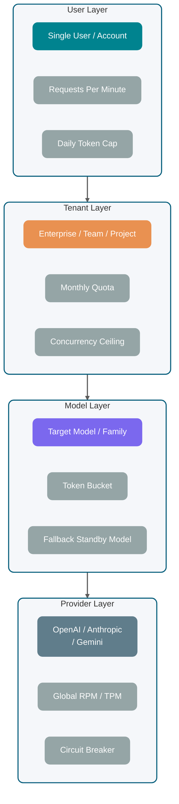
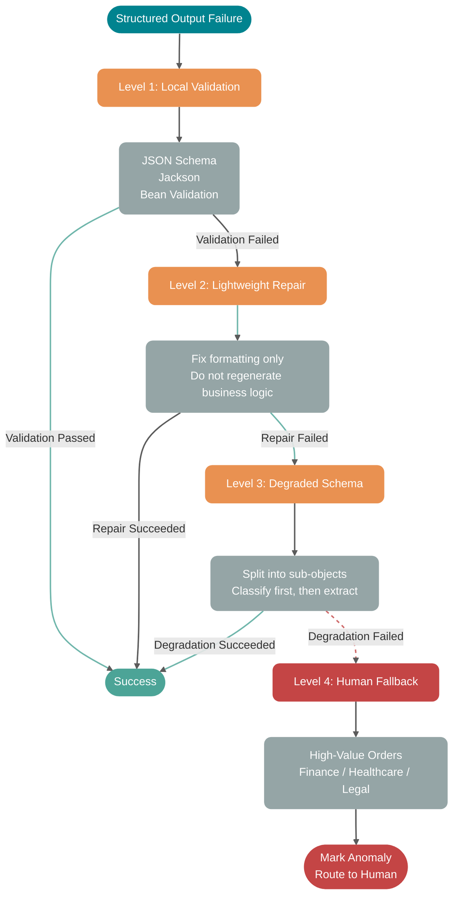

Getting an LLM API call to work locally only demonstrates that the network and parameters are basically operational. Once integrated into a real business workflow, you must deal with Time To First Token (TTFT), truncated JSON, 429 Too Many Requests, cancellations, and duplicate executions:

- A user waits 8 seconds without seeing a single word, assumes the system is frozen, and refreshes the page immediately.
- The model returns only half of a JSON object; the frontend fails to parse it, and the backend logs contain only a truncated fragment like `{"answer": "The root cause is`.
- The provider occasionally returns 429; your service begins retrying aggressively, and the more it retries, the worse it gets throttled.
- The user clicks cancel and the browser disconnects, yet the backend continues burning tokens.
- The exact same business request executes twice due to retries, duplicating database writes, billings, and notification dispatches.

Sending an HTTP request is only a small slice of the overall invocation pipeline. The business entry point, prompt assembly, model routing, streaming response handling, state persistence, and observability must all be designed cohesively—particularly around cancellations, retries, quotas, and partial outputs.

This article assumes you understand basic concepts such as tokens, context window, temperature, and top-p. If you have questions about these fundamentals, we recommend reading [LLM Operating Mechanism: How Tokens, Context Windows, and Sampling Parameters Affect Output](./llm-operation-mechanism.md) and [Prompt Engineering for Large Language Models: What Is Prompt Engineering and Prompting Techniques?](../agent/prompt-engineering.md).

Note: Capabilities and parameters of providers like OpenAI, Anthropic, and Gemini change rapidly. Production systems should manage these dynamically via consoles, response headers, or configuration centers rather than hardcoding static numbers from documentation.

## What Stages Are Included in a Production-Grade LLM Invocation?

Looking solely at what the provider returns makes it difficult to diagnose issues in LLM calls. A request traverses the business system, context system, model gateway, external provider, and frontend presentation layer. A lack of state tracking or error handling in any single segment can ultimately manifest as "model instability."


Deconstructed into detail, a typical production request includes 8 stages:

1. **Business Request Entry**: Validate user identity, tenant, subscription tier, feature permissions, and request payload size.
2. **Context Assembly**: Assemble the System Prompt, user input, chat history, RAG retrieved context, tool schemas, and output format constraints.
3. **Token Budget Estimation**: Estimate input tokens, reserve output tokens, and decide whether to truncate history, compress context, or switch to a smaller model.
4. **Model Gateway Routing**: Select the appropriate model, provider, region, timeout parameters, retry policy, and rate-limiting bucket.
5. **Provider API Invocation**: Synchronous or streaming responses, transported via SSE, WebSocket, or standard HTTP response bodies.
6. **Response Parsing**: Handle deltas, finish reasons, tool calls, token usage, refusals, structured JSON validation, and abnormal interruptions.
7. **State Persistence**: Persist the complete answer, incremental chunks, token usage, invocation costs, failure reasons, and business lifecycle states.
8. **Observability and Alerting**: Record `traceId`, `providerRequestId`, TTFT, end-to-end latency, retry counts, 429 occurrences, and parse failure rates.

Model invocations are best consolidated into a unified `LLMGateway` or shared client layer that centrally manages API keys, timeouts, retries, rate limits, logging, and provider failover. Otherwise, each business module will invent slightly different failure semantics, making production troubleshooting exceptionally difficult.


## What Is the Difference Between Synchronous and Streaming Responses?

Synchronous calls require the model to complete generating the entire content before returning the full result in one payload. Streaming responses, on the other hand, return chunks as they are generated: each time the model produces a text segment or event, the provider pushes the delta to the client over a persistent connection. OpenAI official documentation describes HTTP streaming in the context of SSE; the Anthropic Messages API similarly supports returning incremental events via SSE; the Gemini API likewise provides standard, streaming, and real-time interfaces. Specific fields and model capabilities evolve over time, **so always refer to the latest official documentation**.

**Why Does Streaming Reduce TTFT?**

TTFT (Time To First Token) measures the time elapsed from dispatching the request to receiving the first renderable token. In a synchronous response, the user must wait until the model finishes the entire answer. For example, if the model needs to generate 800 tokens, the backend must wait until all 800 tokens are generated before returning anything. With streaming responses, the client only waits until the first chunk arrives, allowing the user to see content emerge progressively.

Streaming does not reduce the number of tokens the model must compute, nor does it inherently save money. It shortens the initial wait time for the user; it does not necessarily shorten the total generation duration.

| Comparison Aspect | Synchronous Response | Streaming Response |
| :--- | :--- | :--- |
| **Initial Latency (TTFT)** | High; must wait for the complete output | Low; renderable upon receiving the first chunk |
| **End-to-End Latency** | Depends on the full generation time | Generally still depends on the full generation time |
| **Frontend Experience** | Like waiting after a form submission | Like a typewriter effect in chat applications |
| **Backend Implementation** | Simple; process the complete string directly | Complex; must handle deltas, cancellations, interruptions |
| **Structured Parsing** | Simple; parse the complete JSON string at once | Requires buffering the full content or using an incremental parser |
| **Suitable Scenarios** | Short text, background jobs, strict ACID transactions | Chat, copywriting, report generation, long answers |
| **Unsuitable Scenarios** | Long interactive user-facing responses | Strict transactional pipelines requiring upfront all-or-nothing validation |

Long-form user-facing content should generally prioritize streaming responses. Background batch processing and tasks that require validating a complete object before committing are better suited for synchronous calls.

## How to Choose Between SSE, WebSocket, and HTTP Chunked

Streaming output has several common delivery protocols; do not conflate them into one mechanism.

| Protocol | Core Characteristics | Suitable Scenarios | Boundaries / Limitations |
| :--- | :--- | :--- | :--- |
| **SSE** | Native browser `EventSource`, unidirectional server-to-client push, media type `text/event-stream` | Text chat, incremental model output, status notifications | Unidirectional; complex bidirectional control requires separate HTTP requests |
| **WebSocket** | Full-duplex persistent connection; both client and server can send messages at any time | Real-time voice agents, multi-user collaboration, frequent interruptions | Higher connection management overhead; gateways, auth, and heartbeats must be self-managed |
| **HTTP chunked** | HTTP/1.1 chunked transfer encoding; response body sent in pieces | Backend-to-backend streaming proxies, low-level transport | A transport mechanism, not an application-level event protocol; HTTP/2+ has native streaming framing |


The primary advantage of SSE is simplicity. A browser requires only a few lines of code to consume events, and the server simply writes chunks prefixed with `data:`. MDN's documentation for `EventSource` highlights its distinction from WebSocket: SSE is a unidirectional data stream from server to client.

WebSocket is better suited for real-time, complex bidirectional interactions. For instance, in a voice agent, the client continuously streams audio upstream while the server concurrently streams ASR, LLM, and TTS status downstream, all while needing to support mid-stream user barge-in (interruption). In this scenario, WebSocket is much more natural.

HTTP chunked is a lower-level transport mechanism. Many server-side frameworks use chunked responses when `Content-Length` is absent. It enables "streaming writes," but it does not define event types, reconnection semantics, or message framing for your application. The business layer must still establish its own protocol.

### Event Boundaries in the SSE Protocol

SSE is typically transported over an HTTP response with the media type `text/event-stream`. The message format is a UTF-8 text event stream. Each event consists of several field lines, and events are separated by a **blank line** (`\n\n` or `\r\n\r\n`).

Common fields include:

| Field | Purpose |
| :--- | :--- |
| `data` | The business payload. Multiple consecutive `data:` lines are concatenated by the client per the specification. |
| `event` | Custom event name. The browser's default event type is `message`. |
| `id` | Event identifier. Used with browser reconnection semantics to resume from a checkpoint. |
| `retry` | Recommended reconnection delay in milliseconds. |

**The blank line is the true event delimiter**. A single newline merely ends the current field line; it does not terminate the event. When handwriting `data:` streams on the server without prefixing every line of the body with `data:`, the client may drop subsequent lines. Conversely, accidentally emitting a blank line will prematurely terminate the event. Markdown bullet lists and code fences with blank lines easily trigger these pitfalls.

In the knowledge base Q&A of the *SpringAI Intelligent Interview Platform + RAG Knowledge Base*, SSE is used: as the model generates tokens, the browser renders them in real time with a typewriter effect. While the pipeline is straightforward, none of these protocol nuances can be overlooked.

### Spring Boot + Spring AI Implementation of SSE

In Java, the common pattern is setting **`Content-Type: text/event-stream`** and pushing data via reactive streams. Spring provides `ServerSentEvent<T>`, preventing string concatenation bugs with `data:` and `\n\n`:

```java
@GetMapping(value = "/chat/stream", produces = MediaType.TEXT_EVENT_STREAM_VALUE)
public Flux<ServerSentEvent<String>> stream() {
    return Flux.interval(Duration.ofMillis(500))
        .map(seq -> ServerSentEvent.<String>builder()
            .id(Long.toString(seq))
            .event("token")
            .data("chunk-" + seq)
            .retry(Duration.ofSeconds(3))
            .build());
}
```

When integrating with large language models, the stream source is typically the streaming API exposed by an SDK or framework. In Spring AI, for example, invoking stream mode via `ChatClient` returns a `Flux<String>`, which can then be mapped to SSE events for the frontend:

```java
Flux<String> tokens = chatClient.prompt()
    .system(systemPrompt)
    .user(userPrompt)
    .stream()
    .content();
```

From an engineering perspective, keep in mind: WebMVC + `Flux` simply uses reactive types at the Controller boundary to stream SSE, but the underlying infrastructure is still a Servlet container. Thread pools, connection limits, and timeouts must be managed as "long-lived requests." Java 21 Virtual Threads significantly reduce the cost of having a platform thread sit idle waiting for I/O, which is especially valuable for generation pipelines that can run for tens of seconds.

### Handling Newlines in Model Content

When generating raw SSE text manually, every line of the payload must begin with the `data:` prefix, and only an empty line signals the end of the event. The browser concatenates multiple `data:` lines within the same event using newline characters.

When using Spring's `ServerSentEvent` and its default message encoders, do not manually replace `\n` in the text with the literal `\\n`. Doing so mutates the business payload and forces the frontend into an unescaping step that is prone to delimiter collisions. Simply hand the raw string to the encoder:

```java
.map(chunk -> ServerSentEvent.<String>builder()
    .event("token")
    .data(chunk)
    .build())
```

If your pipeline routes through custom gateways or non-SSE clients, you can wrap each incremental update in JSON—for example, `{"sequence":12,"delta":"Line 1\nLine 2"}`—and let the JSON serializer handle escaping. With either approach, thoroughly test LF, CRLF, empty lines, code blocks, and partial events caused by broken streams.

### Nginx and Gateway Streaming Configurations

If Nginx or another buffering reverse proxy sits in front of your service, `text/event-stream` chunks may be buffered until a full block is accumulated before being flushed downstream. This immediately destroys the low TTFT benefit, degrading the user experience back to synchronous behavior.

A minimal Nginx configuration is:

```nginx
location /api/ {
    proxy_pass http://backend;
    proxy_buffering off;
    proxy_cache off;
    proxy_read_timeout 300s;
    proxy_set_header Connection "";
    add_header Cache-Control no-cache;
}
```

Pair this with `proxy_read_timeout` (or its equivalent in your API gateway) to protect long generations; otherwise, intermediate proxies will abruptly drop the connection when silent read timeouts expire.

### Four Categories of Streaming Failure Scenarios

The completion states of a streaming pipeline require dedicated design. User cancellations, timeouts, broken streams, and reconnections must not be lumped into a single generic "failed" state.


**User Cancellation.**

When a user closes the page, clicks "Stop Generating," or switches chat sessions, cancellation must be triggered immediately. The backend must concurrently cancel:

- The active HTTP request to the model provider API.
- The stream parsing pipeline.
- Downstream tasks such as TTS, tool invocations, and database writes.
- Uncommitted incremental buffers.

Never just stop rendering on the frontend. If the frontend stops rendering while the provider request keeps executing, tokens and budget continue to be consumed.

**Timeouts.**

Timeouts should be segregated into at least three tiers:

- **Connection Timeout**: Inability to establish a connection with the provider.
- **TTFT Timeout**: Connection established, but no initial event is received within the deadline.
- **Total Duration Timeout**: Content is streaming continuously, but the overall runtime exceeds the acceptable business SLA.

These three timeouts must be recorded separately. A TTFT timeout typically indicates provider queuing, an overly long prompt context, or provider network jitter. A total duration timeout, on the other hand, often means the user requested an excessively verbose generation.

**Stream Interruption.**

When a stream drops unexpectedly, never treat partial content as a successful response. The correct practice is to record the `finish_reason` or the last received event status. If a normal termination signal is absent, mark the call as `INTERRUPTED`. The frontend should display "Generation interrupted, click to regenerate" rather than quietly saving an incomplete draft as the final answer.

**Reconnections.**

SSE's `EventSource` supports automatic reconnection, but LLM output is not a generic news ticker. Whether a reconnecting client can resume from where it left off depends on whether your backend caches event sequence numbers, chunk deltas, and provider invocation state. In most cases, the provider-side stream has already terminated, making token-level resumption impossible.

A more resilient architecture is:

- The server generates a unique `messageId` and monotonic `sequence` for each streaming response.
- Emitted chunks are saved to a short-term cache (e.g., Redis).
- Upon client reconnection, the server re-emits cached chunks first.
- If the provider stream has expired or failed, prompt the user to regenerate rather than pretending seamless continuation.

## Which Errors Can Be Retried, and Which Cannot?

Retrying is a familiar capability for backend engineers, but it is also the easiest to abuse.

Retries with Large Language Model APIs introduce two unique engineering realities:

1. **Requests Are Expensive**: Failed requests may still consume quota or partial tokens.
2. **Outputs Are Non-Deterministic**: Even with the exact same prompt, the second response may differ noticeably from the first.


### Error Type Decision Matrix

| Category | Examples | Recommended to Retry? | Handling Strategy |
| :--- | :--- | :--- | :--- |
| **Transient Network Errors** | Connection reset, DNS jitter, read timeout | Yes | Exponential backoff with jitter; enforce maximum retry attempts. |
| **Provider 5xx Errors** | 500, 502, 503, 504 | Yes | Short retries; fail over to alternative models or degrade if threshold exceeded. |
| **Provider Overloaded** | Anthropic 529, similar overloaded errors | Yes | Slow retries; trip circuit breakers for that provider if sustained. |
| **429 Rate Limiting** | Exceeded RPM, TPM, RPD, or concurrency limits | Caution | Inspect `Retry-After` and rate-limit headers; queue or degrade. |
| **Stream Interruption** | Connection closed without a clean finish event | Scenario-dependent | Do not auto-retry user-facing interactive tasks; background batch tasks can retry idempotently. |
| **400 Bad Request** | Invalid Schema, missing fields, context length exceeded | No | Fix the request payload; never retry the exact same invalid payload. |
| **401/403 Authentication** | Invalid API Key, insufficient permissions | No | Alert on-call and disable the compromised/invalid key immediately. |
| **Safety Refusal** | Content moderation policy violations | No | Route to business refusal workflow; do not retry. |
| **JSON Parse Failures** | Incomplete JSON, incorrect field types | Limited Retry | Re-prompt with the error explanation to fix format; limit to 1–2 attempts. |

OpenAI official rate limiting guides advise using randomized exponential backoff for rate limit errors and remind developers that failed requests still count against per-minute limits. Anthropic error documentation explicitly categorizes errors such as 429 rate limit, 500 api error, 504 timeout, and 529 overloaded. When integrating other providers, you must similarly distinguish retryable, non-retryable, and overloaded states based on their specific error codes.

### Exponential Backoff and Jitter

Exponential backoff increases the wait duration as the failure count grows, up to a maximum delay or retry limit. Jitter injects a randomized delta into the wait time, preventing synchronized retries (thundering herd) that knock a recovering service right back into rate limiting.

A practical formula:

```text
sleep = min(maxDelay, baseDelay * 2^retryCount) + random(0, jitter)
```

In production, never forget two hard guardrails:

- **Maximum Retries**: 2–3 attempts are usually sufficient; never retry indefinitely.
- **Overall Deadline**: User requests operate under an end-to-end SLA (e.g., 15 seconds). Once reached, fail immediately rather than stretching the user wait to a minute through retries.

### Idempotency Keys and Deduplication Mechanisms

Whenever retries exist, idempotency is mandatory.

An idempotency key can be derived from business dimensions:

```text
tenantId:userId:conversationId:messageId:attemptGroup
```

Upon receiving a request, the server first queries whether the key exists:

- If already completed, immediately return the historical result.
- If currently generating, return the subscription handle for the existing streaming task.
- If failed and eligible for retry, create a new attempt associated with the same business message.
- If failed and non-retryable, return the error reason directly.

This prevents two common production pitfalls:

1. A user aggressively clicks "Resend," causing the backend to spawn multiple concurrent LLM calls.
2. A gateway times out and auto-retries, while the first attempt actually succeeded in writing to the database, resulting in duplicate response records.

### Handling Duplicate Responses

Retried responses may result in duplicate, conflicting, or overlapping outputs.

For chat applications, it is recommended to clearly delineate multiple model invocations under a single user message:

- `message_id`: The business message identifier, visible to the user.
- `attempt_id`: The model invocation attempt identifier, visible to the system.
- `provider_request_id`: The provider request identifier, used for auditing and debugging.
- `stream_sequence`: Incremental chunk sequence number, used for deduplication and retransmission.

When persisting records, only one attempt may be marked as `final`. Other attempts are preserved as diagnostic logs and excluded from downstream user context. This preserves full observability without polluting future prompt rounds.

## Why Rate Limiting? How to Implement It?

For many engineering teams, awareness of rate limiting begins with receiving their first 429 error.

Starting rate-limiting design only after hitting a provider's 429 indicates that the system lacks its own internal capacity planning. A 429 should serve only as an external protection signal, not a substitute for client-side budgeting, queuing, and concurrency controls.

### Four-Layer Rate Limiting Architecture

| Layer | Target Entity | Core Objective | Common Strategies |
| :--- | :--- | :--- | :--- |
| **User Layer** | Individual user or account | Prevent abuse, misclicks, and scraping scripts | Requests per minute (RPM), daily token caps |
| **Tenant Layer** | Enterprise, team, or project | Enforce plan quotas, cost controls, and fairness | Monthly quotas, concurrency limits, priority queues |
| **Model Layer** | Specific model or model family | Prevent overwhelming high-demand models | Per-model token buckets, degradation to fallback models |
| **Provider Layer** | OpenAI, Anthropic, Gemini, etc. | Protect shared upstream dependencies and API keys | Global RPM, TPM, concurrency limits, circuit breakers |



Gemini official documentation segments rate limits into RPM, input TPM, and RPD, noting that limits apply per project rather than per individual API key. OpenAI official documentation similarly illustrates rate limit headers covering request counts, token counts, and remaining allowance. Because these thresholds fluctuate rapidly, production systems must never hardcode static numbers from documentation, but should configure them dynamically via dashboards, response headers, or configuration systems.

### Why Token Budgets Outweigh Request Counts

Traditional API rate limiting relies primarily on QPS (Queries Per Second). For LLM APIs, QPS alone is insufficient.

The cost disparity between two requests can be astronomical:

- Request A: 500 input tokens, 100 output tokens.
- Request B: 80K input tokens, 8K output tokens.

Both are counted as a single HTTP request, yet the stress exerted on model inference, provider quotas, and billing is completely different.

Consequently, rate limiting must evaluate multiple dimensions simultaneously:

- **RPM**: Requests per minute.
- **TPM**: Tokens per minute.
- **Concurrency**: Active concurrent generation requests.
- **Context Size**: Input tokens per single request.
- **Max Output**: `max_tokens` or equivalent parameters.
- **Daily / Monthly Budget**: Total cost per tenant or user.

Budgets must be deducted before requests are dispatched to the provider.

When a request enters the gateway, estimate `input_tokens + reserved_output_tokens` first, and attempt reservations against the user, tenant, model, and provider buckets. If the budget reservation fails, do not forward the request to the provider; queue, degrade, or reject it immediately.

### Comparison of Common Rate Limiting Strategies

| Strategy | Suitable Scenarios | Advantages | Disadvantages |
| :--- | :--- | :--- | :--- |
| **Fixed Window** | Simple background tasks, internal admin APIs | Easy to implement and record | Burst spikes at window boundaries |
| **Sliding Window** | User-level request throttling | Smoother boundary enforcement | Higher implementation and storage overhead |
| **Token Bucket** | Model invocations, token budgets | Accommodates bursts; industry standard | Requires parameter tuning |
| **Leaky Bucket** | Strictly smoothed outbound traffic | Constant outflow rate; shields upstream | Poor tolerance for burst traffic |
| **Concurrency Semaphore** | Streaming generation, long-running jobs | Directly bounds active connection resource usage | Does not regulate individual request token costs |
| **Priority Queue** | Multi-tenant, tiered subscriptions | Protects high-priority VIP requests | Must handle starvation and timeouts |

Production systems commonly combine these strategies:

- User Layer: Sliding window + daily token cap.
- Tenant Layer: Token bucket + monthly budget.
- Model Layer: Token bucket + concurrency semaphore.
- Provider Layer: Global token bucket + circuit breaker.
- Streaming Requests: Concurrency semaphore + total duration ceiling.

For an in-depth guide on rate-limiting algorithms, refer to: [Detailed Explanation of Service Rate Limiting](https://javaguide.cn/high-availability/limit-request.html).

### How to Handle Receiving a 429 Error

HTTP 429 indicates rate limiting. When your backend encounters a 429, follow this recommended sequence:

1. **Inspect `Retry-After` or Provider Rate Limit Headers**: Honor the exact recovery time if provided.
2. **Identify the Throttled Dimension**: Determine whether you hit the request count limit, token throughput ceiling, or daily quota exhaustion.
3. **Queue Short / Asynchronous Requests**: For example, background summarization jobs can be routed to a delayed retry queue.
4. **Minimize Retries on User-Facing Interactive Requests**: When users cannot wait, display a "Service busy, please try again later" notice or switch immediately to a lightweight model.
5. **Trip Circuit Breakers on Sustained 429s**: Prevent requests from continually battering an exhausted provider.

A typical degradation cascade:

```text
Preferred model available -> Normal invocation
Preferred model returns 429 -> Fallback to equivalent peer model
Peer model also throttled -> Fallback to lightweight model with truncated max_tokens
Still unavailable -> Queue request or return "System is currently busy"
```

Avoid a common misconception: degradation does not mean silently delivering poor quality. If switching to a lightweight model degrades answer quality, state it explicitly in the UI—for example, "Running in fast mode; for complex analysis, please retry shortly."

## Why Use Structured Outputs?

Many projects initially write prompts like this:

```text
Please analyze the user's question and output JSON with the fields intent, confidence, and answer.
```

The backend then simply calls `JSON.parse()`.

While this works in early demos, production environments encounter numerous edge cases:

- The model prefixes the JSON with conversational fluff: "Sure! Here is the JSON result:".
- Required fields are missing.
- Enum values are hallucinated.
- Numbers are returned as strings.
- Only half of the JSON object arrives due to stream truncation.
- Safety refusals return plain text that violates the expected schema entirely.

Structured outputs ensure that program code can deterministically consume model output, rather than relying on outputs merely "looking like JSON."

### Differences Between JSON Mode, JSON Schema, and Structured Outputs

| Approach | Constraint Strength | Engineering Value | Risks |
| :--- | :--- | :--- | :--- |
| **Plain Natural Language** | Virtually none | Good for display answers | Unsuitable for programmatic parsing |
| **Prompt Requesting JSON** | Weak | Simple, cross-model portability | Often includes preamble text or drops fields |
| **JSON Mode** | Medium | Guarantees valid JSON syntax | Does not guarantee compliance with business schema |
| **JSON Schema** | Strong | Explicitly defines fields, types, required keys, and enums | Subsets supported differ across providers |
| **Structured Outputs** | Strongest | Provider enforces schema at the decoding / SDK level | Constrained by model, SDK, and schema subset limits |
| **Function Calling / Tool Use** | Action-oriented | Ideal for letting models select tools and arguments | Not a silver bullet for final natural-language answers |


OpenAI official Structured Outputs documentation emphasizes that outputs strictly conform to developer-supplied JSON Schemas, providing a `strict: true` flag. Gemini official guides note that structured outputs use `response_format` and JSON Schema, supporting a specific subset of the JSON Schema standard. Anthropic documentation provides Structured Outputs alongside Strict Tool Use, noting that the two solve related but distinct problems. Because specific models, parameters, and supported schema subsets evolve, always refer to the latest official documentation.

### Engineering Disparity Between Plain JSON and Structured Outputs

Plain natural language responses are like "notes written by humans for humans to read," while structured outputs are like "typed API interfaces written by services for services to consume."

Consider an intent classification scenario:

```json
{
  "intent": "refund_request",
  "confidence": 0.86,
  "entities": {
    "order_id": "202605080001",
    "reason": "Damaged goods"
  },
  "need_human_review": false
}
```

With an enforced Schema, the backend can guarantee:

- `intent` is strictly constrained to a finite enum.
- `confidence` is guaranteed to be a float.
- `order_id` may be null, but its type is consistently a string.
- `need_human_review` is guaranteed to be present as a boolean.
- Parse failures can trigger programmatic repair or human fallback.

Schema elevates LLM-generated JSON into a strictly validated data contract.

### Fallback Strategies for Structured Output Failures

Structured outputs can still fail. Failures are not necessarily provider bugs; they may stem from overly complex schemas, prompt conflicts, output token truncation, or safety refusals.

We recommend a four-tiered fallback mechanism:

1. **Local Validation**: Validate fields and types using JSON Schema validators, Jackson, or Bean Validation.
2. **Lightweight Repair**: Prompt the model specifically to fix formatting errors without regenerating the underlying business content.
3. **Degraded Schema**: Split complex objects into smaller sub-objects, or perform classification first before extracting fields.
4. **Human or Rule-Based Fallback**: For high-value transactions, finance, healthcare, and legal domains, never rely solely on automated repair.



A cardinal rule: when structured output parsing fails, never feed raw natural language strings directly into downstream transactional systems. Just because text can be displayed to a user does not mean it can be safely executed by code.

## How to Implement LLM Invocations in Java Backends

The following Java pseudo-code is agnostic of any specific provider SDK. Token budgeting, rate limiting, retries, streaming parsing, idempotency, and observability are all encapsulated within a single gateway:

```java
public interface LLMClient {
    LLMResponse chat(LLMRequest request);

    void stream(LLMRequest request, StreamHandler handler);
}

public interface StreamHandler {
    void onStart(String messageId);

    void onDelta(String messageId, long sequence, String delta);

    void onComplete(String messageId, LLMUsage usage);

    void onError(String messageId, Throwable error);
}

public final class LLMGateway {
    private final LLMClient client;
    private final RateLimiter rateLimiter;
    private final IdempotencyStore idempotencyStore;
    private final TokenEstimator tokenEstimator;
    private final Observation observation;

    public LLMGateway(
            LLMClient client,
            RateLimiter rateLimiter,
            IdempotencyStore idempotencyStore,
            TokenEstimator tokenEstimator,
            Observation observation) {
        this.client = client;
        this.rateLimiter = rateLimiter;
        this.idempotencyStore = idempotencyStore;
        this.tokenEstimator = tokenEstimator;
        this.observation = observation;
    }

    public LLMResponse chatWithRetry(BusinessCommand command) {
        String idemKey = command.idempotencyKey();
        LLMRequest request = buildRequest(command);
        String requestFingerprint = command.requestFingerprint();
        IdempotencyClaim claim = idempotencyStore.claim(idemKey, requestFingerprint);

        if (claim.isCompleted()) {
            return claim.toResponse();
        }
        if (!claim.isOwner()) {
            throw new LLMException("Request with the same idempotency key is already running");
        }

        TokenBudget budget = tokenEstimator.estimate(request);
        try {
            rateLimiter.acquire(command.tenantId(), request.model(), budget);
        } catch (RuntimeException ex) {
            idempotencyStore.releaseClaim(idemKey, requestFingerprint);
            throw ex;
        }

        RetryPolicy retryPolicy = RetryPolicy.defaultPolicy();
        Throwable lastError = null;

        for (int attempt = 0; attempt <= retryPolicy.maxRetries(); attempt++) {
            String attemptId = idemKey + ":attempt:" + attempt;
            long startNanos = System.nanoTime();

            try {
                idempotencyStore.startAttempt(idemKey, requestFingerprint, attemptId);
                LLMResponse response = client.chat(request.withAttemptId(attemptId));

                ParsedAnswer parsed = parseAndValidate(response.content(), command.schema());
                idempotencyStore.markSuccess(idemKey, attemptId, response, parsed);
                observation.recordSuccess(request, response.usage(), startNanos, attempt);
                return response;
            } catch (LLMException ex) {
                lastError = ex;
                observation.recordFailure(request, ex, startNanos, attempt);

                if (!retryPolicy.canRetry(ex, attempt)) {
                    idempotencyStore.markFailed(idemKey, attemptId, ex);
                    throw ex;
                }

                sleep(retryPolicy.nextDelay(ex, attempt));
            }
        }

        throw new LLMException("LLM request failed after retries", lastError);
    }

    public void stream(BusinessCommand command, StreamHandler downstream) {
        String idemKey = command.idempotencyKey();
        LLMRequest request = buildRequest(command).enableStream();
        String messageId = command.messageId();
        String requestFingerprint = command.requestFingerprint();
        IdempotencyClaim claim = idempotencyStore.claim(idemKey, requestFingerprint);
        if (!claim.isOwner()) {
            downstream.onError(messageId,
                    new LLMException("Duplicate or conflicting idempotency key"));
            return;
        }

        TokenBudget budget = tokenEstimator.estimate(request);
        try {
            rateLimiter.acquire(command.tenantId(), request.model(), budget);
        } catch (RuntimeException ex) {
            idempotencyStore.releaseClaim(idemKey, requestFingerprint);
            downstream.onError(messageId, ex);
            return;
        }

        StreamBuffer buffer = new StreamBuffer(messageId);
        idempotencyStore.startAttempt(idemKey, requestFingerprint, messageId);

        client.stream(request, new StreamHandler() {
            @Override
            public void onStart(String ignored) {
                downstream.onStart(messageId);
            }

            @Override
            public void onDelta(String ignored, long sequence, String delta) {
                if (buffer.seen(sequence)) {
                    return;
                }
                buffer.append(sequence, delta);
                idempotencyStore.appendDelta(messageId, sequence, delta);
                downstream.onDelta(messageId, sequence, delta);
            }

            @Override
            public void onComplete(String ignored, LLMUsage usage) {
                String fullText = buffer.fullText();
                try {
                    ParsedAnswer parsed = parseAndValidate(fullText, command.schema());
                    idempotencyStore.markSuccess(idemKey, messageId, fullText, parsed, usage);
                } catch (Exception ex) {
                    idempotencyStore.markFailed(idemKey, messageId, ex);
                    downstream.onError(messageId, ex);
                    return;
                }
                downstream.onComplete(messageId, usage);
            }

            @Override
            public void onError(String ignored, Throwable error) {
                idempotencyStore.markInterrupted(idemKey, messageId, buffer.fullText(), error);
                downstream.onError(messageId, error);
            }
        });
    }

    private LLMRequest buildRequest(BusinessCommand command) {
        return LLMRequest.builder()
                .model(command.model())
                .systemPrompt(command.systemPrompt())
                .userPrompt(command.userPrompt())
                .context(command.context())
                .responseSchema(command.schema())
                .timeout(command.timeout())
                .metadata("tenantId", command.tenantId())
                .metadata("messageId", command.messageId())
                .build();
    }

    private ParsedAnswer parseAndValidate(String content, JsonSchema schema) {
        try {
            return ParsedAnswer.fromJson(content, schema);
        } catch (Exception ex) {
            throw new NonRetryableLLMException("Structured output validation failed", ex);
        }
    }

    private void sleep(Duration duration) {
        try {
            Thread.sleep(duration.toMillis());
        } catch (InterruptedException ex) {
            Thread.currentThread().interrupt();
            throw new LLMException("Retry sleep interrupted", ex);
        }
    }
}
```

This code abstracts away database storage and concurrency primitives. The `claim` call must map to Redis `SET NX`, database unique constraints, or conditional atomic updates—never a naive "query-then-insert" sequence. Idempotency keys must also bind to request fingerprints; identical keys with differing payloads should yield conflict exceptions rather than stale cached results.

Key architectural takeaways:

- **Business controllers never call provider SDKs directly**; everything flows through `LLMGateway`.
- **Estimate tokens and deduct from rate-limiting buckets first**, preventing unbudgeted requests from reaching providers.
- **Idempotency claims encompass the entire business message**, while attempts represent internal system retries.
- **Segregate synchronous and streaming paths**; streaming requires monotonic `sequence` tracking to prevent duplicate deltas during reconnection retransmissions.
- **Validate structured outputs before persisting**, routing failures into an explicit error lifecycle rather than corrupting business state.

In production environments, you will also need:

- API key pooling and provider routing.
- Model priority tiers and automatic failover policies.
- Prompt template versioning.
- Outbound and inbound content safety moderation.
- Usage cost calculation.
- Correlating internal `traceId` with provider-returned `providerRequestId`.
- Propagating downstream streaming cancellation signals to the active upstream HTTP client.
- SSE egress contracts: ensure newline and event framing align with frontend expectations, while turning off reverse proxy buffering and extending read timeouts.

## Without Metrics, There Is No Stability

Observability for AI applications cannot stop at recording simple "invocation succeeded / failed" flags.

At a minimum, monitor these metrics:

| Metric | Meaning | Purpose |
| :--- | :--- | :--- |
| **TTFT** | Time To First Token | Detect provider queuing, prompt bloat, or upstream network jitter |
| **E2E Latency** | End-to-end completion latency | Evaluate user experience and SLA compliance |
| **Input Tokens** | Number of input prompt tokens | Cost accounting, diagnosing prompt context inflation |
| **Output Tokens** | Number of generated completion tokens | Cost accounting, identifying runaway long outputs |
| **Retry Count** | Number of retries triggered | Identify provider instability or overly aggressive retry policies |
| **429 Rate** | Proportion of rate-limited requests | Assess if quotas and token bucket sizes are configured properly |
| **Parse Failure Rate** | Proportion of structured parsing failures | Identify schema ambiguities, prompt bugs, or model mismatches |
| **Cancel Rate** | Proportion of user-initiated cancellations | Detect slow responses or excessive verbosity |
| **Provider Error Rate** | Error rate per external provider | Guide routing, degradation, and circuit-breaking decisions |

Recommended fields for structured log entries:

```text
trace_id
tenant_id
user_id
conversation_id
message_id
attempt_id
model
provider
prompt_version
input_tokens
output_tokens
ttft_ms
latency_ms
retry_count
finish_reason
error_type
provider_request_id
```

Without these fields, production troubleshooting becomes an exercise in frustration. When a user reports "the AI didn't respond," you will have no way of knowing which provider, model, or attempt failed, or whether the first delta ever arrived.

## Interview Questions

### 1. What is the complete end-to-end pipeline of an LLM API invocation?

An invocation begins when a business request enters the system, undergoing user authentication, tenant authorization, permission verification, and payload validation. Next, the system compiles the System Prompt, user input, conversation history, RAG retrieved context, tool definitions, and output schemas. The gateway then estimates the token budget, performs routing, enforces rate limits and timeouts, selects retry policies, and picks an upstream provider. Once the provider returns synchronous data or streaming events, the backend parses deltas, validates structured outputs, commits state, and records usage. Finally, TTFT, end-to-end latency, error codes, retry counts, and token costs are dispatched to the observability system.

Thus, an LLM call must be managed as a comprehensive production pipeline rather than treated as a simple HTTP request.

### 2. Why does streaming improve user experience?

Streaming allows the model to return chunks as they are generated, letting users see the first token significantly earlier and thereby reducing TTFT. It does not guarantee a shorter overall generation time, nor does it inherently reduce token consumption. The backend must handle additional engineering challenges: cancellations, timeouts, broken connections, reconnections, incomplete JSON objects, and incremental persistence.

### 3. How do you choose between SSE and WebSocket?

If the requirement is simply for the server to stream text to the browser, SSE is simpler and naturally suited for unidirectional incremental output. In production, remember that **`text/event-stream` is sensitive to newlines and event delimiters**, and reverse proxy buffering will turn streaming back into batch responses. If the client must also stream high-frequency data to the server—such as real-time audio, bidirectional control, multi-user collaboration, or speech barge-in—WebSocket is the better choice. HTTP chunked transfer is a lower-level transport mechanism; application layers must still define their own message framing and event semantics.

### 4. Which LLM API errors are eligible for retries?

Transient network failures, connection resets, certain 5xx errors (500, 502, 503, 504), and provider overloaded errors (such as Anthropic 529) are generally eligible for limited retries. 429 rate limits should be handled cautiously using `Retry-After` headers, queueing, or model degradation. 400 parameter errors, 401/403 authentication failures, and content moderation safety refusals must never be retried. When structured parsing fails, attempt 1–2 lightweight format repairs, but avoid infinite retry loops.

### 5. Which LLM invocations require idempotency guarantees?

Pure text generation does not always require strict business idempotency, though retrying still incurs extra costs and can spawn orphaned candidate responses. However, whenever database writes, billing deductions, notifications, or tool write operations are involved, the system must guarantee that a business request is never executed multiple times. You can generate an idempotency key from business message IDs combined with request fingerprints. Multiple model invocation attempts are attached to the same business message, allowing only one attempt to be finalized.

### 6. Why can't rate limiting rely solely on QPS?

Because the operational cost and system pressure of LLM APIs are determined primarily by token volume. A 500-token request and an 80K-token request both count as a single HTTP request, but their resource consumption differs by orders of magnitude. Production rate limiting must simultaneously monitor RPM, TPM, active concurrency, context window size, maximum generation tokens, and tenant budgets.

### 7. What is the difference between JSON Mode and Structured Outputs?

JSON Mode only guarantees that the output syntax is valid JSON; it does not ensure adherence to your specific business schema. Structured Outputs (or JSON Schema enforcement) provide much stronger constraints, strictly mandating fields, data types, required properties, and enum values. Function Calling / Tool Use is tailored for having the model generate tool execution arguments. Because supported schema subsets vary across providers, always verify vendor documentation and build compatibility abstraction layers.

### 8. How should streaming structured outputs be handled?

Never attempt to run `JSON.parse()` on the full object upon receiving each individual delta. A more reliable strategy is: during the streaming phase, only stream text for display or buffer chunks in memory. Once a clean completion event is received, reconstruct the complete string and execute Schema validation. If the provider SDK provides a structured streaming accumulator, you can use the official utility; otherwise, manage your own buffer, monotonic sequence numbers, and completion lifecycle states.

## Pre-Production Checklist

Production readiness gates must cover at least four failure pathways:
1. Ensure client cancellation signals propagate all the way to the provider API.
2. Ensure retryable errors are bounded by overall request deadlines and atomic idempotency claims.
3. Ensure RPM, TPM, concurrency, and tenant budgets are enforced simultaneously.
4. Ensure structured output parse failures transition into explicit, actionable error states.

Observability logs must tie together `messageId`, `attemptId`, and `providerRequestId`, recording TTFT, total latency, token usage, finish reasons, and parse results. If any link in this chain is missing, diagnosing broken streams, duplicate executions, and billing anomalies becomes nearly impossible.

## References

- [OpenAI Streaming API responses](https://developers.openai.com/api/docs/guides/streaming-responses)
- [OpenAI Structured model outputs](https://developers.openai.com/api/docs/guides/structured-outputs)
- [OpenAI Rate limits](https://developers.openai.com/api/docs/guides/rate-limits)
- [Anthropic Streaming Messages](https://platform.claude.com/docs/en/build-with-claude/streaming)
- [Anthropic Errors](https://platform.claude.com/docs/en/api/errors)
- [Anthropic Structured outputs](https://platform.claude.com/docs/en/build-with-claude/structured-outputs)
- [Gemini Structured outputs](https://ai.google.dev/gemini-api/docs/structured-output)
- [Gemini Rate limits](https://ai.google.dev/gemini-api/docs/rate-limits)
- [MDN Using server-sent events](https://developer.mozilla.org/en-US/docs/Web/API/Server-sent_events/Using_server-sent_events)
- [MDN EventSource](https://developer.mozilla.org/en-US/docs/Web/API/EventSource)
- [Spring `ServerSentEvent` Javadoc](https://docs.spring.io/spring-framework/docs/current/javadoc-api/org/springframework/http/codec/ServerSentEvent.html)
- [MDN 429 Too Many Requests](https://developer.mozilla.org/en-US/docs/Web/HTTP/Reference/Status/429)
- [MDN Transfer-Encoding](https://developer.mozilla.org/en-US/docs/Web/HTTP/Reference/Headers/Transfer-Encoding)
