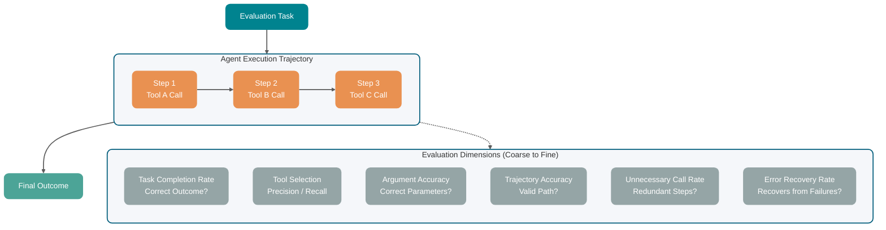
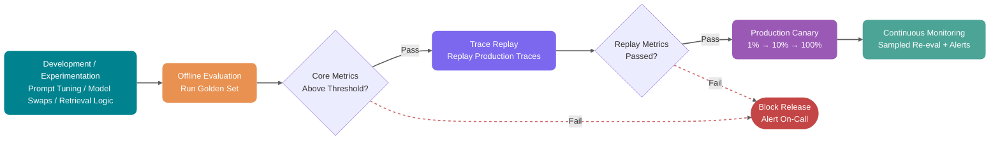

After upgrading a customer service RAG system with hybrid search and a reranker, the most common deployment heuristic is: test a few dozen questions locally, observe that the answers read more smoothly than the previous version, and conclude it is ready for production traffic.

When business stakeholders report a week into rollout that "some answers feel less accurate than before," troubleshooting immediately grinds to a halt.

At that point, you need to compare historical results across identical scenarios: what were the hit rates of the previous version on returns, logistics tracking, and product comparisons, and on which category did the new version regress? Without this baseline, "less accurate than before" could represent real regression or simply shifting user expectations; root-cause analysis is reduced to manually combing through individual raw conversations.

Model selection, prompt tuning, retrieval optimization, and canary rollouts lose a shared basis of comparison without structured evals. The purpose of an evaluation dataset is to place all these engineering changes under the exact same measuring stick.

Frameworks such as RAGAS, TruLens, LangSmith, and Langfuse continue to evolve; production implementations should refer to their respective latest official documentation. This article focuses on evaluation methodologies and metric designs, without benchmarking third-party tools or citing unverified figures.

## Why Are Public Benchmarks Insufficient?

Public benchmarks are useful for early-stage coarse filtering—disqualifying models with weak language capabilities, insufficient context windows, or inadequate tool-calling skills for your domain.

However, treating leaderboard scores as a green light for deployment overlooks domain-specific business realities.

Public benchmarks evaluate fixed tasks and static datasets; leaderboard rankings cannot substitute for domain-specific validation. An e-commerce support system frequently handles returns, delivery windows, promotional discounts, and technical specification comparisons; high marks on general English reasoning benchmarks provide no guarantee that a model will adhere to specific enterprise policies.

Real-world traffic also introduces typos, colloquialisms, screenshots, code-switching, and self-contradictory prompts. Pristine benchmark performance rarely reflects behavior on messy production inputs.

Pre-deployment checks must especially scrutinize zero-tolerance failure modes: overlooking high-risk clauses in contract review compromises legal signing; misguiding a customer on a refund process leads to incorrectly submitted claims; executing a destructive command in a coding agent damages repositories and runtime environments. Even if such failures account for a tiny percentage of cases, they are easily masked by high aggregate scores; generic benchmarks will not spotlight them.

Public leaderboards help eliminate unviable candidates. Whether a model can safely integrate into your production pipeline must be determined by your own proprietary evaluation suite.

## What Constitutes an Evaluation Test Case?

An evaluation test case must ground itself in a verifiable question: given an input, what should the system accomplish, and by what standard is success judged?

Single-turn Q&A scenarios are straightforward. The input is a user query, the output is the model's answer, and a grader evaluates whether it is accurate, complete, and relevant.

Agent scenarios are considerably more complex. An Agent may reason across multiple turns, invoke external tools, mutate external state, and leave behind an extensive execution transcript. Several core concepts recur throughout:

| Concept | Meaning | Example |
| :--- | :--- | :--- |
| **Task** | An evaluation unit containing an input and success criteria | "Fix the vulnerability allowing empty passwords to bypass login validation" |
| **Trial** | A single execution of a specific task | The same Agent executing the same task on its 3rd attempt |
| **Grader** | A scoring component evaluating output or execution process | Unit tests, JSON Schema validators, LLM-as-Judge, human review |
| **Transcript / Trace** | Complete record of an execution run | User inputs, model outputs, tool calls, parameters, returns, latencies |
| **Outcome** | Ground-truth state upon task termination | Unit tests passed, refund record created, database updated |
| **Eval Harness** | Engineering framework executing tasks, capturing traces, invoking graders, and aggregating results | Local scripts, evaluation platforms, Claude Code-driven eval pipelines |

When diagnosing failures, these concepts must be analyzed distinctly.

For example, if a customer service Agent replies "Your refund has been processed," that is merely the final response text in the Transcript. The critical metric to verify is the Outcome: was the refund record created in the database, has the status transitioned, and was the amount calculated correctly? Evaluating only the final text easily confuses "sounding successful" with "actual execution success."

Similarly, when a coding Agent finishes and passes unit tests, that does not mean its execution process was clean. It may have looped through trial-and-error a dozen times or inadvertently modified out-of-scope files. A detailed Trace ensures failed samples leave not just a score, but forensic evidence of tool selection, argument construction, context comprehension, and grader execution.

## How to Build a Golden Set?

A Golden Set is an AI application's authoritative reference test suite. It is not built by piling up raw volume; its value lies in every sample possessing an explicit input and a rigorous criterion for judging output quality.

This criterion does not have to be a single rigid answer string. It can be a reference answer, multi-axis scoring criteria, automated validation rules, or human adjudication guidelines. As long as subsequent evaluations execute against the exact same rubric, it provides lasting value.

### Where Does Evaluation Data Come From?

**Stratified Sampling from Production Logs.**

Once a system is live, production logs represent your most valuable data asset. When sampling, do not focus solely on high-frequency questions, as those have typically already been optimized by prompt tuning and product design. Low-frequency, edge, and anomalous inputs are far more effective at revealing systemic weaknesses.

Prioritize samples where users clicked "thumbs down," where follow-up clarifications were requested, where users escalated to human agents, and borderline interactions that "almost failed."

Sampling exclusively from smooth conversations results in a Golden Set that misses multimodal inputs, cross-intent shifts, and contradictory user statements. Subsequent releases might show improved pass rates, when in reality the test suite simply lacked challenging cases.

**Synthetic and Human-Constructed Test Cases.**

When launching a new feature before logs exist, or for high-stakes risks like refund authorization bypasses and prompt injections that rarely occur organically, gaps in the test set must be populated by human construction.

When drafting synthetic cases, avoid authoring only "happy path" questions. Your initial release suite should encompass at least three categories:
- Standard paths, such as "Can unopened goods be returned within 7 days?", with unambiguous answers to validate baseline logic.
- Underspecified inputs, such as "It's broken," missing order IDs, timestamps, and fault details, where the expected behavior is prompting for clarification.
- Adversarial inputs attempting to bypass refund rules or cajoling a coding Agent into executing unauthorized shell commands.

**Failure Case Backfilling.**

Whenever a customer complaint is triaged, evaluate whether the incident can be converted into a permanent regression case. By continuously backfilling confirmed failure samples, the Golden Set evolves alongside the model's actual vulnerabilities rather than remaining frozen in initial assumptions.

During cold starts, knowledge base documentation can serve as seeds to generate synthetic questions, reference answers, and hard negative cases. Following human sampling and verification, these can enter the candidate pool; tools like RAGAS can assist in synthetic generation.

However, synthetic samples only expand initial coverage; they should not serve as unvetted production deployment gates. Generated questions are often overly clean and formal; misspellings, colloquialisms, screenshot descriptions, and contradictory follow-ups must be backfilled from real logs and human reviews.

### How to Expand Coverage Without Exhaustive Enumeration?

Real-world requests and context permutations cannot be exhaustively enumerated. When expanding a test suite, start from verified tasks and perturb conditions known to influence outputs:

- **Input Perturbations**: Introduce typos, slang, colloquial shorthand, varied syntax, multilingual phrases, and omitted fields.
- **Context Perturbations**: Shift positions of irrelevant passages, inject outdated or conflicting facts, and vary conversation history depth.
- **Tool Perturbations**: Simulate timeouts, rate limits, empty responses, missing payload fields, partial failures, and modified API return structures.
- **State Perturbations**: Mutate user permissions, order statuses, leftover filesystem artifacts, cache hit states, and temporal constraints to test whether the Agent maintains rule adherence.

This methodology aligns with Metamorphic Testing: rather than authoring a unique expected output for every variant, assert the invariants that must hold true across input variations. For instance, injecting irrelevant background context should not alter the core conclusion; omitting an order ID must always trigger a clarifying follow-up; revoking user permissions must immediately halt write actions; asking the same request with synonymous phrasing must yield an identical outcome.

Crucially, partition a portion of expanded samples into a held-out evaluation set, shielded from prompt engineering, few-shot selection, and rule tuning. Otherwise, teams overfit to known test cases without discovering whether the system generalizes to novel prompts, unfamiliar contexts, and emergent failures.

### How Many Test Cases Are Sufficient?

There is no universal constant; establish a starting point calibrated to your project stage.

An initial suite of 20 to 50 authentic tasks is sufficient to validate your evaluation harness. This count serves as an operational pilot rather than a statistically significant sample; when establishing deployment gates, calculate sample sizes based on risk profile, baseline variance, and minimal detectable effect. Regardless of scale, the definition of "task completion" must be codified as repeatable automated checks.

An initial evaluation suite should incorporate real production failures, manual edge cases, and high-risk paths rather than waiting for an exhaustive dataset—a philosophy echoed in Anthropic's agent evaluation practices.

For production deployment gates, test sets must first cover all primary functional paths and high-risk scenarios. Then, evaluate baseline variance and acceptable error margins across stratified slices to derive necessary sample sizes; outside specific business contexts, figures like 50, 200, or 500 are arbitrary numbers that cannot serve as absolute benchmarks.

Sample distribution matters far more than raw volume. One hundred cases stratified across 10 distinct failure domains provide far greater signal than 200 variations of the same question.

In Agent environments, the number of Trials per task is equally vital. Passing a task once does not prove production stability. For support, payment, refund, and compliance workflows, repeat critical tasks across multiple runs to compare "at least one success" against "consecutive successes." The former measures capability ceiling; the latter reflects production reliability.

### Stratification Outweighs Raw Volume

| Stratum | Typical Content | Sampling Principle |
| :--- | :--- | :--- |
| **Happy Path** | High-frequency, well-defined core flows | Sample proportional to production traffic to cover baseline features |
| **Edge Scenarios** | Incomplete details, ambiguous queries, cross-domain asks | Upsample historical failures and easily confused inputs |
| **Adversarial Cases** | Specialized inputs designed to induce model errors | Design around attack surfaces and privilege risks; do not rely on organic traffic |
| **High-Severity Failures** | Business-critical failure modes | Maintain dedicated pass/fail gates; never dilute with average scores |

High-severity failure samples may be few in number, but they must be evaluated under isolated zero-tolerance gates. In compliance applications, missing a high-risk clause, or in healthcare, generating an incorrect dosage recommendation, warrants halting a release regardless of a 99% overall suite pass rate.

### Golden Sets Are Living Assets

As products iterate and user behaviors evolve, Golden Sets naturally become stale. Maintain them by tracking three operational rituals:
- **Coverage Audits**: Periodically review test cases against new features, deprecated policies, and expired business rules.
- **Failure Backfilling**: Triage newly discovered production failure patterns, verify them with human reviewers, and promote them into the Golden Set.
- **Version Tracking**: Co-version the Golden Set alongside model identifiers and prompt templates; failing to do so invalidates cross-version comparisons.

## Three Evaluation Methodologies

Once the Golden Set is assembled, you must decide who evaluates it. Human grading, rule-based checks, and LLM-as-Judge are not mutually exclusive; they form a coordinated division of labor.


| Methodology | Accuracy | Speed | Cost | Typical Graded Attributes | Typical Use Cases |
| :--- | :--- | :--- | :--- | :--- | :--- |
| **Human Evaluation** | High (depends on rubric clarity and consistency) | Slow | High | Nuanced semantic judgment, borderline arbitration, business risk assessment | Initial Golden Set annotation, high-risk final validation, LLM Judge calibration |
| **Rule-Based Evaluation** | High (within deterministic rule scope) | Fastest | Low | JSON syntax, field completeness, enums, numerical bounds, citation existence | Format validation, enum checks, reference checks, boundary enforcement |
| **LLM-as-Judge** | Moderate (subject to cognitive biases) | Fast | Moderate | Answer relevance, faithfulness, completeness, coherence, tone appropriateness | Semantic similarity, answer coherence, factual faithfulness, multi-axis scoring |

Deterministic defects—such as malformed syntax, missing enum values, or absent citations—should be intercepted immediately by rule-based graders. Open-ended semantic reasoning can then be graded by an LLM-as-Judge, while high-risk edge cases are reserved for human spot-checks to continuously calibrate the Judge.

Whenever acceptance criteria can be defined unambiguously, prefer binary pass/fail assertions evaluated one condition at a time—for example: "Was user authentication validated first?", "Does the cited document support this claim?", "Were out-of-scope files modified?". Binary outcomes integrate into CI/CD release gates far more cleanly than an ambiguous aggregate score like 82/100, and they simplify pinpointing root causes.

Continuous numerical scores are best reserved for subjective dimensions like coherence, fluency, and comprehensiveness, with each score bracket tied to concrete observable rubrics. High-risk failures must never be offset by high average scores: if a refund calculation is wrong, the task fails entirely, regardless of whether tone, completeness, and user empathy scored 5/5.

Production troubleshooting requires more than a single aggregate score. Every evaluated sample should capture:
- `pass/fail`: Whether the sample passed overall acceptance criteria.
- `score`: Numerical score for specific dimensions to facilitate version-over-version trend analysis.
- `reason`: A concise justification sentence to accelerate human auditing.
- `category`: Problem taxonomy—e.g., format error, factual hallucination, uninvoked tool, over-promising.
- `confidence`: The grader's self-reported certainty; low-confidence samples route to human review. (This signal must be calibrated against human annotations before use).

This structured schema allows engineers investigating badcases to filter by failure symptom immediately rather than reading every failure transcript from scratch.

ARES demonstrates an advanced approach: training lightweight, domain-specific Judges on synthetic data and applying Prediction-Powered Inference (PPI) alongside a small batch of human annotations to estimate tight confidence intervals for RAG quality. When eval volume is massive and the API cost of querying frontier models limits scale, this is an effective path. However, it still requires in-domain corpora, few-shot examples, and human validation sets; it is not a zero-annotation shortcut.

Most engineering teams should begin with general-purpose LLM-as-Judge setups, turning to domain-specific trained Judges only when cost or evaluation consistency becomes an operational bottleneck.

## How to Select Evaluation Tooling?

Avoid integrating every tool simultaneously. Choose tools aligned with your immediate engineering bottleneck:

| Tool | Optimal Stage | Typical Capabilities |
| :--- | :--- | :--- |
| **RAGAS** | RAG Metric Evaluation | Faithfulness, Response Relevancy, Context Precision, Context Recall |
| **TruLens** | RAG / LLM Observability & Feedback Functions | Groundedness, Context Relevance, Answer Relevance feedback |
| **LangSmith** | LLM / Agent Development & Production Lifecycle | Datasets, Traces, offline experimentation, production evals, regression suites |
| **Langfuse** | Production Tracing & Score Analytics | Trace sampling, human annotation, LLM-as-Judge, score analytics |

Standardize your Golden Set, grading rubrics, and version tracking first before plugging in comprehensive dashboard platforms. Otherwise, dashboards in RAGAS, LangSmith, or Langfuse will merely visualize an unstable, uncalibrated evaluation pipeline.

## How to Make LLM-as-Judge Reliable?

LLM-as-Judge refers to utilizing a capable model (typically a frontier model) to evaluate the outputs generated by another model.

It excels at evaluating open-ended prose without requiring exhaustive if/else rules, at a fraction of the cost of human labor. However, Judge models exhibit systematic cognitive biases; they must never be treated as infallible arbiters.

### Two Grading Paradigms

**Reference-Based Grading**

With a reference answer provided, the Judge's task is tightly bounded. It evaluates the candidate answer against ground-truth facts, edge conditions, and omitted details rather than judging purely by fluency.

```text
Reference Answer: Refund requests must be submitted within 7 days of delivery; requests after this period will be rejected.
Candidate Answer: You must submit your refund request within 7 days of receiving the item, otherwise it cannot be processed.

Please grade across the following dimensions (1-5 scale):
- Factual Accuracy: Does the candidate answer factually match the reference answer?
- Completeness: Are all key details from the reference answer present in the candidate answer?
- Clarity: Is the candidate answer clear and unambiguous?
```

**Reference-Free Grading**

Reference-free grading operates without a ground-truth answer. The Judge evaluates the response based solely on the user's prompt, retrieved context, and general quality rubrics. While useful for creative writing or open-ended synthesis where no single correct answer exists, factual enterprise Q&A should always supply source context, business rules, or reference criteria whenever feasible.

### Four Common Biases and Limitations

**Position Bias**

In pairwise A/B evaluations, the presentation order of responses influences the Judge. When candidate answers are of similar quality, certain models consistently favor the first option, while others favor the second.

Mitigate this by executing two evaluation passes with candidate positions swapped, accepting the outcome only if both passes agree; alternatively, grade candidates independently in isolation.

**Verbosity Bias**

Judge models often assign higher scores to longer, wordier answers, even when the extra length consists of conversational filler and repetitive padding.

Counter this by including benchmark calibration pairs: one answer quoting paragraphs of policy verbatim, and another concisely stating the exact conditions and deadlines. If the Judge favors the verbose version, the prompt's conciseness criteria require hardening.

**Self-Enhancement Bias**

When the Judge model shares the same vendor or model family as the candidate model, it can exhibit leniency toward outputs generated by its own kind.

In MT-Bench experiments, GPT-4 and Claude-v1 exhibited measurable win-rate preferences toward their own outputs, though GPT-3.5 did not demonstrate the same effect. The authors noted that sample sizes were limited, advising against overgeneralizing this as an absolute systematic law.

For milestone evaluation gates, cross-evaluate using Judges from different model families and maintain human spot-checks to prevent evaluations from skewing toward a single vendor's stylistic fingerprint.

**Limited Reasoning Ability**

Assessing the correctness of mathematics, code, SQL, and complex deductive chains cannot be entrusted solely to an LLM Judge. Flawed reasoning in candidate answers can mislead the Judge, even if that same Judge model could solve the problem correctly when prompted from scratch.

Mitigate this with Reference-Guided Grading: provide the Judge with explicit ground truth, unit test results, SQL execution diffs, or step-by-step proofs, anchoring its assessment to verifiable evidence. MT-Bench confirms that chain-of-thought and reference-guided prompts mitigate scoring errors in math and logic. Entrust subjective tone to the Judge, but feed it hard evidence for factual truth.

### How to Engineer a Robust Judge Prompt

Many LLM-as-Judge implementations fail because the grading prompt is too vague. When the Judge is given generic criteria, it scores on intuition, resulting in clustered, uninformative scores.

A battle-tested Judge Prompt template:

```text
You are an expert evaluator assessing the quality of an AI assistant's response.

[User Question]
{question}

[Reference Context] (Retrieved passages, if applicable)
{context}

[Reference Answer] (If available, used to verify facts, values, code, or reasoning)
{reference_answer}

[AI Response]
{answer}

Complete these checks before scoring, but output ONLY the final JSON without raw chain-of-thought text:
- Extract all explicit requirements and implicit constraints from the user query.
- Compare the response against Reference Context and Reference Answer to verify that all factual claims are grounded.
- Check whether key information is fully addressed without irrelevant filler.
- Assign an integer score from 1 to 5 for each dimension below.

Evaluation Rubric:

1. Faithfulness
   5: All factual claims in the response are grounded in the Reference Context.
   3: Mostly grounded; contains minor unverifiable extrapolations.
   1: Contains factual claims that contradict or are entirely unsupported by the Reference Context.

2. Answer Relevance
   5: Directly and concisely answers the user query with zero off-topic content.
   3: Answers the core question but includes slightly tangential material.
   1: Fails to address the user's actual question.

3. Completeness
   5: Covers all necessary key points required to resolve the inquiry.
   3: Covers primary points but omits minor details.
   1: Severely misses critical information.

Output strictly in the following JSON format without preamble or commentary:
{"faithfulness": <score>, "relevance": <score>, "completeness": <score>, "reasoning": "<one-sentence justification>"}
```

Explicit dimensions, anchor rubrics, and counter-examples reduce subjective scoring variance. However, stability must still be verified against a human calibration set (measuring inter-rater reliability, confusion matrices, and borderline cases) rather than assuming a lengthy prompt guarantees accuracy.

When a Judge lacks sufficient evidence, allow it to output `Unknown` or `needs_human_review` instead of forcing a guess. In finance, healthcare, legal, and security domains, routing low-confidence evaluations to human experts is far safer than accepting an artificial certainty score.

G-Eval pairs chain-of-thought reasoning with form-filling to evaluate NLG quality. Engineering pipelines can adopt its pattern of generating evaluation steps before filling structured scorecards; when storing results, retain final scores and concise rationales without burdening storage with verbose intermediate tokens.

This is valuable for complex, multi-constraint evaluations. For simple formatting checks or when using advanced reasoning models with native internal scratchpads, explicit step-by-step instructions may simply increase token overhead.

## How to Evaluate RAG Applications?

When a RAG system fails, users simply report: "The answer is inaccurate." However, the engineering fix depends entirely on where the breakdown occurred: if critical documents were never retrieved, tweaking prompts will not help; if documents were retrieved into context but ignored by the model, tuning vector indexes is useless.

RAG evaluation must decouple retrieval from generation: retrieval metrics evaluate whether relevant knowledge entered context, while generation metrics evaluate whether the model faithfully utilized that knowledge.

```mermaid
flowchart LR
    Query["User Query"]:::client
    Retrieval["Retrieval Layer\nVector / Hybrid Search"]:::business
    Context["Retrieval Results\nCandidate Passages"]:::external
    Generation["Generation Layer\nModel + Prompt"]:::gateway
    Answer["Final Answer"]:::success

    Query --> Retrieval --> Context --> Generation --> Answer

    subgraph rMetrics["Retrieval Metrics"]
        direction TB
        R1["Recall@k"]:::info
        R2["Hit Rate@k"]:::info
        R3["MRR"]:::info
        R4["Context Precision / Recall"]:::info
    end

    subgraph gMetrics["Generation Metrics"]
        direction TB
        G1["Faithfulness"]:::info
        G2["Answer Relevance"]:::info
        G3["Context Usage"]:::info
        G4["Noise Sensitivity"]:::info
    end

    Retrieval -.-> rMetrics
    Generation -.-> gMetrics

    classDef client fill:#00838F,color:#FFFFFF,stroke:none,rx:10,ry:10
    classDef business fill:#E99151,color:#FFFFFF,stroke:none,rx:10,ry:10
    classDef gateway fill:#7B68EE,color:#FFFFFF,stroke:none,rx:10,ry:10
    classDef external fill:#607D8B,color:#FFFFFF,stroke:none,rx:10,ry:10
    classDef success fill:#4CA497,color:#FFFFFF,stroke:none,rx:10,ry:10
    classDef info fill:#95A5A6,color:#FFFFFF,stroke:none,rx:10,ry:10
    linkStyle default stroke-width:2px,stroke:#333333,opacity:0.8
    linkStyle 4,5 stroke-dasharray:5 5,opacity:0.8

    style rMetrics fill:#F5F7FA,stroke:#005D7B,stroke-width:2px,rx:10,ry:10
    style gMetrics fill:#F5F7FA,stroke:#005D7B,stroke-width:2px,rx:10,ry:10
```



### Retrieval Metrics

**Recall@k** measures the proportion of ground-truth relevant documents retrieved within the top-k results:

```text
Recall@k = Retrieved Relevant Documents / Total Relevant Documents
```

This metric is sensitive to missing critical knowledge. In knowledge base Q&A, teams typically monitor Recall@3 or Recall@5.

**Hit Rate@k** measures whether at least one relevant document appears within the top-k results, scored as 0 or 1 per sample and averaged across the suite.

It is ideal for rapid sanity checks when you only care whether any pertinent context reached the model.

**MRR (Mean Reciprocal Rank)** evaluates the position of the first relevant document. The higher it ranks, the higher the score.

If your generator model disproportionately relies on top-ranked passages, MRR provides an accurate reflection of retrieval utility.

| Metric | Focus | Suitable Scenarios |
| :--- | :--- | :--- |
| **Recall@k** | Coverage of relevant documents | High-stakes scenarios where missing context is intolerable (legal, medical) |
| **Hit Rate@k** | Binary hit presence | Fast smoke testing and stage validation |
| **MRR** | Ranking position of first relevant doc | Scenarios heavily reliant on Top-1 retrieval results |
| **Precision@k** | Precision density in Top-k | Token-constrained budgets requiring compact, noise-free context |
| **Context Precision** | Relevant passages ranked higher | Scenarios lacking document IDs but possessing reference answers |
| **Context Recall** | Reference answer claims covered by context | Document-level ID annotation is too costly, but reference answers exist |

Traditional Information Retrieval (IR) metrics require annotating ground-truth document IDs for each question—a time-intensive component of Golden Set construction.

When document-level labeling is too costly, start with LLM-assisted retrieval metrics like RAGAS. Context Precision evaluates whether relevant context chunks rank near the top: when reference answers exist, chunks are compared against ground truth; reference-free variants compare chunks against the generated response. Context Recall evaluates how many factual claims in the reference answer are supported by the retrieved context. While these eliminate manual document ID labeling, they rely on LLM judgments; reference-free Context Precision can inherit errors from the generated answer itself, necessitating human sampling.

RAGAS documentation also features Context Utilization. In reference-free setups, it compares retrieved chunks against the generated answer to compute a ranking score; it is not a direct measurement of how much retrieved context the answer actually consumed. If you wish to evaluate the latter, use a distinct custom name (such as Context Usage) to avoid conflating metrics.

### Generation Metrics

Generation metrics examine whether the answer is faithful to the context, directly addresses the prompt, and resists distraction by irrelevant context.

**Faithfulness**

Faithfulness checks whether the response hallucinates claims unsupported by the retrieved context. If all factual statements trace directly to retrieved passages, Faithfulness is high.

**Answer Relevance**

This evaluates whether the response directly addresses the user's inquiry. If a user asks "How do I request a refund?" and the model pastes raw warranty text without application links, deadlines, or steps, relevance remains poor even if the text came directly from the context.

**Context Usage (Custom Metric)**

This metric checks whether relevant passages provided in the prompt were actually utilized in the answer. If the refund policy was present in Top-3 chunks but the response still outputs "Please contact support," the bottleneck lies in context ranking, prompt formatting, or middle-context neglect (Lost-in-the-Middle).

**Noise Sensitivity**

Expanding Top-k frequently introduces tangential chunks. RAGAS Noise Sensitivity quantifies the proportion of incorrect claims in the answer attributable to relevant or irrelevant context; scores range from 0 to 1 (lower is better). Elevated scores indicate a need to tune chunking, rerankers, or prompt constraints.

### Two Common Pitfalls in RAG Evaluation

**Pitfall 1: Using Retrieved Context as Ground Truth.**

To avoid annotation costs, some teams treat retrieved chunks directly as the ground-truth answer, scoring the generated response against them.

This conflates retrieval quality with generation quality. Retrieved passages are unverified candidates, not ground truth. This pattern merely evaluates whether the model echoed retrieved text, not whether it answered correctly.

**Pitfall 2: Evaluating Only Final Output Without Decoupling Layers.**

When evaluating only the end-to-end response, diagnosing failures is impossible. Poor retrieval and poor generation both manifest as "inaccurate answers," but their engineering remedies are completely different. Decoupled evaluation is mandatory for actionable diagnostics.

## How to Evaluate Agent Applications?

Agent evaluation is significantly more complex than RAG. RAG can be cleanly decoupled into retrieval and generation; an Agent reasons, selects tools, mutates state, processes observations, and adapts across multi-turn trajectories. An error in step one cascades and compounds downstream.

Classify your Agent before designing metrics. Conversational and task-execution Agents share baseline traits, but their production release gates differ:

| Agent Archetype | Primary Deliverable | Primary Evaluation Focus |
| :--- | :--- | :--- |
| **Conversational / Informational** | Answers, explanations, search summaries, advice | Factual accuracy, evidence grounding, timeliness, safety refusals, user feedback |
| **Task Execution** | External state changes (emails, refunds, code edits, DB writes) | Outcome validity, permissions, tool/argument accuracy, critical milestones, side effects |
| **Hybrid Conversational & Execution** | Gathers details across turns, then executes tools | Detail completeness, step-up confirmation, final state, auditability |

Avoid forcing generic evaluation rubrics onto every Agent. Ground your strategy in what can be concretely observed and validated:

| Verification Layer | Target of Evaluation | Common Evidence or Metrics |
| :--- | :--- | :--- |
| **Final State** | Ground-truth state and correctness upon completion | Task completion rate, factual claims, database state, test suites |
| **Decision & Execution** | Tool choice, argument precision, milestone compliance | Tool selection precision/recall, argument accuracy, milestone assertions, unnecessary call rate |
| **Runtime Resilience** | Stability across rephrased prompts, faults, and repeat trials | Error recovery rate, pass^k across trials, latency, token burn, harness error rate |
| **Boundaries & Safety** | Enforcement of permissions, safety, and clear explanations | Unauthorized operations, confirmation on destructive actions, refusals, clarity, human handoffs |

When grading Agents, always separate the Outcome from the Transcript.

The Outcome is the final state: was the refund created in the database, did unit tests pass, were files modified accurately? The Transcript is the execution trace: which tools were called, what arguments were passed, what was returned, and how many turns were taken.

A coding Agent might pass tests while modifying out-of-scope files; a support Agent might claim "refund processed" while skipping identity verification; an analytics Agent might chart data while misreading currency as units sold. These bugs hide within execution traces, invisible to final answer inspection.

For mutations (refunds, transfers, deletions, emails), verify milestones strictly. For research and data queries, check outcomes first, inspecting transcripts only when failures occur.

Reference trajectories should specify mandatory milestones without over-constraining the order of intermediate tool calls.



### Task Completion Rate

Task completion rate evaluates the destination: decompose a task into verifiable acceptance criteria and evaluate them programmatically:

```text
Task Completion Rate = Tasks Passing All Criteria / Total Tasks
```

### Tool Calling Metrics

Evaluating only `Correct Calls / Total Calls` measures precision among executed actions, but misses recall failures where an Agent neglected to call a mandatory tool. Gold-standard datasets should annotate the necessary tool set and evaluate:

- **Tool Selection Precision**: Ratio of executed calls that were necessary and correct.
- **Tool Selection Recall**: Ratio of mandatory tools that were actually invoked.
- **Tool Set Exact Match**: Ratio of tasks where the executed tool set matched the expected set exactly.
- **Argument Accuracy**: Ratio of parameters matching business schemas and domain requirements.
- **Unnecessary Call Rate**: Ratio of redundant, circular tool invocations.

High unnecessary call rates indicate the Agent is polling tools aimlessly without extracting new information, wasting tokens while risking rate limits and unintended side effects.

### Trajectory Accuracy

Trajectory accuracy measures how closely the Agent's tool and parameter sequence matches expert milestone paths.

Keep milestone definitions appropriately coarse. A refund Agent must enforce "Verify Identity -> Query Order -> Evaluate Policy -> Execute Refund", but does not need its internal reasoning verbiage pinned down; overly rigid path constraints falsely flag valid alternate solutions as failures.

Strict milestone checking is appropriate for destructive actions, financial mutations, and audit-sensitive workflows. Open-ended coding and research tasks should use trajectory tracing primarily as a diagnostic tool.

### Error Recovery Rate

Tools fail in the real world. When an API returns a 500 or validation error, can the Agent diagnose the issue, retry intelligently, or cleanly notify the user?

```text
Error Recovery Rate = Successful Recoveries / Total Tool Failures
```

Differentiate between task completion after error recovery and graceful degradation (e.g., escalating to a human before an unauthorized action). Both are valid, but they should be tracked under separate counters.

### Consistency Across Multiple Runs

Because LLM outputs are stochastic, passing a task once does not prove reliability. Production evaluation must evaluate consistency across multiple Trials:

- **pass@k**: The probability of succeeding at least once in $k$ attempts (measures capability ceiling).
- **pass^k**: The probability of succeeding across all $k$ consecutive attempts (measures production stability).

If an Agent has an independent single-run success rate of 90%, its probability of succeeding 5 times consecutively ($0.90^5$) is approximately 59%. High-risk financial and compliance tasks must track `pass^k` as their primary deployment gate.

### Evaluating Dynamic Environments and Web Search

When benchmarking Prompt or routing changes, evaluations must be fully reproducible. However, when evaluating live Web Search or dynamic APIs, the Agent must interact with fluctuating environments. Segregate these into two distinct tracks:

| Evaluation Track | Environment Strategy | Primary Purpose |
| :--- | :--- | :--- |
| **Fixed Snapshot Regression** | Freeze retrieval corpora, tool mocks, DB state, and reference timestamps | Measure code, prompt, model, RAG, and orchestration modifications |
| **Live Capability Probes** | Access live Web, APIs, and third-party systems | Assess freshness, tool compatibility, and real-world adaptation |

Fixed snapshot test cases must explicitly define temporal benchmarks (e.g., "as of 2026-05-01") rather than relative terms like "today." Search results, scraped HTML, mock responses, and database seeds must be version-locked with the evaluation record.

Live Web Search cannot use static reference answers. Every trial must record:
- Target reference time, execution timestamp, and timezone.
- Search queries, visited URLs, crawl timestamps, and article publication dates.
- Content snapshots or cryptographic hashes of text ingested by the Agent.
- Citations backing each factual assertion, verifying whether sources actually substantiate claims.
- Freshness constraints (e.g., whether data is permitted to lag by hours or days).

When live probes fail, classify the failure into four buckets:
1. **Content Drift**: Factual truth changed in the real world.
2. **Tool/Environment Failure**: External API timed out or website DOM changed.
3. **Harness Error**: The evaluation harness failed to capture full inputs or snapshots.
4. **Agent Failure**: The Agent reasoned incorrectly given valid evidence.

### Evaluating Agent Skills in Isolation

Skills (such as code review, PR summarization, TDD, and refund processing) should be evaluated independently before end-to-end integration:

| Test Case Type | Focus | Example |
| :--- | :--- | :--- |
| **Triggering Cases** | Validates correct activation; confirms silence on irrelevant queries | Casual chit-chat should not trigger the Refund Skill |
| **Core Logic Cases** | Validates major decision trees and high-risk branches | Shipped orders must query order state before initiating refund |
| **Artifact Quality** | Validates formatting, required fields, and domain standards | PR summaries must document changes, risks, and test plans |
| **Error Handling** | Validates graceful recovery on missing arguments or failed tools | When order lookup fails, abort refund and explain to user |

## How to Build an Evaluation Harness

Evaluation methodologies must culminate in an automated Eval Harness.

An Eval Harness orchestrates execution: preparing inputs, calling the target system, recording Traces, executing Graders, aggregating metrics, and persisting results. Without a harness, evaluation regresses to manual ad-hoc testing.


A minimal viable Harness executes four responsibilities:
1. **Load Evaluation Datasets**: Ingest test cases containing inputs and acceptance criteria.
2. **Invoke System Under Test**: Dispatch calls to models, Agents, RAG pipelines, or internal APIs.
3. **Execute Graders**: Orchestrate rule checks, LLM Judges, and human review queues.
4. **Persist Artifacts**: Save scores, pass/fail states, traces, model IDs, prompt versions, and commit SHAs.

In Agent testing, ensure rigorous environment isolation. Every Trial must start from a clean environment to prevent residual files, caches, or database mutations from contaminating subsequent runs.

If your team lacks a dedicated evaluation platform, bootstrap a lightweight Harness using coding agents such as Claude Code or Codex:
1. Inject prompts, tool schemas, and business policies into the context.
2. Direct the coding agent to draft an evaluation plan: metrics, thresholds, sample distributions, and error taxonomies.
3. Prepare a compact Golden Set in JSON or tabular format.
4. Generate evaluation runner scripts and Judge prompts.
5. Execute batch runs and have the agent analyze regressions, badcases, and suggested fixes.

Engineering guardrails for eval scripts:
- Graders must read real execution outputs rather than speculating from inputs.
- Scores, pass/fail states, and rationales must serialize to structured JSON.
- Tool argument generation rules should be explicitly codified in prompts.
- Preserve full debug logs locally, but store compact JSON outputs during batch runs.
- When changing grader prompts or rules, calibrate them against human annotations first.

## How to Evaluate Structured Outputs?

Evaluating structured outputs is largely deterministic and well-suited for automated rule checks without requiring an LLM Judge.

Validation spans three progressive tiers:
1. **Format Validity**: Is the payload valid JSON? Verified via `JSON.parse()`.
2. **Schema Compliance**: Does the JSON conform to the JSON Schema (field presence, types, enum bounds)?
3. **Field Semantic Accuracy**: Are the field values correct in business context (e.g., correct category enum, confidence score in reasonable bounds)?

Evaluate structured outputs at the field level rather than relying solely on object-level pass rates. An object with 9 correct fields and 1 incorrect field is still a critical failure if that field governs financial transactions.

## Comprehensive Evaluation Metric Matrix

The metrics discussed above are consolidated into this engineering reference matrix:

*(Note: The "Dynamic Information" group represents custom criteria formulated in this guide for live Web evaluation; ensure denominators and arbitration rules are defined prior to production adoption).*

| Dimension | Metric | Calculation Method | Applicable Scenarios |
| :--- | :--- | :--- | :--- |
| **Retrieval Quality** | Recall@k | Relevant documents retrieved / Total relevant documents | RAG Knowledge Bases |
| | Hit Rate@k | Proportion of queries with >= 1 relevant doc in Top-k | RAG Fast Smoke Testing |
| | MRR | Mean reciprocal rank of the first relevant document | Top-1 Dependent RAG |
| | Precision@k | Relevant docs in Top-k / k | Token-Constrained Contexts |
| | Context Precision | Proportion of relevant chunks ranked near the top | LLM-Assisted RAG Evals |
| | Context Recall | Proportion of reference answer claims backed by context | RAG Evals Lacking Doc IDs |
| **Generation Quality** | Faithfulness | Factual claims backed by context / Total claims | RAG, Factual Q&A |
| | Answer Relevance | Evaluates whether the answer directly addresses the query | General Chat, Customer Support |
| | Completeness | Evaluates whether all key aspects are addressed | Policy, Legal, Compliance |
| | Context Usage | Evaluates whether retrieved context was utilized | Diagnosing RAG Context Underuse |
| | Noise Sensitivity | Proportion of incorrect claims induced by context | RAG with Large Top-k |
| **Dynamic Info** | Point-in-Time Accuracy | Factual accuracy relative to target reference timestamp | Web Search, Real-Time Data |
| | Evidence Freshness | Citations satisfying task max-age constraints | Time-Sensitive Inquiries |
| | Citation Grounding | Factual statements supported by cited URLs | Research Agents, Cited Answers |
| | Required Source Coverage | Inclusion of mandatory authoritative domains | Multi-Source Compliance Review |
| **Tool Calling** | Tool Selection Precision | Necessary & correct tool calls / Total tool calls | Agents |
| | Tool Selection Recall | Invoked necessary tools / Total mandatory tools | Agents |
| | Tool Set Exact Match | Runs matching expected tool set exactly / Total tasks | Agents |
| | Argument Accuracy | Correct arguments / Total arguments | Agents |
| | Unnecessary Call Rate | Redundant tool invocations / Total invocations | Agent Efficiency Optimization |
| | Task Completion Rate | Fully completed tasks / Total tasks | Agent End-to-End Success |
| | Error Recovery Rate | Predefined successful recoveries / Total tool failures | Agent Robustness |
| **Agent Stability** | pass@k | Probability of >= 1 success across k runs | Measuring Capability Ceiling |
| | pass^k | Probability of k consecutive successful runs | High-Risk Production Workflows |
| | Avg Turns / Tool Count | Mean turns or tool calls per task | Efficiency and Cost Auditing |
| **Skill Quality** | Trigger Recall | Correctly activated runs / Total expected triggers | Skill Router Evaluation |
| | False Trigger Rate | Erroneously activated runs / Total non-target runs | Skill Router Evaluation |
| | Artifact Compliance | Valid generated artifacts / Total artifacts | PR Summaries, Code Reviews |
| | Fault Convergence Rate | Safe convergence rate under abnormal inputs | Tool Failures, Missing Params |
| **Format & Schema** | Format Validity | Valid JSON outputs / Total outputs | Structured Outputs |
| | Schema Pass Rate | Validated JSON outputs / Valid JSON outputs | Structured Outputs |
| | Enum Accuracy | Correct enum values / Total enum fields | Classifications, Status Flags |
| **Cost & Latency** | TTFT | Time To First Token | Streaming User Experience |
| | E2E Latency | Total duration from request to completion | System Performance SLA |
| | Input / Output Tokens | Consumption counts for prompt and completion tokens | Cost Management |
| | Retry Rate | Proportion of requests triggering retries | Infrastructure Stability |
| **Safety & Policy** | Violation Interception | Intercepted harmful prompts / Total harmful prompts | Content Moderation |
| | False Refusal Rate | Erroneously rejected safe prompts / Total safe prompts | Content Moderation |
| | Unauthorized Action Rate | Unauthorized mutations / Total executed actions | Task Execution Agents |
| | Hallucination Rate | Proportion of ungrounded factual assertions | Factual Q&A |
| **User Experience** | CSAT / Thumbs Up | Positive user feedback / Total feedback | Consumer Support Applications |
| | Follow-Up Rate | Sessions requiring clarification / Total sessions | Conversational Agents |
| | Escalation Rate | Sessions escalated to humans / Total sessions | Support Agents (read with policy) |

Customer feedback, clarification requests, and escalation rates are proxy metrics that must be interpreted in context. Necessary clarifications naturally raise follow-up rates, and escalating high-risk cases to human agents is often desired behavior. Evaluate them alongside task completion and qualitative conversation audits.

For a customer service RAG pilot, tracking Recall@k, Faithfulness, Answer Relevance, latency, and CSAT/escalation is sufficient; for an Agent, begin with task completion rate, critical tool milestones, error recovery, and token costs. Keep metrics concise and interpretable.

## Offline Evals → Trace Replay → Production Canary

A Golden Set alone is insufficient. Comprehensive evaluation spans three continuous lifecycle gates: discovering bugs during development, intercepting regressions pre-release, and monitoring post-deployment.



### Offline Evaluation

Run the candidate release against the version-locked Golden Set, tabulating results side-by-side with the prior baseline. Bind prompt versions, model IDs, and retrieval configs to the evaluation run.

Pre-define regression policies: does a drop in Faithfulness from 0.82 to 0.79 constitute a blocker? Knowing this upfront prevents subjective debates during release freezes.

### Trace Replay

Golden Sets cannot represent all production permutations. Trace Replay samples historical production traffic, taking raw user inputs and environmental context (retrieved chunks, tool returns, system prompts) and executing them against candidate models or prompts to identify behavioral shifts.

Trace replay requires the production system to log comprehensive contextual snapshots. If past context was omitted, "replay" is merely running old queries through new pipelines without historical environmental parity.

For Web Search or dynamic APIs, logging URLs and parameters is insufficient; page text, API payloads, crawl timestamps, and content hashes must be archived to explain why past decisions were made.

For comprehensive logging schema designs, refer to the observability section in [LLM API Engineering Practices](./llm-api-engineering.md).

### Production Canary

Canary deployments represent the final pre-release gate, directing a fraction of live traffic to the candidate release to evaluate real-world metrics against the control group:

- Structured outputs can be evaluated deterministically via rule graders.
- Open-ended prose can be sampled and scored asynchronously via LLM-as-Judge jobs.
- User sentiment (CSAT, follow-ups, human escalations) serves as auxiliary signal.

Canary exit thresholds should be codified prior to experimentation. Avoid simplistic rules like "pause on a 3% drop." Establish non-inferiority margins based on historical variance, acceptable risk, and statistical sample size calculations.

### Continuous Monitoring

Evaluation must persist after full rollout. Data distributions drift, user behaviors change, knowledge bases update, and model vendors silently alter underlying weights.

Sample evaluation rates should reflect traffic volume, grading API budgets, and domain risk. High-risk workflows warrant 100% rule-based checking with sampled semantic review; high-volume informational chats can sample at lower rates. Base alerting rules on control charts or historical confidence intervals rather than rigid multi-day rules.

Maintain both fixed snapshot regressions and live capability probes. If only live probes degrade, investigate external data, tool schemas, or source changes; if both tracks degrade, inspect shared prompt, model, or orchestration modifications.

### Badcase Analysis and Feedback Loops

Defective samples must be triaged across the entire lifecycle: regression test failures, production monitoring alerts, QA audits, support tickets, and explicit negative user feedback. Rather than maintaining disparate spreadsheets, consolidate samples into a unified failure ledger capturing evidence, taxonomy, reproduction, root cause, and regression IDs.

An actionable badcase report must detail why a failure occurred, identify the responsible architectural layer, outline remediation actions, and establish regression guards:

1. **Evidence Fields**: Input, output, trace, tool calls, retrieved chunks, prompt version, model ID, environment snapshot, error logs.
2. **Symptom Fields**: Factual hallucination, off-topic, uninvoked tool, invalid arguments, over-promising, format syntax error.
3. **Localization Fields**: Suspected layer, reproduction status, A/B isolation experiment, elimination evidence.
4. **Root Cause Fields**: Primary root cause, contributing factors, owning module, taxonomy enum, confidence, remediation proposal.
5. **Feedback Fields**: Owner, remediation PR, regression test case ID, verification run ID.

Map symptoms to architectural candidate layers and isolate variables via controlled experiments:

| Symptom | Primary Layer to Inspect | Required Evidence |
| :--- | :--- | :--- |
| **Critical knowledge omitted from context** | Chunking, indexing, retrieval, reranker | Candidate docs, similarity scores, metadata filters, index version |
| **Context accurate, but answer factually wrong** | Prompt formatting, context placement, generator model | Rendered prompt, chunk positions, model ID, re-run with identical context |
| **Tool omitted when required** | Intent classification, Skill router, tool descriptions, planner | Routing scores, tool schemas, transcript |
| **Correct tool chosen, but invalid arguments or sequence** | Agent planning, parameter generation, schema constraints | Generated arguments, required params, milestone assertions |
| **Tool returns success, but external state unchanged** | Tool adapter, downstream API, transaction handling, idempotency | API response, DB state, audit log, idempotency key |
| **High variance across Trials on identical snapshot** | Model temperature, concurrency, shared state, environment leaks | Randomness seeds, trial initial state, cache keys, concurrency traces |
| **Simultaneous multi-case failures** | Downstream dependencies, network, rate limits, vendor outage, harness | Status codes, timeout logs, quota metrics, harness logs, control health |
| **Persistent disagreement between Judge and Humans** | Rubric definitions, Judge prompt, Judge model, human consistency | Human calibration set, confusion matrix, low-confidence samples |

Isolate variables one at a time: swap models with identical context; swap context with identical models; invoke tools directly without the Agent; evaluate fixed outputs across different Graders. This isolates whether defects stem from models, third-party APIs, application code, or flawed grading rubrics.

Once resolved, confirmed production failures must be converted into permanent regression test cases.

## Integrating Automated Regression into CI

Incorporating offline evaluations into CI transforms testing from a manual chore into an automated release gate.

Distinguish between two test suites in CI:
- **Capability Suite**: Contains hard, currently unsolved tasks used to track incremental improvements across prompt and model iterations (pass rates can start low).
- **Regression Suite**: Contains verified, business-critical tasks that must reliably pass. When capability tasks achieve sustained stability and clear business value, promote them into the regression suite.

### Defining Thresholds

**Absolute Thresholds**: Codify minimum quality floors into release policies (e.g., Faithfulness must not drop below 0.75).

**Relative Thresholds**: Guard against regressions relative to the prior stable baseline (e.g., Task completion rate must not degrade by more than 5% compared to baseline).

Combine both: absolute thresholds guard the floor; relative thresholds prevent regression.

### Balancing Execution Speed and Coverage

Running 500 test cases through frontier LLM Judges in CI can take 10 to 30 minutes, encouraging developers to bypass pipelines.

Run a compact core regression suite during pull request checks, utilizing rule-based graders and lightweight calibrated judges. Full Golden Set runs can execute on main branch merges or nightly schedules, while extensive trace replays execute prior to major milestones.

Version-control the Agent evaluation environment. Reusing dirty working directories, shared databases, or shared caches across trials risks harness errors that pollute test scores.

### Java Backend Evaluation Record Structure

```java
// Evaluation Run Record
public record EvalRecord(
        String evalId,              // Unique evaluation execution ID
        String taskId,              // Evaluation task ID
        String trialId,             // Attempt index for repeated trials
        String promptVersion,       // Prompt version tied to prompt repository
        String modelId,             // Model identifier (e.g., gpt-4o-2024-08-06)
        String datasetVersion,      // Golden Set version
        Instant taskAsOf,           // Target reference timestamp for dynamic queries
        String timezone,            // Reference timezone
        String environmentVersion,  // DB seed, index, and tool mock environment version
        String evidenceSnapshotUri, // URI to snapshot of ingested web/API/context data
        String inputHash,           // Hash of input payload for cross-version tracking
        String rawInput,            // Raw input prompt
        String referenceOutput,     // Reference answer (if available)
        String actualOutput,        // Actual generated response
        String transcriptUri,       // URI to detailed Trace/Transcript artifact
        String outcomeStatus,       // Outcome: SUCCESS, FAILED, PARTIAL
        Map<String, Double> scores, // Multi-dimensional score map
        String judgeModel,          // Identifier of LLM-as-Judge model used
        String graderVersion,       // Version of rubric or grader prompt
        String judgeReasoning,      // Concise rationale provided by Judge
        String errorCategory,       // Failure taxonomy for clustering badcases
        String rootCauseLayer,      // Root-cause layer: DATA, MODEL, AGENT, TOOL, ENV, GRADER
        Double confidence,          // Calibrated confidence score
        Instant evaluatedAt,        // Evaluation timestamp
        String gitCommit            // Associated Git commit SHA
) {}

// Evaluation Run Summary
public record EvalRunSummary(
        String runId,
        String promptVersion,
        String modelId,
        String datasetVersion,
        int totalCases,
        Map<String, Double> avgScores,       // Average scores across dimensions
        Map<String, Double> passRates,       // Pass rates per dimension
        Map<String, Double> baselineScores,  // Comparison scores from prior baseline
        boolean passedRegression,            // Boolean regression gate status
        List<String> regressionDetails,      // Detailed listing of regressed metrics
        Instant startedAt,
        Instant completedAt
) {}
```

These records facilitate three primary queries:
- **Version Comparison**: Compare outputs across different `promptVersion` entries for an identical `inputHash`.
- **Quality Trending**: Aggregate scores chronologically by `evaluatedAt` to visualize quality trajectories.
- **Regression Auditing**: Identify which metrics degraded following a specific `gitCommit`.

## Interview Questions

### 1. Why can't AI application quality rely solely on public benchmarks?

Public benchmarks rely on clean, standardized datasets, whereas production systems encounter domain-specific jargon, messy inputs, business rules, and low-tolerance failure modes. Leaderboard scores are useful for initial screening, but they cannot replace a domain-tailored Golden Set before release.

### 2. How should a Golden Set be constructed?

Source samples from three channels: sample production logs prioritizing negative feedback, clarifications, and human escalations; handcraft cases covering baseline paths, edge conditions, and adversarial security tests; and systematically backfill confirmed production failures. For cold starts, bootstrap pipelines with a few dozen real failure cases or manual tests, calculating formal release gate sample sizes from stratified variance and minimal detectable effects.

### 3. What are the primary biases of LLM-as-Judge, and how are they mitigated?

Position bias is mitigated by swapping candidate order in pairwise evaluations. Verbosity bias requires explicit conciseness rubrics and calibration pairs. Self-enhancement bias is mitigated by cross-evaluating with competing model families and human audits. For objective logic (math, code, SQL), anchor the Judge with reference answers, execution outputs, and unit test results rather than relying on ungrounded prose grading.

### 4. Why must RAG evaluation decouple retrieval from generation?

When an answer is incorrect, you must determine whether retrieval failed or generation failed. If relevant policy was never retrieved, the fix lies in chunking, vector embeddings, hybrid search weights, and rerankers. If the policy was present in context but ignored, the fix lies in prompt engineering, context ordering, and generator capabilities. End-to-end scores alone obscure which layer to optimize.

### 5. Why is Agent evaluation more complex than RAG?

Agents execute multi-step reasoning and tool calls; a successful final output does not guarantee a sound execution process. For mutation workflows (refunds, emails, code edits), you must verify tool choices, arguments, error handling, and security boundaries. For open-ended research, use traces diagnostically to avoid penalizing valid alternative paths.

### 6. What roles do offline evaluation, trace replay, and production canaries play?

Known regressions are caught by offline Golden Sets; real-world edge cases and unannotated data distributions are caught by Trace Replay; real-world user feedback and traffic shifts are monitored via canary deployments. Each gate operates at a distinct phase and none can substitute for another.

### 7. How should CI pipelines balance evaluation speed against coverage?

Run lightweight core regression suites during PR checks; schedule comprehensive Golden Set runs on main branch merges or nightly builds; execute full Trace Replays before major releases. Determine sample sizes from waiting-time budgets, API quotas, and desired statistical sensitivity. Evaluate releases against both absolute quality floors and relative regression deltas.

### 8. What should you do when LLM-as-Judge disagrees with human evaluation?

Isolate the divergent samples into a dedicated calibration set. If human annotators assign low scores due to missing process steps while the Judge assigns high scores based on fluent tone, the grading rubric requires finer granularity. Measure alignment using Cohen's kappa, precision, recall, and weighted kappa rather than relying on a crude "80% raw agreement" metric.

### 9. What are Task, Trial, Grader, and Transcript in Agent evaluation?

A Task defines the input and verifiable completion criteria; a Trial is a single execution instance of that Task (run repeatedly to measure stochastic stability). A Grader scores outputs or execution paths (via rules, LLM Judges, or human review); the Transcript (Trace) captures model outputs, tool invocations, parameters, return values, and intermediate steps. Outcome confirms the final state, while Transcript diagnoses the execution path.

### 10. How should an Agent Skill be evaluated in isolation?

Structure Skill test cases around its operational lifecycle:
- **Routing**: Activates when required; remains silent on irrelevant requests.
- **Core Logic**: Covers happy paths and high-risk decision branches.
- **Artifact Quality**: Validates deliverable formatting, schema adherence, and domain standards.
- **Error Handling**: Gracefully handles missing parameters, tool failures, and unauthorized requests.

Isolating these phases clarifies whether bugs stem from routing, orchestration, or artifact generation.

### 11. What is the role of an Eval Harness in AI applications?

An Eval Harness automates the execution lifecycle: connecting test datasets, target systems, traces, graders, reporting, and versioning into a repeatable pipeline. For Agents, it guarantees environment isolation, preventing residual files and state leaks from skewing scores. Bootstrap lightweight harnesses using coding agents (like Claude Code) to generate test scripts and analyze batch runs, while keeping human experts in charge of business rubrics and release approvals.

### 12. How do you evaluate time-sensitive and live Web Search tasks?

Decouple evaluations into two tracks: Fixed Snapshot Regressions freeze reference timestamps, crawled HTML, mock API returns, and seed data to assess whether prompt or model changes cause regression; Live Capability Probes query live APIs and websites to detect content drift and environment compatibility. Never mix the two tracks into a single aggregate score. Archive reference times, URLs, crawl timestamps, and ingested content hashes; when failures occur, classify them into content drift, external infrastructure failures, harness errors, or Agent reasoning bugs.

### 13. When a Badcase occurs, how do you isolate model, API, architectural, and code defects?

Preserve the reproduction input, trace, external state, and environment snapshot, then map symptoms to candidate layers. Unretrieved context points to ingestion and retrieval; accurate context with incorrect answers points to prompts and models; successful tool returns with unmutated database state point to adapters and transaction handling; simultaneous multi-case timeouts point to quotas and infrastructure. Isolate variables one at a time while holding other conditions constant. Once resolved, backfill the case, root cause, and remediation run ID into the regression suite to close the loop.

## Preserving Evaluation Artifacts for Future Releases

Every evaluation report must be bound to its dataset version, prompt template, model ID, retrieval configuration, grader version, commit SHA, reference timestamp, and environment snapshot. RAG metrics must decouple retrieval from generation; Agent metrics must record both Outcome and Trace; safety metrics must report both false negatives and false positives; dynamic web tasks must preserve ingested evidence snapshots.

Canary decisions must be supported by sample sizes, effect sizes, and statistical confidence intervals. When production failures are converted into permanent regression cases, future releases can immediately verify that past defects have not resurfaced.

## References

### Official Documentation and Papers

- [RAGAS Documentation](https://docs.ragas.io/)
- [RAGAS Available Metrics](https://docs.ragas.io/en/latest/concepts/metrics/available_metrics/)
- [RAGAS Context Precision Documentation](https://docs.ragas.io/en/latest/concepts/metrics/available_metrics/context_precision/)
- [RAGAS Context Recall Documentation](https://docs.ragas.io/en/latest/concepts/metrics/available_metrics/context_recall/)
- [RAGAS Noise Sensitivity Documentation](https://docs.ragas.io/en/latest/concepts/metrics/available_metrics/noise_sensitivity/)
- [RAGAS v0.1 Context Utilization Documentation](https://docs.ragas.io/en/v0.1.21/concepts/metrics/context_utilization.html)
- [TruLens Documentation](https://www.trulens.org/)
- [LangSmith Evaluation Documentation](https://docs.langchain.com/langsmith/evaluation)
- [Langfuse Evaluation Documentation](https://langfuse.com/docs/evaluation/overview)
- [MT-Bench Paper: Judging LLM-as-a-Judge with MT-Bench and Chatbot Arena](https://arxiv.org/abs/2306.05685)
- [ARES Paper: An Automated Evaluation Framework for Retrieval-Augmented Generation Systems](https://arxiv.org/abs/2311.09476)
- [OpenAI Evals Framework](https://github.com/openai/evals)
- [OpenAI: Evaluation Best Practices](https://platform.openai.com/api/docs/guides/evaluation-best-practices)
- [G-Eval Paper: NLG Evaluation using GPT-4 with Better Human Alignment](https://arxiv.org/abs/2303.16634)
- [Anthropic: Demystifying evals for AI agents](https://www.anthropic.com/engineering/demystifying-evals-for-ai-agents)
- [WebArena Paper: A Realistic Web Environment for Building Autonomous Agents](https://arxiv.org/abs/2307.13854)

### Engineering Practice References

- [Alibaba Technology: Agent Evaluation: Methodology and Architecture Design](https://mp.weixin.qq.com/s/7a2L-GatYYwI6s1uK9mTjA)
- [Alibaba Cloud Developers: Harness-Driven Enterprise Agent Evaluation Using Claude Code](https://mp.weixin.qq.com/s/n9zkbKTi3Q1j-L2vgmO1Vw)
