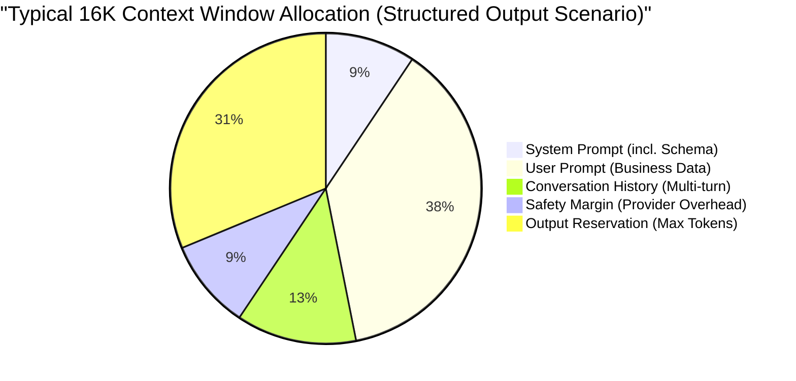

Even when Temperature is set to 0, structured outputs can still occasionally fail to parse; after stuffing a context window with documents, a model may still miss critical constraints buried in the middle. Investigating these phenomena requires examining Token segmentation, context capacity, and decoding strategies independently.

To troubleshoot these issues effectively, first examine what Tokens comprise a single invocation, then verify context budgets alongside decoding parameters like Temperature, Top-p, and Top-k. The Token numbers and parameter ranges in this article serve to explain the underlying mechanisms; actual billing and model capability ceilings should always be verified against the target model's API documentation and response `usage`.

## Why Do Tokens and Context Determine Cost and Performance?

When you type "The weather today is really " into an input method, it automatically suggests "nice". Large language models predict subsequent content in much the same way, except they reference thousands or even hundreds of thousands of preceding characters. At each step, the model generates a single Token (a fragment of text), appends it to the context, and predicts the next one until the response completes.

This process is known as **Autoregressive Generation**.

Autoregressive generation links several key concepts together:

- **Token**: The text fragment the model generates at each step.
- **Context Window**: The maximum total Token ceiling a model can process in a single invocation, consumed by system prompts, conversation history, current input, and output reservations.
- **Temperature / Top-p**: The strategy the model uses to choose among candidate fragments.
- **Max Tokens**: The upper limit on how many generation steps the model is permitted to take.

When a Tokenizer receives text, it slices it into fragments of varying lengths. For instance, `你好，我是小 G。` can yield an illustrative breakdown like this:

- Original text: `你好，我是小 G。`
- Tokens: `[你好]` `[，]` `[我是]` `[小 G]` `[。]`
- Statistics: 9 original characters → 5 Tokens → compression ratio of approx. 1.8x


This breakdown is for explanatory purposes only. Actual results depend on the target model's Tokenizer; switching providers or model versions for the same text can alter the Token sequence. OpenAI also provides a hands-on [Tokenizer Tool](https://platform.openai.com/tokenizer) to inspect segmentation directly.

If segmentation is fixed strictly character-by-character, the vocabulary remains small, but sequences become excessively long. If segmentation is fixed strictly word-by-word, the sequence is shorter, but the massive number of word compounds causes the vocabulary to balloon. **Subword tokenization algorithms** like BPE (Byte Pair Encoding) and Unigram balance these tradeoffs: high-frequency fragments are preserved as intact units, while low-frequency words are broken down into smaller pieces. Consequently, there is no fixed one-to-one mapping between Tokens and characters or words. An English word may span multiple Tokens; Chinese may also require multiple Tokens per word or merge multiple characters into a single Token.

Capacity planning can begin with empirical rules of thumb: 1 Token in English corresponds roughly to 3–4 characters; Chinese typically ranges between 1–2 characters per Token, with mixed-language content fluctuating further. Official DeepSeek data indicates that 1 English character consumes approx. 0.3 Tokens and 1 Chinese character consumes approx. 0.6 Tokens—meaning each Token is roughly 3.3 English characters or 1.7 Chinese characters.

Tokenizer versions also alter conversion ratios. Early models (such as GPT-3.5) had lower Chinese compression rates, roughly 1 character to 1.5–2 Tokens; GPT-4o uses the `o200k_base` Tokenizer with a vocabulary of approx. 200,000, while Qwen2.5 has a vocabulary of approx. 150,000. In practical benchmarks, news text averages approx. 1.5 characters/Token, and technical documentation averages approx. 1.2 characters/Token, but these figures should not be used directly for financial billing calculations.

Approaching "1 character per 1 Token" occurs only for certain high-frequency words. During budgeting, use empirical values to maintain safety margins, but rely strictly on the `usage` returned by APIs for billing and monitoring. The granularity with which Chinese ambiguities, rare characters, and low-frequency technical jargon are tokenized also directly impacts how effectively the model processes text.

**Special Tokens**: In addition to Tokens representing text content, models internally use special markers that are also counted against total Token usage:

| Special Token | Purpose | Example |
| --- | --- | --- |
| BOS (Beginning of Sequence) | Marks sequence start | `<s>` |
| EOS (End of Sequence) | Marks sequence completion | `</s>` |
| PAD (Padding) | Fills short sequences in batch processing | `<pad>` |
| Tool Calling Markers | Delimits Function Calling boundaries | `<tool_call/>` |

These special Tokens are typically hidden from end users, but consume context window space. For precise counting, rely on official Tokenizer libraries rather than manual estimation.

### Token Overhead of Multimodal Inputs

Vision-capable models convert images into internal representations and calculate input Tokens according to proprietary rules. This cost cannot be estimated simply on the basis of "there is one image":

- OpenAI vision models calculate costs based on model type, image dimensions, and `detail` mode. For models using a 512-pixel tiling rule, low detail consumes a fixed base amount, while high detail adds Tokens based on the number of scaled tiles.
- Anthropic estimates Tokens based on scaled image pixel counts, using the approximate official formula `tokens ≈ width × height / 750`. An unscaled 1024×1024 image costs approximately 1,398 Tokens, not a static 5 or 85 Tokens.
- Gemini applies distinct tiling rules for smaller versus larger images. The 258 Tokens cited in documentation applies only under specific dimension criteria and cannot be applied across any arbitrary 1024×1024 image.

Model versions alter image billing rules. Prior to deployment, use provider Token calculation endpoints or official formulas, validating across thumbnails, screenshots, tall scrolling images, and multi-image requests. Refer to [OpenAI Vision Guides](https://developers.openai.com/api/docs/guides/images-vision), [Anthropic Vision](https://platform.claude.com/docs/en/build-with-claude/vision), and [Gemini Token Counting](https://ai.google.dev/gemini-api/docs/tokens).

When images enter a Multimodal RAG pipeline, this overhead directly impacts both budgets and latency:

- Image Tokens must be factored into single-call budgets alongside text Tokens.
- Batch image processing inflates Time-To-First-Token (TTFT), necessitating dedicated stress testing.
- When a task only requires OCR results, extract the text first and pass pure text to the LLM instead.

### Capacity Boundaries of the Context Window

Advertised context windows of 128K, 200K, or 1M denote the maximum total Token capacity a single call can accommodate. Larger windows allow passing more documents and conversation history, but this capacity must still be shared across system instructions, tool definitions, and generated output. Most models compute inputs and outputs collectively, whereas certain providers (such as Google Gemini) enforce separate input and output limits.


- **Static Content**: System Prompt, tool calling Schemas, and formatting markers.
- **Dynamic Input**: User Prompt, message history, and RAG retrieval snippets.
- **Generation Budget**: Output Tokens reserved for the model to generate.

Subtracting these components from the advertised window yields the actual space available for business payload data.

Note: Context Window ≠ Maximum Generation Length. Many models support 128K or 1M contexts, but per-call output limits vary by model and API, appearing under parameter names like `max_tokens`, `max_completion_tokens`, or `max_output_tokens`. Never assume generation limits based on provider naming; always check the specific model's capability specifications before calling.

Multi-turn message formatting for reasoning models also differs by provider:

- [DeepSeek Thinking Mode](https://api-docs.deepseek.com/guides/thinking_mode) returns `reasoning_content` and final `content` separately. When no tool calls occur, the previous turn's `reasoning_content` does not need to be passed into the next turn's context and will be ignored if provided; when tool calls occur, the current turn's `reasoning_content` must be passed back alongside tool results until that turn completes.
- [OpenAI Reasoning Models](https://developers.openai.com/api/docs/guides/reasoning) do not expose raw chain-of-thought to applications. The Responses API can persist context via `previous_response_id` or pass reasoning items as required by the API; applications receive an optional reasoning summary rather than the underlying chain-of-thought tokens.

Although reasoning Tokens might not appear in subsequent turn messages, they still consume generation budgets during the active turn and may count against output limits and context quotas. Never generalize that reasoning tokens do not consume window space or do not incur billing.

### Computational Constraints Behind Long Context

The Transformer's **Self-Attention Mechanism** introduces three computational overheads as context length expands:

- Quadratic growth in compute cost: Computational demands grow quadratically with sequence length ($O(N^2)$). Doubling input Tokens can quadruple required processing capacity.
- Increased inference latency: As context lengthens, generating each new Token requires attending across all previous Tokens, significantly increasing Time-To-First-Token (TTFT).
- Heightened security attack surface: A longer context window offers a broader surface for prompt injection and adversarial manipulation.

Techniques like FlashAttention, GQA/MQA, Sliding Window Attention, and Ring Attention reduce memory footprints or compute loads, but they do not magically convert all long-context attention into linear costs; $O(N^2)$ remains the foundational theoretical complexity of standard self-attention.

### Real Manifestations of Context Overflow

When a System Prompt explicitly mandates "Must output JSON" yet the model ignores the instruction, context overflow is often the culprit. Responses may also drift off topic halfway through, or fail to latch onto relevant evidence because too many noisy RAG snippets were stuffed into the prompt.

Putting information into a window does not guarantee the model utilizes every position equally. The "Lost in the Middle" phenomenon describes how models readily attend to information at the beginning and end of a context while struggling to recall content in the middle. Expanding a window to 1M does not automatically resolve this issue.

Long contexts also introduce directly monitorable operational costs: input Tokens scale with content volume, increasing billing; prefill latency and TTFT both rise. When observing these symptoms, audit retrieved snippet counts, prune conversation history, and optimize critical information positioning before blindly stuffing more context into the window.

### Billing Differences Between Input and Output Tokens

Most providers bill separately for input, cached input, and output Tokens, with reasoning models sometimes breaking out reasoning tokens separately. Output pricing is frequently higher than input pricing, but there is no uniform "2x–4x" industry standard: model versions, batching tiers, cache hits, and service tiers all alter pricing ratios.

Pricing changes frequently and should not be hardcoded into technical architecture docs. Cost tracking should ingest current provider pricing pages and persist `model_version`, granular `usage` metrics, and actual billed rates in your model gateway.

Cost accounting must record inputs, cached inputs, outputs, and provider-returned reasoning tokens separately. In RAG pipelines, restrict retrieval snippet counts to prevent irrelevant content from inflating input Tokens; use generation ceilings to bound output and reasoning costs. Because reasoning tokens are often billed at output rates, monitor them carefully in reasoning models.

### The Cost-Saving Logic of Prompt Caching

Batch evaluation pipelines frequently send the same System Prompt repeatedly, altering only the test sample at the end; multi-turn conversations also carry forward identical conversation prefixes. Such requests can leverage **Prompt Caching** to reuse common prefixes. When subsequent requests satisfy criteria regarding model version, prefix length, exact content match, and TTL (time-to-live), the cached portion is billed at reduced rates and bypasses prefill computation.

Workloads with long static prefixes and high repetition benefit most:

- Multi-turn dialogues (where System Prompt + historical messages remain stable).
- RAG applications (where retrieved reference snippets have high overlap).
- Batch evaluation (same System Prompt evaluated across varied resumes or articles).

Trigger thresholds, cache lifespans, and pricing discounts vary significantly across OpenAI Prompt Caching, Anthropic Prompt Caching, and DeepSeek Context Caching, with some distinguishing between automatic caching, explicit caching, and extended caching. Consult official documentation prior to implementation, and avoid hardcoding cache durations or discounts into application code.

The structural arrangement of request payloads directly determines cache hits:

1. Place static content first (System Prompt, tool definitions, RAG context), placing dynamic content last (User Prompt).
2. Monitor cache-read and cache-write Tokens via provider response headers/fields to verify hit rates.
3. Schedule batch tasks within active cache TTL windows.

### Single-Invocation Token Budget Formula

Treating the "context window" as a bucket with a fixed capacity, the diagram below illustrates a typical Token budget allocation:



The numbers above are illustrative. For standard generation models, verify that this fundamental inequality holds:

**window ≥ input_tokens + max_output_tokens**

For reasoning models, calculate according to target API parameter semantics. Some APIs define `max_output_tokens` or `max_completion_tokens` to encompass both reasoning Tokens and visible answers, in which case adding `reasoning_tokens` again results in double counting; other APIs cap thinking and visible outputs independently. Prior to production rollout, analyze real `usage` receipts to reverse-engineer actual token compositions and calibrate your budgeting formulas.

Here `input_tokens` encompasses at least:

- System prompt (including schema and tool definitions)
- User prompt (including actual text after variable interpolation)
- Conversation history (in multi-turn dialogues)
- RAG context (if injected)

Output lengths in structured extraction tasks are generally predictable. You can lock in `max_output_tokens` first, leaving a 10%–20% safety margin for inputs. If the budget remains insufficient, progressively reduce RAG Top-K, deduplicate fragments, or summarize long fields; if a task cannot fit in a single turn, decompose it into batched evaluations or two-phase generation pipelines.

## How Sampling Parameters Impact Output Stability

### From Logits to Probability Sampling

At each generation step, the model assigns a raw score (internally called **logits**) to **every** candidate Token in its vocabulary. A higher score signifies higher model confidence that the Token belongs in this position.

For example, suppose the model is completing "The weather today is really \_\_". It might output scores like this:

| Candidate Token | Raw Score (Logit) |
| --- | --- |
| great | 5.0 |
| nice | 3.2 |
| wonderful | 2.1 |
| terrible | 0.5 |
| purple | -8.0 |

Raw scores are not probabilities. They must pass through a **softmax** function to generate a valid probability distribution:

| Candidate Token | Probability |
| --- | --- |
| great | 81.21% |
| nice | 13.42% |
| wonderful | 4.47% |
| terrible | 0.90% |
| purple | ~0.00% |

Once the probability distribution is established, the model samples from it to select the output Token.

Decoding parameters (Temperature, Top-p, Top-k, etc.) exert control over this "scoring → probability → sampling" process:

- Temperature: Adjusts distribution "flatness", making high-scoring options more dominant or spreading probability more evenly.
- Top-p / Top-k: Truncates low-probability candidates, shrinking the sampling pool.
- Penalty series: Lowers scores for previously generated tokens to prevent repetitive loops.

### Temperature's "Risk Appetite"


Temperature functions straightforwardly: prior to softmax, all raw logits are **divided** by the temperature value $T$:

$$p(t) = \text{softmax}(z_t / T)$$

Applying this formula to our "The weather today is really \_\_" example illustrates how temperature reshapes the distribution:

| Temperature | Distribution Shape Change | Sample Outcome |
| --- | --- | --- |
| T = 0.2 | Sharper distribution; high-probability tokens dominate | "great" ~ 99.99% |
| T = 1.0 | Retains raw distribution | "great" ~ 81.21%, "nice" ~ 13.42% |
| T = 1.5 | Flatter distribution; lower-probability tokens gain chances | "great" ~ 66.85%, "nice" ~ 20.14%, "wonderful" ~ 9.67% |

Lower temperature yields deterministic outputs; higher temperature introduces randomness.

Engineering guidelines (empirical rules of thumb):

| Scenario | Recommended Temperature | Notes |
| --- | --- | --- |
| Structured Extraction / JSON | 0 ~ 0.3 | Combine with strict schemas + parse retry logic |
| Evaluation / Code Review / Analysis | 0.4 ~ 0.8 | Balances determinism with expressive nuance |
| Creative Writing / Brainstorming | 0.8 ~ 1.2+ | Increases diversity at the expense of format stability |

If the target API supports a `seed` parameter, record it alongside fixed model versions, fixed Prompts, and static sampling parameters. However, `seed` provides only best-effort reproducibility rather than bitwise determinism; furthermore, DeepSeek's current API does not expose a `seed` parameter.

Non-determinism can still occur due to:

- Model version updates (underlying weight adjustments).
- Cross-region routing (different server clusters running different build versions).
- Backend variations in decoding implementations, parallel GPU scheduling, and floating-point math.

In CI/CD, reserve real LLM invocations for smoke tests; use Mocks for deterministic logic testing.

### Top-p and Top-k Sampling Pools

While Temperature adjusts the shape of the probability curve, Top-p and Top-k truncate the candidate set, pruning tail options entirely from the sampling pool.

Revisiting the weather completion example:

| Candidate Token | Probability | Cumulative Probability |
| --- | --- | --- |
| great | 81.21% | 81.21% |
| nice | 13.42% | 94.63% |
| wonderful | 4.47% | 99.10% |
| terrible | 0.90% | ~100% |
| purple | ~0.00% | 100% |

`Top-k = 3` statically retains the 3 highest-probability tokens ("great", "nice", "wonderful"), excluding all others. `Top-p = 0.9` sums probabilities from top to bottom; here "great + nice" reaches 94.63%, so only these two are retained. If the top candidate alone exceeds 90%, only that single token is kept.

Because Top-k governs candidate count while Top-p governs cumulative probability, Top-p's pool size adapts dynamically to distribution confidence. When combined with Temperature, common configurations behave as follows:

| Combination | Effect | Typical Scenario |
| --- | --- | --- |
| T=0 (Greedy Decoding) | Selects the highest-scoring token at each step; still subject to provider implementation variances | Structured outputs, low-randomness tasks |
| Low T + Top-p=0.9 | High stability with natural phrasing variations | Analytical reports, summarization |
| Medium-High T + Top-p=0.95 | Rich diversity while eliminating absurd tail choices | Creative writing, conversational chat |

Note: While greedy decoding maximizes determinism, it can be more prone to repetitive loops.

### Stopping Conditions and Truncation Risks

When generation hits Max Tokens, the model stops abruptly—even if a JSON payload is missing its closing brace or a list is half-written. When receiving `finish_reason=length`, the backend must flag the result as truncated and halt downstream processing.

Stop Sequences instruct the model to terminate generation early when encountering designated strings, such as `"\n\n"` or `"```"`. If a stop sequence collides with valid business payload text, critical content will be cut short. Structured output handling must account for both length exhaustion and accidental stop sequence triggers.

For reasoning models, verify whether generation limits cover both reasoning tokens and visible output. In APIs sharing a unified budget, reasoning consumption depletes the space available for final answers; other APIs control thinking depth via parameters like `reasoning_effort`. When encountering `finish_reason=length`, evaluate both reasoning token usage and visible output lengths during triage.

### Penalties and Repetition Loops

You may have encountered models repeating identical phrases or reiterating the same point across a long response. Penalty parameters alleviate this by **reducing logits for tokens that have already appeared**:

| Parameter | Function | Plain Explanation |
| --- | --- | --- |
| Repetition Penalty | Lowers probability for all previously generated tokens | "Penalize words that have been spoken" |
| Presence Penalty | Flat penalty applied once a token has appeared (regardless of frequency) | "Encourage introducing new topics" |
| Frequency Penalty | Penalty scales with the number of times a token appears | "Penalize heavily for repeated usage" |

JSON objects often naturally repeat field names like `"name"` or `"score"`. Setting Repetition Penalty too high penalizes these necessary structural repetitions, resulting in missing fields. In RAG Q&A, enabling Presence Penalty encourages the model to introduce words not found in retrieved source passages, degrading grounding faithfulness.

Providers define penalties with subtle differences. Unless you have empirical justification for tuning them, leave penalties at default values and rely on output length caps, prompt constraints, and schemas to enforce structure.

### Parameter Constraints in Reasoning / CoT Modes

Supported sampling parameters vary by provider, and DeepSeek Thinking Mode cannot be assumed to behave identically to OpenAI Reasoning models:

- DeepSeek V4 Thinking Mode returns `reasoning_content` alongside `content`, explicitly enumerating parameters that are ignored or unsupported.
- OpenAI does not return raw internal chain-of-thought tokens. Its Responses API can return reasoning items and optional summaries; different reasoning models support different subsets of `temperature` and `top_p`.

Before making calls, filter unsupported parameters according to the provider's capability matrix. Structural stability should rely on Structured Outputs, server validation, and failure handling rather than adjusting Temperature alone.

### Streaming Output and First-Token Latency

Synchronous endpoints block until the complete response is generated; streaming endpoints emit incremental deltas as tokens are generated, delivering lower Time-To-First-Token (TTFT) and an immediate perceived response. Avoid confusing TTFT, total latency, and financial costs:

- Streaming does not reduce end-to-end (E2E) latency; total Token generation time remains unchanged.
- Streaming does not save money; token usage and rate limits apply identically.
- When generating structured data (such as JSON), streaming architectures must handle incomplete, partially formed JSON across gateway and frontend layers.

### Logprobs and Confidence Diagnostics

Certain APIs (such as OpenAI) support returning **log probabilities** (logprobs) for each generated Token, representing the model's confidence in that selection. A logprob close to 0 indicates high certainty, while deeply negative values (e.g., -5.0) indicate hesitation.

Engineering applications:

- **Confidence Assessment**: When extracting "Amount: 1000", a low logprob on the amount token indicates low confidence, signaling a need for human review.
- **Anomaly Detection**: Tracking average output logprob in production helps detect prompt drift or malformed inputs when scores suddenly drop.
- **Candidate Comparison**: Inspecting Top-N candidate tokens and probabilities facilitates error correction or secondary reranking.

Caveat: Requesting logprobs increases payload sizes, and not all providers support them. Review API specs before relying on logprobs.

### Sampling Parameter Configuration Recommendations

| Scenario | Temperature | Top-p | Penalty | Additional Recommendations |
| --- | --- | --- | --- | --- |
| JSON / Structured Output | 0 ~ 0.3 | 1.0 | Default | Pair with Strict Mode + retry policies |
| Code Review / Technical Analysis | 0.4 ~ 0.7 | 0.9 | Default | Combine with CoT Prompting |
| Multi-turn Dialogue | 0.6 ~ 0.8 | 0.9 | Moderate | Constrain conversation history length |
| Creative Writing / Brainstorming | 0.8 ~ 1.2 | 0.95 | As needed | Plan for post-processing and output variance |
| Reasoning Models | Check Docs | Check Docs | Check Docs | Strip unsupported parameters; preserve server validation |

## What Data to Retain in Production

Perform capacity planning based on Tokens, but base billing and operational alerts strictly on API-reported `usage`. For every production call, persist at least: model version, input Tokens, cached Tokens, reasoning Tokens (if returned), output Tokens, context pruning strategy, and sampling parameters.

A large context window increases information capacity, but does not guarantee uniform attention across all positions. Structured tasks must be paired with Schemas and server-side validation; when reproducibility is required, freeze model versions, prompts, inputs, and decoding parameters while acknowledging minor inherent non-determinism in hosted cloud environments.
