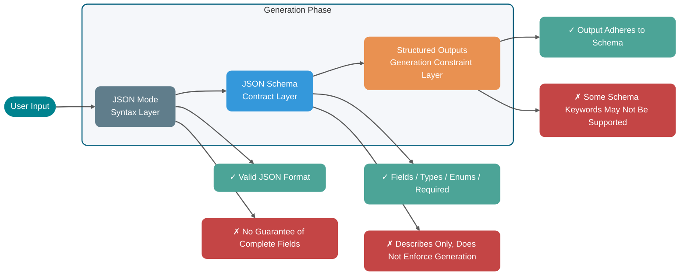
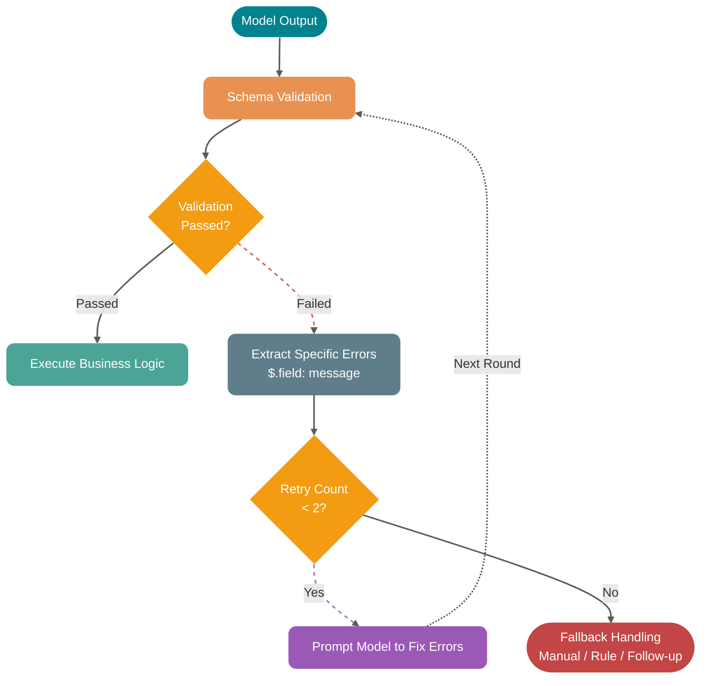
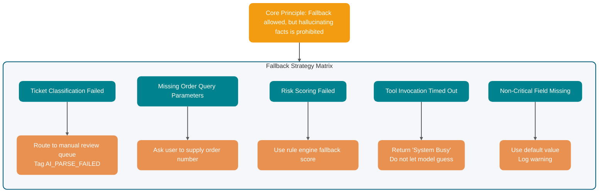

When you write "Please return JSON" in a prompt, the model will usually output an object, but that object cannot be directly consumed as a production business interface.

Sometimes it prefixes the JSON with conversational filler like "Sure, here is the result:"; sometimes it drops a required field; sometimes an `orderId` that should be a number arrives as a string; worse still, as edge conditions grow complex, the model may fabricate an enum value that your business system has never seen. The moment your parser throws an exception, the entire execution pipeline breaks.

Natural language prompts lack a type system and cannot perform permission checks. Structured Outputs delegate fields, types, and enums to Schema constraints; Function Calling then delegates the model-generated tool intent to a trusted execution layer for verification. JSON Mode, Structured Outputs, MCP, and Java backend services each occupy distinct stages along this invocation pipeline.

Note: Products and protocols such as OpenAI, Anthropic, Gemini, and MCP are continuously evolving. Production systems should derive capability definitions from the latest official documentation. This article does not cite unverified benchmarks or make absolute performance assertions.

## Why Is "Please Return JSON" Unreliable?

Consider a very common prompt:

```text
Please classify which ticket category the following user feedback belongs to. Return JSON.

User Feedback: My payment went through successfully, but the order still displays as pending payment.
```

The model might return:

```json
{
  "category": "payment",
  "priority": "high",
  "reason": "User paid successfully but order status has not updated"
}
```

It looks fine on the surface. But that is only "how it looks."

The backend requires a contract that can be deterministically consumed. For example:

- `category` must strictly be one of `PAYMENT`, `LOGISTICS`, `AFTER_SALE`, or `ACCOUNT`.
- `priority` must strictly be `LOW`, `MEDIUM`, or `HIGH`.
- `confidence` must be a float between `0` and `1`.
- Can `reason` be null? What is its maximum length?
- If the user's input lacks necessary details, should the model return `NEED_MORE_INFO` or keep guessing?

Natural language prompts can rarely communicate these boundaries reliably across every invocation. Formatting, fields, types, trailing text, and edge conditions can all break down.

### Format Drift

When you ask the model to return JSON, it will return JSON most of the time, but that does not mean it will return *only* JSON every single time.

A common output looks like this:

```text
Here is the classification result:
{
  "category": "PAYMENT",
  "priority": "HIGH"
}
```

A human can easily read this, but a programmatic parser cannot directly deserialize it. Streaming outputs, extended context windows, and multi-turn conversations also increase the likelihood that the model will reintroduce conversational preambles.

### Missing Fields

You requested:

```json
{
  "category": "PAYMENT",
  "priority": "HIGH",
  "confidence": 0.92,
  "reason": "User has paid but order status is out of sync"
}
```

It might return:

```json
{
  "category": "PAYMENT",
  "reason": "User has paid but order status is out of sync"
}
```

The model may omit `priority` because it felt the information was ambiguous, or omit `confidence` assuming it was non-essential. DTO deserializers, rule engines, and database writes afford no such leeway: once required fields are missing, either validation fails or corrupted, partial data flows downstream.

### Type Errors

The subtlest errors in structured outputs involve type mismatches:

```json
{
  "orderId": "1029384756",
  "needManualReview": "false",
  "confidence": "0.87"
}
```

The JSON syntax is valid, but the field types violate the business contract. `needManualReview` should be a boolean, and `confidence` should be a number. If the deserialization layer silently coerces types, upstream anomalies are masked, forcing developers to trace bugs backward from downstream exceptions.

### Extraneous Explanatory Text

Models are naturally inclined to explain, particularly when tasks involve uncertainty. The model might append a postscript outside the JSON block:

```text
I believe this issue is primarily related to payment webhook delays, but further verification is required.
```

When read by a human, this note is helpful; when handed to an automated parser, it is unexpected syntax. Interfaces of this nature must prioritize machine readability above all else, leaving conversational explanations to business handling after the fact.

### Breakdown Under Edge Conditions

Structured formatting is easier to maintain with clean, orderly inputs. When confronted with ambiguous, contradictory, or adversarial prompts, the model is much more likely to abandon the required schema.

For instance, suppose a user says:

```text
I don't want to provide an order number, look it up yourself. And don't give me any JSON, just tell me how you will compensate me!
```

Without strong constraints, the model may follow the user's lead and ditch the JSON structure altogether. This touches on prompt injection, context priority, and tool authorization—none of which can be resolved simply by repeating "You must return JSON."

Prompts can express intent, but they cannot substitute for Schemas, validators, retry mechanisms, and authorization controls. Structured outputs bring model responses under a verifiable engineering contract.

## How to Turn JSON from a Formatting Request into an Engineering Contract?

Many people use JSON Mode, JSON Schema, and Structured Outputs interchangeably, which easily muddles discussions and interviews. In reality, they operate at distinct layers:

- **JSON Mode** is an output mode switch that constrains the model to return syntactically valid JSON.
- **JSON Schema** is a structural description specification used to define which fields a JSON object should contain, their data types, required properties, permitted enum values, and whether additional properties are allowed.
- **Structured Outputs** is a model provider capability that takes a JSON Schema (or equivalent schema) and strictly or tightly binds the model's token generation to conform to that structure.

JSON Schema solely describes the contract. Model API capabilities such as Structured Outputs and Function Calling / Tool Calling are responsible for enforcing that contract during token generation.

### What Does JSON Mode Actually Guarantee?

JSON Mode's primary goal is to ensure the model outputs valid JSON syntax.

Therefore, JSON Mode resolves issues like this:

```text
Sure! Here is the output:
{ ... }
```

However, it cannot reliably prevent issues like this:

```json
{
  "category": "pay",
  "priority": "urgent",
  "confidence": "very high"
}
```

This output is syntactically valid JSON, but it is invalid business data.

### What Is JSON Schema Responsible for Defining?

JSON Schema is a standard specification for describing the structure of JSON documents. According to official JSON Schema documentation, `properties` defines object attributes, `required` declares mandatory fields, `additionalProperties` controls whether undeclared properties are permitted, and `enum` restricts values to a closed set.

A ticket classification Schema can be specified as follows:

```json
{
  "type": "object",
  "properties": {
    "category": {
      "type": "string",
      "enum": [
        "PAYMENT",
        "LOGISTICS",
        "AFTER_SALE",
        "ACCOUNT",
        "NEED_MORE_INFO"
      ],
      "description": "Ticket category. Select NEED_MORE_INFO if information is insufficient."
    },
    "priority": {
      "type": "string",
      "enum": ["LOW", "MEDIUM", "HIGH"],
      "description": "Processing priority. Higher priority for financial loss, checkout blocks, or widespread impact."
    },
    "confidence": {
      "type": "number",
      "minimum": 0,
      "maximum": 1,
      "description": "Classification confidence score, ranging from 0 to 1."
    },
    "reason": {
      "type": "string",
      "description": "Classification reasoning, under 80 Chinese characters or equivalent."
    }
  },
  "required": ["category", "priority", "confidence", "reason"],
  "additionalProperties": false
}
```

The Schema explicitly formalizes the shape of data acceptable to the backend. When calling an API that supports structured outputs, you supply this schema with the request; the server must also validate the model's output against the same rules or an equivalent validator.

### What Constraints Can Structured Outputs Shift Left?

Structured Outputs generally refers to the native constrained generation capabilities provided by model vendors. By passing a JSON Schema into the model call, constraints are applied directly during the autoregressive generation stage.

OpenAI, Anthropic, and Gemini all provide native structured output capabilities today; it is no longer accurate to claim that "only OpenAI enforces strict schemas while other vendors rely on prompt engineering." The three vendors differ, however, in model coverage, refusal and truncation semantics, supported schema subsets, and initial compilation latencies. Furthermore, when a model returns a refusal, hits token limits, or fails during tool execution, "support for Structured Outputs" must never be mistaken for guaranteed business request success.

An essential engineering caveat: **The JSON Schema subsets supported by different providers are not identical**. Keywords such as `pattern`, `format`, recursive `$ref`, and combinators (`allOf`, `oneOf`, `anyOf`) have varying levels of support across different APIs. In production implementations, avoid blindly copying the entire JSON Schema specification; always consult the vendor's documentation on supported schemas and tool definitions first.

### Comparison of the Three Layers of Generation Constraints

| Dimension | JSON Mode | JSON Schema | Structured Outputs |
| :--- | :--- | :--- | :--- |
| **Role** | Output format switch | Data structure description standard | Model API structured generation capability |
| **Primary Constraint** | Valid JSON syntax | Fields, types, enums, required, additional properties | Outputs closely or strictly adhere to Schema |
| **Guarantees Business Fields?** | No | Describes only; does not enforce generation | Depends on vendor capability and supported schema subset |
| **Executes Tools?** | No | No | No; only produces structured results |
| **Typical Use Cases** | Simple JSON output | Defining data contracts and validation rules | Classification, extraction, parameter generation, Agent intermediate states |
| **Server-Side Validation Needed?** | Yes | Yes | Still required |


JSON Mode constrains syntax, JSON Schema describes the contract, and Structured Outputs applies the contract during generation. The backend server must still validate refusals, truncations, permissions, and business states.



Structured output typically serves two primary engineering patterns:

1. **Structured Response Output**: The model's final response is a JSON object conforming to a schema—such as ticket classification, entity extraction, or sentiment scoring. The backend directly deserializes and consumes it.
2. **Structured Tool Parameter Output**: The model generates a tool name and `arguments`, where `arguments` must conform to the tool's parameter Schema; the business application executes the tool and interacts with external systems.

Function Calling, discussed next, belongs to this second category.

## What Does Function Calling Actually Call?

The name "Function Calling" frequently misleads newcomers. Many assume that the model literally executes a function, as though it were running your Java method inside its runtime.

In reality, the model generates a structured invocation intent based on user queries and tool descriptions. Your business service, Agent Runtime, MCP Host, or vendor-managed environment is what actually executes the tool.

### The Model Only Generates Invocation Intent

A typical tool invocation pipeline looks like this:


Broken down into engineering steps:

1. **Server Registers Tool Definitions**: Registers tool names, usage descriptions, and parameter Schemas.
2. **User Dispatches Request**: For example, "Help me check where order 1029384756 is right now."
3. **Model Selects Tool**: The model determines that `query_order` is required and generates parameters `{"orderId": "1029384756"}`.
4. **Business Layer Validates Parameters**: Verifies types, required fields, permissions, order ownership, idempotency keys, etc.
5. **Business Layer Executes Tool**: Invokes the order service, database, or HTTP API.
6. **Tool Results Fed Back to Model**: Sends the query result back to the model along with the original `tool_use_id`. Anthropic requires strict matching of `tool_use_id`, and Gemini 3 likewise assigns a unique `id` to each `functionCall`, which must be preserved to prevent mismatched results during parallel tool calls.
7. **Model Generates Final Response**: The model synthesizes the structured result into human-readable text.

In Anthropic's tool use workflow, Claude returns structured calls based on user prompts and tool definitions, client tools are executed by the application, and results are returned via `tool_result`. Gemini Function Calling similarly delegates "selecting functions and populating arguments" to the model while keeping execution entirely on the application side. Both decouple model outputs from tool execution.

### Why Is Tool Invocation Intent Necessary?

Because a semantic chasm separates natural language inputs from backend APIs.

A user will say:

```text
The coffee machine I bought yesterday hasn't shipped yet, can you check on it?
```

The backend API expects:

```json
{
  "userId": "U10086",
  "orderId": "O202605070001",
  "includeLogistics": true
}
```

The value of Function Calling is enabling the model to perform the mapping from "natural language intent → structured parameters." However, it only performs this mapping; it does not bypass permissions, query databases, deduct inventory, or send SMS messages for you.

Tool calling only maps intent to parameters. Authorization, resource ownership, business states, and side effects remain strictly governed by the execution layer.

## How Do Function Calling, MCP Tools, HTTP APIs, and Agent Skills Relate?

These concepts do not form a rigid hierarchy (such as Skill → MCP → Function Calling → HTTP API). They address different concerns and can be combined flexibly depending on system architecture.

| Capability | Positioning | Problem Solved | Execution Party | Typical Boundary |
| :--- | :--- | :--- | :--- | :--- |
| **JSON Mode** | Output format switch | Ensures model outputs valid JSON syntax | Model-side generation | No guarantee of fields or business semantics |
| **JSON Schema** | Structural description standard | Defines contracts for fields, types, enums, required keys | Does not generate; describes structure | Does not execute generation or external calls |
| **Structured Outputs** | Model API structured generation | Applies Schema during decoding to align output | Model generation + server validation | Does not execute external systems |
| **Function Calling / Tool Calling** | Model-to-tool intent generation mechanism | Translates natural language into tool names and parameters | Executed by business side or provider | Not equivalent to the underlying API itself |
| **MCP** | Tool and context integration protocol | Standardizes tool discovery, invocation, and resource access | MCP Client / Server collaboration | Does not replace model reasoning |
| **Standard HTTP API** | Business service interface | Deterministic business read/write operations | Backend services | Does not interpret natural language |
| **Agent Skill** | Reusable task instructions and execution SOP | Workflow orchestration and context injection for complex tasks | Agent follows instructions | Does not necessarily invoke tools |

### How Does Function Calling Map to HTTP APIs?

Standard HTTP APIs are deterministic endpoints of backend systems. For example:

```http
GET /api/orders/O202605070001
```

Function Calling is the invocation intent generated by the model. For example:

```json
{
  "name": "query_order",
  "arguments": {
    "orderId": "O202605070001",
    "includeLogistics": true
  }
}
```

A tool execution layer typically bridges the two:

```text
Model tool call query_order → Server validates parameters → Invokes GET /api/orders/{orderId}
```

Thus, Function Calling can wrap an HTTP API, but an HTTP API is not itself Function Calling.

### Which Standardization Layer Does MCP Tool Solve?

Function Calling is a tool invocation mechanism on the model vendor side; request and response schemas differ across vendors.

An MCP Tool is a tool capability defined within the Model Context Protocol. According to the official MCP specification, MCP enables Servers to expose tools callable by language models, where tools contain names and metadata describing their schemas; messages between MCP clients and servers conform to JSON-RPC 2.0.

Function Calling enables the model to express "which tool to call and with what arguments"; MCP handles tool discovery, execution dispatch, and result delivery between Client and Server.

An MCP-enabled Agent Runtime can discover tools via MCP, convert those tool definitions into vendor-specific Function Calling formats for the model, and then, once the model selects a tool, translate the invocation into an MCP `tools/call` request.

This is a common adapter pattern, not a strict protocol prerequisite of MCP. An MCP Client can also trigger `tools/call` directly from a rule engine, UI, or other programmatic process; an MCP Server implementation can query HTTP APIs, databases, local files, or processes without requiring Function Calling underneath.

### Why Isn't an Agent Skill Merely Syntactic Sugar for Function Calling?

A Skill captures the context, execution steps, and operational heuristics required for a specific task—effectively serving as a reusable standard operating procedure (SOP).

For example, an "Incident Postmortem Skill" might prescribe:

1. Read the incident timeline first.
2. Query monitoring dashboard screenshots.
3. Retrieve release deployment logs.
4. Output findings formatted into "Symptoms, Impact, Root Cause, Action Items."

During execution, this Skill might call MCP tools, invoke Function Calling tools, or simply instruct the model to perform pure text synthesis. It is fundamentally distinct from Function Calling syntactic sugar.

A common implementation pattern involves a Skill constraining the Agent's workflow, a Runtime converting MCP tool definitions into the provider's Tool Calling format, and a tool executor mapping arguments to HTTP APIs. Alternatively, an MCP Server can directly query databases or local files without involving a model. Component combinations depend on runtime architecture; there is no single mandatory path.

## When Should You Use Structured Outputs vs. Tools?

Having decomposed the layers above, let's examine engineering selection criteria: should you request structured output directly, or have the model invoke external tools?

| Dimension | JSON Mode | JSON Schema | Structured Outputs | Function Calling / Tool Calling | MCP |
| :--- | :--- | :--- | :--- | :--- | :--- |
| **Architectural Layer** | Model output format layer | Structural description standard layer | Model structured generation layer | Model tool intent layer | Application protocol layer |
| **Input to Model** | "Output JSON" mode toggle | Not directly passed into generation | Schema or response format definition | Tool names, descriptions, parameter Schemas | Converted by Host before passing to model; protocol communicates between Client and Server |
| **Model Output** | Raw JSON text | — | Structured object matching Schema | Tool name + arguments, or final answer | Does not prescribe model output; prescribes MCP messages |
| **Invokes External Systems?** | No | No | No | Generates intent; executed externally | Yes; MCP Client invokes MCP Server |
| **Cross-Model Standardization** | Vendor implementations differ | Universal standard; reusable across models | Supported schema subsets differ by vendor | Vendor formats differ | Designed to standardize tool and context integration |
| **Suitable Scenarios** | Simple structured text | Defining data contracts and validation rules | Extraction, classification, parameter generation | Order lookups, emails, inventory queries, etc. | Multi-tool, multi-client, team-wide tool ecosystems |
| **Primary Risks** | Valid JSON but invalid fields | Describes only; easily overestimated | Complex schemas or vendor support drift | Erroneous tool calls, parameter privilege escalation | Server permissions, security boundaries, protocol compatibility |

When selecting an approach, first determine whether the output triggers external actions, then consider across how many clients the tools must be shared:

- For lightweight data extraction, start with Structured Outputs.
- When reading or modifying business systems, prioritize Function Calling / Tool Calling.
- With numerous tools, multiple clients, or cross-IDE / cross-Agent reuse goals, adopt MCP.
- For complex tasks governed by a fixed SOP, adopt Skills to codify tool composition and decision workflows.

## How to Implement Structured Outputs in Production?

Structured outputs involve far more than merely appending a schema parameter. Production implementations must account for schema design, version compatibility, error handling, logging, and degradation.

### 1. Schema Design: One Field Expresses One Concept

Poor Design:

```json
{
  "result": "Payment issue, high priority, requires manual processing"
}
```

Good Design:

```json
{
  "category": "PAYMENT",
  "priority": "HIGH",
  "needManualReview": true,
  "reason": "User paid but order status is out of sync"
}
```

The more atomic the fields, the easier it is for backend services to validate, aggregate, route, and roll out changes gradually.

### 2. Field Descriptions Must State "When to Use" and "When Not to Use"

Many erroneous tool invocations stem not from weak model reasoning, but from ambiguous field descriptions.

For example:

```json
{
  "category": {
    "type": "string",
    "description": "Ticket category"
  }
}
```

This is almost useless. A far better formulation:

```json
{
  "category": {
    "type": "string",
    "enum": ["PAYMENT", "LOGISTICS", "AFTER_SALE", "ACCOUNT", "NEED_MORE_INFO"],
    "description": "Ticket category. Select PAYMENT if payment succeeded but order status is abnormal; select LOGISTICS for delivery, tracking, or courier issues; select AFTER_SALE for returns, repairs, or refund status; select ACCOUNT for login, verification, or account security; select NEED_MORE_INFO if critical details are missing."
  }
}
```

Tool descriptions must clearly delineate positive conditions, exclusion conditions, and acceptable values; verbosity is secondary to precision.

### 3. Enums Take Precedence Over Free-Form Text

For categories, statuses, action types, and risk levels, always use `enum` rather than free-form text.

Free-form text introduces non-deterministic handling:

```json
{
  "priority": "urgent"
}
```

Should the backend treat `urgent` as `HIGH` or as an illegal value? Implementing fuzzy mapping on the server merely leaks model uncertainty into core business rules.

### 4. Be Deliberate with Required Fields, but Do Not Cut Corners

Taking OpenAI's Structured Outputs strict mode as an example, common constraints include: `additionalProperties: false`, all declared properties must appear in `required`, objects must explicitly declare `type`, and only a subset of JSON Schema keywords are accepted. Keywords such as `pattern`, `format`, `minLength`, and `oneOf` have differing support across models and vendors; consult supported schemas documentation before deployment. What must be established first is the business semantics when a value is absent: if the business permits unknown values, do not force the model to hallucinate placeholders to satisfy the schema.

Two common patterns exist:

- Use explicit `null` to denote an unknown value: `"refundId": null`.
- Use a dedicated status field to indicate missing information: `"status": "NEED_MORE_INFO"`.

The absence of a field should indicate a protocol violation, not "unknown." Unknown values should be expressed inside the schema via `null` or state fields, enabling the backend to branch deterministically.

### 5. Version Compatibility: Schemas Require Versioning

When multiple services consume the same structured output, schema modifications directly impact downstream consumers, requiring API-style version governance.

Include a version field in the Schema:

```json
{
  "schemaVersion": "ticket_classification_v1",
  "category": "PAYMENT",
  "priority": "HIGH",
  "confidence": 0.91,
  "reason": "User paid but order status is out of sync"
}
```

Introduce new fields as optional extensions whenever possible; canary changes before deleting fields to confirm downstream independence; verify that legacy consumers can handle new enum values. Prompts, schemas, parsing code, and monitoring dashboards should share the same version boundary, as downstream services consume the interface they form collectively.

### 6. Validation Failure Retries: Prompt the Model to Fix Specific Errors

When validation fails, do not simply rerun the original prompt from scratch. Instead, feed specific validation errors back to the model, asking it solely to rectify the formatting.

Suppose the server detects:

```text
$.priority: must be one of LOW, MEDIUM, HIGH
$.confidence: must be number
```

The subsequent correction prompt can state:

```text
The previous output failed JSON Schema validation. Please return only the corrected JSON without commentary.

Validation Errors:
1. priority must be one of LOW, MEDIUM, HIGH.
2. confidence must be a number.

Original Output:
{...}
```

Recommended retry heuristics:

- Cap retries at 1 to 2 attempts.
- Include explicit validation error diagnostics with each retry.
- Trigger fallback logic if retries remain unsuccessful.
- Log all failed samples to inform future schema and prompt optimization.



### 7. Degradation Strategies: Don't Let a Broken JSON Stall the Main Flow

Before going live, establish how the core business proceeds when structured outputs fail. Failures across ticket classification, order queries, risk scoring, and tool calls cannot share a single generic fallback:

| Scenario | Degradation Strategy |
| :--- | :--- |
| **Ticket classification failed** | Route to human queue, tag with `AI_PARSE_FAILED` |
| **Order query parameters missing** | Ask user to supply the order number |
| **Risk scoring failed** | Fall back to rule engine score |
| **Tool invocation timed out** | Return "System busy"; do not allow model to guess |
| **Non-critical field missing** | Use default value and log an alert |



Crucial rule: **You may degrade, but the model must never fabricate business facts**.

## How to Guarantee Tool Invocation Security?

The most hazardous step in Function Calling occurs when you take model-generated JSON and execute operations against live production systems.

Querying an order typically reads a single record bounded by permissions; refunding money, deleting records, sending SMS alerts, or running SQL statements alters system state and demands far more stringent execution guards.

This section highlights parameter validation and execution constraints. To connect indirect prompt injection, MCP authorization, sensitive data handling, egress control, sandboxing, and security evaluations, refer to [LLM/Agent Security in Practice](../system-design/llm-security.md).

### 1. Parameter Validation: Schema Validation Is Only the First Layer

Schema validation verifies structure and types, but cannot verify business authorization.

For instance:

```json
{
  "orderId": "O202605070001"
}
```

The Schema confirms only that this is a valid string. It cannot know whether the order belongs to the requesting user, whether it has already been refunded, or whether the user holds customer support privileges.

The server must perform three distinct validation tiers:

- **Structural Validation**: Types, required fields, enums, lengths, formats.
- **Business Validation**: Resource ownership, lifecycle state transitions, inventory availability, monetary ranges.
- **Permission Validation**: User identity, role, tenant scope, data access boundaries.

### 2. Privilege Control: Restrict Tool Access by Role

Never expose administrative tools across all user-facing contexts indiscriminately.

Stratify tools by risk tier:

| Risk Tier | Tool Category | Control Policy |
| :--- | :--- | :--- |
| **Low Risk** | Weather queries, reading public documentation | Basic rate limiting and logging |
| **Medium Risk** | Order status queries, user profile lookups | Identity verification, data boundary checks |
| **High Risk** | Refunds, coupon grants, address updates, SMS dispatches | Permission checks, step-up confirmation, auditing |
| **Extreme Risk** | Data deletions, raw SQL execution, bulk batch mutations | Prohibited by default; requires manual approval or dedicated console |


### 3. Step-Up Confirmation for Sensitive Operations

A model may propose a refund, but it should not automatically execute a refund on the user's behalf unless explicitly authorized by policy.

Deconstruct high-risk tools into two stages:

1. `prepare_refund`: Generates a refund proposal detailing amount, justification, and impact.
2. `confirm_refund`: Executes only after the user or customer service agent confirms.

This division of labor ensures the model organizes information and proposes actions, while humans or business rules retain final execution authority.

### 4. Idempotency: Prevent Retries from Triggering Duplicate Deductions

Tool invocation pipelines are subject to retries at multiple layers: model retries, network retries, message queue retries, and business service retries.

For example, a refund tool should have its `idempotencyKey` generated by the trusted execution layer based on the business request ID, action, and target resource—rather than accepting a key generated by the model. The database enforces uniqueness, while external payment gateways receive the same idempotency token. When a duplicate request arrives, the system returns the existing result without re-executing the operation.

If a tool cannot be safely retried, an Agent must not be permitted to invoke it freely.

### 5. Audit Logging: Record Model Intent and Execution Results

Audit logs must record what action the model proposed, what the server authorized, and what the business system actually executed—without logging raw plaintext payloads indiscriminately.

Define an explicit field allowlist. Tool names, validation outcomes, return codes, execution latencies, model versions, schema versions, and trace IDs can generally be logged directly. Identifiers like order numbers and user IDs should be masked, hashed, or tokenized according to operational troubleshooting needs. Passwords, auth tokens, payment card data, private keys, and raw document contents are strictly forbidden in standard application logs. When sensitive original payloads must be retained, store them in a dedicated, access-controlled audit repository governed by approval workflows, encryption, retention policies, and purge schedules.

Log content is itself untrusted input. Sanitize logs against log injection during display or export, and restrict who can correlate user queries by `traceId`. Refer to the [OWASP Logging Cheat Sheet](https://cheatsheetseries.owasp.org/cheatsheets/Logging_Cheat_Sheet.html).

### 6. Timeouts and Circuit Breaking: Short-Circuit on Tool Failures

When a tool times out, do not allow the model to hallucinate an answer based on empty data.

Best practices:

- Configure tight timeouts for query tools.
- Exercise caution with write-operation retries, ensuring idempotency keys are mandatory.
- Return explicit error codes when external dependencies fail.
- Once the model receives a tool failure code, it must only explain that the operation cannot be completed at this time, rather than guessing an outcome.

## Java Backend Example: Building an Order Query as a Validated Tool

Taking order lookup as an example: a user asks about an order's status in natural language, the model generates a `query_order` tool call via Function Calling, and the Java backend validates parameters before dispatching to the order service.

### Tool Parameter JSON Schema

```json
{
  "$schema": "https://json-schema.org/draft/2020-12/schema",
  "type": "object",
  "properties": {
    "schemaVersion": {
      "type": "string",
      "const": "query_order_v1",
      "description": "Tool parameter version, fixed to query_order_v1."
    },
    "orderId": {
      "type": "string",
      "pattern": "^O[0-9]{12,20}$",
      "description": "Order number, starting with uppercase O followed by 12 to 20 digits."
    },
    "includeLogistics": {
      "type": "boolean",
      "description": "Whether to return logistics tracking. Set to true if the user asks about shipping, delivery, or tracking."
    }
  },
  "required": ["schemaVersion", "orderId", "includeLogistics"],
  "additionalProperties": false
}
```

Each field here serves a distinct purpose. `schemaVersion` is fixed to the current version (e.g., `query_order_v1`) to evaluate compatibility during future upgrades; `orderId` enforces formatting via `pattern`; `includeLogistics` uses a boolean to eliminate ambiguous free-form text like `"yes"` or `"needed"`.

Because this tool is read-only, its parameter Schema does not accept an idempotency key. Write operations such as refunds or inventory deductions have idempotency keys generated by the server or Agent Runtime after authorization, deduplicating requests via Redis `SET NX`, conditional writes, or unique database indexes. Setting `additionalProperties: false` ensures undeclared parameters are blocked before execution.

### Java Server Validation and Dispatch

The Java backend uses Jackson to parse JSON and JSON Schema Validator to enforce structural integrity. In real-world projects, dependency versions should be managed centrally via project BOMs or security scanning.

```java
package cn.javaguide.ai.tool;

import com.fasterxml.jackson.databind.JsonNode;
import com.fasterxml.jackson.databind.ObjectMapper;
import com.networknt.schema.JsonSchema;
import com.networknt.schema.JsonSchemaFactory;
import com.networknt.schema.SpecVersion;
import com.networknt.schema.ValidationMessage;

import java.math.BigDecimal;
import java.time.Instant;
import java.util.LinkedHashMap;
import java.util.Map;
import java.util.Set;

public class ToolCallDispatcher {

    private static final ObjectMapper OBJECT_MAPPER = new ObjectMapper();

    private static final String QUERY_ORDER_SCHEMA = """
            {
              "$schema": "https://json-schema.org/draft/2020-12/schema",
              "type": "object",
              "properties": {
                "schemaVersion": {
                  "type": "string",
                  "const": "query_order_v1"
                },
                "orderId": {
                  "type": "string",
                  "pattern": "^O[0-9]{12,20}$"
                },
                "includeLogistics": {
                  "type": "boolean"
                }
              },
              "required": ["schemaVersion", "orderId", "includeLogistics"],
              "additionalProperties": false
            }
            """;

    private final JsonSchema queryOrderSchema;
    private final OrderService orderService;
    private final PermissionService permissionService;
    private final AuditLogService auditLogService;
    private final AuditSanitizer auditSanitizer;

    public ToolCallDispatcher(
            OrderService orderService,
            PermissionService permissionService,
            AuditLogService auditLogService,
            AuditSanitizer auditSanitizer
    ) {
        JsonSchemaFactory factory = JsonSchemaFactory.getInstance(SpecVersion.VersionFlag.V202012);
        this.queryOrderSchema = factory.getSchema(QUERY_ORDER_SCHEMA);
        this.orderService = orderService;
        this.permissionService = permissionService;
        this.auditLogService = auditLogService;
        this.auditSanitizer = auditSanitizer;
    }

    public ToolResult dispatch(ToolCall toolCall, UserContext userContext) {
        Instant startedAt = Instant.now();

        try {
            ToolResult result = switch (toolCall.name()) {
                case "query_order" -> handleQueryOrder(toolCall.argumentsJson(), userContext);
                default -> ToolResult.failed("UNSUPPORTED_TOOL", "Unsupported tool: " + toolCall.name());
            };

            auditLogService.record(new AuditEvent(
                    auditSanitizer.pseudonymizeUserId(userContext.userId()),
                    toolCall.name(),
                    auditSanitizer.sanitize(toolCall.name(), toolCall.argumentsJson()),
                    result.code(),
                    result.success(),
                    startedAt
            ));
            return result;
        } catch (Exception ex) {
            auditLogService.record(new AuditEvent(
                    auditSanitizer.pseudonymizeUserId(userContext.userId()),
                    toolCall.name(),
                    auditSanitizer.sanitize(toolCall.name(), toolCall.argumentsJson()),
                    ex.getClass().getSimpleName(),
                    false,
                    startedAt
            ));
            return ToolResult.failed("TOOL_EXECUTION_FAILED", "Tool execution failed, please retry later.");
        }
    }

    private ToolResult handleQueryOrder(String argumentsJson, UserContext userContext) throws Exception {
        JsonNode arguments = OBJECT_MAPPER.readTree(argumentsJson);

        Set<ValidationMessage> errors = queryOrderSchema.validate(arguments);
        if (!errors.isEmpty()) {
            return ToolResult.failed("INVALID_ARGUMENTS", formatValidationErrors(errors));
        }

        QueryOrderArgs args = OBJECT_MAPPER.treeToValue(arguments, QueryOrderArgs.class);

        if (!permissionService.canReadOrder(userContext.userId(), args.orderId())) {
            return ToolResult.failed("FORBIDDEN", "Current user is not authorized to query this order.");
        }

        OrderView order = orderService.queryOrder(args.orderId(), args.includeLogistics());
        if (order == null) {
            return ToolResult.failed("ORDER_NOT_FOUND", "Order not found.");
        }

        Map<String, Object> payload = new LinkedHashMap<>();
        payload.put("orderId", order.orderId());
        payload.put("status", order.status());
        payload.put("amount", order.amount());
        if (order.paidAt() != null) {
            payload.put("paidAt", order.paidAt());
        }
        if (order.logistics() != null) {
            payload.put("logistics", order.logistics());
        }
        return ToolResult.success(payload);
    }

    private String formatValidationErrors(Set<ValidationMessage> errors) {
        return errors.stream()
                .map(ValidationMessage::getMessage)
                .sorted()
                .reduce((left, right) -> left + "; " + right)
                .orElse("Arguments do not conform to Schema.");
    }

    // callId is used to feed results back to the model: Anthropic's tool_use_id / Gemini's functionCall.id must be preserved intact
    public record ToolCall(String callId, String name, String argumentsJson) {
    }

    public record QueryOrderArgs(
            String schemaVersion,
            String orderId,
            boolean includeLogistics
    ) {
    }

    public record UserContext(String userId, String tenantId) {
    }

    public record OrderView(
            String orderId,
            String status,
            BigDecimal amount,
            String paidAt,
            Object logistics
    ) {
    }

    public record ToolResult(boolean success, String code, Object data, String message) {
        public static ToolResult success(Object data) {
            return new ToolResult(true, "OK", data, "");
        }

        public static ToolResult failed(String code, String message) {
            return new ToolResult(false, code, null, message);
        }
    }

    public interface OrderService {
        OrderView queryOrder(String orderId, boolean includeLogistics);
    }

    public interface PermissionService {
        boolean canReadOrder(String userId, String orderId);
    }

    public interface AuditLogService {
        void record(AuditEvent event);
    }

    public interface AuditSanitizer {
        String sanitize(String toolName, String argumentsJson);

        String pseudonymizeUserId(String userId);
    }

    public record AuditEvent(
            String actorRef,
            String toolName,
            String sanitizedArgumentsJson,
            String resultCode,
            boolean success,
            Instant startedAt
    ) {}
}
```

This code chains together the mandatory steps for backend tool execution:

1. **Dispatch by tool name first**, rejecting unrecognized tools immediately.
2. **Execute JSON Schema validation**, then deserialize into strongly typed domain parameters.
3. **Perform authorization checks**, confirming the current user can access the target order.
4. **Return structured tool results**, enabling the model to synthesize answers grounded in real facts.
5. **Full-pipeline auditing**, logging allowlisted, sanitized arguments along with validation decisions and outcomes.

Passing model-generated parameters directly to an order service without this pipeline is equivalent to exposing your core business entry points directly to a probabilistic model.

## What Engineering Details Should Be Verified Before Going Live?

Before deployment, trace the pipeline across output generation, business execution, and failure fallback, rather than merely confirming whether the schema passes.

### Schema Layer

- Does each field represent exactly one business concept?
- Are statuses such as "insufficient information" and "no action needed" captured in explicit enums?
- Do `required`, `additionalProperties`, and field descriptions delineate clear input boundaries?
- When shared across multiple consumers, is versioning differentiated via `schemaVersion`?

### Model Invocation Layer

- Are provider-native Structured Outputs or strict tool calling capabilities enabled?
- Are output token limits configured to prevent JSON truncation?
- Is excessive sampling randomness avoided during structured extraction tasks?
- Are retry correction prompts designed for validation failures?

### Server Execution Layer

- Is Schema validation enforced?
- Are business constraints and authorization policies validated?
- Are write operations idempotent?
- Do high-risk operations require step-up confirmation?
- Do tool invocations short-circuit on timeouts?
- Are audit logging and `traceId` propagation in place?

### Fallback Layer

- Do parse failures route to manual review queues or rule engine fallbacks?
- Does failure handling prohibit the model from fabricating results?
- Are failure rates, error categories, and frequent illegal enums tracked?
- Can failed samples be used to systematically refine Schemas and Prompts?

## Common Misconceptions

### Misconception 1: Setting Temperature to 0 Guarantees Determinism

Low temperature is common practice across OpenAI and Claude models, but it does not replace a Schema. Long contexts, prompt conflicts, output truncations, and vague tool descriptions can still cause structured outputs to fail. Moreover, temperature guidance varies across vendors: Gemini 3 official documentation recommends retaining the default `temperature=1.0`, warning that lowering it can cause loops or degraded reasoning. Always tune parameters against target model documentation.

### Misconception 2: Using Structured Outputs Eliminates the Need for Validation

False. Provider capabilities reduce errors during generation, but this does not permit the backend to abandon defensive boundaries. You must still safeguard against invalid arguments, unauthorized access, replay attacks, and business state conflicts.

### Misconception 3: The More Complex the Schema, the Better

Overly complex schemas increase cognitive load for the model and compatibility overhead across vendors. Begin by locking down the fields, enums, required properties, and additional-property restrictions truly needed by the business; introduce advanced combinators only after verifying target provider support.

### Misconception 4: More Tools Make an Agent More Powerful

Expanding the tool registry broadens the model's selection space, increasing the likelihood of tool confusion and erroneous invocations. Design tools to be concise and focused; monolithic, kitchen-sink tools are the easiest way to confuse an Agent.

### Misconception 5: Function Calling Can Handle Business Authorization

Function Calling is merely a parameter generation mechanism. Authorization control must reside on the server, never hidden inside prompts. Directives in prompts like "Do not perform unauthorized queries" are mere suggestions, not security boundaries.

## Interview Questions

### 1. Why is simply writing "Please return JSON" unreliable?

Because natural language prompting is a soft instruction, not an engineering contract. The model may output conversational preamble text, drop required fields, introduce type mismatches, hallucinate unknown enums, or abandon formatting altogether when contexts grow complex. Production systems require a combination of JSON Schema, native Structured Outputs, server-side validation, error-feedback retries, and fallback mechanisms.

### 2. What is the difference between JSON Mode and Structured Outputs?

JSON Mode only guarantees that the output syntax can be parsed as valid JSON; it cannot verify whether `priority` conforms to a business enum. Structured Outputs enforces the Schema during autoregressive generation, ensuring fields, types, enums, and required properties conform to the vendor's supported schema subset. Once received by the server, permissions and business states must still be verified independently.

### 3. What problem does JSON Schema solve in LLM applications?

It transforms "what the output should look like" into a verifiable data contract. Key primitives include `properties`, `required`, `enum`, `additionalProperties`, `pattern`, `minimum`, and `maximum`. It supplies structural constraints to the model while serving as the authoritative validator for server-side defensive checks.

### 4. What is the complete pipeline of Function Calling?

The server registers tool definitions; the model generates a tool name and arguments based on user input; the business layer validates arguments and executes the actual tool; tool results are returned to the model; and the model synthesizes a final response grounded in those facts. The model does not execute functions directly; execution authority remains strictly with the business application or hosted tool runtime.

### 5. What is the difference between Function Calling and MCP?

Function Calling is a model-side mechanism for generating tool invocation intent, focusing on "how natural language maps to tool names and arguments." MCP is an application-level protocol focusing on "how tools are standardly discovered, described, invoked, and returned across systems." MCP establishes an ecosystem for tool integration, while Function Calling serves as one underlying capability for models selecting MCP tools.

### 6. What is the relationship between MCP Tools and standard HTTP APIs?

HTTP APIs are business service endpoints designed for programmatic consumption; MCP Tools are standardized capabilities exposed to AI Hosts, which can internally invoke HTTP APIs, databases, or local scripts. MCP standardizes integration, while HTTP APIs implement underlying business capabilities.

### 7. Are Agent Skills the same thing as Function Calling?

No, they address different concerns. A Skill encapsulates reusable task instructions and execution SOPs, injecting context, constraining workflows, and orchestrating steps. Function Calling generates tool names and parameters. A single Skill can direct an Agent to invoke multiple Function Calling or MCP tools, or guide pure-text analysis without tools.

### 8. How should structured output failures be handled?

Extract specific validation errors via server-side validators and feed them back to the model for limited retries (1–2 attempts). If retries fail, trigger graceful degradation: route to human review queues, apply rule engine fallbacks, prompt the user for clarification, or return a clean error. Never allow the model to hallucinate answers in the absence of factual data.

### 9. Why is security governance mandatory for tool calling?

Tool parameters generated by models are untrusted input. Even if an `orderId` passes regex format validation, that does not prove the requesting user has permission to view it. All tools must undergo parameter and authorization checks; operations with side effects require step-up confirmation and idempotency controls. Logging fields, timeouts, and retry policies must similarly be calibrated to tool risk levels.

## References

- [OpenAI Structured Outputs Documentation](https://platform.openai.com/docs/guides/structured-outputs)
- [OpenAI Function Calling Documentation](https://platform.openai.com/docs/guides/function-calling)
- [Anthropic Structured Outputs Documentation](https://platform.claude.com/docs/en/build-with-claude/structured-outputs)
- [Anthropic Tool Use Documentation](https://platform.claude.com/docs/en/agents-and-tools/tool-use/overview)
- [Gemini Structured Outputs Documentation](https://ai.google.dev/gemini-api/docs/structured-output)
- [Gemini Function Calling Documentation](https://ai.google.dev/gemini-api/docs/function-calling)
- [MCP Basic Protocol Specification](https://modelcontextprotocol.io/specification/2025-11-25/basic)
- [MCP Tools Specification](https://modelcontextprotocol.io/specification/2025-11-25/server/tools)
- [JSON Schema Object Reference](https://json-schema.org/understanding-json-schema/reference/object)
- [JSON Schema Enum Reference](https://json-schema.org/understanding-json-schema/reference/enum)
