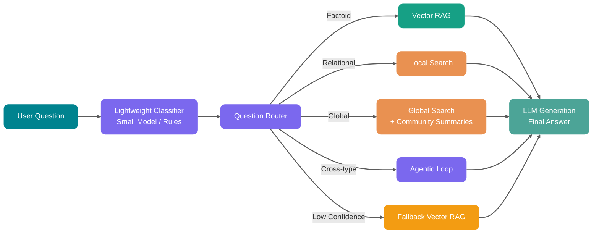

"What recurring risk factors have these departments repeatedly flagged over the past six months, and how do they correlate with one another?" Questions like this require aggregating departmental, risk, project, vendor, and chronological evidence across disparate documents. While Top-K dense vector retrieval can surface semantically similar text passages, it does not explicitly capture or preserve relationships linking these entities.

GraphRAG integrates graph structures directly into the retrieval pipeline, structuring cross-document evidence via entities, relationships, or thematic community summaries. Deciding whether to adopt it depends on whether existing RAG failure cases concentrate around multi-hop relational traversal and global corpus-wide synthesis.

## What is RAG?


RAG (Retrieval-Augmented Generation) is an architecture that couples information retrieval systems with generative large language models.

Its core thesis is straightforward: before prompting an LLM to answer questions or generate text, relevant context is retrieved from external knowledge sources (such as databases, document repositories, or enterprise knowledge bases). The prompt then passes both the raw user query and the retrieved context into the LLM. This enables the model to produce answers that are more accurate, timely, and aligned with domain-specific knowledge.

In traditional RAG, the primary retrieval unit is a chunk—a discrete passage of text. This setup excels at answering questions where "the answer resides cleanly within a few specific passages," such as organizational policy lookups, API parameter queries, and localized factual lookups.

## What is GraphRAG?


GraphRAG (Graph-based Retrieval-Augmented Generation) represents a class of architectures that leverage graph structures for retrieval augmentation. The system explicitly models entities, relationships, and structured contexts extracted from documents; during query execution, it collects evidence by traversing graph connections before passing context to the LLM.

GraphRAG is an umbrella term; underlying indexing pipelines and query patterns vary significantly across implementations. Hierarchical community summaries, Global Search, Local Search, and DRIFT Search originate primarily from Microsoft's GraphRAG framework. Conversely, Neo4j-centric implementations often operate directly on labeled property graphs, Cypher traversals, full-text, and vector indices without mandating pre-generated community summaries.

GraphRAG brings nodes, edges, relational paths, and community summaries into the retrieval context; a graph database is merely one implementation choice for persisting this topology.

Traditional vector RAG retrieves chunks—isolated text blocks. GraphRAG navigates a connected relational knowledge network composed of nodes, edges, paths, and community summaries, synthesizing these structural relationships with raw source text to formulate answers.

By way of analogy:

- **Vector RAG** is like searching a vast library for a handful of pages sharing semantic similarity.
- **GraphRAG** is like first compiling an organizational chart, event timelines, and thematic indices, then tracing interconnected relationship lines to assemble complete evidence.

Vector RAG excels at judging "whether this paragraph sounds like my question," whereas GraphRAG excels at comprehending "how these disparate entities are actually interconnected."

## What Are the Limitations of Traditional Vector RAG?


Dense vector search projects both documents and queries into a shared embedding space, fetches Top-K chunks based on cosine or distance metrics, and supplies them to the LLM. This short, linear pipeline works well when evidence is localized within a few passages:

- "What is the return and refund policy?"
- "What is the rate limiting threshold for this API?"
- "How do I configure a vector database in Spring AI?"

For these questions, the core conditions and answers are co-located within the same section; once the correct paragraph is retrieved, the model simply extracts and formats the facts.

Cross-document synthesis is fundamentally different. System ownership, upstream/downstream dependencies, and post-mortem incident logs often reside across separate documents and chapters. Formulating a coherent answer requires first establishing linkages among these fragmented facts.

### 1. Chunks Are Isolated Information Silos

Chunking cuts long documents into retrievable units, but simultaneously severs facts spanning multiple sections. In an enterprise system, architecture definitions, lead engineers, database dependencies, and production incident post-mortems may appear in entirely different documents. Once indexed, they no longer share an explicit business identity.

Vector similarity can surface related paragraphs, but it cannot intrinsically recognize that these paragraphs represent interconnected upstream and downstream evidence for a single system. Semantic proximity is fundamentally distinct from structural relational integrity.

### 2. Vector Similarity Struggles with Multi-Hop Reasoning

Consider a user asking:

> "Which incident post-mortems related to the payment pipeline has the lead engineer of System A participated in recently?"

Answering this query demands four constrained, sequential hops: identify the lead engineer of System A, locate incident post-mortems involving that engineer, and filter those records for the payment pipeline.

While the "System A Specification" and "Payment Outage Post-Mortem" documents may both score high similarity, standard Top-K retrieval cannot guide the search engine along the explicit path `System -> Lead Engineer -> Incident -> Pipeline` to assemble complete evidence.

### 3. Global Thematic Questions Cannot Be Answered by Top-K Chunks

An even more challenging class of queries involves holistic corpus understanding:

- "What are the primary categories of customer complaints over the past quarter?"
- "What recurring architectural risks have appeared across company repositories over the past year?"
- "What overarching strategic themes do these quarterly reports point toward?"

These questions require aggregation and thematic synthesis across the entire corpus. A localized Top-K retrieval window encounters a structural dilemma:

- Retrieve too few chunks: The model misses the macro pattern.
- Retrieve too many chunks: Token expenditures and context noise explode uncontrollably.

Expanding Top-K, introducing rerankers, or applying query rewriting can refine candidate quality, but they remain fundamentally anchored to passage ranking. When relational chains or macro themes lack explicit structural representations, increasing candidate volume does not eliminate the underlying limitation.

## Differences Between GraphRAG and Traditional Vector RAG


| Dimension | Traditional Vector RAG | GraphRAG |
| --- | --- | --- |
| Retrieval Unit | Text Chunks | Entities, relationships, paths, community summaries, source passages |
| Core Capability | Semantic similarity matching | Relational reasoning, graph traversal, global thematic aggregation |
| Data Structure | Primarily vector indices | Knowledge graph + vector index + full-text index |
| Ideal Queries | Localized factoid QA, section explanation | Multi-hop relational QA, cross-document synthesis, complex business analysis |
| Explainability | Relies primarily on cited text spans | Explicitly displays nodes, relationships, graph paths, and original sources |
| Ingestion Cost | Moderate; focused on chunking and embeddings | High; requires extraction, entity disambiguation, ontology modeling, evaluation |
| Query Latency | Typically low (single-digit to tens of ms) | Dependent on graph traversal depth, community summaries, and LLM call volume |
| Maintenance Overhead | Update chunks and vectors | Maintain entities, edges, community hierarchies, and periodic summaries |
| Primary Risk | Missing incomplete context fragments | Systematic misinformation caused by corrupted graph construction |

Deciding whether to introduce graph structures should always begin with an empirical audit of existing RAG failure cases. Missing keywords, severed chunk boundaries, multi-hop entity traversal, and global summarization represent distinct failure modes; the former two should first be addressed via improved document parsing, refined chunking, and hybrid search.

Entity and relation extraction, entity resolution, graph persistence, summarization, and incremental updates introduce substantial engineering complexity. When evaluating, record indexing token usage, build duration, storage footprints, query P95 latency, and answer accuracy on a unified corpus benchmark to verify whether graph retrieval yields tangible improvements on target queries.

If an interviewer asks "What is the difference between GraphRAG and standard RAG?", you can summarize:

> Standard vector RAG primarily retrieves text chunks, making it ideal for localized factual lookups. GraphRAG explicitly preserves entity, relational, and thematic topology: queries can expand along relationship paths from semantic entry points or read hierarchical community summaries for global synthesis. Consequently, entity disambiguation, relation extraction, incremental graph updates, and granular permission enforcement become core system responsibilities.

If asked "When should you NOT use GraphRAG?", add:

> If the workload consists primarily of straightforward document QA, or if the corpus is modest with minimal relational complexity, vector RAG augmented with hybrid search and reranking is far more cost-effective. GraphRAG should be reserved for production scenarios where vector RAG failure cases explicitly stem from multi-hop reasoning, cross-document synthesis, and strict structural constraints.

## Core Concepts of GraphRAG

To understand GraphRAG, break down its foundational building blocks:


### Knowledge Graphs: Structuring Knowledge into Traversable Networks

A Knowledge Graph represents entities, concepts, and their interrelationships via nodes and edges.

- **Nodes**: Represent entities or concepts—such as users, systems, purchase orders, incidents, vendors, or policy clauses.
- **Edges**: Represent directed relationships between entities—such as `OWNS`, `DEPENDS_ON`, `AFFECTS`, `BELONGS_TO`, `CAUSES`, or `CITES`.
- **Properties**: Key-value attributes attached to nodes or edges—such as timestamps, version tags, confidence scores, and source document IDs.

For instance:

```text
User Service --DEPENDS_ON--> Redis Cluster
Redis Cluster --EXPERIENCED--> Connection Pool Exhaustion Incident
Connection Pool Exhaustion Incident --AFFECTS--> Order Placement API
Zhang San --OWNS--> User Service
```

Once these relationships are structured in a graph, the system can reliably answer:

> "What risks are associated with systems owned by Zhang San that could impact the order placement flow?"

Vector RAG sees fragmented paragraphs; a knowledge graph sees explicit connections between business entities.

### Entities: The Atomic Business Objects of GraphRAG

**Entities** constitute the core nodes of the graph.

In GraphRAG, entities are not restricted to traditional NLP definitions like "Person, Location, Organization." They frequently encompass:

- Business systems, e.g., "Order Center"
- Technical components, e.g., "Kafka Consumer Group"
- Regulatory clauses, e.g., "Data Masking Requirement"
- Risk categories, e.g., "Permission Bypass"
- Project milestones, e.g., "Payment Pipeline Load Test"

The quality of entity extraction directly dictates the upper bound of GraphRAG. Extracting too coarsely leaves the graph devoid of actionable detail; extracting too granularly floods the graph with duplicate nodes and noise.

This step closely resembles domain-driven design modeling. Key engineering practices:

- **Enforce extraction schemas via JSON Schema**: Avoid unconstrained free-text parsing to minimize post-processing failures.
- **Design few-shot examples covering positive, negative, and edge cases**: Explicitly guide the LLM on what *not* to extract.
- **Set maximum entity thresholds per chunk**: Prevent LLMs from hallucinating excessive entities in long documents.
- **Mandate a `source_text_span` field on every entity**: Ensure end-to-end traceability and human verification.

### Relationships: Explicitly Connecting Entities

Relationships capture dependencies, causal impacts, ownership, and containment between entities.

Vector RAG can tell you that "Order Center" and "Payment Failure" share semantic closeness, but it cannot inherently verify whether they represent a dependency, a direct causal relationship, an impact, or mere coincidental co-occurrence.

GraphRAG makes these connections explicit:

```text
Order Center --CALLS--> Payment Gateway
Payment Gateway --DEPENDS_ON--> Risk Control Service
Risk Control Service --CAUSED--> Transaction Timeout
```

With explicit relationships, retrieval transitions from flat similarity sorting to structured traversal:

- Traverse immediate neighbors from an entity node.
- Trace upstream and downstream dependencies for a relationship type.
- Calculate blast radiuses from an incident node.
- Discover relevant topical communities from an overarching theme.

This structural traversal is precisely what empowers GraphRAG to resolve multi-hop queries.

### Community Detection: Discovering Thematic Clusters

**Community Detection** is a classical graph algorithm designed to partition densely interconnected nodes into distinct clusters or "communities."

Community detection operates directly on edge density. Consider an enterprise corpus where the following nodes are frequently interconnected:

```text
Payment Gateway, Risk Control Service, Transaction Timeout, Rate Limiting Policy, Canary Release, Alert Escalation
```

Graph algorithms partition these nodes into a unified community; "Payment Stability" is the thematic label generated during the subsequent summarization stage.

Microsoft's GraphRAG framework extracts entities, relationships, and claims, then applies algorithms like Leiden or Louvain to establish hierarchical communities and generate multi-level summaries. Global questions evaluate these summaries to isolate relevant themes, while raw text spans remain preserved for citation traceability.

### Global Search vs. Local Search

GraphRAG architectures frequently distinguish between **Global Search** and **Local Search**.

They serve distinct query scopes. **Local Search** expands outward from known entities to their neighbors and linked text chunks, catering to:

- "Which services does the Order Center depend on?"
- "Which internal projects are affected by Vendor A?"
- "What is the upstream and downstream call path for this incident?"

The retrieval entry point is an entity, and the returned context comprises adjacent nodes, relationship paths, and associated source text snippets.

**Global Search** addresses holistic, thematic inquiries across the entire corpus:

- "What recurring risk themes emerge across these audit reports?"
- "How do customer support complaints categorize at a macro level?"
- "What are the most frequent architectural bottlenecks documented by engineering?"

These queries first aggregate hierarchical community summaries, allowing the LLM to synthesize and rank broad patterns; it does not eliminate the need for validating specific factual claims against underlying source documents.

**DRIFT Search** combines entity neighbors with community summaries. When a question focuses on a specific entity but requires cross-community context for a complete answer, DRIFT bridges the gap left by purely localized retrieval.

| Search Mode | Applicable Scenario | Core Mechanism |
| --- | --- | --- |
| Basic Search | Standard factual lookups | Standard Top-K vector retrieval |
| Local Search | Entity-centric question answering | Traversal across entity neighbors and linked concepts |
| DRIFT Search | Entity focus + cross-community relationships | Local graph expansion + community summary context |
| Global Search | Global thematic synthesis | Map-Reduce over hierarchical community summaries |

## GraphRAG Ingestion and Query Architecture

### Ingestion Pipeline: Transforming Documents into Knowledge Graphs

The ingestion workflow from unstructured documents to a queryable graph unfolds as follows:


Indexing proceeds through the following phases:

| Phase | Purpose | Key Risks |
| --- | --- | --- |
| Document Parsing | Extract clean text from PDFs, HTML, Markdown, and databases | OCR errors, distorted tables, version confusion |
| Text Chunking | Segment documents into TextUnits or Chunks | Slicing too small breaks relationships; slicing too large inflates LLM extraction costs |
| Entity Extraction | Identify systems, people, organizations, concepts, and events | Homonyms, aliases, abbreviations, noisy entities |
| Relation Extraction | Identify dependencies, containment, causality, and impacts | Inverted edge directions, overly generalized relation types, low confidence |
| Entity Resolution | Merge duplicate entities; attach properties and source anchors | High disambiguation costs; requires deterministic rules and continuous evaluation |
| Community Detection | Identify densely interconnected thematic clusters | Sparse or noisy graphs degrade community clustering quality |
| Summary Generation | Generate summaries for communities, entities, and edges | LLM summarization risks dropping constraints or hallucinating facts |
| Index Persistence | Write to graph databases, vector indices, and full-text stores | Complexities in incremental updates and permission filtering |

Compared to maintaining simple chunk vectors, graph retrieval mandates entity resolution, edge provenance tracking, and community summary invalidation, expanding the operational surface area.

### Query Pipeline: Classifying Question Types First

The most critical operational step in GraphRAG query execution is **query routing**.

Different question types demand different retrieval mechanisms:

| Question Type | Recommended Retrieval Mechanism | Example |
| --- | --- | --- |
| Local Factoid | Vector search or local graph lookup | "What is the timeout limit for API X?" |
| Entity Relationship | Local graph traversal | "Which services does the Order Center depend on?" |
| Multi-Hop Reasoning | Graph traversal + vector evidence grounding | "Which incidents impacting payment did Engineer X participate in?" |
| Global Synthesis | Community summaries + Global Search | "What are the primary risk themes across these reports?" |
| Structured Filtering | Graph Cypher query or metadata filtering | "Which Q4 2025 projects depend on Vendor A?" |

The mapping between question types and retrieval modes is illustrated below:


A mature production architecture does not route every question through expensive graph pipelines. Simple factual inquiries are resolved cheaper, faster, and more reliably via standard vector retrieval.

## When Should You Use GraphRAG? (And When Should You Not?)

Adopting GraphRAG is justified only when answering queries strictly requires traversing entity relationships, graph paths, or cross-document thematic structures. It expands data governance from chunks and vectors to entities, relationships, summaries, and their revision lifecycles.

Candidate scenarios well-suited for graph augmentation include:

- **Complex Enterprise Knowledge Base QA**: Inquiries requiring cross-departmental, cross-policy, and cross-project reconciliation, e.g., "Which departments are involved in this workflow, and what are their specific obligations?" or "Which historical policies conflict with this new regulation?".
- **IT Architecture & Failure Blast-Radius Analysis**: Natural dependencies connecting services, APIs, databases, message queues, lead engineers, alerts, and incident post-mortems, e.g., "Which core APIs are degraded if the Redis cluster fails?" or "Which systems share a dependency on this vulnerable component?".
- **Financial Risk, Compliance, and Supply Chain**: Domains prioritizing entity relationships over raw text similarity, e.g., relationships linking customers to accounts, corporate entities to ultimate beneficial owners (UBO), vendors to procurement contracts, and legal clauses to statutory frameworks.
- **Cross-Document Thematic Synthesis**: When analyzing customer interviews, research papers, support tickets, and post-mortems for macro patterns, community summaries allow LLMs to perform global synthesis across pre-aggregated thematic clusters.

Conversely, optimizing dense or hybrid retrieval first is significantly more cost-effective under these conditions:

- **Small Corpora and Simple Questions**: If the knowledge base contains only dozens of documents and queries look up specific rules, vector RAG with hybrid search and reranking is vastly superior in ROI.
- **Low-Quality Source Documents**: If source texts suffer from missing subjects, conflicting versions, inconsistent terminology, and broken tables, the extracted graph will be fatally corrupted. Vector RAG errors manifest as "retrieving a few incorrect paragraphs"; GraphRAG errors manifest as "an entire relationship network inverted or hallucinated."
- **Ultra-Low Latency Ingestion**: Entity extraction, community detection, and summary generation impose heavy ingestion overhead. If documents must be searchable within seconds of creation, incremental graph updating costs may prove prohibitive.
- **Lack of Graph Modeling and Evaluation Expertise**: GraphRAG requires continuous decisions on entity ontology, relationship schemas, entity disambiguation, graph error evaluation, and permission boundaries. Without dedicated ownership, the graph quickly devolves into an unmaintainable, expensive black box.

Follow a clear diagnostic sequence: if target documents are missing from candidates, debug parsing, chunking, and retrieval; if candidate documents are fully retrieved but the system fails to assemble their business relationships, proceed with GraphRAG evaluation.

## When Does Neo4j GraphRAG Fit Best?

The Neo4j approach places the graph database at the core of the query pipeline. Vector or full-text searches first locate entity or document nodes, after which Cypher traversals navigate explicitly constrained relationships to collect adjacent nodes, paths, and properties before handing evidence to the LLM.

A query breaks down into: locating starting nodes, traversing relationships, assembling node properties and source text, and generating the answer. Schemas, edge directions, and traversal bounds are explicitly governed by the application rather than inferred on the fly by an LLM.

The `neo4j-graphrag` Python package provides graph ingestion, vector indexing, and diverse retrieval primitives. Retrieval pipelines can dynamically combine full-text, vector, and Cypher queries tailored to query intent:

| Retrieval Pattern | Mechanism | Best Suited For |
| --- | --- | --- |
| **VectorRetriever** | Similarity search over Neo4j vector indices; returns matching nodes and scores | Standard semantic search; candidate entity discovery |
| **VectorCypherRetriever** | Vector search locates seed nodes; Cypher traverses and enriches context | "Find similar documents, then fetch related entities, paths, and properties" |
| **HybridRetriever / HybridCypherRetriever** | Fuses vector and full-text indices, expanding with Cypher when needed | Enterprise corpora where both exact keywords and semantics matter |
| **Text2Cypher** | LLM translates natural language into Cypher based on graph schema | Exact structured filtering, multi-condition queries, tabular reporting |
| **ToolsRetriever** | Wraps multiple retrievers as agent tools for dynamic LLM routing | Complex query routing, dynamic multi-retriever composition |
| **External Vector DB + Neo4j** | Vectors reside in Pinecone/Weaviate/Qdrant, mapped back to Neo4j nodes | Leveraging existing vector infrastructure alongside graph capabilities |

The distinction between `VectorCypherRetriever` and `Text2Cypher` is critical. `VectorCypherRetriever` uses vector search to identify starting nodes, then executes deterministic, pre-parameterized Cypher queries; matching "Payment Gateway" allows deterministic traversal along `[:DEPENDS_ON]`, `[:AFFECTS]`, and `[:OWNER]` to retrieve upstream systems, blast radiuses, and owners with guaranteed path fidelity.

`Text2Cypher` suits structured queries like "Which high-priority projects depend on Vendor A in Q4 2025?". It must be bounded by strict schema whitelisting, query syntax validation, read-only database credentials, result limits, and execution timeouts. High-risk production queries should favor deterministic Cypher templates or semantic layers over unconstrained LLM Cypher generation.

In domains like financial crime, supply chain, IT asset management, access governance, and incident analysis, entity relationships are paramount. The definitive strength of Neo4j GraphRAG is: **connecting the LLM directly to established, verified business relationships rather than forcing the model to guess connections from raw text every time.**

## Other GraphRAG Ecosystem Implementations

Beyond Neo4j, several major architectural routes exist:

| Implementation Path | Core Philosophy | Best Suited For |
| --- | --- | --- |
| **LangChain + Neo4j** | Connects via `Neo4jGraph`, converting natural language to Cypher using `GraphCypherQAChain` | Existing LangChain / LangGraph stacks integrating graph databases into agents or RAG |
| **LlamaIndex PropertyGraphIndex** | Extracts entities and edges from chunks via `kg_extractors` into queryable property graphs | Document ingestion, indexing, and retrieval already standardizing on LlamaIndex |
| **FalkorDB GraphRAG SDK** | GraphRAG built on a graph engine supporting OpenCypher, full-text, vector similarity, and range indices | Teams exploring Neo4j alternatives prioritizing ultra-low latency and multi-tenant graph queries |
| **Lightweight In-House Graph + Vector DB** | Stores core entity relationships in relational tables; vector store handles text, relation tables enrich context | Validating GraphRAG value without introducing a full graph database cluster upfront |

These three paths balance trade-offs differently: graph databases optimize online path traversals; frameworks like LangChain and LlamaIndex maximize reuse of ingestion and agent tooling; lightweight in-house tables minimize initial scope by constraining entity and edge ontologies.

If a stable enterprise graph already exists and queries demand strict relational traversal, evaluate Neo4j. If pipelines and agents are already built on LangChain or LlamaIndex, validate their native graph components first. If the goal is simply verifying whether relational expansion fixes a set of production failures, modeling a few edge tables on your existing database is the fastest way to measure impact.

## Engineering Challenges in GraphRAG

Graph databases only store and traverse data. Text extraction, entity disambiguation, versioning, permission filtering, and incremental maintenance prior to graph ingestion determine whether the graph is reliable for retrieval.

While vector RAG primarily manages documents, chunks, and embeddings, graph retrieval must maintain consistency across entities, edges, provenance links, and security classifications. Operational failures typically cluster around synchronizing these objects.

### 1. Entities Are Prone to Duplication, Hallucination, and Over-Fragmentation

A single business entity appears under multiple aliases:

```text
Order Center, Order Service, order-service, OMS
```

Are these identical entities? When should they merge, and when should they remain separate?

This cannot rely entirely on LLM intuition. Production systems require:

- Controlled vocabularies and enterprise taxonomies
- Alias mapping tables
- Deterministic rule-based matching
- Human-in-the-loop review queues
- Confidence score thresholds
- Regression evaluation sets

Without rigorous entity disambiguation, the graph fragments into disconnected duplicate nodes, severing traversal paths.

### 2. Inverted Relationship Directions Systematically Derail Answers

Relationships are far more prone to extraction errors than entities.

"Service A depends on Service B" versus "Service B depends on Service A" differs by a single arrow direction, but carries inverted operational meaning. Causality, impact, and containment edges are frequently hallucinated or inverted by LLMs.

In production, attach these metadata attributes to every relationship edge:

| Field | Purpose |
| --- | --- |
| `source_doc_id` | Trace back to the source document |
| `source_span` | Locate the exact textual passage proving the relationship |
| `confidence` | Record extraction confidence score |
| `relation_type` | Restrict edges to a strictly governed ontology |
| `updated_at` | Support incremental updates and timestamp pruning |
| `extraction_model_version` | Facilitate re-extraction diffs and A/B benchmarking upon LLM upgrades |

A graph lacking verifiable source provenance should never be trusted for high-stakes operational question answering.

### 3. Community Summaries Are Computationally Expensive

Community summaries facilitate macro-level synthesis, but generating and updating them requires significant LLM invocation overhead:

- Extracting entities and relationships.
- Generating entity descriptions.
- Generating community summaries.
- Regenerating affected summaries upon upstream document mutations.

As corpora scale, entity extraction and summary refreshes multiply indexing costs. Always validate whether community summaries improve answer quality on a targeted benchmark of global queries before committing to multi-level hierarchical summarization and Global Search.

### 4. Updating a Single Document Can Invalidate a Web of Graph Elements

In standard vector RAG, updating a document simply requires deleting old chunks and inserting new chunks and vectors.

In GraphRAG, modifying a single document may invalidate or require recalculating:

- Entity nodes
- Relationship edges
- Community partition boundaries
- Community summaries
- Entity descriptions
- Vector indices
- Permission indices

Full rebuilds amplify compute costs, whereas incremental updates require maintaining dependency graphs tracking source documents to graph elements. You are maintaining an interconnected web of mutating entities, edges, and summaries.

### 5. Permission Filtering Extends Far Beyond Document Boundaries

Enterprise knowledge bases cannot bypass authorization.

In vector RAG, metadata filtering executes before or during retrieval. In GraphRAG, complex authorization questions arise:

- A user can view Node A, but are they authorized to view its neighboring Node B?
- A user can view an edge, but are they permitted to see the target entity it links to?
- Did a community summary ingest facts from documents the current user cannot access?
- Does a global summary inadvertently leak confidential initiatives?

When multiple sources synthesize into a community summary, confidential facts become permanently baked into the summary text. Query-time document ID filtering cannot retroactively scrub this text. Permission boundaries must be enforced during summary generation:

- Partition summaries by stable permission boundaries, querying only partitions fully accessible to the current user; avoid pre-generating summaries across dynamic permission boundaries.
- Retain all source document IDs on summaries for auditing and invalidation sweeps. Because source IDs cannot "filter out" sensitive text already baked into a summary, do not use permission intersections to authorize access.
- Route highly sensitive or frequently mutating corpora through authenticated Local Search, where raw evidence undergoes authorization checks before injection into model prompts.

## How to Implement GraphRAG in Real-World Projects

Start with a solid vector RAG baseline and a limited set of high-value entity relationships, expanding graph scope only after measurable gains are verified.

### Phase 1: Solidify the Vector RAG Baseline

Ensure core retrieval fundamentals are rock solid:

- Robust document parsing.
- Measurable chunking strategies.
- Hybrid Search combining dense vectors and BM25.
- Pluggable reranking models.
- Traceable source citations.
- Reliable permission filtering.

Introducing GraphRAG before these basics are stabilized only compounds systemic complexity.

### Phase 2: Audit Relational Failure Cases

Decide whether to introduce graph structures by classifying production failure cases:

| Failure Type | Suitable for GraphRAG? |
| --- | --- |
| Missed exact keywords | Optimize BM25 and Query Rewrite first |
| Suboptimal chunk boundaries | Optimize chunking strategies first |
| Multi-hop reasoning across entities required | Prime candidate for graph structures |
| Global thematic synthesis across corpus required | Prime candidate for community summaries |
| Strict structured filtering and permissions required | Combine structured database queries |

Only when multi-hop reasoning and global synthesis consistently appear in failed samples does graph investment have a clear, measurable objective; otherwise, resolve the prerequisite issues first.

### Phase 3: Start with a Lightweight Graph

Your first version does not need to be an exhaustive, monolithic ontology.

Build a minimal viable graph:

- Extract only core entities, e.g., Systems, APIs, Owners, Incidents, Policies.
- Restrict edges to a few high-value relationships, e.g., `DEPENDS_ON`, `OWNS`, `AFFECTS`, `BELONGS_TO`, `CITES`.
- Use the graph strictly for retrieval context expansion, not as an ungrounded factual oracle.
- Preserve original source text anchors on every edge.

This validates whether graph augmentation moves core business metrics at minimal computational cost.

### Phase 4: Introduce Community Detection and Global Search

As corpus scale expands and user queries demand broader thematic synthesis, consider community detection and hierarchical summaries.

Focus evaluation on:

- Do community boundaries align with intuitive business domains?
- Do community summaries drop critical operational constraints?
- Do global answers provide stable, verifiable citations?
- Are summaries shielded against permission leaks across user roles?

If evaluation tooling cannot verify these dimensions, do not expose Global Search to high-risk production workflows.

### Phase 5: Implement Dynamic Hybrid RAG Routing

When a single user interface handles factoid, relational, and global queries simultaneously, route requests dynamically based on classified intent:



Key design rules: keep the query classifier explainable, define unambiguous fallback paths, and maintain auditable routing logs.

## Evaluating GraphRAG Systems

Evaluation must decouple "whether the graph retrieved the correct structural evidence" from "whether the model answered faithfully based on that evidence," tracking how these metrics correlate with business outcomes:

### Retrieval Layer Metrics

- **Entity Recall / Relation Recall**: Whether retrieved subgraphs contain the entities and relationships necessary to answer the question.
- **Community Consistency**: Spot-check audits verifying whether community clusters mirror coherent business domains.

### Generation Layer Metrics

- **Faithfulness**: Whether generated answers are strictly grounded in retrieved graph and text context (calculable via RAGAS).
- **Answer Relevance & Context Precision**: Measure whether the response directly addresses the query and whether context provided to the model contains minimal noise.

### Business Layer Metrics

- **User Acceptance Rate, Human Escalation Rate, Citation Click-Through**: Gauges real-world operational effectiveness.
- **Regression Benchmark Suite**: Incorporates production failures and high-stakes questions, expanding in tandem with traffic, mutation velocity, and human annotation bandwidth.

## Comparison with Other RAG Enhancement Paradigms

GraphRAG is one of several enhancement paradigms; understanding adjacent architectures guides technology selection:

| Paradigm | Solves | Leaves Unaddressed |
| --- | --- | --- |
| **Multi-Vector (ColBERT / Late Interaction)** | Fine-grained token matching within chunks | Multi-hop relational traversal |
| **HyDE / Query Rewriting** | Morphological gap between query and documents | Multi-hop structural reasoning |
| **Self-RAG / Corrective RAG** | Answer verification and hallucination detection | Underlying retrieval topology |
| **GraphRAG** | Relational reasoning and macro thematic synthesis | Entity extraction, disambiguation, and maintenance costs |

GraphRAG is a dedicated solution for relational retrieval and global synthesis, but not the only one. RAPTOR, iterative multi-hop retrieval, agentic retrieval, and domain-specific relational SQL can address subsets of these challenges; benchmark costs and benefits on a unified evaluation suite.

## Technology Selection Checklist

Differentiate failure modes first: if text passages are never retrieved, optimize document parsing, BM25, dense retrieval, and reranking; if relevant text is retrieved but the system cannot traverse explicit entity relationships, multi-hop chains, or cross-document themes, evaluate graph augmentation. In pilot implementations, restrict entities and edges to a minimal set of high-value types, preserving source text anchors, versions, and security metadata on every edge.

## Summary

GraphRAG expands the retrieval unit from flat chunks to entities, relationships, paths, and community summaries. This structural representation is what enables systems to resolve multi-hop reasoning, blast-radius calculations, and corpus-wide thematic synthesis.

The operational trade-offs are significant: extraction quality, entity resolution, edge orientation, version synchronization, and authorization boundaries demand dedicated data governance. Where an established enterprise graph exists, Neo4j graph traversals integrate directly into search; systems on LangChain or LlamaIndex can evaluate native graph components. Selection ultimately hinges on existing tech stacks, graph ontology scale, and operational maintenance bandwidth.

Always conduct failure attribution: when source text is missing, refine parsing, chunking, and retrieval; only when source text is present yet impossible to connect via business relationships should you invest in GraphRAG.

## References

- [Neo4j: What Is GraphRAG?](https://neo4j.com/blog/genai/what-is-graphrag/)
- [Neo4j GraphRAG Python Package](https://neo4j.com/docs/neo4j-graphrag-python/current/)
- [Neo4j GraphRAG RAG User Guide](https://neo4j.com/docs/neo4j-graphrag-python/current/user_guide_rag.html)
- [LangChain Neo4j Integration](https://docs.langchain.com/oss/python/integrations/graphs/neo4j_cypher)
- [LlamaIndex PropertyGraphIndex](https://developers.llamaindex.ai/python/framework/module_guides/indexing/lpg_index_guide/)
- [FalkorDB Docs](https://docs.falkordb.com/)
- [RAPTOR: Recursive Abstractive Processing for Tree-Organized Retrieval](https://arxiv.org/abs/2401.18059)
- [GraphRAG: Enterprise Knowledge Retrieval Practice from RAG to GraphRAG](https://juejin.cn/post/7618261670406438964)
- [RAGAS Evaluation Framework](https://docs.ragas.io/)
