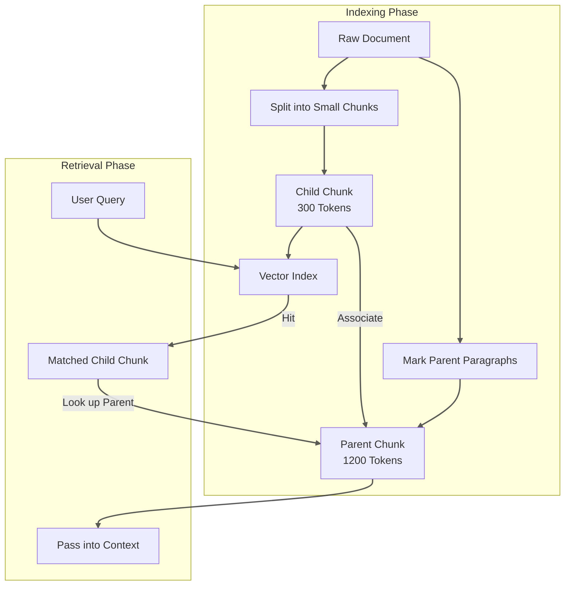
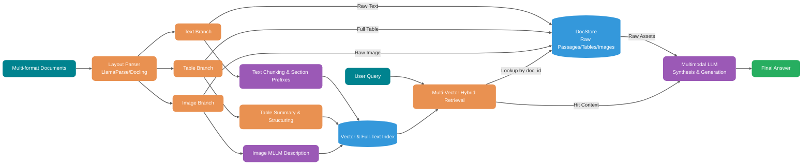

Before RAG can retrieve anything, PDFs, Word documents, Excel sheets, or scanned files must be converted into searchable content. If multi-column reading orders, table row-column relationships, heading hierarchies, or OCR errors are mishandled at this stage, downstream replacements of Embedding models or vector databases cannot recover the lost information.

This article traces the lifecycle of a document—uploading, parsing, chunking, validation, and multimodal ingestion—explaining engineering practices and boundaries for each phase.

## What Stages Does a Document Go Through from Upload to Ingestion?

A document must pass through at least six stages between upload and vector database ingestion:


Quality validation cannot be deferred until after ingestion. Incorporating hierarchical sampling validation during parsing and Chunking intercepts corrupted files, garbled characters, and abnormal chunking early, preventing low-quality data from being written en masse into the vector store.

Common issues and their downstream impacts at each stage include:

| Stage | Typical Issues | Downstream Impact |
| --- | --- | --- |
| File Upload | Forged formats, oversized files, conflicting encodings | Parser crashes or silent failures |
| Format Validation | File extension mismatches actual MIME type | Selecting the wrong parser |
| Layout Parsing | Multi-column PDFs, merged table cells, headers/footers | Structural loss, context misalignment |
| Cleaning & Denoising | Garbled characters, special symbols, duplicate blank lines, residual TOC | Noise in the index, distorted Embeddings |
| Chunking | Semantic truncation, broken context, chunks too large or too small | Inaccurate recall, incomplete answers |
| Metadata | Missing source, page numbers, version, permissions | Inability to filter or cite sources |
| Ingestion | Inconsistent vector dimensions, exceeding Token limits | Search failures, corrupted indices |

Embedding models and vector databases can only process the text fed to them. Once disordered multi-column PDF reading flows, broken table associations, or OCR typos enter the index, the retrieval phase cannot reconstruct the original structure from vectors.

## How to Choose the Right Chunking Strategy?


### Fixed-Length Chunking: Establishing an Evaluation Baseline

Fixed-length chunking only requires setting a chunk size (`chunk_size`) and chunk overlap (`chunk_overlap`), such as splitting every 512 Tokens with an overlap of 50 to 100 Tokens.

This method is simple to implement and computationally trivial. It serves effectively as an evaluation baseline for short documents and single-item FAQ scenarios. Its limitation is that it is completely agnostic to paragraph, table, and code block boundaries.

For example, consider a post-sales policy stating:

> Except for the following circumstances, all items are eligible for a 7-day unconditional return: (1) Custom-made goods; (2) Fresh and perishable goods; (3) Digital products downloaded online...

If this list falls directly across a fixed-length chunk boundary, the preceding chunk contains only "Except for the following circumstances, all items are eligible for a 7-day unconditional return", while the subsequent chunk starts with "(1) Custom-made goods...". Regardless of which chunk is retrieved, the context is incomplete, and the model can easily overlook restrictions. Before evaluating more sophisticated chunking schemes, run your benchmark question set through fixed-length chunking first, and observe whether structured chunking significantly resolves such boundary truncation.

### Recursive Character Chunking: Preserving Paragraph and Sentence Boundaries

Recursive Character Splitting tries separators sequentially based on a defined priority list (e.g., `["\n\n", "\n", ".", " ", ""]`). Only when a natural paragraph exceeds the target chunk size does it drop down to split by line breaks or periods. This keeps sections, paragraphs, and sentences intact as much as possible within the designated Token budget.

Documents with non-standard heading hierarchies and varied paragraph lengths (such as tech blogs, product manuals, and research reports) usually prioritize this strategy. LangChain's `RecursiveCharacterTextSplitter` is a canonical implementation. For general Chinese or English technical documentation, start testing with a chunk size of 400–800 Tokens and an overlap of 10%–15%. For code files, use language-aware splitters like `RecursiveCharacterTextSplitter.from_language(Language.PYTHON, ...)`, which prioritize syntactic boundaries such as `class` and `def` to avoid severing a single function body in half.

### Semantic Chunking: Grouping by Thematic Boundaries

Semantic Chunking does not rely directly on fixed character counts. Instead, it first segments text into sentences using sentence delimiters, computes the cosine distance between Embeddings of adjacent sentences or sliding windows, and introduces a split only when the semantic distance changes sharply beyond a threshold (such as a percentile or standard deviation threshold). This clusters semantically coherent sentences into the same chunk.

The trade-off of this strategy is that the offline build phase must compute Embeddings for a large number of individual sentences, significantly driving up indexing time and cost compared to character-based chunking. If minimum and maximum chunk constraints (`min_chunk_size` / `max_chunk_size`) are not configured, locations with frequent topic shifts will produce tiny fragments of only one or two sentences, whereas lengthy single-topic passages may exceed the context budget. Before deploying, always check the chunk length distribution: mean, P95, and the proportion of undersized chunks.

### Structural Chunking: Reusing Layout and Syntactic Boundaries

When a document inherently possesses a clear layout or syntactic structure, splitting along structural boundaries is generally much more robust than purely statistical character splitting.

In layout-rigid documents like financial reports and legal contracts, a single page often corresponds to a relatively self-contained topical unit. NVIDIA benchmark tests on financial reports and legal documents showed that Page-Level Chunking achieved an average accuracy of 0.648 with lower variance than fixed-token chunking. However, page-level chunking does not win across all datasets: on the FinanceBench benchmark, a 1024-Token chunking strategy achieved slightly higher accuracy (0.579) than page-level chunking (0.566). If a PDF is merely a standard Word document casually exported with reflowed pagination, the page break carries no semantic meaning, and page-level chunking yields no benefit. Furthermore, factual queries generally favor fine-grained chunks of 256–512 Tokens, while cross-paragraph analytical queries benefit more from 1024+ Tokens or page-level chunking.

Common document structures and their starting chunking approaches:

| Document Type | Recommended Chunking Approach | Common Tools / Strategy |
| --- | --- | --- |
| Markdown | Split by heading hierarchy (H1/H2/H3) | `MarkdownHeaderTextSplitter` + secondary recursive splitting for oversized sections |
| HTML | Split by semantic tags (`h1`~`h6`, `p`, `div`) | `HTMLHeaderTextSplitter` / `HTMLSectionSplitter` |
| PDF | Split by section headings, tables, or pages | Docling, LlamaParse, `chunk_by_title` |
| Code | Split by AST, classes, functions | Tree-sitter, `RecursiveCharacterTextSplitter.from_language` |
| Laws & Contracts | Split by part, chapter, section, article, clause | Regex structural recognition + hierarchical path backfilling |

### Parent-Child Chunking: Decoupling Retrieval Granularity from Reading Granularity

Vector search requires smaller, topic-focused text chunks to improve matching precision, while generative models require longer passages containing prerequisite conditions and broader context. Parent-Child Chunking decouples these two objectives: it generates vectors and builds indices using small Child Chunks (~200–400 Tokens), which link via `parent_id` to larger Parent Chunks (~1000–1500 Tokens) or encompassing chapters. When an online search hits a child chunk, the system deduplicates by `parent_id` and retrieves the corresponding parent chunk to feed into the LLM context.



This pattern is highly effective in lengthy technical manuals, regulatory compilations, and troubleshooting runbooks. The trade-off is that the storage layer must maintain an additional document store (DocStore) for parent chunks, and retrieval involves an extra batch lookup by primary key.

### Overlap Control: Mitigating Boundary Truncation

Regardless of whether fixed-length or recursive chunking is employed, chunk boundaries can sever a single continuous concept. Setting an overlap window allows sentences near the boundary to appear simultaneously in both adjacent Chunks. However, an excessively large overlap expands index volume and causes Top-K retrieval results to return large amounts of duplicate text.

For general text, establishing a baseline with a 512-Token chunk length and a 50–100 Token overlap is a reliable starting point. For code, statutory clauses, and standalone tables, prioritize keeping the syntactic or clause unit intact, only using overlapping splits if a single unit is excessively long. While academic literature often reports accuracy swings of tens of percentage points between different chunking strategies (e.g., [an experiment on 30 medical Q&A samples](https://pubmed.ncbi.nlm.nih.gov/41301150/) comparing adaptive chunking against fixed chunking), such conclusions depend heavily on specific corpora and question designs. Parameter choices must always be verified on your proprietary evaluation benchmark.

## What Is Semantic Loss, and Why Does It Happen?


Semantic loss occurs when prerequisite conditions, referential antecedents, or structural relationships within the original document are weakened or stripped during parsing, cleaning, or chunking. As a result, the isolated Chunk cannot convey its true intended meaning.

### Four Common Scenarios of Semantic Loss

1. **Separation of Conditions and Conclusions**: A business rule specifies application criteria in the first half and approval workflows in the second half. An exception clause in the middle ("If condition X is met, supplementary material Y is required") happens to land right on a chunk boundary, leaving both chunks lacking critical constraints.
2. **Loss of Antecedent and Background**: A chunk retains only isolated body text, losing its parent section title. When the model reads "Over the past three years, this ratio has steadily declined", it cannot determine whether "this ratio" refers to a supplier's defect rate or a business line's product return rate.
3. **Destruction of Table Row-Column Relations**: Multi-row, multi-column tables are flattened into an unaligned string of plain text by generic text extractors, obliterating correspondences between headers, row keys, and numeric data cells.
4. **Truncation or Breaking of Proper Nouns**: Hyphenated line breaks in English PDFs (e.g., `micro-\nservice`), OCR misrecognitions (e.g., recognizing `OAuth2` as `0Auth2`), or rigid character splits can shatter product models, API identifiers, or internal codenames, preventing both vector and keyword searches from matching.

### Why a Single-Chunk Embedding Cannot Rescue Lost Context

Standard Embedding models encode only the text of a single Chunk at a time. If the cross-paragraph subject, scope of application, and table headers are not preserved within the current chunk, the generated vector reflects only local literal phrasing.

In engineering, context can be augmented in four ways, ordered from lowest to highest implementation cost:

1. **Section Path Backfilling (Title / Breadcrumb Prepends)**: During chunking, prepend the document title and hierarchical parent headings to each Chunk (e.g., `[Order System > Refund Rules > Special Items] Body text...`), while also recording them in Metadata. This approach incurs almost no additional compute yet effectively eliminates ambiguous references.
2. **Multi-Entry Retrieval Expansion (Summaries & Hypothetical Questions)**: Generate a concise summary or 2–3 potential user questions for important Chunks (e.g., mapping colloquial question "How do I get my money back?" to formal text "Refund Application Process"). Indexing question vectors alongside body text vectors against the same chunk narrows the lexical gap between informal user queries and formal documentation.
3. **Contextual Chunking**: Proposed by teams like Anthropic, this approach invokes a small LLM after chunking to generate a 50–100 Token contextual explanation for each Chunk based on the whole document. This context is prepended before computing Embeddings and BM25 indices. The accuracy gain is substantial, but offline ingestion incurs additional LLM Token costs, which can be mitigated via Prompt Caching.
4. **Late Chunking**: First pass the entire long document (within the window of a long-context Embedding model, such as 8192 Tokens) through the Transformer encoder layer, allowing each Token's hidden state to integrate full-text attention. Finally, apply Mean Pooling to Token vectors according to Chunk boundaries. This preserves full-document referential information without invoking a generative LLM, making it well-suited for local long-context embedding models.

## How to Handle Structural Loss?


Different file formats lose structure for completely different reasons during parsing, and cannot all be relegated to a single plain-text extractor.

### Multi-Column PDF Layouts and Complex Tables

PDFs are essentially collections of page-drawing instructions; the underlying storage order of text objects does not necessarily match human reading order. If a dual-column research paper or financial report is extracted using basic PyPDF in stream order, it frequently concatenates the top half of the left column with the top half of the right column on the same line. When dealing with multi-line merged cells or borderless financial tables, row-column misalignment becomes even more severe.

Such documents require Layout-Aware Parsers. These use vision models to recognize bounding boxes for titles, body columns, tables, formulas, headers, and footers, reconstructing the proper reading flow before extracting text. For open-source options, evaluate Docling (with its built-in TableFormer for table structure), MinerU, or Marker; for commercial or cloud services, evaluate LlamaParse, Azure Document Intelligence, etc. For high-value documents such as contracts and financial statements, if parsed table column counts fluctuate or numerical totals fail to reconcile, flag the affected pages and route them to a human review queue.

### Word Heading Hierarchy Restoration

Word (`.docx`) documents typically rely on paragraph styles (`Heading 1`, `Heading 2`, Normal) to organize structure. However, real-world business documents frequently suffer from improper formatting: some authors simply bold and enlarge normal paragraphs to serve as titles, use only Heading 1 throughout, or place a Heading 2 immediately beneath a Heading 1 without intervening text.

When parsing Word documents, you must not only read paragraph styles or outline levels, but also maintain a stack to track the current heading hierarchy path. This prevents parent titles from being overwritten by subsequent child titles and captures introductory content preceding the first heading:

```python
from docx import Document


def extract_sections(doc_path):
    """
    Extract section content based on Word heading hierarchy and preserve the full section path (section_path).
    """
    doc = Document(doc_path)
    heading_stack = []  # Elements are (level, heading_text)
    current_content = []

    def current_path():
        return " / ".join(text for _, text in heading_stack) if heading_stack else "Document Introduction"

    for para in doc.paragraphs:
        text = para.text.strip()
        if not text:
            continue

        style_name = para.style.name if para.style else ""
        if style_name.startswith("Heading"):
            # Output accumulated body text before encountering a new heading
            if current_content:
                yield {
                    "section_path": current_path(),
                    "content": "\n".join(current_content),
                }
                current_content = []

            # Parse heading level (e.g., "Heading 2" -> 2), pop headings of same or deeper level from stack
            parts = style_name.split()
            level = int(parts[1]) if len(parts) > 1 and parts[1].isdigit() else 1
            while heading_stack and heading_stack[-1][0] >= level:
                heading_stack.pop()
            heading_stack.append((level, text))
        else:
            current_content.append(text)

    if current_content:
        yield {
            "section_path": current_path(),
            "content": "\n".join(current_content),
        }
```

### Excel Field Association

Cell meanings in Excel are jointly determined by row headers, column headers, merged cells, and sheet names. If cells are flattened into plain text, the link between field names and numerical values is severed.

When processing Excel or CSV files, first identify the active data region and multi-level headers, then convert them based on document purpose:

- **Detailed & Statistical Reports**: Concatenate each row (or aggregated records) into JSON or Markdown table rows containing complete header key-value pairs, appending Sheet name, reporting scope, and units.
- **Configuration & Parameter Mapping Tables**: Assemble "Parameter Name - Default Value - Description" into self-contained entries.
- **Large-Scale Numeric Tables**: If user queries frequently involve sums, year-over-year calculations, or conditional filtering, vector search on text chunks is prone to calculation errors. In such cases, sync structured tables into a relational database and query via Text2SQL or tool calling.

### OCR Quality Control for Scanned Files

Scanned PDFs and image documents depend on OCR to convert into text. Recognition accuracy is heavily affected by resolution, stamp occlusions, tilt, and handwritten annotations. Common errors cluster in three areas: character confusion (e.g., digit `0` vs letter `O`, digit `1` vs letter `l`), which breaks retrieval of product serial numbers and contract IDs; broken table borders causing cross-column row merging; and multi-column or annotation text blending into the main body, scrambling paragraphs.

When handling scanned documents, apply image deskewing and denoising prior to OCR, and select an engine supporting layout analysis (e.g., PaddleOCR, Surya, Google Document AI, or AWS Textract). For critical fields like model numbers, national ID numbers, and financial amounts, validate before ingestion using regular expressions or business rules (such as checking if the sum of sub-items equals the total). Pages failing validation should trigger alerts or manual verification.

## How to Design a Hierarchical Validation Strategy?


Documents uploaded in production environments vary widely in quality. A document processing pipeline must establish validation gates across upload, parsing, and chunking, while maintaining explicit fallback paths for failed documents.

### Three Validation Gates

The first gate is file format validation at the upload stage. Before persisting to disk or queuing for parsing, verify file extensions, true MIME types (using Magic Bytes via tools like Apache Tika to prevent renaming `.exe` or corrupted archives to `.pdf`), file sizes, and encryption status.

```java
public class DocumentValidationException extends RuntimeException {
  private final ValidationErrorType errorType;
  private final String fileName;
  private final Object rejectedValue;

  public enum ValidationErrorType {
    FILE_TOO_LARGE,     // File size exceeds limit
    UNSUPPORTED_FORMAT, // Unsupported format
    MIME_TYPE_MISMATCH, // Extension does not match actual MIME type
    CORRUPTED_FILE,     // Corrupted file or encrypted/unreadable
    EMPTY_FILE,         // Empty file
    ENCODING_ERROR      // Character encoding error
  }
}
```

The second gate is parsing result validation. After the parser extracts text, check whether character counts are empty or anomalously low (for instance, a 50-page scanned PDF yielding only dozens of whitespace characters from a plain text parser indicates it must be routed to OCR), and calculate the proportion of garbled characters (such as replacement characters like `` and non-printable control characters).

```java
public class ParseResultValidator {

  public ValidationResult validate(DocumentParseResult parseResult) {
    List<String> errors = new ArrayList<>();

    if (parseResult.getContent().isEmpty()) {
      errors.add("Parsed content is empty, possibly a pure scanned image or encrypted document");
    }

    double garbledRate = calculateGarbledRate(parseResult.getContent());
    if (garbledRate > 0.05) { // More than 5% garbled characters
      errors.add("Garbled character rate is too high: " + String.format("%.2f%%", garbledRate * 100));
    }

    int contentLength = parseResult.getContent().length();
    if (contentLength < 50) {
      errors.add("Valid content is too short, parsing may be incomplete");
    }
    if (contentLength > 10_000_000) {
      errors.add("Single document text exceeds maximum limit, needs chapter-based splitting");
    }

    if (parseResult.hasStructure()) {
      validateStructure(parseResult.getStructure()).forEach(errors::add);
    }

    return new ValidationResult(errors);
  }
}
```

The third gate is chunking quality validation. After Chunking, inspect total chunks generated, minimum/maximum lengths, and length standard deviation to detect whether numerous tiny fragments of only a few characters or giant chunks exceeding Embedding token limits were generated.

```java
public class ChunkingQualityReport {
  private final int totalChunks;
  private final int totalCharacters;
  private final double averageChunkSize;
  private final int minChunkSize;
  private final int maxChunkSize;
  private final double chunkSizeStdDev;

  private final List<String> warnings = new ArrayList<>();
  private final List<String> errors = new ArrayList<>();

  public boolean isAcceptable() {
    if (chunkSizeStdDev > averageChunkSize * 0.5) {
      warnings.add("Large fluctuation in chunk size distribution, please check if structural separators match the current document");
    }

    if (minChunkSize < 20) {
      warnings.add("Tiny fragmented chunks exist, recommended to merge into adjacent chunks");
    }

    if (maxChunkSize > 5000) {
      errors.add("Overly large chunk exists, likely exceeds Embedding model Token limit");
    }

    return errors.isEmpty();
  }
}
```

### Fallback Strategies for Anomalies

When validation fails, pages cannot simply be discarded silently. Instead, route them according to the failure reason:

| Failure Type | Handling Strategy |
| --- | --- |
| Empty file or forged format | Reject ingestion immediately, record audit logs, return clear error codes to caller |
| Pure scanned image PDF | Automatically route to OCR + layout analysis pipeline for re-extraction |
| Complex parser failure | Retry with secondary backup parser; if still failing, route to manual review queue |
| Structural chunking anomaly | Merge fragmented chunks or fall back to recursive character splitting with section prefixes |
| Partial page parse failure | Record missing page numbers and mark document status as "partially available"; halt release for legal/contracts |

If 10 pages of tables fail parsing in a 100-page document, never mark the remaining 90 pages as "completely ingested". For contracts, regulations, and financial reports requiring evidence completeness, missing pages must block release and trigger human intervention. For general reference materials where partial ingestion is permissible, missing page numbers must be recorded in document metadata to prevent the system from returning definitive answers on omitted content.

## How to Handle Multimodal Content?

Real-world enterprise documents are filled with architecture diagrams, UI screenshots, flowcharts, multi-page tables, and statistical charts. If the parsing pipeline discards non-text elements, questions touching on diagrams and workflows will result in erroneous answers due to missing evidence.

### Three Handling Paths for Image Content

First, filter out non-informative images during parsing—such as header logos, background patterns, and purely decorative icons (using dimensions, aspect ratios, or recurring cross-page coordinates). Only ingest screenshots, architecture diagrams, and flowcharts carrying business information. Three approaches are commonly used:

1. **Multimodal Embeddings (e.g., CLIP / SigLIP / ColPali) + Raw Image Return**: Encode images directly into a vision-text aligned vector space (or generate multi-vector representations directly from document page images as in ColPali). At query time, match text vectors against image vectors; once hit, retrieve the original image from object storage and pass it to a Multimodal Large Language Model (MLLM) to answer. Note that standard CLIP models perform well on natural images, but offer limited discriminative power on system architecture diagrams or error screenshots packed with dense small text and intricate wiring.
2. **MLLM Image Captioning + Text Retrieval**: Call a vision model offline (supplying surrounding section headings and body paragraphs referencing the image) to generate a detailed textual description. Write this text into standard vector and full-text indices, while retaining the raw image URI in Metadata.
3. **Multi-Vector Retriever**: Formalize the second approach into an architectural pattern: store searchable structured summaries of images (containing extracted text, node flows, key conclusions) in the vector store, while storing high-resolution original images in a DocStore (e.g., object storage + key-value store). When search hits a summary, retrieve the raw image by `doc_id` and pass it alongside text context into the multimodal LLM.

```python
# LangChain Multi-Vector Retriever Example
# Note: In LangChain 0.3, import from langchain.retrievers.multi_vector; in LangChain 1.0+, migrated to langchain_classic
from langchain_classic.retrievers.multi_vector import MultiVectorRetriever
from langchain_core.stores import InMemoryByteStore

# Vector store stores text summaries of images/tables for retrieval matching
vectorstore = Chroma(
    collection_name="multimodal_summaries",
    embedding_function=OpenAIEmbeddings(),
)

# DocStore stores raw image bytes or full table contents (replace with S3 + Redis/PostgreSQL in production)
docstore = InMemoryByteStore()

retriever = MultiVectorRetriever(
    vectorstore=vectorstore,
    byte_store=docstore,
    id_key="doc_id",
    search_kwargs={"k": 5},
)
```

### Structural Preservation of Table Content

When tables are split as continuous plain text, not only do headers become disconnected from values, but rows split in the middle lose header associations entirely. Engineering best practices combine the following techniques:

1. **Preserve Structured Formats**: Use tools like Docling or LlamaParse to reconstruct tables into Markdown tables, HTML `<table>` (preserving `rowspan` and `colspan` information), or JSON row arrays. If a large table exceeds the Chunk length limit, every split sub-chunk must re-prepend the complete table header at the top.
2. **Generate Table Semantic Summaries**: Purely numeric financial or monitoring tables are difficult to align with natural language queries in vector space. Generate a textual summary for each table detailing its parent section, table title, timeframe, statistical dimensions, and core metrics (e.g., "East China Region 2024 Product Line Sales Summary Table, containing Q1/Q2 sales volume and QoQ growth rates for Phone A and Phone B, Unit: Units"). Build vector indices on the summaries; upon retrieval hits, feed the complete Markdown/JSON table into the generation context.

### Context Binding for Charts

The meaning of line graphs, bar charts, and pie charts relies heavily on captions, axis labels, legends, units of measurement, and explanatory paragraphs in the surrounding text. When calling an MLLM offline to extract chart data, pass along the caption and neighboring paragraphs on that page. Require the model to output a structured description (encompassing metrics, timeframes, units, extrema, and trend conclusions) alongside an equivalent data table, preventing the model from misinterpreting "Millions" as "Dollars" or confusing legend series.

### Complete Multimodal RAG Pipeline

Chaining text, table, and image parsing, summary indexing, and original asset retrieval yields the complete multimodal processing architecture:



The core design of this pipeline separates retrieval representations from generation assets: vector and full-text indices store easily matchable text chunks, table summaries, and image descriptions; the DocStore retains uncompressed full tables, parent paragraphs, and high-res images, which are assembled and passed to the generation model upon retrieval by `doc_id`.

## How to Build a Document Processing Pipeline from Scratch?


When architecting an enterprise document processing pipeline, advance in stages based on format complexity rather than applying costly vision models across all files from day one:

1. **Stage 1 (Structured Plain Text Baseline)**: Implement parsing for Markdown, HTML, and standardized Word documents first. Build heading-hierarchy recursive chunking, attach `doc_id`, `section_path`, update timestamps, and permission ACLs to Metadata, and validate against a basic benchmark set.
2. **Stage 2 (Complex PDF Layouts & Table Governance)**: For multi-column PDFs, merged-cell tables, and scanned files, integrate layout-aware parsers like Docling, MinerU, or LlamaParse alongside OCR pipelines. Implement three-tiered quality checks, table header duplication across split chunks, and fallback queues for anomalous documents.
3. **Stage 3 (Parent-Child Chunking & Multimodal Expansion)**: When error analysis reveals tension between fine-grained retrieval and long-context completeness, introduce Parent-Child chunking or section contextual augmentation. When business logic relies heavily on flowcharts, architecture diagrams, or financial charts, add MLLM chart descriptions and Multi-Vector retrieval as needed.

## Summary

Document processing and chunking determine whether complete, accurate evidence exists in the index in the first place. When deploying or tuning parsers and chunking parameters, always verify these four checkpoints:

1. **Layout & Structural Fidelity**: Spot-check multi-column PDF reading orders, cross-page table row-column alignments, Word/Markdown section paths (`section_path`), and OCR accuracy on critical fields in scanned files.
2. **Chunk Granularity & Contextual Completeness**: Verify that chunks do not sever prerequisites from conclusions, that long table splits repeat headers, and track chunk length distributions and fragment ratios.
3. **Complete & Auditable Metadata**: Ensure every chunk binds source document ID, version number, page number, section path, and permission ACLs to enable pre-filtering and answer citation tracing.
4. **Static Benchmark Regression**: Whenever parsers change or `chunk_size` / `chunk_overlap` parameters are adjusted, compare Context Recall and final answer accuracy across the same question set covering tables, cross-paragraph constraints, and specialized terminology.

## References

- [Databricks: Mastering Chunking Strategies for RAG](https://community.databricks.com/t5/technical-blog/the-ultimate-guide-to-chunking-strategies-for-rag-applications/ba-p/113089)
- [Firecrawl: Best Chunking Strategies for RAG in 2026](https://www.firecrawl.dev/blog/best-chunking-strategies-rag)
- [Premiere AI: RAG Chunking Strategies 2026 Benchmark Guide](https://blog.premai.io/rag-chunking-strategies-the-2026-benchmark-guide/)
- [Weaviate: Chunking Strategies to Improve LLM RAG Pipeline Performance](https://weaviate.io/blog/chunking-strategies-for-rag)
- [Omdena: Document Parsing for RAG - A Complete Guide for 2026](https://www.omdena.com/blog/document-parsing-for-rag)
- [DataCamp: Multimodal RAG - A Hands-On Guide](https://www.datacamp.com/tutorial/multimodal-rag)
- [LangChain: Multi-Vector Retriever for RAG on Tables, Text, and Images](https://www.langchain.com/blog/semi-structured-multi-modal-rag)
- [Procycons: PDF Data Extraction Benchmark 2025](https://procycons.com/en/blogs/pdf-data-extraction-benchmark/)
- [LlamaIndex: Mastering PDF Parsing](https://www.llamaindex.ai/blog/mastering-pdfs-extracting-sections-headings-paragraphs-and-tables-with-cutting-edge-parser-faea18870125)
