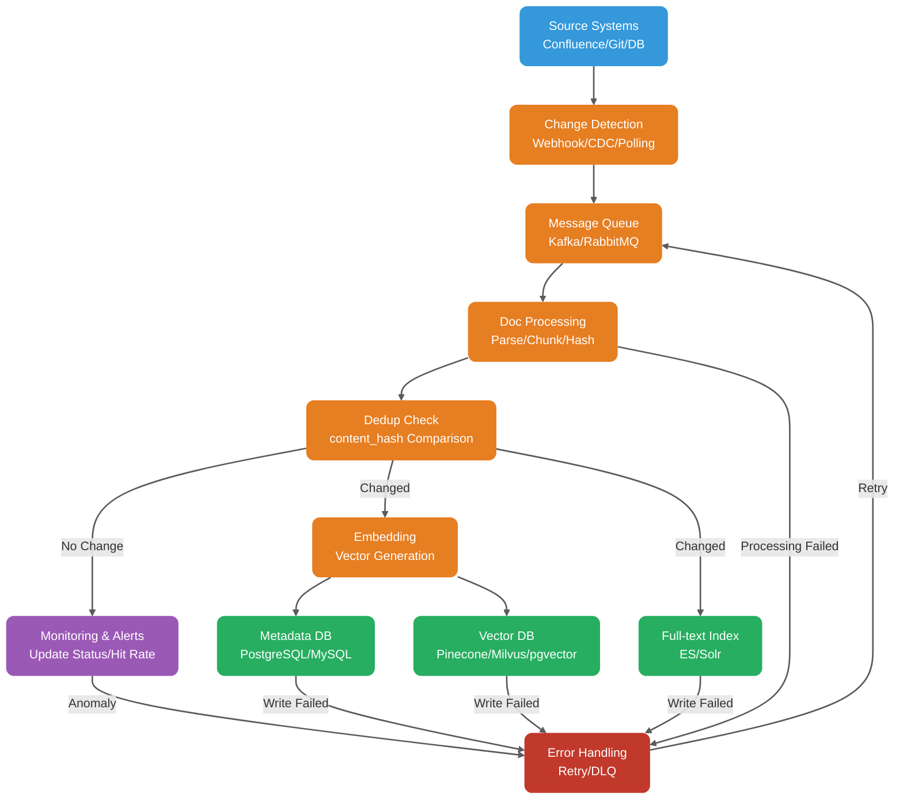
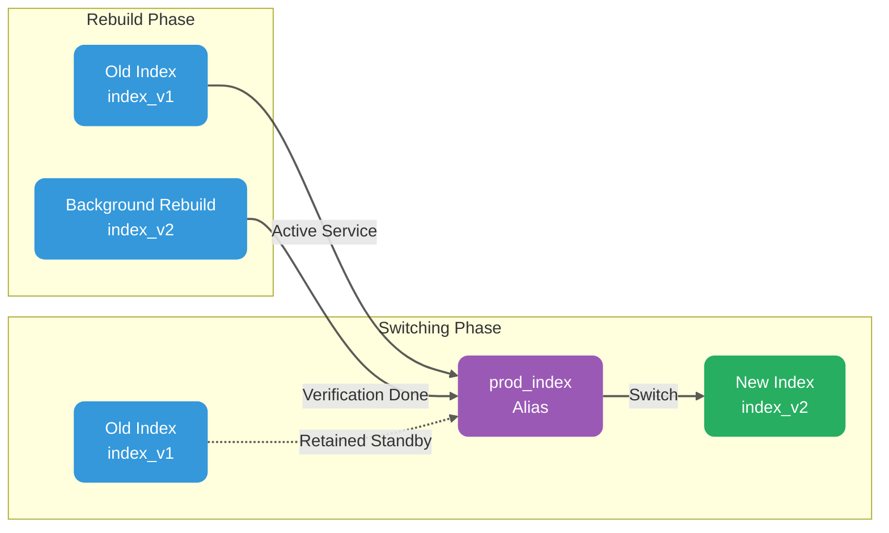

After launching their first enterprise knowledge base RAG system, many engineering teams encounter a very real frustration: documents were clearly updated, yet the model's answers remain stubbornly unchanged.

Before blaming the LLM, investigate the data pipeline. A far more common cause is that the knowledge base index was never synchronized, or the update pipeline only implemented "inserting new content" while ignoring older versions, access permissions, and cross-index consistency.

As document modifications become more frequent, problems compound: rebuilding the entire index every time is unsustainable in terms of computing cost and processing time; updating only delta changes risks leaving orphaned outdated chunks; appending new vectors without purging old revisions causes stale data to be continuously retrieved; and when switching embedding models, deciding whether and how to re-index historical corpora becomes unavoidable.

Updating a knowledge base requires handling document versions, permissions, and consistency across heterogeneous storage systems simultaneously. Following the lifecycle of create, update, and delete events, this article details how incremental synchronization, full rebuilds, canary deployments, rollbacks, and observability operate together.

## What Problems Must Knowledge Base Updates Solve?

Before diving into architectural solutions, let us clarify the core objectives.

Once an update finishes, retrieval results must reflect the current source documents without leaking permissions; when synchronization fails, the system must pinpoint the offending document and target storage system, while retaining the capability to revert to the previous index state.

Dynamism means that as documents evolve, indices must keep pace. "Timeliness" is not necessarily sub-second; it might be minute-level or daily, depending on business real-time requirements. An internal HR policy repository may only need daily batch synchronization, whereas customer support manuals and regulatory compliance rules require near-real-time updates.

Accuracy means retrieved content after an update strictly matches the latest document version; the model must not quote superseded revisions after an upstream edit has landed. When this fails, user trust erodes immediately.

Consistency is significantly more complex. A single document may exist across multiple revisions, while vector stores, metadata databases, and full-text search engines operate as independent distributed systems. Any partial failure or replication lag introduces split-brain discrepancies.

Rollback capability ensures that during an operational failure, you can swiftly revert traffic to the previous healthy state rather than frantically patching corrupt production data by hand. Observability requires that every step in the ingestion pipeline can be monitored, outcomes evaluated, and failure root causes tracked to specific components.

While these goals sound fundamental, many projects only implement the naive first step—"upload and insert"—leaving everything else to luck. The inevitable consequence: documents evolve through ten revisions while answers remain stuck on version 1; or a sensitive document is deleted, yet continues surfacing in user query responses months later.

## Why Must the Embedding Model Remain Strictly Consistent?

This principle must be underscored independently: the embedding model used during indexing must be 100% identical to the embedding model used during query time.

Embedding models project textual semantics into high-dimensional vector spaces, and vector geometries from different models are fundamentally incompatible. Encoding a sentence with OpenAI's `text-embedding-3-small` versus sentence-transformers' `all-MiniLM-L6-v2` produces vectors with zero comparative mathematical meaning. If index ingestion uses Model A while query retrieval uses Model B, the system is computing vector similarities across two disjoint mathematical universes.

The failure manifestation depends partly on vector dimensionality. If dimensions differ, vectors cannot even reside within the same index, and most vector databases will reject inserts or queries outright. If dimensions happen to align but the underlying models differ, similarity scores become completely meaningless and retrieved candidates become untrustworthy. This is not mere "minor randomness"—the entire foundational ranking mechanism is corrupted.

In production, two scenarios frequently trigger this mistake:

**First: Model Upgrades.** The business decides a new model yields superior quality and wishes to migrate from `text-embedding-3-small` to `text-embedding-3-large`. This requires every historical record to be re-encoded and re-indexed. Engineering techniques like dual-index parallelism and canary traffic shifting mitigate downtime risks, but re-indexing cannot be bypassed.

**Second: Mixing Local and Remote API Models.** Development and testing environments run a local sentence-transformers model, while production uses OpenAI's API. This discrepancy is surprisingly common in multi-engineer teams: local tests appear pristine, but production recall collapses upon deployment.

A robust operational practice is writing embedding model parameters directly into chunk metadata and strictly validating the active model version on every search request. If a mismatch is detected, the system should either reject the query or log high-priority alerts while degrading to a conservative keyword-based fallback.

| Field | Description | Example |
| --- | --- | --- |
| `embedding_model` | Model name | `text-embedding-3-large` |
| `embedding_model_version` | Model release version | `2025-01-15` |
| `embedding_dimension` | Vector dimensionality | `3072` |

When upgrading embedding models, execute the following phased workflow:

1. Rebuild the entire corpus from scratch using the new model inside a newly provisioned index.
2. Run the old and new indices in parallel, comparing retrieval hit rates and answer quality across regression benchmarks.
3. Once the new index is validated, swap production traffic to it atomically via an index alias.
4. Retain the old index for a designated cooling period to enable instant rollback if hidden regressions emerge.
5. Decommission and drop the old index only after complete operational stability is confirmed.

This approach mirrors blue-green database deployments: never mutate in-place; build a fresh secondary environment, verify thoroughly, and cut over cleanly.

## How to Design an Update-Friendly Metadata Schema?

A well-architected metadata schema is the foundation for incremental updates, permission enforcement, and rollbacks. When RAG systems degrade over time, it is rarely because they lack raw text, but because they lose track of which document, revision, timestamp, and security classification each vector belongs to.

Every indexed chunk should carry at least the following metadata:

```json
{
  "doc_id": "doc-uuid-001",
  "chunk_id": "chunk-uuid-001",
  "content_hash": "sha256:abc123...",
  "version_id": 3,
  "chunk_strategy": "semantic",
  "chunk_size": 512,
  "chunk_overlap": 50,
  "source_id": "confluence-page-123",
  "source_type": "confluence",
  "title": "Order Center API Documentation",
  "section_path": "Technical Docs / Order System / API Specifications",
  "page": 5,
  "tenant_id": "tenant-001",
  "acl": ["role:admin", "team:order-team"],
  "created_at": "2025-03-01T10:00:00Z",
  "updated_at": "2025-04-15T14:30:00Z",
  "embedding_model": "text-embedding-3-large",
  "embedding_model_version": "2025-01-15",
  "embedding_dimension": 3072,
  "is_deleted": false
}
```

Chunking configurations must also be versioned. Altering chunking algorithms, overlap ratios, or document parsers alters the vector distribution just as heavily as changing embedding models, warranting full rebuilds or canary dual-indexing. Recording `chunk_strategy`, `chunk_size`, and `chunk_overlap` ensures objective baselines for evaluation and rollbacks.

`content_hash` is the linchpin of incremental updates. It is computed not over the raw file binary, but over the cleaned body text or individual chunk content. Common choices include: MD5 (fast, but possesses collision risks; acceptable only in collision-insensitive settings); SHA-256 (near-zero collision risk, strongly recommended for enterprise production); and SimHash (useful for near-duplicate web scraping, but incapable of pinpointing precise delta modifications).

In production, `content_hash` determines whether a specific text chunk has mutated. During ingestion, compute the hash and compare it against the metadata database. If hashes match, the content is unchanged and embedding generation can be safely skipped; if they diverge, the passage must be re-encoded.

`version_id` tracks sequential modification counts. With every document update, increment `version_id` by one. Paired with `content_hash`, it provides change auditability and straightforward rollbacks.

`is_deleted` represents a soft-delete tombstone. Purging records from a vector database without recording a tombstone in the metadata store destroys audit trails, recovery options, and cross-system reconciliation. When a delete event arrives, set `is_deleted = true`; when documents are re-uploaded, create a fresh version or revive the record with a recomputed `content_hash`; at query time, filter for `is_deleted = false` by default.

Soft deletes provide a critical buffer window for compliance auditing, accidental deletion recovery, asynchronous physical garbage collection, and distributed system consistency.

`tenant_id` and `acl` form the cornerstone of multi-tenancy and data isolation. All content destined for model prompts must pass strict authorization filters. Enforcing tenant, role, and resource ACL checks before or during retrieval prevents unauthorized chunks from consuming valuable Top-K slots or leaking into model contexts. Complex rules such as dynamic attribute-based access control (ABAC) or cross-organizational inheritance can be re-validated after candidate retrieval, but this secondary verification must occur strictly before assembling the LLM context; a final defensive check should also precede the generation of source citations.

## How to Synchronize Inserts, Updates, and Deletes?

Moving documents from source systems into vector indices involves multiple decoupled stages. A failure at any point leads to persistent data drift.



Special care must be taken regarding partial successes. Vector stores, relational metadata databases, and full-text search clusters rarely share a distributed transaction domain. Writing simultaneously to three heterogeneous targets frequently results in partial failures. The most resilient pattern designates the relational metadata database as the single source of truth, tracking indexing state per chunk (e.g., `index_status = 'ready' / 'partial_failed'`). Background reconciliation workers periodically retry failed target stores and resolve cross-system drift.

### Inserting New Documents

Insertion is the simplest of the three operations: parse the raw document, extracting body text, headings, and hierarchy; segment into chunks according to established chunking rules; calculate each chunk's `content_hash`; verify whether the hash already exists; if new, generate vector embeddings and write transactionally or idempotently across vector, metadata, and full-text engines.

Idempotency is paramount. Ingestion pipelines must safely tolerate repeated invocations. Whether a message broker redelivers a duplicate message or an ingestion worker crashes and restarts mid-task, duplicate chunk entities must never be created.

### Modifying Documents

Modifications are significantly more intricate because existing historical vectors must be managed safely.

You must avoid scenarios where queries concurrently observe mixed versions, as well as transient windows where no version is retrievable. The standard architectural pattern writes the new version invisibly first, then performs an atomic cutover:

1. Query the metadata store by `doc_id` to retrieve the current active version and its existing list of `chunk_id` records.
2. Ingest new chunks, vectors, and full-text records with an incremented `version_id`, maintaining `status = 'building'` so they are excluded from production search.
3. Validate write success across all storage layers, then atomically switch the active version pointer in the metadata database or swap the index alias.
4. Mark the preceding version as deleted and schedule asynchronous garbage collection per data retention policies.

If the vector database natively supports primary-key upserts (such as Milvus), you can directly overwrite records sharing identical keys. However, note that upserts only overwrite entities with matching primary keys. If modified text alters total chunk counts or shifts chunk boundaries, stale chunks from the previous layout will remain unless explicitly pruned by `doc_id + version_id`.

If the storage layer cannot atomically replace an entire document collection, rely on an `active_version` metadata filter, an index alias, or dual-index switching. Deleting old records before writing new ones causes transient outages; writing new records without version gating results in queries retrieving contradictory mixed-version snippets.

A rampant anti-pattern is inserting new vectors while neglecting to purge old ones.

If a document undergoes 10 revisions and the vector store retains all 10 historical sets as queryable entities, retrieval will inevitably surface obsolete facts. The update pipeline must deactivate historical versions and purge stale vectors according to retention policies, otherwise knowledge base accuracy deteriorates continually.

### Deleting Documents

Deletion splits into soft deletion and physical deletion.

Soft deletion updates the `is_deleted` flag to `true`. This retains revision history and facilitates recovery from accidental deletions, but cannot satisfy regulatory mandates requiring immediate data erasure (such as GDPR).

Physical deletion scrubs the record entirely from vector databases, metadata tables, full-text indices, and edge caches. The retention duration for soft-deleted records should be dictated by business recovery objectives (RPO/RTO), data sensitivity, and compliance mandates rather than arbitrary hardcoded day counts.

Soft deletion streamlines audits and recovery at the expense of higher storage footprints and filter evaluation costs. Physical deletion is definitive and mandatory for compliance or sensitive data purges, but makes recovery expensive. Production systems typically adopt "soft delete + delayed asynchronous physical purge + immutable audit logging". For highly confidential documents, secondary caches—such as reranker caches and LLM context caches—must also be invalidated immediately.

Deletion also harbors a subtle vulnerability: "ghost data" arising from permission changes. Consider a document originally accessible to all employees, subsequently restricted to "Executives Only." If the vector index retains the outdated `acl` metadata, standard employee queries may still retrieve the sensitive content. Permission modifications must immediately trigger re-indexing or an atomic metadata-only ACL update in the vector database if supported.

## Incremental Updates vs. Full Rebuilds: Choosing the Right Strategy

The standard architecture uses incremental synchronization for day-to-day document edits, reserving full rebuilds for model migrations, chunking re-architectures, or catastrophic data corruption. The necessity of periodic full rebuilds depends on underlying vector index algorithms, mutation rates, and reconciliation outcomes.

| Dimension | Incremental Updates | Full Rebuilds |
| --- | --- | --- |
| Trigger Condition | Document mutation events | Scheduled jobs or manual operational triggers |
| Scope | Only modified documents | Entire knowledge base repository |
| Compute Cost | Low; processes delta changes only | High; requires re-encoding the entire corpus |
| Update Latency | Low; near-real-time to minutes | High; may require multiple hours |
| Consistency | Bound to change detection accuracy | Guarantees snapshot consistency against source systems |
| Applicable Scenarios | Daily mutations, frequent edits | Model migrations, chunking re-architecture, disaster recovery |
| Primary Risk | Missed events result in silent data drift | Heavy compute/storage consumption; risks downtime if cutover fails |

### When to Use Incremental Updates?

Incremental updates suit environments with moderate change frequency, tight latency requirements, and substantial repository scale—such as organizations experiencing dozens to hundreds of document edits daily where minute-level synchronization is expected and full rebuilds are cost-prohibitive.

Incremental pipelines rely on change detection mechanisms:

1. Webhooks / Event-Driven: Source platforms (e.g., Confluence, GitHub, GitLab, CMS databases) push mutation webhooks consumed directly by RAG pipelines. Offers lowest latency, provided source platforms support webhooks.
2. Change Data Capture (CDC): Streams database transaction logs (such as MySQL binlog or PostgreSQL WAL) to capture data deltas. Highly effective for structured databases.
3. Scheduled Polling: Periodically scans source systems (e.g., every 5 minutes), comparing `updated_at` timestamps. Simple to implement, but introduces latency and places recurrent query load on source systems.

Resilient production architectures combine event-driven triggers with periodic polling fallbacks. Event streams handle low-latency updates, while polling catches missed webhooks. A message broker (such as Kafka or RocketMQ) decouples source systems from compute-heavy RAG ingestion workers.

### When to Use Full Rebuilds?

Full rebuilds are mandatory under the following conditions:

- Embedding model upgrades. This is a non-negotiable mathematical requirement.
- Fundamental chunking strategy redesigns—such as migrating from fixed 500-token windows to semantic chunking. This can be handled via full rebuilds or versioned multi-index batch migrations, provided query pipelines can cleanly distinguish strategy versions.
- Data schema overhauls, such as introducing or restructuring core metadata dimensions.
- Disaster recovery, such as when an ingestion outage went unnoticed for extended periods, leaving indices severely degraded.
- Routine index health maintenance. Certain vector index implementations accumulate tombstone markers and fragmented memory under heavy delete workloads, eventually degrading search recall. This behavior depends on the underlying index algorithm (e.g., HNSW with tombstone cleanup); always verify against vector database vendor documentation.

The critical danger of a full rebuild is service interruption. Mitigate this risk via atomic index alias swapping:



The execution steps unfold as follows:

1. Query services route traffic through an abstraction alias (`prod_index`), currently mapped to physical index `index_v1`.
2. A background worker builds a new physical index (`index_v2`) from scratch without touching production traffic.
3. Once `index_v2` passes automated validation, re-point `prod_index` to `index_v2` atomically. Milvus and Elasticsearch support instantaneous alias switching across collections/indices; verify equivalent capabilities if using other engines.
4. Retain `index_v1` in read-only standby mode for a defined safety period (e.g., 7 days) to guarantee instantaneous rollback.
5. Drop `index_v1` once performance and stability metrics remain green.

### Steady-State Production Strategy

In steady state, capture daily changes via Webhook or CDC streams, while periodic polling and reconciliation scanners detect dropped events, missed deletions, or out-of-order writes. Trigger full rebuilds on-demand: when upgrading models, overhauling index schemas, or when reconciliation metrics indicate persistent drift. While some teams schedule recurring rebuilds, the cadence must reflect index implementation, deletion volume, compute expenditure, and drift metrics rather than arbitrary calendar intervals.

## Building a Reliable Ingestion Pipeline

### Idempotent Updates: The Backbone of Message Consumption

Message brokers inevitably redeliver messages due to network partitions, consumer crashes, rebalances, or uncommitted offsets.

Idempotency requires reliable deduplication keys, typically formed from unique constraints on `doc_id + content_hash` or `doc_id + version_id`. Under concurrent processing, naive "check-then-insert" logic is vulnerable to race conditions: duplicate or out-of-order messages arriving simultaneously can overwrite or duplicate records.

Robust patterns include:

1. Database Unique Constraints: Place unique indices on `doc_id + content_hash` or `doc_id + version_id`, allowing the database engine to enforce uniqueness atomically.
2. Optimistic / Distributed Locking: Acquire a lock on the document entity before writing a new revision to serialize concurrent mutations.
3. Transactional Outbox: Write mutation events to an internal transactional outbox table before workers process them idempotently.

The implementation below reinforces unique constraints with an explicit state machine. `index_status` transitions through `pending`, `processing`, `partial_failed`, and `ready`; `claim_token` and `claimed_at` prevent multiple workers from racing on the same entity while allowing timed-out tasks to be safely reclaimed.

```python
from uuid import uuid4


def process_document_change(event):
    doc_id = event['doc_id']
    content = event['content']
    version_id = event.get('version_id', 1)
    chunk_hash = compute_hash(content)

    # Use the full content hash to avoid prefix collisions on varying text
    chunk_id = f"{doc_id}_{version_id}_{chunk_hash}"

    # Duplicate events do not create new rows; failed rows resume from their existing state
    db.execute("""
        INSERT INTO chunks (
            doc_id, chunk_id, content_hash, version_id, is_deleted, index_status
        )
        VALUES (
            :doc_id, :chunk_id, :content_hash, :version_id, false, 'pending'
        )
        ON CONFLICT (doc_id, chunk_id) DO NOTHING
    """, {
        'doc_id': doc_id,
        'chunk_id': chunk_id,
        'content_hash': chunk_hash,
        'version_id': version_id
    })

    claim_token = str(uuid4())
    claimed = db.fetch_one("""
        UPDATE chunks
        SET index_status = 'processing',
            claim_token = :claim_token,
            claimed_at = CURRENT_TIMESTAMP
        WHERE doc_id = :doc_id
          AND chunk_id = :chunk_id
          AND (
              index_status IN ('pending', 'partial_failed')
              OR (
                  index_status = 'processing'
                  AND claimed_at < CURRENT_TIMESTAMP - INTERVAL '10 minutes'
              )
          )
        RETURNING chunk_id
    """, {
        'doc_id': doc_id,
        'chunk_id': chunk_id,
        'claim_token': claim_token
    })

    # If the task was not claimed, it is already complete or active on another worker
    if claimed is None:
        logger.info(f"Doc {doc_id} is ready or being processed, skipping")
        return

    try:
        # Upsert using chunk_id as idempotent key; repeated executions never duplicate vectors
        embedding = embedding_model.encode(content)
        vector_db.upsert(doc_id, chunk_id, embedding, {
            'doc_id': doc_id,
            'content_hash': chunk_hash,
            'version_id': version_id,
            'updated_at': now()
        })

        db.execute("""
            UPDATE chunks
            SET index_status = 'ready',
                claim_token = NULL,
                claimed_at = NULL
        WHERE doc_id = :doc_id
          AND chunk_id = :chunk_id
          AND claim_token = :claim_token
        """, {
            'doc_id': doc_id,
            'chunk_id': chunk_id,
            'claim_token': claim_token
        })
    except Exception as e:
        db.execute("""
            UPDATE chunks
            SET index_status = 'partial_failed',
                claim_token = NULL,
                claimed_at = NULL
        WHERE doc_id = :doc_id
          AND chunk_id = :chunk_id
          AND claim_token = :claim_token
        """, {
            'doc_id': doc_id,
            'chunk_id': chunk_id,
            'claim_token': claim_token
        })
        logger.error(f"Failed to process {doc_id}: {e}")
        raise
```

The database unique constraint guarantees deduplication, conditional updates atomically claim tasks, and `partial_failed` ensures subsequent retry sweeps resume vector ingestion. PostgreSQL-style `RETURNING` clauses eliminate reliance on driver-dependent `rowcount` behaviors. If relational and vector databases cannot share a single transaction, vector mutations must be keyed idempotently by `chunk_id`; even if vectors are written but the status update fails, retries can safely re-execute the `upsert`. In production, scheduled cron jobs should also sweep for tasks that remain in `processing` beyond their lease duration.

### Handling Out-of-Order Events

Message brokers do not guarantee global FIFO ordering across distributed partitions. Receiving version v3 prior to version v2 is a frequent occurrence. Without explicit ordering controls, stale versions will overwrite newer ones.

Mitigate out-of-order mutations with these practices:

1. Ensure every event carries `source_version`, `updated_at`, or a monotonically increasing `revision` sequence.
2. Prior to writing, verify that `event.version >= current_version`; discard stale events or route them to audit logs.
3. Enforce partition-level ordering for identical entities by keying Kafka messages by `doc_id`, ensuring all mutations for a document route to the same partition.
4. Instrument metrics for discarded out-of-order events to detect upstream source anomalies.

### Retry Logic and Dead Letter Queues (DLQ)

Any link in the ingestion chain can fail: network timeouts, API rate limits, transient vector store unavailability, or malformed document structures.

Adopt exponential backoff retries paired with Dead Letter Queues (DLQ):

```python
def process_with_retry(event, max_retries=3):
    # max_retries defines total retries permitted after initial failure
    for attempt in range(max_retries + 1):
        try:
            process_document_change(event)
            return  # Succeeded, return cleanly
        except TransientError as e:
            if attempt == max_retries:
                break
            wait_time = 2 ** (attempt + 1)  # Exponential backoff: 2s, 4s, 8s
            logger.warning(f"Attempt {attempt + 1} failed: {e}, retrying in {wait_time}s")
            time.sleep(wait_time)
        except PermanentError as e:
            # Permanent errors (e.g., malformed format) should not retry; route to DLQ immediately
            logger.error(f"Permanent error, sending to DLQ: {e}")
            dlq.send(event, reason=str(e))
            return

    # Maximum retry threshold exceeded; route to DLQ and trigger high-priority alerts
    logger.error(f"Max retries exceeded for {event['doc_id']}")
    dlq.send(event, reason="max_retries_exceeded")
    alert.trigger(f"Document update failed after {max_retries} retries: {event['doc_id']}")
```

Categorizing errors is crucial. Transient errors such as network timeouts and rate limits warrant backoff retries; permanent errors like malformed payloads or missing mandatory schema fields must never be retried endlessly, as they consume resources without hope of success.

Dead letter queues must not become write-only cemeteries. Establish regular operational reviews (e.g., weekly) to diagnose root causes and re-ingest resolved events.

### Rollback Mechanisms: The Emergency Evacuation Route

A rollback mechanism is not an afterthought; it is an essential emergency evacuation route. It must empower operators to quickly restore the system to its last known good state.

Alias swapping provides the fastest rollback. If an issue is detected post-cutover, re-point the alias back to the old index immediately—assuming the standby index has not yet been dropped.

For model upgrade rollbacks, archive the previous model's `model_name`, `model_version`, and corresponding index identifiers prior to upgrading. If the new model behaves anomalously, revert both the query embedding model and index pointer in tandem; full rebuilds with the old model are only necessary if the historical index was already decommissioned.

For data version rollbacks, leverage `updated_at` and `version_id`. When rolling back to a specific point in time, restore from point-in-time snapshots stored in object storage or native vector database backups.

Permission rollbacks demand extreme urgency. If an ACL synchronization failure leaks restricted data, do not attempt gradual index repairs; immediately sever the blast radius: disable the affected knowledge base or tenant search endpoint, deactivate the compromised index, and mandate query-time authorization checks. Resort to full service maintenance only if the breach perimeter cannot be circumscribed.

```python
def rollback_to_version(target_version_id):
    # Fetch snapshot metadata for the target version
    snapshot = get_snapshot(version_id=target_version_id)
    if not snapshot:
        raise ValueError(f"No snapshot found for version {target_version_id}")

    # Set service to maintenance mode
    service.set_status('maintenance')

    # Restore vector database from snapshot
    vector_db.restore(snapshot)

    # Re-enable active traffic
    service.set_status('active')

    # Broadcast notification alert
    alert.trigger(f"System rolled back to version {target_version_id}")
```

### Canary Deployments: Validating New Indices with Limited Traffic

Knowledge base updates should follow phased canary deployments just like application releases.

Standard canary strategies include: canary by corpus percentage (e.g., update 10% of documents first); canary by user cohort (e.g., route 5% of internal or beta users to the new index); or canary by query category (e.g., validate exact-match queries that are especially sensitive to indexing regressions).

Monitor critical metrics closely throughout the canary phase. The thresholds below illustrate typical alert triggers and must be calibrated against historical baselines, offline benchmarks, and production A/B tests rather than copied blindly:

| Metric | Definition | Alert Threshold |
| --- | --- | --- |
| `retrieval_hit_rate@10` | Percentage of Top-10 results containing ground-truth answers | Drop > 5% |
| `avg_answer_latency` | Average end-to-end response latency | Increase > 20% |
| `citation_accuracy` | Accuracy of cited reference sources | Drop > 3% |
| `user_feedback_negative_rate` | Ratio of negative user feedback / thumbs down | Increase > 2% |

If any core indicator trips an alarm threshold, halt the canary immediately and investigate. Never wait until full global rollout to discover degraded retrieval quality.

## Common Pitfalls in Knowledge Base Updates

### Pitfall 1: Appending New Vectors Without Purging Old Ones

This is the single most common operational error. When a document is modified 5 times, 5 historical vector versions linger in the database. Queries hit obsolete chunks, leading the LLM to generate answers based on superseded facts.

The solution is straightforward but non-negotiable: purge or deactivate older chunks during modification. Before or during new version ingestion, clean up stale chunks linked to `doc_id`.

### Pitfall 2: Mixing Embedding Models

Using Model A for indexing and Model B for query retrieval renders vector distances meaningless due to incompatible coordinate spaces.

The remedy is enforcing `embedding_model` and `embedding_model_version` as required metadata fields. Validate model versions before running vector queries, rejecting or gracefully degrading requests upon mismatch.

### Pitfall 3: Altering Chunking Rules Without Historical Re-Indexing

Switching from fixed-length windows to semantic chunking, or shifting from 500 to 800 tokens, only affects newly ingested documents while historical data remains untouched. This pollutes the knowledge base with contradictory segmentation boundaries, compromising retrieval benchmarks.

The fix is versioning chunking strategies. Perform a full rebuild or migrate historical documents into a new versioned index before switching the active alias; never mix unversioned chunking logic within the same active index.

### Pitfall 4: Retrieving Deleted Documents

Occurs when soft deletion fails, or when delete logic cleans the vector store while missing the full-text engine.

Deletions must execute consistently across vector, metadata, and full-text tiers. A reliable pattern records mutation events via the transactional outbox pattern, consumed idempotently by background workers; periodic reconciliation sweeps then compare source systems, metadata, vector stores, and full-text engines to heal orphaned, dropped, or out-of-order deletions.

### Pitfall 5: Desynchronized Permission Metadata

Document permissions are updated from "Public" to "Admin Only," but the `acl` metadata on vector chunks is never refreshed.

Permission mutations must trigger immediate document re-indexing or atomic ACL metadata updates in the vector store, provided the vector database natively supports in-place metadata modifications.

### Pitfall 6: Silent Change Detection Misses

Dropped webhooks, CDC replication lag, or excessively wide polling intervals cause documents to change upstream while indices remain frozen.

The remediation is pairing event-driven triggers with periodic polling sweeps. Simultaneously, instrument freshness monitoring to periodically compare `updated_at` timestamps between source systems and vector stores. If source timestamps outpace index timestamps beyond a configured threshold, trigger alerts and automated re-indexing.

## Ensuring Observability in Knowledge Base Updates

The knowledge base update pipeline must be fully instrumented; otherwise, you are flying blind. Whether updates succeed, which step failed, and whether compensations were executed must not be discovered via customer complaints.

Start by tracking these essential operational metrics:

| Metric | Description | Recommended Alert Threshold |
| --- | --- | --- |
| `index_lag_seconds` | Elapsed time from source mutation to completed indexing | > 5 minutes |
| `failed_updates_total` | Cumulative count of failed update operations | > 0 for 10 consecutive minutes |
| `dlq_size` | Current backlog depth in Dead Letter Queue | > 100 |
| `retrieval_hit_rate` | Retrieval accuracy rate | Period-over-period drop > 5% |
| `stale_docs_count` | Count of source-updated documents not yet refreshed in index | > 10 |
| `source_to_queue_lag_seconds` | Latency from source mutation to queue ingestion | > 1 minute |
| `queue_to_index_lag_seconds` | Latency from queue ingestion to index write completion | > 5 minutes |
| `index_success_rate` | Indexing operation success rate | < 99% |
| `partial_index_count` | Count of documents partially written across storage layers | > 0 for 30 consecutive minutes |
| `acl_mismatch_count` | Discrepancies between source ACLs and indexed ACLs | > 0 |

Every update operation must produce an immutable audit log capturing: `doc_id`, `change_type` (create / update / delete), `timestamp`, `operator` (automated / manual), `result` (success / failure), and `error_message`. When production incidents occur, these logs pinpoint the precise document, component, and timestamp where failure originated.

## Production Pre-Launch Checklist

Verify four fundamentals before promoting to production:

1. Indexing and query pipelines execute against the exact same embedding model name and release version;
2. All retrieved candidate chunks pass mandatory authorization checks before entering model prompt contexts;
3. Document modifications transition atomically via active version pointers or index aliases; failures across vector databases, metadata stores, full-text engines, or caches are detected by reconciliation workers;
4. `doc_id`, `content_hash`, `version_id`, indexing state machines, and audit logging span the entire lifecycle end-to-end.

## Summary

Maintaining a RAG knowledge base is far more than scheduling a cron job to re-index files. It encompasses change detection, distributed consistency, idempotent persistence, versioning, canary rollouts, rollback orchestration, and comprehensive observability.

Keep these key conclusions in mind:

Embedding model consistency is a strict rule. Upgrading models requires a complete index rebuild; shortcuts do not exist.

Metadata architecture is the foundation for incremental updates. Fields like `doc_id`, `content_hash`, `version_id`, and `is_deleted` underpin idempotent ingestion, version lineage, and rollback execution.

Deletions must synchronize across all three storage tiers: vector database, metadata database, and full-text index. Otherwise, ghost data will inevitably surface.

Incremental updates handle day-to-day modifications, while full rebuilds maintain long-term architectural hygiene. Operating them in tandem prevents systemic data drift over time.

Index alias switching is the industry standard for production-grade canary rollouts and instant rollbacks: build the new index, validate it thoroughly, cut over atomically, and retain the previous index as a safety net.

Idempotency, retries, and dead letter queues form the baseline for ingestion reliability. Observability is the final line of defense: if you cannot verify whether an update succeeded, assume it failed.

Knowledge base maintenance does not end upon launching a RAG application—it is where the real operational work begins.

## References

- [How to Update RAG Knowledge Base Without Rebuilding Everything](https://particula.tech/blog/update-rag-knowledge-without-rebuilding)
- [RAG Knowledge Base Management: Updates & Refresh](https://apxml.com/courses/optimizing-rag-for-production/chapter-7-rag-scalability-reliability-maintainability/rag-knowledge-base-updates)
- [RAG in Practice: Versioning, Observability, and Evaluation in Production](https://pub.towardsai.net/rag-in-practice-exploring-versioning-observability-and-evaluation-in-production-systems-85dc28e1d9a8)
- [RAG in Production: Deployment Strategies & Practical Considerations](https://coralogix.com/ai-blog/rag-in-production-deployment-strategies-and-practical-considerations/)
- [23 RAG Pitfalls and How to Fix Them](https://www.nb-data.com/p/23-rag-pitfalls-and-how-to-fix-them)
- [Incremental Indexing Strategies for Large RAG Systems](https://medium.com/@vasanthancomrads/incremental-indexing-strategies-for-large-rag-systems-e3e5a9e2ced7)
- [RAG Series: Embedding Versioning with pgvector](https://www.dbi-services.com/blog/rag-series-embedding-versioning-with-pgvector-why-event-driven-architecture-is-a-precondition-to-ai-data-workflows/)
