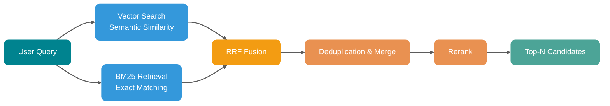
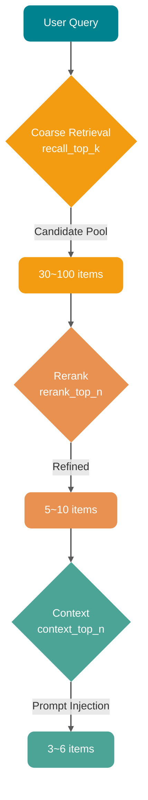
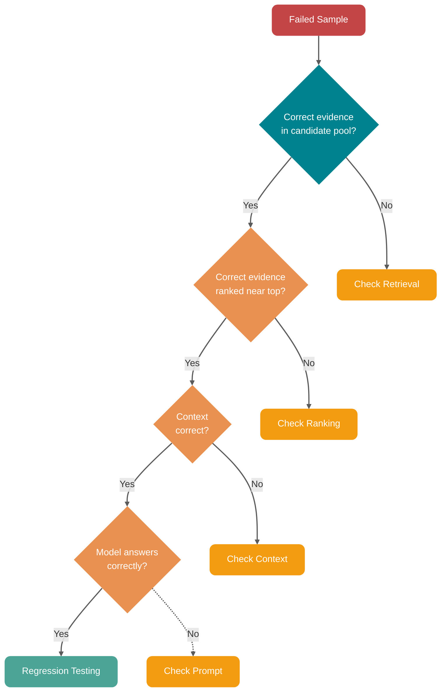

When RAG produces incorrect answers, simply swapping the embedding model or expanding Top-K rarely provides a stable fix. Issues such as PDF table parsing errors, chunk boundary truncating conditions, late permission filtering, and candidate pools lacking correct evidence all lead to the generation model receiving flawed context.

Systematic tuning requires diagnosing each stage step-by-step: document ingestion, indexing, retrieval, reranking, context construction, and generation—followed by replaying changes against a fixed evaluation benchmark. To understand how to prepare evaluation datasets and score retrieval and generation independently, refer first to [RAG Evaluation: From Offline Datasets to Online Observability](./rag-evaluation.md).

## What Are We Actually Optimizing in RAG?

RAG functions much like an evidence processing pipeline: raw materials are parsed, cleaned, chunked, tagged with metadata, and indexed. When a user query arrives, it undergoes query understanding, retrieval, reranking, and context construction before being handed to the LLM to generate an answer.

A breakdown at any link in this chain propagates downstream.

| Stage | Typical Problem | Final Symptom |
| --- | --- | --- |
| Document Parsing | Misaligned tables, lost headings, missing page numbers | Inaccurate citations, loss of critical conditions |
| Chunking | Blocks too large or too small; semantic boundaries truncated | High retrieval noise or fragmented fragments lacking context |
| Metadata | Missing source, timestamp, permissions, or section path | Inability to filter or cite; prone to permission leaks |
| Retrieval | Relying solely on vector search; ignoring keywords & structured criteria | Missed error codes, SKUs, version numbers, and proper nouns |
| Reranking | Feeding raw Top-K candidates directly to the model | Correct evidence ranked low; model misses key points |
| Context | No deduplication, compression, or reordering | Token waste; model distracted by irrelevant noise |
| Generation | Prompts fail to constrain evidence boundaries | Fluent-looking answers with hallucinated or mismatched citations |
| Evaluation | Relying solely on subjective gut feeling without test sets | Changes driven by intuition; frequent production regressions |

Whether a RAG optimization succeeds ultimately depends on answer usability, traceability, and stability, balanced against latency and financial cost. For every failed sample, at least five checks must be recorded: whether the correct evidence was retrieved, its rank among candidates, what entered the final context, whether the generated answer adhered strictly to the evidence, and whether the modification can be reproduced on a fixed sample benchmark. Without these records, discussions about vector database selection lack an objective foundation.

```mermaid
flowchart LR
    %% ========== classDef Color Declarations ==========
    classDef client fill:#00838F,color:#FFFFFF,stroke:none,rx:10,ry:10
    classDef business fill:#E99151,color:#FFFFFF,stroke:none,rx:10,ry:10
    classDef infra fill:#9B59B6,color:#FFFFFF,stroke:none,rx:10,ry:10
    classDef success fill:#4CA497,color:#FFFFFF,stroke:none,rx:10,ry:10

    %% ========== Node Declarations ==========
    Doc[/Raw Documents/]:::client
    Parse[Document Parsing]:::business
    Chunk[Chunking]:::business
    Meta[Metadata Tagging]:::infra
    Index[Indexing]:::infra
    Query[User Query]:::client
    Recall[Hybrid Retrieval]:::business
    Rerank[Reranking]:::business
    Compress[Context Compression]:::business
    LLM[LLM Generation]:::business
    Answer[Final Answer]:::success

    %% ========== Connections ==========
    Doc --> Parse --> Chunk --> Meta --> Index
    Query --> Recall
    Index --> Recall
    Recall --> Rerank --> Compress --> LLM --> Answer

    linkStyle default stroke-width:2px,stroke:#333333,opacity:0.8
```

## The RAG Optimization Closed Loop

Production-grade RAG demands continuous evaluation and replay capabilities. Otherwise, you cannot determine which problems a change solved or what regressions it introduced.

Every time chunk size, rewrite logic, reranker models, or Top-K parameters are tuned, run the exact same question benchmark and compare Context Recall, Context Precision, Faithfulness, Answer Relevancy, latency, and cost.

Without replay verification, you cannot know whether performance improved or merely shifted into a different failure mode.

## Data Governance First, Retrieval Optimization Second

If data is misparsed or stripped of structure before ingestion, subsequent retrieval and generation stages cannot recover the missing evidence.

### Document Parsing Determines the Upper Bound

PDF, Word, HTML, Markdown, database records, and customer ticket logs look like plain text, but their underlying structures differ dramatically. For PDF tables, images, headers, footers, footnotes, and multi-page spanning tables, naive plain-text extraction often causes:

- Lost column relationships in tables, jumbling prices, versions, and conditions together.
- Headers and footers repeatedly appended to every chunk, polluting the vector space.
- Complete loss of diagrams and workflow charts, leaving answers missing crucial operational steps.
- Collapsed heading hierarchies, leaving the model unaware of which chapter or section a paragraph belongs to.

For technical documentation, policy papers, and product manuals, **parsing quality is often far more impactful than switching embedding models**.

Practical recommendations:

| Document Type | Recommended Processing Strategy | Core Goal |
| --- | --- | --- |
| Markdown / HTML | Preserve heading hierarchies, lists, and code blocks | Avoid breaking natural document structures |
| PDF Documents | Parse body text, tables, page numbers, and image captions | Preserve evidence boundaries |
| Tabular Documents | Convert to structured row records or Markdown tables | Preserve column-field relationships |
| Code Documents | Segment hierarchically by package, class, method, and docstring | Preserve invocation semantics |
| Tickets / Chat Logs | Partition by session, timestamp, and speaker role | Preserve conversational context order |

When documents contain heavy ratios of tables and images, consider supplementing poorly-matching documents with OCR or multimodal structured extraction. Do not feed all files blindly to vision models: begin with high-value documents and frequent failure cases, observing whether extraction gains justify the added processing costs and latency.

### The Role of Metadata

Both retrieval filtering conditions and final answer citation data rely on metadata. Metadata determines which chunks enter candidate pools and ensures results trace back to source documents, page numbers, and specific revisions.

At minimum, store the following fields per chunk:

- `source_id`: Source document ID for tracing and deduplication.
- `source_type`: PDF, webpage, ticket, source code, database record, etc.
- `title`: Document title.
- `section_path`: Section path, e.g., "Return Policy / Warranty Scope / Special Items".
- `page`: Page number or paragraph offset.
- `created_at` / `updated_at`: Timestamps for time-based filtering and version checks.
- `tenant_id` / `acl`: Multi-tenancy and access control lists.
- `business_tags`: Product line, language, region, version, module.

Permission filtering must occur prior to retrieval. If a vector database returns Top-10 candidates where 8 are unauthorized, filtering them out leaves only 2 chunks—this does not mean the system only found 2 relevant items; worse, missed permissions risk leaking sensitive context directly to the LLM.

Therefore, narrow query scope using metadata first. For instance, restrict `tenant_id`, document type, version, and update timestamps before computing vector similarity or executing hybrid search.

## Chunking Strategy: Avoid Fragmenting Knowledge

Chunk boundaries determine how many conditions and conclusions a single retrieval unit carries. If a precondition is cut into an adjacent chunk, even subsequent reranking can only select from incomplete candidates.

### There Is No Silver-Bullet Chunk Size

Token windows like 512, 800, or 1000 serve only as initial experimental baselines. For sentences carrying preconditions like "The above conditions do not apply to the 7-day unconditional return policy," slicing too finely leaves only the bare conclusion; slicing too broadly drags paragraphs of irrelevant explanation into context.

Initial baselines can start within these ranges:

- FAQs, short policies, API parameter docs: Start around 200 to 500 tokens.
- Technical documentation, tutorials, solution designs: Start around 400 to 800 tokens.
- Legal regulations, contracts, financial policies: Prioritize clause completeness, cutting by heading, article, section, and item.
- Code repositories: Do not chunk purely by token count; cut by file, class, function, and comment block.

Build separate indices for these candidate parameters, run the same benchmark queries, compare Context Recall, Context Precision, answer accuracy, and average context tokens, and retain the configuration best suited to your corpus.

### Semantic Chunking Fits Stable Documents

Semantic chunking determines boundaries by evaluating relationships between headings, paragraphs, and adjacent sentences rather than cutting at fixed character counts. When documents cover mixed topics, queries lean conceptual, and offline processing overhead is acceptable, include it in your experiments:

- Documents cover heterogeneous topics, addressing multiple concepts on a single page.
- User queries are conceptual rather than looking up a specific field.
- The knowledge base updates infrequently, tolerating heavier offline preprocessing.

This approach also has distinct boundaries:

- When documents undergo frequent incremental updates, modified files require recomputing sentence or paragraph embeddings, incurring higher offline costs than structural chunking. Common semantic chunking evaluates adjacent text within a single document without requiring global clustering across the entire repository.
- Documents that already possess clear structure, such as Markdown heading hierarchies.
- Queries that primarily target exact IDs, fields, statuses, or configuration keys.

When API documentation already defines OpenAPI paths, methods, and parameter tables, chunk according to those structural boundaries. Using sentence embeddings to determine splits risks severing parameters from their return constraints.

### Parent-Child Chunking Is a Practical Compromise

Parent-child chunking decouples the retrieval unit from the reading unit. An index is built using small child chunks of ~300 tokens, each linked to a larger parent passage of ~1200 tokens. When a child chunk hits, its full parent passage is pulled into context. This allows queries to match fine-grained expressions while retaining overarching preconditions and adjacent descriptions without resorting to inflated Top-K values. Long documentation, tutorials, policy interpretations, and troubleshooting manuals benefit substantially from this relationship.

### Adding Semantic Entry Points to Chunks

"How do I get my money back?" and "Refund application workflow" describe identical intents, but surface text similarity may fall short. To bridge this gap, attach extra retrieval entry points to chunks during indexing:

- Generate summaries for each chunk, indexing both summary and body text.
- Generate potential questions each chunk answers, using question vectors to assist retrieval.
- Generate heading vectors for chapters or sections, letting conceptual questions hit broad topics first.
- Generate structured summaries for code snippets or tables, avoiding un-embeddable raw formats.

Summaries, synthetic questions, and structured descriptions require generation and maintenance overhead. Validate on high-value documents or frequent failure cases first before rolling them out globally.

## Retrieval Optimization: Don't Rely Solely on Vector Similarity

Encoding a query into an embedding and retrieving Top-K candidates serves as a baseline. However, exact terms such as error codes, part numbers, and version tags are easily crowded out by semantically similar but factually incorrect passages, requiring keyword retrieval signals.

### Which Queries Suit Hybrid Search?

Vector retrieval discovers candidates based on semantic closeness, whereas BM25 matches candidates based on exact term occurrences. The table below illustrates their respective strengths across query types:

| Query Type | Vector Retrieval Performance | BM25 Performance | Recommendation |
| --- | --- | --- | --- |
| "How to cancel subscription" | Matches "Turn off auto-renew" | May miss due to vocabulary mismatch | Retain vector retrieval |
| "Error code E1027" | May retrieve generalized failure docs | Exactly matches the error code | Keyword retrieval mandatory |
| "ABX-4421 model specifications" | Tends to match similar model numbers | Exactly matches SKU | Keyword retrieval mandatory |
| "Java thread pool rejection policy differences" | Strong semantic understanding | Matches keywords well | Hybrid search is more stable |
| "Latest v3.2 pricing policy" | Requires semantic + time constraints | Matches version string | Metadata + Hybrid Search |

Production pipelines retrieve semantic and keyword candidates in parallel, merge them via Reciprocal Rank Fusion (RRF) or normalized linear weighting, deduplicate the combined candidates, and pass them to a reranker. Microsoft Azure AI Search, Google Vertex AI Vector Search, and Weaviate all adopt Hybrid Search and RRF as primary patterns. Because RRF merges results based on rank positions, you do not need to calibrate BM25 scores and cosine similarities onto the same numerical scale.

If documents are highly structured and queries contain almost no specific keywords, the gain from Hybrid Search may be modest. Conversely, queries dominated by error codes, product models, configuration flags, and technical terminology require an active keyword channel to prevent similar documents lacking the exact entity from dominating candidate rankings.

### Query Rewrite: Make Questions Searchable First

User prompts often omit target entities, temporal bounds, or operational context. For example:

- "How do I fix this error?"
- "Can I get my money back?"
- "Did that online rate limiting issue happen again?"

"How do I fix this error" lacks error codes and service names; "Can I get my money back" lacks order statuses. Query rewrite must fill in searchable representations without mutating the user's core intent.

Common strategies include:

| Strategy | Applicable Scenario | Example |
| --- | --- | --- |
| Canonical Normalization | Colloquial expressions, acronyms, missing context | Rewrite "Can I get money back" to "Refund policy, refund eligibility, refund process" |
| Multi-Query | Multiple valid phrasings for the same intent | Concurrently search "cancel subscription", "turn off auto-renew", "terminate membership plan" |
| Query Decomposition | Questions containing multiple sub-questions | Split "Compare Stripe vs Square processing fees and dispute handling" into 4 sub-queries |
| Step-back Query | Query is overly specific and lacks background | Retrieve high-level "subscription billing rules" before answering specific cancellation rules |
| HyDE | Queries are short with large morphological gaps to documents | Generate a hypothetical answer first, then use its vector to retrieve real documents |
| Self-Query | Query embeds filtering criteria | Extract year and category filters from "Find 2025 Java policy updates" |

Frameworks like LangChain package these patterns in components such as `MultiQueryRetriever` and `SelfQueryRetriever`. Whether using these components or custom logic, always include the original raw query alongside rewritten queries during retrieval and fusion: if the rewrite model mistakenly interprets "refund" as "cancel subscription", the raw query preserves the correct retrieval path.

### Top-K: Bigger Is Not Always Better

Increasing Top-K raises the odds that relevant evidence enters the candidate pool, but it also increases reranking overhead, prompt token consumption, and noise ratios. Apply distinct ceilings across the retrieval, reranking, and context stages:

- `recall_top_k`: Coarse retrieval candidate pool, e.g., 30 to 100.
- `rerank_top_n`: Retained post-rerank, e.g., 5 to 10.
- `context_top_n`: Final entries into prompt context, e.g., 3 to 6.

`recall_top_k` prevents missed evidence, `rerank_top_n` bounds fine-grained ranking computation, and `context_top_n` is governed by the volume of evidence the model can reliably absorb. Calibrate all three together on a unified evaluation benchmark.

## Rerank: Reordering "Relevant" into "Answerable"

Bi-encoder dense retrieval encodes query and documents independently before calculating vector distance, making it fast for retrieving candidates from millions of documents. In contrast, cross-encoders or specialized reranker models encode the query and candidate document together; while computationally more expensive, they can judge whether a candidate contains the precise conditions and conclusions needed to answer the query.

### Why Does Rerank Work?

Vector scores gauge whether text is semantically related; reranker scores evaluate whether "this passage can directly answer the current question."

Consider an example:

User asks: "Why does a thread pool trigger its rejection policy?"

Vector retrieval might return these chunks:

1. Thread pool core parameter specifications.
2. Enumeration list of rejection policies.
3. Conditions triggering rejection when the queue is full and active threads reach `maximumPoolSize`.
4. Sample code demonstrating thread pool usage.

Chunks 1 and 2 are semantically very close to the query, but Chunk 3 holds the exact answer. The core value of Rerank is pushing Chunk 3 to the very top.

### Where to Place Rerank?

A clean pipeline spans five steps: metadata pre-filtering, hybrid search coarse retrieval of 30 to 100 candidates, deduplication and merging of adjacent passages, reranking down to 5 to 10 candidates, and final compression before insertion into the prompt.

Rerank cannot resurrect documents that never entered the candidate pool. Always check Context Recall first: if coarse retrieval fails to capture the correct evidence, debug parsing, chunking, and query rewriting rather than endlessly switching reranker models.

### How to Choose Between LLM Reranking and Dedicated Rerankers?

| Approach | Advantages | Disadvantages | Best Suited For |
| --- | --- | --- | --- |
| Cross-Encoder Reranker | Fine-grained relevance scoring; predictable latency & cost | Requires model selection; potential language/domain biases | General production pipelines |
| LLM-Based Scoring | Outputs reasoning; flexible evaluation rules | Slow, costly, prompt-sensitive; reasoning does not guarantee factual ground truth | Low-traffic, high-value, complex reasoning |
| Rule-Based Rerank | Inexpensive, deterministic, fully controllable | Limited to explicitly codified rules | Enforcing recency, permissions, versioning, source priorities |
| Hybrid Rerank | Flexible, adaptable to complex business logic | High engineering complexity | Enterprise knowledge bases, customer support, compliance |

Dedicated rerankers handle relevance scoring on the primary path, while deterministic rules handle temporal, permission, and version constraints. LLM scoring fits offline evaluation or complex, low-traffic edge cases. When evaluating models, benchmark across target languages, domain corpora, latency, and cost.

## Context Engineering: Don't Treat the Model as a Trash Can

Once retrieval completes, you must decide which fragments enter the prompt and in what order. Expanding context windows does not mean you can ignore attention distribution, latency, cost, and signal-to-noise ratio. Injecting irrelevant fragments clutters the model's attention window, causing:

- Misattribution, treating similar but unrelated paragraphs as factual proof.
- "Lost in the middle" phenomena, ignoring critical instructions placed midway.
- Verbose, unfocused answers.
- Erroneous citations.
- Substantial increases in token cost and time-to-first-token (TTFT).

Every fragment entering the prompt must substantiate a specific conclusion, condition, or exception relevant to the user query.

### Context Compression

Compression filters evidence specifically around the current query rather than applying generic summarization across all candidates. Common options:

| Compression Method | Mechanism | Risk |
| --- | --- | --- |
| Selective Extraction | Retain only original sentences directly relevant to query | Risk of dropping implicit conditions |
| Query-Aware Summarization | Compress long passages into summaries focused on the query | May introduce rewriting bias or distortion |
| Structured Extraction | Extract fields, conditions, conclusions, and exceptions | Heavily dependent on extraction schema design |

LangChain's `ContextualCompressionRetriever` illustrates this "base retriever + compressor" pattern. In practice, filter and deduplicate with rules first, applying LLM-based compression only to longer passages to avoid paying model invocation overhead on every single chunk.

### Context Ordering Also Impacts Answers

Raw retriever output merges different retrieval channels, sources, and versions, making it unsuitable for direct linear insertion into prompts. Organize context along these principles:

- Place the most critical and relevant evidence at the top.
- Maintain the original reading order for adjacent chunks originating from the same document.
- Explicitly label update timestamps and version numbers on conflicting passages.
- Retain clear source attribution on every cited fragment.
- Never mix low-confidence candidates indiscriminately with high-confidence evidence.

Structure cross-document comparisons by topic, chronological analyses by timeline, and troubleshooting guides along "Symptom, Root Cause, Remediation, Notes". Context engineering structures how evidence is presented to the model, not merely how much text is retrieved.

### Prompting Must Constrain Evidence Boundaries

Prompts should clearly define evidence constraints:

- Answer strictly based on the provided context.
- Explicitly state inability to answer when context is insufficient.
- Append source citations to every key conclusion.
- Never treat historical or similar documents as current-version facts.

Evidence quality checks and citation validation should also be enforced outside the prompt. While system prompts instruct models to reject ungrounded questions, prompt directives alone cannot guarantee compliance without external validation gates.

## Evaluation: Separately Isolate Retrieval and Generation Issues

RAG evaluation requires decomposing metrics. Evaluating only the final answer score leaves you blind to which stage broke down.

### Build a Minimal Evaluation Set

You do not need thousands of samples to start. Begin with 50 to 100 high-value questions covering:

- High-frequency user queries.
- Known production failure cases.
- Business-critical workflows.
- Multi-hop reasoning queries.
- Exact-match queries (e.g., error codes, version tags, SKUs).
- Permission-gated or time-sensitive queries.
- Queries that must trigger rejection / refusal.

Each evaluation sample should include:

- `question`: The raw user query.
- `golden_answer`: The verified ideal answer.
- `golden_context`: The expected ground-truth chunks or documents.
- `metadata_filter`: Required metadata constraints.
- `answer_type`: Factoid, procedural, comparison, rejection, summarization, etc.

### Separate Retrieval Metrics from Generation Metrics

| Metric | Target Stage | Description |
| --- | --- | --- |
| Hit Rate@K | Retrieval | Whether correct evidence appears in the top K results |
| MRR | Ranking | How high the first correct piece of evidence is ranked |
| Context Recall | Retrieval Completeness | Proportion of necessary evidence successfully retrieved |
| Context Precision | Context Purity | Proportion of retrieved context that is truly relevant |
| Faithfulness | Generation Groundedness | Whether the generated answer is strictly supported by context |
| Answer Relevancy | Answer Relevance | Whether the answer directly addresses the user query |
| Citation Accuracy | Citation Accuracy | Whether cited references actually substantiate the claims |
| Latency / Cost | Engineering Metrics | P95 latency, prompt/completion tokens, rerank duration, cache hits |

Tooling such as RAGAS, DeepEval, and LangSmith support evaluating context relevancy, faithfulness, and answer relevancy. Ragas documentation clearly decouples Context Precision, Context Recall, Faithfulness, and Response Relevancy; DeepEval facilitates composing retrieval and generation metrics into end-to-end regression suites.

Keep in mind: **LLM-as-a-Judge is an auxiliary signal, not an infallible oracle.**

Prior to launch, manually review a representative sample of automated judgments to calibrate whether the evaluator favors overly verbose answers, overlooks subtle citation errors, or struggles with specialized domain terminology.

### Version Every Single Change

Every benchmark run must link to these precise version identifiers:

- Document parser version.
- Chunking strategy version.
- Embedding model version.
- Indexing parameter configuration.
- Query rewrite prompt version.
- Reranker model version.
- Generation prompt version.
- Evaluation dataset version.

When metrics shift after knowledge base updates, these version logs pinpoint whether the regression was introduced by parsing, indexing, retrieval, or generation.

## Common Pitfalls

### Only Tuning Embeddings

If PDF tables parse incorrectly, chunks sever necessary preconditions, metadata omits permissions, or the source document never made it into the candidate pool, switching embedding models cannot recover the lost evidence. Always isolate retrieval, ranking, context, and generation failures on your evaluation set before deciding to replace embeddings.

### Skipping Evaluation

An individual answer looking sharper does not mean overall performance improved. Expanding Top-K might fix one query while swamping dozens of others in noise; without a fixed test set, you cannot see both shifts simultaneously. Maintain a minimal evaluation suite covering frequent, failed, exact-match, and out-of-scope queries.

### Blindly Expanding Top-K

Inflating Top-K drives up reranker costs, prompt tokens, and generation latency while degrading signal-to-noise ratio. When higher recall coverage is required, increase the coarse retrieval candidate pool (`recall_top_k`), then rely on reranking and compression to prune noise. Never dump expanded candidate pools directly into the model context. Track and evaluate coarse retrieval Top-K, rerank Top-N, and context Top-N independently.

### Stuffing Irrelevant Context into the Model

When multiple conflicting policy versions, similar product docs, and adjacent unrelated paragraphs are jammed together, the model may synthesize seemingly plausible yet entirely false answers. Prior to prompt assembly, deduplicate, compress, sort by evidence strength, and preserve distinct version tags and source metadata.

### Neglecting Rejection/Refusal Capabilities

When retrieval confidence is low, evidence is contradictory, or the user lacks access to required documents, the system must refuse, seek clarification, or escalate to human agents. Introduce evidence quality gates post-retrieval to trigger query rewriting, broader search, external retrieval, or explicit refusal.

## A Practical Troubleshooting Path

When production RAG quality degrades, follow a systematic diagnosis: confirm whether correct evidence entered the candidate pool first, then check ranking, context assembly, and finally the model's answer. This prevents chaotic simultaneous edits to prompts, models, and retrieval configurations.

### Step 1: Categorize Failed Samples

Review 20 to 50 failed queries and bucket them into specific categories:

- Correct document completely missed during retrieval.
- Correct document retrieved, but ranked too low.
- Correct document included in context, but ignored by the model.
- Model used the context, but misinterpreted it.
- Model cited non-existent or irrelevant sources.
- Model answered when it should have refused.
- Failure in permission, timestamp, or version filtering.

This classification is high-leverage because each failure mode points to a completely different remediation path.

### Step 2: Check Whether Correct Evidence Entered the Candidate Pool

If coarse retrieval Top-50 lacks the ground-truth evidence, check:

- Was the document ingested into the knowledge base?
- Did document parsing extract text and tables correctly?
- Did chunking slice through critical factual conditions?
- Were metadata filters overly restrictive?
- Does the query need rewriting, decomposition, or HyDE?
- Is BM25 or Hybrid Search required?

Tuning the reranker at this stage is futile: if the candidate pool lacks the answer, reranking merely reshuffles errors.

### Step 3: Evidence Is in Candidates but Not in Context

If correct evidence is present within Top-50 candidates but fails to enter the final context, check:

- Is the reranker model suited to the language and technical domain?
- Was reranker input truncated due to length limits?
- Did score fusion push keyword results too far down?
- Did merging adjacent chunks introduce excessive noise?
- Is `rerank_top_n` set too low?

These signals point toward reranker models, fusion weighting, candidate pool sizing, or deduplication logic.

### Step 4: Context Is Correct but the Answer Is Wrong

If the correct evidence was injected into the prompt yet the model still answered incorrectly, check:

- Does the prompt explicitly demand grounding answers in provided context?
- Does the context contain conflicting versions?
- Was the crucial evidence buried in the middle of a lengthy context window?
- Does the question require multi-hop reasoning or tabular comparison?
- Are structured outputs and citation constraints needed?
- Should context be compressed before feeding the generation model?

Only after ruling out the earlier three stages should you tune prompts, context ordering, compression, and LLM selection.

### Step 5: Establish Regression Testing

Whenever a failed sample is remediated, add its reproducible inputs, expected evidence, and verification criteria to your regression suite. Replaying subsequent updates against this suite ensures fixes do not introduce regressions.

## Zero-to-One Implementation Sequence

When building enterprise RAG from scratch, begin by ensuring document parsing, noise reduction, heading hierarchy, page tracking, table handling, and metadata filtering function reliably. Validate this baseline with a benchmark covering frequent, failed, exact-match, permission-gated, and out-of-scope questions.

Once a baseline is established, evaluate fixed-length, structural, parent-child, and semantic chunking. Leverage vector retrieval for semantic similarity and BM25 or sparse vectors for exact terminology. Next, layer on Query Rewrite for colloquial queries, abbreviations, multi-intent, and multi-hop scenarios. As candidate pools expand, apply Rerank, deduplication, trimming, summarization, or structured extraction to construct a compact, high-signal context bounded by token constraints.

On the generation side, implement strict refusal logic for insufficient evidence and enforce key citation references. Record metrics by version throughout canary deployments and continually collect production failure cases. Change only a minimal set of variables per iteration, logging versions across parsers, chunking, embeddings, indexing, query rewrites, rerankers, and prompts. Offline gains validated on regression suites must always be corroborated under live canary traffic.

## Summary

A rigorous optimization replay begins with searchable content generated by parsing and metadata, progresses through chunking, hybrid search, query rewrite, reranking, and context orchestration, and concludes by validating the evidence and answers consumed by the model. Fixed evaluation suites and version tracking ensure every architectural tweak can be systematically measured and reproduced.

## References

- [Production RAG: The Five Decisions Behind Every System That Works](https://www.bestblogs.dev/article/899eff0a)
- [RAG Optimization Dictionary: 20 RAG Optimization Methods Analyzed](https://cloud.tencent.com/developer/article/2634637)
- [Weaviate Hybrid Search Documentation](https://docs.weaviate.io/weaviate/concepts/search/hybrid-search)
- [Microsoft Azure AI Search: Hybrid Search RRF](https://learn.microsoft.com/en-us/azure/search/hybrid-search-ranking)
- [Google Vertex AI Vector Search: Hybrid Search](https://docs.cloud.google.com/vertex-ai/docs/vector-search/about-hybrid-search)
- [Cohere Rerank Documentation](https://docs.cohere.com/docs/rerank-overview)
- [LangChain Retriever API Documentation](https://api.python.langchain.com/en/latest/langchain/retrievers.html)
- [RAGAS Metrics Documentation](https://docs.ragas.io/en/stable/concepts/metrics/available_metrics/context_precision/)
- [DeepEval RAG Evaluation Guide](https://deepeval.com/guides/guides-rag-evaluation)
