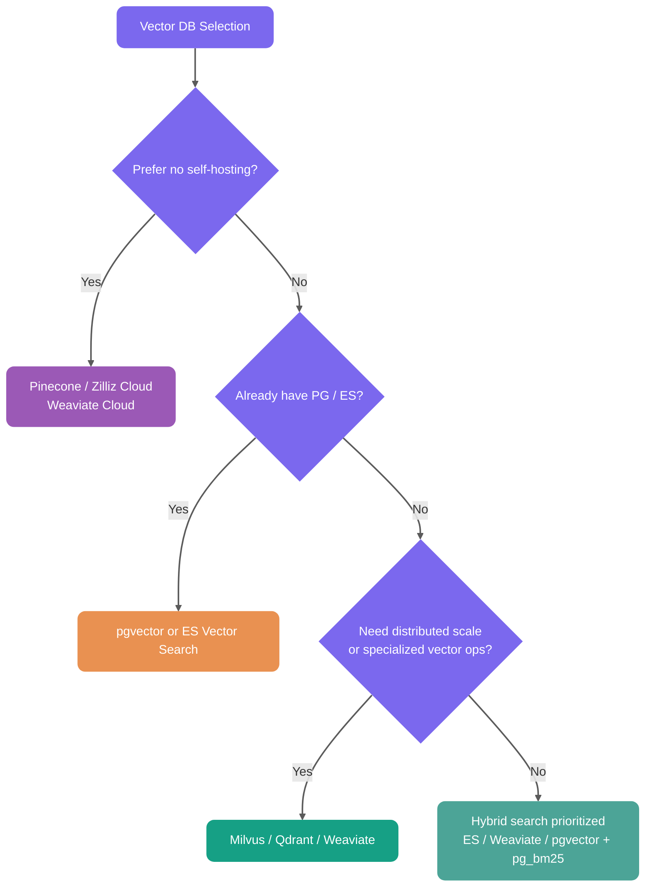

Storing Embeddings in standard database columns and calculating distances row by row can serve as an exact search baseline when data volumes are small. However, as data volume, concurrency, or latency demands increase, the computational cost of full-table scans scales linearly with the number of vectors. At that point, it becomes necessary to evaluate ANN indices or dedicated vector retrieval systems.

This article begins with distance metrics and indexing algorithms, followed by an explanation of HNSW and IVFFLAT parameters, filtering behaviors, and selection strategies using PostgreSQL + pgvector.

## What Is the Relationship Between Embeddings and Vector Search?

A vector database does not understand text directly. It stores and retrieves Embeddings.

The embedding process works like this: text is fed into an Embedding model, which outputs a fixed-dimension dense vector. This can be conceptualized as "semantic coordinates of text." The closer two pieces of text are in meaning, the closer their distance typically is in vector space.


The vector retrieval pipeline in RAG can be simplified as follows:

```text
Document Chunk -> Embedding Model -> Document Vector -> Written to Vector Database
User Question  -> Embedding Model -> Query Vector    -> Retrieve Most Similar Top-K Document Vectors
```

For basic concepts, refer to [RAG Core Concepts](./rag-basis.md). This article focuses on the latter half of the pipeline: how these vectors are efficiently stored, indexed, and retrieved.

## Why Are Vector Databases Needed in RAG Scenarios?

Vector semantic search is one of the most common retrieval methods in RAG. The system transforms both documents and user questions into high-dimensional vectors, then retrieves the most similar Top-K fragments to supply as context for the LLM. RAG can also utilize BM25, SQL, graph queries, or external APIs for retrieval, depending on the data format.

Therefore, the actual challenge to solve in RAG scenarios is not simply "can we store Embeddings," but whether we can identify the most relevant Top-K candidates across massive collections of high-dimensional vectors with low latency.

Traditional relational databases can store vectors and calculate similarity via functions or SQL expressions. However, without dedicated vector indices, they typically rely on full-table scans, which can rarely sustain production-grade low-latency retrieval. When the number of chunks reaches hundreds of thousands, millions, or more, it becomes necessary to introduce vector databases, vector search engines, or database extensions with vector indexing capabilities like PostgreSQL + pgvector.


### High-Dimensional Vector Similarity Search

Embeddings are typically dense vectors ranging from 768 to 3072 dimensions. Without a vector index, even if the database can compute cosine similarity, inner product, or Euclidean distance, it struggles to execute Top-K retrieval rapidly over large datasets.

Brute-force search traverses the entire table to compute distances, exhibiting an O(n) time complexity. For 1 million 1024-dimensional vectors, a single query requires approximately:

```text
1,000,000 × 1,024 multiplication operations
```

Actual latency can easily reach the seconds level, depending on hardware and implementation. For real-time conversational systems, latency in the seconds range is essentially unacceptable.

ANN (Approximate Nearest Neighbor) search was created specifically to solve this problem. Vector databases reduce the number of distance calculations through graph navigation, space partitioning, and quantization techniques, rather than computing every single vector every time.

The value of ANN lies not in guaranteeing 100% precision for the true nearest neighbors, but in making engineering trade-offs among recall rate, latency, and resource consumption. Given appropriate index parameters and hardware conditions, ANN can typically reduce retrieval across millions of vectors from a multi-second brute-force scan down to dozens of milliseconds or less. However, concrete results must be benchmarked against your actual business data, Top-K, filtering predicates, concurrency, and recall targets, rather than relying solely on theoretical complexity.

| Metric | Brute-force Search | ANN Index Retrieval |
| --- | --- | --- |
| Search Method | Computes distance across all vectors | Searches only candidate sets |
| Recall Rate | Theoretically 100% | Depends on index type and parameters |
| Latency | Scales linearly with data volume | Typically much lower |
| Cost | High compute overhead | Requires building indices; consumes additional memory or disk |

The table above illustrates general orders of magnitude. Real-world performance depends heavily on hardware specifications, concurrent load, data distribution, filtering conditions, Top-K, and index parameters (such as `ef_search` and `nprobe`). When selecting and tuning indices, refer to [ann-benchmarks.com](https://ann-benchmarks.com), and more importantly, validate within your own business environment.

### Large-Scale Data Handling Capability

Vector databases typically offer capabilities such as persistence, incremental updates, sharding, and background index building. Traditional databases can also store vectors as standard attributes; whether an independent vector database is needed depends on tests against your existing tech stack, vector dimensionality, filtering predicates, QPS, latency, and recall goals. In the absence of a vector index, data growth directly inflates exact scanning costs.

### How Does Semantic Search Differ from Keyword Search?

Keyword search and vector semantic search address two distinct classes of problems.

| Search Type | Mechanism | Limitations |
| --- | --- | --- |
| BM25 Keyword Search | Literal matching based on term frequency statistics | Prone to failure with synonyms or rephrasings (e.g., "merchandise return" vs "refund process") |
| Vector Semantic Search | Embedding captures semantic similarity | Handles synonyms, context, and implicit intent, but depends on Embedding model quality |

Chunking strategies and Embedding models jointly establish the theoretical upper bound for semantic recall; the vector database is responsible for realizing this upper bound within acceptable latency.

Production-grade RAG generally requires several additional capabilities:

- Metadata filtering, such as combining `WHERE category='Java' AND version>='v2'` with vector similarity queries.
- Hybrid Search, fusing vector retrieval, BM25, and Reciprocal Rank Fusion (RRF).
- Dynamic updates, supporting incremental writes. However, high-frequency updates and deletions can cause vector index bloat, invalid data accumulation, and fluctuations in recall or latency, requiring ongoing monitoring via `VACUUM`, `REINDEX`, query plans, and business evaluation sets.
- Permissions and multi-tenant isolation, which are foundational requirements for enterprise-grade RAG.

## How to Choose Vector Similarity and Distance Metrics?

Vector databases do not perform keyword matching; they compute the distance or similarity between query vectors and document vectors. The most common metrics in RAG scenarios are Cosine Distance, Inner Product, and Euclidean Distance.

Taking pgvector as an example, the three common representations are:

| Metric | pgvector Operator | Operator Class | Characteristics | Suitable Scenarios |
| --- | --- | --- | --- | --- |
| Euclidean Distance (L2 Distance) | `<->` | `vector_l2_ops` | Measures absolute distance in vector space; smaller is more similar | Models or indices explicitly optimized for L2 |
| Inner Product | `<#>` | `vector_ip_ops` | pgvector returns negative inner product; smaller is more similar | Vectors are normalized; prioritizes compute efficiency |
| Cosine Distance | `<=>` | `vector_cosine_ops` | Insensitive to vector magnitude; smaller is more similar; cosine similarity is `1 - distance` | Text semantic search; most common in RAG |

If asked in an interview "why RAG commonly uses cosine similarity," you can answer: text semantic retrieval cares much more about directional alignment than vector magnitude; cosine distance is insensitive to magnitude, making it more reliable for evaluating semantic similarity. If the Embedding model outputs are already normalized, inner product and cosine distance are rank-equivalent, and inner product computes faster.

Do not choose based on intuition. Always check whether the Embedding model is normalized, review the official recommended metric, and ensure the vector index supports the corresponding operator class.

The most common trap in practice is: the query operator must match the index operator class. For instance, if the index uses `vector_cosine_ops`, the query must use `<=>`; otherwise, PostgreSQL may fail to use the vector index.

## What Are Vector Index Algorithms?

Vector index algorithms solve the problem of rapidly identifying the few vectors most similar to a query vector within a massive collection of high-dimensional vectors.

Without an index, the database must compare against every single vector—this is brute-force search. Across millions or billions of records, this latency is unacceptable.

The goal of a vector index is to pre-organize data so queries can bypass the vast majority of irrelevant vectors and perform exact comparisons only within a significantly smaller candidate pool.

Using an everyday analogy:

- Without an index: Searching for a person door-to-door across an entire city.
- With an index: Narrowing down first to the district, then the street, then the specific building.

In practice, vector index algorithms broadly fall into two categories.


Most discussions around vector indexing refer to ANN algorithms. The speedup gained from an index depends on data distribution, hardware, Top-K, filtering predicates, and recall targets, and cannot be captured by a fixed multiplier. When tuning, always measure query latency, resource consumption, and recall rate simultaneously.

### Exact Nearest Neighbor (ENN)

ENN aims to identify the most similar vectors with 100% certainty. Traditional spatial trees like KD-Tree and VP-Tree fall under this approach.

The problem is that spatial tree structures like KD-Tree and VP-Tree excel primarily on low-dimensional data. As dimensionality grows, pruning efficiency degrades sharply, and queries often regress toward brute-force scans. The degree of degradation depends on data distribution and implementation, and cannot be defined by a fixed dimensionality threshold.

### Approximate Nearest Neighbor (ANN)

ANN is the dominant paradigm in modern vector retrieval. It embraces an engineering trade-off: it does not guarantee finding the absolute nearest neighbor 100% of the time, but finds sufficiently similar candidates with high probability, sacrificing a small amount of recall in exchange for orders-of-magnitude speedups.

Common ANN algorithms generally belong to three families:

- Graph-based algorithms, such as HNSW. They organize vectors into multi-layer network graphs, navigating the graph during queries like a GPS. HNSW typically achieves an excellent balance between query speed and recall, representing one of the most capable algorithm classes today.
- Quantization-based algorithms, such as IVF-PQ. Through clustering and compression techniques, they compress massive vectors into much smaller representations, reducing memory footprints and making them suitable for ultra-large-scale deployments.
- Hash-based algorithms, such as LSH. Using specialized hash functions, they ensure similar vectors have a high probability of colliding into the same hash buckets, thereby narrowing the search space.

## What Vector Index Algorithms Exist?

In RAG applications, the indexing algorithm directly influences recall rate, response latency, and resource consumption.

First, distinguish between two architectural levels:

| Level | Examples | Description |
| --- | --- | --- |
| Vector Database | Milvus, Qdrant, pgvector | Complete system responsible for vector storage, retrieval, and management |
| Supported Index Algorithms | HNSW, IVF-PQ, IVFFLAT, Flat | Internal implementations that determine retrieval performance and recall |

Mainstream index algorithms can be summarized as follows:

| Algorithm Name | Underlying Mechanism | Core Advantages | Major Disadvantages | Recommended Scope of Use |
| --- | --- | --- | --- | --- |
| Flat (Brute Force) | Traverses all vectors to compute distance | 100% accurate, zero loss | Extremely slow queries on large datasets | Small scale, low QPS, offline evaluation, recall baseline |
| HNSW (Graph Index) | Hierarchical Navigable Small World graphs | Fast queries, high recall | High memory consumption, slow build times | Medium-to-large scale, high recall, low latency; common at millions, memory must be evaluated at tens of millions |
| IVFFLAT (Inverted Clustering) | Clustering + inverted index buckets | Better memory efficiency, faster build | Requires prior training, slightly lower recall | Focuses on memory and build speed, tolerates minor recall loss |
| IVF-PQ (Product Quantization) | Clustering + extreme vector compression | Supports massive scale, low overhead | Noticeable precision loss | Ultra-large scale, memory-sensitive, tolerates quantization error |
| IVF_RABITQ | Clustering + randomized rotation bit quantization | Low memory footprint, higher recall than traditional PQ | Newer algorithm, ecosystem support still maturing | Ultra-large scale, memory-sensitive, tolerates quantization error |

A brief note on IVF_RABITQ: Introduced in 2024 as a next-generation quantization algorithm, its core concept is Random Rotation + Bit Quantization. Unlike traditional PQ which splits vectors into sub-vectors and clusters them independently, RABITQ first applies random rotation to distribute variance evenly across dimensions, then quantizes each dimension into a single bit, retaining only the sign. This significantly compresses memory while maintaining high recall, and distance calculations can be accelerated via bitwise operations. Milvus 2.6.x already offers the `IVF_RABITQ` index type.

## What Vector Index Algorithm Does Your Project Use?

Taking the project ["SpringAI Intelligent Interview Platform + RAG Knowledge Base"](https://javaguide.cn/zhuanlan/interview-guide.html) as an example:

The project utilizes PostgreSQL's pgvector extension configured with an HNSW index.

Why choose HNSW? Because at the current business scale, it achieves a well-balanced trade-off among search speed, recall rate, and engineering complexity.

HNSW can be understood as a multi-layer highway network.


HNSW relies on three core mechanisms:

1. Hierarchical Construction: A node's maximum level is determined by `level = floor(-ln(random()) * mL)`, where `mL` is the level multiplier. This causes the number of nodes at higher levels to decrease exponentially, forming a pyramid-like structure.
2. Greedy Search: Traversal starts at the top layer, moving at each layer to the neighbor node closest to the query point.
3. Coarse-to-Fine Navigation: Upper layers quickly locate the broad semantic region, while lower layers perform fine-grained searches for candidate neighbors.

This search pattern rapidly identifies candidate neighbors without needing to compare against every single point like brute-force search.

Because HNSW is an ANN algorithm, its purpose is balancing speed against recall; it does not guarantee 100% recall. Parameter adjustments alter recall and latency, and whether they meet requirements depends on your evaluation benchmark and final answer quality.

HNSW has three common tuning parameters:

- `m`: Maximum number of bidirectional links per node. A larger `m` produces a denser graph and higher recall, but increases build time and memory usage.
- `ef_construction`: Size of the dynamic candidate list during index construction. Larger values improve index quality at the cost of slower build times.
- `ef_search`: Size of the dynamic candidate list during search. This runtime parameter is the most critical, directly controlling query speed and recall.

pgvector's default HNSW parameters are `m = 16`, `ef_construction = 64`, and `ef_search = 40`. They can be tuned according to the following guidelines:

| Parameter | Typical Range | Impact When Increased | Tuning Advice |
| --- | --- | --- | --- |
| `m` | 8–64 | Denser graph, higher recall, increased memory and build time | Start with default; increase to 24 or 32 if recall is insufficient |
| `ef_construction` | 64–256+ | Better index quality, slower build time | Increase only when slower offline index construction is acceptable |
| `ef_search` | 40–200+ | Higher query recall, increased latency | Best suited for online tuning; use benchmarks to find the sweet spot between recall and latency |

A practical workflow is to first build the index with fixed `m` and `ef_construction`, then adjust `ef_search` via session parameters:

```sql
SET hnsw.ef_search = 100;
```

Next, use `EXPLAIN ANALYZE` to confirm index usage, and compare recall, latency, and final response quality across a batch of labeled questions under different `ef_search` values. `ef_search` should not be increased indefinitely; once acceptable business recall is achieved, stop tuning, or you will merely trade latency and CPU for marginal gains.

Scalability must also be anticipated. HNSW is memory-intensive. If future data scales to tens or hundreds of millions of vectors, or write throughput requirements rise sharply, HNSW's memory consumption and build overhead may become a bottleneck.

At that stage, consider IVFFLAT. Based on inverted indexing, IVFFLAT clusters the vector space into multiple buckets to narrow search scope. Alternatively, introduce specialized vector databases like Milvus, which are more mature in distributed and large-scale scenarios.

Another easily overlooked factor is filtering conditions.

When pgvector's HNSW index encounters `WHERE` filters, examine the query execution plan carefully. Approximate indices typically identify candidates by vector distance first, then apply filters. If the filter is very selective, final results may fall below the expected Top-K, and in certain query patterns it may even degrade into a slower scan.

For example, querying "return 10 similar documents where `category='Java'`": if only 3 candidates in the initial pool satisfy the condition, only 3 records are returned.

Common remediation strategies include:

1. Expanding the candidate pool: Set a larger `ef_search` or `LIMIT` so more candidates reach the filtering stage.
2. Pre-filtering: Filter by metadata first, then perform vector search; however, this may invalidate the index and fall back to brute-force scanning.
3. Partial Index: PostgreSQL supports conditional HNSW indices, such as `CREATE INDEX ... WHERE category = 'Java'`, though this requires creating dedicated indices for common filter conditions.
4. Iterative Index Scan: pgvector 0.8.0+ supports continuing index scans when post-filtering results are insufficient, mitigating the problem of "ANN first, filter second resulting in insufficient Top-K". However, it still requires tuning parameters like `hnsw.max_scan_tuples` and `ivfflat.max_probes` to manage costs.

## What Is the Difference Between HNSW and IVFFLAT Indices?

The core distinction between the two is simple: HNSW finds neighbors via graph connectivity, while IVFFLAT narrows the search space via clustering.

HNSW builds a multi-layer graph. Queries traverse it like a highway network, making large leaps on upper layers before performing fine-grained local searches on the base layer. Its advantages are fast queries and consistently high recall; its drawbacks are high memory consumption (storing extensive node connections alongside raw vectors) and slower index construction.

IVFFLAT partitions the vector space into multiple buckets using K-Means. Queries first locate the nearest buckets, then perform brute-force search only within those buckets. Its advantages are lower memory consumption, structural simplicity, and faster build times; its drawback is that at equivalent recall targets, query performance and stability are generally inferior to HNSW. If data distributions shift significantly, cluster centroids may need to be retrained.

| Feature | HNSW (Graph Index) | IVFFLAT (Inverted Clustering) |
| --- | --- | --- |
| Underlying Principle | Hierarchical Small World graph structure | Clustering + inverted bucket structure |
| Query Speed | Typically faster, more stable recall | Depends on `lists` and `probes` |
| Memory Footprint | High (raw vectors + graph connection pointers) | Typically lower than HNSW |
| Build Speed | Slower; requires inserting nodes sequentially | Typically faster, but requires clustering training |
| Data Dynamism | Easy incremental additions; monitor health after heavy updates/deletions | Significant data shifts may require index rebuilding |
| Applicable Scenarios | Medium-to-large scale, high recall, low latency | Memory- and build-speed sensitive, accepts slight recall loss |

How to choose?

If you prioritize low latency and high recall, and server memory is plentiful, choose HNSW. If you are more constrained by memory and build speed, can tolerate minor recall loss, and are willing to tune `lists` and `probes`, consider IVFFLAT.

## What Vector Databases Are Available?

There is no silver bullet for vector database selection; the best solution is the one that fits your project requirements.

### Traditional Database Extensions

Representative solutions include PostgreSQL + pgvector and MongoDB Atlas Vector Search.

The advantage of this approach is a unified technology stack without introducing an additional database system; vector data and business data can be managed within the same ACID transaction; team SQL expertise is reused; and SQL filters can be seamlessly combined with vector search.

This approach is ideal for early-stage or small-to-medium projects. Especially when business data and vector data require strong consistency within the same transaction, PostgreSQL + pgvector offers compelling advantages. For teams already running PostgreSQL, learning and maintenance costs are negligible.

### Search Engine Evolution

Representative solutions include Elasticsearch and OpenSearch.

The advantage of this approach is superior hybrid search capability, pairing BM25 keyword retrieval with vector semantic search. It preserves traditional search engine strengths in handling long text, tokenization, highlighting, and aggregation analysis, backed by mature distributed architectures.

If your business already depends heavily on keyword search—such as e-commerce search, document retrieval, complex filtering, and aggregations—or if your team already maintains an ES cluster, reusing ES / OpenSearch vector capabilities is a natural progression.

### Native Specialized Vector Databases

Representative solutions include Milvus, Weaviate, and Qdrant.

Milvus is feature-rich with a large community; Weaviate features built-in AI modules and GraphQL query support; Qdrant is written in Rust, offering high memory efficiency and robust filtering.

These databases are engineered specifically for vector retrieval, natively supporting multiple index algorithms (such as HNSW, IVF, and LSH) with advanced capabilities in partitioning, multi-tenancy, dynamic updates, and distance metrics.

When vector scale reaches hundreds of millions or more, or when QPS and latency requirements are strict, native vector databases are generally better suited than pgvector. The cost is equally clear: an additional system brings additional maintenance, monitoring, backup, and training overhead.

### Managed Cloud Vector Database Services

Representative solutions include Pinecone, Zilliz Cloud, and Weaviate Cloud.

Their key advantage is minimal operational burden, rapid deployment, and automated scaling with high-availability SLAs. When budget is available and the team wishes to avoid self-hosting infrastructure, these services are highly attractive.

However, "managed" does not mean hands-off. You remain responsible for index parameter tuning, recall benchmarking, permission isolation, and cost monitoring.

## How to Choose a Vector Database?

Use the following flowchart for a high-level assessment:



When evaluating options, first assess existing technology stacks and business constraints:

- If you already run PostgreSQL and single-node resources, write throughput, filtered queries, and latency satisfy benchmark goals, start with pgvector.
- If you already run Elasticsearch / OpenSearch and business logic depends heavily on keywords, tokenization, highlighting, and aggregations, reuse their vector search paired with BM25.
- If you require distributed scaling, resource isolation, multi-tenancy, or specialized index algorithms, evaluate Milvus, Qdrant, or Weaviate.
- If the team does not wish to maintain clusters, compare pricing, data residency, and SLAs across Pinecone, Zilliz Cloud, and Weaviate Cloud.

Record counts should only be used to estimate capacity, not determine product choice in isolation. One million vectors can yield vastly different performance profiles depending on dimensionality, filter selectivity, QPS, Top-K, and hardware.

## Why Did You Choose PostgreSQL + pgvector?

Taking the project ["SpringAI Intelligent Interview Platform + RAG Knowledge Base"](https://javaguide.cn/zhuanlan/interview-guide.html) as an example: this project must store structured data (such as resumes and interview transcripts) alongside vector data (document Embeddings).

A comparison of options:

| Solution | Advantages | Main Costs | Best Suited Conditions |
| --- | --- | --- | --- |
| PostgreSQL + pgvector | Unified database management, simple operations | Vector workloads compete for resources with business queries | Already using PostgreSQL; measured latency, recall, and capacity meet targets |
| PostgreSQL + Milvus | Isolates business data from vector compute load | Additional component increases operational complexity | Needs independent vector scaling while retaining transactional data in PostgreSQL |
| Pinecone / Zilliz Cloud | Fully managed, eliminates cluster operations | Cost, data residency, and vendor lock-in | Prioritizes time-to-market and can accept compliance and cost constraints |

Key reasons for choosing pgvector:

1. Simple Architecture: Avoids additional components, minimizing deployment and operational complexity.
2. Sufficient Performance: HNSW index speed and recall fully meet current business demands.
3. Strong Transactional Consistency: Vectors and business data reside in the same database, natively supporting ACID transactions.
4. Convenient SQL Queries: Easily combined with `WHERE` filters, though query plans must be verified to prevent degraded index lookups.

```sql
-- pgvector Cosine Similarity Search Example
-- <=> is the cosine distance operator (0 = identical, 2 = completely opposite)
-- cosine_similarity = 1 - cosine_distance
SELECT content, 1 - (embedding <=> $1) as cosine_similarity
FROM vector_store
WHERE metadata->>'category' = 'Java'
ORDER BY embedding <=> $1  -- Ascending distance: smaller means more similar
LIMIT 5;

-- ⚠️ Critical prerequisite: The distance operator used in queries must strictly match
-- the operator class (e.g., vector_cosine_ops) specified when creating the HNSW index;
-- otherwise, the query will fail to hit the index and degrade directly to a full-table scan.
-- Verification: Run EXPLAIN ANALYZE to ensure the execution plan includes an Index Scan.
```

## What Are Practical Implementation Details for pgvector?

The essence of pgvector is not simply "can it store vectors," but ensuring that indices, distance metrics, and query syntax are properly aligned.

### HNSW Index Creation Example

```sql
-- Embedding type example: vector(1536)
CREATE INDEX idx_document_embedding_hnsw
ON document_chunk
USING hnsw (embedding vector_cosine_ops)
WITH (m = 16, ef_construction = 64);
```

If the query uses `<=>` (Cosine Distance), the index must use `vector_cosine_ops`. If the query uses `<->`, the index must use `vector_l2_ops`.

### IVFFLAT Index Creation Example

```sql
CREATE INDEX idx_document_embedding_ivfflat
ON document_chunk
USING ivfflat (embedding vector_cosine_ops)
WITH (lists = 100);

-- Control how many cluster buckets to scan during queries
SET ivfflat.probes = 10;
```

IVFFLAT requires a baseline volume of data before building the index because it relies on clustering. The pgvector documentation recommends starting with `rows / 1000` for up to 1 million rows, and `sqrt(rows)` for over 1 million rows; these are only starting guidelines and must be tuned against business data. A larger `probes` setting typically yields higher recall at the expense of query speed.

### Index Maintenance

Following heavy deletions or updates, vector indices may experience bloat, accumulated dead tuples, and fluctuations in recall or latency. Schedule `VACUUM` and `REINDEX` during off-peak hours while monitoring execution plans and evaluation benchmarks.

`VACUUM` remains essential, but it is not a panacea for recall recovery. Vector index health must be assessed collectively through query latency, recall benchmarks, and execution plans.

Whenever distance operators, operator classes, filter predicates, or index parameters are modified, run `EXPLAIN ANALYZE` to verify index hits.

### Version Highlights

- pgvector 0.5+ added support for HNSW indices.
- pgvector 0.7+ added `halfvec`, `sparsevec`, `bit` types and expanded distance support, suitable for compressing storage or handling sparse vectors.
- pgvector 0.8.0+ introduced iterative index scans, which continue scanning indices when filtered results fall short, mitigating Top-K deficiencies. In production, lock version dependencies and run regression benchmarks before upgrading.

## Why Not Choose MySQL Paired with a Vector Database?

PostgreSQL's greatest advantage in this scenario is its extensibility. Developers can add substantial capabilities via extensions without modifying the database core.

For example:

- AI Vector Retrieval: pgvector integrates tightly with PostgreSQL's native ecosystem, supporting ACID transactions, JOINs, backup/restore, and SQL filtering—ideal for small-to-medium RAG projects seeking stack simplification.
- Full-Text Search: Built-in `tsvector` satisfies baseline requirements, with pg_bm25 available for advanced needs.
- Time-Series Data: TimescaleDB.
- Geospatial Information: PostGIS.

This "one PG handling multiple foundational capabilities" paradigm is exceptionally friendly for small-to-medium projects. Starting with PostgreSQL simplifies the tech stack; as data scale, QPS, and multi-tenant isolation demands grow, specialized components like Elasticsearch, Milvus, Qdrant, or Weaviate can be decoupled cleanly.

On the MySQL side, capabilities vary by version. The MySQL 8.x series, including 8.4 LTS, lacks an official `VECTOR` data type. MySQL 9.x introduced a `VECTOR` data type and related functions, but official capabilities focus primarily on vector storage and basic function support rather than mature, production-grade ANN search.

If a project is already deeply invested in MySQL, continue using MySQL for business data and pair it with external vector search components like pgvector, Milvus, Qdrant, Weaviate, or Elasticsearch / OpenSearch. There is no need to shoehorn all vector workloads into MySQL for RAG.


For a detailed comparison between MySQL and PostgreSQL, refer to my article: [MySQL vs PostgreSQL: How to Choose?](https://mp.weixin.qq.com/s/APWD-PzTcTqGUuibAw7GGw).

## Summary

Vector storage and vector indexing are foundational infrastructure in RAG systems. Flawed technology selection quickly leads to the triad of "slow retrieval, poor recall, and runaway costs."

Without dedicated vector indices, Top-K retrieval across large-scale high-dimensional vectors defaults to full-table scans. ANN indices sacrifice a small amount of precision to make an engineering trade-off among recall, latency, and resource consumption.

Among mainstream index algorithms: Flat is brute-force search, suitable for small datasets, low QPS, offline evaluations, and recall baselines; HNSW is a graph index offering fast queries and high recall at the cost of high memory usage; IVFFLAT is inverted clustering, more memory-friendly and faster to build, but requires parameter tuning and tolerates minor recall loss; IVF-PQ supports massive scale via product quantization, but introduces precision loss.

HNSW is best suited for low latency and high recall, while IVFFLAT is preferred when memory and build costs are constrained. For database selection: PostgreSQL + pgvector fits small-to-medium scales; Milvus, Qdrant, and Weaviate excel at large-scale or dedicated vector search; Pinecone and Zilliz Cloud suit low-maintenance operational models.

Frequently asked interview questions:

- What is an Embedding? Why does text need to be converted into vectors?
- Why are vector databases needed in RAG scenarios?
- What is the difference between cosine similarity and Euclidean distance? Which should be used in RAG?
- Why can ANN algorithms accept results that are not 100% precise?
- What vector index algorithms exist? What are their respective strengths and weaknesses?
- What is the difference between HNSW and IVFFLAT?
- How do you tune HNSW's `ef_search` parameter? What happens when it is increased or decreased?
- What is the core difference between a vector database and a traditional database?
- If vector data expands from 1 million to 100 million, what architectural adjustments are required?
- Under what circumstances will pgvector's HNSW index fail or degrade into a slower scan?
- Why choose PostgreSQL + pgvector?

When implementing, make sure you clearly understand HNSW's graph structure and IVF's clustering principles first. Then build a minimal demo using pgvector or Milvus to compare recall and latency under various index parameters. Never tune parameters like `ef_search` or `nprobe` on guesswork—always benchmark against real business questions.

Vector database selection and index tuning directly determine whether a RAG system can thrive in production. Making the wrong choice leads straight to slow queries, poor recall, and exploding costs.
