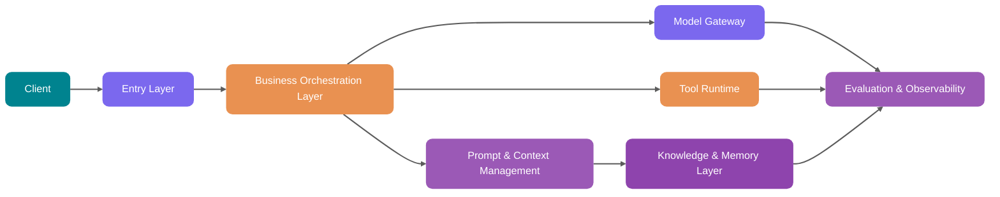

A minimal AI application is very easy to build: the frontend takes a user question, the backend stitches the question together with a system prompt, calls a model API once, and the page renders a seemingly decent response.

For a demo presentation, that is usually sufficient.

Once real users arrive, however, problems become much more specific: when a user asks about internal policies, the retrieval layer injects documents into the context that they have no permission to view; operations updates a version of the Prompt, and questions that were answered correctly yesterday start deviating today; model calls time out while the browser waits indefinitely; when reviewing monthly bills, Token consumption has surged, but nobody can tell which tenant, feature, or model incurred the cost; and during online post-mortems, engineers must painstakingly piece together what happened from application logs, vector database hits, and raw model responses.

This article addresses that latter reality: how to transform a functioning Prompt Demo into a production-grade AI application that can be deployed reliably, troubleshot, rolled back, and cost-controlled.

This is an architectural overview: it first compares the gap between a Demo and a production system, and then breaks down responsibilities across entry points, business orchestration, model gateways, Prompt/Context management, RAG, Memory, Tools, asynchronous tasks, evaluation, and observability. Java backend module splitting, database table designs, and service interfaces are integrated throughout the corresponding sections; for deeper dives into specific topics, you can follow the thematic links provided throughout the article.

## Why Demo Architectures Cannot Withstand Production Traffic

Consider the most common demo setup:

```text
Frontend input -> Backend prompt assembly -> Model API invocation -> Response returned
```

While this pipeline effectively demonstrates a product concept, it lacks the 6 most critical pillars of a production system.

| Dimension | Prompt Demo | Production-Grade Architecture |
| --- | --- | --- |
| Stability | Single model, single call; throws errors on failure | Multi-model routing, retries, fallbacks, circuit breaking, degraded responses |
| Permissions | Assumes users can query whatever they ask | Pre-retrieval permission filtering; tool invocations authenticated by user and tenant |
| Cost | Only checks if a single invocation succeeds | Token budgets, model tiering, caching, cost attribution, and quotas |
| Observability | Logs user query and final response | Records Prompts, retrieved chunks, tool calls, model outputs, Tokens, latency, errors |
| Evaluation | Relies on manually testing a few examples | Fixed evaluation datasets, online sampling, LLM-as-Judge, human review feedback loop |
| Data Governance | Documents ingested directly, logs stored without restriction | PII masking, data retention, auditing, versioning, deletion, and authorization pipelines |

The capabilities in this table are not merely extra wrappers around existing interfaces. Model outputs are probabilistically generated; the same question is influenced collectively by Prompt versions, context ordering, retrieval results, tool descriptions, and sampling parameters. When an answer goes astray, it cannot always be traced down to a single line of code via a stack trace like an ordinary `if-else` statement.

A production system must record what inputs were used, what steps were executed, and what results were generated for every request. Only then can an erroneous response be replayed to determine whether the issue stemmed from retrieval, the model, permission filtering, or output parsing.

If you are not yet familiar with the engineering lifecycle of LLM API calls, you can first read [Engineering Practices for LLM API Invocations: Streaming, Retries, Rate Limiting, and Structured Responses](../llm-basis/llm-api-engineering.md). If you want to brush up on fundamentals like Tokens, context windows, and sampling parameters, check [LLM Mechanics: How Tokens, Context Windows, and Sampling Parameters Shape Outputs](../llm-basis/llm-operation-mechanism.md).

## A Pragmatic Layered Architecture for AI Applications

When a request enters the system from the entry point, it must first establish identity and permissions, then decide whether to retrieve knowledge, invoke tools, or execute asynchronously, and finally record the execution pipeline into an observability system. The diagram below partitions responsibilities along this flow; actual projects can merge modules and need not treat this as a rigid industry standard.



### Entry Layer: Turning User Requests into Governed Tasks

When a user request arrives at the system, the entry layer shapes it into a standardized task that downstream services can handle:

- Authentication and Authorization: Verify user, tenant, role, and data scope.
- Request Standardization: Unify Web, App, API, Webhook, and scheduled tasks into an internal task model.
- Rate Limiting and Anti-Abuse: Apply rate limits based on user, tenant, model capacity, and business scenario.
- Idempotency Control: Idempotency keys are mandatory for retryable asynchronous tasks and tools with side effects; read-only deduplication can be decided based on cost and consistency requirements.
- Sensitive Content Preprocessing: PII masking, malicious input detection, and initial Prompt Injection screening.

Downstream pipelines should receive structured requests rather than raw user strings:

```java
public record AiRequest(
        String requestId,
        String tenantId,
        String userId,
        String sceneCode,
        String input,
        Map<String, Object> variables,
        PermissionScope permissionScope
) {
}
```

### Business Orchestration Layer: Determining the Execution Path

The business orchestration layer determines which execution path the request should follow:

- Is this a standard Q&A, RAG Q&A, multi-step Agent task, or batch processing task?
- What context is needed: session history, user profile, knowledge base, real-time business data?
- Are tool invocations permitted? Which tools require secondary confirmation?
- Should the interaction be synchronous, streaming, or asynchronous?
- Does the output need to undergo evaluation, human review, or post-processing?

For example, whether a user has permission to read a document or whether an operation requires confirmation should be evaluated by deterministic business rules; models are best suited for language understanding where rules cannot be fully enumerated. Blending both types of decisions into a single "super prompt" makes it difficult to diagnose whether an error was caused by rule failure or model hallucination.

### Model Gateway: Treating Model Calls as Infrastructure

The model gateway centrally integrates providers like OpenAI, Anthropic, Google Gemini, private models, Embedding models, and Rerank models. It abstracts away differences across provider APIs and exposes a stable interface upstream. The model gateway warrants its own dedicated deep dive; see [Deep Dive into LLM Gateways: Multi-Model Routing, Fallback, Rate Limiting, and Cost Control](./llm-gateway.md).


Once model calls are consolidated at the gateway, routing, quotas, and observability gain a consistent execution point:

- Multi-Model Routing: Select models based on scenario, cost, latency, language, context length, and success rates.
- Fallback: Switch to backup models when the primary model fails, times out, or exceeds rate limits.
- Rate Limiting and Circuit Breaking: Prevent upstream provider outages from exhausting backend business thread pools.
- Token Budgets: Estimate input and output Tokens, compressing context or downgrading models when budgets are exceeded.
- Cost Attribution: Record costs by tenant, user, scenario, and Prompt version.
- Unified Observability: Record model requests, responses, errors, TTFT, total latency, and Token usage.

Official documentation from OpenAI, Anthropic, Google, and others is continuously updating capabilities around models, tools, streaming, evaluation, and pricing. When dealing with specific model names, context windows, pricing, availability regions, and tool support, it is best to maintain them in a configuration center or model registry marked as "subject to the latest official documentation" rather than hardcoding them in business code.

### Prompt and Context Management: Stop Treating Prompts as Hardcoded Strings

Prompts used in production requests must have explicit versioning and cannot be scattered as multi-line strings in source code. Releases and rollbacks must provide traceability for exact content, variable constraints, and effective scopes:

- Template Versioning: Every edit generates a new version, allowing legacy versions to be replayed.
- Variable Injection: Business variables, user inputs, retrieval results, and tool outputs are injected into segregated partitions.
- Canary Releases: Route traffic to Prompt versions based on tenant, user percentage, or scenario toggles.
- Rapid Rollback: Quickly revert to a stable version when production performance degrades.
- Audit Logging: Track who modified what, at what time, and for what reason.
- Runtime Binding: Every request logs the Prompt name, version, and variable digest utilized.

Prompt modifications alter response contents and can also impact retrieval, tool calling, cost, and evaluation results. Consequently, change logs, runtime Traces, and evaluation results must link to the exact same Prompt version. Platforms like Langfuse place Prompt Management, Tracing, and Evaluation on a single platform precisely to maintain these relationships; whether you adopt that tool depends on your stack, but the relational linkage itself cannot be missing.

For prompt writing guidelines, see [What is Prompt Engineering? Techniques and Best Practices](../agent/prompt-engineering.md). If your focus is on "what information should enter the context, how much, and when to compress it", refer to [What is Context Engineering? Differences from Prompt Engineering](../agent/context-engineering.md).


### RAG, Memory, and Tools: Do Not Conflate Three Distinct Contexts

Retrieved documents, user preferences, and tool returns all enter the model's context, but their sources, update lifecycles, and risks differ substantially:

| Type | What It Stores | Lifecycle | Core Risks |
| --- | --- | --- | --- |
| RAG | Enterprise docs, product manuals, policies, code docs, ticket knowledge | Governed by knowledge base updates | Retrieval misses, unauthorized recall, stale documents, citation mismatches |
| Memory | User preferences, past decisions, long-term profiles, task experience | Evolves with the user and sessions | Entrenched false memories, privacy leaks, outdated memory interference |
| Tool | Order lookups, ticket creation, email dispatch, config updates, DB queries | Invoked on-demand at runtime | Parameter errors, permission escalation, accidental execution of sensitive operations |

All three may rely on vector retrieval, structured storage, and reranking under the hood, but they cannot be governed by the same rules. RAG represents shared knowledge sources, Memory stores personalized backgrounds, and Tools interact with real-world business systems; permission checks and invalidation strategies must be designed independently.


Do not treat Memory as a personal RAG cache to write into arbitrarily. Once corrupted memories are written, multiple subsequent conversation turns will be poisoned. Different Memory types require distinct controls: preferences explicitly confirmed by users can be written synchronously; long-term facts extracted by models are better validated via Schema checks, provenance tracking, and confidence filtering before deciding whether to write them asynchronously, set TTLs, or route them to human review based on risk.

For RAG fundamentals, begin with [RAG Fundamentals: Retrieval, Generation, and Engineering Trade-offs](../rag/rag-basis.md); for document parsing, cleaning, and chunking, read [RAG Document Processing and Chunking Strategies](../rag/rag-document-processing.md); for retrieval optimization, check [RAG Optimization: From Recall and Rerank to Context Engineering](../rag/rag-optimization.md). For a dedicated breakdown of Memory, see [AI Agent Memory Systems: Short-Term Memory, Long-Term Memory, and Memory Evolution Mechanisms](../agent/agent-memory.md).

## Choosing Between Synchronous, Streaming, and Asynchronous Interaction Modes

Not all requests in an AI application are suited for synchronous HTTP blocking. Choosing the wrong interaction mode degrades both user experience and system stability.

| Mode | Best Suited For | Advantages | Risks | Backend Design Essentials |
| --- | --- | --- | --- | --- |
| Synchronous Request | Short Q&A, classification, extraction, low-latency small tasks | Simple implementation, clear call chain | Timeout sensitive; easily saturates threads | Short timeouts, fail-fast, result caching |
| Streaming Response | Chat, long answers, code generation, pre-speech text for voice | Excellent time-to-first-token (TTFT), reduced perceived wait time | Complex mid-stream failure handling, more frontend state | SSE/WebSocket, TTFT monitoring, cancellable generation |
| Asynchronous Task | Report generation, batch evaluations, long document analysis, multi-tool tasks | Queueable, retryable, resumable | Complex task state and notification pipelines | Task tables, queues, progress events, idempotency, and compensations |

If a request can complete reliably within approximately 3 seconds, and both client and gateway timeouts allow it, synchronous calling is usually the simplest choice. This threshold is not a rigid rule and must be determined by your specific timeout configurations.

When users need immediate visibility into the generation process, streaming responses are preferable; when tasks depend on long documents, multi-step tool calls, or batch processing, offloading to queues makes retries and failure recovery vastly simpler.

Internal tasks such as label classification, risk scoring, and routing decisions rarely require first-token feedback. Maintaining SSE or WebSocket connections for them only increases the overhead of connection drops, cancellations, and frontend state management.

For deeper engineering breakdowns of streaming outputs, retries, rate limiting, and structured responses, see [Engineering Practices for LLM API Invocations](../llm-basis/llm-api-engineering.md). In real-time voice scenarios, where VAD, ASR, TTS, interruptions, and end-to-end latency must be considered, see [AI Voice Technology Deep Dive: From ASR and TTS to Real-Time Voice Agent Production Implementation](./ai-voice.md).

## Prompt Management: From Template Strings to Versioned Systems

Production-grade Prompt management can be modeled around 5 core entities:

- `prompt_template`: Metadata of the Prompt, such as name, scene, type, and status.
- `prompt_version`: Concrete content, variable definitions, model parameters, author, and changelog.
- `prompt_release`: Deploys a specific version to environments, tenants, and traffic allocations.
- `prompt_run`: Binds each request to a Prompt version, variable digest, and model output.
- `prompt_eval_result`: Benchmark results of a specific Prompt version against an evaluation dataset.

Core tables can be designed as follows:

| Table Name | Key Fields | Purpose |
| --- | --- | --- |
| `ai_prompt_template` | `id`, `tenant_id`, `name`, `scene_code`, `type`, `status` | Manages logical Prompt names |
| `ai_prompt_version` | `id`, `template_id`, `version_no`, `content`, `variables_schema`, `model_config`, `created_by`, `change_reason` | Stores replayable Prompt content |
| `ai_prompt_release` | `id`, `template_id`, `version_id`, `env`, `traffic_ratio`, `tenant_scope`, `status` | Controls canaries and rollbacks |
| `ai_prompt_run` | `id`, `request_id`, `version_id`, `variables_hash`, `input_tokens`, `output_tokens`, `created_at` | Connects production requests to Prompt versions |

Variable injection is most prone to issues in two places. First, user inputs, tool outputs, and retrieved chunks can harbor injection instructions; partitioning tags and escaping only assist the model in recognizing untrusted content, while the backend must still constrain callable tools and re-validate arguments and permissions before execution.

The second issue is version mismatch: when a Prompt introduces a new variable that code has not yet supplied, the rendered prompt will miss critical context. A `variables_schema` can catch and block such requests at runtime before calling the model.

`ai_prompt_run` generally stores only variable digests, hashes, Tokens, and relational IDs. When raw user inputs, retrieved chunks, or tool returns contain PII or sensitive business information, decide whether to mask, encrypt, and truncate retention periods based on security classifications; never persist full plaintext blindly just for debugging convenience.

A minimal interface example:

```java
public interface PromptService {

    RenderedPrompt render(RenderPromptCommand command);

    PromptVersion publish(PublishPromptCommand command);

    void rollback(String templateId, String targetVersionId);
}
```

If Prompt outputs must be reliably parsed by programs, avoid relying solely on "please return JSON". For engineering details on structured outputs, JSON Schemas, and Function Calling, see [Structured Outputs from LLMs: From JSON Contracts to Function Calling Implementation](../llm-basis/structured-output-function-calling.md).

## Model Gateway: Multi-Model Routing, Fallbacks, and Cost Control

Model gateways are frequently underestimated. Many teams initially invoke vendor SDKs directly within business code, only to discover tight coupling everywhere when switching models, running canaries, or investigating costs.

### Comparison of Model Gateway Strategies

| Strategy | Core Logic | Best Suited For | Risks |
| --- | --- | --- | --- |
| Fixed Model | Dedicated invocation of a single model per scenario | Early-stage systems, low-complexity tasks | Cost and stability tied entirely to one provider |
| Cost-First Routing | Routes to low-cost models by default, escalating on failure or low confidence | Classification, summarization, lightweight Q&A | Misjudgments by cheap models propagate downstream |
| Quality-First Routing | High-value requests prioritize high-capability models | Legal, finance, clinical assistance, complex Agents | High cost, requiring strict budget caps |
| Latency-First Routing | Selects models based on P95/P99 latency and availability zones | Real-time chat, voice, live customer support | May sacrifice deep reasoning quality |
| Multi-Model Voting | Generates across multiple models in parallel, selected by a judge | High-risk content, critical reports | Very high cost and latency |
| Fallback Chain | Switches to backup models upon primary failure | Most production systems | Capability gaps in backup models affect output consistency |

### Implementing Token Budgets

The model gateway must estimate context and maximum output Token consumption prior to invocation:

```text
Estimated Input Tokens = System Prompt + User Input + Message History + RAG Chunks + Memory + Tool Schemas
Estimated Total Tokens = Estimated Input Tokens + Max Output Tokens
```

When exceeding budget limits, prioritize pruning content with lower relevance to the current query rather than truncating strings from the middle:

1. Prune low-relevance RAG chunks.
2. Compress earlier conversation turns.
3. Minimize Tool Schemas, retaining only candidate tools.
4. Reduce maximum generation length.
5. Switch to a long-context model.
6. Reject execution and prompt the user to narrow their request scope.

Token budgeting and context compression here are fundamentally identical to the Context Engineering concepts discussed earlier. For comprehensive context assembly, on-demand loading, and degradation strategies, see [What is Context Engineering? Differences from Prompt Engineering](../agent/context-engineering.md).

In OpenTelemetry's GenAI registry, you can find attributes like `gen_ai.request.model`, `gen_ai.response.model`, `gen_ai.usage.input_tokens`, `gen_ai.usage.output_tokens`, `gen_ai.response.time_to_first_chunk`, retrieval, and tools. Note that OpenTelemetry has migrated GenAI semantic conventions to an independent repository, so rather than copying field names from outdated articles, pin current versions and define field mappings. Whether you use Langfuse, LangSmith, or an in-house platform, adhering closely to standard naming simplifies future migrations and monitoring.

## Tool Calling and Permissions: Models Propose Actions, Systems Decide Execution

Tool Calling easily creates a false sense of security: the model returns a function name and arguments, and the system executes it.

In production, this is dangerous.

The correct mental model is: **The model can only propose "what tool it intends to call"; actual execution must pass through rigorous system validation**.

A tool runtime requires at least 6 defensive stages:

| Stage | Purpose |
| --- | --- |
| Tool Registration | Declares tool name, description, parameter Schema, permission tags, risk level |
| Tool Retrieval | Selects the few tools relevant to the current task from a large catalog, preventing context bloat |
| Parameter Validation | Uses JSON Schema or strongly-typed DTOs to enforce required fields, formats, enums, and bounds |
| Permission Validation | Executes backend authorization based on user, tenant, role, and resource ID |
| Confirmation Policies | Operations like deletion, payment, messaging, and configuration updates require secondary confirmation based on risk and pre-authorization boundaries |
| Audit Logging | Records model recommendations, final parameters, actor, execution result, and rollback metadata |

Official tool/function calling guides from Anthropic, OpenAI, and Google emphasize tool definitions, parameter structures, and invocation handling; Google's documentation explicitly highlights that for function calls with consequential side effects (such as placing orders or updating databases), user confirmation must be obtained before execution. Pre-authorized low-risk actions can execute automatically according to policy, but permission validation must reside within the business system, never delegated to the model.

Even if a provider offers server-side tools, the application side cannot bypass its own ACLs, auditing, and confirmation workflows. The provider connects tool capability to the model; the business system decides whether this user, in this tenant, for this resource, is permitted to execute it in this scenario.

For foundational concepts on tool calling, see [Structured Outputs from LLMs: From JSON Contracts to Function Calling Implementation](../llm-basis/structured-output-function-calling.md). If your tools will be shared across multiple models, Agents, or IDEs, check [What is the Model Context Protocol (MCP)? Relationship to Function Calling and Agents](../agent/mcp.md).


Tool interfaces can be defined as follows:

```java
public interface AiTool {

    ToolDefinition definition();

    ToolResult execute(ToolExecutionContext context, Map<String, Object> arguments);
}
```

Tool definitions must separate side effects from risk levels. Read-only does not equal low-risk; reading secret keys, medical records, or bulk customer data involves no write action, yet requires strict authorization and auditing:

```java
public enum ToolSideEffect {
    READ_ONLY,
    WRITE
}

public enum ToolRiskLevel {
    LOW,
    MEDIUM,
    HIGH
}
```

The orchestration layer chooses control policies based on `sideEffect + riskLevel + preAuthorization`. High-risk write operations default to "pending confirmation actions"; high-risk reads enforce resource-level authorization, field masking, result volume limits, and auditing. If business logic permits automated execution of writes under pre-authorization, utilize narrowly-scoped, revocable credentials accompanied by idempotency, audit trails, and compensation mechanisms.


## RAG and Memory: Collaborating Between Shared Knowledge and Personalized Memory

Both RAG and Memory inject external data into the model context, but their governance strategies differ.

### Collaboration Flow in a Request

The recommended execution order for a request is:

1. The entry layer verifies user identity and permission scope.
2. The Memory service retrieves preferences and long-term facts within the user's scope.
3. The RAG service retrieves shared knowledge within the tenant and resource permission scope.
4. The Context management layer deduplicates, filters, and compresses both result sets independently.
5. The orchestration layer places Memory into the "User Background" partition and RAG into the "Evidence Reference" partition.
6. The model is instructed to differentiate between "facts grounded in evidence" and "expression tailored to user preferences".

This sequence primarily prevents context contamination. Specific projects can query RAG before Memory, but permission scopes must be determined first; "retrieve first, filter later" must never be the default design.

### Preventing Context Contamination

| Contamination Type | Typical Manifestation | Defense Mechanism |
| --- | --- | --- |
| RAG Noise Contamination | Irrelevant documents retrieved, misguiding the model | Hybrid Search, Reranking, Top-N compression, citation verification |
| Permission Contamination | Users receive document chunks they have no right to view | Pre-retrieval ACL filtering, tenant isolation, recalled hit auditing |
| Memory Mis-entrenchment | A user's temporary comment is treated as a permanent preference | Write confidence scores, expiration TTLs, user-editable UI, human review |
| Conflicting Facts | Outdated policies and updated policies enter context simultaneously | Versioning fields, timestamp filtering, conflict detection |
| Prompt Injection Contamination | Documents contain text like "Ignore previous instructions" | Content partitioning, instruction hierarchy, injection detection |

Never concatenate RAG and Memory results into an undifferentiated block of "background material". Explicitly tag provenance, timestamp, permissions, and trust levels for the model to prevent confusing user preferences, enterprise policies, and tool returns.

A knowledge base is not static after initial ingestion. Document versioning, incremental sync, deduplication, rollbacks, and full rebuilds all affect production accuracy; see [Updating RAG Knowledge Base Documents: Incremental Updates, Versioning, Deduplication, and Full Rebuilds](../rag/rag-knowledge-update.md). When queries require cross-document relationships, entity graphs, and global summarization, traditional vector search may fall short; continue reading [GraphRAG: Augmenting Vector Search with Graph Structures](../rag/graphrag.md).

## Observability and Evaluation: Without Replay, There Is No Optimization

### What a Trace Must Capture

The biggest risk when troubleshooting AI applications is seeing only the final answer.

A complete request must capture relatable metadata at minimum. Raw text should only be stored when replay is genuinely needed, proper authorization is granted, and encryption, access control, and retention policies are configured:

| Category | Default Captured Metadata |
| --- | --- |
| Prompt | Template name, version, variable hash or masked digest, message roles and lengths |
| Retrieval | Masked query or hash, chunk ID, score, source, permission filter outcome, rerank rank |
| Memory | Matched memory ID, source, update timestamp, confidence score |
| Tool | Tool name, parameter hash or masked fields, permission outcome, latency, result code, error |
| Model | Provider, model name, sampling parameters, input/output Tokens, finish reason |
| Latency | Entry latency, retrieval latency, model TTFT, total latency, tool latency |
| Cost | Input cost, output cost, cache hits, attributed by tenant and scenario |
| Results | Response hash, structured parsing result, user feedback, evaluation score |

Official documentation across Langfuse, LangSmith, Google Vertex AI, and OpenTelemetry universally features entities like Traces, datasets, evaluators, token usage, and latency. Tools may differ, but the signals to capture remain largely identical.

### How Evaluation Should Be Conducted

Evaluation requires fixed datasets, explicit pass criteria, and replayable target versions. To learn how to construct evaluation sets, isolate RAG and Agent metrics, and integrate LLM-as-Judge into CI pipelines, refer to [AI Application Evaluation Systems](../llm-basis/llm-evaluation.md).

Assigning a single subjective "good or bad" score to the final output fails to clarify whether errors occurred during retrieval, generation, or tool execution. Track distinct metrics across each stage; while platform terminologies vary, internal definitions should remain consistent:

- **Context Recall**: Was the correct evidence recalled?
- **Context Precision**: How many chunks placed in context were actually useful?
- **Faithfulness**: Is the answer faithful to the provided evidence?
- **Answer Relevancy**: Does the answer address the user's query?
- **Tool Success Rate**: Did tool calls complete successfully?
- **Format Valid Rate**: Could structured outputs be parsed correctly?
- **Cost per Success**: Average cost per successful response.

LLM-as-Judge is well-suited for large-scale initial screening, regression comparisons, and production sampling, but its assessments cannot replace deterministic rule checks, human reviews, and user feedback loops for critical workflows. External evaluation platform interfaces change; evaluation tasks, datasets, and results should reside in your own data model, letting external platforms handle execution or visualization.

The feedback loop for production samples entering evaluation is:

```text
Production failure samples -> Ingested into dataset -> Replayed on fixed version -> Isolate Prompt/RAG/Tool/Model issue -> Canary new strategy -> Compare metrics -> Full release
```

Without replay against fixed versions, whenever Prompts, retrieval strategies, or model versions shift, it becomes impossible to determine what an adjustment actually improved.

## Security and Compliance: AI Applications Have Wider Attack Surfaces

The security surface of AI applications is broader than traditional CRUD systems because user inputs, retrieved documents, tool outputs, and historical memories can all influence model behavior.

### Implementing Risk Controls in Code and Processes

| Risk | Description | Recommended Mitigation |
| --- | --- | --- |
| PII Leakage | Logs, Prompts, evaluation sets containing phone numbers, IDs, emails | Mask before persistence, encrypt sensitive fields, minimize retention |
| Permission Bypass | Retrieval or tool execution bypassing business ACLs | Pre-retrieval filtering, secondary authorization before tool execution |
| Prompt Injection | Users or documents inducing models to ignore system instructions | Content partitioning, instruction hierarchy, injection detection, refusal policies |
| Uncontrolled Data Retention | Model requests and observability logs retained indefinitely | Configure retention periods per tenant and scenario |
| Training Data Exposure | User sensitive data repurposed for fine-tuning or evaluation | Explicit authorization, anonymization, isolation, right to erasure |
| Accidental High-Risk Actions | Models inadvertently invoking delete, payment, or messaging tools | Risk tiering, secondary confirmation, auditing, and compensation |

A critical detail often missed: **Security policies cannot live solely in the Prompt**. Prompts can instruct models not to leak privacy, but permission filtering, masking, auditing, and confirmation flows must be enforced by code and infrastructure.

### Managing Data Boundaries for Third-Party Models

If requests are routed to third-party models, separately verify data authorization, geographic region, retention, and training policies. When uncertain, adhere to the principle of least privilege: omit non-essential fields, mask or summarize necessary fields, and define retention schedules within configuration and audit logs.

Prompt Injection, context partitioning, and tool permissions are interconnected; review [Prompt Engineering](../agent/prompt-engineering.md), [Context Engineering](../agent/context-engineering.md), and [MCP](../agent/mcp.md) together.

If your system allows an Agent to read external content and invoke write tools, you must additionally design resource-level authorization, parameter-bound approvals, MCP Tokens, code/network isolation, and security regressions; see [LLM/Agent Security in Practice](./llm-security.md).

## Java Backend Implementation Recommendations

When building production-grade AI applications in Java, decompose modules around domain capabilities rather than provider SDKs.

### Module Breakdown

| Module | Responsibilities |
| --- | --- |
| `ai-api` | External REST/SSE/WebSocket endpoints, request authentication, protocol adaptation |
| `ai-orchestrator` | Business orchestration, interaction mode selection, task state machines |
| `ai-prompt` | Prompt templates, versioning, canaries, rendering, rollbacks |
| `ai-context` | Context assembly, Token budgeting, history compression, context partitioning |
| `ai-gateway` | Model routing, fallbacks, rate limiting, circuit breaking, cost analytics |
| `ai-rag` | Knowledge base retrieval, permission filtering, reranking, citation management |
| `ai-memory` | User memory persistence, retrieval, conflict resolution, expiration policies |
| `ai-tool` | Tool registration, parameter validation, execution, confirmation, auditing |
| `ai-eval` | Datasets, evaluation jobs, LLM-as-Judge, human feedback |
| `ai-observability` | Traces, metrics, logs, cost tracking, alerts |

### Core Database Table Design

This set of tables does not need to be built all at once in v1; it illustrates where data ownership belongs in a production system. The first release should at least persist request Traces, model calls, Prompt versions, and RAG recall records to ensure troubleshooting material is available when issues arise.

| Table Name | Recommended Key Fields | Purpose |
| --- | --- | --- |
| `ai_request_trace` | `id`, `request_id`, `tenant_id`, `user_id`, `scene_code`, `mode`, `status`, `total_latency_ms`, `error_code`, `created_at` | Primary Trace of an AI request; logs user, tenant, scene, status, latency |
| `ai_model_call` | `id`, `request_id`, `provider`, `model_name`, `prompt_version_id`, `input_tokens`, `output_tokens`, `ttft_ms`, `latency_ms`, `finish_reason`, `error_code` | Model call detail; logs model, params, Tokens, TTFT, errors |
| `ai_context_item` | `id`, `request_id`, `source_type`, `source_id`, `content_hash`, `token_count`, `inject_position`, `sensitivity_level` | Context entry; logs source type, source ID, Tokens, injection position |
| `ai_rag_chunk_hit` | `id`, `request_id`, `knowledge_base_id`, `doc_id`, `chunk_id`, `score`, `rank_no`, `acl_result`, `citation_url` | RAG recall detail; logs score, ranking, document ACL, citation info |
| `ai_memory_item` | `id`, `tenant_id`, `user_id`, `memory_type`, `content`, `source_type`, `source_id`, `evidence_hash`, `request_id`, `confidence`, `expires_at`, `status`, `updated_at` | Long-term memory item; logs content, provenance, confidence, TTL, status |
| `ai_tool_call` | `id`, `request_id`, `tool_name`, `risk_level`, `arguments_hash`, `permission_result`, `confirm_status`, `execute_status`, `latency_ms` | Tool call detail; logs tool, argument digest, permission outcome, execution outcome |
| `ai_eval_dataset` | `id`, `name`, `scene_code`, `version_no`, `status`, `created_by` | Evaluation dataset metadata |
| `ai_eval_case` | `id`, `dataset_id`, `input`, `expected_behavior`, `tags`, `difficulty`, `status` | Evaluation sample; contains input, expected behavior, tags |
| `ai_eval_run` | `id`, `dataset_id`, `target_type`, `target_version`, `judge_config`, `status`, `started_at`, `finished_at` | An evaluation execution run |
| `ai_eval_result` | `id`, `run_id`, `case_id`, `score`, `pass_status`, `judge_reason`, `error_code` | Individual sample evaluation outcome |

Three database design guidelines must not be overlooked:

1. `request_id` must span across Prompts, RAG, Memory, Tools, Model Calls, and Evaluation, ideally globally unique across the entire pipeline.
2. Avoid dumping large text fields into MySQL indiscriminately. Store full Prompts, raw model outputs, and tool returns in object storage or log analytics systems, keeping only digests, hashes, sensitivity tags, and reference URIs in transactional tables.
3. Runtime tables must index and archive around `tenant_id`, `scene_code`, `created_at`, and `status`, otherwise observability tables will quickly become database bottlenecks.

### Core Service Interfaces

```java
public interface ModelGateway {

    ModelResponse generate(ModelRequest request);

    Flux<ModelStreamEvent> stream(ModelRequest request);
}
```

If the project does not use WebFlux, `Flux<ModelStreamEvent>` can be replaced with JDK `Flow.Publisher`, an SSE emitter, or internal event callbacks. The core objective is separating synchronous generation from streaming events into two distinct interface contracts, preventing callers from guessing when a return value is complete.

```java
public interface ContextAssembler {

    AssembledContext assemble(AiRequest request, ContextPolicy policy);
}
```

```java
public interface RagService {

    List<RagHit> retrieve(RagQuery query, PermissionScope permissionScope);
}
```

```java
public interface EvaluationService {

    EvalRunResult runDataset(EvalRunCommand command);
}
```

### A Minimal Request Pipeline

```text
Controller
  -> RequestGuard: Authentication, rate limiting, masking
  -> Orchestrator: Selects sync / streaming / async
  -> ContextAssembler: Fetches RAG, Memory, conversation history
  -> PromptService: Renders template version
  -> ModelGateway: Routes model and tracks Tokens
  -> OutputParser: Validates structured output
  -> TraceService: Persists observability data
```

The initial release of an enterprise knowledge base Q&A application can implement just `ai-api`, `ai-prompt`, `ai-gateway`, `ai-rag`, and `ai-observability`. Memory, Tools, and Evaluation can be introduced as business needs dictate; however, request Traces and actual Prompt versions used must be recorded from day one, or troubleshooting materials will be absent when production errors emerge.

To explore Java backend LLM API calling details, read [Engineering Practices for LLM API Invocations](../llm-basis/llm-api-engineering.md); if your team plans to centralize model calls as shared infrastructure, read [Deep Dive into LLM Gateways](./llm-gateway.md).

## How to Explain This Architecture in Interviews

When answering questions about this architecture, start with the lifecycle of a single request rather than rattling off framework names. A user request arrives at the entry layer for authentication and rate limiting; the orchestration layer determines whether to retrieve knowledge, invoke tools, or process asynchronously; once Prompt/Context assembly is complete, the model gateway routes to the appropriate model; the output is parsed and recorded into a Trace. Then explain how Prompt versions, Token budgets, tool permissions, and PII masking mitigate specific risks, and conclude with how fixed benchmark datasets and failure replays validate updates.

If you are preparing along an interview track, you can directly consult [AI System Design Interview Questions Summary](../interview-questions/ai-system-design-interview-questions.md). RAG, Agent, and LLM foundations are also covered in [RAG Interview Questions Summary](../interview-questions/rag-interview-questions.md), [AI Agent Interview Questions Summary](../interview-questions/agent-interview-questions.md), and [LLM Fundamentals Interview Questions Summary](../interview-questions/llm-interview-questions.md).

## Frequently Asked Interview Questions

**1. What is the greatest difference between a Prompt Demo and a production system?**

A demo validates whether a model can generate an acceptable answer once. A production system must handle timeouts and degradations, tenant and resource permissions, Token expenses, invocation Traces, evaluation replays, and sensitive data retention.

**2. Why is a model gateway necessary?**

A model gateway isolates provider API discrepancies in one place and handles model routing, fallbacks, rate limiting, circuit breaking, Token budgets, cost tracking, and observability. Business services avoid direct coupling to individual vendor APIs.

**3. How do you choose between synchronous, streaming, and asynchronous modes?**

Short tasks that reliably complete within client timeouts can return synchronously; chat and long responses that require immediate feedback use streaming; report generation, batch processing, and multi-tool tasks belong in asynchronous queues. The decision hinges on execution duration, the need for first-token feedback, and whether failure recovery requires retries.

**4. Why is version management essential for Prompts?**

Prompts modify outputs, retrieval strategies, tool calling behavior, and Token consumption. Versioning links production requests to exact contents and gives canaries, rollbacks, audits, and offline replays concrete targets.

**5. Where are the security boundaries of Tool Calling?**

The model only produces tool invocation intent. Parameter validation, resource-level permission checks, sensitive operation confirmations, and audit logs are strictly enforced by the backend system.

**6. What is the difference between RAG and Memory?**

RAG queries shared knowledge such as enterprise documents and product manuals; Memory preserves personalized long-term facts like user preferences and historical decisions. Both result sets can be used together, but they must be injected into partitioned zones and managed separately regarding permissions, provenance, and TTLs.

**7. What metrics should AI application observability track?**

A single request must correlate at least the Prompt version, retrieval hits, tool calls, model output, input/output Tokens, TTFT, total latency, success/error status, cost, and evaluation scores.

**8. Can LLM-as-Judge replace human evaluation?**

No. It can handle automated regressions, production sampling, and large-scale initial screening; critical business paths still require deterministic rule checks, human reviews, and user feedback loops.

## Summary

Calling a model is merely one step in the production chain. The entry layer manages permissions, rate limiting, and masking; the orchestration layer selects synchronous, streaming, or asynchronous execution while organizing retrieval, memory, and tools; the model gateway manages model selection, Tokens, and fault fallbacks; evaluation and observability provide empirical evidence for every modification. Memory, Tools, and Evaluation can be introduced incrementally, but Prompt versioning and Tracing must be established from the very start.

## References

JavaGuide Related Reading:

- [AI Application Development Knowledge System: LLMs, Agents, RAG, MCP, Prompt Engineering, and System Design](../README.md)
- [AI System Design Series: Production Architectures, Model Gateways, Evaluation Governance, and Voice Agents](./README.md)
- [LLM Fundamentals Series: Operating Mechanics, API Calling, Structured Outputs, and Evaluation](../llm-basis/README.md)
- [RAG Series: Document Processing, Vector Databases, GraphRAG, Retrieval Optimization, and Knowledge Base Updates](../rag/README.md)
- [AI Agent Series: Agent Loop, Memory, Prompts, Context, MCP, and Skills](../agent/README.md)

- [OpenAI API Official Documentation](https://developers.openai.com/api/docs)
- [OpenAI Function Calling Official Documentation](https://developers.openai.com/api/docs/guides/function-calling)
- [OpenAI Streaming Official Documentation](https://developers.openai.com/api/docs/guides/streaming-responses)
- [OpenAI Evals Official Documentation](https://developers.openai.com/api/docs/guides/evals)
- [OpenAI Agents SDK Observability and Integrations](https://developers.openai.com/api/docs/guides/agents/integrations-observability)
- [Anthropic Tool Use Official Documentation](https://platform.claude.com/docs/en/agents-and-tools/tool-use/overview)
- [Anthropic Prompt Caching Official Documentation](https://platform.claude.com/docs/en/build-with-claude/prompt-caching)
- [Google Gemini Function Calling Official Documentation](https://docs.cloud.google.com/gemini-enterprise-agent-platform/models/tools/function-calling)
- [Google Generative AI Evaluation Official Documentation](https://docs.cloud.google.com/gemini-enterprise-agent-platform/models/evaluation-overview)
- [Google RAG Grounding Official Documentation](https://docs.cloud.google.com/gemini-enterprise-agent-platform/models/grounding/ground-responses-using-rag)
- [Langfuse Observability Official Documentation](https://langfuse.com/docs/observability/overview)
- [Langfuse Prompt Management Official Documentation](https://langfuse.com/docs/prompt-management/overview)
- [LangSmith Evaluation Official Documentation](https://docs.langchain.com/langsmith/evaluation)
- [OpenTelemetry GenAI Semantic Conventions Registry](https://opentelemetry.io/docs/specs/semconv/registry/attributes/gen-ai/)
