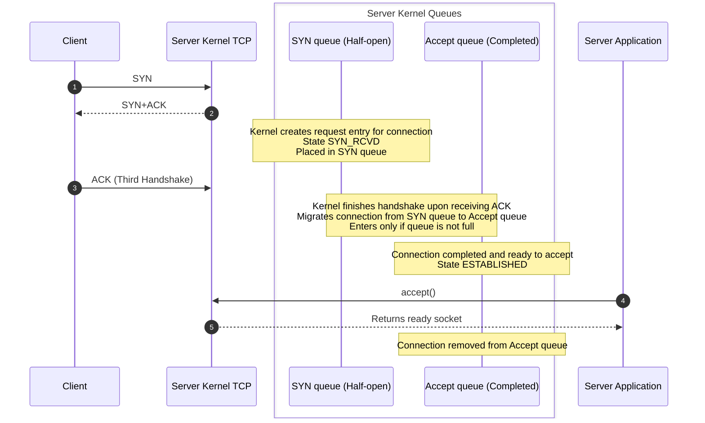
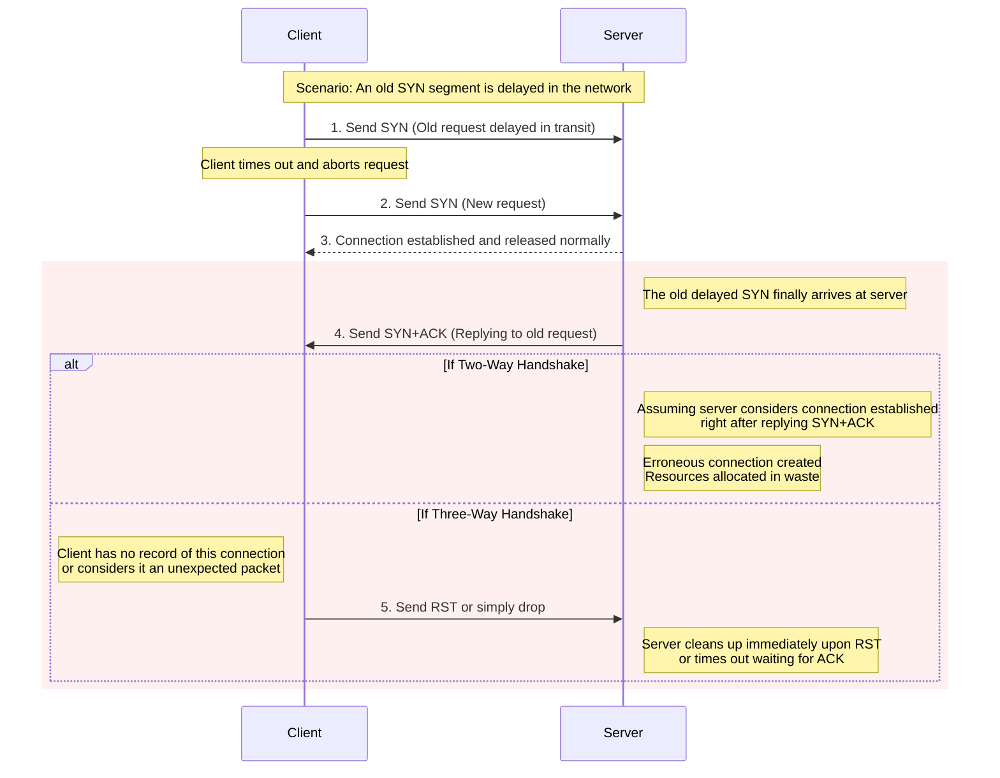
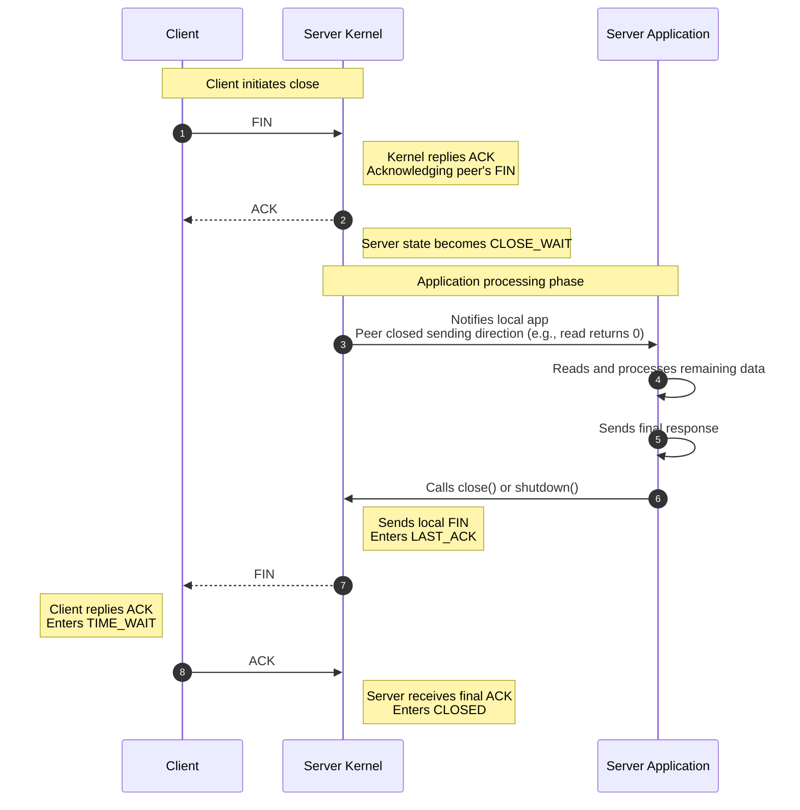
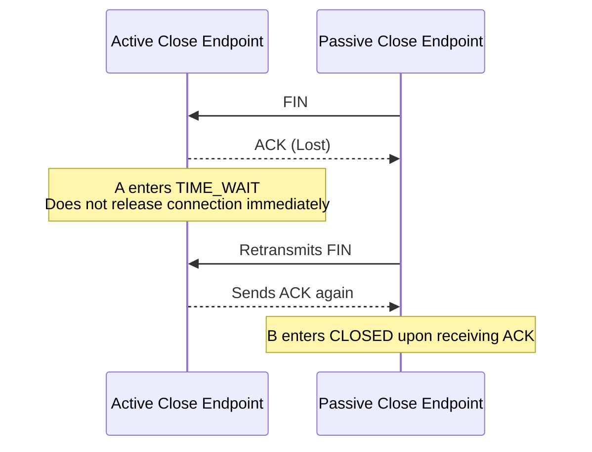

The TCP three-way handshake and four-way wave are often memorized as a simple flowchart: the client sends `SYN`, the server responds with `SYN+ACK`, and finally comes an `ACK`; when tearing down the connection, it goes through `FIN`, `ACK`, `FIN`, `ACK`.

However, when actually troubleshooting network issues, analyzing packet captures, or discussing interview questions, merely memorizing the sequence is far from enough. For example: Why is connection establishment not a two-way handshake? After the server receives the third handshake, which queue does the connection actually reside in? Why are ACK and FIN in the four-way wave usually sent separately? And under what conditions can they be merged into a three-way wave?

This article revolves around TCP connection establishment and termination to clearly connect and explain these questions:

1. What does each step of the TCP three-way handshake do?
2. Why does establishing a connection require a three-way handshake rather than two or four?
3. What do the SYN queue and Accept queue store respectively?
4. What does each step of the TCP four-way wave do?
5. How should details like `TIME_WAIT`, `CLOSE_WAIT`, and the three-way wave be understood?

> **Terminology Note**: The body of this article uniformly uses underscored notations such as `SYN_RCVD` and `TIME_WAIT`. RFCs often write them as `SYN-RECEIVED` and `TIME-WAIT`, while the Linux `ss` command frequently displays them as `syn-recv` and `time-wait`. They all refer to the same TCP states, differing only by context and notation.

## Connection Establishment: TCP Three-Way Handshake


In the most common scenario of "one party actively initiates a connection while the other party passively listens", a TCP connection is typically established via a three-way handshake:

1. **First Handshake (SYN)**: The client sends a SYN (Synchronize Sequence Numbers) segment to the server, containing an Initial Sequence Number (ISN) generated by the client, e.g., `seq=x`. After sending, the client enters the `SYN_SENT` state and waits for server confirmation.
2. **Second Handshake (SYN+ACK)**: After receiving the SYN, if the server agrees to establish the connection, it replies with a SYN+ACK segment. This segment contains two critical pieces of information:
   - **SYN**: The server also needs to synchronize its own initial sequence number, so it carries an ISN generated by the server, e.g., `seq=y`.
   - **ACK**: Used to acknowledge the receipt of the client's SYN, with the acknowledgment number set to the client's initial sequence number plus one, i.e., `ack=x+1`.
   - After sending this segment, the server enters the `SYN_RCVD` state.
3. **Third Handshake (ACK)**: After the client receives the server's SYN+ACK, it sends a final acknowledgment segment to the server. Since the client's SYN consumes one sequence number, the sequence number of this ACK segment is typically `seq=x+1`; it acknowledges the server's SYN, with an acknowledgment number of `ack=y+1`. After sending, the client enters the `ESTABLISHED` state. Upon receiving this ACK, the server also enters the `ESTABLISHED` state.

At this point, both parties have completed initial sequence number synchronization and confirmed that the connection can begin bidirectional data transmission.

### What Are the SYN Queue and Accept Queue?



During the TCP three-way handshake, the server kernel typically utilizes two queues to manage connection requests. The following takes common Linux behavior as an example; specific details may vary across operating systems, kernel versions, socket options, and deployment environments.

1. **SYN Queue (Half-Open Queue)**:
   - Stores requests where the handshake is not yet completed. After the server receives a SYN and replies with SYN+ACK, the connection enters `SYN_RCVD` and waits for the client's final ACK.
   - If the ACK is never received, the kernel retransmits SYN+ACK according to its retransmission strategy, eventually timing out and cleaning it up.
   - Common related parameters include `net.ipv4.tcp_max_syn_backlog`. In SYN Flood scenarios, `net.ipv4.tcp_syncookies` is also involved.
2. **Accept Queue (Fully Established Queue)**:
   - Stores connections where the handshake is completed but the application has not yet called `accept()`. After the server receives the final ACK, the connection becomes `ESTABLISHED` and enters the Accept queue, waiting for the application layer to retrieve it via `accept()`.
   - The queue capacity is influenced jointly by `listen(fd, backlog)` and the system ceiling `net.core.somaxconn`. In practice, the common effective limit can be approximated as `min(backlog, somaxconn)`, though exact behavior depends on the kernel version and application configuration.

To summarize:

| Queue | Purpose | State | Dequeue Condition |
| --- | --- | --- | --- |
| SYN Queue (Half-Open Queue) | Holds connections with incomplete handshakes | `SYN_RCVD` | ACK received / Timeout retransmission failure |
| Accept Queue (Completed Queue) | Holds connections with completed handshakes waiting for app accept | `ESTABLISHED` | Retrieved by application layer `accept()` |

When the Accept queue is full, `net.ipv4.tcp_abort_on_overflow` dictates the handling policy:

- `0` (default): Linux generally does not return an immediate RST. Instead, it may discard the third handshake ACK, leaving the server in an incompletely established state and retransmitting SYN+ACK. After the client sends the third ACK, it typically considers `connect()` successful; however, the server has not placed this connection into the Accept queue. Consequently, subsequent data sent by the client may not receive a timely response, manifesting as first-packet stalls, read timeouts, or retries.
- `1`: Directly replies to the client with `RST`, failing the connection fast.

When troubleshooting, you can inspect listening sockets using `ss -ltn`. For the `LISTEN` state, `Recv-Q` usually represents the current number of connections in the backlog waiting for the application to `accept`, and `Send-Q` represents the socket backlog limit. If `Recv-Q` stays close to `Send-Q` for an extended period, you should strongly suspect delayed application accepts, an undersized backlog, stuck thread pools, GC pauses, or sudden short-term connection bursts.

When the SYN queue is full, if `tcp_syncookies=1`, Linux enables SYN Cookies when the SYN backlog overflows: the server encodes necessary information directly into the returned SYN+ACK rather than allocating full half-connection state for every request. That is, when SYN Cookie is active, the server does not allocate conventional state in the SYN queue for the incoming SYN; only after receiving a valid final ACK does the kernel verify the cookie and reconstruct the necessary connection parameters.

However, SYN Cookie is a defense mechanism, not a scaling tool. It mitigates the impact of SYN Flood on the SYN queue, but still consumes CPU; if attack traffic saturates network bandwidth, SYN Cookie cannot restore availability. Furthermore, some TCP extensions may be restricted under SYN Cookie mode, potentially degrading performance on high-latency, high-bandwidth links. Setting `tcp_syncookies=2` is mostly for testing and is not recommended as a default production configuration.

### Why Is a Three-Way Handshake Required?

The TCP three-way handshake primarily achieves two goals: **synchronizing initial sequence numbers of both parties** and **verifying that bidirectional transmit/receive paths are operational**. True reliable data delivery still depends on subsequent acknowledgments, retransmissions, window control, and congestion control throughout data transfer.

#### 1. Verifying Bidirectional Transmit/Receive Capabilities and Synchronizing Initial Sequence Numbers

```mermaid
sequenceDiagram
  autonumber
  participant C as Client
  participant S as Server

  Note over C,S: Objective: Synchronize ISNs of both parties and verify bidirectional reachability

  C->>S: SYN seq=ISN_C
  Note right of S: Server knows C→S path is reachable<br/>Client can send, server can receive
  Note right of S: Server state: SYN_RCVD

  S->>C: SYN+ACK seq=ISN_S ack=ISN_C+1
  Note left of C: Client knows S→C path is reachable<br/>Also knows server received its SYN

  C->>S: ACK seq=ISN_C+1 ack=ISN_S+1
  Note left of C: Client state: ESTABLISHED
  Note right of S: Server knows client received SYN+ACK<br/>Handshake loop closed, ISN sync complete
  Note right of S: Server state: ESTABLISHED

  Note over C,S: Connection established; data transmission can begin
```

TCP relies on Sequence Numbers (SEQ) and Acknowledgment Numbers (ACK) to ensure data ordering, deduplication, and retransmission. By exchanging and acknowledging each other's ISN, the three-way handshake establishes a consensus on "from which sequence number data transmission starts", while preventing either side from entering an established state based on one-way information alone.

This can be remembered using the following table:

| Step | Segment | What It Confirms |
| --- | --- | --- |
| 1 | C→S: SYN | Server knows: Client can send, server can receive, C→S direction is reachable |
| 2 | S→C: SYN+ACK | Client knows: Server can send, client can receive; also confirms server received its SYN |
| 3 | C→S: ACK | Server knows: Client received SYN+ACK, S→C direction confirmed by server; handshake loop closed |

Note: When Step 2 is completed, only the client has confirmed bidirectional reachability; the server does not yet know whether the SYN+ACK it sent was received by the client. The server only confirms this closed loop upon receiving the 3rd handshake ACK, which is the core reason why a two-way handshake is insufficient.

#### 2. Preventing Stale Connection Requests from Being Erroneously Established



Imagine a scenario: The first connection request SYN1 sent by the client is delayed in transit due to network lag. After timing out, the client re-sends SYN2, successfully establishes a connection, finishes data transfer, and releases the connection. Only after all this does the delayed SYN1 finally reach the server.

- **With a Two-Way Handshake**: Upon receiving this stale SYN1, the server might misinterpret it as a fresh connection request, immediately allocating resources and establishing the connection. However, the client has no intention of connecting and will not cooperate in data transfer, leaving the server maintaining an invalid connection unilaterally.
- **With a Three-Way Handshake**: When the server receives the stale SYN1 and replies with SYN+ACK, it must wait for the client's final ACK. Since the client does not currently possess state for this connection, it may drop the packet directly or reply with an RST. Unable to receive a valid ACK, the server eventually purges this erroneous connection.

Therefore, the three-way handshake is not just "sending one more packet"; it closes the loop on connection establishment, preventing delayed and duplicate historical requests from disrupting new connections.

### Since the 2nd Handshake Already Returns an ACK, Why Must It Also Return a SYN?

The ACK in the second handshake serves to confirm that "the server received the client's SYN", meaning it confirms the request in the C→S direction has arrived.

Simultaneously carrying a SYN is necessary because the server also needs to synchronize its own ISN with the client and demand an acknowledgment from the client. Only when both parties have synchronized their ISNs do they share a common sequence baseline for subsequent reliable transfer.

In short: ACK means "I received your SYN", and SYN means "I also need to synchronize my initial sequence number, please confirm."

> SYN (Synchronize Sequence Numbers) is the synchronization signal used during TCP connection establishment. The client first sends SYN, the server responds with SYN+ACK, and finally the client acknowledges with ACK. Only in this way can both sides complete initial sequence number synchronization and establish a TCP connection for reliable data transmission.

### Can Data Be Carried During the Three-Way Handshake?

In standard TCP, the ACK of the third handshake can carry application data. RFC 9293 also permits packets during the connection synchronization phase to carry data, but the receiving endpoint cannot deliver this data to the application before confirming its validity; typically, the application layer can only read this data after the connection transitions to `ESTABLISHED`.

If the third handshake ACK is lost, but the client subsequently transmits a packet containing data and the ACK flag, the server can treat it as a valid third handshake acknowledgment upon receipt. Once the connection is recognized as established, the server proceeds to process that data.

Note that this is distinct from TCP Fast Open (TFO). TFO enables the very first SYN packet to carry application data, which requires joint support from the client, server, and system configuration, and is not default standard TCP behavior.

## Connection Teardown: TCP Four-Way Wave


TCP is a full-duplex protocol where the transmission directions of both endpoints are mutually independent. Terminating a connection typically requires both directions to independently undergo the process of "I have stopped sending" and "I acknowledge that you have stopped sending", which is why it is logically described as a "four-way wave" (or four-way handshake / termination).

However, note that: the four-way wave describes logical operations and does not necessarily imply that 4 distinct segments will always be observed in a packet capture. In certain situations, ACK and FIN can be combined into a single segment.

The typical process is as follows:

1. **First Wave (FIN)**: When the client (or either side) decides to close its sending direction, it sends a FIN segment indicating it has no more data to transmit. This segment contains a sequence number, e.g., `seq=u`. After sending, the active close initiator enters the `FIN_WAIT_1` state.
2. **Second Wave (ACK)**: Upon receiving the FIN, the server replies with an ACK with an acknowledgment number of `ack=u+1`. After sending, the server enters the `CLOSE_WAIT` state. Upon receiving the ACK, the client enters the `FIN_WAIT_2` state. At this point, the connection is in a **Half-Close** state: the client-to-server direction is closed, but the server can still continue sending remaining data to the client.
3. **Third Wave (FIN)**: Once the server confirms all remaining data has been sent, it also sends a FIN indicating that it is ready to close its sending direction as well. This segment similarly carries a sequence number, e.g., `seq=v`, and typically continues to carry the current acknowledgment number, e.g., `ack=u+1`. After sending, the server enters the `LAST_ACK` state, waiting for the client's final acknowledgment.
4. **Fourth Wave (ACK)**: Upon receiving the server's FIN, the client replies with a final ACK with an acknowledgment number of `ack=v+1`. After sending, the client enters the `TIME_WAIT` state. The server enters `CLOSED` upon receiving this ACK. The client waits for 2MSL in the `TIME_WAIT` state before finally transitioning to `CLOSED`.

Here, for ease of understanding, the client initiating the close is used as an example. In reality, whichever side actively closes the connection enters `TIME_WAIT`; this has no inherent binding to the "client/server" role.

> Important distinction: **Half-Close** refers to one direction having sent a FIN while the other direction can still transmit data; **Half-Open Connection** typically refers to a scenario where one side crashed, rebooted, or lost state while the other side still believes the connection is alive. They are entirely different concepts.

The common state transition paths for TCP connection establishment and teardown are shown below. Rare or abnormal branches such as simultaneous open, simultaneous close, RST, and CLOSING are omitted.


### Why Is a Four-Way Wave Required?

Because TCP is full-duplex. Just because party A has nothing more to send does not mean party B immediately has nothing more to send either.

For example, when A and B are on a phone call and the conversation is coming to an end:

1. A says: "I have nothing more to say." (A sends FIN)
2. B replies: "Got it." But B might still have things to say. (B replies ACK)
3. B finishes saying what remains, and finally says: "I am done too." (B sends FIN)
4. A replies: "Got it." (A replies ACK)

In TCP, this corresponds to closing and acknowledging both directions independently.

### Why Can the Server's ACK and FIN Usually Not Be Merged into a Three-Way Wave?



The key reason is: **replying with ACK** and **sending FIN** are typically triggered by different events at different times.

- When the server receives the client's FIN, the kernel protocol stack must reply with an ACK to acknowledge: "I received your request to close your transmission direction." At this moment, the server enters `CLOSE_WAIT` and waits for the local application to process remaining data.
- Only after the server application finishes processing and explicitly calls `close()` or `shutdown()` will the kernel send its own FIN.
- Therefore, "kernel automatic ACK" and "application deciding to send FIN" are decoupled in time and usually cannot be merged. Only when the server happens to also be ready to close immediately can FIN+ACK be combined into a single segment.

### Why Does CLOSE_WAIT Accumulate?

`CLOSE_WAIT` is the state entered by the passive close endpoint after receiving a FIN and replying with an ACK. Under normal circumstances, it is merely a transient state: after the application reads the EOF signal (indicating the peer has closed its sending direction) and finishes processing remaining data, it calls `close()` or `shutdown()`, transitioning the connection to `LAST_ACK`.

If a machine exhibits a massive number of `CLOSE_WAIT` sockets, it is usually not a matter of poorly tuned kernel parameters, but rather that the application layer failed to close connections promptly. Common causes include: omitting `close()` in exception handling blocks, discrepancies between connection pool release and true socket close logic, or business worker threads blocked by slow queries or external calls, preventing execution from ever reaching socket closure code.

When troubleshooting, you can first identify which connections are stuck in `CLOSE_WAIT` via `ss -tan state close-wait`, and then correlate with application logs, thread dumps, and connection pool metrics to pinpoint the exact code path. The crux of `CLOSE_WAIT` lies in "the local application has not closed the socket", so tweaking TCP kernel parameters alone will not resolve the root cause.

### Under What Circumstances Does a Three-Way Wave Occur?

A four-way wave turning into a three-way wave does not fundamentally omit any closing step; rather, **the ACK of the second wave and the FIN of the third wave are merged into the same segment**.

A typical condition is: after the passive close endpoint receives FIN, the local side has no pending data to send, and the application immediately decides to close the connection.

This also ties into TCP Delayed ACK. The purpose of Delayed ACK is to give the ACK an opportunity to piggyback on window updates, application responses, or other outbound segments, reducing pure ACK packet traffic. RFC 1122 requires that an ACK must not be excessively delayed, with the exact duration determined by the implementation. In implementations such as Linux, if the ACK acknowledging the peer's FIN is waiting to be combined, and the local application quickly calls `close()` or `shutdown()`, the kernel can dispatch a FIN+ACK: simultaneously acknowledging the peer's FIN and indicating "I have no more data to send either".

The observed sequence in packet captures then becomes:

1. The active close endpoint sends FIN;
2. The passive close endpoint sends FIN+ACK;
3. The active close endpoint replies with ACK and enters `TIME_WAIT`.

Two nuances are often confused here:

- A three-way wave does not violate TCP full-duplex close semantics. Both directions are still closed; it is simply that the passive close party's "acknowledgment" and "closing sending direction" happen to fit into the same TCP segment.
- Whether merging occurs depends on the specific TCP implementation, delayed ACK policy, and application close timing. If the ACK has already been dispatched independently by the kernel, subsequent FIN transmission cannot retroactively merge it; if a fast acknowledgment policy like `TCP_QUICKACK` is enabled, causing ACKs to be sent out independently as quickly as possible, a full four-way wave is more commonly observed.

### What Happens If the Server's ACK in the Second Wave Fails to Reach the Client?

After sending the first FIN, the client enters `FIN_WAIT_1` and starts a retransmission timer. If no ACK acknowledging the FIN is received within the timeout period, the client retransmits the FIN.

If the server receives a duplicate FIN, it typically resends the ACK. If persistent network issues prevent the ACK from ever arriving, the client may error out or abort after reaching a specific retry or timeout threshold. The exact behavior depends on the implementation and configuration: in Linux, if the socket has already been closed by the application and has become an orphaned socket, subsequent retries are directly governed by `tcp_orphan_retries`; standard RTO retransmission timeouts on active connections are related to `tcp_retries2`.

### Why Must the Endpoint Wait 2MSL After the Fourth Wave?

During the fourth wave, the final ACK sent by the active close endpoint to the passive close endpoint may be lost. If the passive close endpoint does not receive the ACK, it will retransmit the FIN. Because the active close endpoint remains in `TIME_WAIT`, it can reply with the ACK again.

If the active close endpoint were to transition immediately to `CLOSED` after sending the final ACK, then when the peer's retransmitted FIN arrives, the local host would have no matching connection state and would respond with an RST, causing the peer to observe an abnormal close or connection reset.



**MSL (Maximum Segment Lifetime)** is the maximum time a segment can exist in the network. 2MSL is not the maximum RTT of a single request-response cycle, but rather a conservative waiting window: it provides an opportunity to handle retransmitted FINs should the final ACK be lost, while also ensuring that delayed segments from the old connection completely dissipate from the network.

Note that MSL in RFCs is a protocol-layer concept, and specific OS implementations may vary. In common Linux implementations, the `TIME_WAIT` duration is typically fixed at 60 seconds, corresponding to the `TCP_TIMEWAIT_LEN` constant in the kernel, rather than being dynamically calculated as "2 × MSL" based on real-time network conditions. Another common misconception: `tcp_fin_timeout` controls the `FIN_WAIT_2` timeout for orphaned connections, not `TIME_WAIT`. To alleviate port exhaustion caused by `TIME_WAIT`, prioritize connection reuse, expanding ephemeral port ranges, tracking active close initiators, and meeting `tcp_tw_reuse` conditions, rather than attempting to shorten `TIME_WAIT` using `tcp_fin_timeout`.

## Common TIME_WAIT Questions: Why Wait, Potential Issues, and Can It Be Reused?

This topic is covered in depth in a dedicated article, see [TCP TIME_WAIT Detailed: Why Wait, Potential Issues, and Can It Be Reused?](./tcp-time-wait.md).

## Summary

The essence of the TCP three-way handshake is not "arbitrarily sending three packets", but synchronizing `SYN`, `ACK`, and initial sequence numbers so that both client and server verify that the connection has bidirectional communication capability. With one fewer handshake, the server cannot verify whether the client received its `SYN+ACK`, and becomes vulnerable to stale network requests interfering with new connections.

During the handshake, the server involves two queues: the SYN queue holds connections whose handshakes are still incomplete, while the Accept queue holds established connections awaiting application `accept()`. When investigating connection latency, intermittent timeouts, SYN Flood, or slow application accept issues, these two queues are critical inspection points.

The core of the TCP four-way wave is that both transmission directions of a full-duplex connection must be terminated independently. The active close endpoint sending a FIN merely signifies "I will send no more data", not that the peer has finished sending data. Thus, ACK and FIN are typically sent separately; only when the passive close endpoint has no remaining data, closes immediately, and Delayed ACK allows bundling, can ACK and FIN merge into a FIN+ACK (appearing as a three-way wave in packet captures). Meanwhile, `CLOSE_WAIT` reminds us that the passive close application has not yet closed its socket.

Finally, `TIME_WAIT` is not superfluous delay. It provides a safety net to handle FIN retransmissions if the final ACK is lost and ensures stale segments dissipate so they do not contaminate subsequent connections. Understanding the triggers behind these states and segments is far more valuable than simply memorizing the handshake and wave step counts.

## References

- Computer Networking (7th Edition)
- Illustrated HTTP
- TCP and UDP Tutorial: <https://www.9tut.com/tcp-and-udp-tutorial>
- Starting from an Online Production Issue: In-Depth Explanation of TCP SYN Queue and Accept Queue: <https://mp.weixin.qq.com/s/YpSlU1yaowTs-pF6R43hMw>
- RFC 9293: Transmission Control Protocol (TCP): <https://www.rfc-editor.org/rfc/rfc9293>
- RFC 1122: Requirements for Internet Hosts - Communication Layers: <https://www.rfc-editor.org/rfc/rfc1122>
- RFC 1337: TIME-WAIT Assassination Hazards in TCP: <https://www.rfc-editor.org/rfc/rfc1337>
- tcp(7) - Linux manual page: <https://www.man7.org/linux/man-pages/man7/tcp.7.html>
- Linux Kernel ip-sysctl Documentation: <https://www.kernel.org/doc/Documentation/networking/ip-sysctl.txt>
- Linux Kernel `include/net/tcp.h`: <https://codebrowser.dev/linux/linux/include/net/tcp.h.html>
- SoByte - Why TCP Needs the TIME_WAIT State: <https://www.sobyte.net/post/2022-10/tcp-time-wait/>
