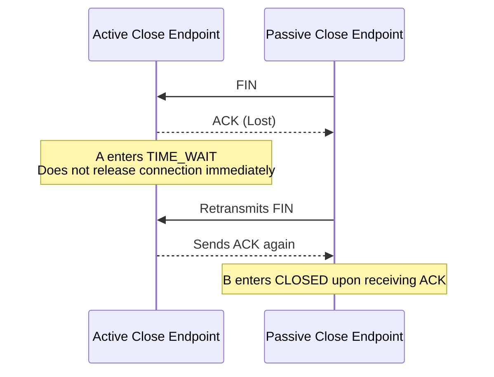

In the final step of the TCP four-way wave, the active close initiator does not close immediately after sending the final ACK; instead, it enters the `TIME_WAIT` state, waiting by default for 60 seconds.

These 60 seconds are frequently misunderstood: some view it as a waste of resources, some attempt to eliminate it forcefully via kernel parameters, and some confuse `CLOSE_WAIT` and `TIME_WAIT` during production troubleshooting.

This article addresses the most common questions encountered in production environments:

1. What is `TIME_WAIT` actually waiting for?
2. Does a massive accumulation of `TIME_WAIT` truly cause operational problems?
3. Can `tcp_tw_reuse` be turned on indiscriminately?
4. How do you distinguish `TIME_WAIT` from `CLOSE_WAIT`?

## TIME_WAIT Is More Than Just "Waiting a Bit Before Closing"

Once the ACK has been transmitted, why continue occupying a port for dozens of seconds?

After the active close party sends the final ACK, it does not release the connection immediately, but transitions to `TIME_WAIT`. As illustrated in the connection state diagram of RFC 9293, `TIME_WAIT` deletes the Transmission Control Block (TCB) and transitions to `CLOSED` only after a 2MSL timeout.

Note an important nuance here: it is not "whichever side receives a FIN enters TIME_WAIT". The passive close endpoint, upon receiving a FIN, typically enters `CLOSE_WAIT`, waiting for the local application to finish processing remaining data and call `close()` or `shutdown()`. The more common scenario is that the active close party enters `TIME_WAIT` after receiving the peer's final FIN and sending the final ACK.

**Whichever party actively closes the connection is the one that enters TIME_WAIT.** For instance, when a client actively terminates an HTTP short connection, `TIME_WAIT` manifests on the client side; if a server actively terminates connections, the server can also pile up substantial amounts of `TIME_WAIT`.

While it appears as merely waiting around, it actually solves two vital problems.

## Reason One: Providing a Safety Net for the Final ACK

After the active close party transmits the final ACK, if this ACK is lost in transit across the network, the passive close party assumes its FIN was never acknowledged and retransmits the FIN. Because the active close party remains in `TIME_WAIT`, it can respond with another ACK. If it had transitioned directly to `CLOSED`, it would likely reply with an RST, causing the peer to perceive an abnormal termination or connection reset.



**MSL (Maximum Segment Lifetime)** represents the maximum time a segment can exist within the network. 2MSL is not the maximum RTT of a single request-response cycle, but a conservative waiting window: it both provides an opportunity to handle FIN retransmissions if the final ACK is lost and ensures that delayed packets from the old connection completely dissipate from the network.

Note that MSL in RFCs is a protocol-level concept; concrete operating system implementations may differ. In common Linux implementations, the `TIME_WAIT` duration is typically fixed at 60 seconds. Another common misconception: `tcp_fin_timeout` controls the `FIN_WAIT_2` timeout for orphaned connections, not `TIME_WAIT`. To relieve port pressure caused by `TIME_WAIT`, prioritize connection reuse, expanding ephemeral port ranges, tracking the active close party, and satisfying `tcp_tw_reuse` conditions, rather than attempting to shorten `TIME_WAIT` using `tcp_fin_timeout`.

## Reason Two: Preventing Old Connection Packets from Corrupting New Connections

TCP connections are uniquely identified by a 4-tuple: Source IP, Source Port, Destination IP, Destination Port. If an old connection closes and a new connection is immediately established using the exact same 4-tuple, delayed packets from the old connection could happen to fall within the new connection's receive window and be processed as legitimate data.

Consider an example:

```text
Old connection: client:50000 -> server:443
A data packet with SEQ=301 sent by the server takes a circuitous route in the network and is delayed.

After the old connection closes, the client quickly reuses the same ephemeral port:
New connection: client:50000 -> server:443

Now, the old SEQ=301 packet finally reaches the client.
If it happens to fall within the new connection's receive window, it might be mistakenly accepted.
```

The TCP sequence number space ranges from 0 to 2^32 - 1, wrapping modulo 2^32; thus, sequence numbers alone cannot permanently distinguish old packets from new ones. Production systems employ timestamps, PAWS (Protection Against Wrapped Sequences), and randomized ISNs, but these are not panaceas that can "completely replace TIME_WAIT". RFC 1337 also discusses the hazards of old duplicate segments during TIME_WAIT.

## Does a Massive Volume of TIME_WAIT Actually Cause Problems?

`TIME_WAIT` is inherently a normal, healthy protocol state. Real problems typically arise when an active close initiator creates a massive number of connections to the exact same destination IP + destination port in a short timeframe, exhausting local ephemeral ports.

The Linux local ephemeral port range can be inspected and tuned via `net.ipv4.ip_local_port_range`. The default range in upstream kernel documentation is `32768 60999`, though actual production values should be checked on your specific host:

```bash
cat /proc/sys/net/ipv4/ip_local_port_range
```

If a client repeatedly connects to the same target IP + port within a short window, and the completed connections sit in `TIME_WAIT`, available local ephemeral ports can become completely saturated. When this happens, new connections fail to obtain a source port, producing the classic error:

```text
Cannot assign requested address
```

You can evaluate the situation using this mental model:

- **If you see many TIME_WAIT sockets on a server**: First check whether the server is actively closing connections — for example, server-side short connections, API gateways closing upstream connections, or connection pools aggressively evicting idle connections.
- **If you see many TIME_WAIT sockets on a client or gateway**: Focus on whether short connection storms exist, connection pooling is bypassed, HTTP Keep-Alive is disabled, or upstream services are frequently disconnecting.

A rough estimation formula:

```text
Max concurrent short connections to same target IP:Port ≈ Available ephemeral ports / TIME_WAIT retention duration
```

For instance, with a default port range of `32768~60999`, there are roughly 28,000 ephemeral ports. If `TIME_WAIT` lasts approximately 60 seconds, the continuous short-connection throughput ceiling to a single target IP:Port is on the order of a few hundred QPS. Actual capacity is influenced by connection reuse, reserved ports, NAT gateways, kernel policies, and 4-tuple variations across different remotes, so you cannot draw conclusions based solely on the raw count of `TIME_WAIT` sockets.

## Why You Should Not Enable tcp_tw_reuse Indiscriminately

`tcp_tw_reuse` allows reusing a socket in `TIME_WAIT` for new outgoing connections when the protocol deems it safe. While it looks like a quick shortcut to relieve port pressure, this parameter alters TCP's safety waiting strategy for stale segments and cannot be treated as a universal cure-all.

Consider this across three layers:

1. **It relies on TCP Timestamps to judge whether incoming packets are sufficiently fresh**. Timestamps filter out some old packets, but cannot protect against all edge cases. RFC 1337 highlights the risk of `TIME_WAIT` states being prematurely aborted by stale RST packets. Stale data segments falling into an acceptable receive window can corrupt data; the effect of stale ACKs depends on sequence numbers, window boundaries, and implementation specifics, and should not be conflated indiscriminately with RST disconnections.
2. **In current upstream Linux documentation, `tcp_tw_reuse` accepts values 0, 1, or 2, with the default being 2**, which permits reuse only for loopback traffic; `1` enables it globally. However, older documentation, distribution man pages, and legacy blog posts may still claim it is "disabled by default". Always verify with `sysctl net.ipv4.tcp_tw_reuse` on your machine. Kernel documentation also explicitly advises against modifying it without expert advice or clear technical justification.
3. **Do not confuse `tcp_tw_reuse` with the obsolete `tcp_tw_recycle`**. In NAT environments, `tcp_tw_recycle` caused timestamp collisions, resulting in massive, silent packet drops for clients behind NAT. It was completely removed in Linux 4.12. Many legacy tutorials on the web still recommend enabling both `tcp_tw_reuse` and `tcp_tw_recycle` simultaneously — never follow such outdated advice.

In short: `tcp_tw_reuse` can be evaluated, but only while considering the Linux kernel version, whether traffic is loopback, whether traffic traverses NAT, whether timestamps are enabled, and whether port exhaustion is genuinely occurring. If an issue can be solved at the application layer, solve it at the application layer first.

## TIME_WAIT vs. CLOSE_WAIT: One Is Normal Waiting, the Other Indicates Application Resource Leaks

When inspecting connection states, `CLOSE_WAIT` warrants far more concern than `TIME_WAIT`.

Upon receiving the peer's FIN, the local kernel returns an ACK and transitions to `CLOSE_WAIT`, waiting for the application to finish processing remaining data and call `close()` or `shutdown()`. In Java applications, an accumulation of `CLOSE_WAIT` almost always points to unclosed connections in application code. Examples include: raw Sockets not closed, unclosed HTTP client response bodies, early `return` statements in error branches bypassing cleanup, or connection pool connections not being returned. In all these cases, the kernel has ACKed the peer's FIN, but the application code fails to call `close()`.

Use this comparison:

- **TIME_WAIT**: The active close endpoint waits for 2MSL; this is a deliberate part of standard protocol design.
- **CLOSE_WAIT**: The passive close endpoint knows the peer has stopped sending, but the local application has not yet closed the socket. When large accumulations occur, suspect application code leaks, stuck threads, connection pool leaks, or I/O workflows that fail to reach their `finally` blocks.

| State | Typically Appears On | Meaning | Primary Troubleshooting Focus |
| --- | --- | --- | --- |
| TIME_WAIT | Active close party | Waiting for final ACK retransmission opportunity & old packet dissipation | Short connections, connection pooling, Keep-Alive, ephemeral port range |
| CLOSE_WAIT | Passive close party | Peer has closed, local app has not yet called `close()` | Code releasing sockets, stuck worker threads, connection pool leaks |

## In Troubleshooting, Look at Who Is Actively Closing, Not Just Socket Counts


When observing high volumes of `TIME_WAIT` or `CLOSE_WAIT`, use the following commands to determine your direction:

Note that `ss` is provided by `iproute2` on Linux and is absent by default on macOS. If your development environment is macOS, use `netstat` and `lsof` instead.

```bash
# Linux: View counts for each TCP state
ss -ant | awk 'NR>1 {cnt[$1]++} END {for (s in cnt) print s, cnt[s]}'

# macOS: View counts for each TCP state
netstat -anp tcp | awk '$1 ~ /^tcp/ {cnt[$NF]++} END {for (s in cnt) print s, cnt[s]}'

# Linux: View which destinations TIME_WAIT connections concentrate on
ss -ant state time-wait | awk 'NR>1 {print $5}' | sort | uniq -c | sort -nr | head

# macOS: View which remotes TIME_WAIT connections concentrate on
netstat -anp tcp | awk '$1 ~ /^tcp/ && $NF=="TIME_WAIT" {print $(NF-1)}' | sort | uniq -c | sort -nr | head

# Linux: Check which process corresponds to CLOSE_WAIT (requires sudo to inspect process metadata)
sudo ss -tanp state close-wait

# macOS: Check which process corresponds to CLOSE_WAIT
sudo lsof -nP -iTCP -sTCP:CLOSE_WAIT

# Linux: View the accept queue status of listening sockets
ss -ltn
```


Interpretations behind these commands:

- **TIME_WAIT concentrated on a specific remote service**: Check if short connections dominate, HTTP connection pooling is disabled, connection pools are undersized or frequently rebuilt, or the remote side is actively tearing down connections.
- **CLOSE_WAIT concentrated in a specific local process**: Prioritize inspecting application code, particularly whether exception branches fail to close response bodies, sockets, or connection handles.
- **Listening socket Recv-Q persistently close to Send-Q**: Investigate accept queue backlogs; examine whether the application calls `accept()` promptly, whether worker thread pools are stuck, or whether backlog settings are undersized.
- For API gateways, reverse proxies, web scrapers, and load test clients, `TIME_WAIT` is typical; for Java backend services with downstream leaks, `CLOSE_WAIT` is far more prevalent.

## Prudent Optimization Recommendations

Follow this troubleshooting priority:

1. **Prioritize eliminating unnecessary short connections**: Enable HTTP Keep-Alive and leverage reusable connection pools.
2. **Identify who is actively closing connections**: Servers, clients, reverse proxies, and connection pool evaporators can all be the active close initiator.
3. **Audit application-side resource cleanup**: In particular, check HTTP response bodies, raw Sockets, database connections, and connection pool return logic.
4. **Expand local ephemeral port ranges**: Only when client-side short connections are genuinely high and concrete evidence of port exhaustion exists, consider tuning `ip_local_port_range`.
5. **Treat kernel tuning as the last resort**: Parameters like `tcp_tw_reuse`, `tcp_abort_on_overflow`, and `tcp_syncookies` must be evaluated against Linux versions, connection topologies, NAT presence, attack patterns, and empirical telemetry data; never blindly copy configurations from internet posts.

A high `TIME_WAIT` count is not inherently an outage; a high `CLOSE_WAIT` count almost always demands an inspection of application code. While both states superficially look like "connections that have not closed cleanly", their underlying engineering problems are completely distinct.

## References

- RFC 9293: Transmission Control Protocol (TCP): <https://www.rfc-editor.org/rfc/rfc9293>
- RFC 1337: TIME-WAIT Assassination Hazards in TCP: <https://www.rfc-editor.org/rfc/rfc1337>
- Linux Kernel ip-sysctl Documentation: <https://www.kernel.org/doc/Documentation/networking/ip-sysctl.txt>
- SoByte - Why TCP Needs the TIME_WAIT State: <https://www.sobyte.net/post/2022-10/tcp-time-wait/>
