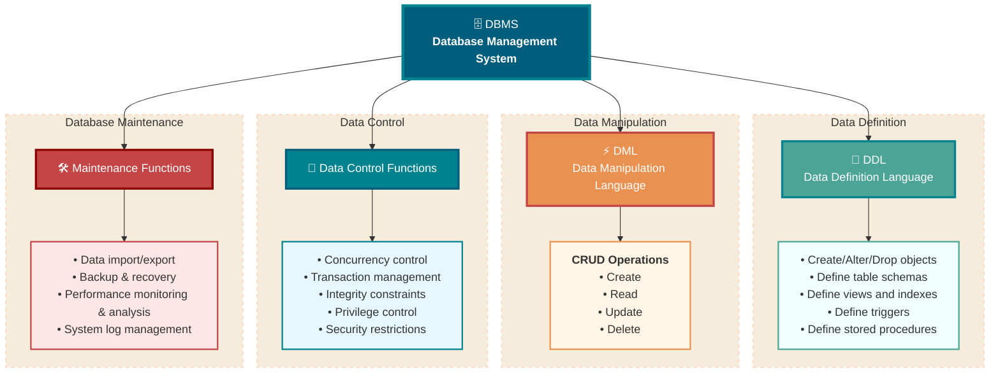
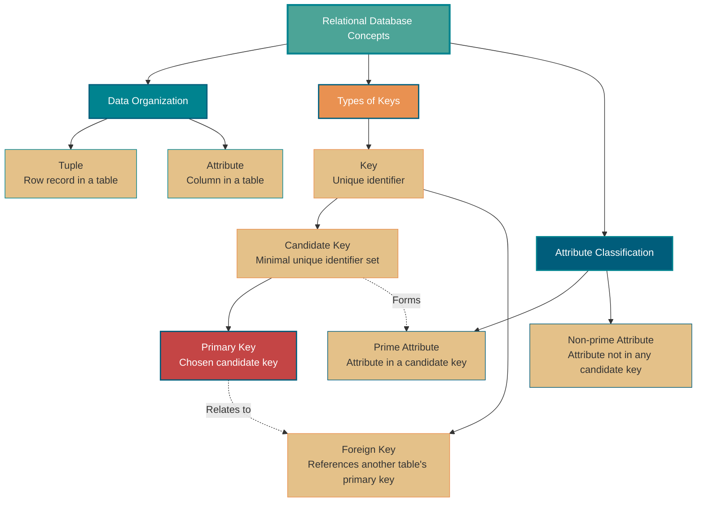
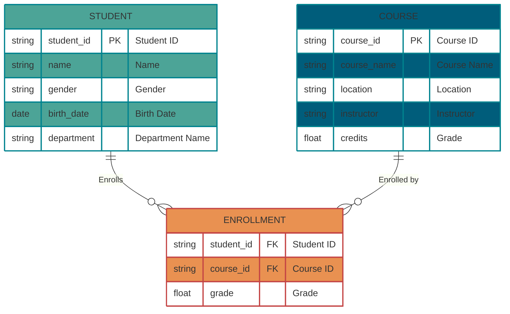
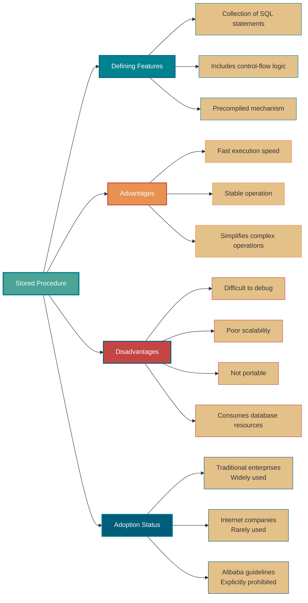
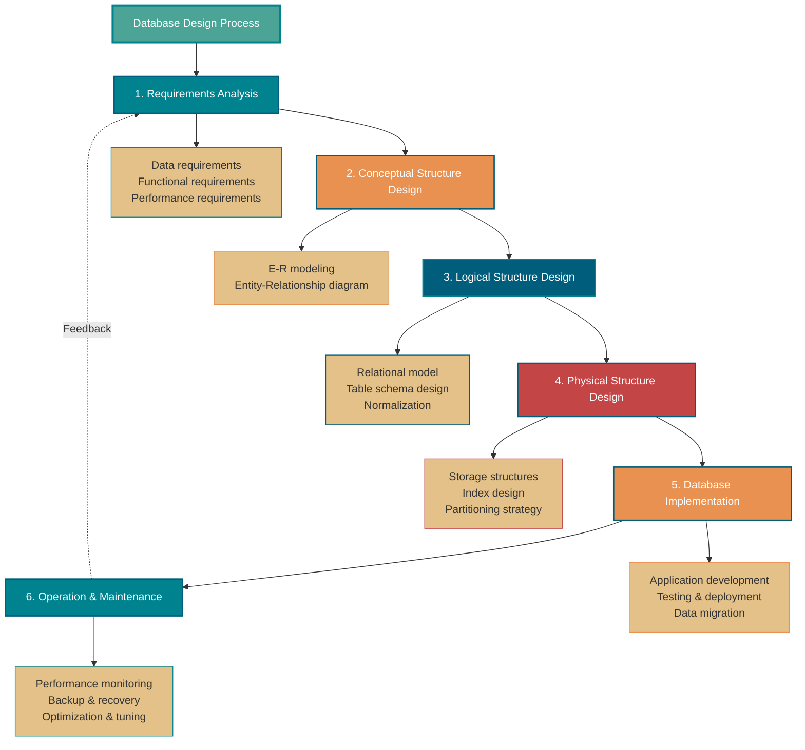

Database knowledge fundamentals—you must understand and remember this material. Although this section covers theoretical knowledge, it is very important and serves as the foundation for learning MySQL later. PS: Because this section involves many conceptual topics, it references the corresponding entries on Wikipedia and Baidu Baike.

## What Are Database, Database Management System, Database System, and Database Administrator?

These four concepts describe different layers ranging from the data itself to managing the entire system. We often use a library analogy to connect and understand them.

- **Database (DB):** It is like all the books and reference materials stored on the shelves in a library. Technically speaking, a database is a collection of structured data organized, described, and stored according to a specific data model, which can be shared by various users. It is the core asset we ultimately store and retrieve—the information itself.
- **Database Management System (DBMS):** It is like the entire management system of the library, including cataloging and classification rules, borrowing and returning workflows, security inspection systems, and so on. Technically speaking, a DBMS is a large software system, such as MySQL, Oracle, or PostgreSQL that we commonly use. Its core responsibility is to scientifically organize and store data, and efficiently retrieve and maintain data; it shields us from the complexity of underlying file operations, provides a standard interface (such as SQL) to manipulate data, and handles complex issues such as concurrency control, transaction management, and access control.
- **Database System (DBS):** It is the entire functioning library as a whole. This is a broader concept that includes not only the books (DB) and the management system (DBMS), but also the hardware, applications, and people using it.
- **Database Administrator (DBA):** The DBA is the head librarian responsible for keeping the entire database system running smoothly. Their responsibilities are broad, including database design, installation, monitoring, performance tuning, backup and recovery, security management, and more, ensuring the stability, efficiency, and security of the entire system.

People often confuse DB and DBMS, so let's clarify briefly: **Usually when we say "using a MySQL database," we actually mean using MySQL (the DBMS) to manage one or more databases (DBs).**

## What Are the Main Functions of a DBMS?

A DBMS typically provides four core functions:

1. **Data Definition:** This is the foundation of a DBMS. It provides a Data Definition Language (DDL) that allows us to create, modify, and drop various objects in the database. This goes beyond defining table structures (such as column names and data types) to include defining views, indexes, triggers, stored procedures, and more.
2. **Data Manipulation:** This is the functionality we developers use most frequently in daily work. It provides a Data Manipulation Language (DML), at the core of which are the familiar CRUD (Create, Read, Update, Delete) operations. It allows us to conveniently manipulate and retrieve data in the database.
3. **Data Control:** This is key to ensuring data correctness, security, and reliability. It typically includes concurrency control, transaction management, integrity constraints, privilege control, security restrictions, and similar capabilities.
4. **Database Maintenance:** These functions ensure the long-term stable operation of the database system. They include data import and export, database backup and recovery, performance monitoring and analysis, and system log management.

## What Types of DBMS Do You Know?

### Relational Databases

First are our most commonly used relational databases (RDBMS), such as MySQL (the top open-source choice), PostgreSQL (the most feature-complete), and Oracle (enterprise-grade). Based on strict table schemas and SQL, they are well suited for structured data and scenarios requiring transaction guarantees, such as banking transactions and order systems.

In recent years, to meet the demands of massive data, high concurrency, and diverse data structures brought by internet applications, a large number of NoSQL and NewSQL databases have emerged.

### NoSQL Databases

Their shared characteristic is making compromises in certain areas (typically transactions) in exchange for extreme performance and horizontal scalability.

**1. Key-Value Databases, represented by Redis.**

- **Characteristics:** The data model is extremely simple—essentially a giant Map where values are stored and retrieved by key. Operations run in memory, delivering extremely high performance.
- **Use Cases:** Ideal for scenarios with ultra-high read/write performance requirements, such as caching, session storage, and counters.

**2. Document Databases, represented by MongoDB.**

- **Characteristics:** They store semi-structured documents (such as JSON/BSON) with a flexible schema, requiring no predefined table structure.
- **Use Cases:** Particularly well suited for businesses with frequently changing data structures and rapid iteration, such as user profiles, content management systems, and log storage.

**3. Columnar (Wide-Column) Databases, represented by HBase and Cassandra.**

- **Characteristics:** Data is stored by column family rather than by row. This gives them extremely high performance when reading a small number of columns across a large number of rows.
- **Use Cases:** Built specifically for massive data storage and analytics, ideal for big data analytics, monitoring data storage, recommendation systems, and other scenarios requiring high-throughput writes and range scans.

**4. Graph Databases, represented by Neo4j.**

- **Characteristics:** The data model consists of Nodes and Edges, purpose-built for storing and querying complex relationships between entities.
- **Use Cases:** In scenarios such as social networks (friend relationships), recommendation engines (user-item relationships), knowledge graphs, and fraud detection (fund-flow relationships), they perform far better than relational databases.

### NewSQL Databases

Because NoSQL databases generally do not support full ACID transactions, many systems with very high data safety requirements (such as financial systems, order systems, and trading systems) cannot easily adopt them. Yet these systems often need to store massive amounts of data.

Such systems used to rely either on buying more powerful hardware or on using database middleware to increase storage capacity. However, the former has excessive monetary cost, while the latter carries excessive development complexity.

And thus, **NewSQL** arrived!

Simply put, NewSQL is: **Distributed Storage + SQL + Transactions**. NewSQL not only possesses NoSQL's ability to store and manage massive data, but also preserves traditional database features such as ACID transactions and SQL support. Therefore, NewSQL can also be called a **distributed relational database**.

Some design goals of NewSQL databases include:

1. Horizontal scaling (Scale Out): Increasing system capacity by adding more machines, in contrast to vertical scaling (Scale Up), which upgrades hardware on an existing machine.
2. Strict Consistency: Data across all nodes is identical at any given moment.
3. High Availability: The system can provide services virtually continuously.
4. Standard SQL support: Like relational databases such as PostgreSQL, MySQL, and Oracle, they support SQL.
5. Transactions (ACID): Atomicity, Consistency, Isolation, and Durability.
6. Compatibility with mainstream relational databases: Compatible with commonly used RDBMSs such as MySQL, Oracle, and PostgreSQL.
7. Cloud Native: Can be deployed and automated cleanly across public, private, and hybrid clouds.
8. HTAP (Hybrid Transactional/Analytical Processing): Supports both OLTP and OLAP workloads simultaneously.

Representative NewSQL databases: Google's F1/Spanner, Alibaba's [OceanBase](https://open.oceanbase.com/), and PingCAP's [TiDB](https://pingcap.com/zh/product-community/).

## What Are Tuple, Key, Candidate Key, Primary Key, Foreign Key, Prime Attribute, and Non-Prime Attribute?

In relational database theory, understanding core concepts such as tuple, key, candidate key, primary key, foreign key, prime attribute, and non-prime attribute is essential for database design and normalization. These concepts form the theoretical foundation of relational databases.

### Basic Concepts

- **Tuple:** A tuple is the fundamental unit in a relational database, corresponding to a single row record in a two-dimensional table. Each tuple contains the complete information of an entity. For example, in a student table, the complete information for each student (student ID, name, age, etc.) forms a tuple.
- **Key:** A key is a set of one or more attributes that can uniquely identify a tuple in a relation. The main role of a key is to guarantee data uniqueness and integrity.

### Key Classifications

- **Candidate Key:** A candidate key is a minimal set of attributes capable of uniquely identifying a tuple, such that no proper subset of it can uniquely identify a tuple. A relation may have multiple candidate keys. For example, in a student table, if "student ID" can uniquely identify a student and "national ID number" can also uniquely identify a student, then `{student ID}` and `{national ID number}` are both candidate keys.
- **Primary Key:** A primary key is one candidate key selected to uniquely identify tuples in a relation. Each relation can have only one primary key, though it may have multiple candidate keys. When choosing a primary key, factors such as simplicity, stability, and lack of business meaning are usually considered.
- **Foreign Key:** A foreign key is an attribute or group of attributes in one relation that corresponds to the primary key of another relation. Foreign keys are used to establish and maintain links between two relations and serve as an important mechanism for enforcing referential integrity. For example, if "student ID" in a course enrollment table references the primary key "student ID" of the student table, then "student ID" in the course enrollment table is a foreign key.

### Attribute Classifications

- **Prime Attribute:** A prime attribute is an attribute contained in any candidate key. If a relation has multiple candidate keys, then all attributes appearing in any of those candidate keys are prime attributes. For example, in the relation `Worker(employee_id, national_id, name, gender, department)`, if both `{employee_id}` and `{national_id}` are candidate keys, then both `employee_id` and `national_id` are prime attributes.
- **Non-prime Attribute:** A non-prime attribute is an attribute not contained in any candidate key. These attributes depend entirely on a candidate key to determine their values. In the `Worker` relation above, `name`, `gender`, and `department` are all non-prime attributes.

## What Is an ER Diagram?

When working on a project, you should always try drawing an ER diagram to clarify the database design—this is also something interviewers frequently ask about when discussing your projects.

**ER Diagram** stands for **Entity Relationship Diagram**, which provides a notation for representing entity types, attributes, and relationships.

An ER diagram consists of the following 3 elements:

- **Entity:** Typically a real-world business object, though logical objects can also be used. For example, a campus management system involves entities such as students, teachers, courses, and classes. In an ER diagram, entities are represented by rectangles.
- **Attribute:** The properties possessed by an entity, used to describe the components of that entity; in product design, these can be understood as fields/columns. In an ER diagram, attributes are represented by ovals (ellipses).
- **Relationship:** The association between entities, represented by diamonds in an ER diagram. This relationship not only conveys business associations, but can also use numbers to express cardinality constraints between entities. For example, one class having multiple students is a relationship between entities.

Below is an ER diagram for student course enrollment. Each student can enroll in multiple courses, and the same course can be chosen by multiple students, so the relationship between them is many-to-many (`M:N`). In addition, the other two cardinalities between entities are one-to-one (`1:1`) and one-to-many (`1:N`).

## Do You Know About Database Normal Forms?

There are 3 common database normal forms:

- 1NF (First Normal Form): Attributes are atomic (cannot be subdivided further).
- 2NF (Second Normal Form): Builds upon 1NF by eliminating partial functional dependencies of non-prime attributes on keys.
- 3NF (Third Normal Form): Builds upon 2NF by eliminating transitive functional dependencies of non-prime attributes on keys.

### 1NF (First Normal Form)

Attributes (corresponding to columns in a table) cannot be split further—that is, a column can hold only a single atomic value and cannot be broken down into multiple other columns. **1NF is the most basic requirement for all relational databases**, meaning any table created in a relational database inherently satisfies First Normal Form.

### 2NF (Second Normal Form)

2NF builds upon 1NF by eliminating partial functional dependencies of non-prime attributes on keys. As shown in the diagram below illustrating the transition from First Normal Form to Second Normal Form, Second Normal Form introduces a column designated as the primary key on top of First Normal Form so that non-prime attributes all depend on the entire primary key.

Some important concepts:

- **Functional Dependency:** In a table, if knowing the value of attribute (or attribute group) $X$ uniquely determines the value of attribute $Y$, then $Y$ is said to be functionally dependent on $X$, written as $X \rightarrow Y$.
- **Partial Functional Dependency:** If $X \rightarrow Y$ and there exists a proper subset $X_0$ of $X$ such that $X_0 \rightarrow Y$, then $Y$ is partially functionally dependent on $X$. For instance, in a basic student info relation $R(\text{student\_id}, \text{national\_id}, \text{name})$, since `student_id` is unique, in relation $R$ we have $(\text{student\_id}, \text{national\_id}) \rightarrow (\text{name})$, $(\text{student\_id}) \rightarrow (\text{name})$, and $(\text{national\_id}) \rightarrow (\text{name})$; thus `name` is partially functionally dependent on $(\text{student\_id}, \text{national\_id})$.
- **Full Functional Dependency:** In a relation, if a non-prime attribute depends on the entire key rather than a proper subset of it, it is called a full functional dependency. For example, in a student info relation $R(\text{student\_id}, \text{class}, \text{name})$, assuming different classes can share the same student ID numbers while student IDs within a single class are unique, in relation $R$ we have $(\text{student\_id}, \text{class}) \rightarrow (\text{name})$, whereas neither $(\text{student\_id}) \rightarrow (\text{name})$ nor $(\text{class}) \rightarrow (\text{name})$ holds; therefore `name` is fully functionally dependent on $(\text{student\_id}, \text{class})$.
- **Transitive Functional Dependency:** In relation schema $R(U)$, let $X, Y, Z$ be distinct attribute subsets of $U$. If $X \rightarrow Y$ and $Y \rightarrow Z$, where $Y \not\subseteq X$ (and $X$ does not contain $Y$), $Y \not\rightarrow X$, and $(X \cup Y) \cap Z = \emptyset$, then $Z$ is transitively functionally dependent on $X$. Transitive functional dependencies cause data redundancy and anomalies. Because subsets $Y$ and $Z$ in a transitive dependency often belong to the same entity, they can be separated into their own table. For example, in relation $R(\text{student\_id}, \text{name}, \text{department\_name}, \text{department\_head})$, $\text{student\_id} \rightarrow \text{department\_name}$ and $\text{department\_name} \rightarrow \text{department\_head}$, so the non-prime attribute `department_head` has a transitive functional dependency on `student_id`.

### 3NF (Third Normal Form)

3NF builds upon 2NF by eliminating transitive functional dependencies of non-prime attributes on keys. A database design that satisfies 3NF **largely** resolves issues of excessive data redundancy, insertion anomalies, update anomalies, and deletion anomalies. For example, in the relation $R(\text{student\_id}, \text{name}, \text{department\_name}, \text{department\_head})$, $\text{student\_id} \rightarrow \text{department\_name}$ and $\text{department\_name} \rightarrow \text{department\_head}$, so the non-prime attribute `department_head` is transitively functionally dependent on `student_id`, meaning this table design does not meet 3NF requirements.

## What Is the Difference Between a Primary Key and a Foreign Key?

In terms of definition and properties, their differences are:

- **Primary Key:** Its core function is to uniquely identify each row of data in a table. Therefore, the value of a primary key column must be unique (`Unique`) and cannot be null (`Not Null`). A table can have only one primary key. A primary key guarantees entity integrity.
- **Foreign Key:** Its core function is to establish and enforce an association between two tables. The value of a foreign key column in one table must match a candidate key value (usually a primary key, or alternatively a unique key) of a row in another table, or be `NULL`. Therefore, foreign key values can repeat and can be null. A table can have multiple foreign keys, each referencing a different table. Foreign keys guarantee referential integrity.

Let's illustrate with a simple e-commerce example: suppose we have two tables: `users` and `orders`.

- In the `users` table, the `user_id` column is the **primary key**. Each user's `user_id` is unique, which we use to distinguish Alice from Bob.
- In the `orders` table, `order_id` is its own **primary key**. At the same time, it has a `user_id` column, which is a **foreign key** referencing the `user_id` primary key in the `users` table.

This foreign key constraint guarantees that:

1. You cannot create an order that does not belong to any known user (where `user_id` does not exist in the `users` table).
2. You cannot delete a user who has already placed orders (unless special rules such as cascading deletes are configured).

## Why Are Foreign Keys and Cascading Not Recommended?

Regarding foreign keys and cascading, the Alibaba Java Development Guidelines state:

> [Mandatory] Do not use foreign keys and cascading; all foreign key concepts must be resolved at the application layer.
>
> Explanation: Taking the relationship between students and grades as an example, `student_id` in the student table is the primary key, so `student_id` in the grade table is a foreign key. If updating `student_id` in the student table simultaneously triggers an update of `student_id` in the grade table, that is a cascading update. Foreign keys and cascading updates are suitable for single-machine, low-concurrency scenarios, not for distributed, high-concurrency clusters; cascading updates are strongly blocking and carry the risk of a database update storm; foreign keys also degrade database insert performance.

Why shouldn't foreign keys be used? Most people would answer along these lines:

1. **Increases complexity:** a. Every `DELETE` or `UPDATE` must account for foreign key constraints, making development painful and preparing test data extremely inconvenient; b. Foreign keys lock in the parent-child relationship—if requirements ever change so that a column no longer needs to link to another table, it creates a lot of trouble.
2. **Adds extra work:** The database must perform extra work to maintain foreign keys. For example, after inserts, deletions, or updates involving foreign key columns, it has to trigger related checks to ensure data consistency and correctness, inevitably consuming database resources. Maintaining this at the application layer reduces pressure on the database.
3. **Unfriendly to database and table sharding:** Under database/table sharding, foreign keys cannot work at all.
4. ...

Personally, I think the answer above isn't completely well-rounded because it only focuses on common downsides of foreign keys. In reality, foreign keys also have many benefits, such as:

1. Guaranteeing data consistency and integrity at the database level;
2. Convenient cascading operations that reduce application code volume;
3. ...

Therefore, you shouldn't blindly discard the concept of foreign keys—there is a reason they exist. If a system does not involve database/table sharding and concurrency is not very high, using foreign keys can still be considered.

## What Is a Stored Procedure?

A stored procedure is a precompiled collection of SQL statements in a database that encapsulates multiple SQL statements along with procedural control-flow statements (such as `IF-ELSE` and `WHILE` loops) into a reusable database object.

**Advantages of Stored Procedures:**

In traditional enterprise applications, stored procedures offer practical value. When business logic is complex and requires executing a large number of SQL statements to complete one business operation, those statements can be encapsulated into a stored procedure to simplify invocation. Because a stored procedure is compiled and stored in the database upon creation, it does not need to be recompiled at runtime, giving it better execution performance than dynamic SQL statements. Moreover, once debugged, a stored procedure runs relatively stably and reliably.

**Limitations of Stored Procedures:**

However, in modern internet architectures, stored procedures are used less and less. The main reasons include: difficulty debugging due to a lack of mature debugging tools; poor extensibility because modifying business logic requires changing database objects directly; poor portability because stored procedure syntax varies greatly across database systems; consuming database resources and increasing the load on the database server; and difficult version management, making code version control awkward.

**Industry Standards:**

For the reasons above, many internet companies' development standards explicitly restrict or prohibit the use of stored procedures. For instance, the *Alibaba Java Development Guidelines* explicitly prohibit stored procedures and recommend placing business logic in the application layer to keep the database simple and efficient.

## What Is the Difference Between DROP, DELETE, and TRUNCATE?

In database operations, `DROP`, `DELETE`, and `TRUNCATE` are three commonly used data deletion commands, and they differ significantly in functionality, performance, and use cases.

**DROP command:**

- Syntax: `DROP TABLE table_name`
- Effect: Completely deletes the entire table, including the table structure, data, indexes, triggers, constraints, and all related objects.
- Use case: Used when a table is no longer needed.

**TRUNCATE command:**

- Syntax: `TRUNCATE TABLE table_name`
- Effect: Empties all data in the table while retaining the table structure.
- Characteristics: Auto-increment columns (`AUTO_INCREMENT`) are reset to their initial value (usually 1).
- Use case: Used when you need to quickly wipe all table data while preserving the table structure.

**DELETE command:**

- Syntax: `DELETE FROM table_name WHERE condition`
- Effect: Deletes rows that satisfy the condition; without a `WHERE` clause, deletes all data.
- Characteristics: Auto-increment columns are not reset and continue incrementing from the previous value.
- Use case: Used when you need to selectively delete specific rows.

`TRUNCATE`, `DELETE` without a `WHERE` clause, and `DROP` all remove data inside a table, but **`TRUNCATE` and `DELETE` only delete the data without deleting the table structure (definition), whereas executing `DROP` deletes the table structure as well—meaning the table ceases to exist after `DROP`.**

### Impact on Table Structure

- `DROP`: Deletes both the table structure and all data; the table no longer exists.
- `TRUNCATE`: Deletes only the data, preserving the table structure and definition.
- `DELETE`: Deletes only the data, preserving the table structure and definition.

### Triggers

- `DELETE` operations fire associated `DELETE` triggers.
- `TRUNCATE` and `DROP` do not fire `DELETE` triggers.

### Transactions and Rollback

- `DROP` and `TRUNCATE` are DDL operations; they take effect immediately upon execution and cannot be rolled back.
- `DELETE` is a DML operation and can be rolled back (within a transaction).

### Execution Speed

Generally speaking: `DROP` > `TRUNCATE` > `DELETE` (I have not benchmarked this myself).

- When `DELETE` executes, it writes to the database's `binlog`. Recording logs takes time, though it provides the benefit of enabling data rollback and recovery.
- `TRUNCATE` does not generate per-row database logs when executed, making it faster than `DELETE`. In addition, it resets the table's auto-increment counter and restores indexes to their initial size.
- `DROP` releases all disk space occupied by the table.

Tips: You should focus more on the appropriate use case rather than execution speed.

## What Is the Difference Between DML and DDL Statements?

- DML stands for Data Manipulation Language. It refers to operations on records within database tables—primarily inserting, updating, deleting, and querying table records—and is what developers use most frequently in daily work.
- DDL stands for Data Definition Language. Simply put, it is the language used to create, drop, and alter objects inside a database. The biggest difference between DDL and DML is that DML only operates on the data inside tables and does not involve modifying table definitions, structures, or other database objects. DDL statements are used more often by Database Administrators (DBAs) and rarely by ordinary application developers.

Additionally, because `SELECT` does not modify or destroy tables, some sources categorize `SELECT` separately as DQL (Data Query Language).

## What Are the Typical Phases of Database Design?

### 1. Requirements Analysis Phase

**Objective:** Deeply understand and analyze user requirements and define system boundaries.
**Main Tasks:**

- Collect and analyze data requirements: Determine what data needs to be stored, data volume, and update frequency.
- Clarify functional requirements: What business operations the system must support and the priority of each operation.
- Define performance requirements: Response time targets, concurrent user count, and data throughput.
- Determine security requirements: Data access permissions, encryption requirements, and auditing requirements.
  **Deliverables:** Software Requirements Specification (SRS), initial draft of the data dictionary.

### 2. Conceptual Structure Design Phase

**Objective:** Transform requirements into a conceptual model of the information domain.
**Main Tasks:**

- Identify entities: Determine the main objects in the system.
- Define attributes: Clarify the characteristics of each entity.
- Establish relationships: Determine relationships among entities (one-to-one, one-to-many, many-to-many).
- Draw an E-R diagram (Entity-Relationship diagram).
  **Deliverables:** E-R diagram, conceptual data model documentation.

### 3. Logical Structure Design Phase

**Objective:** Convert the conceptual model into a logical model supported by the specific DBMS.
**Main Tasks:**

- Convert the E-R diagram to a relational model: Map entities to tables and attributes to columns.
- Normalize the design: Eliminate data redundancy and update anomalies through normalization (typically up to 3NF).
- Define integrity constraints: Primary keys, foreign keys, uniqueness constraints, and check constraints.
- Optimize the model: Perform appropriate denormalization based on performance requirements.
  **Deliverables:** Logical data model, table schema design documentation.

### 4. Physical Structure Design Phase

**Objective:** Determine the physical storage layout and access methods for the data.
**Main Tasks:**

- Choose a storage engine: Such as MySQL's InnoDB, MyISAM, etc.
- Design indexing strategies: Determine the index types and columns to create.
- Design partitioning: Partition large tables to improve performance.
- Determine storage parameters: Tablespace size, data file locations, and buffer configuration.
- Formulate backup strategies: Frequency and methods for full backups and incremental backups.
  **Deliverables:** Physical design documentation, index design plan.

### 5. Database Implementation Phase

**Objective:** Turn the design into an operational database system.
**Main Tasks:**

- Create databases and table structures: Write and execute DDL statements.
- Develop stored procedures and triggers (if needed).
- Write application interfaces.
- Import initial data.
- System integration testing: Functional testing, performance testing, and stress testing.
- User training and documentation writing.
  **Deliverables:** Database scripts, test reports, user manuals.

### 6. Operation and Maintenance Phase

**Objective:** Ensure the database system runs stably and efficiently.
**Main Tasks:**

- Daily monitoring: Performance monitoring, disk space monitoring, and error log analysis.
- Performance optimization: Query optimization, index adjustments, and parameter tuning.
- Data backup and recovery: Scheduled backups and recovery drills.
- Security management: Privilege management, security patch updates, and auditing.
- Capacity planning: Forecast data growth and scale up/out ahead of time.
- Change management: Evaluate and implement requirement changes.
  **Deliverables:** Operations reports, optimization plans, change records.

### Design Principles

Throughout the entire design process, follow the principles of data independence, integrity, security, scalability, and standardization.

## References

- <https://blog.csdn.net/rl529014/article/details/48391465>
- <https://www.zhihu.com/question/24696366/answer/29189700>
- <https://blog.csdn.net/bieleyang/article/details/77149954>
