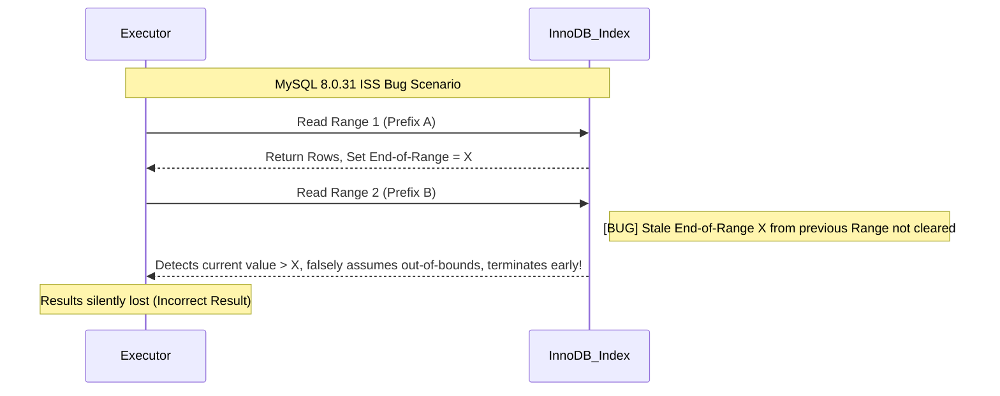

In database performance optimization, indexing is one of the most direct and effective tools available. However, **creating an index does not guarantee that MySQL will actually use it**. In real-world development, engineers frequently face this puzzle: an index is clearly created on a column, yet queries still crawl at snail's pace, and `EXPLAIN` analysis reveals that MySQL is running an unexpected full table scan.

The causes of index invalidation are diverse, stemming from both how SQL queries are written and how indexes are designed. Some invalidation scenarios are obvious (such as violating the leftmost prefix rule), while others are subtle and easily overlooked (such as implicit type conversion). Without a solid grasp of these failure scenarios, it is easy to plant performance landmines in production environments.

This article systematically summarizes common MySQL index invalidation scenarios, explains the underlying mechanisms behind them, and provides corresponding optimization recommendations to help you quickly identify and resolve index invalidation issues in daily development and troubleshooting.

### SELECT * Queries (Cost Trade-offs)

- **Core Definition**: `SELECT *` itself **does not directly cause index invalidation**. It represents a "non-covering index" query; if the `WHERE` condition matches an index, the index is still initially evaluated.
- **Table Lookup Cost Decision**: When the columns required by a query are not present in the index tree, MySQL must take the primary key back to the clustered index to retrieve the full row of data (table lookup). The optimizer evaluates and compares the cost of "Index Scan + Table Lookups" against a "Direct Full Table Scan". If the qualifying rows constitute a significant portion of the total table data (typically exceeding a threshold of 20% to 30%), the optimizer determines that sequential I/O from a full table scan is faster and cheaper than the random I/O required by repeated secondary index table lookups, and **actively chooses to abandon the index**.
- **Scenario Trade-offs**:
  - **Covering Index Scenario**: If the query only requires columns already contained in the index, using a covering index completely avoids table lookups, delivering optimal performance.
  - **When Table Lookups Are Unavoidable**: If the business genuinely requires multiple non-indexed columns, simply write `SELECT required_columns`. When most columns from the table are needed, code clarity and maintainability may outweigh the micro-optimization of omitting a few columns, making `SELECT *` acceptable.
- **Practical Recommendation**: Prioritize `SELECT required_columns`; aim for a covering index where feasible. If a large number of fields are required and table lookups cannot be avoided, do not be overly dogmatic about trimming fields.

### Violating the Leftmost Prefix Rule

- **Core Definition**: The leftmost prefix matching rule states that when evaluating a composite index, MySQL matches query conditions from left to right according to the order of columns defined in the index. If the query conditions match the leftmost column in the index, MySQL can utilize the index to filter data.
- **Interruption Effect of Range Queries**: In a composite index, if a column is queried using a range condition (e.g., `>`, `<`, `BETWEEN`, or prefix pattern matching `LIKE 'abc%'`), that column and all preceding columns can match normally and be used for precise index positioning (i.e., fast binary search via `ref` or `range`). However, any columns defined after that range column in the index cannot be used for rapid index seek operations. This is because in a B+Tree structure, subsequent columns are strictly ordered only when all preceding columns are exact equalities. Once a leading column spans a range of values, subsequent columns become unordered across that range, breaking the precise binary seek capability. Nonetheless, in MySQL 5.6 and later, these subsequent columns are not completely wasted; they are downgraded to participate in **Index Condition Pushdown (ICP)**, filtering rows directly at the storage engine level during the range scan to reduce the number of costly table lookups.
- **Index Skip Scan (ISS)**: MySQL 8.0.13 introduced **Index Skip Scan**, which allows queries missing the leftmost prefix column to jump across the index tree by enumerating all distinct values of the leading column.
  - **Version Bug Warning**: In **MySQL 8.0.31**, ISS suffered from a severe bug ([Bug #109145](https://bugs.mysql.com/bug.php?id=109145)): stale boundary values were not properly reset when reading across ranges, causing queries to prematurely terminate and **silently lose data**!
  - **Practical Recommendation**: ISS performs best when the leading column has very low cardinality (e.g., gender or small status enums), because the optimizer must enumerate each distinct leading value to perform skip scans—fewer distinct values mean fewer skips. However, "low cardinality" is not a formal prerequisite; the optimizer makes a cost-based decision whether to invoke ISS. In production environments, **never rely on ISS to compensate for poor index design**. You should always satisfy the leftmost prefix rule by adjusting composite index column order or providing leading column conditions in your queries.

**Index Skip Scan Failure Flowchart:**



Invalidation Examples:

```sql
-- Index: (sname, s_code, address)
SELECT * FROM students WHERE s_code = 1;                  -- Skips leftmost column sname, index is not used
SELECT * FROM students WHERE sname = 'A' AND address = 'Shanghai'; -- Skips middle column, only sname uses the index (ICP optimizes filtering)
SELECT * FROM students WHERE sname = 'A' AND s_code > 1 AND address = 'Shanghai'; -- After range query, address cannot be used for index seek, only for filtering
```

### Performing Calculations, Functions, or Type Conversions on Indexed Columns

- **Core Definition**: The index B+Tree stores the **original values** of the column. Once a function (such as `ABS()`, `DATE()`) or arithmetic calculation is applied to an indexed column in the `WHERE` clause, the column values are logically transformed.
- **Disrupting Ordering**: Because the B+Tree is sorted based strictly on the original, untransformed values, the results computed by a function or calculation are **unordered** within the index tree. The database cannot use binary search to locate data, leaving it no choice but to perform a full table scan.
- **Functional Indexes**: MySQL 8.0 introduced **functional indexes**, which allow building an index on computed expressions. However, their use cases remain specialized; the preferred solution is always to refactor the SQL statement.

Invalidation Examples:

```sql
SELECT * FROM students WHERE height + 1 = 170;            -- Calculation on indexed column
SELECT * FROM students WHERE DATE(create_time) = '2022-01-01'; -- Function applied to indexed column
```

Optimization Recommendations:

```sql
SELECT * FROM students WHERE height = 169;                -- Move calculation to the right-hand side
SELECT * FROM students WHERE create_time BETWEEN '2022-01-01 00:00:00' AND '2022-01-01 23:59:59';
```

### LIKE Fuzzy Queries Starting with a Leading Wildcard

- **Core Definition**: A `LIKE` query must start with a concrete character prefix to take advantage of B+Tree ordering, e.g., `WHERE sname LIKE 'Guide%';`. This is because B+Trees are sorted lexicographically from left to right. A leading wildcard (`%`) disrupts this ordering, making it impossible to determine a search starting point.
- **Failure Mechanism of Leading Wildcards**: If a pattern starts with `%` (e.g., `'%abc'`), the uncertainty of the prefix means matching strings could reside anywhere across the entire index tree, preventing the optimizer from identifying a bounded scan interval.
- **Practical Recommendations**:
  - If a full wildcard query is strictly necessary, try to query only columns covered by the index. In this case, `EXPLAIN` will display `type: index` (**Index Full Scan**); although it scans the entire index tree, it avoids table lookups, performing noticeably better than `type: ALL`.
  - For core business search features requiring large-scale fuzzy searching, implement them using **Elasticsearch** or dedicated search engines.

Invalidation Examples:

```sql
SELECT * FROM students WHERE sname LIKE '%Guide';          -- Leading wildcard, full table scan
SELECT * FROM students WHERE sname LIKE '%Guide%';         -- Leading and trailing wildcards, full table scan
```

### OR Connections and Index Merge

- **Core Definition**: In queries with multiple conditions connected by `OR`, if **any single column involved lacks an index**, MySQL abandons all indexes and performs a full table scan.
- **Index Merge Mechanism**: If columns on both sides of an `OR` condition are indexed, MySQL 5.1+ may attempt an **Index Merge** optimization, scanning both indexes separately and computing the union of the result sets. However, if both indexes match large volumes of data, the cost of merging results can exceed a full table scan, causing the optimizer to abandon the indexes anyway.
- **Practical Recommendations**:
  - Prioritize rewriting `OR` into `UNION ALL`. `UNION ALL` allows each query branch to independently utilize its own index and circumvents inaccurate cost estimations by the optimizer on `OR` constructs.
  - Note: Only use `UNION ALL` when you are certain the result sets do not overlap; otherwise, use `UNION` (which incurs extra overhead for deduplication via temporary tables).

Invalidation Examples:

```sql
-- Assuming both sname and address have indexes, but each matches 30%+ of the total rows
SELECT * FROM students WHERE sname = 'Student 1' OR address = 'Shanghai'; -- Likely abandons indexes, resulting in full table scan

-- Recommended rewrite
SELECT * FROM students WHERE sname = 'Student 1'
UNION ALL
SELECT * FROM students WHERE address = 'Shanghai'; -- Each branch utilizes its respective index
```

**Verification Method**: If `type: index_merge` and `Extra: Using union; Using where` appear in `EXPLAIN`, it indicates Index Merge is being utilized.

### Improper Use of IN / NOT IN

**`IN` List Length**:

- The `eq_range_index_dive_limit` system variable (default **200**) does not directly invalidate indexes, but it fundamentally alters the **row estimation strategy**:
  - **<= 200**: MySQL uses **Index Dives** (probing the actual index tree pages) to accurately estimate row counts. Cost estimates are precise, and indexes are highly likely to be selected.
  - **> 200**: When the length of an `IN` list exceeds `eq_range_index_dive_limit` (defaulting to 200 in MySQL 5.7.4+), the optimizer switches from precise Index Dives to rough estimates based on `index_statistics`. If table cardinality statistics are stale, the estimated cost can deviate drastically, leading the optimizer to mistakenly abandon range scans in favor of a full table scan.
- This can be mitigated by increasing `eq_range_index_dive_limit` or rewriting the query to `JOIN` a temporary table.

**`NOT IN`**:

- **Constant Lists** (e.g., `NOT IN (1, 2, 3)`): Typically result in a full table scan, because the engine must traverse the entire B+Tree to prove absence from the set.
- **Subqueries Referencing Indexed Columns**: `WHERE id NOT IN (SELECT user_id FROM orders WHERE user_id > 1000)` can utilize the index on `orders.user_id`.
- **Recommended Alternatives**: Prefer `NOT EXISTS` or `LEFT JOIN ... WHERE ... IS NULL`, which offer better performance and clearer semantics.

Invalidation Examples:

```sql
SELECT * FROM students WHERE s_code IN (1, 2, 3, ..., 500); -- List too long, may switch to statistical estimation and trigger misjudgment
SELECT * FROM students WHERE s_code NOT IN (1, 2, 3);     -- Constant list, triggers full table scan
```

### Implicit Type Conversion

This is one of the most deceptive pitfalls in daily development; **the direction of conversion dictates whether the index lives or dies**.

| Scenario | Example | Direction of Conversion | Is Index Utilized? |
| --- | --- | --- | --- |
| **String Column + Numeric Value** | `varchar_col = 123` | String converted to number (happens on indexed column) | ❌ Invalidated |
| **Numeric Column + String Value** | `int_col = '123'` | String converted to number (happens on constant literal) | ✅ Valid |

**Key Points**:

- The index is invalidated **only when the conversion takes place on the indexed column itself**.
- When comparing strings with numbers, MySQL converts strings to **double-precision floating-point numbers (`DOUBLE`)** by default (see [MySQL Official Documentation Rule 7](https://dev.mysql.com/doc/refman/8.0/en/type-conversion.html)). Implicit type conversion on an indexed column is equivalent to wrapping the column in an irreversible conversion function, destroying the B+Tree ordering and forcing a full table scan.
- In contrast, `int_col = '123'` is evaluated as `int_col = CAST('123' AS DOUBLE)`; the conversion occurs on the constant side and does not interfere with the index on `int_col`.

**Detailed Guide**: [Index Invalidation Caused by Implicit Conversion in MySQL](https://javaguide.cn/database/mysql/index-invalidation-caused-by-implicit-conversion.html)

### ORDER BY Sorting Optimization Pitfalls

Even when `WHERE` conditions are precise, improper `ORDER BY` clauses can still trigger slow queries.

**Conditions Triggering `Using filesort`**:

- The sorting column is not included in the index.
- The order of indexed columns does not match the `ORDER BY` clause (e.g., index is `(a, b)`, but sorting with `ORDER BY b, a`).
- The `WHERE` clause and `ORDER BY` clause use different, conflicting indexes.
- The sort columns involve non-indexed columns retrieved via `SELECT *` (requiring table lookups before sorting).

**Optimization Solutions**:

- Leverage **covering indexes** that satisfy both the `WHERE` filter and `ORDER BY` sorting simultaneously. For example, with an index on `(name, age)`, execute `SELECT name, age FROM users WHERE name = 'A' ORDER BY age`.
- Adjust index column order to align with the `ORDER BY` requirements.

**Verification Method**: The appearance of `Using filesort` in the `Extra` column of `EXPLAIN` indicates an explicit sorting pass was triggered.

### Summary

This article has systematically categorized common MySQL index invalidation scenarios. At the architectural level, they boil down to two core categories:

**1. Conflicts Between SQL Writing and Underlying Structure (Destroying B+Tree Ordering)**

This category is the most prevalent. Its essence is that query conditions strip the underlying B+Tree of its fast binary-search seek capability:

- **Violating the Leftmost Prefix Rule**: Skipping leading columns in composite indexes, or encountering range queries (`>`, `<`, `BETWEEN`, `LIKE 'abc%'`) that break precise seeks for subsequent columns, downgrading them to range scans plus filtering.
- **Applying Calculations or Functions to Indexed Columns**: Performing arithmetic or calling functions on indexed columns in `WHERE` modifies raw data logically, rendering it unordered within the index tree.
- **Implicit Type Conversion (Deceptive and Costly)**: Comparing string columns with numeric values causes MySQL to apply conversion functions directly to the indexed column, destroying tree ordering.
- **Leading Wildcard LIKE Queries**: Patterns like `LIKE '%abc'` introduce prefix uncertainty, preventing the optimizer from identifying the start of a scan interval.
- **ORDER BY Pitfalls**: Sorting columns missing from indexes, or sorting directions inconsistent with index definitions, triggering costly in-memory or disk-based sorting (`Using filesort`).

**2. Cost Decisions Made by the Optimizer (I/O Cost Trade-offs)**

In these cases, the index itself is technically usable, but the MySQL optimizer computes that bypassing the secondary index incurs lower overall cost. **It is crucial to emphasize: when the optimizer chooses a full table scan or table lookup, it is often making the correct cost decision rather than exposing a "performance flaw"**.

- **Table Lookups Are Normal Operations**: When queries require non-indexed columns, table lookups are an expected necessity. Filtering via secondary indexes and looking up base rows is standard operating procedure, not inherently poor performance. Attention is only warranted when table lookup volumes are excessively high (e.g., matching 20% to 30%+ of the dataset) and a full table scan is more efficient.
- **Full Table Scans Can Be the Optimal Path**: The optimizer's choice of a full table scan is typically a rational decision based on I/O cost models. When index selectivity is low (large qualifying row sets), the sequential I/O of a full table scan is often substantially faster than the random I/O of secondary index lookups. This is not index "failure"; rather, the optimizer selected a faster execution path.
- **SELECT * Trade-offs**: Prioritize `SELECT required_columns`, leveraging covering indexes when possible. If numerous non-indexed columns are genuinely needed and table lookups cannot be avoided, do not be overly dogmatic about omitting columns—code readability often outweighs microscopic gains.
- **OR Conditions Inducing Full Table Scans**: If any single branch of an `OR` construct lacks an index, a full table scan will be triggered. Even when indexes exist on both sides, if the estimated cost of Index Merge is too high, indexes will still be abandoned.
- **Excessively Long IN Lists Distorting Estimates**: When an `IN` list exceeds the threshold (default 200), the optimizer switches from precise Index Dives to rough statistical estimations, making it susceptible to misjudging execution costs due to stale statistics.

**Practical Action Checklist**:

1. **Cultivate the Habit of Analyzing with `EXPLAIN`**: After writing non-trivial SQL, always inspect execution plans using `EXPLAIN`, paying particular attention to the `type`, `key`, `rows`, and `Extra` columns. **Remember**: `type: ALL` is not inherently a problem; it may represent the optimizer's most efficient choice.
2. **Select Query Strategies Based on Context**:
   - If queried columns can be fully indexed, prioritize covering indexes to eliminate table lookups.
   - If multiple non-indexed columns are necessary, avoid splitting them into multiple round-trip queries just to "save columns"; minimize network round trips.
3. **Standardize Data Types**: Ensure query parameter types match column definitions precisely to prevent implicit conversions.
4. **Design Composite Indexes Thoughtfully**: Order columns by query frequency and selectivity, prioritizing high-frequency query patterns.
5. **Consider Elasticsearch for Large-Scale Text Search**: For queries requiring leading or bidirectional wildcards (`%keyword%`), deploy dedicated search engines like Elasticsearch.

Index optimization is a fundamental skill in database tuning, requiring continuous trade-offs based on actual business workloads and data distribution. Understanding the root causes of index invalidation enables you to swiftly diagnose and resolve performance bottlenecks when they arise.

**Extended Reading**:

- [In-Depth Guide to MySQL Indexes](https://javaguide.cn/database/mysql/mysql-index.html)
- [MySQL Query Execution Plan Analysis](https://javaguide.cn/database/mysql/mysql-query-execution-plan.html)
- [Index Invalidation Caused by Implicit Conversion in MySQL](https://javaguide.cn/database/mysql/index-invalidation-caused-by-implicit-conversion.html)
