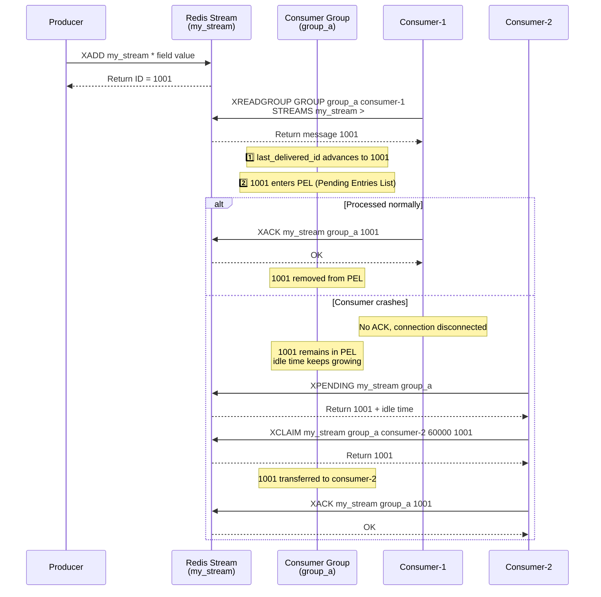

Let's state the conclusion first: **Yes, it is possible, depending on the specific scenario. Compared with professional message queues (such as Kafka and RabbitMQ), there are still some shortcomings.**

Before formally introducing how, let's first look at: **What core capabilities does a production-grade MQ need?**

| Capability Dimension      | Definition                                                           | Key Metrics / Characteristics                                    |
| :------------------------ | :------------------------------------------------------------------- | :--------------------------------------------------------------- |
| **Persistence**           | Messages are not lost due to process/node failures after being written | Sync disk flush / multi-replica ack, RPO ≈ 0                   |
| **At-Least-Once Delivery**| Messages are eventually consumed; duplicates are allowed             | Requires consumer idempotency                                    |
| **Consumption Acknowledgment** | Consumers explicitly notify successful processing               | ACK mechanism, timeout retry, dead-letter queue                  |
| **Message Retry**         | Failed consumptions can be automatically redelivered                 | Backoff strategy, max retry count, dead-letter transfer          |
| **Consumer Group**        | Multiple consumers collaborate on consumption with automatic failover| In-group load balancing, partition assignment, Rebalance         |
| **Message Backlog Capacity** | Buffering capacity when production rate > consumption rate        | Disk storage, TTL, backlog alerting                              |
| **Ordering Guarantee**    | Messages are consumed in the order they were sent                    | Partition ordering / global ordering, out-of-order penalty       |
| **Scalability**           | Horizontal scaling to improve throughput or disaster recovery        | Sharding mechanism, stateless Broker, dynamic scaling            |

Redis provides multiple ways to implement an MQ, evolving from the early `List` to `Pub/Sub`, and then to the `Stream` data structure introduced in Redis 5.0 (implemented based on an ordered linked list, supporting consumer groups and ACK mechanisms, which can be used to build lightweight message queues).

### Phase 1: Early Stage Using the List Data Structure

**Before Redis 2.0, if you wanted to use Redis as a message queue, you could only implement it via List.**

A simple message queue can be implemented using `RPUSH/LPOP` or `LPUSH/RPOP`:

```bash
# Producer produces messages
> RPUSH myList msg1 msg2
(integer) 2
> RPUSH myList msg3
(integer) 3
# Consumer consumes messages
> LPOP myList
"msg1"
```

However, approaches like `RPUSH/LPOP` or `LPUSH/RPOP` suffer from performance issues: we need to continuously poll by calling `RPOP` or `LPOP` to consume messages. When the List is empty, most polling requests are invalid requests, wasting a large amount of system resources.

Therefore, Redis also provides blocking read commands such as `BLPOP` and `BRPOP` (commands prefixed with `B` for Blocking are blocking commands), which also support a timeout parameter. If the List is empty, the Redis server does not return a result immediately; instead, it waits until new data arrives in the List or returns empty after waiting for at most the specified timeout duration. If the timeout is set to `0`, it will wait indefinitely until a message is popped.

```bash
# Timeout is 10s
# Returns immediately if data is available; otherwise waits up to 10 seconds
> BRPOP myList 10
null
```

Using List to implement a message queue is overly simplistic, and features such as message acknowledgment have to be implemented by ourselves. **Most fatally, it does not support a single message being consumed by multiple consumers (broadcasting), and once a message is popped, it is gone—if the consumer fails to process it, the message is permanently lost.**

### Phase 2: Introducing the Pub/Sub (Publish/Subscribe) Pattern

**Redis 2.0 introduced the Publish/Subscribe (Pub/Sub) feature, solving the issue where List-based message queues lacked a broadcast mechanism.**


Pub/Sub introduces the concept of a **Channel**, and the publish-subscribe mechanism is built around this Channel.

Pub/Sub involves two roles: Publisher and Subscriber (also called consumer):

- A publisher delivers messages to a specified Channel using `PUBLISH`.
- A subscriber subscribes to the Channels it cares about using `SUBSCRIBE`. Moreover, a subscriber can subscribe to one or multiple Channels.

In other words, multiple consumers can subscribe to the same Channel; when a producer publishes a message to that Channel, all subscribers can receive it.

Here we start 3 Redis clients for a quick demonstration:


Pub/Sub supports both unicast and broadcast, and also supports simple regex pattern matching for Channels.

Pub/Sub has a fatal flaw: **it is fire-and-forget, with zero persistence or reliability guarantees.** If a consumer is offline when a message is published, or if there is a brief network blip, that message is permanently lost for that consumer. In addition, it has **no ACK mechanism**, making it impossible to know whether the consumer successfully processed the message, let alone handling **message backlogs**. Therefore, Pub/Sub is only suitable for real-time notifications with very low reliability requirements and must never be used for any serious business message queue.

### Phase 3: Redis 5.0 Introduces Stream

Redis 5.0 added the `Stream` data structure. It is an ordered message log implemented based on a Radix Tree, natively supporting consumer groups and ACK mechanisms, and can be used to build lightweight message queues.

**Why use a Radix Tree?** Many people wonder why Redis didn't continue using `List/LinkedList`.

1. **Extreme memory compression**: Message IDs in `Stream` (such as `1625000000000-0`) are highly ordered and share heavily overlapping prefixes. A Radix Tree is a compressed prefix tree that merges nodes sharing the same prefix. By contrast, `List/LinkedList` incurs full linked-list node overhead for every element and cannot exploit prefix repetition in IDs to save space.
2. **Efficient retrieval**: When handling millions of backlogged messages, a Radix Tree maintains very high query efficiency, which is the underlying foundation that allows `Stream` to support large-scale range queries (`XRANGE`). In contrast, `List/LinkedList` only allows head/tail operations and cannot efficiently query by ID range—executing `XRANGE` would require traversing the entire list.

It borrows core concepts from professional MQs such as Kafka:

1. **Consumer Groups**: Achieves load balancing of messages across multiple consumers and supports automatic failover.
2. **Persistence**: Uses RDB and AOF to ensure messages are not lost after a Redis restart (depending on the `appendfsync` configuration; under `everysec` mode, typically at most 1 second of data is lost).
3. **ACK Mechanism**: After finishing processing a message, the consumer must manually acknowledge it via `XACK`; otherwise, the message remains in the `Pending List`. This guarantees that messages are successfully consumed at least once.
4. **Message Replay and Transfer**: Supports `XRANGE` to replay messages by time range, and `XCLAIM` to transfer pending messages to another consumer for processing.

> 🌈 Version Evolution:
>
> - Redis 8.2: The `XACKDEL`, `XDELEX`, `XADD`, and `XTRIM` commands provide fine-grained control over how stream operations interact with multiple consumer groups, simplifying message-processing coordination across different applications.
> - Redis 8.6: Supports idempotent message processing (at-most-once production), preventing duplicate entries when using at-least-once delivery mode. This feature enables reliable message submission with automatic deduplication.

The structure of `Stream` is as follows:


This is an ordered message list where each message has a unique ID and corresponding content. The ID is a combination of a timestamp and a sequence number to guarantee uniqueness and monotonic increment. The content consists of one or more key-value pairs (similar to the Hash basic data type) used to store the message's data.

Here is a brief explanation of some concepts shown in the diagram:

- `Consumer Group`: A consumer group organizes and manages multiple consumers. The consumer group itself does not process messages; instead, it distributes messages to consumers, which perform the actual consumption.
- `last_delivered_id`: A cursor identifying the current consumption position of the consumer group; whenever any consumer in the group reads a message, `last_delivered_id` advances forward.
- `pending_ids`: Records the IDs of messages that have been consumed by clients but have not yet been acknowledged (`ACK`).

Below are common commands when using `Stream` as a message queue:

- `XADD`: Append a new message to a stream.
- `XREAD`: Read messages from a stream.
- `XREADGROUP`: Read messages from a consumer group.
- `XRANGE`: Read messages from a stream within a message ID range.
- `XREVRANGE`: Similar to `XRANGE`, but returns results in reverse order.
- `XDEL`: Delete messages from a stream.
- `XTRIM`: Trim the length of a stream, allowing a trimming strategy (`MAXLEN`/`MINID`) to be specified.
- `XLEN`: Get the length of a stream.
- `XGROUP CREATE`: Create a consumer group.
- `XGROUP DESTROY`: Destroy a consumer group.
- `XGROUP DELCONSUMER`: Remove a consumer from a consumer group.
- `XGROUP SETID`: Set a new last-delivered message ID for a consumer group.
- `XACK`: Acknowledge that messages in a consumer group have been processed.
- `XPENDING`: Query pending (unacknowledged) messages in a consumer group.
- `XCLAIM`: Transfer ownership of pending messages from one consumer to another.
- `XINFO`: Get detailed information about a stream (`XINFO STREAM`), consumer groups (`XINFO GROUPS`), or consumers (`XINFO CONSUMERS`).

The sequence diagram below illustrates Stream consumer group message flow and the ACK mechanism:



Overall, `Stream` already meets the basic requirements of a message queue. However, you should keep the following points in mind when using `Stream` in practice:

1. **Persistence limitations**: Redis 5.0's Stream relies on asynchronous RDB/AOF persistence, so recently unpersisted messages may still be lost during crash recovery (depending on the `appendfsync` configuration). Under AOF's `everysec` mode, typically at most 1 second of data is lost.
2. **Limited message backlog capacity**: Redis Stream stores data in memory, bounded by the server's memory capacity. Compared with Kafka's disk-based storage, Redis Stream is not suitable for massive message backlog scenarios.
3. **Consumer group management**: State metadata of Consumer Groups (such as `last_delivered_id`) needs periodic maintenance, and Pending messages that remain unprocessed for a long time will occupy memory.

The table below compares Redis Stream with common MQs:

| Dimension               | Redis Stream                               | RabbitMQ                                          | Kafka                                                  | In-Memory Queue                          |
| :---------------------- | :----------------------------------------- | :------------------------------------------------ | :----------------------------------------------------- | :--------------------------------------- |
| **Throughput**          | High (hundreds of thousands of QPS)        | Medium (tens of thousands of QPS)                 | **Extremely High (millions, scales horizontally via partitions)** | Extremely High (bounded by CPU/memory) |
| **Latency**             | **Extremely Low (sub-millisecond)**        | **Low (microsecond/millisecond, strong real-time)**| Medium (millisecond, affected by batching)             | Extremely Low (nanosecond/microsecond)   |
| **Persistence**         | Supported (RDB/AOF async)                  | Supported (disk)                                  | **Strong support (native sequential disk writes)**     | None                                     |
| **Message Backlog**     | Fair (limited by memory)                   | Medium (performance degrades significantly under heavy backlog) | **Extremely Strong (TB-level disk storage, stable performance)** | Poor (prone to OOM)          |
| **Message Replay**      | Supported (by ID/time)                     | **Not supported (under traditional queue mode)**  | **Strong support (by Offset/time)**                    | Not supported                            |
| **Reliability**         | Medium (risk of AOF data loss)             | **High (mature Confirm/ack mechanism)**           | **Extremely High (multi-replica + strong consistency config)** | Low                             |
| **Ops Complexity**      | Low (just operate Redis)                   | Medium (Erlang runtime, cluster management)       | High (depends on ZK or KRaft)                          | Extremely Low                            |
| **Applicable Scenarios**| Lightweight, low-latency, Redis already in stack | **Complex routing, high reliability, financial services** | **Big data, log aggregation, high-throughput stream processing** | In-process decoupling, extreme performance needs |

### Summary

**Back to the original question: Can Redis really be used as an MQ?**

- **If your business logic is simple, data volume is small, and you pursue extreme performance** while being able to tolerate an extremely small probability of data loss, using **Redis Stream** is the optimal solution—because it eliminates the cost of deploying and maintaining a separate MQ and reuses existing Redis infrastructure (most projects that need an MQ usually need Redis anyway).
- **If it is a financial-grade business, involves massive data, and requires strict zero-message-loss guarantees**, you must choose a more mature MQ such as **Kafka or RabbitMQ**.

For more high-frequency Redis knowledge points and interview question summaries, you can read these articles written by the author:

- [Common Redis Interview Questions Summary (Part 1)](https://javaguide.cn/database/redis/redis-questions-01.html "Common Redis Interview Questions Summary (Part 1)") (Redis basics, applications, data types, persistence mechanisms, threading model, etc.)
- [Common Redis Interview Questions Summary (Part 2)](https://javaguide.cn/database/redis/redis-questions-02.html "Common Redis Interview Questions Summary (Part 2)") (Redis transactions, performance optimization, production issues, clustering, usage standards, etc.)
- [How to Implement Delayed Tasks Based on Redis](https://javaguide.cn/database/redis/redis-delayed-task.html "How to Implement Delayed Tasks Based on Redis")
- [Detailed Guide to Redis's 5 Basic Data Types](https://javaguide.cn/database/redis/redis-data-structures-01.html "Detailed Guide to Redis's 5 Basic Data Types")
- [Detailed Guide to Redis's 3 Special Data Types](https://javaguide.cn/database/redis/redis-data-structures-02.html "Detailed Guide to Redis's 3 Special Data Types")
- [Why Does Redis Use Skip Lists to Implement Sorted Sets?](https://javaguide.cn/database/redis/redis-skiplist.html "Why Does Redis Use Skip Lists to Implement Sorted Sets?")
- [Detailed Guide to Redis Persistence Mechanisms](https://javaguide.cn/database/redis/redis-persistence.html "Detailed Guide to Redis Persistence Mechanisms")
- [Detailed Guide to Redis Memory Fragmentation](https://javaguide.cn/database/redis/redis-memory-fragmentation.html "Detailed Guide to Redis Memory Fragmentation")
- [Summary of Common Causes of Redis Blocking](https://javaguide.cn/database/redis/redis-common-blocking-problems-summary.html "Summary of Common Causes of Redis Blocking")

My project [*SpringAI Smart Interview Platform + RAG Knowledge Base*](https://javaguide.cn/zhuanlan/interview-guide.html) uses Redis Stream as its message queue. In the context of my project, it was almost the most suitable choice and completely sufficient.


