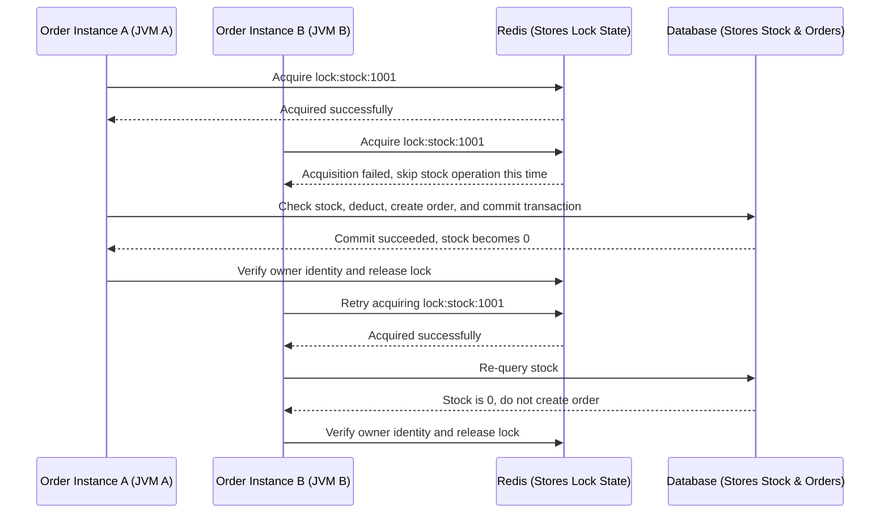

Starting from the scenario where the same service is deployed across multiple instances, this article introduces the scope of local locks, the problems distributed locks solve, and the boundaries to watch out for when using them.

## Why Do We Need Distributed Locks?

**When multiple processes need mutually exclusive access to the same external shared resource, local locks cannot coordinate across those processes—a distributed lock provides cross-process mutual exclusion.**

Here, the "shared resource" can be an inventory record for the same product in a database, the same cache entry in Redis, and so on. **Different JVMs typically do not share Java heap memory, yet they can access the same external data over the network.** What needs to be coordinated is how these processes operate on that external data.

### Why Can't Local Locks Control Multiple Service Instances?

Suppose an order service processes purchase requests via "query stock → check availability → deduct stock → create order." For now, assume the stock query is a plain `SELECT`, and the deduction performs neither a `count > 0` condition nor a version check.

When only a single instance is deployed, if all purchase requests acquire the same `synchronized` lock object or `ReentrantLock` instance and complete those operations plus transaction commit inside the lock, the requests execute serially. The code block inside the lock that requires mutually exclusive execution is the **critical section**. A local lock restricts only threads within the current JVM that use the same lock object, even though the data manipulated inside the lock resides in a database.

Now suppose the order service is deployed as two instances, A and B, each running in its own JVM and connecting to the same database. Even with identical code, **the local locks inside A and B are two independent lock objects**—neither knows whether the other holds the lock. Even declaring the lock field `static` only shares it within each individual JVM.

When only 1 unit of product `sku_id = 1001` remains in the database, the following execution sequence can occur:

| Step | Instance A (JVM A) | Instance B (JVM B) |
| --- | --- | --- |
| 1 | Acquires local lock in A, succeeds | |
| 2 | | Acquires local lock in B, also succeeds |
| 3 | Queries stock as 1, passes check | |
| 4 | | Queries stock also as 1, passes check |
| 5 | Executes unconditional deduction, creates & commits order, releases local lock | |
| 6 | | Executes unconditional deduction, creates & commits order, releases local lock |

Both requests succeed even though only 1 item existed, resulting in overselling. Local locks still serialize threads within each JVM, yet they cannot make a request in another JVM wait.

### How Does a Distributed Lock Enforce Mutual Exclusion Across Instances?

To make instances A and B compete for the same lock, the lock state must live in an external system accessible to both—such as Redis, ZooKeeper, or a database—which atomically decides who holds the lock.

Taking a Redis lock as an example, both instances agree to acquire the lock `lock:stock:1001` before operating on product `1001`. The diagram below illustrates the case where A acquires the lock first and the lock remains valid throughout business execution:



In the diagram, Redis stores the **lock state**, whereas the database stores the **business data**. After acquiring the lock, the instance still accesses the database directly. A Redis lock does not automatically lock database rows; every participant needing mutual exclusion must follow the same locking protocol—any request that bypasses the lock to modify stock directly is not constrained by it.

The lock must cover the entire critical section: from stock checking through deduction, order creation, and transaction commit—not merely the initial query. Requests that fail to acquire the lock can wait, fail fast, or retry; once a subsequent request acquires the lock, it must re-check the business state. Lock expiration and client failures can undermine mutual exclusion, and those boundaries are covered in the next section.

### Do Multi-Instance Deployments Always Need Distributed Locks?

Not necessarily. **Needing cross-process mutual exclusion does not automatically mean introducing a separate distributed lock service like Redis.** If the database itself can enforce the business invariant, you can usually rely directly on database capabilities.

For example, to prevent stock from going negative, you can use a conditional update:

```sql
UPDATE stock SET count = count - 1 WHERE sku_id = ? AND count > 0;
```

In MySQL InnoDB, concurrent updates to the same row are coordinated via row locks. Only when the affected row count equals 1 did the deduction succeed and order creation proceed; both the deduction and order insertion should run inside the same local transaction so they roll back together on failure. Even with multiple service instances, you do not need an extra Redis lock for this inventory deduction.

Similarly, limiting each user to 1 unit per campaign can be enforced with a unique constraint on `user_id + activity_id`, and duplicate order submissions can be handled with an idempotency key. Each constraint should be designed independently rather than relying solely on an inventory lock.

Consider a distributed lock only when the business genuinely requires serializing a block of logic across multiple processes and database conditional updates or unique constraints are not suitable. Distributed locks add network round-trips and failure-handling complexity, and also limit concurrency on the same resource.

## What Requirements Should a Distributed Lock Satisfy?

At a minimum, a basic distributed lock must satisfy:

- **Mutual Exclusion**: For the same lock key mapped to the same resource, at most one valid holder may exist at any given time. Design lock keys at resource granularity—such as `stock:{skuId}` or `order:{orderId}`—to avoid stuffing unrelated resources behind a single coarse global lock.
- **High Availability and Deadlock Prevention**: The lock service itself should be highly available, and locks must have an expiration time, session mechanism, or lease mechanism so a crashed client does not leave a lock held forever. However, expiration time must be designed alongside execution time and renewal mechanisms; otherwise a lock may expire prematurely, allowing two clients into the critical section simultaneously.
- **Safe Release**: Releasing a lock must verify owner identity so a client can only release a lock it holds itself. With Redis, for instance, write a random value (owner token) upon acquisition and use a Lua script to compare the value before deleting the key on release.

Beyond these three core requirements, a well-designed distributed lock also benefits from:

- **Reentrancy**: Not required in every scenario, but if the same thread or call chain may re-enter the same critical section, you need to track the lock owner and re-entry count so it does not block itself.
- **High Performance**: Acquiring and releasing locks should complete quickly without imposing significant overhead on overall system throughput.
- **Explicit Acquisition Semantics**: Lock acquisition can block and wait, wait up to a timeout, or fail immediately. Production code should always configure a maximum wait time and retry backoff rather than waiting indefinitely.
- **Renewal Mechanism**: Configure lock TTL based on the critical section's P99 execution latency; when execution may exceed the TTL, use a Watchdog or lease renewal mechanism, or shrink the critical section.
- **Fencing Token**: Stricter scenarios also require a Fencing Token. Every successful lock acquisition issues a monotonically increasing token, and downstream storage rejects writes carrying an older token—blocking late writes from a former lock holder after its lock has expired.

## What Are the Common Ways to Implement Distributed Locks?

Common distributed lock implementations include:

- Relational databases such as MySQL.
- Distributed coordination services such as ZooKeeper.
- High-performance key-value stores such as Redis, or strongly consistent distributed key-value stores such as etcd.

Database-based approaches fall roughly into three patterns: inserting into a lock table with a unique index, transaction-scoped `SELECT ... FOR UPDATE` row locks, and named locks like MySQL `GET_LOCK()`. Each achieves some degree of mutual exclusion, though they differ in performance, release timing, timeout semantics, and failure recovery.

It is not that database approaches cannot handle expiration, but their expiration semantics and performance are generally less natural than Redis, ZooKeeper, or etcd. For instance, a lock table can include an expiration timestamp column, yet you still have to handle expired-lock takeover, clock consistency, cleanup jobs, and transaction isolation; `GET_LOCK()` is tied to MySQL connection/session semantics and does not suit every business workflow.

Redis locks are more commonly used in high-performance, short-critical-section scenarios where business-level idempotency can act as a safety net. ZooKeeper and etcd are better suited to coordination scenarios requiring session semantics, sequential nodes, leases, and stronger consistency, though typically at higher latency, lower throughput, and greater operational cost. I have written a dedicated article detailing both Redis and ZooKeeper approaches: [Distributed Lock Common Implementations Summary](./distributed-lock-implementations.md).

One final reminder: **A distributed lock is not a distributed transaction. A lock only controls concurrent entry into a critical section; it does not guarantee that a database commit will succeed, nor that message publishing and order insertion will happen atomically together. Business consistency still depends on local transactions, idempotency, state machines, and compensation jobs.**

To dive deeper into the relationship among Leader/Quorum, Lease, and Fencing Tokens, read [Distributed Coordination Explained](./protocol/centralized-and-decentralized.md).

## Summary

In this article, we covered:

- **Purpose of distributed locks**: Coordinating mutually exclusive access to the same external shared resource across multiple processes. Local locks only coordinate threads sharing the same lock object within a single JVM; if database conditional updates or unique constraints already enforce the business invariant, there is no need to introduce an extra distributed lock service.
- **Requirements for distributed locks**: Mutual exclusion, high availability and deadlock prevention, safe release, reentrancy, high performance, explicit acquisition semantics, and renewal mechanisms—paired with Fencing Tokens in stricter scenarios.
- **Common implementation options**: Relational databases such as MySQL, distributed coordination services like ZooKeeper, high-performance key-value stores like Redis, and strongly consistent distributed key-value stores like etcd.
