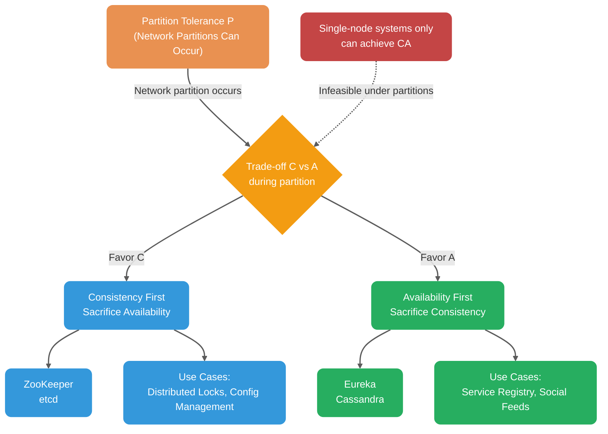
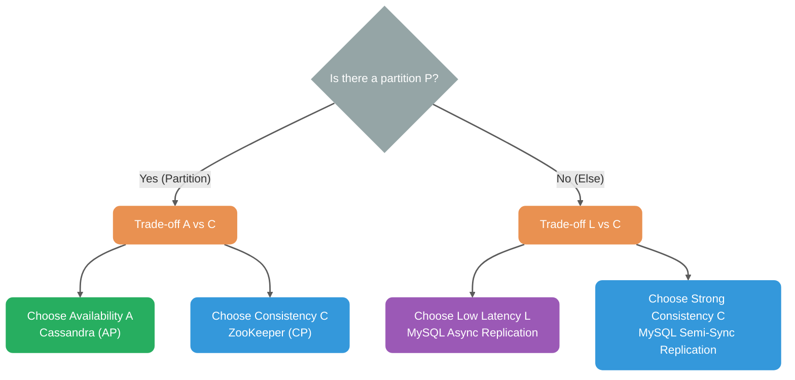
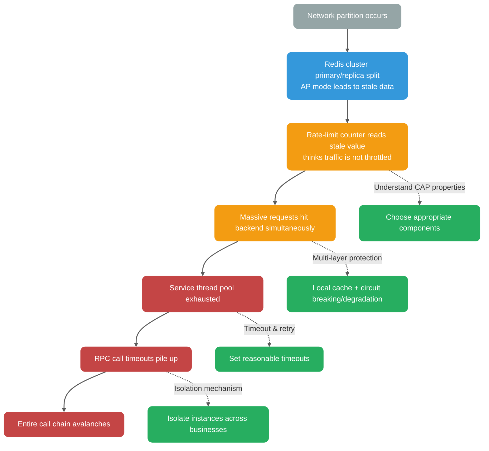
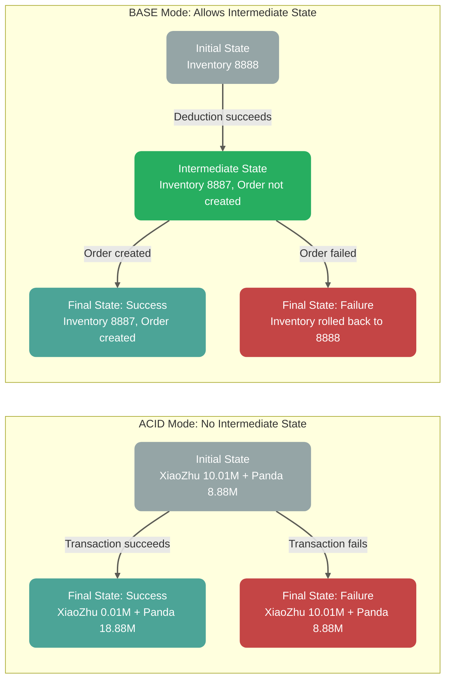
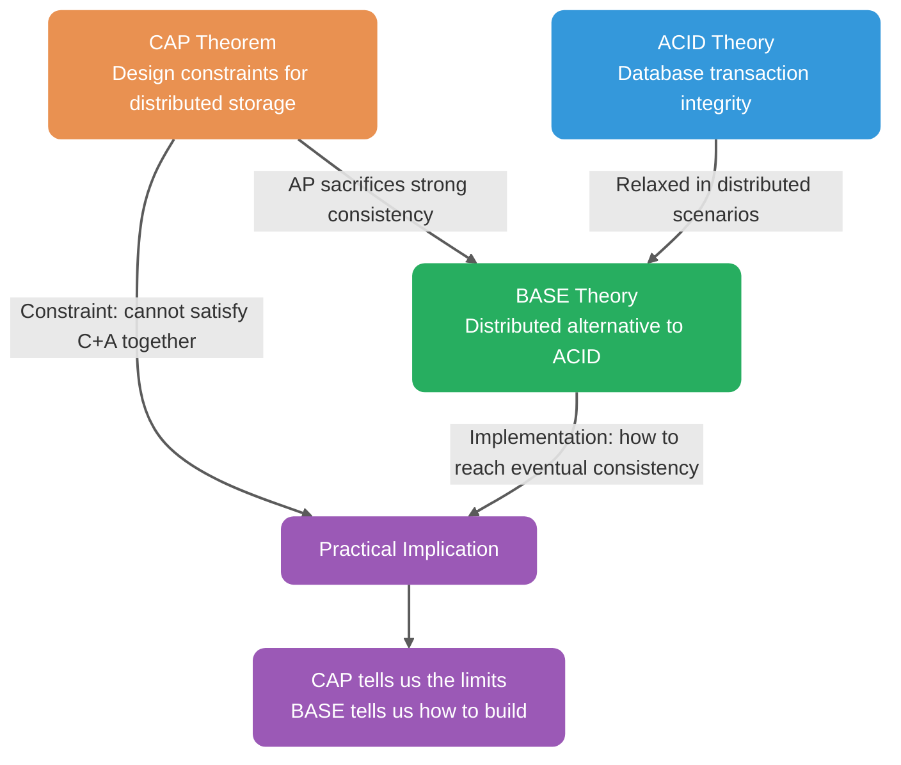

Anyone who has gone through technical interviews is surely all too familiar with the CAP and BASE theories!

Back when I was interviewing, without exaggeration, whenever distributed systems came up, interviewers almost always asked about these two foundational theories. Partly because they are essential prerequisites for learning distributed systems, and partly because many interviewers know them well themselves (making them easy to ask about).

It is crucial for us to truly understand both theories and be able to explain them in our own words.

This article focuses on "how a system makes trade-offs when a partition occurs." If you want to continue exploring why designs such as Leader, Quorum, Lease, and Gossip exist, you can read [Distributed Coordination Explained](./centralized-and-decentralized.md) next; if you want to see how eventual consistency is applied on the business side, you can read [Distributed Transaction Solutions Explained](../distributed-transaction.md).

## CAP Theorem

The [CAP theorem](https://zh.wikipedia.org/wiki/CAP%E5%AE%9A%E7%90%86) originated in 2000, proposed by Professor Eric Brewer of UC Berkeley at the Symposium on Principles of Distributed Computing (PODC), which is why the CAP theorem is also known as **Brewer's theorem**.

Two years later, Seth Gilbert and Nancy Lynch at MIT published a formal proof of Brewer's conjecture, officially establishing CAP as a theorem in the field of distributed computing.

### Introduction

The CAP theorem discusses Consistency, Availability, and Partition Tolerance.

> **Important Note**: In what follows, labels like "CP-leaning / AP-leaning" are used purely for intuitive description. Strictly under the CAP definitions (C = Linearizability, A = every non-failing node must respond), many systems cannot be neatly classified—different operations within the same system exhibit different consistency/availability characteristics, and many systems satisfy neither CAP-C nor CAP-A.


When Brewer first proposed the CAP conjecture, he did not provide strict formal definitions for **Consistency**, **Availability**, and **Partition Tolerance**.

As a result, there are many informal interpretations of CAP; below is a common and more accurate one.

In theoretical computer science, the CAP theorem states that for a distributed system, when designing read and write operations, at most two of the following three guarantees can be satisfied simultaneously:

- **Consistency**: In the context of Gilbert and Lynch's (2002) proof, CAP's C refers to **Atomic Consistency**, usually equivalent to **Linearizability**. That is, all operations are linearized in real-time order: once a write completes, all subsequent reads must return that written value (or a newer one). **Note:** Consistency here differs from Consistency (integrity constraints) in database ACID, where it means a database transitions from one valid state satisfying integrity constraints to another before and after a transaction.
- **Availability**: Every non-failing node must return a non-error response to every request (without guaranteeing response latency). **Note**: This is the strict definition in the CAP theorem and does not include engineering latency/SLA metrics (such as "responding within 1s").
- **Partition Tolerance**: P in CAP essentially assumes an asynchronous network (where delays, packet loss, and partitions can happen), rather than a feature you "choose whether to turn on." The real trade-off is: when a partition occurs, you must choose between **linearizability (CAP Consistency = Linearizability)** and **CAP Availability (every non-failing node returns a non-error response to requests)**.

**What is a network partition?**

In a distributed system, multiple nodes are normally connected over a network, but due to certain failures (for example, network issues on some nodes), some nodes lose connectivity with others and the network splits into separate regions—this is called a **network partition**.


### Not the So-Called "Pick 2 of 3"

When most people explain this theorem, they often summarize it simplistically as: "Among Consistency, Availability, and Partition Tolerance, you can only achieve two at the same time, never all three." In reality, this phrasing is quite misleading—and 12 years after the CAP theorem was born, Brewer himself revisited and clarified his earlier work in 2012.

> **When a network partition occurs, if we want to continue serving requests, we can only choose 1 between strong consistency and availability.**
>
> Put simply: Partition Tolerance P is not something optional in CAP; rather, under the premise that P can occur, you can only satisfy either Availability A or Consistency C during a partition.

**Why is a CA architecture impossible in distributed systems?**

Because distributed systems depend on network communication, and network failures are the norm:

- Heartbeat checks may drop packets due to network jitter, causing false-positive failure detection.
- Data replication may suffer packet loss leading to divergence; retrying continuously to reach agreement blocks requests.

**Therefore, under an asynchronous network model (where partitions can happen), when a partition occurs, you must trade off between linearizability and CAP availability.** Only a single-node system can guarantee CA—because there is only one node, once data is written successfully, every request sees the same data; as long as that node is alive, the system is available.

The diagram below illustrates the core trade-off of the CAP theorem and the tendencies of common systems:



Here we should introduce the **PACELC theorem** (an extension of CAP) for a more complete picture:

Proposed by Daniel J. Abadi, the PACELC theorem states: **If there is a Partition (P), the system must choose between Availability (A) and Consistency (C); Else (E), in normal operation, it must choose between Latency (L) and Consistency (C).**



Practical implication: even without a network partition, a distributed system still has to trade off between low latency (asynchronous replication) and strong consistency (synchronous replication). For example:

- **Cassandra**: Allows tuning read/write consistency levels (`ONE`/`QUORUM`/`ALL`) to trade off between latency and consistency.
- **MySQL Primary-Replica**: Allows choosing asynchronous replication (low latency) or semi-synchronous replication (stronger consistency).

For instance, ZooKeeper and HBase lean toward CP architectures, Cassandra and Eureka lean toward AP architectures, and Nacos supports both CP and AP architectures.

**Whether to choose CP or AP depends entirely on the current business scenario—there is no single universal answer**: for scenarios requiring strong consistency such as distributed locks and configuration management, CP is chosen; for high-availability-first scenarios such as microservices service registries, AP is often chosen.

**Additionally, one more point worth clarifying**: when there is no partition, it is possible to achieve both linearizability and "responds to requests" CAP availability; however, in engineering practice, systems still typically trade off between latency and consistency (which is precisely what the ELC part of the PACELC theorem addresses).

### Scope of Applicability of the CAP Theorem

**Key Conclusion**: The CAP theorem primarily discusses the trade-off between consistency and availability for a single data object under replica replication.

| Closer to the CAP Discussion Model | Must Be Analyzed at the Shard / Object / Operation Level |
| ---------------------------------- | -------------------------------------------------------- |
| Redis Primary-Replica / Sentinel Cluster | Business systems (stateless services)              |
| MySQL Primary-Replica / Multi-Primary Cluster | Redis Cluster (each shard still has replicas) |
| MongoDB Replica Set                | MongoDB Cluster (sharding + replication coexist)         |
| ZooKeeper, etcd                    | Sharded databases (cross-shard transactions need extra coordination) |
| Kafka, RocketMQ                    | Most microservice applications\*                         |

**Notes**:

- **CAP Discussion Model**: Replication semantics of a single read/write register.
- **Complex Systems**: Must be broken down to the consistency semantics of each object, partition, and operation.
- **Sharding + Replication**: In sharded systems, each shard usually still has replica replication, so the consistency vs. availability trade-off still exists per shard.

> **Deep Connection Between Business Systems and CAP**:
>
> Although business application code itself does not implement replica synchronization, **it is deeply affected by the CAP properties of its underlying components**. Ignoring this can cause cascading failures (avalanches) when the system encounters a network partition.
>
> **Business Scenarios Affected by CAP Properties**:
>
> | Business Scenario | Underlying Component | Impact of CP Component | Impact of AP Component |
> | ----------------- | -------------------- | ---------------------- | ---------------------- |
> | RPC Routing | Service Registry (e.g., Nacos CP mode) | Unavailable during registration/partition; requests rejected | May route to offline instances; retries needed |
> | Distributed Lock | Redis (AP) / ZooKeeper (CP) | Lower performance but reliable | High performance but lock may fail/expire prematurely |
> | Rate Limiting & Circuit Breaking | Redis Counters | May read stale counts, causing rate limiting to fail | Same as left |
> | Cache Update | Redis Primary-Replica | Data loss may occur during failover | Same as left |
> | Message Consumption | Kafka | Consumer offset sync lag, leading to duplicate consumption | Same as left |
>
> **Practical Advice**: Although business developers do not need to "implement" the CAP theorem, they **must understand the CAP theorem** in order to:
>
> - Choose suitable components (CP or AP) for different business scenarios.
> - Understand how chosen components behave during a network partition.
> - Design fault-tolerance mechanisms suited to business needs (retries, circuit breaking, degradation).

Many developers think they are "practicing the CAP theorem," when in fact they are merely choosing among existing components (whether to use CP or AP), rather than implementing the theorem itself. The engineers who truly need to practice CAP are those building distributed storage systems like Redis and MySQL.

### Applying CAP Thinking in Business Systems

Aside from building distributed storage engines, business development is mostly about **choosing** the right architecture rather than implementing the CAP theorem directly:

| Scenario | CP-Leaning Choice | AP-Leaning Choice | Business Trade-off |
| -------- | ----------------- | ----------------- | ------------------ |
| Database Primary-Replica Replication | Synchronous replication (strong consistency) | Asynchronous replication (high performance) | Data consistency vs. response speed |
| Distributed Lock Implementation | ZooKeeper (strong consistency) | Redis (high performance) | Lock reliability vs. acquisition speed |
| Service Registry | ZooKeeper, Consul (CP mode) | Eureka, Nacos (AP mode) | Registration accuracy vs. discovery availability |
| Rate-Limiting Counter | Redis (strongly consistent commands) | Redis (expiration tolerated) | Rate-limiting accuracy vs. performance |

**Selection Principles**:

- **Performance-focused**: Prefer components allowing asynchronous replication; writing to the primary node returns success immediately with low latency, but carries the risk of data loss or reading stale data, requiring retry mechanisms.
- **Data-safety-focused**: Prefer components requiring majority confirmation; writes wait for a quorum of nodes to acknowledge, resulting in slower responses, while reducing the risk of data loss.

**Note**: Whether data is lost depends more on persistence, replication acknowledgment policies, and failure models—you cannot judge it solely by a "CP/AP label."

**Cascading Failure Case Study**:

A classic cascading avalanche scenario caused by ignoring CAP:



**Protective Measures**:

1. **Understand the CAP properties of underlying components**: Know how components behave during a network partition.
2. **Multi-layer defense**: Do not rely on a single component; combine local caches, circuit breaking, and service degradation.
3. **Timeouts and retries**: Configure reasonable timeouts to avoid unbounded waiting.
4. **Isolation mechanisms**: Use separate underlying component instances for different business domains to prevent fault propagation.

### Real-World CAP Application Examples

Let us explore practical applications of CAP using service registries. Since some readers may not be familiar with what a service registry does, let us briefly look at Dubbo as an example.

Below is Dubbo's architecture diagram. **What role does the Registry play here, and what services does it provide?**

The Registry is responsible for registering and looking up service addresses—essentially acting as a directory service. Service providers and consumers only interact with the Registry at startup (and on updates); the Registry does not forward actual business requests, so its load is relatively light.


Common components used as service registries include ZooKeeper, Eureka, and Nacos.

#### ZooKeeper 3.8.x (CP Architecture)

ZooKeeper leans toward a **CP architecture**. ZooKeeper 3.x provides **Linearizable Writes** via the ZAB protocol, while read behavior needs to be distinguished:

- **Sync Reads**: Force synchronization with the Leader, guaranteeing **Linearizability**.
- **Regular Reads**: Provide **Sequential Consistency** by default, ensuring a global order of updates where a client's view within the same session never goes backward, though it may read slightly stale data (read lag).

> **Important Distinction**: Sequential Consistency ≠ Eventual Consistency. ZooKeeper's regular reads guarantee that all clients observe the exact same **update order** (global `zxid` order), merely with potential read lag; whereas eventual consistency does not guarantee a global order and only guarantees eventual convergence. ZooKeeper's default read is closer to "stale-but-ordered" reads (very strong ordering/session guarantees) rather than Dynamo-style eventual consistency.

During Leader election or when the number of Follower nodes falls below Quorum (`N/2 + 1`), ZooKeeper refuses write service to preserve consistency, manifesting as unavailability (sacrificing A).

In multi-node deployments, the cluster uses Quorum mode: a majority of nodes (`n/2 + 1`) must agree for a state change to take effect.

ZooKeeper provides the Watcher mechanism (asynchronous change notifications) and version numbers (`zxid` freshness checks) to mitigate read lag.

Failure paths and state machine behavior:

| Failure Scenario | System State | Client Behavior |
| ---------------- | ------------ | --------------- |
| Quorum lost (more than half of nodes fail) | **LOOKING** state, Leader election in progress | Write requests rejected; read requests may return stale data or time out |
| Follower partitioned from Leader | Follower enters **ELECTION** state | That Follower cannot vote, though it may still serve reads (stale data) |
| Leader partitioned from majority | Leader automatically steps down; cluster re-elects | Writes on old Leader are lost; client must retry (detects `zxid` rollback) |
| Watcher lost | Caused by network jitter or GC pauses | Client must retry (exponential backoff + Jitter); monitor `Watches` queue to prevent backpressure |

#### Eureka (AP Architecture)

Eureka adopts an AP architecture: nodes are peers that stay consistent via peer replication/synchronization (periodic full fetch + incremental updates), with no Leader election. **Note**: Historically, Spring Cloud ecosystems mostly used the 1.x dependency line; meanwhile, `Netflix/eureka` 2.x is still maintained and actively released.

Failure paths and state machine behavior:

| Failure Scenario | System State | Client Behavior | Self-Preservation Mechanism |
| ---------------- | ------------ | --------------- | --------------------------- |
| Network partition (split-brain) | Both sides of partition **operate independently**, allowing reads and writes | Clients may read stale registry info (inconsistency window = 30s heartbeat + gossip propagation delay; P99 < 60s in a 10-node topology) | Triggered when renewal rate < 85%, pausing instance eviction to avoid wrongly evicting healthy instances |
| Half of nodes fail | Remaining nodes continue serving, though data may diverge | Reads succeed; writes may reside only on minority nodes | Self-preservation triggers; once nodes recover, state merges automatically via gossip |
| Brief node restart | Fetches full registry in bulk from peers (Registry Fetch) | Brief service discovery unavailability (< 1 min), mitigated by client cache | Normal mode, automatic recovery |
| Registration storm (massive simultaneous registrations) | Write queue backs up, potentially dropping requests | Some registration requests time out; client retries required | Configurable rate limiting and backpressure (e.g., Ribbon retry policies) |

**Self-Preservation Mechanism Explained**:

Eureka Server decides whether to enter self-preservation using the following logic:

```
Expected renewals per minute E = Current instance count N × (60 / heartbeat interval in seconds)
Threshold T = E × 0.85
If actual renewals in the last minute R < T, enter self-preservation: pause eviction
(E and T are updated periodically based on N, typically every ~15 minutes)
```

With the default heartbeat interval of 30 seconds, expected renewals per minute = instance count × 2.

When `actual renewal rate < 85%`:

1. Enters **SELF PRESERVATION** mode.
2. Stops evicting expired instances (`EvictionTask` paused).
3. Logs: `ENTER SELF PRESERVATION MODE`.

**Design Trade-off**: Better to keep "zombie" instances than to mistakenly evict healthy ones—because in microservice architectures, brief partial degradation is preferable to a large-scale service outage. Clients typically configure retries and circuit breakers to handle unavailable instances.

#### Summary

Choosing CP or AP depends on the scenario: ZooKeeper fits strong-consistency needs such as configuration management; Eureka fits high-availability registration such as microservice discovery.

Nacos supports both CP and AP.

### Summary

The CAP theorem guides us: under the premise that network partitions (P) can occur in distributed systems, we must make a trade-off between strong consistency (C) and high availability (A).

- **CP Architecture**: Sacrifices availability to guarantee strong consistency. Suitable for scenarios requiring strict data consistency (e.g., financial transactions, distributed locks).
- **AP Architecture**: Sacrifices strong consistency to guarantee high availability. Suitable for scenarios prioritizing system availability that can tolerate brief data inconsistency (e.g., social feeds, product search).
- **PACELC**: When there is no partition (E), systems must trade off between latency (L) and consistency (C).

### Recommended Reading

1. [CAP Theorem Simplified](https://medium.com/@ravindraprasad/cap-theorem-simplified-28499a67eab4) (in English, with interesting examples)
2. [Where the Legendary CAP Theorem Is Applied](https://juejin.im/post/6844903936718012430) (in Chinese, listing many practical examples)
3. [Please Stop Calling Databases CP or AP](https://martin.kleppmann.com/2015/05/11/please-stop-calling-databases-cp-or-ap.html) (in English, offering a fresh perspective)

## BASE Theory

[BASE theory](https://dl.acm.org/doi/10.1145/1394127.1394128) originated in 2008, published in the ACM by eBay architect Dan Pritchett under the title *Base: An ACID Alternative*.

> **Key Insight**: As the paper's title indicates, **BASE is first and foremost an alternative to ACID**. At the same time, note that BASE also has a close relationship with the CAP theorem—**eventual consistency is precisely the guiding principle by which AP architectures in CAP achieve system convergence in engineering practice**.

### Introduction

**BASE** is an acronym for **Basically Available**, **Soft-state**, and **Eventually Consistent**. BASE theory emerged from summarizing distributed engineering practices in large-scale Internet systems.

### Relationship Between BASE and ACID

To understand BASE theory, we first need to revisit **Consistency** in ACID theory:

**ACID's definition of Consistency**: Before and after a transaction executes, the database can only transition from one consistent state to another consistent state.

Take a bank transfer as an example: XiaoZhu transfers 10M to Panda.

- **Initial state**: XiaoZhu 10.01M, Panda 8.88M, total 18.89M
- **Result state**: XiaoZhu 0.01M, Panda 18.88M, total 18.89M

Whether the transaction succeeds or fails, the overall data changes must remain consistent—similar to the law of conservation of energy.

**Challenges in Distributed Scenarios**:

In distributed systems, the product service and order service are deployed separately. `[Deduct inventory, Create order]` requires network calls, between which there is inevitably a time gap:

```
Time T1: Inventory 8888 → 8887 (deduction succeeded)
Time T2: Network call to order service...
Time T3: Order created successfully
```

Between T1 and T3, the system is in an **intermediate state**: inventory has been deducted, while the order has not yet been created. Across services, a single-database ACID transaction cannot guarantee overall atomic commit and isolation, so intermediate states objectively exist; BASE accepts intermediate states and uses compensation or retries so the state eventually converges.

**BASE Theory's Solution**:

BASE theory acknowledges and permits the existence of such intermediate states:

- **Soft-state**: Allows intermediate states in the system, and these intermediate states do not affect overall system availability.
- **Eventually consistent**: Intermediate states eventually evolve into final states (either succeeding or rolling back).

The comparison diagram below intuitively illustrates how ACID and BASE differ in transaction processing:



Therefore, **BASE theory is an alternative to ACID in distributed scenarios**, rather than a supplement to the CAP theorem.

### Three Elements of BASE Theory


#### Basically Available

Basically Available means that when an unpredictable failure occurs in a distributed system, it is acceptable to lose partial availability. However, this is by no means equivalent to total system unavailability.

**What does allowing partial availability loss mean?**

- **Loss in response time**: Under normal conditions, a user request returns a result in 0.5s, but due to a system failure, processing time increases to 3s.
- **Loss in system functionality**: Under normal conditions, users can access all features of the system, but due to a sudden traffic spike, some non-core features become unavailable.

#### Soft State

Soft State means allowing data in the system to exist in an intermediate state, while recognizing that the presence of this intermediate state does not harm overall system availability.

> **Difference from ACID**: ACID theory requires transactions to enter a final state (success or failure) immediately upon execution, allowing no intermediate states; whereas BASE theory accepts intermediate states as an objective reality of distributed systems, as long as they eventually transition to a final state.

For example:

- **ACID mode**: In a bank transfer transaction, debiting and crediting must succeed or fail together; an intermediate state of "debited but not yet credited" is disallowed.
- **BASE mode**: In an e-commerce checkout flow, an intermediate state where "inventory is deducted but the order is not yet created" is permitted, provided it eventually reaches consistency (either the order is created or the inventory is rolled back).

#### Eventually Consistent

Eventually Consistent emphasizes: **if no new updates are made to the system for a period of time, all replicas will eventually converge to the same value.**

It is worth noting that the term "eventual consistency" carries different meanings in two distinct contexts:

| Context | Meaning | Typical Scenario |
| ------- | ------- | ---------------- |
| **Replicated Storage (CAP context)** | Data replicas eventually synchronize to match | Cassandra data replication |
| **Transaction State (BASE/ACID context)** | Transaction intermediate states eventually resolve into final states | Distributed transactions (e.g., TCC, Saga) |

**Eventual Consistency in Replicated Storage**:

That "period of time" is unbounded—it could be milliseconds (LAN synchronization) or minutes (cross-region replication). Production environments actively accelerate convergence via **Read Repair**, **Anti-Entropy (background sync)**, or **Quorum writes**.

**Eventual Consistency in Transaction States**:

Take a distributed transaction: `[Deduct inventory, Create order, Deduct balance]`

- Time T1: Inventory deducted (intermediate state)
- Time T2: Order created (intermediate state)
- Time T3: Balance deducted (final state: transaction succeeded)

Or in a failure scenario:

- Time T1: Inventory deducted (intermediate state)
- Time T2: Order creation failed (triggers rollback)
- Time T3: Inventory rolled back (final state: transaction failed)

The system guarantees reaching a consistent state within a bounded window without requiring real-time strong consistency across everything.

Three levels of distributed consistency:

1. **Strong Consistency**: Whatever is written into the system is immediately what subsequent reads return.
2. **Weak Consistency**: Reads are not guaranteed to return the latest written value, nor is there a guarantee on how long it will take for data to become up-to-date; the system simply tries to become consistent at some point.
3. **Eventual Consistency**: An upgraded form of weak consistency—the system guarantees that data will reach a consistent state within a certain timeframe.

**The industry widely favors eventual consistency, though scenarios with strict data consistency requirements—such as bank transfers—still demand strong consistency.**

What are the concrete techniques to achieve eventual consistency?

- **Read Repair**: When reading data, detect inconsistencies across replicas and repair them. Well-suited for read-heavy, write-light workloads.
- **Hinted Handoff (Write-time Repair)**: When writing data, if the target node is unavailable, temporarily buffer the write elsewhere and replay it once the target node recovers. **Hinted Handoff** optimizes write latency, though it increases the window of read inconsistency (data may still sit in a buffer queue before landing on the target node).
- **Anti-Entropy (Asynchronous Repair)**: Periodically compare replica differences in the background and reconcile them. A key engineering challenge is **efficiently detecting data divergence**—brute-force item-by-item comparison (`O(n)`) is infeasible at large scale, so production systems use **Merkle Trees** to pinpoint differences with low overhead.

**Selection Guidelines**:

- **Hinted Handoff**: Suitable for write-heavy, read-light workloads; optimizes write performance at the expense of a wider consistency window.
- **Read Repair**: Suitable for read-heavy, write-light workloads; helps ensure read accuracy.
- **Anti-Entropy**: A background safety net suitable for large-scale datasets with strict eventual-consistency guarantees.

### Why Do Many People Treat BASE as a Supplement to CAP?

That phrasing is **partially right, yet imprecise**. A more accurate understanding is:

1. **BASE is primarily an alternative to ACID**: As evident from the paper's title [*Base: An ACID Alternative*](https://spawn-queue.acm.org/doi/10.1145/1394127.1394128), BASE was conceived to address the overly rigid demands of ACID in distributed transactions.

2. **BASE has an intrinsic connection to the AP architecture in CAP**:

   - Choosing an AP architecture means giving up strong consistency (C).
   - After giving up strong consistency, how does the system converge? The answer is **eventual consistency**.
   - Therefore, BASE theory (especially eventual consistency) is the guiding principle that an AP architecture **must adopt** in engineering practice.

3. **Root cause of the misconception**: Many people misinterpret "BASE relates to AP" as "BASE supplements CAP." In fact:
   - **BASE is not a supplement to or revision of the CAP theorem.**
   - **BASE is the engineering practice guide for choosing an AP architecture**—once you choose AP, BASE tells you how to make the system converge to consistency in practice.

**The Correct Understanding**:



| Dimension | CAP Theorem | BASE Theory |
| --------- | ----------- | ----------- |
| Focus Area | Distributed storage systems (with replicas) | All distributed systems |
| Meaning of Consistency | Data consistency (replica synchronization) | State consistency (transaction final state) |
| Meaning of Availability | System remains available when nodes fail | Partial functionality remains available when some nodes fail |
| Core Relationship | - | ① Distributed alternative to ACID<br>② Engineering practice guide for AP architectures |

> **Practical Takeaway**: CAP tells us that strong consistency cannot be guaranteed under an AP architecture, while BASE tells us how to make the system converge through eventual consistency under AP—the two stand in a **constraint vs. implementation** relationship, not a supplemental one.

If CAP defines the design constraints of distributed storage systems (telling us what we cannot do), then BASE is the practical guide for distributed systems, especially business applications (telling us what we should do)—teaching us that **the vast majority of application scenarios do not need strong consistency, and accepting intermediate states to eventually achieve consistency is the far more pragmatic choice.**

### Summary

**ACID is the theory of database transaction integrity, CAP is the design theory of distributed storage systems, and BASE is the distributed alternative to ACID as well as the engineering practice guide for AP architectures.**

> **Key Mappings**:
>
> - **CAP Consistency** = Data consistency (synchronization across replica nodes)
> - **BASE Consistency** = State consistency (consistency of final transaction state) = ACID Consistency
> - **CAP Availability** = Availability of a primary-replica cluster (system remains available despite node failures)
> - **BASE Availability** = Availability of a sharded/partitioned cluster (partial node failures only impact a subset of users)
> - **Relationship Between CAP and BASE**: After choosing an AP architecture, BASE theory guides how to achieve system convergence in practice via eventual consistency
