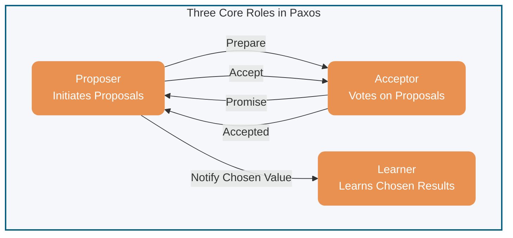
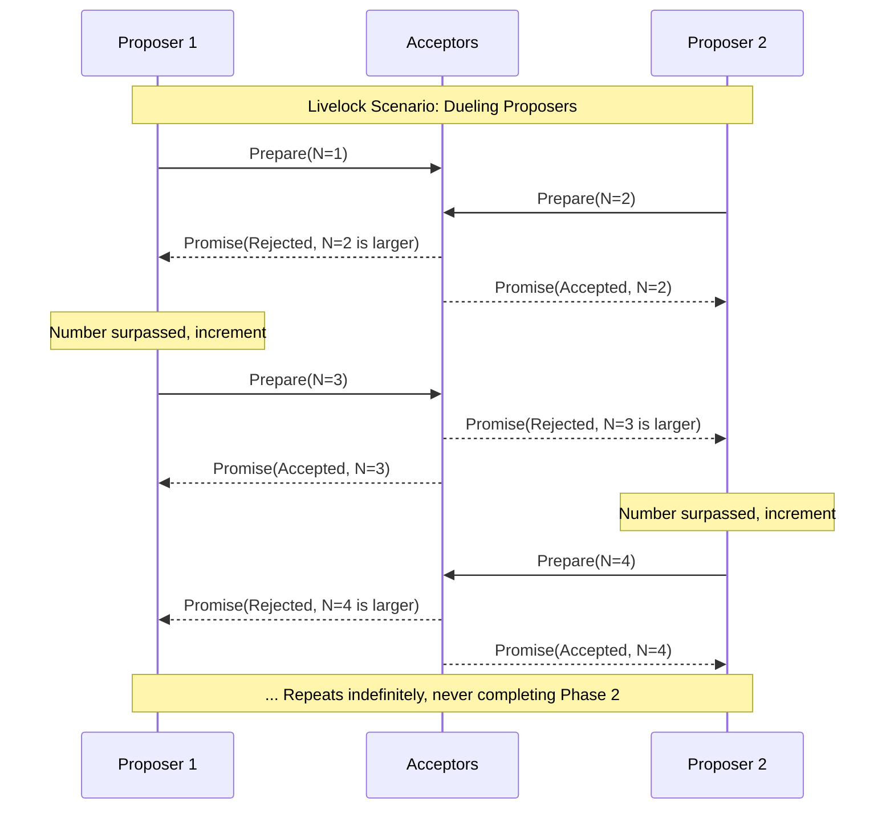
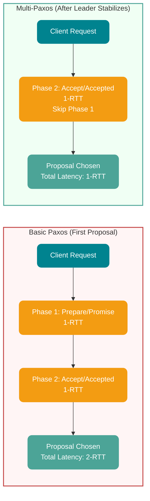
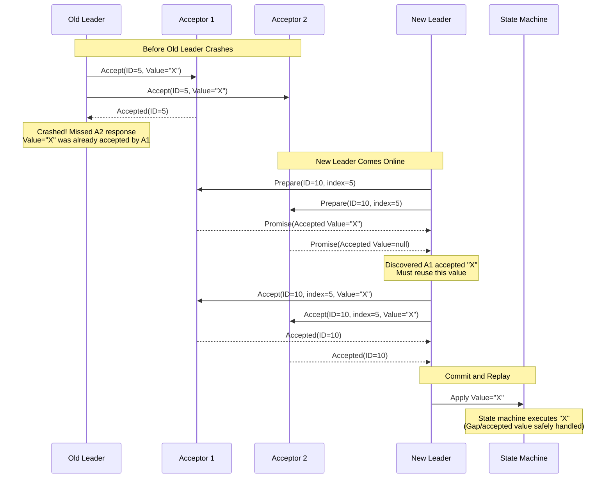
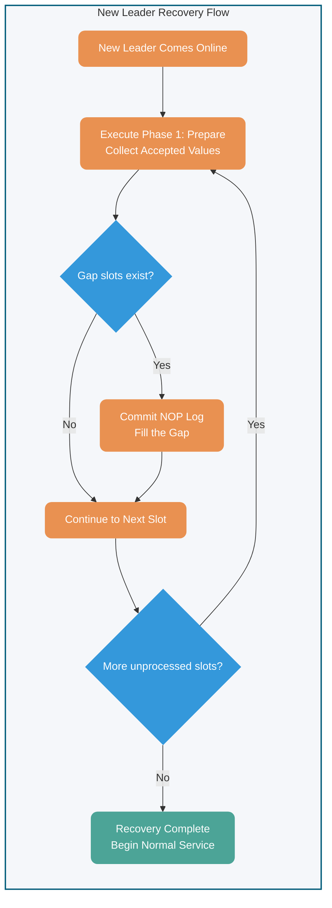

## Background

The Paxos algorithm is a distributed **consensus** algorithm proposed by Leslie Lamport in **1990**. It was one of the earliest widely recognized distributed consensus algorithms (assuming the absence of the Byzantine Generals Problem—that is, no malicious nodes).

To introduce Paxos, Lamport wrote a witty and humorous paper in which he invented a fictional Greek island city-state called Paxos to illustrate the algorithm more vividly.

However, the reviewers did not appreciate the paper's humor. They told Lamport: "If you want this paper to be published, you must remove all the Paxos story background." Lamport was not pleased: "Why should I revise it? You reviewers just lack a sense of humor—if it doesn't get published, so be it!"

As a result, the paper introducing the Paxos algorithm was not published at that time.

It was not until 1998 that two researchers at the Systems Research Center (SRC) needed suitable distributed algorithms for the distributed system they were building, and Paxos happened to solve part of their requirements. Lamport sent them the paper. After reading it, the two researchers thought it was genuinely great. Thus, in **1998**, Lamport finally published [The Part-Time Parliament](http://lamport.azurewebsites.net/pubs/lamport-paxos.pdf).

After the paper came out, scholars everywhere complained that they could not understand it, often with mocking remarks. Unwilling to let that stand, Lamport wrote another paper in **2001**, [Paxos Made Simple](http://lamport.azurewebsites.net/pubs/paxos-simple.pdf), to simplify the explanation of Paxos—focusing primarily on the two-phase consensus protocol—while taking a jab at those scholars along the way.

*Paxos Made Simple* is only 14 pages long, significantly shorter than the 33 pages of *The Part-Time Parliament*. Best of all, its entire abstract is just a single sentence:


> The Paxos algorithm, when presented in plain English, is very simple.

In other words: when described in plain, unadorned English, the Paxos algorithm is genuinely simple!

Can you feel the unmistakable dose of sarcasm coming from Lamport?

## Introduction

This article explains Paxos in two parts:

- **Basic Paxos**: Describes how multiple nodes reach consensus on a single value.
- **Multi-Paxos**: Achieves consensus on a sequence of values by executing multiple Basic Paxos instances.

The purpose of a consensus algorithm is to enable multiple nodes in a distributed system to agree on a proposal. Depending on the system, a "proposal" can represent many things, such as leader election or event ordering.

Because Paxos is widely recognized as difficult to understand and implement, the easier-to-understand [Raft algorithm](./raft-algorithm.md) was introduced in 2013.

**On the Relationship Between Raft and Paxos**: From an academic standpoint, Raft is not a strict variant of Paxos—there are fundamental differences in their underlying design philosophies (such as log gaps and Leader authority). From an engineering standpoint, however, Raft drew inspiration from Multi-Paxos and can be understood as a "redesign inspired by Multi-Paxos." We will compare the two in detail later in this article.

For non-Byzantine scenarios (no malicious nodes), besides Raft, the **ZAB protocol** and **Fast Paxos** are also consensus algorithms built upon improvements to Paxos.

For Byzantine scenarios (where malicious nodes exist), consensus algorithms such as **Proof-of-Work (PoW)** and **Proof-of-Stake (PoS)** are typically used, with blockchain systems being the classic application.

## Basic Paxos Algorithm

### Role Definitions

Basic Paxos defines three key roles:

1. **Proposer**: Also called a coordinator; responsible for accepting client requests and initiating proposals. A proposal typically includes a proposal ID and a proposed value.
2. **Acceptor**: Also called a voter; responsible for voting on proposals and persisting its voting history.
3. **Learner**: Responsible for learning the chosen value. In a Replicated State Machine (RSM) implementation, this value usually corresponds to a command to be executed, which is applied in order by the state machine before the service layer returns the result externally.


**Role Interaction Diagram**:



To reduce the number of nodes required to implement the algorithm, a single node may assume multiple roles simultaneously. Furthermore, a proposal is chosen once it is accepted by a majority (more than half) of Acceptors. This gives Basic Paxos fault tolerance: as long as fewer than half of the nodes fail, the cluster can continue operating normally.

### Basic Paxos Execution Flow

Basic Paxos reaches consensus in two phases: the **Prepare/Promise phase** and the **Accept/Accepted phase**.

```mermaid
sequenceDiagram
    participant P as Proposer
    participant A1 as Acceptor 1
    participant A2 as Acceptor 2
    participant A3 as Acceptor 3

    note over P, A3: Phase 1: Prepare Phase - Contend for Lock & Retrieve History
    P->>A1: Prepare(ID=N)
    P->>A2: Prepare(ID=N)
    P->>A3: Prepare(ID=N)

    A1-->>P: Promise(ID=N, Accepted Value=null)
    A2-->>P: Promise(ID=N, Accepted Value=null)
    note right of A3: Assume A3 does not respond due to network delay

    note over P, A3: Phase 2: Accept Phase - Commit Decision
    P->>A1: Accept(ID=N, Value="Set X=1")
    P->>A2: Accept(ID=N, Value="Set X=1")

    A1-->>P: Accepted(ID=N)
    A2-->>P: Accepted(ID=N)
    note over P: Received majority (2) Accepted responses; value is Chosen
```

#### Phase 1: Prepare/Promise

A Proposer selects a proposal number `n` (which must be globally unique and monotonically increasing) and sends a `Prepare(n)` request to a majority of Acceptors.

**Acceptor Logic** (for each proposal number `n`):

- If `n > max_n` (the highest proposal number this Acceptor has seen so far):
  - Return `Promise(n, max_v)`, where `max_v` is the value of the highest-numbered proposal it has previously accepted (if any).
  - Promise not to accept any future proposals with numbers `< n`.
- If `n ≤ max_n`:
  - Reject or ignore the request.

**Purpose**: Allows the Proposer to discover any proposals already accepted or about to be accepted in the system, preventing it from proposing a conflicting value.

#### Phase 2: Accept/Accepted

Once the Proposer receives `Promise` responses from a majority of Acceptors, it selects the value `max_v` associated with the highest proposal number among those responses (or chooses any value freely if none of the Acceptors reported an accepted value), and sends an `Accept(n, v)` request to a majority of Acceptors.

**Acceptor Logic**:

- If `n ≥ max_n` (the highest number promised by this Acceptor in Phase 1):
  - Accept the proposal, persist `(n, v)`, and return `Accepted(n, v)`.
- Otherwise:
  - Reject the request.

#### Convergence Condition

When the Proposer receives `Accepted` responses for `Accept(n, v)` from a majority of Acceptors, proposal `v` is **chosen**. The Proposer notifies all Learners that the proposal has been chosen.

### Safety Guarantees

Basic Paxos guarantees the following safety properties:

1. **Consistency**: Once a value has been chosen, any subsequently chosen value must be that same value.
2. **Termination**: If there is no Proposer contention and communication is reliable, a value will eventually be chosen.

**Core Mechanism**: By collecting `Promise` responses in Phase 1, a Proposer is forced to adopt a value already accepted/promised by Acceptors if one exists (or pick a new value otherwise), guaranteeing that conflicting values can never be chosen.

### Liveness Issue

Basic Paxos carries a risk of **livelock**:

- If multiple Proposers initiate proposals concurrently with interleaved, ever-increasing proposal numbers,
- No proposal may ever secure `Accept` from a majority,
- Causing the system to fall into infinite contention and fail to reach consensus.

**Livelock Example (Dueling Proposers)**:

Suppose two Proposers `P1` and `P2` initiate proposals concurrently:

1. `P1` sends `Prepare(1)`, and `P2` sends `Prepare(2)`.
2. Acceptors make a promise to `P2`, which has the larger number.
3. `P1` sees its number was surpassed and sends `Prepare(3)`.
4. `P2` sees its number was surpassed and sends `Prepare(4)`.
5. ... This repeats endlessly, and neither ever completes Phase 2.

**Livelock Sequence Diagram**:



**Solution**: Introduce a stable Leader mechanism via Multi-Paxos.

**Randomized Exponential Backoff**:

To prevent multiple competing Proposers from causing livelock, production implementations typically introduce randomized backoff:

When a Proposer's `Prepare` request is rejected (because its proposal number is too small):

1. Wait for a random duration: `base_delay * random(1, 2^attempt)`.
2. Choose a larger proposal number (e.g., `n = n + k`, where `k > 0`).
3. Retry the `Prepare` phase.

Example parameters:

- `base_delay`: `10ms`
- `attempt`: retry count (`1, 2, 3...`)
- Maximum backoff duration: `max(1s, base_delay * 2^10)`

This mechanism ensures contenders do not retry in lockstep, allowing one Proposer to eventually complete Phase 1 cleanly.

**Partition Handling**: If a network partition occurs, the majority side can continue electing a Leader and committing new proposals; the minority side cannot form a quorum and must wait for the partition to heal.

## Multi-Paxos

### Core Idea

Basic Paxos can only reach consensus on a single value. To reach consensus on a sequence of values, we need the Multi-Paxos approach.

The core optimization behind Multi-Paxos is **reusing the Leader**: elect a stable Proposer as Leader using Basic Paxos, and let subsequent proposals be initiated directly by that Leader, skipping Phase 1 (`Prepare/Promise`).

### Optimization Mechanisms

#### 1. Stable Leader Election

- Elect a single Proposer as Leader via Basic Paxos.
- If the Leader crashes, elect a new Leader through a new round of Basic Paxos.
- Prevents livelock caused by multiple competing Proposers.

#### 2. Skipping Phase 1

- Once the Leader is stable, subsequent proposals go straight to Phase 2 (`Accept`).
- Eliminates the need to run `Prepare/Promise` for every entry, saving one round-trip RPC.
- **Latency Optimization**: Each Basic Paxos proposal requires 2-RTT (`Prepare` + `Accept`), whereas subsequent Multi-Paxos proposals require only 1-RTT (`Accept` only), **cutting proposal commit latency by 50%** (`2-RTT → 1-RTT`).

**Performance Optimization Comparison**:



#### 3. Log Index

- Assign an incrementing **log index** to each proposal.
- Guarantees global ordering: the Leader appends logs sequentially, and Acceptors accept entries by index.
- Supports **gaps**: an entry at a given index may temporarily be missing due to a Leader change and can be filled later.

#### 4. Log Gaps and NOP Filling

**Problem Description**: When a new Leader takes over, it may face a tricky scenario—the previous Leader had already reached consensus at a certain log index, yet the new Leader is unaware of that value. If the new Leader attempts to commit a new value at that index, it would overwrite an already chosen value and violate consistency.

**Solution: NOP (No-Operation) Log Entries**

Multi-Paxos resolves this by introducing `NOP` log entries:

1. **Discovery**: During Phase 1 (`Prepare`), the new Leader collects any already-accepted values returned by Acceptors.
2. **Mandatory Reuse**: If it discovers an accepted/chosen value at a given slot, the new Leader **must** reuse that value and cannot propose a new one.
3. **NOP Placeholder**: For gap slots (where no Acceptor has an accepted value), the new Leader can commit a special value—`NOP` (no operation).
4. **State Machine Skipping**: Although the `NOP` entry occupies a log index, the state machine skips it during replay without executing any business logic.

**Example Flow**:

```
Before the previous Leader crashed:
Index 1: Value=A (chosen)
Index 2: Value=B (chosen)
Index 3: <Gap> (incomplete)

After the new Leader comes online:
Index 1: Reuse Value=A
Index 2: Reuse Value=B
Index 3: Commit NOP (fills the gap, executes no business logic)
Index 4: Commit Value=C (normal business log entry)
```

**Gap and Accepted Value Recovery Flow**:



### Multi-Paxos Execution Flow

1. **Leader Election**: Elect a Leader via Basic Paxos.
2. **Log Replication**: The Leader receives client requests, appends them to its local log, and assigns monotonically increasing indices.
3. **Direct Accept**: The Leader sends `Accept(index, value)` directly to Acceptors (skipping `Prepare`).
4. **Response Handling**: Acceptors accept entries by index and persist them locally.
5. **Commit Confirmation**: Once a majority of Acceptors accept the entry at a given index, that index can be committed.

### Fault Tolerance and Recovery

- **Leader Crash**: The new Leader reconciles logs to identify committed positions and backfills uncommitted entries.
- **Network Partition**: The majority side continues serving requests while the minority side waits for recovery.
- **Log Gaps**: The new Leader fills in log positions left uncommitted by the previous Leader.

**New Leader Recovery Flow**:



⚠️ **Note**: Multi-Paxos is an architectural idea rather than a complete specification—its essence is reaching consensus over a sequence of values using multiple Basic Paxos instances. In other words, Basic Paxos is the core of Multi-Paxos, and Multi-Paxos simply runs Basic Paxos repeatedly.

Because Lamport's Multi-Paxos proposal omitted critical implementation details (such as exactly how a Leader is elected and how log gaps are handled), it has historically been hard to understand and implement.

Fortunately, we do not need to build a Multi-Paxos-based consensus algorithm from scratch, as proven implementations already exist in industry. Although Raft is not a strict variant of Paxos, it borrows its core ideas (Leader election, log replication) while simplifying the engineering details—making it much easier to understand and implement. In real-world projects, Raft should usually be preferred.

## Paxos vs. Raft

Since 2014, the Raft algorithm has become an industry favorite thanks to its exceptional understandability. It is important to clarify that Raft is not a variant of Paxos; the two have fundamental differences in their underlying design philosophies.

| **Dimension**                 | **Multi-Paxos**                                                           | **Raft**                                                                                  | **Key Engineering Impact**                                                                  |
| ----------------------------- | ------------------------------------------------------------------------- | ----------------------------------------------------------------------------------------- | ------------------------------------------------------------------------------------------- |
| **Log Flow & Constraints**    | Allows out-of-order commits and **log gaps**.                             | Enforces strictly sequential append-only logs; **log gaps are strictly forbidden**.        | Raft is simple to implement with smooth state machine replay; Paxos allows higher concurrency at exponentially higher implementation complexity. |
| **Leader Election & Authority** | The Leader is merely a performance optimization (skipping Phase 1), not strictly mandatory. | **Strong Leader model**. All data is authoritative on the Leader; logs flow strictly from Leader to Followers. | Raft simplifies data recovery by restricting election to nodes with the "most complete log." |
| **Livelock Defense**          | Requires extra randomized backoff or an external leader-election protocol. | Built-in election defense based on randomized timeouts.                                   | Raft has much higher out-of-the-box usability than Paxos.                                   |
| **Production Implementations** | Apache ZooKeeper (via ZAB, Multi-Paxos-like), Google Spanner              | etcd, HashiCorp Consul, TiKV                                                              | Modern microservices infrastructure strongly favors Raft.                                    |

## Practical Applications

Systems built on Paxos or its variants include:

- **Google Chubby**: Distributed lock service implemented on top of Paxos.
- **Apache ZooKeeper 3.8+**: Based on the ZAB protocol (Multi-Paxos-like; writes are broadcast through the Leader with FIFO ordering).
- **etcd 3.5+**: Based on the Raft algorithm (strong consistency consensus, supporting dynamic membership changes and lightweight transactions `Txn`).
- **HashiCorp Consul**: Based on the Raft algorithm (service discovery and configuration management).

These systems play crucial roles in distributed coordination, configuration management, service discovery, and more.

> **Version Note**: These systems introduce protocol optimizations across releases (for example, etcd 3.4 introduced lease Keep-Alive optimizations, and ZooKeeper 3.5 introduced dynamic reconfiguration). Always review the Release Notes for your target version before production deployment.

## Production Deployment Recommendations

### Observability Checklist

| Category      | Key Metric                      | Suggested Alert Threshold | Description                                          |
| ------------- | ------------------------------- | ------------------------- | ---------------------------------------------------- |
| **Latency**   | Proposal commit latency (p99)   | `> 100ms`                 | Time from client request to majority acknowledgment  |
| **Throughput**| Proposal processing rate        | `< 50%` of expected QPS   | May indicate network partition or node failure       |
| **Election**  | Leader election frequency       | `> 3` times/hour          | Frequent leader switches indicate cluster instability|
| **Gaps**      | Uncommitted log slot count      | `> 100`                   | Too many gaps degrade state machine replay           |
| **Split-Brain**| Multi-Leader contention events | `= 0`                     | Must never occur                                     |

### Chaos Engineering Recommendations

| Test Scenario         | Validation Goal                                           | Recommended Tool         |
| --------------------- | --------------------------------------------------------- | ------------------------ |
| **Leader Crash**      | Verify fast leader re-election and zero data loss         | Chaos Mesh, Chaos Monkey |
| **Network Partition** | Verify majority continues serving while minority stalls   | Toxiproxy                |
| **Network Jitter**    | Verify randomized backoff prevents livelock               | `tc` (`netem`)           |
| **Clock Drift**       | Verify uniqueness of proposal IDs remains unaffected      | `--`                     |

### Common Anti-Patterns

1. **Ignoring Gap Handling**: Skipping over gap slots during state machine replay can cause client requests to be silently lost.
2. **Fixed Proposal IDs**: Using timestamps or node IDs alone as proposal IDs fails to guarantee global monotonicity.
3. **Missing Timeouts**: Allowing `Prepare`/`Accept` requests to wait indefinitely causes the system to hang.
4. **Ignoring Previously Accepted Values**: Having a new Leader forcefully commit its own value violates safety and consistency.

## Summary

- Proposed by Lamport in 1990, the Paxos algorithm is a foundational distributed consensus algorithm for strong consistency.
- Basic Paxos reaches consensus on a single value through two phases (`Prepare/Promise` and `Accept/Accepted`).
- Multi-Paxos optimizes consensus over a sequence of values by reusing a stable Leader and skipping Phase 1 (reducing proposal latency from `2-RTT` to `1-RTT`).
- Raft borrows Multi-Paxos concepts while redesigning the implementation details (strong Leader model, no log gaps), making it far easier to understand and build in practice.
- In production projects, mature implementations such as Raft, etcd, and ZooKeeper are recommended over hand-rolled Paxos.

## References

- [Paxos Made Simple](http://lamport.azurewebsites.net/pubs/paxos-simple.pdf) - Lamport, 2001
- [The Part-Time Parliament](http://lamport.azurewebsites.net/pubs/lamport-paxos.pdf) - Lamport, 1998
- [In Search of an Understandable Consensus Algorithm](https://raft.github.io/raft.pdf) - Ongaro & Ousterhout, 2014 (Raft paper)
- <https://zh.wikipedia.org/wiki/Paxos>
- Consistency and Consensus Algorithms in Distributed Systems: <http://www.xuyasong.com/?p=1970>
