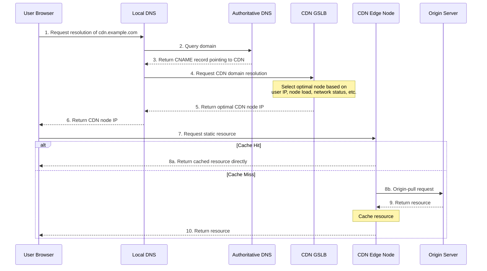

## What Is a CDN?

**CDN** stands for **Content Delivery Network** (or Content Distribution Network).

We can break down the phrase "Content Delivery Network" into two parts:

- **Content**: refers to static resources, including images, videos, documents, JS, CSS, HTML, and so on.
- **Delivery Network**: refers to distributing these static resources across servers located in data centers across many different geographic regions to achieve **proximity access**—for example, a user in Beijing directly fetches data from a data center in Beijing.

Put simply, **a CDN distributes static resources across multiple geographic locations to enable nearby access, thereby accelerating static resource delivery and reducing the load on origin servers and bandwidth.**

This is analogous to JD.com's vast warehousing and logistics network: JD Logistics operates a huge number of warehouses across the country, covering nearly every county and district. As soon as a user places an order, the product is dispatched directly from the warehouse closest to the user to the corresponding delivery station, and then delivered to the user's doorstep by a courier.


You can think of a CDN as a **specialized caching layer** sitting in front of your services, distributed nationwide or globally, primarily used to handle requests for static resources.


Whole-site acceleration is often compared with a Content Delivery Network—do not confuse the two! **Whole-site acceleration** (known by different names across cloud providers, such as ECDN on Tencent Cloud and DCDN on Alibaba Cloud) can accelerate both static and dynamic resources, whereas a **Content Delivery Network (CDN)** primarily targets **static resources**.


The vast majority of companies use CDN services in their projects, while very few build their own CDN from scratch. Considering cost, stability, and ease of use, it is recommended to choose an out-of-the-box CDN service from major cloud providers (such as Alibaba Cloud, Tencent Cloud, Huawei Cloud, or QingCloud) or dedicated CDN vendors (such as Wangsu or ChinaCache).

## Why Not Simply Deploy Services in Multiple Regions?

Many people ask: **If the goal is nearby access, why not directly deploy the application service in multiple different locations?**

This comes down to the **architectural separation between static resources and dynamic requests**:

1. **Cost**: Deploying full services in multiple regions requires deploying multiple complete sets of applications, databases, and middleware, which is prohibitively expensive. A CDN only needs to store static resources, keeping costs well controlled.
2. **Different resource characteristics**: Static resources (images, JS, CSS) are **large in size, frequently accessed, and immutable in content**, making them ideal for cached distribution; dynamic requests require real-time computation and must go back to the origin server.
3. **System resource consumption**: If application servers handle static resource requests directly, they consume large amounts of CPU, memory, and bandwidth, which can degrade core business operations.
4. **Specialized optimizations**: CDNs incorporate extensive optimizations specifically for static asset delivery (such as smart compression, protocol optimization, and edge computing) that ordinary application servers do not possess.

> **Note**: Deploying multiple copies of the same service across different regions (such as intra-city disaster recovery, geo-disaster recovery, intra-city multi-active, or geo-multi-active architectures) is meant for **High Availability (HA)**, not proximity caching.

## How Does a CDN Work?

To understand how a CDN works, you need to understand three core questions:

1. How are static resources cached onto CDN nodes?
2. How does a user find the optimal CDN node?
3. How do you prevent static resources from being hotlinked or stolen?

In production environments, two additional metrics deserve close attention:

- **Cache Hit Rate**: The higher the hit rate, the fewer requests fall back to the origin server, and the lower the load on the origin.
- **Origin-Pull Latency and Error Rate**: Once the origin-pull link slows down or origin errors increase, CDN edge nodes will also be slowed down.

Therefore, a CDN does not automatically make everything faster just by turning it on. If caching rules are misconfigured, asset URLs are unstable, or caches are purged too frequently, a flood of requests may hit the origin concurrently—putting even heavier load on the origin than without a CDN.

### How Are Static Resources Cached onto CDN Nodes?

There are two main ways a CDN caches static resources: **prefetching** and **origin pull**.

- **Prefetching (Warm-up)**: Proactively pushes resources from the origin server to CDN nodes. This way, the very first user request can be served directly from the CDN node without hitting the origin—ideal for major sales promotions, hot content releases, and similar events.
- **Origin Pull**: When a CDN node does not have the requested resource or its cached copy has expired, the CDN node fetches the latest resource content from the origin server.

> **Note**: When a user request triggers an origin pull, its response time is actually slower than accessing the origin directly, because it passes through an extra CDN node hop. Thus, improving the **cache hit rate** is a primary goal of CDN optimization.

The complete lifecycle of CDN caching is shown in the figure below:


When a resource is updated, you can perform a **purge (refresh)** operation to delete the stale cached resource on CDN nodes and force the CDN nodes to pull the latest resource from the origin on the next request.

Almost all cloud CDN providers offer cache purge and prefetch features (the screenshot below shows the corresponding feature in Alibaba Cloud CDN):


**Hit rate** and **origin-pull rate** are the two core metrics for measuring CDN service quality:

- **Hit Rate**: The proportion of user requests served directly by CDN nodes—**the higher, the better**.
- **Origin-Pull Rate**: The proportion of user requests that must be fetched from the origin server—**the lower, the better**.

Common techniques to improve hit rate:

- **Include content hashes in static asset filenames**: For example, `app.8f3a1c.js`. Since the filename changes whenever content changes, you can safely configure a long cache TTL.
- **Keep short TTLs for entry files**: Entry files such as HTML, sitemap, and robots should not be cached long-term, preventing them from referencing old resources that have already been removed.
- **Prefetch hot assets in advance**: Before major promotions, campaign pages, or installation package releases, push hot resources to CDN nodes ahead of time.
- **Avoid unnecessary full purges**: Site-wide purges force large numbers of edge nodes to pull from the origin simultaneously; prefer targeted purging by URL or directory.
- **Retain old asset versions briefly**: After deploying a new version, do not delete old hashed files immediately, so users holding cached HTML do not encounter 404 errors when loading old assets.

If your hit rate suddenly drops, start by checking whether caching rules were changed, whether resource URLs contain random query parameters, whether a full-site purge occurred, or whether the origin returned response headers that forbid caching.

### How Does a User Find the Optimal CDN Node?

**GSLB (Global Server Load Balance)** is the brain of a CDN, responsible for coordinating and scheduling requests across multiple CDN nodes. The most common implementation is **DNS-based GSLB**.

The complete CDN request scheduling flow is illustrated below:



**Step-by-step walkthrough**:

1. The user's browser sends a domain name resolution request to the local DNS server.
2. The local DNS queries the authoritative DNS and discovers that the domain is configured with a **CNAME (Canonical Name)** alias record pointing to the CDN provider's domain.
3. The local DNS then sends a resolution request to the CDN's **GSLB**.
4. Based on metrics such as **the user's IP address and CDN node status (load, performance, response time, bandwidth)**, GSLB evaluates the options and returns the IP address of the optimal CDN node.
5. The user's browser sends the resource request directly to that CDN node (edge server).
6. The CDN node checks its local cache: if it hits, it returns the resource directly; if it misses or has expired, it fetches the resource from the origin and then returns it to the user.

> **Additional Note**: The diagram above is somewhat simplified. In practice, GSLB internally can be viewed as a combination of a **CDN-dedicated DNS server** and a **Load Balancing system**. The CDN-dedicated DNS server returns the IP address of the Load Balancing system, and the browser queries that IP to reach the corresponding CDN node.

### How Do You Prevent Unauthorized Resource Hotlinking and Scraping?

If static resources are illegally hotlinked or scraped by external users or websites, they can incur massive unexpected bandwidth bills. Common hotlink protection mechanisms include:

| Hotlink Protection Mechanism | Principle                                                                 | Security Level | Implementation Cost | Bypass Difficulty                          |
| ---------------------------- | ------------------------------------------------------------------------- | -------------- | ------------------- | ------------------------------------------ |
| **Referer Hotlink Protection** | Validates the request source via the HTTP `Referer` request header      | Low            | Low                 | Low (`Referer` can be forged or cleared)   |
| **Timestamp Hotlink Protection** | URL carries a signature and expiration timestamp; expires after timeout | Medium         | Medium              | Medium (requires knowing signing algorithm) |
| **IP Allowlist / Denylist**  | Restricts or allows access from specific IP addresses                     | Medium         | Low                 | Medium (can be bypassed via proxies)       |
| **Token Authentication**     | Application server issues a Token; CDN node verifies it                   | High           | High                | High                                       |

#### Referer Hotlink Protection

This mechanism checks the **Referer** field in the HTTP request header to verify whether the request comes from an authorized source. You can configure an allowlist of permitted domains so requests from non-allowlisted origins are rejected.

Virtually all CDN providers support this basic hotlink protection mechanism:


> **Note**: If the hotlink protection rule allows an empty `Referer`, attackers can bypass the check simply by stripping the `Referer` header. Therefore, `Referer` hotlink protection usually needs to be combined with other mechanisms.

#### Timestamp Hotlink Protection

**Timestamp hotlink protection** provides stronger security. Its core idea is to embed a **signature string** and an **expiration time** in the URL; when handling a request, the CDN node validates the signature and checks whether it has expired, rejecting any expired URL.

The signature string is typically generated by computing an MD5 hash over **secret key + request path + expiration time**.

Example URL with timestamp hotlink protection:

```plain
http://cdn.example.com/video/123.mp4?wsSecret=79aead3bd7b5db4adeffb93a010298b5&wsTime=1601026312
```

- `wsSecret`: Signature string computed by the server from the secret key and request parameters.
- `wsTime`: Expiration timestamp (Unix timestamp format).


Most CDN providers offer out-of-the-box timestamp hotlink protection:


> **Recommended Practice**: In production, combining **Referer hotlink protection + timestamp hotlink protection** strikes a good balance between security and implementation cost. For scenarios requiring high security (such as paid content), introduce Token-based authentication as well.

## How Does a CDN Accelerate Dynamic Resources?

Traditional CDNs focus on caching static resources (such as images, CSS, and JS). For **dynamic resources** (such as API endpoints, real-time queries, payment requests, and `.jsp`/`.asp`/`.php` dynamic pages), the content changes in real time and cannot be cached, so traditional CDNs simply pass requests back to the origin with limited acceleration benefits.

**Dynamic Content Acceleration (DCA)** is designed specifically to solve this problem. Instead of caching content, it improves the speed and stability of dynamic request delivery through intelligent routing and protocol optimizations.

Dynamic acceleration is primarily achieved through three technical mechanisms:

1. **Intelligent Routing (Optimal Path Probing)**: After leaving the client, a dynamic request first reaches the nearest CDN edge node. Using **real-time network monitoring**, the CDN probes link quality across the entire network (including latency, packet loss, and bandwidth utilization), avoids congested or degraded public network nodes, and selects an optimal transmission path to the origin server.
2. **Transport Protocol Optimization**:
   - **TCP Optimization**: Tunes TCP slow start and congestion control algorithms to improve transmission efficiency under high-latency or packet-loss conditions.
   - **Connection Reuse**: Maintains persistent connections (`Keep-Alive`) between edge nodes and the origin server, eliminating the latency of repeated handshakes.
3. **Hybrid Static-Dynamic Acceleration**: Modern CDNs (such as Alibaba Cloud DCDN and Tencent Cloud ECDN) automatically distinguish between resource types:
   - **Static resources**: Served directly from the edge node's cache.
   - **Dynamic resources**: Routed back to the origin over intelligent paths.

> **One-sentence summary**: Dynamic acceleration = intelligent probing + dynamic routing + protocol optimization, making dynamic requests travel faster and more reliably.

Dynamic acceleration also has boundaries: it optimizes the network transport path, not business computation, database queries, or third-party API call duration. If an endpoint itself is slow due to SQL queries, lock contention, or downstream dependencies, dynamic acceleration alone cannot fix the root cause. In an interview, frame it this way: static resources rely primarily on cache hits, while dynamic requests rely on path optimization and origin-side performance tuning—they belong to two distinct problem classes.

## How Does a CDN Optimize HTTPS Access Speed?

While HTTPS improves security, the TLS handshake and encryption/decryption overhead introduce extra latency. CDNs apply multiple optimization techniques to accelerate HTTPS delivery without sacrificing security.

| Optimization Technique | Mechanism                                                                                                               | Effect                                             |
| ---------------------- | ----------------------------------------------------------------------------------------------------------------------- | -------------------------------------------------- |
| **Session Resumption** | After a user establishes an HTTPS connection, the node caches session state and reuses session parameters on return visits to avoid a full TLS handshake | Reduces handshake latency                          |
| **OCSP Stapling**      | The CDN node periodically caches certificate status and sends it alongside the TLS handshake, sparing the browser a separate CA lookup | Improves handshake efficiency                      |
| **False Start**        | Begins sending encrypted application data before the TLS handshake is fully completed                                   | Saves one RTT                                      |
| **HTTP/2**             | Supports multiplexing and header compression                                                                            | Reduces connection count and transmission latency  |
| **QUIC**               | UDP-based transport protocol supporting 0-RTT connection setup                                                          | Cuts connection setup time and improves weak-network UX |

**Benefits of CDN Certificate Hosting**:

CDN providers (such as Tencent Cloud and Alibaba Cloud) typically offer **free SSL certificates** and **auto-renewal**, providing several advantages:

- **Zero maintenance**: No manual certificate renewals needed, preventing outages caused by expired certificates.
- **Flexible configuration**: Upload custom certificates in the CDN console or request free certificates in one click.
- **Multiple encryption modes**: Choose between **half-chain encryption** (HTTPS from user to CDN, HTTP from CDN to origin) or **full-chain encryption** (HTTPS on both segments).

**HTTPS Acceleration Configuration Recommendations**:

1. **Basic setup**: Enable HTTPS in the CDN console and configure a valid certificate.
2. **Performance optimization**: Enable **OCSP Stapling** and **HTTP/2**.
3. **Security hardening**: Enable **HSTS** if stronger security is required (forcing browsers to use HTTPS).
4. **Weak-network optimization**: Enable **QUIC** support to improve mobile experience on unstable networks.

In production, also ensure consistency between certificates and origin-pull protocols. If user-to-CDN uses HTTPS while CDN-to-origin uses HTTP, plaintext traffic is still exposed along the backhaul segment. Conversely, if the origin enforces HTTPS, configure proper certificate verification and SNI on the CDN origin-pull side—otherwise origin requests may fail.

## Summary

- **Core value of a CDN**: Distributes static resources across multiple geographic regions for **nearby access**, speeding up static asset loading and offloading origin server compute and bandwidth.
- **CDN selection**: Considering cost, reliability, and ease of use, prefer out-of-the-box services from major cloud providers (such as Alibaba Cloud, Tencent Cloud, or Huawei Cloud) or specialized CDN vendors (such as Wangsu or ChinaCache).
- **Role of GSLB**: GSLB (Global Server Load Balance) is the brain of a CDN, routing user requests to the **optimal CDN node** based on user location, node health, and network conditions.
- **Core metrics**: **Hit rate** should be as high as possible, while **origin-pull rate** should be as low as possible.
- **Hotlink protection**: Combining **Referer hotlink protection + timestamp hotlink protection** is recommended to balance security and cost.
- **Dynamic acceleration**: Uses **intelligent path routing**, **transport protocol optimization**, and **hybrid static-dynamic acceleration** to improve the speed and reliability of dynamic requests (API calls, real-time queries, etc.).
- **HTTPS acceleration**: Optimizes TLS handshakes and transport via **Session Resumption**, **OCSP Stapling**, **False Start**, **HTTP/2**, and **QUIC**, delivering both security and speed.

## References

- Timestamp Hotlink Protection - Qiniu Cloud CDN: <https://developer.qiniu.com/fusion/kb/1670/timestamp-hotlinking-prevention>
- What Is a CDN? Explained in One Article: <https://mp.weixin.qq.com/s/Pp0C8ALUXsmYCUkM5QnkQw>
- *Demystifying the HTTP Protocol* - 37 | CDN: Accelerating Our Network Services: <http://gk.link/a/11yOG>
