> This article was contributed by FrancisQ! Compared to the original text, it mainly includes the following enhancements:
>
> - [Analyzed the reasons behind RocketMQ's high-performance reads/writes and the concrete implementation of ordered consumption](https://github.com/Snailclimb/JavaGuide/pull/2133)
> - [Added introductions to message types, consumer types, Consumer Groups, and Producer Groups](https://github.com/Snailclimb/JavaGuide/pull/2134)
> - [RocketMQ 5.x support for message-level assignment](https://github.com/Snailclimb/JavaGuide/issues/2778)

## Message Queue Primer

RocketMQ interviews rarely stop at "what is a message queue?". More common follow-up questions include: why NameServer can be kept so lightweight, how Broker master-slave replication works, what CommitLog and ConsumeQueue are each responsible for, and how ordered messages, transactional messages, and scheduled messages are implemented under the hood.

If you have not yet used an MQ system in depth, first remember three core scenarios: **asynchronous processing, decoupling, and peak shaving**. When we later discuss RocketMQ's architecture, storage, and consumption models, almost everything revolves around these three problems.

### Why Did Message Queues Emerge?

In a monolithic application, direct calls between interfaces are the simplest approach. Once a system is split into multiple services, however, the call chain grows longer, and synchronous calls propagate latency, failures, and traffic spikes all the way down the chain. A message queue sits in between, storing messages first so that downstream services can consume them at their own pace.

### What Can Message Queues Be Used For?

#### Asynchronous Processing

You might ask: communication between applications doesn't have to be solved only by a message queue—why insert a message queue in the middle? Can't they just communicate directly?

This brings up another concept—**synchronous communication**. For example, Dubbo, which is widely used in the industry, is an RPC framework designed for synchronous communication across systems.

Take a ticket-purchasing system as an example: the requirement is that after a user completes a purchase, they receive an SMS notification confirming the purchase.


Ignoring intermediate network communication overhead, suppose the ticket-purchasing system takes 150ms to process and the SMS system takes 200ms. Then the total processing time for the entire workflow is 150ms + 200ms = 350ms.

At first glance, that seems fine. But closer analysis reveals a flaw: the user's ticket purchase is already complete once the ticket-purchasing system finishes its work, yet synchronous invocation forces the entire request to take longer. The SMS system is merely an auxiliary feature to improve user experience, not core business logic. The whole call flow becomes **top-heavy**—ticket purchasing itself does not take long, yet because of the synchronous call, it must wait for the slower SMS-sending operation to finish before returning a response. What if we also add a requirement to send an email?


That makes the system's call chain even longer, bringing the total time to 550ms.

When we stand in line at a cafeteria for food, the interaction between us and the cafeteria staff is a synchronous model.

We tell the staff member: "Please give me a chicken drumstick, some hot-and-sour shredded potatoes, and extra rice."

Then the staff member scoops the rice and dishes out the sides while we wait for that entire process to finish.

Finally, we take the tray of food from the staff member and go find a seat.

Think about it: after stating our request, we **synchronously wait for the staff member to plate the meal**. If we add more dishes, the plating process gets longer and our waiting time increases accordingly.

In contrast, when dining at a sit-down restaurant, we tell the waiter we want a bowl of beef noodles with a poached egg **(conveying a message)**, and then we can do our own thing at the table **(handle other tasks)** until the beef noodles are served and we start eating. Although the time needed to cook the noodles has not gotten shorter, we only need to send a message and can immediately move on to other things—this is the concept of **asynchrony**.

Therefore, to solve this problem, clever programmers inserted a piece of middleware similar to a restaurant waiter in the middle—a message queue. At this point, we can redesign the model.


This way, we can return immediately after storing the message in the message queue (just like telling the waiter what we want to eat and then playing on our phone), so the total perceived latency is only 150ms + 10ms = 160ms.

> However, keep in mind that the duration of the overall end-to-end process has not changed—just as simply telling the waiter what you want to eat does not speed up how fast the noodles are cooked.

#### Decoupling

Going back to the original synchronous invocation process, let's summarize it briefly with some pseudocode.


In step two, we added email sending, so we had to modify the code again. If we add yet another requirement—awarding points to the user after purchase—do we have to change the code once more?


Even if that still feels tolerable, what happens when we need to remove the email-sending service? We have to modify the code and restart the application yet again!


Having to change code this frequently is clearly cumbersome. At this point, we can **use a message queue for decoupling**. Note that subsequent operations—sending SMS, sending email, adding points, and so on—all depend on `result`, i.e., the ticket-purchasing result (such as the order ID, user account, etc.), meaning those downstream services all need the same message for processing. Therefore, this can be implemented via the **"broadcast message"** pattern.

What we call "broadcast" here is not true network broadcasting; rather, downstream systems act as consumers and **subscribe** to a specific topic. For instance, the topic can be named `ticket-booking`. The purchasing system acts as a producer and sends messages to the message queue, and consumers subscribe to that topic, pulling and consuming messages from the queue. The producer side only needs to care about **producing messages to the specified topic**, while **consumers only need to care about pulling messages from the specified topic**.


> Without a message queue, whenever a new business feature is onboarded, we have to call the new interface in the main system, and whenever a feature is retired, we have to remove those interface calls in the main system. With a message queue, we only need to care about whether the message has been delivered to the queue; who wishes to subscribe and how they process the received message are entirely up to downstream systems, which dramatically reduces development and integration effort.

#### Peak Shaving

Returning to the synchronous invocation scenario, think about what happens to the entire system if a huge number of users send ticket-purchasing requests at the same time.


Suppose 10,000 requests hit the ticket-purchasing system. Servers running core business services typically have strong hardware configurations, so the ticket-purchasing system can withstand those 10,000 user requests. However, this simultaneously generates 10,000 calls to the SMS service. The SMS system is not a core business service and will not be provisioned with high-end hardware resources. Can the SMS system withstand this peak of 10,000 requests? Most likely, the system will **crash outright**.

Since the SMS service is non-core, can we handle it with a **compromise**? If we send the purchase-completion information into a message queue, and the SMS system **pulls and consumes messages from the queue at whatever pace it can handle**, even if processing is a bit slower, that is completely acceptable as long as the system does not crash.

System availability is paramount; a few seconds of delay before a verification SMS reaches a user's phone is usually acceptable.

### What Benefits Do Message Queues Bring?

To summarize, there are three keywords: **asynchronous processing, decoupling, and peak shaving**. These represent not only the core value of message queues, but also an essential design philosophy in distributed architecture.

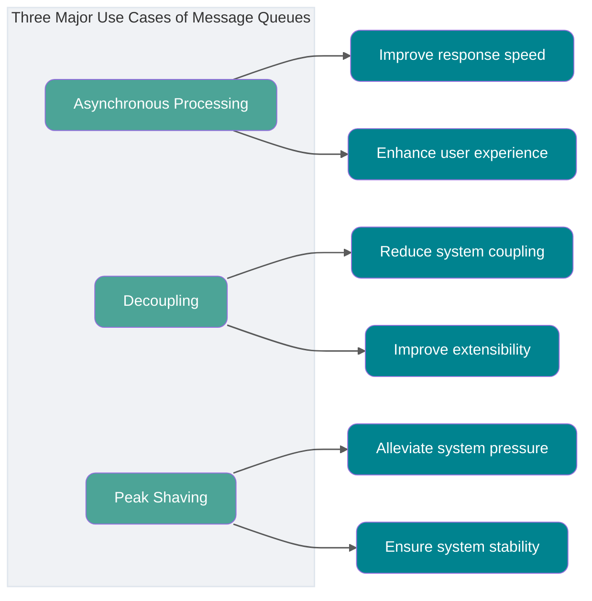

### Do Message Queues Introduce Side Effects?

No technology is a "silver bullet," and message queues come with side effects too.

For example, previously two systems communicated cleanly with each other; now we put a message queue in the middle—what happens if the message queue goes down? Doesn't that **reduce overall system availability**?

Then don't we need to ensure HA (High Availability)? Don't we have to build a cluster? Doesn't that **increase the complexity of the entire system**?

Setting those issues aside, what if the sender fails to send a message and performs a retry? That can produce duplicate messages.

Or what if the consumer fails to process a message and requests redelivery? That can also produce duplicate messages.

For certain microservices, consuming duplicate messages causes serious trouble—for instance, awarding points: if points are added multiple times, isn't that unfair to other users?

So, **how do we solve the problem of duplicate message consumption**?

What if our messages require strict ordering? Suppose a producer generates a sequence of ordered messages (create, update, delete on a record with ID 1). Since a publish-subscribe model has no global ordering across a topic, consumers might not consume messages in the order the producer sent them—for example, consuming them in the order update -> delete -> create. If that record involves monetary amounts, wouldn't that cause a major incident?

So, **how do we solve the problem of ordered message consumption**?

Taking the distributed system example we just discussed: after a user finishes purchasing a ticket, we need to add points to their account. Within a single system, we normally use a transaction—with `Spring`, adding `@Transactional` to the pseudocode above would suffice. But how do we guarantee transactionality across different systems? We certainly cannot allow money to be deducted in System A while points are never added in System B—or money deduction to fail while System B still adds points.

So, **how do we solve distributed transaction problems**?

Earlier we noted that message queues can perform peak shaving. If our consumers consume too slowly or producers produce too fast, won't messages pile up in the message queue?

So, **how do we solve message backlog problems**?

Reduced availability, increased complexity, plus duplicate consumption, ordered consumption, distributed transactions, and message backlogs—how do we solve this series of problems?


Let's discuss the solutions to each of these problems one by one below.

## What Is RocketMQ?


Before discussing the solutions to the problems above, let's first understand the internal design of RocketMQ. It helps to read with those questions in mind.

RocketMQ is a **Topic-based publish-subscribe messaging system**, where a Topic can contain multiple MessageQueues, and a MessageQueue is the smallest queue unit for message storage and transmission. It features **high performance, high reliability, high real-time capability, and distributed architecture**. Written in Java, it was donated to Apache by the Alibaba team at the end of 2016 and became an Apache Top-Level Project. Inside Alibaba, RocketMQ reliably serves thousands of applications across the group, and during each year's Double 11 shopping festival, trillions of messages flow through RocketMQ.

RocketMQ delivers high throughput, low latency, and high availability, proven across large-scale production scenarios such as Double 11.

Starting with RocketMQ 5.x, the project places stronger emphasis on cloud-native architecture: the Proxy layer supports gRPC, multi-language SDKs, and multi-protocol access, while Brokers focus more cleanly on message storage and high availability. When evaluating RocketMQ for a new project, in addition to traditional NameServer, Broker, Producer, and Consumer roles, you should also consider whether you need Proxy, gRPC SDKs, Kubernetes deployment, and cloud-native observability.

## What Are the Queue Model and the Topic Model?

Before discussing RocketMQ's technical architecture, let's clarify two terminology concepts—the **Queue Model** and the **Topic Model**.

First, why is a message queue called a "message queue"?

In fact, early messaging middleware was implemented using the **queue** model; likely for historical reasons, we grew accustomed to calling messaging middleware "message queues."

However, modern messaging middleware such as RocketMQ and Kafka implement message storage using more than just a single **queue**.

### Queue Model

Just as we understand a queue data structure, the queue model in messaging middleware really is just a single queue.


Key characteristic of the queue model: **a message can only be consumed by one consumer**.

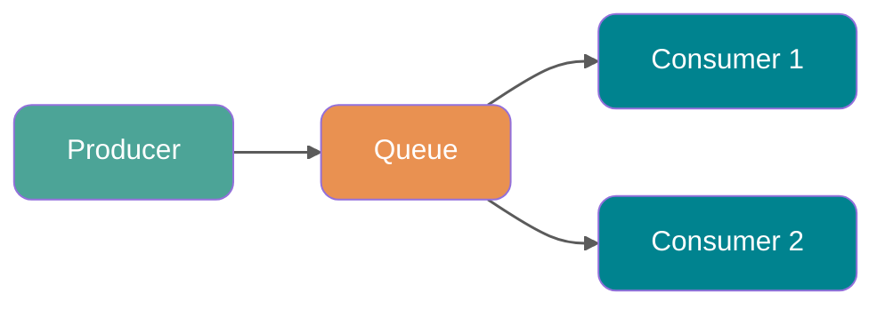

Earlier I mentioned the concept of **"broadcasting"**—that is, if we need to send one message to multiple consumers (for instance, sending the same information to both the SMS system and the email system), a single queue can no longer meet our needs.

Of course, you could have the Producer produce messages into multiple queues, with each queue corresponding to a consumer. That solves the problem, but creating multiple queues and duplicating messages consumes significant resources and hurts performance. Worse yet, the producer would have to know the exact number of consumers and replicate the corresponding number of queues, which violates the **decoupling** principle of messaging middleware.

### Topic Model

Is there a better way to solve this problem? Yes—the **Topic Model**, also known as the **Publish-Subscribe (Pub/Sub) Model**.

> Interested readers can look up the Observer design pattern and implement it by hand—you will definitely learn a lot from it.

In the Topic model, a message producer is called a **Publisher**, a message consumer is called a **Subscriber**, and the container that holds messages is called a **Topic**.

Publishers send messages to a specified Topic, and subscribers must **subscribe to the Topic in advance** in order to receive messages for that specific Topic.


Key characteristic of the Topic model: **one Topic can be subscribed to by multiple Consumer Groups, and each Consumer Group maintains its own independent consumption progress**. In clustering consumption mode, typically only one consumer instance within the same Consumer Group processes a given message; in broadcasting consumption mode, every consumer within the same Consumer Group receives the message.

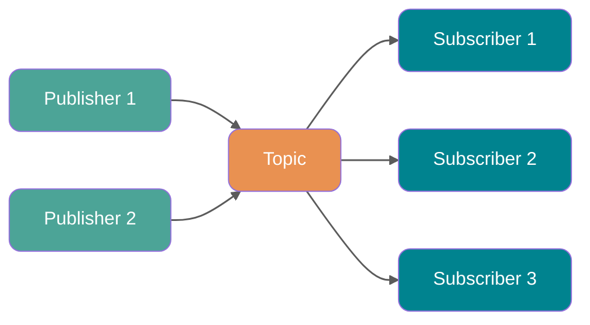

### Messaging Model in RocketMQ

The messaging model in RocketMQ is implemented following the **Topic Model**. So how is a **Topic** actually implemented?

In fact, every messaging middleware has a different underlying design for the Topic model—for example, **Partitions** in Kafka, **Queues** in RocketMQ, and **Exchanges** in RabbitMQ. You can think of the **Topic Model / Publish-Subscribe Model** as a standard specification that different middleware implementations follow in their own way.

So how does RocketMQ actually implement the **Topic Model**? Let's look at a diagram first:


In the diagram, we can see three roles: `Producer Group`, Topic, and `Consumer Group`. This diagram is closer to the early and compatibility model; when understanding 5.x, remember that in the new domain model, producers themselves are lightweight and anonymous, so Producer Group is no longer a primary concept.

- `Producer Group`: In early clients and compatibility scenarios, represents a category of producers—for example, if we have multiple flash-sale service instances acting as producers, together they form a `Producer Group`, and they generally produce the same type of messages.
- `Consumer Group`: Represents a category of consumers—for example, if we have multiple SMS service instances acting as consumers, together they form a `Consumer Group`, and they generally consume the same type of messages.
- Topic: Represents a category of messages, such as order messages, logistics messages, and so on.

As you can see in the diagram, producers in a Producer Group send messages to a Topic, and **a Topic contains multiple queues**. Each time a producer creates a message, it sends the message to one of the queues under the specified Topic.

Each Topic has multiple queues (distributed across different Brokers, and in a cluster deployment, Brokers are distributed across different servers). Under clustering consumption mode, multiple machines in a consumer cluster jointly consume the multiple queues of a `topic`.

**Load Balancing Strategy Comparison**

The comparison below shows **clustering consumption (shared consumption) within the same Consumer Group**. The load balancing granularity depends on the client type and consumption protocol rather than just the Broker version: consumers using the traditional 3.x/4.x Remoting SDK use queue-level granularity; `PushConsumer` and `SimpleConsumer` in the new 5.x SDK use message-level granularity; and `PullConsumer` still uses queue-level granularity.

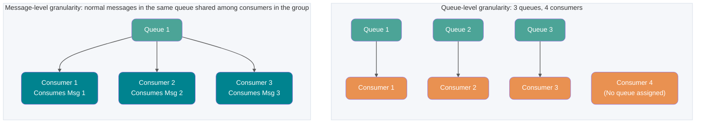

- **Queue-level load balancing**: Once assignment stabilizes, within the same Consumer Group, one queue is assigned to only one consumer instance, while one consumer can be assigned multiple queues. If a consumer goes down, rebalancing reassigns its queues to other consumers in the group. If there are more consumers than queues, some consumers will receive no queues. This mode is prone to load imbalance: if a consumer processes slowly or is assigned queues with more messages, that consumer may accumulate a backlog while other consumers sit idle. Different Consumer Groups can still independently consume the same queue without being restricted by intra-group exclusive assignment.
- **Message-level load balancing**: `PushConsumer` and `SimpleConsumer` in the new 5.x SDK allow multiple consumers within the same Consumer Group to share different messages from the same queue. The diagram only illustrates a single assignment snapshot—messages are not permanently bound to a specific consumer. Once a message is fetched, it will not be delivered again to other consumers **in the same group** during its invisible time; however, consumption failure or timeout can still trigger retries, so this does not mean duplicate consumption can never occur. This approach helps mitigate backlogs caused by uneven queue assignment and differing consumer processing speeds, though it cannot eliminate all bottlenecks such as slow business logic. Ordered messages are also constrained by MessageGroup ordering, so messages within the same MessageGroup cannot be processed arbitrarily in parallel.

The diagram below applies only to **queue-level load balancing**. Having fewer consumers than queues is not a problem because one consumer can consume multiple queues; however, if you want newly scaled-out consumers to be assigned queues, there must be enough queues. Under message-level load balancing, the number of consumer instances is not directly limited by the number of queues.


**Why do different Consumer Groups need to record consumption progress separately for each queue?**

Because when different Consumer Groups subscribe to the same Topic, each group needs to consume those messages independently, and their consumption speeds may differ. Taking traditional queue-level clustering consumption as an example, consumption offsets are recorded separately by **Consumer Group + Topic + Queue**, and consumers within a group share that progress; when rebalancing occurs, the consumer taking over a queue can resume consumption from the committed offset.

The consumption offset (`ConsumerOffset`) indicates the position where that group will resume consuming next in that queue. It is neither a message ID nor a sequence number shared across the entire Topic. Below, assume two groups subscribe to the same Topic, with no filtering or retries, and messages are consumed in queue order with committed offsets:

| Consumer Group | Queue Q0 Progress                                | Queue Q1 Progress                                |
| -------------- | ------------------------------------------------ | ------------------------------------------------ |
| Group A        | offset is 3: consumed 0–2, next starts from 3    | offset is 1: consumed 0, next starts from 1      |
| Group B        | offset is 1: consumed 0, next starts from 1      | offset is 4: consumed 0–3, next starts from 4    |

The offsets of Q0 and Q1 increment independently within their respective queues. When Group A advances the offset of Q0, it neither changes Group B's offset nor changes its own offset on Q1.

**Offset updates cannot be naively understood as "increment by 1 after each successful message," nor do they guarantee zero duplicate consumption.** Batch pulling, concurrent processing, message filtering, and offset commits all affect how progress advances; for instance, if an earlier message has not finished processing yet, a later message that finishes first cannot simply jump ahead and commit the offset past the earlier message. If a failure occurs after consumption succeeds but before the offset is persisted, the message may be consumed again. `PushConsumer` and `SimpleConsumer` in the new 5.x SDK acknowledge messages individually with consumption state managed by the server, so the simplistic explanation "the client increments the offset by 1 on every success" does not apply there either.

A message is not immediately deleted from storage once a group successfully consumes it, nor must deletion wait until every group has consumed it. RocketMQ reclaims messages according to retention-time and storage-capacity cleanup policies, so even unconsumed messages may eventually be deleted. Consumption progress management, message retention, and business idempotency are distinct concerns.

Reference official documentation: [Consumer Load Balancing](https://rocketmq.apache.org/zh/docs/featureBehavior/08consumerloadbalance/), [Consumer Progress Management](https://rocketmq.apache.org/zh/docs/featureBehavior/09consumerprogress/), [Message Storage and Cleanup Mechanism](https://rocketmq.apache.org/zh/docs/featureBehavior/11messagestorepolicy/).

You might still have one question: **why does a Topic need to maintain multiple queues?**

The answer is **to improve concurrency**. Having only one queue per Topic also works—different Consumer Groups can still subscribe to it independently and maintain their own consumption progress. The diagram below illustrates a single-queue scenario under queue-level load balancing.


When there is only one queue, all producer messages are written into that single queue, making it impossible to distribute load across multiple Brokers via multiple queues. Under queue-level load balancing, only one consumer instance in the same group can be assigned that queue, so other instances cannot share the work; this is a limitation of the queue assignment strategy rather than an inherent consequence of maintaining consumption offsets. Message-level load balancing allows multiple consumers in a group to share different messages from a single queue, while having multiple queues still helps distribute storage and read/write load.

In summary, RocketMQ implements the **Topic Model / Publish-Subscribe Model** by **configuring multiple queues within a Topic and tracking each Consumer Group's consumption position per queue**.

## RocketMQ Architecture

Now that we have covered the messaging model, understanding RocketMQ's technical architecture becomes much easier.

The core components of RocketMQ include **NameServer, Broker, Producer, and Consumer**, and version 5.0 also introduced the **Proxy** component.

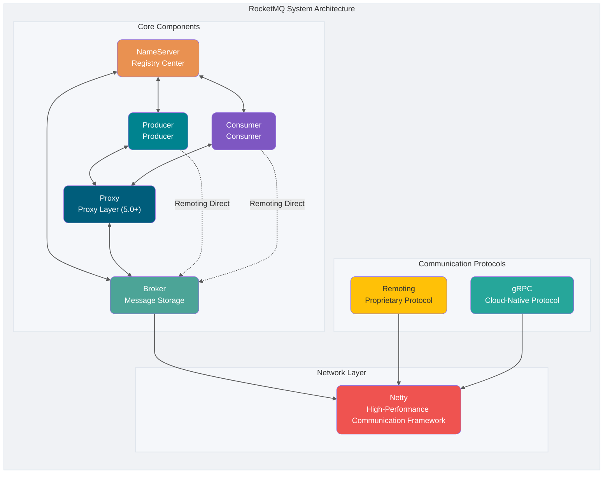

### Core Component Highlights

| Component      | Key Technical Points                                                     |
| -------------- | ------------------------------------------------------------------------ |
| **NameServer** | Lightweight registry center; nodes do not synchronize data with one another |
| **Broker**     | Message storage and delivery; supports master-slave deployment           |
| **Proxy**      | Added in 5.0; protocol adaptation and compute offloading (optional)      |
| **Producer**   | Supports synchronous, asynchronous, and one-way sending modes            |
| **Consumer**   | Push, Pull, and Simple consumption modes                                 |

### NameServer (Registry Center)

NameServer is responsible for storing metadata and acts as the "central nervous system" of the cluster. Its core role is to provide routing information to producers and consumers so they can locate the corresponding Broker addresses.

**Core Functions:**

1. **Broker Management**: Brokers actively connect to NameServer on startup and report their metadata.
2. **Routing Information Management**: Producers and consumers fetch the Broker routing table from NameServer.

**Heartbeat Mechanism:**

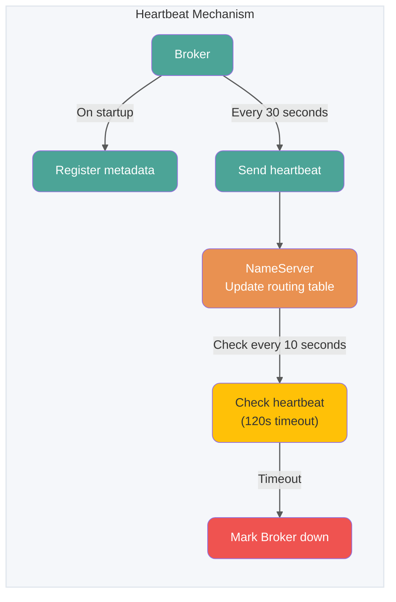

**Metadata Includes:**

- Broker address, name, and BrokerId
- Master node address
- Queue configurations for all Topics on that Broker

### Broker (Message Storage)

Brokers are responsible for message storage, delivery, querying, and high availability guarantees.

**Storage Mechanism:**

1. **Message Writing**: Upon receiving a message, append it sequentially to a `CommitLog` file
2. **File Splitting**: Generate a new file once a file exceeds a fixed size (1GB by default)
3. **Logical Sharding**: `MessageQueue` is a logical shard, and `ConsumeQueue` is the message index

**One Topic is distributed across multiple Brokers, and one Broker can be configured with multiple Topics—they have a many-to-many relationship.**

If a Topic has very high message volume, you should configure more queues for it (as mentioned above to increase concurrency) and **distribute them across different Brokers as much as possible to relieve pressure on any single Broker**.

When message volume across Topics is roughly even, the more queues a Broker hosts, the heavier the load on that Broker.


### Producer

**Sending Flow:**

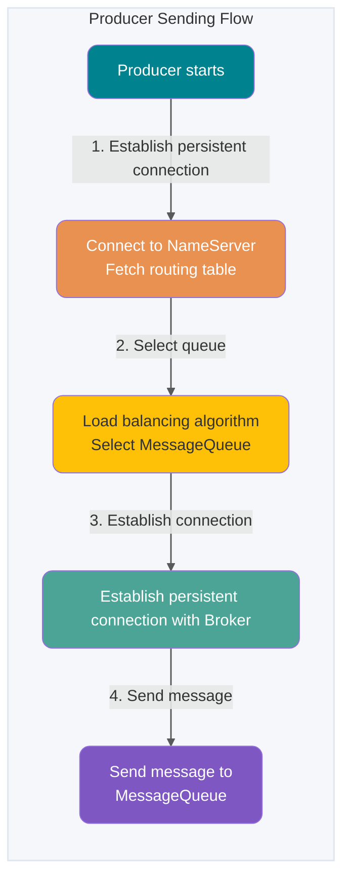

**Three Sending Modes:**

- **Oneway**: Returns immediately after sending without caring whether delivery succeeds
- **Synchronous (Sync)**: Waits for a response after sending
- **Asynchronous (Async)**: Returns immediately after sending and handles the response in a callback method

### Consumer

**Consumption Flow:**

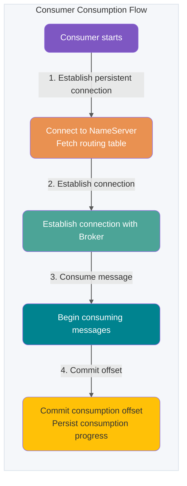

**Three Consumption Modes:**

- **Pull Mode**: The consumer actively sends pull requests to the Broker
- **Push Mode**: Long-polling mechanism where the Broker returns messages once they become available
- **Stateless Mode (Pop)**: Added in RocketMQ 5.0; the server manages rebalancing and offsets

### Network Protocols

RocketMQ currently supports two primary access protocols—Remoting and gRPC:

| Comparison Dimension | Remoting (Traditional Protocol)                                 | gRPC (5.x New SDK)                                                     |
| -------------------- | --------------------------------------------------------------- | ---------------------------------------------------------------------- |
| **Maturity**         | Long history in the Java ecosystem; shorter network path        | Suited for multi-language and cloud-native access; typically via Proxy |
| **Extensibility**    | Multi-language support requires adapting each client separately | Standard protocol; friendlier client ecosystem and gateway governance  |
| **Trade-offs**       | Suited for existing 4.x clients and internal low-latency paths  | Adding a Proxy hop requires extra attention to latency and capacity    |

### Network Module (Based on Netty)

RocketMQ's RPC communication uses Netty as its underlying networking library, with deep extensions and optimizations built on top of the Reactor multi-threaded model.

**Thread Model Summary:**

- **Reactor Main Thread**: 1 thread, responsible for listening for incoming connections
- **Reactor Thread Pool**: 3 threads by default, responsible for network data processing
- **Business Thread Pool**: Dynamically adjusted based on the number of CPU cores

### Proxy (Proxy Layer, Added in 5.0)

RocketMQ 5.0 introduced the **Proxy** component, which embodies the **separation of compute and storage** architecture. Acting as a proxy layer between clients and Brokers, Proxy decouples compute logic—such as client protocol adaptation, permission management, and consumption management—from the Broker, allowing the Broker to focus more cleanly on message storage and high availability. This design is crucial for cloud-native architectures, enabling the compute layer to scale elastically on its own.

**Two Deployment Modes:**

| Mode             | Description                                                                   | Applicable Scenarios                                                     |
| ---------------- | ----------------------------------------------------------------------------- | ------------------------------------------------------------------------ |
| **Local Mode**   | Proxy and Broker run in the same process; only new Proxy config is needed     | Smooth upgrades from older versions, or scenarios with no special needs  |
| **Cluster Mode** | Proxy and Broker are deployed independently in separate processes             | Scenarios needing elastic scaling or custom protocol adaptation          |

**Core Roles:**

- **Protocol Adaptation**: Supports gRPC access, making multi-language client integration easier
- **Compute Offloading**: Strips authentication/authorization, consumption management, and similar compute logic out of the Broker to reduce Broker load
- **Elastic Scaling**: Proxy is stateless and can scale out horizontally on its own

> **Note**: In version 5.0, clients using the new SDK (gRPC protocol) must connect through Proxy, whereas legacy SDKs (Remoting protocol) can still connect directly to Brokers.

The value of Proxy goes beyond simply "adding another proxy layer." In cloud-native environments, it strips compute responsibilities such as protocol ingress, authentication/authorization, traffic governance, and consumption management out of Brokers so Brokers can serve storage more stably. The trade-off is an extra network hop along the path, requiring extra attention to horizontal scaling, latency, rate limiting, and monitoring of Proxy instances.

### Why Is NameServer Necessary?

First look at a simplified architectural model:


You might wonder: what does NameServer actually do? Why can't Producers and Consumers just talk directly to a Broker to produce and consume messages?

Brokers must ensure high availability. Relying on a single Broker puts immense pressure on it, so multiple Brokers are used to achieve **load balancing**. If producers and consumers connected directly to multiple Brokers, any change to the Brokers would affect every producer and consumer, creating tight coupling. The NameServer registry center exists to solve this exact problem.

**Design Philosophy of NameServer:**

NameServer is **stateless, with no inter-node communication**. This contrasts sharply with ZooKeeper's strong consistency (which requires leader election), reflecting RocketMQ's design philosophy of pursuing **extreme performance and architectural simplicity**. Every Broker maintains persistent connections with all NameServer nodes and periodically reports its status; even if a NameServer node crashes, the availability of the entire cluster remains unaffected.

Below is the official architecture diagram:


Compared to the simplified diagram earlier, there are a few key differences in detail:

First, Brokers **are deployed in a cluster with master-slave replication**. Because messages are distributed across Brokers, if a Broker goes down, both reads and writes on that Broker are affected. RocketMQ therefore provides a `master/slave` architecture where `slave` nodes periodically sync data from the `master` (using synchronous or asynchronous flushing). If the `master` goes down, **the `slave` can still serve read/consumption requests, though it cannot accept writes** (we will discuss this in more detail later).

Second, to ensure HA, NameServer is also deployed as a cluster, and it is **decentralized**. That means there is no master node—notice clearly in the diagram that NameServer nodes do not perform `Info Replicate` with one another. In RocketMQ, **each individual Broker maintains persistent connections to all NameServer nodes**, and **every 30 seconds** the Broker sends a heartbeat containing its own Topic configuration to all NameServers. Each NameServer checks heartbeats **every 10 seconds**, and if a Broker has had **no heartbeat for over 120 seconds**, NameServer considers that Broker down.

Third, when a producer needs to send messages to a Broker, **it first fetches Broker routing information from NameServer**, and then uses **round-robin** to produce messages across queues to achieve **load balancing**.

Fourth, after obtaining routing information for all Brokers from NameServer, consumers send `Pull` requests to Brokers to retrieve messages. Consumers can start in two modes—**Broadcast** and **Cluster**. In Broadcast mode, a message is delivered to **every consumer in the same Consumer Group**, whereas in Cluster mode, a message is delivered to only one consumer in the group.

## RocketMQ Messages

### Normal Messages

Normal messages are generally used in scenarios such as microservice decoupling, event-driven architectures, and data integration. Most of these scenarios require reliable data transmission channels without special requirements on processing timing or message ordering. Taking an online e-commerce transaction scenario as an example, the upstream order system encapsulates the user's order placement and payment event as independent normal messages and sends them to the RocketMQ server, while downstream services subscribe to the messages on demand and execute downstream tasks according to local consumption logic. Each message is independent of the others and requires no correlation. Another example is a logging system: in an offline log collection scenario, instrumentation components collect relevant operation logs from frontend applications and forward them to RocketMQ.

**Normal Message Lifecycle**


- Initialized: The state after a message is constructed and initialized by the producer, waiting to be sent to the server.
- Pending Consumption: The state after the message is sent to the server, visible to consumers and waiting to be consumed.
- Consuming: The process in which a consumer retrieves the message and handles it according to local business logic. During this phase, the server waits for the consumer to finish processing and commit the consumption result; if no response arrives from the consumer within a certain period, RocketMQ retries the message.
- Consume Committed: The consumer finishes processing and commits the consumption result to the server; if consumption fails or times out, the message is redelivered according to the retry policy and may enter the Dead-Letter Queue (DLQ) after exceeding the maximum number of retries. RocketMQ does not delete a message immediately just because a Consumer Group succeeded in consuming it; instead, it cleans up messages on a rolling basis according to its message retention mechanism, so consumers can still rewind and re-consume the message before it is deleted due to expiration or insufficient storage space.
- Message Deleted: Apache RocketMQ rolls through and cleans up the oldest message data according to its retention policy, deleting messages from physical files.

### Scheduled / Delayed Messages

> **Note: Scheduled messages and delayed messages are essentially the same—in both cases, the server delivers the message to consumers at a specific fixed timestamp according to the scheduled time configured on the message.**

In scenarios such as distributed scheduled triggering and task timeout handling, accurate and reliable timed event triggers are needed. Using RocketMQ's scheduled messages simplifies the development logic of scheduled tasks and provides high-performance, scalable, and highly reliable timed triggering capabilities.

**Typical Scenario 1: Distributed Scheduled Dispatching**

In distributed scheduled dispatching scenarios, timed tasks with various granularities are required—for example, running file cleanup every day at 5:00 AM or triggering push notifications every 2 minutes. Traditional database-based scheduling solutions suffer from low performance and complex implementation in distributed environments.

**Typical Scenario 2: Task Timeout Handling**

Take an e-commerce transaction scenario: after an order is placed and remains unpaid, you cannot close the order immediately—you must wait for a period of time before closing it. Using RocketMQ scheduled messages enables timeout inspection triggers for unpaid orders.

Handling timeout tasks via scheduled messages offers the following advantages:

- **More flexible precision and lower development barrier**: RocketMQ 5.x no longer relies solely on fixed delay levels and lets you set the delivery time via a timestamp; however, the default delivery granularity is still at the second level, so it should not be assumed to fire with strict millisecond-level punctuality.
- **High performance and scalability**: Traditional database polling approaches are complex and require frequent scan queries, easily becoming a performance bottleneck. RocketMQ scheduled messages provide high concurrency and horizontal scalability.

**Principles for Setting Scheduled Time**

The scheduled time set on a RocketMQ scheduled message is an expected system trigger timestamp; a relative delay duration must also be converted into a future timestamp relative to the current system time, rather than passing a duration directly.

- **Time format**: Millisecond-precision Unix timestamp
- **Maximum scheduled duration**: Defaults to 24 hours and does not support custom modification
- **The scheduled time must be set after the current time**; otherwise, scheduling does not take effect and the server delivers the message immediately

**Examples**:

- Scheduled message: Suppose the current system time is `2022-06-09 17:30:00`, and you want the message delivered at `19:20:00`; then the scheduled timestamp is `1654773600000`.
- Delayed message: Suppose the current system time is `2022-06-09 17:30:00`, and you want it delivered after a 1-hour delay; then the scheduled timestamp is `1654770600000`.

**Differences Between Version 4.x and Version 5.x**

- **Version 4.x**: Only supports delayed messages with 18 default levels (`1s 5s 10s 30s 1m 2m 3m 4m 5m 6m 7m 8m 9m 10m 20m 30m 1h 2h`), though custom delay levels and durations can be added in the configuration file.
- **Version 5.x**: Supports setting delivery times via millisecond-precision Unix timestamps, which is far more flexible than 4.x's fixed delay levels; however, the default timer granularity is 1000ms, and actual delivery is affected by server load, storage recovery, and other factors, so it cannot be treated as strict millisecond-accurate delivery.

**Scheduled Message Lifecycle**


- **Initialized**: The state after a message is constructed and initialized by the producer, waiting to be sent to the server.
- **Scheduled**: After the message is sent to the server, unlike normal messages, the server does not immediately build a message index for it; instead, it stores the scheduled message **separately in the timer storage system**, waiting for the scheduled timestamp to arrive.
- **Pending Consumption**: Once the scheduled timestamp arrives, the server writes the message back into the normal storage engine so it becomes visible to downstream consumers and waits to be consumed.
- **Consuming**: The process in which a consumer retrieves the message and executes local business logic. During this phase, the server waits for the consumer to finish processing and commit the result; if no response arrives within a certain period, RocketMQ triggers a retry.
- **Consume Committed**: The consumer completes processing and commits the result to the server; if consumption fails or times out, the message is redelivered according to the retry policy and may enter the Dead-Letter Queue after exceeding the maximum retry count. RocketMQ does not delete a message immediately just because a Consumer Group succeeded in consuming it, but instead cleans up messages on a rolling basis according to its retention mechanism.
- **Message Deleted**: Apache RocketMQ rolls through and cleans up the oldest message data according to its retention mechanism, deleting messages from physical files.

**Usage Limitations**

1. **Message type consistency**: Scheduled messages are only supported within Topics whose `MessageType` is `Delay`.
2. **Timer precision constraint**: The scheduled timestamp parameter accepts millisecond precision, but the default accuracy is 1000ms (second-level granularity).

**Usage Recommendations**

Scheduled messages must first wait in timer storage before being triggered and delivered to consumers when the scheduled time arrives. Therefore, if a large number of scheduled messages are set to the exact same timestamp, a massive surge of messages will need to be processed simultaneously at that moment, causing excessive system pressure, delivery delays, and degraded timing accuracy.

### Ordered Messages

**What Are Ordered Messages?**

Ordered messages are an advanced message type provided by Apache RocketMQ that enable consumers to receive messages in the exact order they were sent, supporting ordered processing in business workflows.

**Use Cases**

In scenarios such as ordered event processing, matching engines, and real-time incremental data synchronization, heterogeneous systems must maintain strongly consistent state synchronization, meaning upstream event changes need to reach downstream systems in order.

- **Order matching**: In securities and stock trading matching scenarios, orders with the same bid price adhere to price-time priority (first offered, first traded), so downstream order-processing systems must handle orders strictly in bid order.
- **Real-time incremental data synchronization**: In incremental database change synchronization, an upstream source database performs inserts, updates, and deletes, sending binary operation logs (`binlog`) as messages through RocketMQ to a downstream search engine, which replays the messages in order to keep indexed state fresh and consistent.

**How Is Message Ordering Guaranteed?**

Message ordering in RocketMQ consists of two parts: **production ordering** and **consumption ordering**.

**Production Ordering**

To guarantee message ordering during production, the following conditions must be met:

1. **Single producer**: Production ordering is only supported by a single producer instance.
2. **Serial sending**: When a producer sends messages concurrently from multiple threads, the chronological order of messages produced across threads cannot be determined.

When a producer satisfying these conditions sends ordered messages to RocketMQ, RocketMQ guarantees that messages assigned the same **MessageGroup** are stored in the same queue in sending order.

**MessageGroup**

RocketMQ determines and identifies ordering relationships among ordered messages via `MessageGroup`; when sending ordered messages, you must assign a `MessageGroup` to each message.

- Multiple messages with the **same MessageGroup** follow First-In, First-Out (FIFO) ordering.
- Messages with **different MessageGroups** or without a MessageGroup have no ordering relationship with each other.

Ordering logic based on `MessageGroup` supports fine-grained partitioning along business lines, improving system parallelism and throughput while preserving local ordering guarantees required by business logic.

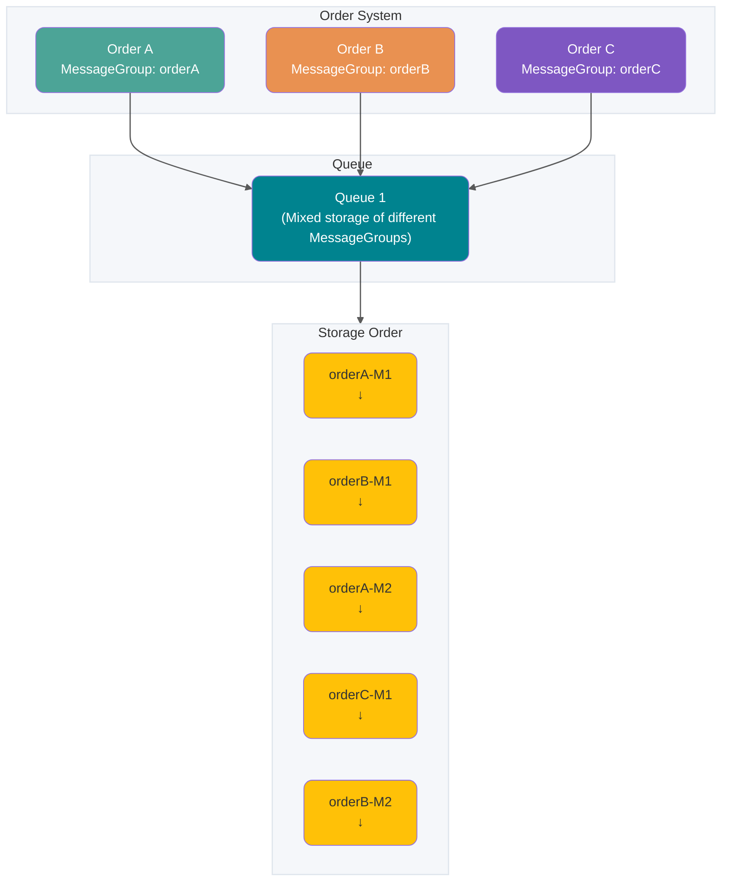

**Notes**:

- M1 and M2 in the `orderA` MessageGroup maintain order.
- M1 and M2 in the `orderB` MessageGroup maintain order.
- Different MessageGroups can be stored mixed together in the same queue.

**Consumption Ordering**

To guarantee message ordering during consumption, the following conditions must be met:

1. **Delivery ordering**: RocketMQ ensures via client SDK and server communication protocols that messages are delivered in the order they are stored on the server.
2. **Bounded retries**: Ordered message delivery retries only within the configured maximum retry limit; once that limit is exceeded, the message is no longer retried and consumption skips it to move on.

**Impact of Consumer Type on Ordered Consumption**

- **PushConsumer**: RocketMQ guarantees that messages are delivered to the consumer one by one in storage order.
- **SimpleConsumer**: A consumer may pull multiple messages at once, in which case ordering during processing must be maintained by the application itself.

**Combinations of Production Ordering and Consumption Ordering**

| Production Ordering                                            | Consumption Ordering   | Ordering Result                                                          |
| -------------------------------------------------------------- | ---------------------- | ------------------------------------------------------------------------ |
| MessageGroup configured; messages sent sequentially            | Ordered consumption    | Strictly guarantees ordering at the MessageGroup granularity             |
| MessageGroup configured; messages sent sequentially            | Concurrent consumption | Concurrent consumption; processes messages approximately in time order   |
| No MessageGroup configured; messages sent out of order         | Ordered consumption    | Only guarantees queue storage order, not business sending order          |
| No MessageGroup configured; messages sent out of order         | Concurrent consumption | Concurrent consumption; processes messages approximately in time order   |

**Usage Limitations**

1. **Message type consistency**: Ordered messages are only supported within Topics whose `MessageType` is `FIFO`; in RocketMQ 5.x, you must also configure `MessageGroup` on ordered messages and configure the Consumer Group for sequential delivery, otherwise messages may still be delivered concurrently.
2. When an ordered message fails consumption and enters retry, to preserve ordering, subsequent messages cannot be consumed until the preceding message finishes processing.

**Usage Recommendations**

1. **Serial consumption**: Messages should be processed serially rather than consuming multiple messages concurrently, which would break ordering.
2. **Distribute MessageGroups as finely as possible**: Partition business entities at the `MessageGroup` level—for example, using order ID or user ID as the `MessageGroup` key—so messages for the same end user are processed in order while messages for different users do not need to wait on each other.

### Transactional Messages

**What Are Transactional Messages?**

Transactional messages are an advanced message type provided by Apache RocketMQ to guarantee eventual consistency between message production and local transactions in distributed scenarios. Put simply, they combine a local transaction (database DML operations) and message sending into a single logical transaction.

**Use Cases**

Distributed system calls are characterized by executing a core business operation while simultaneously invoking multiple downstream services. Ensuring that the execution outcome of the core service and multiple downstream services remains completely consistent is the primary problem distributed transactions solve.

Taking an e-commerce transaction scenario as an example, the core action of a user paying for an order involves state changes across multiple downstream subsystems such as logistics shipping, points updates, and shopping cart clearing:

- **Primary branch (Order system status update)**: Transitions from unpaid to payment succeeded
- **Logistics system status addition**: Creates a pending-shipment logistics record and order logistics entry
- **Points system status change**: Updates user points and the user points table
- **Shopping cart system status change**: Clears the cart and updates the user's shopping cart records

**Problems with Traditional Approaches**

- **Traditional XA transactions**: Distributed transaction systems based on the XA protocol achieve strong consistency, but lock resources broadly across multiple branches, resulting in low concurrency.
- **Normal-message-based approach**: Normal messages and the order transaction cannot be guaranteed consistent—it is easy to end up with a message sent while the order transaction rolled back, or the order committed while the message failed to send.

**RocketMQ Transactional Message Solution**

RocketMQ's transactional message approach offers high performance, scalability, and straightforward business development. It supports two-phase commit (2PC) semantics by binding the two-phase commit to the local transaction, achieving eventual consistency between **the local transaction and message sending**.

**Transactional Message Processing Flow**

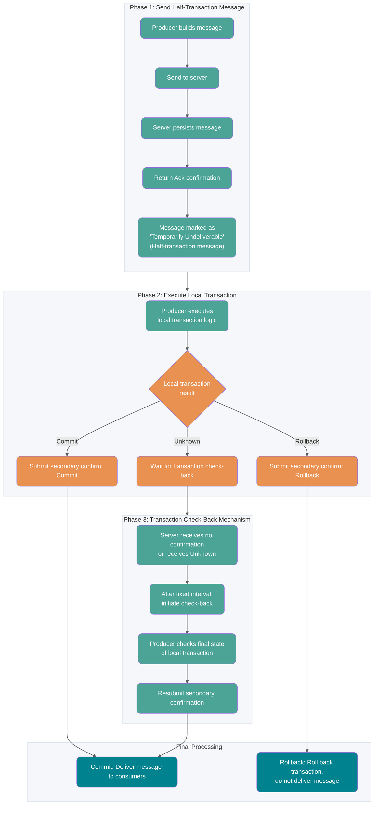

1. The producer sends the message to the RocketMQ server.
2. After successfully persisting the message, the server returns an `Ack` confirming the send succeeded; at this point, the message is marked as "temporarily undeliverable," and a message in this state is called a **half-transaction message**.
3. The producer starts executing the local transaction logic.
4. Based on the local transaction outcome, the producer submits a secondary confirmation (`Commit` or `Rollback`) to the server.
5. If the server does not receive a secondary confirmation or receives `Unknown`, after a fixed interval the server initiates a **transaction check-back** against the producer.
6. Upon receiving the check-back, the producer checks the final execution status of the local transaction corresponding to that message.
7. Based on the final local transaction status found, the producer resubmits the secondary confirmation.

**Transactional Message Lifecycle**

- **Initialized**: The half-transaction message is constructed and initialized by the producer, waiting to be sent to the server.
- **Transaction Pending Commit**: After the half-transaction message is sent to the server, it is persisted in transaction-specific storage rather than entering the normal consumable state directly; it must wait for Phase 2's local transaction to return `Commit` or `Rollback` before deciding whether to deliver. At this stage, the message is invisible to downstream consumers.
- **Message Rolled Back**: If Phase 2 clearly resolves to `Rollback`, the server rolls back the half-transaction message and terminates the transactional message flow.
- **Committed & Pending Consumption**: If Phase 2 clearly resolves to `Commit`, the server writes the half-transaction message into the normal storage system, making it visible to downstream consumers.
- **Consuming**: The consumer retrieves the message and processes it according to local business logic.
- **Consume Committed**: The consumer completes processing and commits the result to the server; if consumption fails or times out, it still enters retry, DLQ, or compensation workflows.
- **Message Deleted**: RocketMQ rolls through and cleans up the oldest message data according to its retention mechanism.

**Usage Limitations**

1. **Message type consistency**: Transactional messages are only supported within Topics whose `MessageType` is `Transaction`.
2. **Consumption transactionality**: RocketMQ transactional messages guarantee consistency between the local primary branch transaction and sending the downstream message, but do not guarantee consistency between downstream consumption outcomes and the upstream transaction.
3. **Intermediate state visibility**: Transactional messages provide eventual consistency—before the committed message reaches the downstream consumer and finishes processing, there is a transient inconsistency between the downstream branch and the upstream transaction.
4. **Transaction timeout mechanism**: A transactional message lifecycle has a timeout; if the server cannot confirm `Commit` or `Rollback` within the specified window after the producer sends a half-transaction message, the message is rolled back by default.
5. **Transaction check-back mechanism**: By default, the server initiates a check-back **every 60 seconds** for unconfirmed half-transaction messages, with a default maximum timeout of **4 hours**, after which unconfirmed messages are forcibly rolled back. Older versions or some cloud provider implementations may also expose a maximum check-back count parameter, so check the specific version used in interviews and production configuration.

**Usage Recommendations**

1. **Avoid large numbers of pending transactions timing out**: Producers should avoid returning `Unknown` for local transactions whenever possible, as massive check-backs degrade system performance.
2. **Handle "in-progress" transactions properly**: During a transaction check-back, if a transaction is still in progress, do not return `Rollback` or `Commit`—keep returning `Unknown`.
3. **Ensure local transaction state is queryable**: Check-backs rely on the producer querying the final state of the local transaction; persist transaction state in a database or reliable storage rather than keeping it only in process memory.
4. **Downstream consumption still requires idempotency**: Transactional messages only solve consistency between "local transaction and message sending"—they do not guarantee downstream consumer business logic always succeeds, so consumers still need retries, idempotency, and compensation.

### Best Practices for Sending Messages

#### Avoid Creating Many Producers in a Single Process

In Apache RocketMQ, Producers and Topics have a many-to-many relationship, meaning a single Producer can send messages to multiple Topics. When creating and initializing Producers, follow the principle of keeping only as many as needed and maximizing reuse—if you need to send messages to multiple Topics, there is no need to create a separate Producer per Topic.

#### Avoid Frequently Creating and Destroying Producers

An Apache RocketMQ Producer is a reusable underlying resource, similar to a database connection pool. Therefore, you should not dynamically create a Producer every time you send a message and destroy it afterward. Frequently creating and destroying Producers generates large volumes of short-lived connections on the server, severely degrading system performance.

Correct example:

```java
Producer p = ProducerBuilder.build();
for (int i =0;i<n;i++){
    Message m= MessageBuilder.build();
    p.send(m);
 }
p.shutdown();
```

## Consumer Types

### PushConsumer

**Core Characteristics:**

A highly encapsulated consumer type where messages are consumed simply by registering a consumption listener and returning a status. Message fetching, consumption status commits, and consumption retries are all handled automatically by the RocketMQ client SDK.

**Applicable Scenarios:**

- Message processing duration is predictable
- No need for asynchronous processing or advanced customization
- Scenarios prioritizing rapid development

**Usage Example:**

```java
public static void main(String[] args) throws InterruptedException, MQClientException {
    // Create a Push mode consumer
    DefaultMQPushConsumer consumer = new DefaultMQPushConsumer("CID_JODIE_1");

    // Subscribe to topic
    consumer.subscribe("TopicTest", "*");

    // Configure where to start consuming
    consumer.setConsumeFromWhere(ConsumeFromWhere.CONSUME_FROM_FIRST_OFFSET);

    // Register message listener
    consumer.registerMessageListener(new MessageListenerConcurrently() {
        @Override
        public ConsumeConcurrentlyStatus consumeMessage(
                List<MessageExt> msgs,
                ConsumeConcurrentlyContext context) {
            System.out.printf("Receive New Messages: %s %n", msgs);
            // Business processing logic
            return ConsumeConcurrentlyStatus.CONSUME_SUCCESS;
        }
    });

    consumer.start();
}
```

**Consumption Listener Execution Results:**

- **Return consumption success**: Indicates the message was processed successfully, and the server updates consumption progress accordingly.
- **Return consumption failure**: Indicates processing failed, and the retry policy determines whether to retry consumption.
- **Throw an exception**: Treated as consumption failure, and the retry policy determines whether to retry consumption.

**Usage Precautions:**

When using `PushConsumer`, the following patterns are prohibited:

1. **Anti-pattern 1**: Returning consumption success prematurely before message processing has actually finished. If processing later fails, the RocketMQ server has no way of knowing and will not retry the message.

2. **Anti-pattern 2**: Dispatching messages from inside the consumption listener to another custom thread pool and letting the listener return a success result early. If processing later fails in that custom thread, the RocketMQ server likewise cannot detect it and will not retry the message.

**How Push Mode Works in the Traditional Remoting SDK (corresponding to the `DefaultMQPushConsumer` example above):**

1. **Load balancing**: The `RebalanceService` thread performs load balancing based on the number of queues and consumers, posting `PullRequest` objects for assigned queues into `pullRequestQueue`.
2. **Message pulling**: The `PullMessageService` thread continuously takes `PullRequest` instances from `pullRequestQueue`, pulls messages from Brokers, and caches them in `ProcessQueue`.
3. **Message consumption**: The `ConsumeMessageService` thread fetches messages from `ProcessQueue` and invokes the listener to run business logic.
4. **Offset committing**: Automatically commits consumption offsets once consumption finishes.
5. **Flow control protection**: Checks local cache thresholds before pulling (1,000 messages or 100 MB) and delays pulling if exceeded.

### SimpleConsumer

`SimpleConsumer` is an atomic-API consumer type where fetching messages, committing consumption status, and triggering retries are all actively initiated by application business logic.

**Message Invisible Time:**

The core mechanism of `SimpleConsumer` is **Invisible Time**. Once a consumer retrieves a message, it becomes invisible to other consumers for the specified invisible duration. If the consumer finishes processing and commits an `ACK` within that duration, the message is marked as consumed; if it times out without an `ACK`, the message becomes visible again and can be retrieved by other consumers. Unlike `PushConsumer`'s scheduled retry queues, `SimpleConsumer` enables more flexible retry control by dynamically adjusting invisible time.

An example from the official documentation:

```java
// Consumption example: consume normal messages with SimpleConsumer by actively receiving, processing, and acking.
ClientServiceProvider provider = ClientServiceProvider.loadService();
String topic = "YourTopic";
FilterExpression filterExpression = new FilterExpression("YourFilterTag", FilterExpressionType.TAG);
SimpleConsumer simpleConsumer = provider.newSimpleConsumerBuilder()
        // Set Consumer Group.
        .setConsumerGroup("YourConsumerGroup")
        // Set endpoints.
        .setClientConfiguration(ClientConfiguration.newBuilder().setEndpoints("YourEndpoint").build())
        // Set pre-bound subscription relationships.
        .setSubscriptionExpressions(Collections.singletonMap(topic, filterExpression))
        // Set maximum wait time when receiving messages from the server
        .setAwaitDuration(Duration.ofSeconds(1))
        .build();
try {
    // SimpleConsumer must actively receive and process messages.
    List<MessageView> messageViewList = simpleConsumer.receive(10, Duration.ofSeconds(30));
    messageViewList.forEach(messageView -> {
        System.out.println(messageView);
        // After processing finishes, actively call ack to commit the consumption result.
        try {
            simpleConsumer.ack(messageView);
        } catch (ClientException e) {
            logger.error("Failed to ack message, messageId={}", messageView.getMessageId(), e);
        }
    });
} catch (ClientException e) {
    // If receive fails due to system flow control or other reasons, re-initiate the receive request.
    logger.error("Failed to receive message", e);
}
```

`SimpleConsumer` is suitable for the following scenarios:

- **Unpredictable message processing duration**: When processing times vary unpredictably and long-running messages are common, `SimpleConsumer` lets you customize the estimated processing time per message and update it ahead of time via API if actual processing takes longer than expected.
- **Advanced customization such as async processing and batch consumption**: `SimpleConsumer` has no heavy threading wrapper inside the SDK, leaving full control to business logic so you can implement asynchronous dispatch, batch consumption, and custom pipelines.
- **Custom consumption rate control**: Because business code explicitly calls APIs to retrieve messages, you can freely tune the polling frequency and regulate consumption throughput.

**How `SimpleConsumer` Works:**

1. **Active message retrieval**: Business code invokes `receive()` to pull messages actively.
2. **Business processing**: Retrieved messages are processed by application logic.
3. **Explicit ACK**: Upon completion, business code calls `ack()` to submit the consumption result.
4. **High controllability**: Applications retain complete control over processing timing and consumption rate.

### PullConsumer

**Core Characteristics:**

In Pull mode, **the application has deep involvement and strong control over message pulling**, deciding when to pull messages and from which `offset` to pull.

**Comparison with Push Mode:**

| Feature                    | Push Mode                                | Pull Mode                         |
| -------------------------- | ---------------------------------------- | --------------------------------- |
| **Control**                | Client SDK pulls automatically           | Application pulls actively        |
| **Controllability**        | Lower controllability                    | High controllability              |
| **Development Complexity** | Simple; only implement a listener        | Must manage the pulling lifecycle |
| **Applicable Scenarios**   | Predictable message processing duration  | Fine-grained control over pulling |

**Usage Example (`DefaultMQPullConsumer`):**

```java
@Test
public void testPullConsumer() throws Exception {
    DefaultMQPullConsumer consumer = new DefaultMQPullConsumer("group1_pull");
    consumer.setNamesrvAddr(this.nameServer);
    String topic = "topic1";
    consumer.start();

    // Fetch message queues belonging to the Topic
    Set<MessageQueue> messageQueues = consumer.fetchSubscribeMessageQueues(topic);
    int maxNums = 10; // Maximum number of messages per pull

    while (true) {
        boolean found = false;
        for (MessageQueue messageQueue : messageQueues) {
            // Get current consumption offset
            long offset = consumer.fetchConsumeOffset(messageQueue, false);
            // Pull messages
            PullResult pullResult = consumer.pull(messageQueue, "tag8", offset, maxNums);

            switch (pullResult.getPullStatus()) {
                case FOUND:
                    found = true;
                    List<MessageExt> msgs = pullResult.getMsgFoundList();
                    System.out.println("Received messages, count----" + msgs.size());
                    // Process messages
                    for (MessageExt msg : msgs) {
                        System.out.println("Processing message--" + msg.getMsgId());
                    }
                    // Update consumption offset
                    long nextOffset = pullResult.getNextBeginOffset();
                    consumer.updateConsumeOffset(messageQueue, nextOffset);
                    break;
                case NO_NEW_MSG:
                    System.out.println("No new messages");
                    break;
                case NO_MATCHED_MSG:
                    System.out.println("No matched messages");
                    break;
                case OFFSET_ILLEGAL:
                    System.err.println("Illegal offset");
                    break;
            }
        }
        if (!found) {
            // If no queue had new messages, pause briefly
            TimeUnit.MILLISECONDS.sleep(5000);
        }
    }
}
```

**Usage Example (`DefaultLitePullConsumer` - Recommended):**

```java
DefaultLitePullConsumer litePullConsumer =
        new DefaultLitePullConsumer("lite_pull_consumer_test");
litePullConsumer.setConsumeFromWhere(ConsumeFromWhere.CONSUME_FROM_FIRST_OFFSET);
litePullConsumer.subscribe("TopicTest", "*");
litePullConsumer.start();

try {
    while (running) {
        // Application actively calls poll() to pull messages
        List<MessageExt> messageExts = litePullConsumer.poll();
        System.out.printf("%s%n", messageExts);
    }
} finally {
    litePullConsumer.shutdown();
}
```

**Applicable Scenarios:**

- **Fine-grained pull timing control**: Decide when to pull messages based on business conditions
- **Consumption rate throttling**: Flexibly adjust polling intervals
- **Batch consumption**: Pull large batches of messages at once for batch processing
- **Specialized consumption needs**: Such as starting from a specific offset or pausing consumption

**How Pull Mode Works:**

1. **Load balancing**: When the `RebalanceService` thread detects a change in consumption assignment snapshots, it starts message pulling tasks.
2. **Message pulling**: After `PullTaskImpl` pulls messages, it places them into `consumeRequestCache`.
3. **Message consumption**: The application invokes `poll()`, continuously reading messages from `consumeRequestCache` for business processing.

### Comparison of the Three Consumer Types

| Comparison Dimension    | PushConsumer                                                                                                                | SimpleConsumer                                                                                           | PullConsumer                                                                                  |
| ----------------------- | --------------------------------------------------------------------------------------------------------------------------- | -------------------------------------------------------------------------------------------------------- | --------------------------------------------------------------------------------------------- |
| Interface Style         | Uses a callback listener interface to return consumption results; consumer logic is restricted to executing inside listener | Application implements processing and actively calls APIs to commit consumption results                  | Application pulls messages per queue and optionally commits consumption offsets               |
| Concurrency Management  | Managed by the SDK                                                                                                          | Consumer threads managed by application business logic                                                   | Consumer threads managed by application business logic                                        |
| Load Balancing Granularity | Default message-level in 5.x SDK; queue-level in earlier versions                                                         | Default message-level in 5.x SDK                                                                         | Queue-level; better batching throughput, but prone to load imbalance                          |
| API Flexibility         | Highly encapsulated; less flexible                                                                                          | Atomic APIs; highly flexible and customizable                                                            | Atomic APIs; highly flexible and customizable                                                 |
| Applicable Scenarios    | Standard business messaging without custom consumption pipelines                                                            | Business scenarios requiring deep customization of the consumption workflow                              | Recommended primarily for integration with stream-processing frameworks                       |

**Selection Recommendations:**

- **General scenarios**: Prefer **PushConsumer** for simple development where the SDK manages pulling and committing automatically.
- **Unpredictable processing duration**: Use **SimpleConsumer**, which supports customizable processing durations.
- **Fine-grained control required**: Use **PullConsumer** for complete control over the pull lifecycle.

**Note**: In production environments, strictly avoid mixing `PullConsumer` with the other two consumer types under the same `ConsumerGroup`, as this causes abnormal consumption behavior.

## Consumer Groups and Producer Groups

### Producer Groups

In RocketMQ 5.x's new domain model, **producers are lightweight, anonymous runtime entities**, so there is generally no need to manage `ProducerGroup` explicitly as in earlier versions. However, in 3.x/4.x clients, the Spring ecosystem, or compatibility modes, you may still encounter `ProducerGroup` configurations; when migrating, do not blindly remove them—verify against the actual client version in use.

### Consumer Groups

A Consumer Group is a load-balancing group of consumers sharing identical consumption behavior. Rather than a physical entity, a Consumer Group is a logical resource that enables horizontal scaling of consumption throughput and high-availability failover.

**Core Roles of a Consumer Group:**

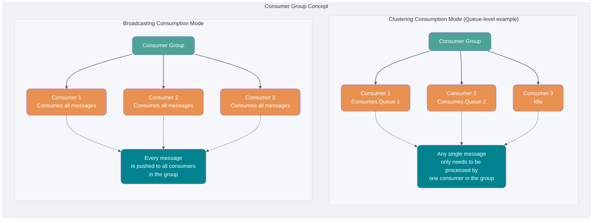

Subscription relationships, delivery ordering, and consumption retry policies are uniform across a Consumer Group:

- **Subscription relationships**: Apache RocketMQ manages subscription relationships at the Consumer Group granularity, enabling centralized management and traceability.
- **Delivery ordering**: When delivering messages to consumers, Apache RocketMQ supports both ordered delivery and concurrent delivery, configured uniformly on the Consumer Group.
- **Consumption retry policy**: The retry policy applied when consumption fails, including maximum retry counts, Dead-Letter Queue settings, and so on.

RocketMQ Server 5.x: The consumption behaviors above are retrieved centrally from the associated Consumer Group, guaranteeing consistent behavior across all consumers in the group without client-side concern.

RocketMQ Server 3.x/4.x Legacy Versions: The consumption behaviors above are defined on the consumer client API, so you must manually ensure all consumer instances within the same group share identical configurations (from the official documentation).

**Comparison of the Two Consumption Modes:**

| Comparison Dimension | Clustering Consumption Mode                                                    | Broadcasting Consumption Mode                                                 |
| -------------------- | ------------------------------------------------------------------------------ | ----------------------------------------------------------------------------- |
| **Message Consumption** | Any given message only needs to be processed by one consumer in the group   | Every message is delivered to all consumers in the group                      |
| **Scaling**          | Consumption capacity can be scaled up or down by adding or removing consumers  | Adding or removing consumers does not change per-message processing load      |
| **Applicable Scenarios** | Scaling consumption throughput and avoiding duplicate consumption across nodes | Scenarios where every consumer instance must receive every message            |

## How to Solve Ordered Consumption and Duplicate Consumption?

Actually, these were all mentioned when introducing the side effects brought by message queues—meaning these problems are not unique to RocketMQ, but rather issues every messaging middleware must address.

When introducing RocketMQ's technical architecture above, I already showed **how it guarantees high availability**. We won't cover operations and setup here—if you are interested, you can follow the examples on the official website to spin up your own RocketMQ cluster.

> In fact, Kafka's architecture is fundamentally similar to RocketMQ's, except that early Kafka relied on ZooKeeper to manage metadata, and its **Partitions** correspond to **Queues** in RocketMQ. A few other subtle differences will be covered later.
>
> Note: Early Kafka relied on ZooKeeper to manage metadata, while newer versions introduced KRaft mode. The comparison here focuses on the architectural idea of "using partitions/queues to increase parallelism," rather than assuming Kafka always depends on ZooKeeper.

### Ordered Consumption

From the technical architecture overview above, we already know that **RocketMQ is unordered at the Topic level and only guarantees ordering at the queue level**.

This brings up two concepts—**normal ordering** and **strict ordering**.

So-called normal ordering means consumers **receive messages in order within the same consumption queue**, whereas messages received across different queues may be out of order. Normal ordered messages **do not guarantee ordering across a Broker restart** (for a brief period).

So-called strict ordering means **all messages** received by consumers are strictly ordered. Strict ordered messages **preserve ordering even under failure scenarios**.

However, while strict ordering sounds great, implementing it comes at a steep cost. If you use strict ordering mode, whenever a single machine in the Broker cluster becomes unavailable, the entire cluster becomes unavailable. What use would it be then? Nowadays, its primary use case is mainly `binlog` synchronization.

Generally speaking, our `MQ` workloads can tolerate brief out-of-order delivery, so normal ordering mode is recommended.

Now, suppose we are using **normal ordering mode**. From what we learned earlier, when a Producer produces messages, it uses round-robin (depending on your load balancing strategy) to send messages across different queues of the same Topic. If we have several messages representing creation, payment, and shipment of the same order, under round-robin those **three messages will be sent to different queues**; once placed in different queues, we can no longer rely on RocketMQ's per-queue ordering property to guarantee message order.


So how do we solve this?

It is quite simple: all we need to do is route messages under the same semantic unit (such as the same order) into the same queue, which can be accomplished using **hash-modulo routing** so that the same order always lands in the same queue.

**Version 4.x: Using `MessageQueueSelector`**

RocketMQ 4.x implements custom queue selection logic by implementing `MessageQueueSelector`:

```java
SendResult sendResult = producer.send(msg, new MessageQueueSelector() {
    @Override
    public MessageQueue select(List<MessageQueue> mqs, Message msg, Object arg) {
        // Compute queue index based on a business key such as order ID
        Long orderId = (Long) arg;
        int index = Math.floorMod(Long.hashCode(orderId), mqs.size());
        return mqs.get(index);
    }
}, orderId);
```

**Version 5.x: Using `MessageGroup`**

RocketMQ 5.x introduced the concept of a **MessageGroup**, ensuring ordering among messages within the same group by specifying a `MessageGroup`:

```java
Message message = messageBuilder.setTopic("topic")
        .setTag("messageTag")
        // Set the ordering group for ordered messages
        .setMessageGroup("fifoGroup001")  // e.g., use order ID as MessageGroup
        .setBody("messageBody".getBytes())
        .build();
```

**Queue Selection Algorithms**

RocketMQ implements two queue selection algorithms:

- **Round-robin algorithm** (default): Sends messages sequentially across all queues belonging to the target Topic to ensure even message distribution.
- **Minimum delivery latency algorithm**: Tracks delivery latency on every send and prioritizes selecting queues with lower message latency.

```java
// Enable minimum delivery latency algorithm
producer.setSendLatencyFaultEnable(true);
```

### Handling Special Cases

#### Send Failures

After selecting a queue, the Producer connects to the Broker and sends the message over the network. If the Broker goes down or network fluctuations cause a send timeout, RocketMQ retries automatically.

It selects a queue on another Broker for sending—retrying twice by default, though this can be configured manually:

```java
producer.setRetryTimesWhenSendFailed(5);
```

#### Oversized Messages

Here we must distinguish two limits: the client can be configured to compress message bodies above a certain threshold (for example, 4 KB is a common default in Java 4.x clients), whereas RocketMQ 5.x's official default maximum message body size is 4 MB, excluding any additional compression effects. Large files should not be stuffed directly into message bodies; instead, store the file in object storage or a file system and pass only the business ID and file URL in MQ.

### Duplicate Consumption

Like most message queues, RocketMQ is engineered around **at-least-once delivery**: whenever consumption failure, timeout, client restart, or network jitter occurs, the same business message may be redelivered. Therefore, the core idea for solving duplicate consumption comes down to one word—**idempotency**. In programming, an *idempotent* operation has the property that executing it any number of times produces the exact same effect as executing it once. Suppose we have an order-points service: whenever a message arrives, it adds the corresponding points to the user who created that order. One day, the MQ delivers an order message for FrancisQ instructing the points service to add 500 points to FrancisQ's account. After finishing the update, the points service attempts to return a consumption-success response to the MQ, but network jitter occurs (or any number of other issues, such as an unexpected Broker restart), so the acknowledgment never arrives.

Since the MQ did not receive a reply from the points service, won't it retry sending the message? Then we have a problem—if it sends the message again, what if it adds another 500 points to FrancisQ's account?

That is why we must make our consumers **idempotent**—so that no matter how many times the same message is processed, the outcome remains unchanged.

How should we implement idempotency in business logic? That depends on the specific business scenario. Redis `SETNX` can be used for short-term deduplication or weak idempotency checks, but should not be treated as the sole guarantee for all scenarios; for strongly consistent scenarios such as orders, payments, and inventory, it is much better to rely on **database unique keys, deduplication/idempotency tables, or business state machines** as a safety net so duplicate messages never cause duplicate writes or repeated deductions.

Above all, you must **choose the right solution for the specific scenario**—determine whether duplicate consumption is strictly unacceptable or tolerable, and then choose between strong and weak validation strategies. After all, there are very few technical silver bullets in computer science.

Consumer-side idempotency in RocketMQ should prioritize designing around a **business unique key** rather than relying solely on the message ID. For example, order payment messages can use the payment serial number or order ID as the unique key, and inventory deduction messages can use a business transaction serial number. That way, even if messages are retried, compensated, or redelivered, duplicate writes are prevented as long as the business unique key remains unchanged.

Across the broader software industry, idempotency applies not just to duplicate consumption in message queues—these same techniques also solve **duplicate requests and duplicate invocations in other contexts**. For example, designing HTTP endpoints to be idempotent **prevents duplicate form submissions from web frontends or mobile apps**, and designing microservices to be idempotent protects against **duplicate RPC calls caused by automatic framework retries**.

## How Does RocketMQ Implement Distributed Transactions?

How do we explain distributed transactions? Everyone knows what a transaction is, right? **Either all operations succeed or none of them do.** Within a single system, transactions are straightforward to implement, but in a distributed architecture, services are deployed across separate systems that must invoke one another. For instance, placing an order and then awarding points: without distributed transaction guarantees, System A might create the order while System B fails to add points, or System A fails to create the order while System B still adds points. The former hurts the user experience, while the latter harms the business—neither is acceptable.

So how do we solve this problem?

Today, common distributed transaction implementations include 2PC, TCC, and Transactional Messages (half-message mechanism). Each approach has its suitable scenarios as well as its own drawbacks—**none is a perfect solution**.

RocketMQ solves distributed transaction problems using **transactional messages combined with a transaction check-back mechanism**. I drew a diagram below to help illustrate the process.


**Detailed Transactional Message Processing Flow**

1. **Send half-transaction message**: The producer sends the message to the RocketMQ server.
2. **Server acknowledgment**: After persisting the message successfully, the server returns an `Ack` confirming the send succeeded; at this point, the message is marked "temporarily undeliverable," and a message in this state is a **half-transaction message**.
3. **Execute local transaction**: The producer executes its local transaction logic.
4. **Submit secondary confirmation**: Based on the local transaction outcome, the producer submits a secondary confirmation (`Commit` or `Rollback`) to the server.
5. **Transaction check-back**: If the server receives no secondary confirmation or receives `Unknown`, after a fixed interval it initiates a **message check-back** to the producer.
6. **Inspect local transaction**: Upon receiving the check-back, the producer checks the final execution outcome of the local transaction corresponding to that message.
7. **Resubmit confirmation**: Based on the inspected final state of the local transaction, the producer resubmits the secondary confirmation.

In step 1, sending a `half` message means that **before the transaction is committed, the message is invisible to consumers**.

> So how does RocketMQ write the message while keeping it invisible to consumers? RocketMQ's transactional message implementation backs up the original message's Topic and queue, and **changes its Topic** to `RMQ_SYS_TRANS_HALF_TOPIC`. Since no Consumer Group subscribes to that internal Topic, consumers cannot consume `half` messages. **RocketMQ then starts a scheduled task that pulls messages from `RMQ_SYS_TRANS_HALF_TOPIC`**, selects a producer instance from the Producer Group to send a transaction status check-back request, and decides whether to commit or roll back the message based on the returned status.

Imagine what would happen without the **transaction check-back mechanism** starting at step 5: if network jitter caused step 4's confirmation to fail, the MQ would never know whether to deliver the message to consumers. RocketMQ solves this via the transaction check-back mechanism described above, whereas Kafka typically leaves exceptions to be handled by application code.

Also note that the step from `MQ Server` to System B is already decoupled from System A—that is, in a message-queue-based distributed transaction, **only the local transaction and storing the message in the message queue belong to the same atomic transaction**. This achieves **eventual consistency**, because the rest of the pipeline is asynchronous and **each system only needs to guarantee its own local transaction**.

A practical issue you will encounter in real projects: transactional messages require a transaction listener to track whether local transactions succeed, and the listener interface can only be implemented once. That would force you to cram the local transaction logic for all different transactional messages into a single method, resulting in heavy coupling and massive `if/else` type branching. By wrapping each business operation in a `Function` interface and passing it as an argument to the listener method, then invoking `Function.apply()` to execute the business transaction inside `apply()`, you decouple the listener from specific business logic and make the pattern genuinely viable in production.

In addition, do not rely solely on Redis during transaction check-backs. The authoritative transaction state should come from a transaction table or business table committed in the same database transaction as the local business operation, with Redis serving at most as a cache or read-acceleration replica. The example below retains Redis calls purely to illustrate the structure—in production, persist local transaction state in reliable storage and enforce consumer-side idempotency with business unique keys or database constraints.

1. Simulate a requirement to record user view history

```java
@PostMapping("/add")
@ApiOperation("Add user view history")
public Result<TransactionSendResult> add(Long userId, Long forecastLogId) {

        // Functional programming: persist view history to the database
        Function<String, Boolean> function = transactionId -> viewHistoryHandler.addViewHistory(transactionId, userId, forecastLogId);

        Map<String, Long> hashMap = new HashMap<>();
        hashMap.put("userId", userId);
        hashMap.put("forecastLogId", forecastLogId);
        String jsonString = JSON.toJSONString(hashMap);

        // Send transactional message; wrap local transaction operation in Function interface and pass as argument
        TransactionSendResult transactionSendResult = mqProducerService.sendTransactionMessage(jsonString, MQDestination.TAG_ADD_VIEW_HISTORY, function);
        return Result.success(transactionSendResult);
}
```

2. Method for sending transactional messages

```java
/**
 * Send transactional message
 *
 * @param msgBody
 * @param tag
 * @param function
 * @return
 */
public TransactionSendResult sendTransactionMessage(String msgBody, String tag, Function<String, Boolean> function) {
    // Build message body
    Message<String> message = buildMessage(msgBody);

    // Build message delivery destination
    String destination = buildDestination(tag);

    TransactionSendResult result = rocketMQTemplate.sendMessageInTransaction(destination, message, function);
    return result;
}
```

3. Producer message listener (only one class is allowed to implement this listener)

```java
@Slf4j
@RocketMQTransactionListener
public class TransactionMsgListener implements RocketMQLocalTransactionListener {

    @Autowired
    private RedisService redisService; // Demo cache; do not use as the sole source of truth for transaction state in production

    /**
     * Execute local transaction (invoked when the half-message is sent successfully)
     *
     * @param message
     * @param o
     * @return commit or rollback or unknown
     */
    @Override
    public RocketMQLocalTransactionState executeLocalTransaction(Message message, Object o) {

        // 1. Retrieve transaction ID
        String transactionId = null;
        try {
            transactionId = message.getHeaders().get("rocketmq_TRANSACTION_ID").toString();
            // 2. Check if the passed Function argument is null; if null, no business logic to execute, discard message
            if (o == null) {
                // Messages returning ROLLBACK will be discarded
                log.info("Transaction message rolled back, no business logic to execute transactionId={}", transactionId);
                return RocketMQLocalTransactionState.ROLLBACK;
            }
            // Cast Object o to Function
            Function<String, Boolean> function = (Function<String, Boolean>) o;
            // Execute business logic; database transaction executes inside function.apply
            Boolean apply = function.apply(transactionId);
            if (apply) {
                log.info("Transaction committed, message processed normally transactionId={}", transactionId);
                // Messages returning COMMIT will become immediately consumable by consumers
                return RocketMQLocalTransactionState.COMMIT;
            }
        } catch (Exception e) {
            log.info("Exception occurred, returning ROLLBACK transactionId={}", transactionId);
            return RocketMQLocalTransactionState.ROLLBACK;
        }
        return RocketMQLocalTransactionState.ROLLBACK;
    }

    /**
     * Transaction check-back mechanism to inspect local transaction status
     *
     * @param message
     * @return
     */
    @Override
    public RocketMQLocalTransactionState checkLocalTransaction(Message message) {

        String transactionId = message.getHeaders().get("rocketmq_TRANSACTION_ID").toString();

        // Demo queries Redis; in production, query the local transaction table or final business table state
        MqTransaction mqTransaction = redisService.getCacheObject("mqTransaction:" + transactionId);
        if (Objects.isNull(mqTransaction)) {
            return RocketMQLocalTransactionState.ROLLBACK;
        }
        return RocketMQLocalTransactionState.COMMIT;
    }
}
```

4. Simulated business handler—this method must be extracted into a separate class. If the caller and callee reside in the same class, Spring `@Transactional` will fail to take effect due to proxy self-invocation.

```java
@Component
public class ViewHistoryHandler {

    @Autowired
    private IViewHistoryService viewHistoryService;

    @Autowired
    private IMqTransactionService mqTransactionService;

    @Autowired
    private RedisService redisService; // Demo cache; transaction state should still rely on the database

    /**
     * Persist view history to database
     *
     * @param transactionId
     * @param userId
     * @param forecastLogId
     * @return
     */
    @Transactional
    public Boolean addViewHistory(String transactionId, Long userId, Long forecastLogId) {
        // Build view history record
        ViewHistory viewHistory = new ViewHistory();
        viewHistory.setUserId(userId);
        viewHistory.setForecastLogId(forecastLogId);
        viewHistory.setCreateTime(LocalDateTime.now());
        boolean save = viewHistoryService.save(viewHistory);

        // Local transaction record
        MqTransaction mqTransaction = new MqTransaction();
        mqTransaction.setTransactionId(transactionId);
        mqTransaction.setCreateTime(new Date());
        mqTransaction.setStatus(MqTransaction.StatusEnum.VALID.getStatus());

        // Transaction state should be persisted in the same transaction as local business data
        mqTransactionService.save(mqTransaction);

        // Redis can only act as a cache replica, not the sole source of truth for transaction state
        redisService.setCacheObject("mqTransaction:" + transactionId, mqTransaction, 4L, TimeUnit.HOURS);

        // Uncomment to simulate an exception and trigger transaction rollback
        // int i = 10 / 0;

        return save;
    }
}
```

5. Consuming the message and handling idempotency

```java
@Service
@RocketMQMessageListener(topic = MQDestination.TOPIC, selectorExpression = MQDestination.TAG_ADD_VIEW_HISTORY, consumerGroup = MQDestination.TAG_ADD_VIEW_HISTORY)
public class ConsumerAddViewHistory implements RocketMQListener<Message> {
    // Invoked automatically when a message arrives
    @Override
    public void onMessage(Message message) {
        // Idempotency check
        String transactionId = message.getTransactionId();

        // Demo queries Redis; for strong consistency, use a business unique key, idempotency table, or database constraint
        MqTransaction mqTransaction = redisService.getCacheObject("mqTransaction:" + transactionId);

        // No transaction record found
        if (Objects.isNull(mqTransaction)) {
            return;
        }

        // Already consumed
        if (Objects.equals(mqTransaction.getStatus(), MqTransaction.StatusEnum.CONSUMED.getStatus())) {
            return;
        }

        String msg = new String(message.getBody());
        Map<String, Long> map = JSON.parseObject(msg, new TypeReference<HashMap<String, Long>>() {
        });
        Long userId = map.get("userId");
        Long forecastLogId = map.get("forecastLogId");

        // Downstream business processing
        // TODO Record user preferences and update user profile

        // TODO Update view count of the 'securities forecast article' and recalculate exposure ranking

        // Mark status as consumed
        mqTransaction.setUpdateTime(new Date());
        mqTransaction.setStatus(MqTransaction.StatusEnum.CONSUMED.getStatus());
        redisService.setCacheObject("mqTransaction:" + transactionId, mqTransaction, 4L, TimeUnit.HOURS);
        log.info("Received message: msg={}", JSON.toJSONString(map));
    }
}
```

## How to Solve Message Backlog Problems?

Earlier we mentioned one of the most important functions of a message queue—**peak shaving**. But what if that traffic peak is so huge that messages pile up in the queue?

We can generalize this problem because message backlogs fundamentally stem from only two root causes—either **producers are producing too fast** or **consumers are consuming too slowly**.

We can tackle this from multiple angles. When a traffic surge causes producers to outpace capacity, we can apply **rate limiting and graceful degradation**, or horizontally scale out consumer instances to boost consumption capacity and match the surge in production. If consumers are consuming too slowly, we should first check **whether consumers are encountering massive consumption errors**, or inspect logs to see if a thread is stuck, holding locks without releasing them, and so forth.

> Scaling out consumer instances usually alleviates backlogs caused by insufficient consumption capacity, though whether you also need to add queues depends on the load balancing strategy and the current number of queues.
>
> **Note**: Under queue-level load balancing in the traditional Remoting SDK, **each queue is assigned to only one consumer instance within the same group**. Only when the scaled-out consumer count exceeds the number of available queues will some consumers have no queues to consume.
>
> `PushConsumer` and `SimpleConsumer` in RocketMQ 5.x default to a **message-level load balancing strategy**, allowing multiple consumers in the same Consumer Group to jointly consume messages from the same queue at the message granularity. Thus, even if there are more consumers than queues, consumption parallelism can still improve. `PullConsumer` still uses queue-level granularity, so queue count still matters when scaling out.


When troubleshooting a message backlog in production, follow this sequence:

1. **Determine the scope of the backlog first**: Is it a single Topic, a single queue, or the entire Broker backing up?
2. **Check production rate vs. consumption rate**: Sudden production spikes call for rate limiting or peak shaving; a drop in consumption rate means investigating consumers.
3. **Inspect consumer latency**: Focus on slow SQL queries, external API calls, lock contention, thread pools, and batch sizes.
4. **Check the queue-to-consumer ratio**: For 4.x and `PullConsumer`, check whether queue count limits concurrency; for 5.x `PushConsumer`/`SimpleConsumer`, check whether message-level load balancing is in effect.
5. **Apply temporary scaling and catch-up**: When needed, temporarily scale out consumers, add queues, or split Topics, and catch up on historical backlogs using batch processing tasks.

Do not focus blindly on "just adding consumers." If single-queue ordered consumption is blocked, or the business processing itself is inherently slow, adding consumers will not bring noticeable improvement.

## What Is Rewind Consumption (Message Replay)?

Rewind consumption means re-consuming messages that a Consumer has already successfully consumed due to business requirements. In RocketMQ, after a Broker delivers messages to a Consumer successfully, **the messages are still retained**. Moreover, re-consumption is typically triggered by time—for example, if a Consumer system crashed and upon recovery needs to re-consume data from 1 hour ago, the Broker must provide a mechanism to roll back consumption progress by timestamp. RocketMQ supports time-based rewind consumption with **millisecond precision**.

## How Does RocketMQ Guarantee High-Performance Reads and Writes?

### Traditional I/O


Traditional I/O reading and writing essentially consists of `read` + `write` operations, broken down into the following steps:

- The user invokes `read()` to begin reading data, triggering a context switch from user mode to kernel mode (Switch 1 in the diagram).
- Disk data is copied via DMA into the kernel buffer.
- Data is copied from the kernel buffer to the user buffer so user-space code can access the file data.
- `read()` returns, switching context from kernel mode back to user mode (Switch 2 in the diagram).
- Once the data is obtained, the application invokes `write()`, switching context from user mode to kernel mode (Switch 3 in the diagram).
- The CPU copies data from the user buffer to the Socket buffer.
- Data is copied from the Socket buffer to the network interface card (NIC).
- `write()` returns, switching context from kernel mode back to user mode (Switch 4 in the diagram).

The entire process incurs 4 context switches and 4 data copies. Under high-concurrency workloads, this severely degrades read/write performance, which is why zero-copy technology is introduced.

### Zero-Copy Technology

#### mmap

`mmap` (memory map) is a memory-mapped file mechanism that maps a file or other object into a process's virtual address space, establishing a one-to-one mapping between disk file offsets and a region of virtual addresses in the process.

Put simply, the kernel buffer and the application buffer share the same memory pages, eliminating one CPU copy from the read buffer to the user buffer. Based on this, the flow becomes:


With `mmap`, I/O becomes `mmap` + `write`—replacing `read` in traditional I/O with `mmap`.

When the user invokes `mmap`, the kernel primarily sets up the mapping between the file and the process's virtual address space without copying the entire file into memory right away. Only when the mapped region is actually accessed—if the corresponding page is not yet in the Page Cache—does a page fault occur to load disk data into memory; afterward, when the user calls `write`, data still needs to be copied from the kernel buffer to the Socket buffer.

This results in 4 context switches and 3 I/O copy operations. In Java, it is implemented as:

```java
FileChannel fileChannel = new RandomAccessFile("test.txt", "rw").getChannel();
MappedByteBuffer mappedByteBuffer = fileChannel.map(FileChannel.MapMode.READ_WRITE, 0, fileChannel.size());
```

#### sendfile

Like `mmap()`, `sendfile()` eliminates one CPU copy, while also eliminating two context switches.


As shown in the diagram, when the user invokes `sendfile()`, Switch 1 occurs; data is copied via DMA into the kernel buffer, then sent by the kernel to the Socket-related buffer and written out to the NIC before `sendfile()` returns (Switch 2). The exact number of copies varies slightly depending on OS and NIC capabilities (such as scatter-gather DMA), but the core benefit is reducing data copies and context switches between user space and kernel space. Java provides the corresponding API:

```java
FileChannel channel = FileChannel.open(Paths.get("./test.txt"), StandardOpenOption.WRITE, StandardOpenOption.CREATE);
// Call transferTo to transfer data to the target channel
channel.transferTo(position, len, target);
```

In the code above, there are no explicit file read/write buffers in user space—file data is transferred directly to the `target` destination. That also means `sendfile` cannot inspect or modify the file contents in user space, whereas `mmap` allows modifying data in the mapped kernel buffer. If you need to modify file contents before transmission, only `mmap` fits.

From the overview above, we conclude that zero-copy technology reduces CPU copies and context switches, thereby improving file I/O and network transmission efficiency.

RocketMQ is fast not solely because of `mmap`. Even more crucial are sequential append writes to `CommitLog`, the OS `Page Cache`, fixed-length `ConsumeQueue` index entries, and careful trade-offs between flushing and replication strategies. `mmap` primarily lowers extra data copies and system-call overhead on the file read/write path, serving as one vital piece of the overall design.

## RocketMQ Flush Mechanism

Having learned RocketMQ's architecture and design principles, let's explore several core questions:

- **In what form do queues inside a Topic exist?**
- **How are messages in a queue stored and persisted?**
- **What are synchronous flushing and asynchronous flushing? How do they impact durability?**

### Synchronous Flush and Asynchronous Flush


As shown above, **synchronous flushing** requires waiting for a flush-success `ACK`. Synchronous flushing provides strong durability guarantees for MQ messages, but **imposes a substantial performance impact**, making it suitable mainly for specialized scenarios like finance.

**Asynchronous flushing**, on the other hand, typically spawns a background thread to flush data asynchronously. Flushing messages via a background asynchronous thread **reduces read/write latency** and increases MQ performance and throughput, making it suitable for scenarios with looser durability guarantees such as sending verification codes.

In general, **asynchronous flushing only risks losing some data if the Broker crashes unexpectedly**. You can configure the Broker parameter `FlushDiskType` (`ASYNC_FLUSH` or `SYNC_FLUSH`) to adjust the flushing strategy.

### Synchronous Replication and Asynchronous Replication

Synchronous and asynchronous flushing operate at the single-node level, whereas synchronous and asynchronous replication apply to `Broker` master-slave mode—determining whether the master node must replicate messages to slave nodes before returning success to the client.

- **Synchronous replication**: Also called "synchronous dual-write"—**write success is returned only after the message has been written to both the master and slave nodes**.
- **Asynchronous replication**: **Write success is returned immediately after the message is written to the master node**.

However, as with most engineering trade-offs, there is no perfect solution: writing to more nodes improves message durability, yet performance declines accordingly. Developers must choose an appropriate master-slave replication strategy based on specific business requirements.

So, **does asynchronous replication also affect message reliability the way asynchronous flushing does?**

Yes, it does. The flushing policy determines whether a message has been persisted to local disk, while the replication policy determines whether a message has been synchronized to replicas. Under asynchronous replication, when the master returns success, the message may not yet have been replicated to the slave; if the master crashes at that moment and its data cannot be recovered, the slave will be missing those messages. Therefore, when higher reliability is required, teams typically choose synchronous flushing + synchronous replication, or a quorum-based replication scheme like `DLedger`.

For example, with asynchronous replication, the master returns success to the producer before the message has been synced to the slave. If the master goes down only temporarily, it can catch up on replication once recovered; however, if the master loses data or suffers an unrecoverable failure, the slave may permanently lose those messages. This affects not only availability, but also durability/reliability.

In a single master-slave pair, if the master node goes down, the entire system can no longer accept new writes. Can this availability issue be solved? **It can be mitigated via a multi-master/multi-slave architecture**, as shown in the initial architecture diagram where each Topic is spread across multiple Brokers.


However, that replication topology introduces another problem: it cannot guarantee **strict ordering**. Earlier we saw that message ordering is maintained by sending messages of the same business entity into the same queue under a Topic. If Master Node A holds the ordered messages for Order A and goes down, other nodes cannot seamlessly replace Master Node A—if any arbitrary node could accept any message, ordering would be broken.

RocketMQ addresses this using **DLedger**. DLedger requires **a message to be replicated to a majority (more than half) of nodes** before returning write success to the client, and supports dynamic leader election to fail over the master node automatically.

> DLedger is not without trade-offs either: it cannot serve requests during leader election; it requires three or more nodes; availability is lost if a majority of nodes fail simultaneously; and waiting for majority replication has lower throughput than plain asynchronous replication.

### Storage Mechanism

At this point, flushing and replication have been covered.

Next, let's answer: **In what form do queues exist? And how are messages in queues persisted?** This brings us to RocketMQ's storage layout, anchored by three key components: `CommitLog`, `ConsumeQueue`, and `IndexFile`.

**Three Major Storage Components:**

- **CommitLog**: **The primary storage file for message bodies and metadata**, storing raw message content written by Producers; message lengths are variable. Each file defaults to **1 GB**, with a 20-digit filename padded with leading zeros representing the starting physical offset—for example, `00000000000000000000` is the first file starting at offset `0`; once full, the second file is `00000000001073741824` starting at offset `1073741824`, and so on. Messages are **written sequentially to the log file**, rolling over to the next file once full.
- **ConsumeQueue**: The physical index file for a specific `MessageQueue` under a Topic, **introduced primarily to improve message consumption performance**. Since RocketMQ uses a Topic-based subscription model, scanning the entire `CommitLog` to filter messages by Topic and queue would be terribly inefficient. `ConsumeQueue` stores each message's **starting physical offset in `CommitLog`**, message size (`size`), and the `HashCode` of the message `Tag`. `ConsumeQueue` directories are organized in a three-tier structure (`topic/queue/file`) at `$HOME/store/consumequeue/{topic}/{queueId}/{fileName}`. Each `ConsumeQueue` entry has a **fixed length of 20 bytes** (8-byte `CommitLog` physical offset + 4-byte message size + 8-byte tag hashcode). A single `ConsumeQueue` file holds **300,000 entries**, making each file roughly **5.72 MB**.
- **IndexFile**: An index file providing a way to look up messages by message key or time range.

In summary, the two central pieces of the storage architecture are `CommitLog` and `ConsumeQueue`. `MessageQueue` is a logical queue under a Topic, whereas `ConsumeQueue` is the physical index file corresponding to that logical queue—do not confuse the two as identical.


RocketMQ adopts a **hybrid storage structure**, meaning all queues on a single Broker instance share one append-only log (`CommitLog`) to store message payloads—whereas Kafka allocates an independent storage log per partition.

RocketMQ does this **to maximize write efficiency**: mixing all Topics together increases the likelihood of batching messages into contiguous **sequential writes**, though it introduces a read problem—scanning all of `CommitLog` directly when reading messages would be very slow.

Therefore, RocketMQ uses `ConsumeQueue` as a per-queue index file to **boost read efficiency**. Using a message's logical queue offset (index ordinal), the Broker calculates the exact file position directly (`index ordinal * 20 bytes`), reads that fixed-length index entry, and immediately locates the full message in `CommitLog` using the recorded physical offset.

Let's walk through the storage architecture using the diagram below:


> If the explanation above wasn't completely clear, be sure to read the step-by-step walkthrough below carefully!

First, at the top of the diagram, think of `ConsumeQueue` as the index file for a `MessageQueue` rather than the message payload itself.

On the far left, red blocks represent messages already written, and dashed blocks represent messages waiting to be written. Producers on the left specify a Topic, `QueueId`, and message payload when sending. Inside the Broker, regardless of Topic or queue, **all messages are sequentially appended to `CommitLog`**. Then, based on the specified Topic and `QueueId`, the Broker writes the message's `CommitLog` offset, message size, and tag hash into the corresponding `ConsumeQueue` index file.

Each queue also tracks `ConsumeOffset`—the consumption position for each Consumer Group—so when consumers pull messages, they simply read the next unconsumed entry starting from `ConsumeOffset`.

That covers the core principles of RocketMQ's storage architecture.

Let's end with a thought question: **Why are `CommitLog` files designed with a fixed size?** Hint: it relates to the **memory-mapping mechanism (`mmap`)**.

## Summary

This article systematically introduced the core concepts of RocketMQ. Here is a recap of the key takeaways:

**Core Value of Message Queues**

- **Asynchronous processing**: Improves system response speed by offloading non-core workflows asynchronously
- **Decoupling**: Reduces inter-system coupling through the publish-subscribe model
- **Peak shaving**: Absorbs sudden traffic bursts and protects downstream services from overload

**RocketMQ Architecture Highlights**

| Component      | Core Responsibilities                                                                       |
| -------------- | ------------------------------------------------------------------------------------------- |
| **NameServer** | Stateless registry center; nodes do not communicate with each other, prioritizing simplicity |
| **Broker**     | Message storage and delivery; supports master-slave and DLedger modes                       |
| **Proxy**      | Added in 5.0; separates compute from storage and supports gRPC protocol                     |
| **Producer**   | Message producer; supports synchronous, asynchronous, and one-way sending                   |
| **Consumer**   | Message consumer; supports Push, Pull, and Simple modes                                     |

**Message Types Comparison**

| Message Type              | Applicable Scenarios                 | Key Characteristics                                          |
| ------------------------- | ------------------------------------ | ------------------------------------------------------------ |
| **Normal Message**        | Microservice decoupling, event-driven| No ordering requirement; messages are independent            |
| **Ordered Message**       | Order processing, data synchronization| Strictly ordered within the same `MessageGroup`             |
| **Scheduled Message**     | Delayed tasks, timeout handling      | 5.x supports setting delivery via Unix timestamp             |
| **Transactional Message** | Distributed transactions             | Half-message mechanism + transaction check-back              |

**Core Upgrades in Version 5.x**

- **Message-level load balancing**: Default for 5.x `PushConsumer`/`SimpleConsumer`, mitigating queue-level load imbalance
- **Separation of compute and storage**: `Proxy` handles protocol adaptation and compute logic while `Broker` focuses on storage
- **Enhanced scheduled messages**: No longer limited to fixed delay levels; supports millisecond Unix timestamps (default granularity: 1 second)
- **gRPC multi-language SDKs**: Lowers integration cost across programming languages, suited for cloud-native and multi-protocol environments

**High-Performance Design**

- **Sequential writes**: `CommitLog` uses sequential append writes to fully exploit high disk sequential I/O performance
- **Zero-copy**: Combines `mmap`, `Page Cache`, and related mechanisms to reduce data copies and syscall overhead
- **Index design**: `ConsumeQueue` serves as a fixed-length index to avoid scanning `CommitLog`

**Reliability Guarantees**

- **Flushing strategy**: Synchronous flushing boosts local disk durability; asynchronous flushing boosts throughput
- **Master-slave replication**: Synchronous replication improves replica durability; asynchronous replication boosts throughput but risks losing unreplicated messages
- **DLedger**: Implements automatic master-slave failover via Raft consensus, enhancing high availability
