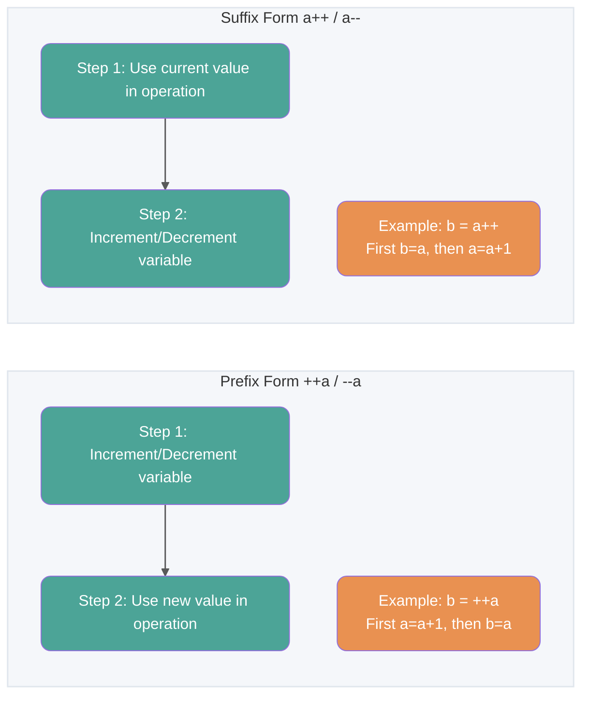
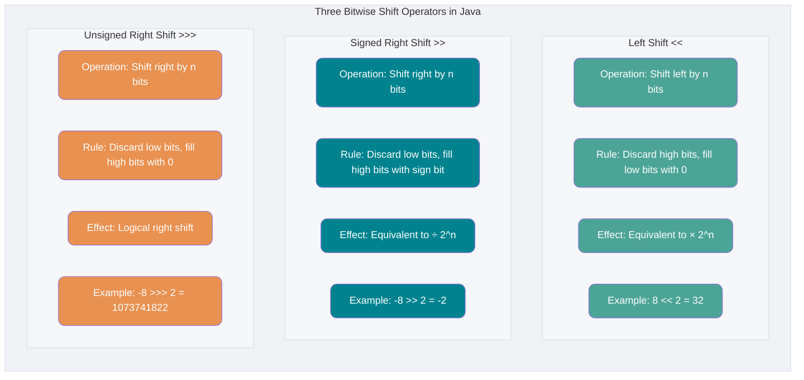
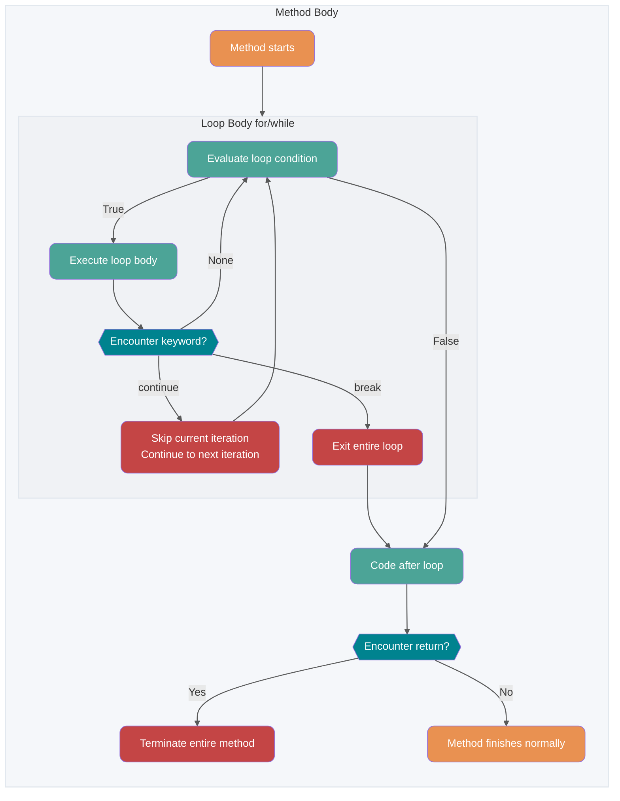
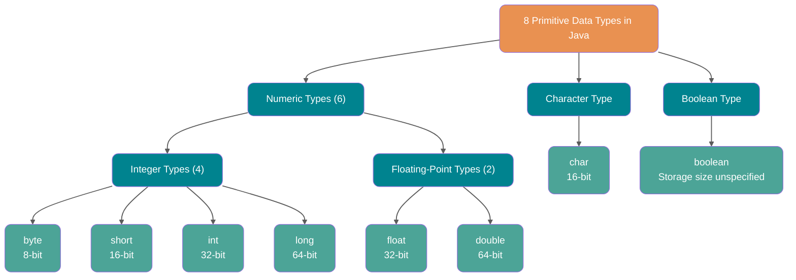
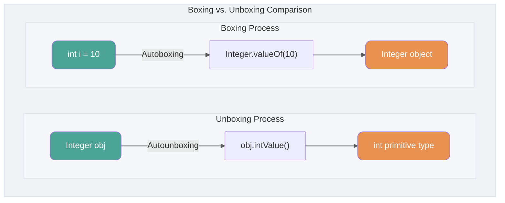

## Basic Concepts and Fundamentals

### What Are the Key Features of the Java Language?

1. Simple and easy to learn (clean syntax, easy to get started);
2. Object-Oriented (Encapsulation, Inheritance, Polymorphism);
3. Platform-independent (the Java Virtual Machine enables platform independence);
4. Supports multithreading (previously, C++ had no built-in multithreading mechanism and had to invoke the operating system's multithreading capabilities for concurrent programming, whereas Java provides built-in multithreading support);
5. Reliability (equipped with exception handling and automatic memory management mechanisms);
6. Security (the design of the Java language itself provides multiple layers of security protection, such as access modifiers and restricting programs from directly accessing operating system resources);
7. High efficiency (through optimizations such as the Just-In-Time compiler, Java's runtime efficiency is very solid);
8. Built-in and convenient support for network programming;
9. Hybrid of compilation and interpretation;
10. ……

> **🐛 Correction (see: [issue#544](https://github.com/Snailclimb/JavaGuide/issues/544))**: Starting from C++11 (back in 2011), C++ introduced a standard multithreading library; on Windows, Linux, and macOS, you can use `std::thread` and `std::async` to create threads. Reference link: <http://www.cplusplus.com/reference/thread/thread/?kw=thread>

🌈 Further thoughts:

The slogan "Write Once, Run Anywhere" is truly a classic and has been circulating for many years! Even today, many people still believe that cross-platform capability is Java's greatest advantage. In reality, cross-platform compatibility is no longer Java's biggest selling point, nor are the various new JDK features. Nowadays, virtualization technologies are already very mature—for example, you can easily achieve cross-platform portability with Docker. In my opinion, Java's powerful ecosystem is what truly stands out!

### Java SE vs Java EE

- Java SE (Java Platform, Standard Edition): The Standard Edition of the Java platform and the foundation of the Java programming language. It includes the core class libraries, the virtual machine, and other core components required to develop and run Java applications. Java SE can be used to build desktop applications or simple server applications.
- Java EE (Java Platform, Enterprise Edition): The Enterprise Edition of the Java platform. Built on top of Java SE, it includes standards and specifications for developing and deploying enterprise-grade applications (such as Servlet, JSP, EJB, JDBC, JPA, JTA, JavaMail, and JMS). Java EE can be used to build distributed, portable, robust, scalable, and secure server-side Java applications, such as web applications.

Simply put, Java SE is the foundational edition of Java, while Java EE is the advanced edition. Java SE is better suited for developing desktop applications or simple server applications, whereas Java EE is better suited for developing complex enterprise-grade applications or web applications.

In addition to Java SE and Java EE, there is Java ME (Java Platform, Micro Edition). Java ME is the Micro Edition of Java, primarily intended for developing applications on embedded consumer electronics devices, such as mobile phones, PDAs, set-top boxes, refrigerators, and air conditioners. There is no need to focus on Java ME—just knowing it exists is enough, as it is essentially no longer used today.

### ⭐️ JVM vs JDK vs JRE

#### JVM

The Java Virtual Machine (JVM) is the virtual machine that executes Java bytecode. The JVM has specific implementations for different operating systems (Windows, Linux, macOS) so that using the same bytecode produces the same results across platforms. Bytecode together with OS-specific JVM implementations is the key to Java's "Compile Once, Run Anywhere" capability.

As shown in the figure below, different programming languages (Java, Groovy, Kotlin, JRuby, Clojure, etc.) are compiled by their respective compilers into `.class` files and ultimately executed on different platforms (Windows, Mac, Linux) via the JVM.


**There is not just one JVM! Any company, organization, or individual can develop their own proprietary JVM as long as it conforms to the JVM specification.** In other words, the HotSpot VM we commonly encounter is merely one implementation of the JVM specification.

Besides the most widely used HotSpot VM, there are also J9 VM, Zing VM, JRockit VM, and others. Wikipedia has a comparison of common JVMs: [Comparison of Java virtual machines](https://en.wikipedia.org/wiki/Comparison_of_Java_virtual_machines), if you are interested in exploring further. Furthermore, you can find the JVM specification corresponding to each JDK version in the [Java SE Specifications](https://docs.oracle.com/javase/specs/index.html).


#### JDK and JRE

The JDK (Java Development Kit) is a full-featured Java development toolkit for developers to create and compile Java programs. It includes the JRE (Java Runtime Environment), the `javac` compiler, and other tools such as `javadoc` (documentation generator), `jdb` (debugger), `jconsole` (monitoring tool), and `javap` (disassembler).

The JRE is the environment required to run compiled Java programs, and it mainly consists of two parts:

1. **JVM**: The Java Virtual Machine mentioned above.
2. **Java Core Class Library**: A set of standard class libraries that provide commonly used functionality and APIs (such as I/O operations, network communication, data structures, etc.).

Simply put, the JRE only contains the runtime environment and class libraries needed to run Java programs, whereas the JDK includes not only the JRE, but also tools for developing and debugging Java programs.

If you need to write or compile Java programs or use the development tools bundled with the JDK, you must install the JDK. Certain applications that compile Java source code at runtime (such as converting JSP into Servlets) may also require the JDK. Java's core Reflection API belongs to the runtime class library, so using reflection itself does not require installing a full JDK.

The diagram below clearly illustrates the relationship between JDK, JRE, and JVM.


However, starting from JDK 9, it is no longer necessary to distinguish between the JDK and JRE; instead, there is the module system (the JDK was reorganized into 94 modules) + the [jlink](http://openjdk.java.net/jeps/282) tool (a new command-line tool released with Java 9 for generating custom Java runtime images containing only the modules required by a given application). Moreover, starting from JDK 11, Oracle no longer provides a separate JRE download.

In the article [Java 9 New Features Overview](https://javaguide.cn/java/new-features/java9.html), when introducing the module system, I noted:

> After introducing the module system, the JDK was reorganized into 94 modules. Java applications can use the newly added `jlink` tool to create a custom runtime image that contains only the JDK modules they depend on. This can greatly reduce the size of the Java runtime environment.

In other words, you can use `jlink` to create a smaller runtime tailored to your needs, rather than shipping the exact same full JRE for every application.

A customized, modular Java runtime image helps simplify Java application deployment, save memory, and enhance security and maintainability. This is very important for meeting the demands of modern application architectures such as virtualization, containerization, microservices, and cloud-native development.

### ⭐️ What Is Bytecode? What Are the Benefits of Using Bytecode?

In Java, the code that the JVM can understand is called bytecode (files with the `.class` extension). It targets no specific processor—only the virtual machine. By using bytecode, Java mitigates the low execution efficiency of traditional interpreted languages to a certain extent while preserving their portability. Therefore, Java programs run relatively efficiently (though there is still a gap compared to languages like C, C++, Rust, and Go), and because bytecode does not target a specific machine, Java programs can run on computers with many different operating systems without recompilation.

**The process of a Java program from source code to execution is illustrated below**:


We need to pay special attention to the `.class -> machine code` step. Taking HotSpot as an example, after loading bytecode, the JVM can first execute it via interpretation and identify frequently invoked methods and code blocks (hot spots), after which the **JIT (Just-In-Time Compilation)** compiler compiles the hot bytecode into machine code. On subsequent executions of this code within the current JVM process, the compiled machine code can be used directly. This also explains why we often say **Java is a language where compilation and interpretation coexist**. However, the JVM specification does not mandate that a concrete implementation must include an interpreter or a JIT compiler.

> 🌈 Further Reading:
>
> - [Fundamentals | Analysis and Practice of Java Just-In-Time Compiler Principles - Meituan Tech Team](https://mp.weixin.qq.com/s/7PH8o1tbjLsM4-nOnjbwLw)
> - [Building Microservice Applications Based on Static Compilation - Alibaba Middleware](https://mp.weixin.qq.com/s/4haTyXUmh8m-dBQaEzwDJw)


> HotSpot adopts Lazy Evaluation: according to the 80/20 rule, only a small portion of code (hot code) consumes most of the system resources, and that is the part JIT needs to compile. The JVM collects profiling information each time code executes and makes optimizations accordingly, so the more times it runs, the faster it becomes.

The relationship among JDK, JRE, JVM, and JIT is shown in the diagram below.


The diagram below shows a high-level structural model of the JVM.


### ⭐️ Why Do People Say Java Combines "Compilation and Interpretation"?

Actually, we already touched on this question when discussing bytecode, and since it is quite important, let's revisit it here.

High-level programming languages can be divided into two categories based on how programs are executed:

- **Compiled**: [Compiled languages](https://zh.wikipedia.org/wiki/%E7%B7%A8%E8%AD%AF%E8%AA%9E%E8%A8%80) use a [compiler](https://zh.wikipedia.org/wiki/%E7%B7%A8%E8%AD%AF%E5%99%A8) to translate source code in one pass into machine code executable by the target platform. Generally, compiled languages execute faster but have lower development efficiency. Common compiled languages include C, C++, Go, Rust, etc.
- **Interpreted**: [Interpreted languages](https://zh.wikipedia.org/wiki/%E7%9B%B4%E8%AD%AF%E8%AA%9E%E8%A8%80) use an [interpreter](https://zh.wikipedia.org/wiki/%E7%9B%B4%E8%AD%AF%E5%99%A8) to interpret code line by line into machine code before executing it. Interpreted languages offer faster development efficiency but slower execution speed. Common interpreted languages include Python, JavaScript, PHP, etc.


According to Wikipedia:

> [Just-in-time compilation](https://zh.wikipedia.org/wiki/%E5%8D%B3%E6%99%82%E7%B7%A8%E8%AD%AF), developed to improve the efficiency of interpreted languages, has narrowed the gap between these two types of languages. This technique blends the advantages of compiled and interpreted languages: like a compiled language, it first compiles program source code into [bytecode](https://zh.wikipedia.org/wiki/%E5%AD%97%E8%8A%82%E7%A0%81), and at execution time, it translates and executes that bytecode. [Java](https://zh.wikipedia.org/wiki/Java) and [LLVM](https://zh.wikipedia.org/wiki/LLVM) are representative products of this technique.
>
> Related reading: [Fundamentals | Analysis and Practice of Java Just-In-Time Compiler Principles](https://mp.weixin.qq.com/s/7PH8o1tbjLsM4-nOnjbwLw)

**Why do people say Java combines "compilation and interpretation"?**

Because common Java implementations use both compilation and interpretation techniques: Java source code is first compiled into bytecode (`.class` files), and the bytecode can be executed via interpretation by the JVM or compiled into machine code at runtime by JIT. Bytecode is not strictly required to be executed by an interpreter; the exact execution strategy is determined by the JVM implementation.

### What Are the Advantages of AOT? Why Not Use AOT Exclusively?

JDK 9 once introduced an experimental AOT (Ahead-of-Time Compilation) tool, `jaotc`, via JEP 295, but it was removed in JDK 17. Therefore, JDK 17 and later standard JDKs no longer include this built-in AOT compiler; the discussion below addresses AOT in general as well as standalone toolchains such as GraalVM Native Image (Native Image is an AOT technology provided by GraalVM, which we will introduce further below). Unlike JIT, AOT compiles code into machine code before program execution, which reduces runtime warm-up overhead and improves startup speed, though exact memory footprint, peak performance, and suitable use cases depend on the specific AOT implementation and application workload.

The comparison below uses common HotSpot JIT and GraalVM Native Image as examples. Different AOT tools vary in implementation, and actual behavior is also affected by build flags, application workload, and whether PGO (Profile-Guided Optimization, using profiling data collected from actual program runs to assist optimization) is enabled.

| Comparison Dimension         | JIT (Just-In-Time Compilation)                                            | AOT (Ahead-of-Time Compilation)                                                             |
| ---------------------------- | ------------------------------------------------------------------------- | ------------------------------------------------------------------------------------------- |
| **Compilation Timing**       | Compiled at runtime based on code execution                               | Compiled ahead of time during the build phase                                               |
| **Startup & Warm-up**        | Typically requires interpretation and hot-code compilation after startup  | Typically starts up faster without waiting for JIT warm-up                                  |
| **Long-Running Performance** | Continuously optimizes hot code using profiling data collected at runtime | Lacks full runtime profiling info; exact performance depends on implementation & build config |
| **Runtime Memory**           | Needs to store the compiler, profiling data, and generated machine code   | Implementations like Native Image typically consume less runtime memory                     |
| **Runtime Dependencies**     | Requires the JVM and corresponding runtime                                | Native Image can produce standalone native executables                                      |
| **Dynamic Features**         | Supports runtime class loading, reflection, and bytecode generation       | Closed-world analysis tools typically require metadata or build-time processing             |
| **Common Scenarios**         | Long-running services prioritizing sustained throughput                   | CLI tools, Serverless, elastic scaling, and cold-start-sensitive services                   |


The advantages of AOT mainly lie in startup speed and runtime memory usage, making it well suited for applications with frequent cold starts, short instance lifecycles, or rapid scaling requirements. JIT, on the other hand, optimizes hot code based on profiling data gathered at runtime, so long-running services usually benefit more easily from it. Throughput and latency performance for either approach cannot be judged solely by the compilation mode—they must be evaluated alongside specific toolchains and real workload benchmarks.

Speaking of AOT, we have to mention [GraalVM](https://www.graalvm.org/)! GraalVM is a high-performance JDK (a complete JDK distribution) that can run Java and other JVM languages, as well as non-JVM languages like JavaScript and Python. GraalVM provides both AOT compilation and JIT compilation. Interested readers can check out the official GraalVM documentation: <https://www.graalvm.org/latest/docs/>. If the official docs feel hard to follow at first, you can also look at articles such as:

- [Building Microservice Applications Based on Static Compilation](https://mp.weixin.qq.com/s/4haTyXUmh8m-dBQaEzwDJw)
- [Moving Toward Native: Spring & Dubbo AOT Examples and Principle Explanation](https://cn.dubbo.apache.org/zh-cn/blog/2023/06/28/%e8%b5%b0%e5%90%91-native-%e5%8c%96springdubbo-aot-%e6%8a%80%e6%9c%af%e7%a4%ba%e4%be%8b%e4%b8%8e%e5%8e%9f%e7%90%86%e8%ae%b2%e8%a7%a3/)

**Since AOT has so many advantages, why not use this compilation mode for everything?**

Taking GraalVM Native Image as an example, it performs closed-world analysis when building a native executable: starting from the program entry point, the builder analyzes which classes, methods, and fields may be accessed at runtime, and includes only reachable code and necessary metadata in the final artifact. The program can still accept dynamic input and create objects; however, code completely unknown at build time will not automatically be included in the analysis results.

In the code snippet below, the class name comes from a runtime argument, so the builder cannot determine which classes to retain through static call-graph analysis alone:

```java
String className = args[0];
Class<?> clazz = Class.forName(className);
Object instance = clazz.getDeclaredConstructor().newInstance();
```

Reflection, dynamic proxies, and JNI can still be used in Native Image. For dynamic accesses that static analysis cannot infer, [reachability metadata](https://www.graalvm.org/latest/reference-manual/native-image/metadata/) is usually needed to declare in advance the classes, methods, fields, proxy interfaces, and JNI elements that may be accessed at runtime. Dynamically loading unknown classes or generating and loading new bytecode at runtime faces stricter limitations because the relevant code does not exist at build time.

Spring uses AOT processing to adapt to this execution model. During the build phase, it analyzes the application context and generates Java source code, proxy bytecode, and the `RuntimeHints` needed for reflection, resources, and proxies. CGLIB typically relies on ASM to generate proxy classes at runtime; in a Native Image scenario, this work can be shifted ahead to the build phase. Once a framework or application provides the appropriate build-time adaptation, Spring, CGLIB, and ASM can still participate in building and running AOT applications. For details on this mechanism, refer to the [official Spring AOT documentation](https://docs.spring.io/spring-framework/reference/core/aot.html).

AOT shifts some runtime work and information into the build phase, while increasing build time, metadata maintenance, and compatibility adaptation costs. For applications that rely on runtime dynamic loading, Java Agents, or extensive runtime bytecode generation, JIT mode is generally more convenient; for applications sensitive to cold starts and memory footprint, AOT is more attractive.

### Oracle JDK vs OpenJDK

Many people, like I used to, may not have encountered or used OpenJDK before reading about this question. So are there major differences between Oracle JDK and OpenJDK? Based on gathered materials, let's clarify this often-overlooked topic.

First, in 2006 Sun Microsystems open-sourced Java, giving birth to OpenJDK. In 2009 Oracle acquired Sun Microsystems and built Oracle JDK on top of OpenJDK. Oracle JDK is not open source, and early versions (Java 8 ~ Java 11) also included certain proprietary features and tools compared to OpenJDK.

Second, as far as Java 7 was concerned, OpenJDK and Oracle JDK were very close. Oracle JDK was built on OpenJDK 7 with only a few minor additions, maintained with the involvement of Oracle engineers.

The excerpt below is taken from an official Oracle blog post published in 2012:

> Q: What is the difference between the source code in the OpenJDK repository and the code used to build the Oracle JDK?
>
> A: Very close—our Oracle JDK build process is based on OpenJDK 7 with just a few parts added, such as deployment code including Oracle's Java Plugin and Java WebStart implementations, some closed-source third-party components like a graphics rasterizer, some open-source third-party components like Rhino, and bits and pieces like additional documentation or third-party fonts. Going forward, our goal is to open source all parts of the Oracle JDK except for the parts we consider commercial features.

Finally, let's briefly summarize the differences between Oracle JDK and OpenJDK:

1. **Open-source status**: OpenJDK is a reference implementation and is completely open source, whereas Oracle JDK is built on top of OpenJDK and is not fully open source (Personal view: as is well known, the JDK was originally developed by Sun Microsystems, which was later sold to Oracle. Oracle is famous for its Oracle Database, which is closed source, so Oracle didn't want to keep Java completely open source—yet Sun had already open-sourced the JDK. If Oracle had closed the source immediately after acquiring Sun, it would inevitably have caused widespread dissatisfaction among Java developers and eroded confidence in Java, leaving Oracle holding a stagnant asset! So Oracle came up with a clever approach: open-source part of the core code for the community to use, distinguish it under the name OpenJDK while naming its own release Oracle JDK—you play with yours, I release mine, and if the community creates something great, Oracle can adopt it in future Oracle JDK releases too. Win-win!). OpenJDK open-source repository: [https://github.com/openjdk/jdk](https://github.com/openjdk/jdk).
2. **Free-to-use status**: Oracle JDK licensing depends on the specific version and update release. Specific updates of Oracle JDK 21 and later allow free use—including commercial production—during the NFTC (No-Fee Terms and Conditions) validity period; for instance, Oracle plans to apply NFTC to JDK 21 updates until September 2026 and to JDK 25 updates until September 2028. When the free period ends, the license changes only for subsequent updates; previously downloaded versions remain governed by the license in effect when they were downloaded. Oracle's OpenJDK builds use GPLv2 + Classpath Exception.
3. **Functionality**: Oracle JDK added proprietary features and tools on top of OpenJDK, such as Java Flight Recorder (JFR, a monitoring tool) and Java Mission Control (JMC, a monitoring tool). However, after Java 11, the functionality of Oracle JDK and OpenJDK is essentially identical, as most of the previously proprietary components in Oracle JDK were contributed to the open-source community.
4. **Long-Term Support (LTS)**: The OpenJDK project itself does not commit to commercial LTS services; Oracle and multiple OpenJDK distribution vendors provide long-term support for specific versions. Java 8, 11, 17, 21, and 25 are Oracle LTS releases, and Oracle plans to release a new LTS version every two years.
5. **Licensing agreements**: The license for Oracle JDK varies by version and update release and may be NFTC or OTN; BCL only applied to releases published prior to April 16, 2019. Oracle OpenJDK uses GPLv2 + Classpath Exception.

> If Oracle JDK is so good, why do we still need OpenJDK?
>
> Answer:
>
> 1. OpenJDK is open source, which means you can modify and optimize it according to your own needs—for example, Alibaba developed Dragonwell8 based on OpenJDK: [https://github.com/alibaba/dragonwell8](https://github.com/alibaba/dragonwell8)
> 2. OpenJDK is free for commercial use (which is also why the default JDK installed via the `yum` package manager is OpenJDK rather than Oracle JDK). Although certain Oracle JDK versions are also free for commercial use (such as JDK 8), not all versions are free.
> 3. Feature releases of both OpenJDK and Oracle JDK follow a six-month release cadence; update and support lifecycles may vary across distributions.
>
> For these reasons, OpenJDK definitely has a reason to exist!


**How should you choose between Oracle JDK and OpenJDK?**

It is recommended to choose OpenJDK or an OpenJDK-based distribution, such as AWS's Amazon Corretto or Alibaba's Alibaba Dragonwell.

🌈 Further details:

- BCL License (Oracle Binary Code License Agreement): Allows using the JDK (including commercial use), but prohibits modification.
- OTN License (Oracle Technology Network License Agreement): Used by newly released JDKs starting from Java 11; free for personal use, but requires a paid license for commercial use.

### What Are the Differences Between Java and C++?

I know many people haven't learned C++, yet interviewers still love comparing Java with C++! Nothing we can do about it—even if you haven't studied C++, you still need to remember these points.

Although both Java and C++ are object-oriented languages that support Encapsulation, Inheritance, and Polymorphism, they still have quite a few differences:

- Java does not provide pointers for direct memory access, making program memory safer.
- Java classes support single inheritance, whereas C++ supports multiple inheritance; although Java classes cannot have multiple inheritance, Java interfaces can extend multiple interfaces.
- Java has an automatic memory management Garbage Collection (GC) mechanism, so programmers do not need to manually free unused memory.
- C++ supports both method overloading and operator overloading, whereas Java only supports method overloading (operator overloading increases complexity, which goes against Java's original design philosophy).
- ……

## Basic Syntax

### What Types of Comments Exist in Java?

There are three types of comments in Java:

1. **Single-line comment**: Typically used to explain the purpose of a single line of code inside a method.

2. **Multi-line comment**: Typically used to explain the purpose of a block of code.

3. **Documentation comment (Javadoc)**: Typically used to generate Java developer documentation.

Single-line comments and documentation comments are the most commonly used; multi-line comments are used relatively less in real-world development.


When writing code, if the codebase is small, we or our teammates can easily understand it; however, once a project structure becomes complex, comments become necessary. Comments are never executed (the compiler strips all comments before compiling code, and comments are not retained in bytecode). They are written by programmers for themselves and other readers—serving as an instruction manual for your code that helps readers quickly clarify the logical relationships in the codebase. Therefore, adding comments as you write programs is a very good habit.

The book *Clean Code* clearly states:

> **More detailed comments are not necessarily better. In fact, good code is self-documenting; we should strive to standardize and clean up our code to reduce unnecessary comments.**
>
> **If a programming language is expressive enough, comments are unnecessary—strive to explain intent through the code itself.**
>
> For example:
>
> Instead of the complicated comment below, simply create a function named after what the comment describes:
>
> ```java
> // check to see if the employee is eligible for full benefits
> if ((employee.flags & HOURLY_FLAG) && (employee.age > 65))
> ```
>
> Should be replaced with:
>
> ```java
> if (employee.isEligibleForFullBenefits())
> ```

### What Is the Difference Between Identifiers and Keywords?

When writing programs, we need to name a huge number of programs, classes, variables, methods, etc.—which gives rise to **identifiers**. Simply put, **an identifier is a name**.

There are certain identifiers to which the Java language has already assigned special meanings and which can only be used in specific contexts; these special identifiers are **keywords**. Simply put, **keywords are identifiers endowed with special meanings**. For instance, in daily life, if we want to open a shop, we give the shop a name—that "name" is an identifier. However, we cannot name our shop "Police Station", because "Police Station" has already been assigned a special meaning, making "Police Station" a keyword in daily life.

### What Are the Keywords in Java?

| Category                       | Keywords  |            |          |              |            |           |        |
| :----------------------------- | --------- | ---------- | -------- | ------------ | ---------- | --------- | ------ |
| Access Control                 | private   | protected  | public   |              |            |           |        |
| Class, Method & Var Modifiers  | abstract  | class      | extends  | final        | implements | interface | native |
|                                | new       | static     | strictfp | synchronized | transient  | volatile  | enum   |
| Program Control                | break     | continue   | return   | do           | while      | if        | else   |
|                                | for       | instanceof | switch   | case         | default    | assert    |        |
| Error Handling                 | try       | catch      | throw    | throws       | finally    |           |        |
| Package Related                | import    | package    |          |              |            |           |        |
| Primitive Types                | boolean   | byte       | char     | double       | float      | int       | long   |
|                                | short     |            |          |              |            |           |        |
| Variable References            | super     | this       | void     |              |            |           |        |
| Reserved Words                 | goto      | const      |          |              |            |           |        |

> Tips: All keywords are lowercase and are highlighted in a special color in IDEs.
>
> The `default` keyword is very special: it belongs to program control, to class/method/variable modifiers, and also to access control.
>
> - In program control, when none of the cases match in a `switch` statement, `default` is used to write the default branch.
> - In class, method, and variable modifiers, starting with JDK 8, default methods were introduced, allowing the `default` keyword to define a default implementation for an interface method.
> - In access control, if a member has no explicit modifier before it, it implicitly has package-private (`default`) access—however, explicitly writing the keyword `default` as an access modifier causes a compile error.

⚠️ Note: Although `true`, `false`, and `null` look like keywords, they are actually literals, and you cannot use them as identifiers either.

Official documentation: [https://docs.oracle.com/javase/tutorial/java/nutsandbolts/\_keywords.html](https://docs.oracle.com/javase/tutorial/java/nutsandbolts/_keywords.html)

### ⭐️ Increment and Decrement Operators

While writing code, a common scenario is needing to increase or decrease an integer variable by 1. Java provides the increment operator (`++`) and decrement operator (`--`) to simplify this operation.

The `++` and `--` operators can be placed either before or after a variable:

- **Prefix form** (e.g., `++a` or `--a`): First increments/decrements the variable's value, then uses the variable. For example, `b = ++a` first increments `a` by 1, then assigns the incremented value to `b`.
- **Suffix (postfix) form** (e.g., `a++` or `a--`): First uses the variable's current value, then increments/decrements the variable's value. For example, `b = a++` first assigns the current value of `a` to `b`, then increments `a` by 1.

To remember this easily, use the rule of thumb: **sign before means add/subtract first; sign after means add/subtract later**.



Let's look at a high-frequency written exam question testing increment/decrement operators: after executing the code below, what are the values of `a`, `b`, `c`, `d`, and `e`?

```java
int a = 9;
int b = a++;
int c = ++a;
int d = c--;
int e = --d;
```

Answer: `a = 11`, `b = 9`, `c = 11`, `d = 10`, `e = 10`.

### ⭐️ Bitwise Shift Operators

Bitwise shift operators are among the most fundamental operators and exist in almost every programming language. In a shift operation, the data being operated on is treated as a binary number, and shifting moves its bits left or right by a specified number of positions.

Shift operators are widely used across frameworks and within the JDK source code itself. For example, the `hash` method in `HashMap` (JDK 1.8) uses a shift operator:

```java
static final int hash(Object key) {
    int h;
    // key.hashCode(): returns the hash value, i.e., hashcode
    // ^: bitwise XOR
    // >>>: unsigned right shift, ignoring the sign bit and filling vacated bits with 0
    return (key == null) ? 0 : (h = key.hashCode()) ^ (h >>> 16);
  }

```

**Main reasons for using bitwise shift operators**:

1. **High efficiency**: Shift operators map directly to processor shift instructions. Modern processors have dedicated hardware instructions to execute these shifts, usually completing within a single clock cycle. By comparison, arithmetic operations like multiplication and division require more clock cycles at the hardware level.
2. **Memory savings**: Through bit shifting, a single integer (such as `int` or `long`) can store multiple boolean values or flags, thereby saving memory.

Shift operators are most commonly used for fast multiplication or division by powers of 2. Beyond that, they also play important roles in:

- **Bit-field management**: Such as storing and manipulating multiple boolean flags.
- **Hashing algorithms and encryption/decryption**: Scrambling data through shifts combined with AND, OR, and similar bitwise operations.
- **Data compression**: For example, Huffman coding can quickly process and manipulate binary data via shift operators to produce compact compressed formats.
- **Data verification**: For example, CRC (Cyclic Redundancy Check) generates and verifies data integrity via shifts and polynomial division.
- **Memory alignment**: Bitwise shift operations make it easy to compute and adjust memory-aligned addresses.

Mastering the fundamentals of shift operators is essential—not only does it help us use them in our own code, it also helps us understand source code that relies on shift operators.



Java has three bitwise shift operators:

- `<<`: Left shift operator; shifts left by a specified number of bits, discarding high bits and filling low bits with zeros. `x << n` is equivalent to `x` multiplied by $2^n$ (provided there is no overflow).
- `>>`: Signed right shift operator; shifts right by a specified number of bits, filling high bits with the sign bit and discarding low bits. Positive numbers fill high bits with `0`; negative numbers fill high bits with `1`. `x >> n` is equivalent to `x` divided by $2^n$.
- `>>>`: Unsigned right shift operator; ignores the sign bit and fills all vacated high bits with `0`.

Although shift operations can fundamentally be divided into left shifts and right shifts, in practice right-shift operations must account for how the sign bit is handled.

Because `double` and `float` have special binary representations, shift operations cannot be performed on them.

The only types actually supported by shift operators are `int` and `long`; before shifting `short`, `byte`, or `char` values, the compiler promotes them to `int`.

**What happens if the shift distance exceeds the number of bits occupied by the numeric value?**

When an `int` is left-shifted or right-shifted by 32 or more bits, the shift distance is first reduced modulo (`%`) 32 before the shift is performed. That is, shifting by 32 bits is equivalent to no shift at all (`32 % 32 = 0`), and shifting by 42 bits is equivalent to shifting by 10 bits (`42 % 32 = 10`). When a `long` is shifted left or right, since `long` occupies 64 bits in binary, the modulus becomes 64.

In other words: `x<<42` is equivalent to `x<<10`, `x>>42` is equivalent to `x>>10`, and `x >>>42` is equivalent to `x >>> 10`.

**Left shift operator code example**:

```java
int i = -1;
System.out.println("初始数据：" + i);
System.out.println("初始数据对应的二进制字符串：" + Integer.toBinaryString(i));
i <<= 10;
System.out.println("左移 10 位后的数据 " + i);
System.out.println("左移 10 位后的数据对应的二进制字符 " + Integer.toBinaryString(i));
```

Output:

```plain
初始数据：-1
初始数据对应的二进制字符串：11111111111111111111111111111111
左移 10 位后的数据 -1024
左移 10 位后的数据对应的二进制字符 11111111111111111111110000000000
```

Because shifting left by 32 or more bits applies the modulo (`%`) operation first, shifting left by 42 bits in the code below is equivalent to shifting left by 10 bits (`42 % 32 = 10`), producing the exact same output as the previous code.

```java
int i = -1;
System.out.println("初始数据：" + i);
System.out.println("初始数据对应的二进制字符串：" + Integer.toBinaryString(i));
i <<= 42;
System.out.println("左移 10 位后的数据 " + i);
System.out.println("左移 10 位后的数据对应的二进制字符 " + Integer.toBinaryString(i));
```

Right-shift operators work similarly; for brevity, they are not demonstrated here.

### What Is the Difference Among `continue`, `break`, and `return`?

In loop structures, when the loop condition is no longer satisfied or the required number of iterations is reached, the loop terminates normally. However, sometimes we need to terminate the current iteration or the entire loop early when a certain condition occurs inside the loop, which requires the following keywords:

1. `continue`: Skips the remainder of the current iteration and proceeds directly to the next iteration of the loop.
2. `break`: Breaks out of the entire loop body and continues executing the statements following the loop.

`return` is used to exit the enclosing method and end its execution. `return` generally has two forms:

1. `return;`: Directly ends method execution, used in methods with no return value (`void`).
2. `return value;`: Returns a specific value, used in methods that declare a return type.



Think about it: what is the output of the following code?

```java
public static void main(String[] args) {
    boolean flag = false;
    for (int i = 0; i <= 3; i++) {
        if (i == 0) {
            System.out.println("0");
        } else if (i == 1) {
            System.out.println("1");
            continue;
        } else if (i == 2) {
            System.out.println("2");
            flag = true;
        } else if (i == 3) {
            System.out.println("3");
            break;
        } else if (i == 4) {
            System.out.println("4");
        }
        System.out.println("xixi");
    }
    if (flag) {
        System.out.println("haha");
        return;
    }
    System.out.println("heihei");
}
```

Output:

```plain
0
xixi
1
2
xixi
3
haha
```

## ⭐️ Primitive Data Types

### Do You Know the Primitive Data Types in Java?

Java has 8 primitive data types:

- 6 numeric types:
  - 4 integer types: `byte`, `short`, `int`, `long`
  - 2 floating-point types: `float`, `double`
- 1 character type: `char`
- 1 boolean type: `boolean`



The default values and storage sizes of these 8 primitive data types are as follows:

| Primitive Type | Bits        | Bytes       | Default Value | Value Range                                                                                                          |
| :------------- | :---------- | :---------- | :------------ | -------------------------------------------------------------------------------------------------------------------- |
| `byte`         | 8           | 1           | 0             | -128 ~ 127                                                                                                           |
| `short`        | 16          | 2           | 0             | -32768 (-2^15) ~ 32767 (2^15 - 1)                                                                                    |
| `int`          | 32          | 4           | 0             | -2147483648 ~ 2147483647                                                                                             |
| `long`         | 64          | 8           | 0L            | -9223372036854775808 (-2^63) ~ 9223372036854775807 (2^63 - 1)                                                        |
| `char`         | 16          | 2           | '\u0000'      | 0 ~ 65535 (2^16 - 1)                                                                                                 |
| `float`        | 32          | 4           | 0f            | Approx. -3.4028235E38 ~ 3.4028235E38, smallest positive nonzero approx. 1.4E-45, plus ±0, ±∞, NaN                    |
| `double`       | 64          | 8           | 0d            | Approx. -1.7976931348623157E308 ~ 1.7976931348623157E308, smallest positive nonzero approx. 4.9E-324, plus ±0, ±∞, NaN |
| `boolean`      | Unspecified | Unspecified | false         | true, false                                                                                                          |

Notice that for `byte`, `short`, `int`, and `long`, the maximum representable positive integer is 1 less than the power of 2. Why is that? Because in two's complement binary representation, the most significant bit represents the sign (`0` for positive, `1` for negative), while the remaining bits represent the magnitude. Therefore, to represent the largest positive integer, all bits except the sign bit must be set to `1`. Adding `1` more causes an overflow and turns it into a negative number.

As for `boolean`, the official specification leaves its exact size undefined; it depends on the specific JVM vendor implementation. Logically it represents 1 bit, though in practice efficient computer storage factors are taken into account.

Furthermore, the storage size of each primitive type in Java does not vary across machine hardware architectures the way it does in most other languages. This invariance in the storage size of primitive types is one of the reasons Java programs are more portable than programs written in most other languages (mentioned in *Thinking in Java*, Section 2.2).

**Note:**

1. Integer literals are parsed as `int` by default; when a value exceeds the `int` range or you need to write a `long` literal explicitly, append **L** after the number. An `int` literal that can be represented via assignment conversion can be assigned directly to `long`, e.g., `long n = 1;`.
2. Floating-point literals with a decimal point or exponent are `double` by default, so assigning them to `float` usually requires appending **f or F**; integer literals can be assigned directly to `float` when convertible, e.g., `float n = 1;`.
3. `char a = 'h'` (`char`: single quotes), `String a = "hello"` (double quotes).

All eight primitive types have corresponding wrapper classes: `Byte`, `Short`, `Integer`, `Long`, `Float`, `Double`, `Character`, and `Boolean`.

### What Are the Differences Between Primitive Types and Wrapper Types?

- **Usage**: Apart from defining constants and local variables, we rarely use primitive types in places like method parameters or object fields. Moreover, wrapper types can be used with generics, whereas primitive types cannot.
- **Storage**: Local variables of primitive types are stored in the local variable table of the current stack frame, while instance fields of primitive types are part of an object's state. Wrapper types are object types whose instances are usually allocated on the Heap, though JIT may eliminate actual allocation via escape analysis and scalar replacement.
- **Memory footprint**: Compared to wrapper types (object types), primitive types typically occupy very little space.
- **Default values**: Unassigned wrapper-type member variables default to `null`, whereas primitive types have non-`null` default values.
- **Comparison**: For primitive types, `==` compares values. For wrapper types, `==` compares whether two references point to the same object (or are both `null`). Comparing the numeric values represented by wrapper objects generally uses `equals()` or the corresponding `compare()`/`compareTo()` methods.

**Why do we say object instances usually reside on the Heap?** The JVM specification defines the Heap as the runtime data area where class instances and arrays are allocated. However, JIT can eliminate the actual allocation of certain objects via escape analysis and scalar replacement, which is not the same as allocating whole objects onto the Stack.

⚠️ Note: **Saying that "primitive data types are stored on the Stack" is a common misconception!** Where a primitive variable is stored depends on the kind of variable: local variables are stored in the local variable table of a stack frame; instance fields are part of the object on the Heap; static fields belong to the class and their exact storage mechanism is determined by the JVM implementation—you cannot broadly claim they live in the Method Area or Metaspace.

```java
public class Test {
    // Member variable, stored in the Heap
    int a = 10;
    // Storage of static fields is a JVM implementation detail; in HotSpot on JDK 8+, it resides in the Java Heap.
    // The variable belongs to the class, not an instance.
    static int b = 20;

    public void method() {
        // Local variable, stored on the Stack
        int c = 30;
        static int d = 40; // Compile error: static cannot be used on local variables inside a method
    }
}
```

### Do You Know the Caching Mechanism of Wrapper Classes?

Most wrapper classes for Java's primitive data types use a caching mechanism to improve performance.

The four wrapper classes `Byte`, `Short`, `Integer`, and `Long` create cached objects for values in the range **[-128, 127]** by default; `Character` creates cached objects for values in the range **[0, 127]**; and `Boolean` directly returns `TRUE` or `FALSE`.

For `Integer`, you can modify the upper cache bound via the JVM flag `-XX:AutoBoxCacheMax=<size>`, though the lower bound of -128 cannot be modified. In practice, it is not recommended to set an excessively large value, so as to avoid wasting memory or even causing an Out of Memory (OOM) error.

For `Byte`, `Short`, `Long`, and `Character`, there is no flag similar to `-XX:AutoBoxCacheMax` to adjust them, so their cache ranges are fixed and cannot be tuned via JVM options. `Boolean` directly returns the predefined `TRUE` and `FALSE` instances and has no concept of a cache range.

**`Integer` cache source code:**

```java
public static Integer valueOf(int i) {
    if (i >= IntegerCache.low && i <= IntegerCache.high)
        return IntegerCache.cache[i + (-IntegerCache.low)];
    return new Integer(i);
}
private static class IntegerCache {
    static final int low = -128;
    static final int high;
    static {
        // high value may be configured by property
        int h = 127;
    }
}
```

**`Character` cache source code:**

```java
public static Character valueOf(char c) {
    if (c <= 127) { // must cache
      return CharacterCache.cache[(int)c];
    }
    return new Character(c);
}

private static class CharacterCache {
    private CharacterCache(){}
    static final Character cache[] = new Character[127 + 1];
    static {
        for (int i = 0; i < cache.length; i++)
            cache[i] = new Character((char)i);
    }

}
```

**`Boolean` cache source code:**

```java
public static Boolean valueOf(boolean b) {
    return (b ? TRUE : FALSE);
}
```

If a value falls outside the corresponding range, a new object will still be created; the size of the cache range is simply a trade-off between performance and resources.

The two floating-point wrapper classes `Float` and `Double` do not implement a caching mechanism.

```java
Integer i1 = 33;
Integer i2 = 33;
System.out.println(i1 == i2);// prints true

Float i11 = 333f;
Float i22 = 333f;
System.out.println(i11 == i22);// prints false

Double i3 = 1.2;
Double i4 = 1.2;
System.out.println(i3 == i4);// prints false
```

Now let's look at a question: does the following code print `true` or `false`?

```java
Integer i1 = 40;
Integer i2 = new Integer(40);
System.out.println(i1==i2);
```

In the line `Integer i1=40`, autoboxing occurs, meaning this line is equivalent to `Integer i1=Integer.valueOf(40)`. Therefore, `i1` directly reuses the object from the cache. Meanwhile, `Integer i2 = new Integer(40)` directly creates a new object.

Thus, the answer is `false`. Did you get it right?

Remember: **for all value comparisons between integer wrapper objects, always use the `equals` method**.


### Do You Understand Autoboxing and Unboxing? What Is the Underlying Principle?

**What are autoboxing and unboxing?**

- **Boxing**: Wrapping a primitive type in its corresponding reference (wrapper) type;
- **Unboxing**: Converting a wrapper type back into its primitive data type;



Example:

```java
Integer i = 10;  // boxing
int n = i;   // unboxing
```

The bytecode corresponding to those two lines is:

```java
   L1

    LINENUMBER 8 L1

    ALOAD 0

    BIPUSH 10

    INVOKESTATIC java/lang/Integer.valueOf (I)Ljava/lang/Integer;

    PUTFIELD AutoBoxTest.i : Ljava/lang/Integer;

   L2

    LINENUMBER 9 L2

    ALOAD 0

    ALOAD 0

    GETFIELD AutoBoxTest.i : Ljava/lang/Integer;

    INVOKEVIRTUAL java/lang/Integer.intValue ()I

    PUTFIELD AutoBoxTest.n : I

    RETURN
```

From the bytecode, we can see that boxing simply calls the wrapper class's `valueOf()` method, while unboxing simply calls its `xxxValue()` method.

Therefore,

- `Integer i = 10` is equivalent to `Integer i = Integer.valueOf(10)`
- `int n = i` is equivalent to `int n = i.intValue()`;

Note: **Frequent boxing and unboxing can severely impact system performance. We should avoid unnecessary boxing and unboxing operations whenever possible.**

```java
private static long sum() {
    // Should use long instead of Long
    Long sum = 0L;
    for (long i = 0; i <= Integer.MAX_VALUE; i++)
        sum += i;
    return sum;
}
```

### Why Does Floating-Point Arithmetic Carry the Risk of Precision Loss?

Code demonstration of floating-point arithmetic precision loss:

```java
float a = 2.0f - 1.9f;
float b = 1.8f - 1.7f;
System.out.printf("%.9f",a);// 0.100000024
System.out.println(b);// 0.099999905
System.out.println(a == b);// false
```

**Why does this problem happen?**

This has a lot to do with how computers store floating-point numbers. Computers represent `float` and `double` using binary formats with finite bit widths; many decimal fractions become infinitely repeating fractions when converted to binary and must be rounded to a finite number of bits, creating the risk of precision loss. However, values like `0.5` and `0.25` that can be represented as finite binary fractions can be stored exactly.

For example, the decimal value `0.2` cannot be converted accurately into a binary fraction:

```java
// The process of converting 0.2 into binary is to repeatedly multiply by 2 until no fractional part remains.
// During this calculation, taking the integer parts from top to bottom yields the binary result.
0.2 * 2 = 0.4 -> 0
0.4 * 2 = 0.8 -> 0
0.8 * 2 = 1.6 -> 1
0.6 * 2 = 1.2 -> 1
0.2 * 2 = 0.4 -> 0 (cycle begins)
...
```

For more on floating-point numbers, it is recommended to read the article [Computer Systems Basics (4): Floating-Point Numbers](http://kaito-kidd.com/2018/08/08/computer-system-float-point/).

### How Do You Solve Precision Loss in Floating-Point Arithmetic?

`BigDecimal` can accurately represent decimal numbers and provides arithmetic operations with explicitly specifiable precision and rounding rules. Rounding may still occur when using finite precision, performing rounding division, or converting to `float` or `double`. Typically, most business scenarios requiring exact decimal calculation results (such as those involving money) use `BigDecimal`.

```java
BigDecimal a = new BigDecimal("1.0");
BigDecimal b = new BigDecimal("1.00");
BigDecimal c = new BigDecimal("0.8");

BigDecimal x = a.subtract(c);
BigDecimal y = b.subtract(c);

System.out.println(x); /* 0.2 */
System.out.println(y); /* 0.20 */
// Compares contents (including scale), not numerical value
System.out.println(Objects.equals(x, y)); /* false */
// To compare whether values are equal, use compareTo; returns 0 when equal
System.out.println(0 == x.compareTo(y)); /* true */
```

For a detailed introduction to `BigDecimal`, you can read my article: [BigDecimal Explained](https://javaguide.cn/java/basis/bigdecimal.html).

### How Should Numbers Larger Than `long` Be Represented?

Every primitive numeric type has a representable range; exceeding that range carries the risk of numeric overflow.

In Java, the 64-bit `long` integer is the largest primitive integer type.

```java
long l = Long.MAX_VALUE;
System.out.println(l + 1); // -9223372036854775808
System.out.println(l + 1 == Long.MIN_VALUE); // true
```

`BigInteger` internally uses an `int[]` array to store integer data of arbitrary size.

Compared to operations on regular primitive integer types, `BigInteger` operations are relatively slower.

## Variables

### ⭐️ What Is the Difference Between Member Variables and Local Variables?

| Comparison Dimension | Member Variables (Fields)                                                                                            | Local Variables                                                                                    |
| -------------------- | -------------------------------------------------------------------------------------------------------------------- | -------------------------------------------------------------------------------------------------- |
| Declaration Location | Declared inside a class, outside methods; divided into instance variables and static variables                       | Declared inside methods, constructors, or code blocks                                              |
| Modifiers            | Can use access modifiers, `static`, `final`, etc.                                                                    | Cannot use access modifiers or `static`, but can use `final`                                       |
| Storage              | Instance fields belong to object state; static fields belong to the class, with exact storage determined by the JVM | In the JVM execution model, stored in the local variable table of a stack frame                    |
| Lifetime             | Instance variables exist with the object; static variables exist with the class until class unloading                | Tied to execution and scope of the enclosing block; stack frame is destroyed after the method ends |
| Default Value        | Have type-specific default values such as `0`, `false`, `null`; `final` fields must also satisfy definite assignment | Have no default value; can be declared without assignment, but must be definitely assigned before reading |

Method parameters and constructor parameters belong to separate variable categories in the JLS—they are initialized by the actual arguments upon invocation and must not be confused with unassigned local variables inside a method body. In addition, distinguish between a local reference variable and the object it points to: the reference is stored in the local variable table, whereas the object is typically allocated on the Heap (JIT optimizations may eliminate some actual allocations).

**Why do member variables have default values?**

The JLS specifies that class variables, instance variables, and array components are initialized to the default values of their respective types upon creation—for example, `0` for numeric types, `false` for `boolean`, and `null` for reference types. Local variables do not undergo default initialization and are governed by the "definite assignment" rule: before a local variable is read, the compiler must be able to verify that it has already been assigned a value. These are two distinct initialization rules specified directly by the language specification, not because the compiler cannot predict when member variables will be assigned.

**`final` member variables are not an exception to default initialization.** Default initialization and the compiler's definite assignment check are two different things: a `final` field must still be explicitly assigned once by the program, which can be done at declaration time; an instance `final` field not initialized at declaration must be assigned before every constructor completes normally (or via an instance initializer block), while a `static final` field must be assigned in a static initializer block.

Local variables can be declared first and assigned later, or never read at all:

```java
int unused; // Valid: only declared, never read, so no assignment is required
int count;
// System.out.println(count); // Compile error: not definitely assigned before reading
count = 10;
System.out.println(count); // Valid
```

Reference: [JLS §4.12.5 Initial Values of Variables](https://docs.oracle.com/javase/specs/jls/se21/html/jls-4.html#jls-4.12.5), [JLS §8.3.1.2 `final` Fields](https://docs.oracle.com/javase/specs/jls/se21/html/jls-8.html#jls-8.3.1.2).

Code example of member variables and local variables:

```java
public class VariableExample {

    // Member variables
    private String name;
    private int age;

    // Local variables in a method
    public void method() {
        int num1 = 10; // Local variable allocated on the stack
        String str = "Hello, world!"; // Local variable allocated on the stack
        System.out.println(num1);
        System.out.println(str);
    }

    // Local variable in a method with parameters
    public void method2(int num2) {
        int sum = num2 + 10; // Local variable allocated on the stack
        System.out.println(sum);
    }

    // Local variables in a constructor
    public VariableExample(String name, int age) {
        this.name = name; // Assign to member variable
        this.age = age; // Assign to member variable
        int num3 = 20; // Local variable allocated on the stack
        String str2 = "Hello, " + this.name + "!"; // Local variable allocated on the stack
        System.out.println(num3);
        System.out.println(str2);
    }
}

```

### What Is the Purpose of Static Variables?

A static variable is a variable modified by the `static` keyword. It can be shared across all instances of a class—no matter how many objects are created from that class, they all share the exact same static variable. In other words, memory for a static variable is allocated only once even if multiple objects are created, saving memory.


Static variables are accessed via the class name, such as `StaticVariableExample.staticVar` (though if marked `private`, it cannot be accessed this way).

```java
public class StaticVariableExample {
    // Static variable
    public static int staticVar = 0;
}
```

Normally, static variables are combined with the `final` keyword to serve as constants.

```java
public class ConstantVariableExample {
    // Constant
    public static final int constantVar = 0;
}
```

### What Is the Difference Between Character Constants and String Constants?

- **Form**: A character constant is a single character enclosed in single quotes, whereas a string constant is zero or more characters enclosed in double quotes.
- **Meaning**: A character constant is a `char` value representing a UTF-16 code unit and can participate in numeric operations; a string constant is a reference to a `String` object, not a memory address exposed at the language level.
- **Memory footprint**: A `char` value is a 16-bit unsigned integer. The memory footprint of a `String` object is a JVM implementation detail and cannot be directly inferred from the byte length of the encoded string.

⚠️ Note that `char` occupies two bytes in Java.

Code example of character constants and string constants:

```java
public class StringExample {
    // Character constant
    public static final char LETTER_A = 'A';

    // String constant
    public static final String GREETING_MESSAGE = "Hello, world!";
    public static void main(String[] args) {
        System.out.println("字符型常量占用的字节数为："+Character.BYTES);
        System.out.println("字符串使用 UTF-8 编码后的字节数为："+GREETING_MESSAGE.getBytes(java.nio.charset.StandardCharsets.UTF_8).length);
    }
}
```

Output:

```plain
字符型常量占用的字节数为：2
字符串使用 UTF-8 编码后的字节数为：13
```

## Methods

### What Is a Method's Return Value? What Types of Methods Are There?

A **method's return value** refers to the result we obtain after executing the code inside a method body (assuming the method can produce a result). The purpose of a return value is to pass out that result so it can be used in other operations!

We can classify methods into the following four types based on their return value and parameter list:

**1. Method with no parameters and no return value**

```java
public void f1() {
    //......
}
// The method below also has no return value, even though it uses return
public void f(int a) {
    if (...) {
        // Ends execution of the method; the print statement below will not run
        return;
    }
    System.out.println(a);
}
```

**2. Method with parameters and no return value**

```java
public void f2(Parameter 1, ..., Parameter n) {
    //......
}
```

**3. Method with a return value and no parameters**

```java
public int f3() {
    //......
    return x;
}
```

**4. Method with both a return value and parameters**

```java
public int f4(int a, int b) {
    return a * b;
}
```

### Why Cannot a Static Method Access Non-Static Members Directly?

A static method executes in a static context and has no implicit current instance `this`, so it cannot directly access instance members. A static method can still access an object's instance members through an explicit object reference—this has nothing to do with class loading order or whether members have already been "allocated memory."

```java
public class Example {
    // Define a character constant
    public static final char LETTER_A = 'A';

    // Define a string constant
    public static final String GREETING_MESSAGE = "Hello, world!";

    public static void main(String[] args) {
        // Print the value of the character constant
        System.out.println("字符型常量的值为：" + LETTER_A);

        // Print the value of the string constant
        System.out.println("字符串常量的值为：" + GREETING_MESSAGE);
    }
}
```

### ⭐️ How Do Static Methods and Instance Methods Differ?

**1. Invocation syntax**

When calling a static method from outside the class, you can use `ClassName.methodName` or `object.methodName`, whereas instance methods only support the latter. In other words, **calling a static method does not require creating an object**.

However, note that calling a static method via `object.methodName` is generally discouraged. This style easily causes confusion because a static method belongs to the class itself rather than to any specific object of the class.

Therefore, it is generally recommended to call static methods using `ClassName.methodName`.

```java
public class Person {
    public void method() {
      //......
    }

    public static void staicMethod(){
      //......
    }
    public static void main(String[] args) {
        Person person = new Person();
        // Call instance method
        person.method();
        // Call static method
        Person.staicMethod()
    }
}
```

**2. Restrictions on accessing class members**

When accessing members of its own class, a static method is only allowed to access static members (i.e., static member variables and static methods) and is not allowed to access instance members (i.e., instance member variables and instance methods), whereas instance methods have no such restriction.

### ⭐️ What Is the Difference Between Overloading and Overriding?

> Overloading means the same method name can perform different processing based on different input data.
>
> Overriding means when a subclass inherits the same method from a superclass and receives the same input data, it must override the superclass method if it needs to respond differently from the superclass.

#### Overloading

Occurs within the same class (or between a superclass and subclass): method names must be identical, while parameter types, parameter counts, or parameter orders must differ; the return type and access modifiers may differ.

The book *Core Java* introduces overloading as follows:

> Overloading occurs if several methods have the same name (for example, the constructors of `StringBuilder`) but different parameters.
>
> ```java
> StringBuilder sb = new StringBuilder();
> StringBuilder sb2 = new StringBuilder("HelloWorld");
> ```
>
> The compiler must pick which method to call by matching the parameter types given in the various methods against the value types used in the specific method call. A compile-time error occurs if the compiler cannot match the parameters or if none of the matches is better than the others (this process is called overloading resolution).
>
> Java allows overloading of any method, not just constructor methods.

In summary: overloading allows multiple methods with the same name in a class to execute different logic depending on the passed arguments.

#### Overriding

Overriding is a declaration relationship between a subclass instance method and an accessible superclass instance method, checked by the compiler according to language rules; what happens at runtime is dynamic dispatch to the overriding method.

1. The method name and parameter list must be identical; the subclass method's return type must be narrower than or equal to the superclass method's return type, the thrown exceptions must be narrower than or equal to the superclass's, and the access modifier must be wider than or equal to the superclass's.
2. If the superclass method has `private`, `final`, or `static` modifiers, the subclass cannot override it—though a `static` method can be re-declared (hidden) in the subclass.
3. Constructors cannot be overridden.

#### Summary

In summary: **Overriding is a subclass's re-implementation of a superclass method—its external signature cannot change, while its internal logic can change.**

| Difference Point    | Overloading                                                                                                              | Overriding                                                                                                           |
| ------------------- | ------------------------------------------------------------------------------------------------------------------------ | -------------------------------------------------------------------------------------------------------------------- |
| **Scope**           | Within the same class.                                                                                                   | Between superclass and subclass (inheritance relationship).                                                          |
| **Signature**       | Method name **must be identical**, while **parameter list must differ** (at least one of type, count, or order differs). | Method name and parameter list **must be completely identical**.                                                     |
| **Return Type**     | **Independent** of return type; can be changed arbitrarily.                                                              | Subclass method return type must be the **same as** or a **subclass of** the superclass method's return type.        |
| **Access Modifier** | **Independent** of access modifier; can be changed arbitrarily.                                                          | Subclass method's access privilege **cannot be lower than** the superclass's (`public > protected > default > private`). |
| **Binding Time**    | Compile-time binding (static binding)                                                                                    | Run-time binding (dynamic binding)                                                                                   |

**Method overriding follows the "Two Sames, Two Smallers, One Larger" rule** (excerpted from *Crazy Java* / [issue#892](https://github.com/Snailclimb/JavaGuide/issues/892)):

- "Two Sames": the method name is the same, and the formal parameter list is the same;
- "Two Smallers": the subclass method's return type should be smaller than (a subtype of) or equal to the superclass method's return type, and the exception classes declared by the subclass method should be smaller than (subtypes of) or equal to those declared by the superclass method;
- "One Larger": the subclass method's access privilege should be larger than or equal to the superclass method's access privilege.

⭐️ Regarding **overriding return types**, one extra clarification is needed since the wording above is not completely precise: if the method's return type is `void` or a primitive type, the return type cannot be changed when overriding. However, if the method's return type is a reference type, overriding may return a subclass of that reference type.

```java
public class Hero {
    public String name() {
        return "超级英雄";
    }
}
public class SuperMan extends Hero{
    @Override
    public String name() {
        return "超人";
    }
    public Hero hero() {
        return new Hero();
    }
}

public class SuperSuperMan extends SuperMan {
    @Override
    public String name() {
        return "超级超级英雄";
    }

    @Override
    public SuperMan hero() {
        return new SuperMan();
    }
}
```

### What Are Variable-Length Arguments (Varargs)?

Starting from Java 5, Java supports defining variable-length arguments (varargs), which allow passing a variable number of arguments when invoking a method. For example, the method below can accept 0 or more arguments.

```java
public static void method1(String... args) {
   //......
}
```

Additionally, a varargs parameter can only be the last parameter of a method, and there may or may not be other parameters before it.

```java
public static void method2(String arg1, String... args) {
   //......
}
```

**What happens when method overloading is involved? Does Java match fixed-parameter methods or varargs methods first?**

The answer is that fixed-parameter methods are matched with higher priority, because fixed-parameter signatures are a closer match.

Let's prove this with the example below.

```java
/**
 * Search JavaGuide on WeChat and reply "Interview Sprint" to receive the original Java interview handbook for free
 *
 * @author Guide
 * @date 2021/12/13 16:52
 **/
public class VariableLengthArgument {

    public static void printVariable(String... args) {
        for (String s : args) {
            System.out.println(s);
        }
    }

    public static void printVariable(String arg1, String arg2) {
        System.out.println(arg1 + arg2);
    }

    public static void main(String[] args) {
        printVariable("a", "b");
        printVariable("a", "b", "c", "d");
    }
}
```

Output:

```plain
ab
a
b
c
d
```

In addition, Java varargs are actually compiled into an array—we can see this directly from the compiled `.class` file.

```java
public class VariableLengthArgument {

    public static void printVariable(String... args) {
        String[] var1 = args;
        int var2 = args.length;

        for(int var3 = 0; var3 < var2; ++var3) {
            String s = var1[var3];
            System.out.println(s);
        }

    }
    // ......
}
```

## References

- What is the difference between JDK and JRE?: <https://stackoverflow.com/questions/1906445/what-is-the-difference-between-jdk-and-jre>
- Oracle vs OpenJDK: <https://www.educba.com/oracle-vs-openjdk/>
- Differences between Oracle JDK and OpenJDK: <https://stackoverflow.com/questions/22358071/differences-between-oracle-jdk-and-openjdk>
- Thoroughly Understanding Java's Bitwise Shift Operators: <https://juejin.cn/post/6844904025880526861>
