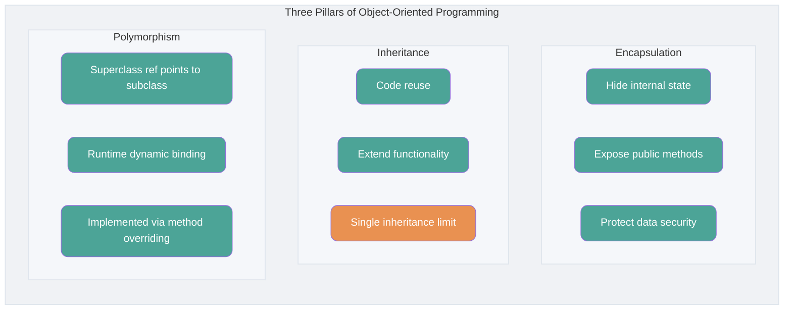
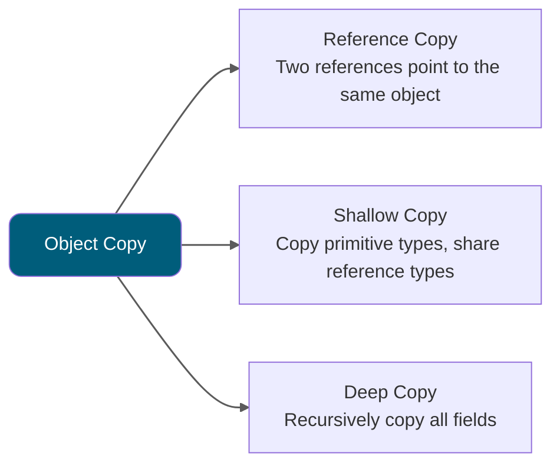

## Object-Oriented Basics

### ⭐️ Differences Between Object-Oriented and Procedural Programming

Procedural-Oriented Programming (POP) and Object-Oriented Programming (OOP) are two common programming paradigms. The main difference between them lies in how they approach solving problems:

- **Procedural-Oriented Programming (POP)**: Procedural programming breaks the problem-solving process down into individual methods and solves the problem by executing these methods one by one.
- **Object-Oriented Programming (OOP)**: Object-oriented programming first abstracts out objects, and then solves the problem by having objects execute methods.

Compared with POP, programs developed with OOP generally have the following advantages:

- **Easy to maintain**: Due to well-defined structure and encapsulation, OOP programs are usually easier to maintain.
- **Easy to reuse**: Through inheritance and polymorphism, OOP design makes code more reusable and facilitates extending functionality.
- **Easy to extend**: Modular design makes system expansion easier and more flexible.

The POP programming style is generally simpler and more direct, making it suitable for handling relatively simple tasks.

Performance differences between POP and OOP mainly depend on their runtime mechanisms rather than the programming paradigm itself. Therefore, simply comparing the performance of the two is a common misconception (related issue: [Procedural Programming: Is Procedural Programming Faster Than Object-Oriented Programming??](https://github.com/Snailclimb/JavaGuide/issues/431)).


When choosing a programming paradigm, performance is not the only consideration. Code maintainability, extensibility, and development efficiency are equally important.

Modern programming languages generally support multiple programming paradigms and can be used for both procedural programming and object-oriented programming.

Below is an example of calculating the area and perimeter of a circle, briefly illustrating both object-oriented and procedural solutions.

**Object-Oriented**:

```java
public class Circle {
    // Define the radius of the circle
    private double radius;

    // Constructor
    public Circle(double radius) {
        this.radius = radius;
    }

    // Calculate the area of the circle
    public double getArea() {
        return Math.PI * radius * radius;
    }

    // Calculate the perimeter of the circle
    public double getPerimeter() {
        return 2 * Math.PI * radius;
    }

    public static void main(String[] args) {
        // Create a circle with radius 3
        Circle circle = new Circle(3.0);

        // Print the area and perimeter of the circle
        System.out.println("Circle area: " + circle.getArea());
        System.out.println("Circle perimeter: " + circle.getPerimeter());
    }
}
```

We defined a `Circle` class to represent a circle, which contains the radius property and methods to calculate its area and perimeter.

**Procedural**:

```java
public class Main {
    public static void main(String[] args) {
        // Define the radius of the circle
        double radius = 3.0;

        // Calculate the area and perimeter of the circle
        double area = Math.PI * radius * radius;
        double perimeter = 2 * Math.PI * radius;

        // Print the area and perimeter of the circle
        System.out.println("Circle area: " + area);
        System.out.println("Circle perimeter: " + perimeter);
    }
}
```

We directly defined the circle's radius and used it to directly compute the area and perimeter of the circle.

### Which Operator Creates an Object? How Does an Object Instance Differ from an Object Reference?

You can create object instances using the `new` operator. The JVM heap is used to allocate class instances and arrays; reference values can be stored in local variables, object fields, static fields, or array elements, and are not necessarily stored on the stack.

- An object reference can point to 0 or 1 object (a string can have no balloon tied to it, or one balloon tied to it);
- An object can have `n` references pointing to it (you can tie `n` strings to a single balloon).

### ⭐️ Differences Between Object Equality and Reference Equality

- Object equality is usually defined by `equals()` and is used to compare the logical state or value agreed upon by the type.
- Reference equality is checked with `==`, indicating whether two references point to the same object (or are both `null`). The Java language does not expose or compare physical memory addresses.

Here is an example:

```java
String str1 = "hello";
String str2 = new String("hello");
String str3 = "hello";
// Use == to compare reference equality of strings
System.out.println(str1 == str2);
System.out.println(str1 == str3);
// Use equals method to compare equality of strings
System.out.println(str1.equals(str2));
System.out.println(str1.equals(str3));

```

Output:

```plain
false
true
true
true
```

From the output above, we can see:

- `str1` and `str2` are not equal, while `str1` and `str3` are equal. This is because the `==` operator compares whether string references are equal.
- `str1`, `str2`, and `str3` all have equal contents. This is because the `equals` method compares the contents of the strings—even if the object references are different, as long as their contents are identical, they are considered equal.

### If a Class Does Not Declare a Constructor, Can the Program Execute Correctly?

A constructor is a special method whose main purpose is to initialize an object.

Even if a class does not declare a constructor, the program can still execute! Because a class without a declared constructor will receive a default no-argument constructor. However, if you add your own constructor to the class (whether with or without parameters), Java will no longer add the default no-argument constructor.

We use constructors all the time without even realizing it—that is why we add parentheses when creating an object (because we are invoking the no-argument constructor). If you overload a constructor with parameters, remember to also explicitly write the no-argument constructor (whether you currently use it or not), as this helps avoid pitfalls when instantiating objects.

### What Are the Characteristics of Constructors? Can They Be Overridden?

Constructors have the following characteristics:

- **Same name as the class**: The constructor's name must match the class name exactly.
- **No return value**: Constructors have no return type and cannot even be declared with `void`.
- **Automatically executed**: When an object of the class is instantiated, the constructor executes automatically without needing an explicit call.

Constructors **cannot be overridden**, but **can be overloaded**. Therefore, a class can have multiple constructors with different parameter lists to provide different ways of initializing objects.

### ⭐️ Three Pillars of Object-Oriented Programming

#### Encapsulation

Encapsulation refers to hiding an object's state information (i.e., its fields/attributes) inside the object, preventing external objects from directly accessing internal information. Instead, publicly accessible methods can be provided to operate on those attributes. Just as we cannot see the internal parts of an air conditioner mounted on the wall (attributes), we can control the air conditioner using a remote control (methods). If we do not want an attribute to be accessed externally, we simply do not provide a method for external access. However, if a class provides no methods for external access at all, that class has little purpose—just as an air conditioner without a remote control could not be operated to cool the room (of course there are many other ways today, this is just an analogy).

```java
public class Student {
    private int id;// Privatize the id field
    private String name;// Privatize the name field

    // Method to get id
    public int getId() {
        return id;
    }

    // Method to set id
    public void setId(int id) {
        this.id = id;
    }

    // Method to get name
    public String getName() {
        return name;
    }

    // Method to set name
    public void setName(String name) {
        this.name = name;
    }
}
```

#### Inheritance

Different types of objects often share a certain number of common characteristics. For example, Xiao Ming, Xiao Hong, and Xiao Li all share the characteristics of students (class, student ID, etc.). At the same time, each object defines additional characteristics that make them unique—for example, Xiao Ming is good at math, Xiao Hong has a likable personality, and Xiao Li is physically strong. Inheritance is a technique that builds a new class using the definition of an existing class as its foundation. The new class definition can add new data or functionality and can also use the superclass's functionality, though it cannot selectively inherit from the superclass. By using inheritance, we can rapidly create new classes, improve code reuse and program maintainability, save substantial time creating new classes, and boost development efficiency.

**Remember these 3 points about inheritance:**

1. A subclass object contains the instance state declared by its superclass, but the superclass's `private` members are not inherited by the subclass, and the subclass cannot access these members directly.
2. A subclass can have its own attributes and methods—that is, a subclass can extend the superclass.
3. A subclass can implement the superclass's methods in its own way (introduced later).

#### Polymorphism

Polymorphism, as the name suggests, means that an object can take multiple forms, specifically manifested as a superclass reference pointing to a subclass instance.

**Characteristics of polymorphism:**

- There is an inheritance (class) or implementation (interface) relationship between the object type and the reference type;
- Which class's method will actually be invoked by a reference-type variable cannot be determined until program runtime;
- Polymorphism cannot invoke methods that "exist only in the subclass and not in the superclass";
- If the subclass overrides a method of the superclass, the subclass's overridden method is what actually executes; if the subclass does not override the superclass's method, the superclass's method executes.



### ⭐️ What Are the Similarities and Differences Between Interfaces and Abstract Classes?

#### Similarities Between Interfaces and Abstract Classes

- **Instantiation**: Neither interfaces nor abstract classes can be instantiated directly; concrete objects can only be created after being implemented (for interfaces) or inherited (for abstract classes).
- **Abstract methods**: Both interfaces and abstract classes can contain abstract methods. Abstract methods have no method body and must be implemented in subclasses or implementing classes.

#### Differences Between Interfaces and Abstract Classes

- **Design purpose**: Interfaces are primarily used to constrain the behavior of classes—if you implement an interface, you possess the corresponding behavior. Abstract classes are primarily used for code reuse and emphasize an "is-a" ownership/inheritance relationship.
- **Inheritance and implementation**: A class can extend only one class (including abstract classes) because Java does not support multiple class inheritance. However, a class can implement multiple interfaces, and an interface can also extend multiple other interfaces.
- **Member variables**: Member variables in an interface can only be `public static final`, cannot be modified, and must have an initial value. Member variables in an abstract class can have any access modifier (`private`, `protected`, `public`) and can be redefined or reassigned in subclasses.
- **Methods**:
  - Prior to Java 8, methods in interfaces were implicitly `public abstract`, meaning only method declarations were allowed. Since Java 8, `default` methods and `static` methods can be defined in interfaces. Since Java 9, interfaces can contain `private` methods.
  - Abstract classes can contain both abstract methods and non-abstract methods. Abstract methods have no method body and must be implemented in subclasses. Non-abstract methods have concrete implementations and can be used directly in the abstract class or overridden in subclasses.

Java 8 introduced `default` and `static` methods to interfaces, and Java 9 allowed interfaces to declare `private` methods. These additions make interfaces much more flexible to use.

The `default` method introduced in Java 8 provides a default implementation for an interface method, which can be overridden in implementing classes. This makes it possible to add new functionality to existing interfaces without modifying existing implementations, enhancing extensibility and backward compatibility.

```java
public interface MyInterface {
    default void defaultMethod() {
        System.out.println("This is a default method.");
    }
}
```

The `static` method introduced in Java 8 cannot be overridden in implementing classes and can only be invoked directly via the interface name (`MyInterface.staticMethod()`), similar to static methods in classes. `static` methods are typically used to define general utility methods related to the interface and are rarely used in practice.

```java
public interface MyInterface {
    static void staticMethod() {
        System.out.println("This is a static method in the interface.");
    }
}
```

Java 9 allows `private` methods in interfaces. `private` methods can be used to share code internally within the interface without exposing it externally.

```java
public interface MyInterface {
    // default method
    default void defaultMethod() {
        commonMethod();
    }

    // static method
    static void staticMethod() {
        commonMethod();
    }

    // Private static method, callable by static and default methods
    private static void commonMethod() {
        System.out.println("This is a private method used internally.");
    }

      // Private instance method, callable only by default methods.
    private void instanceCommonMethod() {
        System.out.println("This is a private instance method used internally.");
    }
}
```

### Do You Know the Difference Between Deep Copy and Shallow Copy? What Is a Reference Copy?



Let's state the conclusion on the difference between deep copy and shallow copy first:

- **Shallow Copy**: A shallow copy creates a new object on the heap (which distinguishes it from a reference copy). However, if the original object contains fields of reference types, a shallow copy directly copies the reference addresses of those inner objects—meaning the copied object and the original object share the same inner objects.
- **Deep Copy**: A deep copy completely duplicates the entire object, including all inner objects contained within it.

If the conclusion above is not yet completely clear, let's look at a concrete example!

#### Shallow Copy

Sample code for a shallow copy is shown below. Here we implement the `Cloneable` interface and override the `clone()` method.

The implementation of `clone()` is simple—it directly calls the `clone()` method of the superclass `Object`.

```java
public class Address implements Cloneable{
    private String name;
    // Constructors, getters & setters omitted
    @Override
    public Address clone() {
        try {
            return (Address) super.clone();
        } catch (CloneNotSupportedException e) {
            throw new AssertionError();
        }
    }
}

public class Person implements Cloneable {
    private Address address;
    // Constructors, getters & setters omitted
    @Override
    public Person clone() {
        try {
            Person person = (Person) super.clone();
            return person;
        } catch (CloneNotSupportedException e) {
            throw new AssertionError();
        }
    }
}
```

Test:

```java
Person person1 = new Person(new Address("Wuhan"));
Person person1Copy = person1.clone();
// true
System.out.println(person1.getAddress() == person1Copy.getAddress());
```

From the output, we can see that the cloned object of `person1` and `person1` itself still use the exact same `Address` object.

#### Deep Copy

Here we simply modify the `clone()` method of the `Person` class so that the inner `Address` object inside `Person` is also cloned together.

```java
@Override
public Person clone() {
    try {
        Person person = (Person) super.clone();
        person.setAddress(person.getAddress().clone());
        return person;
    } catch (CloneNotSupportedException e) {
        throw new AssertionError();
    }
}
```

Test:

```java
Person person1 = new Person(new Address("Wuhan"));
Person person1Copy = person1.clone();
// false
System.out.println(person1.getAddress() == person1Copy.getAddress());
```

From the output, it is clear that the cloned object of `person1` and `person1` itself now contain different `Address` objects.

**Then what is a reference copy?** Simply put, a reference copy means two different references point to the same object.

I specifically drew a diagram to illustrate shallow copy, deep copy, and reference copy:


## ⭐️ Object

### What Are the Common Methods of the `Object` Class?

The `Object` class is a special class that serves as the superclass of all classes and mainly provides the following methods. Note that `finalize()` has been deprecated since JDK 9 and marked for removal in JDK 18, and should not be used in new code:

```java
/**
 * Native method that returns the Class object of the current runtime object. Modified with final, so subclasses are not allowed to override it.
 */
public final native Class<?> getClass()
/**
 * Native method that returns the hash code of the object, primarily used in hash tables such as HashMap in the JDK.
 */
public native int hashCode()
/**
 * Used to compare whether 2 references point to the same object. The String class overrides this method to compare whether string values are equal.
 */
public boolean equals(Object obj)
/**
 * Native method used to create and return a copy of the current object.
 */
protected native Object clone() throws CloneNotSupportedException
/**
 * Returns a string containing the class name and the hexadecimal representation of the instance's hash code. It is recommended that all subclasses of Object override this method.
 */
public String toString()
/**
 * Native method that cannot be overridden. Wakes up a single thread waiting on this object's monitor (a monitor is conceptually equivalent to a lock). If multiple threads are waiting, one is chosen arbitrarily.
 */
public final native void notify()
/**
 * Native method that cannot be overridden. Same as notify, except it wakes up all threads waiting on this object's monitor rather than just one.
 */
public final native void notifyAll()
/**
 * Native method that cannot be overridden. Pauses execution of the thread. Note: sleep does not release the lock, whereas wait releases the lock; timeout is the waiting duration.
 */
public final native void wait(long timeout) throws InterruptedException
/**
 * Adds a nanos parameter representing extra time (in nanoseconds, range 0-999999), so the total timeout adds nanos nanoseconds.
 */
public final void wait(long timeout, int nanos) throws InterruptedException
/**
 * Same as the previous two wait methods, except this method waits indefinitely with no timeout.
 */
public final void wait() throws InterruptedException
/**
 * Triggered when the instance is reclaimed by the garbage collector.
 */
protected void finalize() throws Throwable { }
```

### Differences Between `==` and `equals()`

**`==`** behaves differently for primitive types and reference types:

- For primitive data types, `==` compares values.
- For reference data types, `==` compares whether references point to the same object (or are both `null`), rather than comparing physical memory addresses.

> For `==`, regardless of whether comparing primitive types or reference types, it compares the values of the operands; a reference value identifies the object it points to, though the Java language does not define it as an observable physical memory address.

**`equals()`** cannot be used to compare primitive-type variables; it can only be used to check whether two objects are equal. The `equals()` method is defined in the `Object` class, and since `Object` is the direct or indirect superclass of all classes, every class has the `equals()` method.

`equals()` method in the `Object` class:

```java
public boolean equals(Object obj) {
     return (this == obj);
}
```

There are two situations when using `equals()`:

- **The class has not overridden `equals()`**: Comparing two objects of the class with `equals()` is equivalent to comparing them with `==`, using the default `Object.equals()` method.
- **The class has overridden `equals()`**: Typically we override `equals()` to compare whether the fields of two objects are equal; if their fields are equal, it returns `true` (i.e., the two objects are considered equal).

For example (just for demonstration—in practice, intelligent IDEs like IDEA will prompt you to replace `==` with `equals()` if you write code like this):

```java
String a = new String("ab"); // a is a reference
String b = new String("ab"); // b is another reference with the same object content
String aa = "ab"; // Placed in the constant pool
String bb = "ab"; // Looked up from the constant pool
System.out.println(aa == bb);// true
System.out.println(a == b);// false
System.out.println(a.equals(b));// true
System.out.println(42 == 42.0);// true
```

The `equals` method in `String` is overridden: whereas `Object.equals` checks whether two references point to the same object, `String.equals` compares the values of the strings.

When creating a `String` object using a string literal (such as `String aa = "ab"`), the JVM looks in the constant pool to see if an object with the same value already exists. If so, it assigns that reference to `aa`; if not, it creates a `String` object in the constant pool and assigns it to `aa`. However, when creating an object using the `new` keyword (such as `String a = new String("ab")`), the JVM always **creates a new object** in heap memory, initializes it with the value from the constant pool (creating `"ab"` in the String Constant Pool first if it is not already there), and assigns it to `a`.

`equals()` method in the `String` class:

```java
public boolean equals(Object anObject) {
    if (this == anObject) {
        return true;
    }
    if (anObject instanceof String) {
        String anotherString = (String)anObject;
        int n = value.length;
        if (n == anotherString.value.length) {
            char v1[] = value;
            char v2[] = anotherString.value;
            int i = 0;
            while (n-- != 0) {
                if (v1[i] != v2[i])
                    return false;
                i++;
            }
            return true;
        }
    }
    return false;
}
```

### What Is the Purpose of `hashCode()`?

The purpose of `hashCode()` is to obtain a hash code (an `int` integer), also known as a scatter code. This hash code is used to determine the object's index position in a hash table.


`hashCode()` is defined in the JDK's `Object` class, which means every class in Java has the `hashCode()` method. Note also that `Object.hashCode()` is a native method—meaning it is implemented in C or C++.

> ⚠️ Note: By default in **Oracle OpenJDK 8**, this method uses "thread-local state for Marsaglia's xor-shift random number generation", NOT an "address" or "derived from an address", and different JDKs/VMs may vary. In **Oracle OpenJDK 8**, there are six generation strategies (the fifth returns the address), and the fifth can be enabled by adding the VM flag `-XX:hashCode=4`. Source references:
>
> - <https://hg.openjdk.org/jdk8u/jdk8u/hotspot/file/87ee5ee27509/src/share/vm/runtime/globals.hpp> (line 1127)
> - <https://hg.openjdk.org/jdk8u/jdk8u/hotspot/file/87ee5ee27509/src/share/vm/runtime/synchronizer.cpp> (starting at line 537)

```java
public native int hashCode();
```

A hash table stores key-value pairs, and its key feature is: **it can quickly retrieve the corresponding "value" based on the "key"—and hash codes make this possible! (allowing desired objects to be found rapidly)**

### Why Do We Need `hashCode()`?

Let's use "how `HashSet` checks for duplicates" as an example to explain why `hashCode()` is needed.

When we add an object to a `HashSet`, `HashSet` first calls the object's `hashCode()` method to obtain a "hash value", and applies an internal hash function to perform a simple transformation (such as modulo) to determine which bucket (a slot in the underlying array) the entry should be placed into:

1. If that bucket is currently empty, the node corresponding to the object is inserted directly into the bucket.
2. If the bucket already contains other elements, `HashSet` traverses the linked list or red-black tree in that bucket and compares elements one by one:
   - For nodes with **different hash values**, it skips them directly;
   - For nodes with the **same hash value**, it further calls the `equals()` method to check whether the two objects are "equal":
     – If `equals()` returns `true`, it means an equivalent element already exists in the set, so `HashSet` will not add it again;
     – If it returns `false`, it is treated as a new element, and the object is added as a new node into the linked list or red-black tree of the **same bucket**.

By first narrowing down candidates to the same bucket using `hashCode()` and then calling `equals()` for exact comparison only on the few elements inside that bucket, `HashSet` drastically reduces the number of `equals()` invocations, thereby improving lookup and insertion performance.

**Then why does the JDK provide both methods?**

Because in collections such as `HashMap` and `HashSet`, having `hashCode()` makes checking whether an element exists in the container much more efficient (refer to the process of adding an element to `HashSet`).

As mentioned earlier when adding an element to `HashSet`, if multiple objects share the same `hashCode`, `HashSet` continues using `equals()` to determine whether they are truly identical. In other words, `hashCode` dramatically reduces our lookup cost.

**Then why not provide only the `hashCode()` method?**

Because two objects having equal `hashCode` values does not guarantee that the two objects themselves are equal.

**Why aren't two objects with the same `hashCode` necessarily equal?**

Because the hashing algorithm used by `hashCode()` may happen to return the same hash value for multiple distinct objects. A poorer hashing algorithm is more prone to collisions, though it also depends on the value distribution characteristics of the data (a so-called hash collision occurs when different objects produce the same `hashCode`).

To summarize:

- If two objects have the same `hashCode` value, those two objects are not necessarily equal (hash collision).
- If two objects have the same `hashCode` value AND `equals()` returns `true`, then we consider the two objects equal.
- If two objects have different `hashCode` values, we can immediately conclude that the two objects are not equal.

After reading the introduction to `hashCode()` and `equals()` above, the next question should be easy for you.

### Why Must You Override `hashCode()` When Overriding `equals()`?

Because two equal objects must have the same `hashCode` value. That is, if `equals()` determines that two objects are equal, their `hashCode` values must also be equal.

If you override `equals()` without overriding `hashCode()`, two objects that `equals()` considers equal might end up having different `hashCode` values.

**Food for thought**: If you override `equals()` without overriding `hashCode()`, what problems might occur when using `HashMap`?

**Summary**:

- If `equals()` judges two objects to be equal, their `hashCode` values must also be equal.
- Two objects having the same `hashCode` value are not necessarily equal (hash collision).

For more on `hashCode()` and `equals()`, see: [Several Questions and Answers on Java hashCode() and equals()](https://www.cnblogs.com/skywang12345/p/3324958.html)

## String

### ⭐️ Differences Between `String`, `StringBuffer`, and `StringBuilder`

**Mutability**

`String` is immutable (we will analyze the reasons in detail later); every modification creates a new object and points the reference to the new instance. Both `StringBuffer` and `StringBuilder` are mutable—when modifying a string, they do not create new objects, but instead operate directly on the underlying character array.

Both `StringBuilder` and `StringBuffer` inherit from the `AbstractStringBuilder` class. `AbstractStringBuilder` also uses a character array to store strings, except it is not declared with `final` or `private`. Most importantly, `AbstractStringBuilder` provides many methods for modifying strings, such as `append`.

```java
abstract class AbstractStringBuilder implements Appendable, CharSequence {
    char[] value;
    public AbstractStringBuilder append(String str) {
        if (str == null)
            return appendNull();
        int len = str.length();
        ensureCapacityInternal(count + len);
        str.getChars(0, len, value, count);
        count += len;
        return this;
    }
    //...
}
```

**Thread Safety**

Objects in `String` are immutable, so they can be understood as constants and are thread-safe. `AbstractStringBuilder` is the common superclass of `StringBuilder` and `StringBuffer` and defines basic string operations such as `expandCapacity`, `append`, `insert`, and `indexOf`. `StringBuffer` applies synchronization locks to its methods or to the methods it calls, so it is thread-safe. `StringBuilder` does not apply synchronization locks to its methods, so it is not thread-safe.


**Performance**

The performance difference between the two mainly stems from their thread-safety mechanisms:

- `StringBuffer`'s methods are generally synchronized (thread-safe), which introduces a certain performance overhead;
- `StringBuilder` has no synchronization overhead (non-thread-safe), so it typically delivers better performance in single-threaded scenarios.
  Under identical conditions, using `StringBuilder` instead of `StringBuffer` yields only around 10%–15% performance improvement, while taking on the risk of thread unsafety.
  Moreover, the exact performance difference is not fixed; in modern JVMs, due to lock optimizations (such as lock coarsening/lock elision), the performance gap between the two may be small in certain scenarios.

**Summary of when to use each of the three:**

- Manipulating small amounts of data: use `String`
- Manipulating large amounts of data in a string buffer under a single thread: use `StringBuilder`
- Manipulating large amounts of data in a string buffer under multiple threads: use `StringBuffer`

### ⭐️ Why Is `String` Immutable?

The `String` class uses the `final` keyword to modify the character array storing the string, ~~so `String` objects are immutable.~~

```java
public final class String implements java.io.Serializable, Comparable<String>, CharSequence {
    private final char value[];
  //...
}
```

> 🐛 Correction: We know that a class modified with `final` cannot be inherited, a method modified with `final` cannot be overridden, a `final` primitive variable cannot have its value changed, and a `final` reference variable cannot be reassigned to point to another object. Therefore, using a `final` array to store the string is NOT the root cause of `String`'s immutability, because the contents of the array itself would still be mutable (as happens when `final` modifies a reference-type variable).
>
> The real reasons `String` is immutable are as follows:
>
> 1. The array storing the characters is both `final` and `private`, and the `String` class provides/exposes no methods that modify this string content.
> 2. The `String` class itself is declared `final`, preventing it from being inherited and thereby preventing subclasses from breaking `String` immutability.
>
> Further reading: [How to Understand the Immutability of String Values? - Zhihu](https://www.zhihu.com/question/20618891/answer/114125846)
>
> Addendum (from [issue 675](https://github.com/Snailclimb/JavaGuide/issues/675)): After Java 9, the implementations of `String`, `StringBuilder`, and `StringBuffer` switched to using a `byte` array to store strings.
>
> ```java
> public final class String implements java.io.Serializable,Comparable<String>, CharSequence {
>     // The @Stable annotation indicates that the variable is modified at most once, known as "stable".
>     @Stable
>     private final byte[] value;
> }
>
> abstract class AbstractStringBuilder implements Appendable, CharSequence {
>     byte[] value;
>
> }
> ```
>
> **Why did Java 9 change the underlying implementation of `String` from `char[]` to `byte[]`?**
>
> The new `String` internally supports two encoding schemes: Latin-1 and UTF-16. If all characters in the string can be represented in Latin-1, Latin-1 is used; otherwise, UTF-16 is used. Chinese characters fall outside the Latin-1 range. Under Latin-1, each character uses one byte of storage, saving half the character data space compared with the original `char[]`.
>
> The JDK team stated that the vast majority of `String` objects contain only characters representable in Latin-1.
>
> 
>
> If a string contains characters that cannot be represented in Latin-1 (such as Chinese characters), UTF-16 is used internally, storing two bytes per code unit.
>
> Here is the official specification: <https://openjdk.java.net/jeps/254>.

### ⭐️ Should String Concatenation Use `"+"` or `StringBuilder`?

Java does not support user-defined operator overloading, but the language specification specifically defines the `+` and `+=` operators for string concatenation.

```java
String str1 = "he";
String str2 = "llo";
String str3 = "world";
String str4 = str1 + str2 + str3;
```

The bytecode corresponding to the code above is:


In the JDK 8 bytecode shown here, string `+` concatenation is translated by `javac` into `StringBuilder.append()` calls. Starting from JDK 9, `javac` switched by default to `invokedynamic` and `StringConcatFactory`, so `StringBuilder` should not be regarded as the mandatory implementation across all versions.

However, using `"+"` for string concatenation inside a loop has an obvious drawback: **the compiler does not create a single `StringBuilder` for reuse, resulting in excessive `StringBuilder` object creation**.

```java
String[] arr = {"he", "llo", "world"};
String s = "";
for (int i = 0; i < arr.length; i++) {
    s += arr[i];
}
System.out.println(s);
```

The `StringBuilder` object is created inside the loop, which means a new `StringBuilder` object is created on every iteration.


If you use a `StringBuilder` object directly for string concatenation, this problem will not happen.

```java
String[] arr = {"he", "llo", "world"};
StringBuilder s = new StringBuilder();
for (String value : arr) {
    s.append(value);
}
System.out.println(s);
```


If you use IntelliJ IDEA, IDEA's built-in code inspection will also warn you to modify such code.

In JDK 9, string `+` concatenation was changed to use the dynamic method `makeConcatWithConstants()`, which pre-allocates space to reduce the creation of some temporary objects. However, this optimization mainly targets simple string concatenations like `a + b + c`. For heavy concatenation inside a loop, memory is still dynamically allocated step by step (conceptually similar to appending two by two), which is still less efficient than manually using `StringBuilder` for concatenation. This improvement was proposed in JDK 9's [JEP 280](https://openjdk.org/jeps/280). For a detailed walkthrough of this enhancement, recommended reading includes [Stop Blindly Using StringBuilder? Let's Revisit String Concatenation](https://juejin.cn/post/7182872058743750715) and [issue#2442](https://github.com/Snailclimb/JavaGuide/issues/2442).

### What Is the Difference Between `String#equals()` and `Object#equals()`?

`String`'s `equals` method is overridden to compare whether the values of two strings are equal. `Object`'s `equals` method checks whether two references point to the same object.

### ⭐️ Do You Know the Role of the String Constant Pool?

The **String Constant Pool** is a dedicated memory area carved out by the JVM specifically for strings (`String` class) to improve performance and reduce memory consumption; its primary purpose is to avoid duplicate string creation.

```java
// 1. Query the String Constant Pool for the string object "ab"; if absent, create "ab" and place it in the pool
// 2. Assign the reference of the string object "ab" to aa
String aa = "ab";
// Directly return the string object "ab" from the String Constant Pool and assign it to reference bb
String bb = "ab";
System.out.println(aa==bb); // true
```

For more on the String Constant Pool, see [Java Memory Areas Explained](https://javaguide.cn/java/jvm/memory-area.html).

### ⭐️ How Many String Objects Are Created by `String s1 = new String("abc");`?

Let's give the answer first: 1 or 2 string objects are created.

1. `"abc"` does NOT exist in the String Constant Pool: 2 string objects are created. One is in the String Constant Pool, triggered by the `ldc` instruction. The other is on the heap, created by `new String()` and initialized using `"abc"` from the constant pool.
2. `"abc"` ALREADY exists in the String Constant Pool: 1 string object is created. That object is on the heap, created by `new String()` and initialized using `"abc"` from the constant pool.

Let's analyze this in detail below.

1. If the string object `"abc"` does not exist in the String Constant Pool, it will first create the string object `"abc"` in the String Constant Pool, and then create another string object `"abc"` in heap memory.

Sample code (JDK 1.8):

```java
String s1 = new String("abc");
```

Corresponding bytecode:

```java
// Allocate an uninitialized String object in heap memory.
// #2 is a symbolic reference in the constant pool pointing to the java/lang/String class.
// During the resolution phase of class loading, this symbolic reference is resolved to a direct reference pointing to the actual java/lang/String class.
0 new #2 <java/lang/String>
// Duplicate the String object reference on top of the operand stack in preparation for the subsequent constructor call.
// At this point there are two identical object references on the operand stack: one to pass to the constructor, and the other to keep the reference to the new object so it can be stored into the local variable table later.
3 dup
// The JVM first checks whether "abc" exists in the String Constant Pool.
// If "abc" already exists in the constant pool, it directly returns the reference to that string;
// If "abc" does not exist in the constant pool, the JVM creates the string literal in the constant pool and returns its reference.
// This reference is pushed onto the operand stack as an argument to the constructor.
4 ldc #3 <abc>
// Invoke the constructor to initialize the String object on the heap using the "abc" loaded from the constant pool.
// The new String object will have the same content as "abc" in the constant pool, but it is an independent object stored on the heap.
6 invokespecial #4 <java/lang/String.<init> : (Ljava/lang/String;)V>
// Store the reference to the heap String object into the local variable table
9 astore_1
// Return and end the method
10 return
```

The `ldc (load constant)` instruction indeed loads various kinds of constants from the constant pool, including string constants, integer constants, floating-point constants, and even class references. For string constants, the `ldc` instruction behaves as follows:

1. **Load string from constant pool**: `ldc` first checks whether a string object with the same content already exists in the String Constant Pool.
2. **Reuse existing string object**: If a string object with the same content already exists in the String Constant Pool, `ldc` loads the reference to that object onto the operand stack.
3. **Create and pool if absent**: If no string object with the same content exists in the String Constant Pool, the JVM creates a new string object in the constant pool and loads its reference onto the operand stack.

2. If the string object `"abc"` already exists in the String Constant Pool, only 1 string object `"abc"` is created on the heap.

Sample code (JDK 1.8):

```java
// The string object "abc" already exists in the String Constant Pool
String s1 = "abc";
// The following line creates only 1 string object "abc" on the heap
String s2 = new String("abc");
```

Corresponding bytecode:

```java
0 ldc #2 <abc>
2 astore_1
3 new #3 <java/lang/String>
6 dup
7 ldc #2 <abc>
9 invokespecial #4 <java/lang/String.<init> : (Ljava/lang/String;)V>
12 astore_2
13 return
```

We won't annotate the bytecode above in detail again; the `ldc` instruction at offset `7` will not create a new string object `"abc"` on the heap, because the `ldc` instruction executed at offset `0` has already created the `"abc"` string object once. Executing `ldc` at offset `7` directly returns the reference corresponding to `"abc"` in the String Constant Pool.

### What Is the Role of the `String#intern` Method?

`String.intern()` is a `native` method used to manage string object references in the String Constant Pool. Its workflow can be summarized in two cases:

1. **A string object with the same content already exists in the constant pool**: If the String Constant Pool already contains a `String` object with the same content as the string calling `intern()`, `intern()` directly returns the reference to that object in the constant pool.
2. **No string object with the same content exists in the constant pool**: If the String Constant Pool does not yet contain an object with the same content as the string calling `intern()`, `intern()` adds the reference of the current string object to the String Constant Pool and returns that reference.

Summary:

- The main purpose of `intern()` is to ensure the uniqueness of string references in the constant pool.
- When `intern()` is called, if a string with the same content already exists in the constant pool, the reference to the existing pooled object is returned; otherwise, the string is added to the constant pool and its reference is returned.

Sample code (JDK 1.8):

```java
// s1 points to the "Java" object in the String Constant Pool
String s1 = "Java";
// s2 also points to the "Java" object in the String Constant Pool, the same object as s1
String s2 = s1.intern();
// Create a new "Java" object on the heap, and s3 points to it
String s3 = new String("Java");
// s4 points to the "Java" object in the String Constant Pool, the same object as s1
String s4 = s3.intern();
// s1 and s2 point to the same object in the constant pool
System.out.println(s1 == s2); // true
// s3 points to the object on the heap, while s4 points to the object in the constant pool, so they differ
System.out.println(s3 == s4); // false
// s1 and s4 both point to the same object in the constant pool
System.out.println(s1 == s4); // true
```

### What Happens When Performing `"+"` Operations Between `String` Variables and Constants?

Let's first look at concatenating strings without the `final` keyword (JDK 1.8):

```java
String str1 = "str";
String str2 = "ing";
String str3 = "str" + "ing";
String str4 = str1 + str2;
String str5 = "string";
System.out.println(str3 == str4);//false
System.out.println(str3 == str5);//true
System.out.println(str4 == str5);//false
```

> **Note**: To compare whether the values of two `String` objects are equal, use the `equals()` method. `String`'s `equals` method is overridden: `Object.equals` determines whether two references point to the same object, whereas `String.equals` compares whether the string values are equal. If you use `==` to compare whether two strings are equal, IDEA will prompt you to replace it with `equals()`.


**For string expressions whose values can be determined at compile time, the compiler performs constant folding and writes the result as a string constant into the constant pool of the class file; the corresponding String object is created at runtime and interned in the String pool.**

During compilation, the `javac` compiler (hereafter referred to simply as the compiler) performs a code optimization known as **Constant Folding**. This is also introduced in *Understanding the JVM*:


Constant folding evaluates the value of constant expressions and embeds the result as a constant in the final generated code. This is one of the very few optimizations `javac` applies to source code (almost all code optimizations are performed in the JIT compiler).

For `String str3 = "str" + "ing";`, the compiler optimizes it to `String str3 = "string";`.

Not all constants undergo constant folding—only constants whose values the compiler can determine at compile time qualify:

- Primitive data types (`byte`, `boolean`, `short`, `char`, `int`, `float`, `long`, `double`) and string literals.
- Primitive data types and string variables modified by `final`.
- Strings concatenated with `"+"`, arithmetic operations between primitive data types (`+`, `-`, `*`, `/`), and bitwise operations on primitive data types (`<<`, `\>>`, `\>>>`).

**The values of object references cannot be determined at compile time, so the compiler cannot optimize them.**

String concatenation using object references and `"+"` is actually implemented via `StringBuilder` calling `append()`, followed by `toString()` to produce a `String` object.

```java
String str4 = new StringBuilder().append(str1).append(str2).toString();
```

When writing code in everyday work, avoid concatenating multiple string objects this way because it repeatedly creates new objects. If you need to modify strings, use `StringBuilder` or `StringBuffer`.

However, declaring a `String` with the `final` keyword allows the compiler to treat it as a constant.

Sample code:

```java
final String str1 = "str";
final String str2 = "ing";
// The following two expressions are actually equivalent
String c = "str" + "ing";// Object in the constant pool
String d = str1 + str2; // Object in the constant pool
System.out.println(c == d);// true
```

A `String` modified with `final` is treated by the compiler as a constant whose value can be determined at compile time, having the same effect as accessing a constant literal.

However, if the compiler cannot know its exact value until runtime, it cannot optimize it.

Sample code (`str2`'s value cannot be determined until runtime):

```java
final String str1 = "str";
final String str2 = getStr();
String c = "str" + "ing";// Object in the constant pool
String d = str1 + str2; // New object created on the heap
System.out.println(c == d);// false
public static String getStr() {
      return "ing";
}
```

## References

- Deep Dive into `String#intern`: <https://tech.meituan.com/2014/03/06/in-depth-understanding-string-intern.html>
- Java `String` Source Code Walkthrough: <http://keaper.cn/2020/09/08/java-string-mian-mian-guan/>
- RednaxelaFX's Answer on Constant Folding: <https://www.zhihu.com/question/55976094/answer/147302764>
