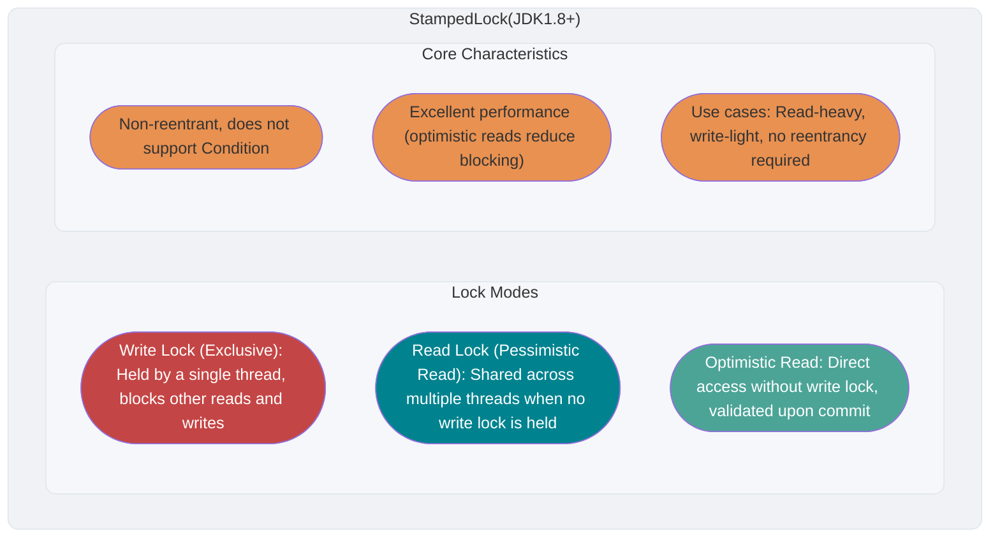

## ⭐️ JMM (Java Memory Model)

There are quite a few questions related to JMM (Java Memory Model), and they are fairly important, so I extracted a separate article to summarize JMM concepts and questions: [Detailed Explanation of JMM (Java Memory Model)](https://javaguide.cn/java/concurrent/jmm.html).

## ⭐️ The `volatile` Keyword

### How Does `volatile` Guarantee Variable Visibility?

In Java, the `volatile` keyword guarantees variable visibility. A write to a `volatile` variable happens-before any subsequent read of that same variable, so the reading thread can see that write as well as any earlier results propagated via happens-before transitivity. This is the semantic defined by the JMM and is not equivalent to requiring every access to bypass CPU caches and directly read from or write to physical main memory.


The `volatile` keyword is not unique to Java, though its semantics differ across languages. Java's `volatile` provides visibility and ordering guarantees defined by the JMM and should not be interpreted as "disabling CPU caches."

The `volatile` keyword guarantees data visibility, but it cannot guarantee data atomicity. The `synchronized` keyword guarantees both.

### How Does `volatile` Prevent Instruction Reordering?

**In Java, besides guaranteeing variable visibility, another important role of the `volatile` keyword is preventing JVM instruction reordering.** If we declare a variable as **`volatile`**, performing reads and writes on this variable prevents instruction reordering by inserting specific **Memory Barriers**.

In Java, the `Unsafe` class provides three out-of-the-box methods related to memory barriers that abstract away low-level OS differences:

```java
public native void loadFence();
public native void storeFence();
public native void fullFence();
```

In theory, you can achieve the same reordering-prevention effect as `volatile` using these three methods, though it is more cumbersome.

#### 4 Types of Memory Barriers

When explaining JVM implementations, the following 4 categories of memory barriers are commonly used to describe the reordering constraints that must be enforced. They are an implementation-level conceptual model for ease of understanding, rather than a JLS mandate dictating which specific barrier instructions a JVM must insert one by one:

| Barrier Type   | Instruction Example          | Description                                                                                                                                                                                                    |
| -------------- | ---------------------------- | -------------------------------------------------------------------------------------------------------------------------------------------------------------------------------------------------------------- |
| **LoadLoad**   | `Load1; LoadLoad; Load2`     | Ensures that the read operation `Load1` completes before `Load2` and any subsequent read operations.                                                                                                             |
| **StoreStore** | `Store1; StoreStore; Store2` | Orders two write operations so that the effects of `Store1` become visible to other processors no later than `Store2`.                                                                                         |
| **LoadStore**  | `Load1; LoadStore; Store2`   | Ensures that the read operation `Load1` completes before `Store2` and any subsequent write operations are flushed to memory.                                                                                    |
| **StoreLoad**  | `Store1; StoreLoad; Load2`   | Ensures that `Store1`'s write operation becomes visible to other processors before `Load2` and any subsequent read operations. `StoreLoad` is the most expensive of the four barriers; it carries the effects of the other three barriers and is therefore also called a **Full Barrier**. |

#### Memory Barrier Insertion Strategy for `volatile` Read and Write Operations

Below is a conservative barrier insertion strategy that makes `volatile` semantics easy to understand. In practice, a JVM selects, merges, or omits concrete barriers based on the target processor's memory model, as long as the final behavior satisfies the JMM:

**Memory barrier insertion strategy for a `volatile` write operation:**

Insert a `StoreStore` barrier **before** each `volatile` write operation, and a `StoreLoad` barrier **after** it.

```
StoreStore barrier
volatile write operation
StoreLoad barrier
```

- Preceding `StoreStore` barrier: ensures that ordinary writes before the `volatile` write cannot be reordered after that `volatile` write.
- Trailing `StoreLoad` barrier: ensures that after the `volatile` write, the written value is visible to subsequent `volatile` read/write operations. This is the most expensive barrier, yet also the most critical one—it prevents the `volatile` write from being reordered with subsequent `volatile` read/write operations.

**Memory barrier insertion strategy for a `volatile` read operation:**

Insert a `LoadLoad` barrier and a `LoadStore` barrier **after** each `volatile` read operation.

```
volatile read operation
LoadLoad barrier
LoadStore barrier
```

- `LoadLoad` barrier: ensures that ordinary read operations after the `volatile` read cannot be reordered before the `volatile` read.
- `LoadStore` barrier: ensures that ordinary write operations after the `volatile` read cannot be reordered before the `volatile` read.

In this way, the combination of a `volatile` write and read establishes semantics similar to **lock release-acquire**: **the results of all operations before a `volatile` write are visible to all operations after a subsequent read of that `volatile` variable.**

Below, I will use a common interview question as an example to illustrate how the `volatile` keyword prevents instruction reordering.

During interviews, interviewers often ask: "Are you familiar with the Singleton pattern? Write one by hand for me! And explain the principle of implementing Singleton with Double-Checked Locking!"

**Double-Checked Locking (DCL) Singleton Implementation (Thread-Safe)**:

```java
public class Singleton {

    private volatile static Singleton uniqueInstance;

    private Singleton() {
    }

    public static Singleton getUniqueInstance() {
       // First check whether the object has already been instantiated; only enter the locked block if it has not
        if (uniqueInstance == null) {
            // Lock on the Class object
            synchronized (Singleton.class) {
                if (uniqueInstance == null) {
                    uniqueInstance = new Singleton();
                }
            }
        }
        return uniqueInstance;
    }
}
```

Using the `volatile` keyword to modify `uniqueInstance` is very necessary. The statement `uniqueInstance = new Singleton();` actually executes in three steps:

1. Allocate memory space for `uniqueInstance`
2. Initialize `uniqueInstance`
3. Point `uniqueInstance` to the allocated memory address

However, because the JVM performs instruction reordering, the execution order might become 1 -> 3 -> 2. Instruction reordering causes no issue in a single-threaded environment, but in a multithreaded environment it can cause a thread to obtain an uninitialized instance. For example, thread T1 executes steps 1 and 3, and at that point T2 calls `getUniqueInstance()`, sees that `uniqueInstance` is not null, and returns `uniqueInstance`—even though `uniqueInstance` has not yet been initialized.

#### Understanding Why DCL Requires `volatile` from a Memory Barrier Perspective

Above, we explained why `uniqueInstance` in a DCL singleton must be modified with `volatile` from the perspective of instruction reordering. Let's analyze further from the perspective of memory barriers how `volatile` solves this problem.

Among the three steps of `uniqueInstance = new Singleton();` (allocating memory, initializing the object, and assigning the reference), without `volatile`, steps 2 and 3 could be reordered into 1 -> 3 -> 2. With `volatile`, because `uniqueInstance` is a `volatile` variable, the write to it (step 3: assigning the reference to `uniqueInstance`) follows the `volatile` write memory barrier insertion strategy described earlier:

1. Insert a `StoreStore` barrier **before** the `volatile` write: ensures that the writes in step 1 (allocating memory) and step 2 (initializing the object) complete before step 3 (assigning the reference), **prohibiting reordering between step 2 and step 3**.
2. Insert a `StoreLoad` barrier **after** the `volatile` write: constrains reordering between this write and subsequent reads/writes, and pairs with the `volatile` read to establish the visibility required by the JMM.

Thus, when thread T2 reads `uniqueInstance` (a `volatile` read) and finds `uniqueInstance != null`, it is guaranteed that the object has been completely initialized.

### Relationship Between `volatile` and `happens-before`

The `happens-before` principle in JMM is an important basis for determining whether data races exist and whether code is thread-safe. Reading and writing `volatile` variables are closely related to the `happens-before` principle.

> For a detailed introduction to the `happens-before` principle, refer to [Detailed Explanation of JMM (Java Memory Model)](https://javaguide.cn/java/concurrent/jmm.html).

The rule in the `happens-before` principle directly related to `volatile` is the **Volatile Variable Rule**:

> **A write to a `volatile` variable happens-before every subsequent read of that `volatile` variable.**

That is, if Thread A writes to a `volatile` variable and Thread B subsequently reads the same `volatile` variable, all modifications made by Thread A before writing the `volatile` variable (including modifications to non-`volatile` variables) are visible to Thread B.

Combining this rule with the **Transitivity Rule** of `happens-before` (if A happens-before B and B happens-before C, then A happens-before C) enables lightweight inter-thread communication. Let's illustrate this with an example:

```java
public class VolatileHappensBeforeDemo {
    private int a = 0;
    private int b = 0;
    private volatile boolean flag = false;

    // Executed by Thread A
    public void writer() {
        a = 1;           // Op 1: ordinary write
        b = 2;           // Op 2: ordinary write
        flag = true;     // Op 3: volatile write
    }

    // Executed by Thread B
    public void reader() {
        if (flag) {      // Op 4: volatile read
            int x = a;   // Op 5: ordinary read, x is guaranteed to equal 1
            int y = b;   // Op 6: ordinary read, y is guaranteed to equal 2
            System.out.println("x=" + x + ", y=" + y);
        }
    }
}
```

In the code above, the `happens-before` chain is as follows:

1. Op 1 and Op 2 happens-before Op 3 (**Program Order Rule**: within the same thread, earlier operations happens-before later operations)
2. Op 3 happens-before Op 4 (**Volatile Variable Rule**: a `volatile` write happens-before a `volatile` read)
3. Op 4 happens-before Op 5 and Op 6 (**Program Order Rule**)

By **Transitivity**: Op 1 and Op 2 happens-before Op 5 and Op 6.

Therefore, when Thread B reads `flag == true` in Op 4, Thread A's modifications to `a` and `b` prior to Op 3 are guaranteed to be visible to Thread B. The key takeaway here is: **the write-read pair on a `volatile` variable not only guarantees the visibility of the `volatile` variable itself, but also "piggybacks" visibility guarantees for ordinary variables before and after it through `happens-before` transitivity.**

This also explains why in real-world development `volatile` is frequently used as a **status flag** (like `flag` in the example above): it allows state information to be passed safely between threads without using locks while guaranteeing the visibility of related data.

### Can `volatile` Guarantee Atomicity?

**The `volatile` keyword guarantees variable visibility, but it cannot guarantee that operations on a variable are atomic.**

We can prove this with the following code:

```java
/**
 * Search JavaGuide on WeChat and reply "Interview Sprint" to get a free original Java interview handbook
 *
 * @author Guide
 * @date 2022/08/03 13:40
 **/
public class VolatileAtomicityDemo {
    public volatile static int inc = 0;

    public void increase() {
        inc++;
    }

    public static void main(String[] args) throws InterruptedException {
        ExecutorService threadPool = Executors.newFixedThreadPool(5);
        VolatileAtomicityDemo volatileAtomicityDemo = new VolatileAtomicityDemo();
        for (int i = 0; i < 5; i++) {
            threadPool.execute(() -> {
                for (int j = 0; j < 500; j++) {
                    volatileAtomicityDemo.increase();
                }
            });
        }
        // Wait 1.5 seconds to ensure the above program finishes executing
        Thread.sleep(1500);
        System.out.println(inc);
        threadPool.shutdown();
    }
}
```

Normally, running the code above should output `2500`. Yet if you actually run it, you will find that the output is less than `2500` every time.

Why does this happen? Wasn't `volatile` supposed to guarantee variable visibility?

That is, if `volatile` could guarantee the atomicity of the `inc++` operation, then after each thread increments `inc`, other threads would immediately see the updated value. With 5 threads each performing 500 operations, the final value of `inc` should be 5\*500=2500.

Many people mistakenly think the increment operation `inc++` is atomic; in reality, `inc++` is a compound operation consisting of three steps:

1. Read the value of `inc`.
2. Add 1 to `inc`.
3. Write the value of `inc` back to memory.

`volatile` cannot guarantee that these three operations are atomic together, which can lead to the following scenario:

1. Thread 1 reads the value of `inc` and has not yet modified it. Thread 2 also reads `inc`, modifies it (+1), and writes `inc` back to memory.
2. After Thread 2 finishes, Thread 1 modifies its copy of `inc` (+1) and writes `inc` back to memory.

As a result, even though both threads performed an increment on `inc`, `inc` actually only increased by 1.

In fact, making the code above run correctly is very simple—you can use `synchronized`, `Lock`, or `AtomicInteger`.

Improving with `synchronized`:

```java
public synchronized void increase() {
    inc++;
}
```

Improving with `AtomicInteger`:

```java
public AtomicInteger inc = new AtomicInteger();

public void increase() {
    inc.getAndIncrement();
}
```

Improving with `ReentrantLock`:

```java
Lock lock = new ReentrantLock();
public void increase() {
    lock.lock();
    try {
        inc++;
    } finally {
        lock.unlock();
    }
}
```

## ⭐️ Optimistic Locking and Pessimistic Locking

### What Is Pessimistic Locking?

Pessimistic Locking always assumes the worst-case scenario, believing that problems (such as shared data being modified) will occur every time a shared resource is accessed. Therefore, every time a thread acquires the resource to perform operations, it acquires a lock first, so other threads wanting to obtain this resource will block until the lock is released by the previous holder. In other words, **a shared resource is given to only one thread at a time, while other threads block and wait for the resource to be handed over after that thread finishes**.

Exclusive locks in Java such as `synchronized` and `ReentrantLock` are implementations of the Pessimistic Locking philosophy.

```java
public void performSynchronisedTask() {
    synchronized (this) {
        // Operations that require synchronization
    }
}

private Lock lock = new ReentrantLock();
lock.lock();
try {
   // Operations that require synchronization
} finally {
    lock.unlock();
}
```

Under high-concurrency scenarios, intense lock contention causes thread blocking, and a large number of blocked threads lead to system context switches, increasing system performance overhead. Moreover, Pessimistic Locking may also suffer from Deadlock issues, affecting normal code execution.

### What Is Optimistic Locking?

Optimistic Locking always assumes the best-case scenario, believing that no problems will occur when a shared resource is accessed. Threads can continue executing without locking or waiting, and only verify when committing modifications whether the corresponding resource (i.e., the data) has been modified by other threads (specifically using a versioning mechanism or the CAS algorithm).

In Java, the atomic variable classes under the `java.util.concurrent.atomic` package (such as `AtomicInteger` and `LongAdder`) are implemented using **CAS**, an implementation approach of Optimistic Locking.


```java
// LongAdder performs better than AtomicInteger and AtomicLong in high-concurrency scenarios
// The trade-off is consuming more memory space (trading space for time)
LongAdder sum = new LongAdder();
sum.increment();
```

In high-concurrency scenarios, compared with Pessimistic Locking, Optimistic Locking has no thread blocking caused by lock contention and no Deadlock issues, so it often wins in performance. However, if conflicts occur frequently (cases with a very high write ratio), operations will fail and retry repeatedly, which also severely degrades performance and causes CPU usage to spike.

Still, the problem of massive failed retries can be solved—for example, `LongAdder` mentioned earlier resolves this issue by trading space for time.

Theoretically speaking:

- Pessimistic Locking is typically used more in write-heavy situations (many writes, intense contention) to avoid frequent failures and retries degrading performance; the overhead of Pessimistic Locking is predictable. However, if Optimistic Locking resolves the frequent failure-and-retry issue (such as `LongAdder`), Optimistic Locking can also be considered, depending on actual circumstances.
- Optimistic Locking is typically used more in write-light situations (many reads, low contention) to avoid frequent locking degrading performance. However, Optimistic Locking primarily targets a single shared variable (refer to the atomic variable classes under `java.util.concurrent.atomic`).

### How to Implement Optimistic Locking?

Optimistic Locking is generally implemented using a versioning mechanism or the CAS algorithm, with the CAS algorithm being used relatively more often—special attention is needed here.

#### Versioning Mechanism

Generally, a data version field `version` is added to the database table to represent the number of times the data has been modified. When data is modified, the `version` value is incremented by one. When Thread A wants to update a data value, it reads the `version` value while reading the data; when submitting the update, it updates only if the `version` value read earlier equals the current `version` value in the database, otherwise retrying the update operation until it succeeds.

**Let's look at a simple example**: Suppose an account information table in the database has a `version` field whose current value is 1, and the current account balance field (`balance`) is \$100.

1. Operator A reads it at this point (`version`=1) and deducts \$50 from the account balance (\$100-\$50).
2. While Operator A is operating, Operator B also reads this user record (`version`=1) and deducts \$20 from the account balance (\$100-\$20).
3. Operator A finishes the modification and submits the data version (`version`=1) along with the post-deduction balance (`balance`=\$50) to the database for update. Because the submitted data version equals the current version of the database record, the data is updated, and the database record's `version` is updated to 2.
4. Operator B finishes its operation and also tries to submit the data (`balance`=\$80) with version (`version`=1) to the database. However, when comparing against the database record's version, it finds that the data version submitted by Operator B is 1 while the current version of the database record is 2, which violates the Optimistic Locking policy that "the submitted version must equal the current version to perform the update." Therefore, Operator B's submission is rejected.

This avoids the possibility of Operator B overwriting Operator A's operation result with a modification based on stale data where `version`=1.

#### CAS Algorithm

CAS stands for **Compare And Swap**. It is used to implement Optimistic Locking and is widely applied across major frameworks. The idea behind CAS is very simple: compare an expected value with the variable value to be updated, and only update when the two values are equal.

CAS is an atomic operation that relies at the bottom level on a single atomic CPU instruction.

> An **atomic operation** is the smallest indivisible operation; that is, once the operation begins, it cannot be interrupted until the operation completes.

CAS involves three operands:

- **V**: The variable value to be updated (Var)
- **E**: The expected value (Expected)
- **N**: The new value to be written (New)

If and only if the value of V equals E, CAS atomically updates the value of V to the new value N. If they are not equal, it means another thread has already updated V, so the current thread gives up the update.

**Let's look at a simple example**: Thread A wants to change the value of variable `i` to 6, and the original value of `i` is 1 (V = 1, E = 1, N = 6, assuming there is no ABA problem).

1. `i` is compared with 1. If they are equal, it means no other thread modified it, so it can be set to 6.
2. `i` is compared with 1. If they are not equal, it means another thread modified it; the current thread gives up the update, and the CAS operation fails.

When multiple threads operate on a variable simultaneously using CAS, only one wins and updates successfully, while all others fail. However, failing threads are not suspended; they are merely informed of the failure and allowed to retry, or of course allowed to give up the operation.

Java code can express CAS semantics via atomic classes, `VarHandle`, and other APIs. HotSpot typically recognizes the relevant calls as JVM intrinsics and maps them to atomic instructions supported by the target processor or equivalent implementations; this is not a fixed Java specification requirement of "calling C++ inline assembly through JNI."

The `Unsafe` class under the `sun.misc` package provides `compareAndSwapObject`, `compareAndSwapInt`, and `compareAndSwapLong` methods to implement CAS operations on `Object`, `int`, and `long` types:

```java
/**
  *  CAS
  * @param o         The object containing the field to modify
  * @param offset    Memory offset of the field within the object
  * @param expected  Expected value
  * @param update    Updated value
  * @return          true | false
  */
public final native boolean compareAndSwapObject(Object o, long offset,  Object expected, Object update);

public final native boolean compareAndSwapInt(Object o, long offset, int expected,int update);

public final native boolean compareAndSwapLong(Object o, long offset, long expected, long update);
```

For a detailed introduction to the `Unsafe` class, see this article: [Detailed Explanation of Java's Magic Class Unsafe - JavaGuide - 2022](https://javaguide.cn/java/basis/unsafe.html).

### How Is CAS Implemented in Java?

In Java, a key class for implementing CAS (Compare-And-Swap) operations is `Unsafe`.

Located in the `sun.misc` package, the `Unsafe` class provides low-level, unsafe operations. Because of its powerful capabilities and potential dangers, it is generally used inside the JVM or in libraries requiring extremely high performance and low-level access, and is not recommended for ordinary developers in application code. For a detailed introduction to the `Unsafe` class, you can read this article: 📌[Detailed Explanation of Java's Magic Class Unsafe](https://javaguide.cn/java/basis/unsafe.html).

The `Unsafe` class in the `sun.misc` package provides `compareAndSwapObject`, `compareAndSwapInt`, and `compareAndSwapLong` methods to perform CAS operations on `Object`, `int`, and `long` types:

```java
/**
 * Atomically updates the value of an object field.
 *
 * @param o        The object to operate on
 * @param offset   The memory offset of the object field
 * @param expected The expected old value
 * @param x        The new value to set
 * @return true if the value was successfully updated; false otherwise
 */
boolean compareAndSwapObject(Object o, long offset, Object expected, Object x);

/**
 * Atomically updates the value of an int-type object field.
 */
boolean compareAndSwapInt(Object o, long offset, int expected, int x);

/**
 * Atomically updates the value of a long-type object field.
 */
boolean compareAndSwapLong(Object o, long offset, long expected, long x);
```

In JDK 8, these CAS methods on `Unsafe` are `native` methods. Java code uses them to express atomic compare-and-swap semantics, and HotSpot typically treats the related calls as JVM intrinsics, mapping them to atomic instructions supported by the target processor or equivalent implementations. The concrete implementation depends on the JVM and CPU architecture, and cannot simply be generalized as "calling C++ inline assembly via JNI."

The `java.util.concurrent.atomic` package provides several classes for atomic operations. These classes leverage low-level atomic instructions to ensure that operations in multithreaded environments are thread-safe.


For an introduction and usage of these Atomic classes, you can read this article: [Summary of Atomic Classes](https://javaguide.cn/java/concurrent/atomic-classes.html).

`AtomicInteger` is one of Java's atomic classes, mainly used for atomic operations on `int` variables. It utilizes the low-level atomic operation methods provided by the `Unsafe` class to achieve lock-free thread safety.

Below, by analyzing the core source code of `AtomicInteger` (JDK 1.8), we illustrate how Java uses `Unsafe` methods to implement atomic operations.

The core source code of `AtomicInteger` is as follows:

```java
// Obtain the Unsafe instance
private static final Unsafe unsafe = Unsafe.getUnsafe();
private static final long valueOffset;

static {
    try {
        // Get the memory offset of the "value" field in the AtomicInteger class
        valueOffset = unsafe.objectFieldOffset
            (AtomicInteger.class.getDeclaredField("value"));
    } catch (Exception ex) { throw new Error(ex); }
}
// Ensure visibility of the "value" field
private volatile int value;

// If the current value equals the expected value, atomically set the value to update
// Uses Unsafe#compareAndSwapInt for the CAS operation
public final boolean compareAndSet(int expect, int update) {
    return unsafe.compareAndSwapInt(this, valueOffset, expect, update);
}

// Atomically add delta to the current value and return the old value
public final int getAndAdd(int delta) {
    return unsafe.getAndAddInt(this, valueOffset, delta);
}

// Atomically add 1 to the current value and return the value before incrementing (old value)
// Uses Unsafe#getAndAddInt for the CAS operation.
public final int getAndIncrement() {
    return unsafe.getAndAddInt(this, valueOffset, 1);
}

// Atomically subtract 1 from the current value and return the value before decrementing (old value)
public final int getAndDecrement() {
    return unsafe.getAndAddInt(this, valueOffset, -1);
}
```

Source code of `Unsafe#getAndAddInt`:

```java
// Atomically get and add an integer value
public final int getAndAddInt(Object o, long offset, int delta) {
    int v;
    do {
        // Get the int value of object o at memory offset using volatile semantics
        v = getIntVolatile(o, offset);
    } while (!compareAndSwapInt(o, offset, v, v + delta));
    // Return the old value
    return v;
}
```

As we can see, `getAndAddInt` uses a `do-while` loop: when `compareAndSwapInt` fails, it keeps retrying until it succeeds. That is, `getAndAddInt` attempts to update `value` via `compareAndSwapInt`; if the update fails (the current value was modified by another thread in the meantime), it re-fetches the current value and tries updating again until the operation succeeds.

Because CAS operations can fail due to concurrency conflicts, they are typically paired with a `while` loop to keep retrying upon failure until the operation succeeds. This is the **Spin Lock mechanism**.

### What Problems Exist with the CAS Algorithm?

The ABA problem is the most common problem with the CAS algorithm.

#### The ABA Problem

If a variable V initially reads as value A, and right before assigning a new value it is checked and found to still be value A, can we say its value was never modified by other threads? Obviously not, because during that interval its value might have been changed to another value and then changed back to A, causing the CAS operation to mistakenly assume it was never modified. This issue is known as the **"ABA" problem** of CAS operations.

The solution to the ABA problem is to prepend a **version number or timestamp** to the variable. The `AtomicStampedReference` class introduced in JDK 1.5 and later is designed to solve the ABA problem. Its `compareAndSet()` method first checks whether the current reference equals the expected reference and whether the current stamp equals the expected stamp; if all match, it atomically updates the reference and stamp to the given new values.

```java
public boolean compareAndSet(V   expectedReference,
                             V   newReference,
                             int expectedStamp,
                             int newStamp) {
    Pair<V> current = pair;
    return
        expectedReference == current.reference &&
        expectedStamp == current.stamp &&
        ((newReference == current.reference &&
          newStamp == current.stamp) ||
         casPair(current, Pair.of(newReference, newStamp)));
}
```

#### High Overhead from Long Spin Loops

CAS often relies on spinning to retry—looping continuously when unsuccessful until it succeeds. If it fails for a long time, it incurs huge CPU execution overhead.

If the JVM supports the `pause` instruction provided by the processor, the efficiency of spin operations improves. The `pause` instruction serves two important roles:

1. **Delays pipelined instruction execution**: The `pause` instruction delays instruction execution, thereby reducing CPU resource consumption. The exact delay depends on the processor implementation; on some processors, the delay may be zero.
2. **Avoids memory order violations**: When exiting a loop, the `pause` instruction prevents the CPU pipeline from being flushed due to memory order violations, thereby improving CPU execution efficiency.

#### Only Guarantees Atomicity for a Single Shared Variable

CAS operations work only on a single shared variable. When multiple shared variables need to be operated on, CAS falls short. However, starting with JDK 1.5, Java provides the `AtomicReference` class, which allows us to guarantee atomicity across object references. By encapsulating multiple variables into a single object, we can use `AtomicReference` to perform CAS operations.

Besides `AtomicReference`, locking can also be used to guarantee atomicity.

### Summary

| **Comparison Dimension** | **Optimistic Locking**                      | **Pessimistic Locking**                                                        |
| ------------------------ | ------------------------------------------- | ------------------------------------------------------------------------------ |
| **Core Assumption**      | Assumes conflicts rarely occur; verifies only at commit time. | Assumes conflicts will occur; acquires a lock upon reading.                    |
| **Common Implementations** | **CAS (Compare And Swap)** or versioning mechanism. | Java monitors, `Lock`, or database locks; concrete implementations may involve spinning, queuing, and suspension. |
| **Behavior on Contention** | On update failure, business logic decides to retry, abort, or roll back. | Threads failing to acquire the lock may spin, queue, or be suspended, depending on the lock implementation. |
| **Concurrency Overhead** | **CPU consumption** (frequent spin retries under high concurrent writes). | **Context-switching overhead** (thread suspension and wakeup).                 |
| **Deadlock Risk**        | **No deadlock** (since no waiting while holding locks is involved). | **Risk of deadlock** (multiple locks waiting on each other).                   |
| **Database Implementation** | `UPDATE ... SET version = version + 1`   | `SELECT ... FOR UPDATE`                                                        |
| **Representative Java Classes** | `AtomicInteger`, `LongAdder`, `StampedLock` | `synchronized`, `ReentrantLock`                                      |
| **Applicable Scenarios** | **Read-heavy, write-light** workloads with low contention probability. | **Write-heavy, read-light** core workloads requiring strict data consistency. |

## The `synchronized` Keyword

### What Is `synchronized`? What Does It Do?

`synchronized` is a keyword in Java meaning synchronization. It primarily solves synchronization when multiple threads access shared resources, ensuring that only one thread can execute the method or code block it modifies at any given time.

In early versions of Java, `synchronized` was a **Heavyweight Lock** with poor efficiency. This was because the monitor lock relied on the underlying operating system's `Mutex Lock`, and Java threads map onto native OS threads. Suspending or waking up a thread required assistance from the operating system, and switching between threads in the OS required transitioning from user mode to kernel mode, which took a relatively long time and incurred high time cost.

However, after Java 6, `synchronized` introduced numerous optimizations such as Spin Lock, Adaptive Spin Lock, Lock Elimination, Lock Coarsening, Biased Lock, and Lightweight Lock to reduce the overhead of lock operations. These optimizations greatly improved the efficiency of `synchronized`. Therefore, `synchronized` is still practical in real projects; both the JDK source code and many open-source frameworks make extensive use of `synchronized`.

An extra note on Biased Locking: because Biased Locking added complexity to the JVM and did not bring performance gains for all applications, in JDK 15 Biased Locking was disabled by default (though it could still be enabled with `-XX:+UseBiasedLocking`), and in JDK 18 Biased Locking was completely deprecated (and can no longer be enabled via command-line flags).

### How to Use `synchronized`?

There are mainly 3 ways to use the `synchronized` keyword:

1. Modifying an instance method
2. Modifying a static method
3. Modifying a code block

**1. Modifying an instance method** (locks the current object instance)

Locks the current object instance; before entering the synchronized code, a thread must acquire the **lock of the current object instance**.

```java
synchronized void method() {
    // Business code
}
```

**2. Modifying a static method** (locks the current Class)

Locks the current class, applying to all object instances of that class; before entering the synchronized code, a thread must acquire the **lock of the current `Class`**.

This is because static members do not belong to any individual instance object—they belong to the entire class, do not depend on a specific instance of the class, and are shared by all instances of the class.

```java
synchronized static void method() {
    // Business code
}
```

Are calls between a static `synchronized` method and a non-static `synchronized` method mutually exclusive? No! If Thread A calls a non-static `synchronized` method on an instance object while Thread B needs to call a static `synchronized` method on that instance's class, it is permitted and no mutual exclusion occurs. This is because accessing a static `synchronized` method acquires the lock on the current `Class`, whereas accessing a non-static `synchronized` method acquires the lock on the current instance object.

**3. Modifying a code block** (locks the specified object/class)

Locks the object/class specified inside the parentheses:

- `synchronized(object)` means that before entering the synchronized code block, a thread must acquire the **lock of the given object**.
- `synchronized(ClassName.class)` means that before entering the synchronized code block, a thread must acquire the **lock of the given `Class`**.

```java
synchronized(this) {
    // Business code
}
```

**Summary:**

- Applying `synchronized` to a `static` method or a `synchronized(ClassName.class)` block both lock the `Class` object;
- Applying `synchronized` to an instance method locks the object instance;
- Try not to use `synchronized(String a)` because the String Constant Pool in the JVM has caching behavior.

### Can Constructors Be Modified with `synchronized`?

Constructors cannot be modified with the `synchronized` keyword. However, a `synchronized` code block can be used inside a constructor.

In addition, constructors themselves are thread-safe, though if operations involving shared resources occur inside a constructor, appropriate synchronization measures must be taken to guarantee thread safety throughout the construction process.

### ⭐️ Do You Understand the Underlying Principle of `synchronized`?

The underlying principle of the `synchronized` keyword belongs to the JVM level.

#### Case of `synchronized` Code Blocks

```java
public class SynchronizedDemo {
    public void method() {
        synchronized (this) {
            System.out.println("synchronized 代码块");
        }
    }
}
```

Use the `javap` command included with the JDK to inspect the bytecode information of `SynchronizedDemo`: first switch to the class directory and run `javac SynchronizedDemo.java` to generate the compiled `.class` file, then run `javap -c -s -v -l SynchronizedDemo.class`.


From the above, we can see: **the implementation of a `synchronized` code block uses the `monitorenter` and `monitorexit` instructions, where `monitorenter` points to the start of the synchronized code block and `monitorexit` indicates the end of the synchronized code block.**

The bytecode above contains one `monitorenter` instruction and two `monitorexit` instructions. This ensures that the lock is properly released both when the synchronized code block finishes executing normally and when an exception occurs.

When executing the `monitorenter` instruction, the thread attempts to acquire the lock—that is, ownership of the **object monitor (`monitor`)**.

> In the Java Virtual Machine (HotSpot), `Monitor` is implemented in C++ by [ObjectMonitor](https://github.com/openjdk-mirror/jdk7u-hotspot/blob/50bdefc3afe944ca74c3093e7448d6b889cd20d1/src/share/vm/runtime/objectMonitor.cpp). Every object has a built-in `ObjectMonitor` object.
>
> Moreover, methods such as `wait/notify` also depend on the `monitor` object, which is why `wait/notify` and similar methods can only be called inside a synchronized block or synchronized method; otherwise `java.lang.IllegalMonitorStateException` will be thrown.

When executing `monitorenter`, it attempts to acquire the object's lock. If the lock counter is 0, it indicates the lock can be acquired; after acquisition, the lock counter is set to 1 (incremented by 1).


Only the thread that owns the object lock can execute the `monitorexit` instruction to release the lock. After executing `monitorexit`, the lock counter is set to 0, indicating that the lock is released and other threads can attempt to acquire it.


If acquiring the object lock fails, the current thread must block and wait until the lock is released by another thread.

#### Case of `synchronized` Methods

```java
public class SynchronizedDemo2 {
    public synchronized void method() {
        System.out.println("synchronized 方法");
    }
}

```


A method modified with `synchronized` does not have `monitorenter` and `monitorexit` instructions; instead, it has the `ACC_SYNCHRONIZED` flag, which indicates that the method is a synchronized method. The JVM uses the `ACC_SYNCHRONIZED` access flag to identify whether a method is declared as synchronized and performs the corresponding synchronized invocation.

If it is an instance method, the JVM attempts to acquire the lock on the instance object. If it is a static method, the JVM attempts to acquire the lock on the current `Class`.

#### Summary

The implementation of `synchronized` code blocks uses the `monitorenter` and `monitorexit` instructions, where `monitorenter` points to the start of the synchronized code block and `monitorexit` marks its end.

Methods modified with `synchronized` do not have `monitorenter` and `monitorexit` instructions; instead, they use the `ACC_SYNCHRONIZED` flag to indicate that the method is a synchronized method.

**However, the essence of both is the acquisition of the object monitor.**

Recommended reading: [Stories About Java Locks and Threads - Youzan Tech Team](https://tech.youzan.com/javasuo-yu-xian-cheng-de-na-xie-shi/).

🧗🏻 Going deeper: Readers with extra capacity can take time to study the object `monitor` in detail.

### What Optimizations Were Made to `synchronized` After JDK 1.6? Do You Know Lock Escalation?

After Java 6, `synchronized` introduced numerous optimizations such as Spin Lock, Adaptive Spin Lock, Lock Elimination, Lock Coarsening, Biased Lock, and Lightweight Lock to reduce lock overhead, greatly boosting the efficiency of `synchronized` (as mentioned earlier, Biased Locking was completely deprecated in JDK 18).

There are mainly four lock states, in order: unlocked state, biased lock state, lightweight lock state, and heavyweight lock state; they gradually escalate as contention intensifies. Note that locks can escalate but cannot downgrade—this strategy is designed to improve the efficiency of acquiring and releasing locks.

`synchronized` lock escalation is a relatively complex process and is rarely asked in detail during interviews. If you want to understand it thoroughly, you can read this article: [A Brief Analysis of the Principles and Implementation of synchronized Lock Escalation](https://www.cnblogs.com/star95/p/17542850.html).

### Why Was Biased Locking in `synchronized` Deprecated?

Official OpenJDK statement: [JEP 374: Deprecate and Disable Biased Locking](https://openjdk.org/jeps/374)

In JDK 15, Biased Locking was disabled by default (it could still be enabled using `-XX:+UseBiasedLocking`), and in JDK 18, Biased Locking was completely deprecated (no longer possible to turn on via command-line options).

In the official statement, there are two main reasons:

- **Insignificant performance benefits:**

Biased Locking is an optimization technique in the HotSpot VM designed to improve single-threaded access performance to synchronized code blocks.

Applications that benefited from Biased Locking typically used legacy Java collection APIs such as `Hashtable` and `Vector`, which use `synchronized` for synchronization; thus, under frequent single-threaded access, Biased Locking reduced synchronization overhead.

With the evolution of the JDK, high-performance collection classes like `ConcurrentHashMap` appeared, featuring extensive internal performance optimizations, making the performance benefit brought by Biased Locking negligible.

Biased Locking yields performance benefits only when synchronized code blocks are accessed by a single thread.

If multithreaded contention exists, **Biased Lock revocation** is required, which is a relatively expensive operation. Revoking a Biased Lock requires waiting for a global safepoint, where all threads are paused to inspect thread states and revoke the biased lock.

- **Excessively high JVM internal code maintenance cost:**

Biased Locking introduced significant complexity into the synchronization subsystem and was intrusive to other HotSpot components. This complexity made understanding the code and refactoring the system difficult; therefore, OpenJDK sought to disable, deprecate, and remove Biased Locking.

### ⭐️ What Are the Differences Between `synchronized` and `volatile`?

The `synchronized` keyword and the `volatile` keyword are complementary, not opposing!

- The `volatile` keyword is a lightweight implementation of thread synchronization, so `volatile` definitely performs better than `synchronized`. However, `volatile` can only be applied to variables, whereas `synchronized` can modify methods and code blocks.
- The `volatile` keyword guarantees data visibility, but not atomicity. The `synchronized` keyword guarantees both.
- The `volatile` keyword is primarily used to solve variable visibility across multiple threads, whereas `synchronized` solves synchronization when multiple threads access shared resources.

#### Performance Comparison Between `volatile` and `synchronized`

As noted above, `volatile` is a lightweight implementation of thread synchronization with better performance than `synchronized`. Let's analyze from an underlying-principle perspective why `volatile` performs better and when to choose each.

Zhou Zhiming pointed out in *Understanding the Java Virtual Machine*:

> The performance cost of reading a `volatile` variable is almost indistinguishable from that of an ordinary variable, while write operations may be somewhat slower because many memory barrier instructions must be inserted into native code to prevent out-of-order processor execution. Even so, in most scenarios the total overhead of `volatile` is still lower than that of a lock.

The fundamental reason for the performance difference between the two lies in their different underlying implementation mechanisms:

| Comparison Dimension | `volatile` | `synchronized` |
| --- | --- | --- |
| **Implementation Layer** | Implemented by inserting memory barrier instructions; involves no thread blocking or context switching | Relies on OS mutex locks (`Mutex Lock`), involving transitions between user mode and kernel mode |
| **Read Operation Overhead** | Almost identical to an ordinary variable | Requires acquiring the monitor lock; incurs some overhead even without contention (biased lock / lightweight lock CAS) |
| **Write Operation Overhead** | Requires inserting `StoreStore` + `StoreLoad` memory barriers; has some overhead, though never blocks threads | Requires acquiring and releasing the monitor lock; causes thread blocking and context switches under contention |
| **Behavior Under Contention** | Does not cause thread blocking; always non-blocking | Under intense thread contention, frequent blocking and wakeups occur, leading to high context-switching overhead |
| **Functional Scope** | Can only modify variables; guarantees visibility and ordering only | Can modify methods and code blocks; guarantees visibility, ordering, and atomicity |

**Selection Advice:**

- If you only need to guarantee variable visibility (such as status flags or the instance reference in a DCL singleton), prefer `volatile` because its overhead is smaller.
- If you need to guarantee the atomicity of compound operations (such as `i++`, check-then-act, etc.), you must use `synchronized`, `Lock`, or atomic classes—`volatile` cannot fulfill this role.

## ReentrantLock

### What Is `ReentrantLock`?

`ReentrantLock` implements the `Lock` interface and is a reentrant, exclusive lock similar to the `synchronized` keyword. However, `ReentrantLock` is more flexible and powerful, adding advanced features such as polling, timeouts, interruption, fair locks, and non-fair locks.

```java
public class ReentrantLock implements Lock, java.io.Serializable {}
```

`ReentrantLock` contains an inner class `Sync`, which extends AQS (`AbstractQueuedSynchronizer`). Most lock acquisition and release operations are actually implemented in `Sync`. `Sync` has two subclasses: `FairSync` (Fair Lock) and `NonfairSync` (Non-fair Lock).


`ReentrantLock` uses a Non-fair Lock by default, and can also explicitly specify a Fair Lock via its constructor.

```java
// Pass a boolean value: true for Fair Lock, false for Non-fair Lock
public ReentrantLock(boolean fair) {
    sync = fair ? new FairSync() : new NonfairSync();
}
```

From the above, we can see that the underlying implementation of `ReentrantLock` is built on AQS. For more on AQS, it is recommended to read [Detailed Explanation of AQS](https://javaguide.cn/java/concurrent/aqs.html).

### What Is the Difference Between a Fair Lock and a Non-fair Lock?

- **Fair Lock**: Under contention, priority is typically given to the thread that has been waiting the longest, though OS thread scheduling is not guaranteed to proceed strictly in chronological order; `ReentrantLock`'s no-argument `tryLock()` also does not honor fairness settings.
- **Non-fair Lock**: After the lock is released, a thread that requests it later may acquire the lock first—order is random or determined by other priorities. It offers better performance, though it may cause certain threads to never acquire the lock.

### ⭐️ What Are the Differences Between `synchronized` and `ReentrantLock`?

#### Both Are Reentrant Locks

A **Reentrant Lock**, also called a recursive lock, means a thread can acquire its own held lock again. For example, if a thread has acquired an object's lock and has not yet released it, it can still acquire that object's lock again when needed; if it were a non-reentrant lock, this would cause a Deadlock.

Common locks in the JDK (such as `synchronized`, `ReentrantLock`, and `ReentrantReadWriteLock`) are reentrant, though not all `Lock` implementations support reentrancy—for instance, `StampedLock` is non-reentrant.

In the code below, both `method1()` and `method2()` are modified by the `synchronized` keyword, and `method1()` calls `method2()`.

```java
public class SynchronizedDemo {
    public synchronized void method1() {
        System.out.println("方法1");
        method2();
    }

    public synchronized void method2() {
        System.out.println("方法2");
    }
}
```

Because `synchronized` is reentrant, the same thread directly obtains the current object's lock when calling `method1()`, and can acquire the same object's lock again when executing `method2()`, without causing a Deadlock. If `synchronized` were non-reentrant, since the object's lock is already held by the current thread and cannot be released, the thread would fail to acquire the lock when executing `method2()`, resulting in a Deadlock.

#### `synchronized` Relies on the JVM Whereas `ReentrantLock` Relies on APIs

`synchronized` is implemented at the JVM level. As mentioned earlier, the VM team made many optimizations to `synchronized` in JDK 1.6, but these optimizations are implemented inside the VM and not directly exposed to us.

`ReentrantLock` is implemented at the JDK level (i.e., the API level, requiring `lock()` and `unlock()` methods paired with `try/finally` blocks), so we can inspect its source code to see how it is implemented.

#### `ReentrantLock` Adds Several Advanced Features Over `synchronized`

Compared with `synchronized`, `ReentrantLock` adds several advanced features. There are mainly three points:

- **Interruptible waiting**: `ReentrantLock` provides a mechanism to interrupt threads waiting for a lock via `lock.lockInterruptibly()`. That is, while the current thread is waiting to acquire a lock, if another thread interrupts it (`interrupt()`), the current thread throws `InterruptedException`, which can be caught and handled accordingly.
- **Configurable fairness policy**: `ReentrantLock` can specify a fair or non-fair policy (non-fair by default), configured via the `ReentrantLock(boolean fair)` constructor. `synchronized` does not offer fairness configuration and makes no guarantee that waiting threads acquire the monitor in arrival order.
- **More powerful notification mechanism**: By binding multiple `Condition` objects, `ReentrantLock` enables grouped wakeups and selective notification. This resolves the efficiency problem where `synchronized` can only wake up a single random thread or all threads, providing strong support for complex thread coordination scenarios.
- **Timeout support**: `ReentrantLock` provides `tryLock(timeout)`, allowing you to specify the maximum time to wait for acquiring the lock; if the timeout is exceeded, lock acquisition fails without waiting indefinitely.

If you want to use the features above, `ReentrantLock` is a great choice.

Additional notes on the `Condition` interface:

> `Condition` was introduced in JDK 1.5 and offers great flexibility, such as multi-way notification—meaning multiple `Condition` instances (i.e., object monitors) can be created on a single `Lock` object. **Thread objects can register on a specific `Condition`, allowing selective thread notification and much greater flexibility in thread scheduling. When using `notify()/notifyAll()`, the notified thread is chosen by the JVM, whereas combining `ReentrantLock` with `Condition` instances enables "selective notification"**, which is a very important capability provided out of the box by the `Condition` interface. By contrast, `synchronized` is equivalent to having only a single `Condition` instance across the entire `Lock` object, with all threads registered on it. Calling `notifyAll()` notifies all waiting threads, causing significant efficiency issues; whereas calling `signalAll()` on a `Condition` instance wakes up only the waiting threads registered on that `Condition` instance.

Additional notes on **Interruptible waiting**:

> `lockInterruptibly()` allows a thread that is blocked waiting to acquire a lock to respond to interrupts: when the current thread tries to acquire the lock and finds it held by another thread, it blocks and waits.
>
> While blocked and waiting, if another thread interrupts the current thread via `interrupt()`, `InterruptedException` is thrown, which can be caught to perform cleanup or handling logic.
>
> To better understand this method, we can borrow an example from Stack Overflow showing how `lockInterruptibly()` responds to interrupts:
>
> ```JAVA
> public class MyReentrantLock {
>     Thread t = new Thread() {
>         @Override
>         public void run() {
>             ReentrantLock r = new ReentrantLock();
>             // 1.1. First attempt to acquire the lock succeeds
>             r.lock();
>
>             // 1.2. Lock reentrancy count is now 1
>             System.out.println("lock() : lock count :" + r.getHoldCount());
>
>             // 2. Interrupt the current thread; Thread.currentThread().isInterrupted() becomes true
>             interrupt();
>             System.out.println("Current thread is interrupted");
>
>             // 3.1. Attempt to acquire the lock; succeeds
>             r.tryLock();
>             // 3.2. Lock reentrancy count is now 2
>             System.out.println("tryLock() on interrupted thread lock count :" + r.getHoldCount());
>             try {
>                 // 4. Prints that the thread's interrupted status is true, so calling lockInterruptibly() throws InterruptedException
>                 System.out.println("Current Thread isInterrupted:" + Thread.currentThread().isInterrupted());
>                 r.lockInterruptibly();
>                 System.out.println("lockInterruptibly() --NOt executable statement" + r.getHoldCount());
>             } catch (InterruptedException e) {
>                 r.lock();
>                 System.out.println("Error");
>             } finally {
>                 r.unlock();
>             }
>
>             // 5. Print the lock hold count; we can see lockInterruptibly() did not acquire the lock
>             System.out.println("lockInterruptibly() not able to Acqurie lock: lock count :" + r.getHoldCount());
>
>             r.unlock();
>             System.out.println("lock count :" + r.getHoldCount());
>             r.unlock();
>             System.out.println("lock count :" + r.getHoldCount());
>         }
>     };
>     public static void main(String str[]) {
>         MyReentrantLock m = new MyReentrantLock();
>         m.t.start();
>     }
> }
> ```
>
> Output:
>
> ```BASH
> lock() : lock count :1
> Current thread is interrupted
> tryLock() on interrupted thread lock count :2
> Current Thread isInterrupted:true
> Error
> lockInterruptibly() not able to Acqurie lock: lock count :2
> lock count :1
> lock count :0
> ```

Additional notes on **Timeout support**:

> **Why is `tryLock(timeout)` needed?**
>
> The `tryLock(timeout)` method attempts to acquire the lock within a specified timeout period. It returns `true` if the lock is acquired successfully, and `false` if the timeout expires before the lock becomes available. This feature is very useful in the following scenarios:
>
> - **Preventing deadlocks:** In complex locking scenarios, `tryLock(timeout)` helps prevent deadlocks by allowing threads to back off and retry within a reasonable amount of time.
> - **Improving responsiveness:** Prevents threads from blocking indefinitely.
> - **Handling time-sensitive operations:** For operations with strict time constraints, `tryLock(timeout)` allows a thread to proceed with an alternative action if it cannot acquire the lock in time.

### What Is the Difference Between Interruptible Locks and Non-Interruptible Locks?

The difference lies in: **when a thread is blocked while trying to acquire a lock, whether it can give up waiting early due to an interrupt.**

- **Non-interruptible locks**: Even if a thread receives an interrupt signal while waiting for the lock, it does not exit the blocked state and keeps waiting until it acquires the lock. The interrupted status is preserved, but it does not affect the lock acquisition process.
  - `synchronized` is a typical non-interruptible lock.
  - `ReentrantLock#lock()` is also non-interruptible.
- **Interruptible locks**: If a thread receives an interrupt signal while waiting for the lock, it immediately stops waiting and throws `InterruptedException`, giving it an opportunity to perform cancellation or error handling.
  - `ReentrantLock#lockInterruptibly()` implements an interruptible lock.
  - `ReentrantLock#tryLock(long time, TimeUnit unit)` (timed attempt to acquire) is also interruptible.

## ReentrantReadWriteLock

`ReentrantReadWriteLock` is not used much in actual projects and is rarely asked in interviews—a brief understanding is sufficient. JDK 1.8 introduced a higher-performing read-write lock, `StampedLock`.

### What Is `ReentrantReadWriteLock`?

`ReentrantReadWriteLock` implements `ReadWriteLock` and is a reentrant read-write lock that guarantees both the efficiency of multiple threads reading simultaneously and thread safety when write operations occur.

```java
public class ReentrantReadWriteLock
        implements ReadWriteLock, java.io.Serializable{
}
public interface ReadWriteLock {
    Lock readLock();
    Lock writeLock();
}
```

- Concurrency rules for ordinary locks: read-read mutually exclusive, read-write mutually exclusive, write-write mutually exclusive.
- Concurrency rules for read-write locks: read-read NOT mutually exclusive, read-write mutually exclusive, write-write mutually exclusive (only read-read is non-exclusive).

`ReentrantReadWriteLock` actually consists of two locks: a `WriteLock` and a `ReadLock`. The read lock is a shared lock, while the write lock is an exclusive lock. The read lock can be read concurrently and held by multiple threads at the same time, whereas the write lock can be held by at most one thread at a time.

Like `ReentrantLock`, `ReentrantReadWriteLock` is also implemented on top of AQS.


`ReentrantReadWriteLock` also supports Fair Locks and Non-fair Locks, using a Non-fair Lock by default, and can be explicitly specified via its constructor.

```java
// Pass a boolean value: true for Fair Lock, false for Non-fair Lock
public ReentrantReadWriteLock(boolean fair) {
    sync = fair ? new FairSync() : new NonfairSync();
    readerLock = new ReadLock(this);
    writerLock = new WriteLock(this);
}
```

### What Scenarios Is `ReentrantReadWriteLock` Suitable For?

Because `ReentrantReadWriteLock` guarantees both the efficiency of concurrent reads by multiple threads and thread safety during writes, in read-heavy, write-light scenarios using `ReentrantReadWriteLock` can significantly improve system performance.

### What Is the Difference Between a Shared Lock and an Exclusive Lock?

- **Shared Lock**: A lock that can be acquired by multiple threads simultaneously.
- **Exclusive Lock**: A lock that can only be acquired by one thread at a time.

### Can a Thread Holding a Read Lock Still Acquire the Write Lock?

- When a thread holds the read lock, it cannot acquire the write lock (because when acquiring the write lock, if it sees the read lock is currently held, acquisition fails immediately, regardless of whether the read lock is held by the current thread).
- When a thread holds the write lock, it can continue to acquire the read lock (when acquiring the read lock, if the write lock is held, acquisition fails only if the write lock is not held by the current thread).

For source code analysis of read-write locks, it is recommended to read this article: [Talking About Several JVM-Level Locks in Java - Alibaba Middleware](https://mp.weixin.qq.com/s/h3VIUyH9L0v14MrQJiiDbw), which is very well written.

### Why Can't a Read Lock Be Upgraded to a Write Lock?

A write lock can downgrade to a read lock, but `ReentrantReadWriteLock` does not support directly upgrading a read lock to a write lock. The key reason is that multiple threads may hold the read lock simultaneously: if they all wait for the write lock without releasing their read locks, they would wait on each other and never satisfy the write lock's exclusivity condition. When an upgrade is needed, you should release the read lock first, acquire the write lock, and re-check the shared state after acquiring the write lock.

## StampedLock



`StampedLock` is rarely asked in interviews and is not very critical—a brief understanding is sufficient.

### What Is `StampedLock`?

`StampedLock` is a higher-performing read-write lock introduced in JDK 1.8; it is non-reentrant and does not support condition variables (`Condition`).

Unlike ordinary `Lock` classes, `StampedLock` does not directly implement the `Lock` or `ReadWriteLock` interface; instead, it is independently implemented based on the **CLH lock** (AQS is also based on this).

```java
public class StampedLock implements java.io.Serializable {
}
```

`StampedLock` provides three read-write control modes: Read Lock, Write Lock, and Optimistic Read.

- **Write Lock**: An exclusive lock that can only be acquired by one thread at a time. Once a thread acquires the write lock, other threads requesting read locks or write locks must wait. Similar to `ReentrantReadWriteLock`'s write lock, except that here the write lock is non-reentrant.
- **Read Lock** (Pessimistic Read): A shared lock; when no thread holds the write lock, multiple threads can hold the read lock simultaneously. If a thread already holds the write lock, other threads requesting this read lock will block. Similar to `ReentrantReadWriteLock`'s read lock, except that here the read lock is non-reentrant.
- **Optimistic Read**: Allows multiple threads to obtain optimistic reads and read locks, while simultaneously allowing one writer thread to acquire the write lock.

In addition, `StampedLock` supports converting between these three lock modes under certain conditions.

```java
long tryConvertToWriteLock(long stamp){}
long tryConvertToReadLock(long stamp){}
long tryConvertToOptimisticRead(long stamp){}
```

When acquiring a lock, `StampedLock` returns a `long` stamp, which is later passed as a parameter when releasing the lock; a returned stamp of 0 indicates failure to acquire the lock. What happens when the current thread already holds a lock and attempts to acquire a lock again depends on which lock it currently holds, which lock it requests again, and whether it uses a blocking method or a `try` method:

- **Current thread holds the write lock and calls `writeLock()` again**: Because the write lock is an exclusive lock, the second acquisition must wait, yet the first write lock cannot be released until the second call returns—so the current thread locks itself out. The result is blocking forever without returning.
- **When using `tryWriteLock()`, it returns 0**: `tryWriteLock()` does not wait indefinitely; it tries immediately. If acquisition succeeds, it returns a non-zero stamp; if it fails, it returns 0.
- **Same thread acquires the pessimistic read lock again and receives a new stamp**: Since the read lock is a shared lock and read locks do not conflict with each other, it normally returns a stamp.

A true "reentrant lock" identifies thread identity. Although in `StampedLock` the same thread can acquire a read lock twice and receive 2 stamps, `StampedLock` does not track thread ownership of the lock. Determining whether a lock is reentrant focuses on the exclusive write lock. `StampedLock`'s write lock cannot be acquired again by the same thread, so it is non-reentrant.

```java
// Write lock
public long writeLock() {
    long s, next;  // bypass acquireWrite in fully unlocked case only
    return ((((s = state) & ABITS) == 0L &&
             U.compareAndSwapLong(this, STATE, s, next = s + WBIT)) ?
            next : acquireWrite(false, 0L));
}
// Read lock
public long readLock() {
    long s = state, next;  // bypass acquireRead on common uncontended case
    return ((whead == wtail && (s & ABITS) < RFULL &&
             U.compareAndSwapLong(this, STATE, s, next = s + RUNIT)) ?
            next : acquireRead(false, 0L));
}
// Optimistic read
public long tryOptimisticRead() {
    long s;
    return (((s = state) & WBIT) == 0L) ? (s & SBITS) : 0L;
}
```

### Why Does `StampedLock` Have Better Performance?

The extra Optimistic Read mode compared to traditional read-write locks is the key reason why `StampedLock` outperforms `ReadWriteLock`. `StampedLock`'s Optimistic Read allows a writer thread to acquire the write lock, so it will not cause all writer threads to starve/block—meaning in read-heavy, write-light scenarios, writer threads still get a chance to acquire the write lock, reducing thread starvation and greatly increasing throughput.

### What Scenarios Is `StampedLock` Suitable For?

Just like `ReentrantReadWriteLock`, `StampedLock` is also well suited for read-heavy, write-light business scenarios and can serve as a higher-performing replacement for `ReentrantReadWriteLock`.

However, keep in mind that `StampedLock` is non-reentrant, does not support `Condition` variables, and is not friendly to thread interruption (improper use can easily cause CPU usage to spike). If you need the advanced features of `ReentrantLock`, `StampedLock` is not recommended.

Furthermore, although `StampedLock` performs well, it is relatively tricky to use, and improper use can lead to production incidents. Before using `StampedLock`, it is strongly recommended to examine the [examples in the official StampedLock documentation](https://docs.oracle.com/javase/8/docs/api/java/util/concurrent/locks/StampedLock.html).

### Do You Understand the Underlying Principle of `StampedLock`?

`StampedLock` does not directly implement the `Lock` or `ReadWriteLock` interface; instead, it is implemented based on the **CLH lock** (AQS is also based on this). The CLH lock is an improvement on spin locks using an implicit linked queue. `StampedLock` manages threads through a CLH queue and uses a synchronization state value `state` to represent the lock's state and type.

The principle of `StampedLock` is quite similar to that of AQS, so we won't go into detail here. If you're interested, you can check out these two articles:

- [Detailed Explanation of AQS](https://javaguide.cn/java/concurrent/aqs.html)
- [Analysis of StampedLock's Underlying Principles](https://segmentfault.com/a/1190000015808032)

If you are just preparing for interviews, it is recommended to focus your energy on mastering AQS principles—the probability of being asked about `StampedLock`'s underlying principles in an interview is very low.

## Atomic Classes

I have written a separate article summarizing the Atomic classes section: [Summary of Atomic Classes](./atomic-classes.md).

## References

- *Understanding the Java Virtual Machine*
- *Practical Java High-Concurrency Program Design*
- Guide to the Volatile Keyword in Java - Baeldung: <https://www.baeldung.com/java-volatile>
- Must-Know Facts About Java "Locks" - Meituan Tech Team: <https://tech.meituan.com/2018/11/15/java-lock.html>
- Why Can't a Read Lock Be Upgraded to a Write Lock in ReadWriteLock?: <https://cloud.tencent.com/developer/article/1176230>
- StampedLock: A High-Performance Weapon Against Thread Starvation: <https://mp.weixin.qq.com/s/2Acujjr4BHIhlFsCLGwYSg>
- Understanding ThreadLocal in Java - Tech Darkroom: <https://droidyue.com/blog/2016/03/13/learning-threadlocal-in-java/>
- ThreadLocal (Java Platform SE 8) - Oracle Help Center: <https://docs.oracle.com/javase/8/docs/api/java/lang/ThreadLocal.html>
