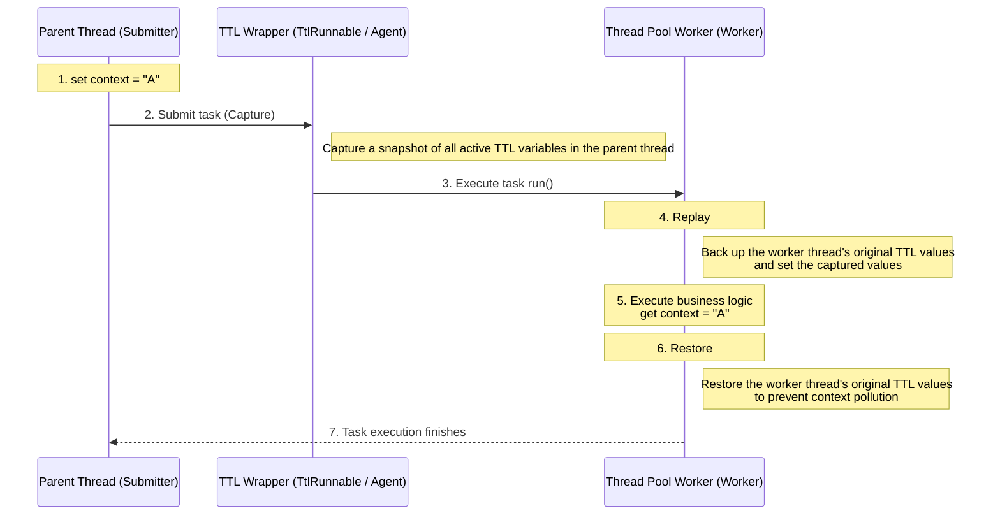

## ThreadLocal

### What Is ThreadLocal Used For?

Normally, variables we create can be accessed and modified by any thread, which can lead to data races and thread-safety issues in a multithreaded environment. So **how can we give each thread its own exclusive local variable?**

The `ThreadLocal` class provided in the JDK is designed specifically to solve this problem. **The `ThreadLocal` class allows each thread to bind its own value.** You can vividly think of it as a "box for storing data": each thread has its own independent box for storing private data, ensuring that data between different threads does not interfere with one another.

When you create a `ThreadLocal` variable, each thread that accesses it gets its own independent copy—which is where the name `ThreadLocal` comes from. Threads can retrieve their local copy via the `get()` method or modify its value via the `set()` method, thereby avoiding thread-safety issues.

Take a simple example: suppose two people go to a treasure room to collect treasures. If they share one bag, conflicts will inevitably arise; however, if each person has an independent bag, this problem will not occur. If we compare these two people to threads, then `ThreadLocal` is the mechanism used to prevent the two threads from competing over the same resource.

```java
public class ThreadLocalExample {
    private static ThreadLocal<Integer> threadLocal = ThreadLocal.withInitial(() -> 0);

    public static void main(String[] args) {
        Runnable task = () -> {
            int value = threadLocal.get();
            value += 1;
            threadLocal.set(value);
            System.out.println(Thread.currentThread().getName() + " Value: " + threadLocal.get());
        };

        Thread thread1 = new Thread(task, "Thread-1");
        Thread thread2 = new Thread(task, "Thread-2");

        thread1.start(); // Output: Thread-1 Value: 1
        thread2.start(); // Output: Thread-2 Value: 1
    }
}
```

### ⭐️ Do You Understand the Principles Behind ThreadLocal?

Let's start from the source code of the `Thread` class.

```java
public class Thread implements Runnable {
    //......
    // ThreadLocal values pertaining to this thread. This map is maintained by the ThreadLocal class
    ThreadLocal.ThreadLocalMap threadLocals = null;

    // InheritableThreadLocal values pertaining to this thread. This map is maintained by the InheritableThreadLocal class
    ThreadLocal.ThreadLocalMap inheritableThreadLocals = null;
    //......
}
```

From the `Thread` class source code above, we can see that the `Thread` class contains a `threadLocals` variable and an `inheritableThreadLocals` variable, both of type `ThreadLocalMap`. We can think of `ThreadLocalMap` as a customized `HashMap` implemented by the `ThreadLocal` class. By default, both variables are `null`; they are only created when the current thread calls `ThreadLocal`'s `set` or `get` method. In reality, when calling these two methods, we are invoking the corresponding `get()` and `set()` methods on the `ThreadLocalMap` class.

The `set()` method of the `ThreadLocal` class:

```java
public void set(T value) {
    // Get the current requesting thread
    Thread t = Thread.currentThread();
    // Retrieve the threadLocals variable inside the Thread class (hash table structure)
    ThreadLocalMap map = getMap(t);
    if (map != null)
        // Put the value to be stored into this hash table
        map.set(this, value);
    else
        createMap(t, value);
}
ThreadLocalMap getMap(Thread t) {
    return t.threadLocals;
}
```

From what we have seen above, we can easily deduce the conclusion: **the actual variable is stored in the current thread's `ThreadLocalMap`, not on `ThreadLocal` itself; `ThreadLocal` can be understood simply as a wrapper around `ThreadLocalMap` that passes variable values.** Inside the `ThreadLocal` class, after obtaining the current thread object via `Thread.currentThread()`, calling `getMap(Thread t)` directly accesses that thread's `ThreadLocalMap` object.

**Each `Thread` has a `ThreadLocalMap`, and `ThreadLocalMap` can store key-value pairs with `ThreadLocal` as the key and an `Object` as the value.**

```java
ThreadLocalMap(ThreadLocal<?> firstKey, Object firstValue) {
    //......
}
```

For example, if we declare two `ThreadLocal` objects in the same thread, `Thread` internally uses its single `ThreadLocalMap` to store the data—the key of `ThreadLocalMap` is the `ThreadLocal` object, and the value is whatever value was set by calling that `ThreadLocal` object's `set` method.

The data structure of `ThreadLocal` is shown in the diagram below:


`ThreadLocalMap` is a static inner class of `ThreadLocal`.


### ⭐️ How Does the ThreadLocal Memory Leak Issue Occur?

The root cause of `ThreadLocal` memory leaks lies in its internal implementation mechanism.

From the content above, we already know that each thread maintains a map named `ThreadLocalMap`. When you use `ThreadLocal` to store a value, it actually stores the value in the current thread's `ThreadLocalMap`, where the `ThreadLocal` instance itself serves as the key and the value you want to store serves as the value.

The source code of `ThreadLocal`'s `set()` method is as follows:

```java
public void set(T value) {
    Thread t = Thread.currentThread(); // Get the current thread
    ThreadLocalMap map = getMap(t);   // Get the current thread's ThreadLocalMap
    if (map != null) {
        map.set(this, value);         // Set the value
    } else {
        createMap(t, value);          // Create a new ThreadLocalMap
    }
}
```

In `ThreadLocalMap`'s `set()` and `createMap()` methods, the `ThreadLocal` object itself is not stored directly; instead, `ThreadLocal`'s hash value is used to compute the array index, and it is ultimately stored in an array of type `static class Entry extends WeakReference<ThreadLocal<?>>`.

```java
int i = key.threadLocalHashCode & (len-1);
```

`ThreadLocalMap`'s `Entry` is defined as follows:

```java
static class Entry extends WeakReference<ThreadLocal<?>> {
    Object value;

    Entry(ThreadLocal<?> k, Object v) {
        super(k);
        value = v;
    }
}
```

Reference mechanism of `ThreadLocalMap`'s `key` and `value`:

- **The key is a weak reference**: The key in `ThreadLocalMap` is a weak reference to `ThreadLocal` (`WeakReference<ThreadLocal<?>>`). This means that if a `ThreadLocal` instance is no longer pointed to by any strong reference, the Garbage Collector will reclaim the instance at the next GC, causing the corresponding key in `ThreadLocalMap` to become `null`.
- **The value is a strong reference**: Even if the `key` is reclaimed by GC, the `value` still has a strong reference from `ThreadLocalMap.Entry` and cannot be reclaimed by GC.

Once a `ThreadLocal` instance loses its strong references, its corresponding value still exists in `ThreadLocalMap` because the `Entry` object holds a strong reference to it. If the thread stays alive continuously (for example, a thread in a thread pool), `ThreadLocalMap` will also continue to exist, causing entries whose key is `null` to be unable to be garbage-collected—resulting in a memory leak.

In other words, two conditions must be met simultaneously for a memory leak to occur:

1. The `ThreadLocal` instance is no longer strongly referenced;
2. The thread remains alive, causing `ThreadLocalMap` to persist long-term.

Although `ThreadLocalMap` attempts to clean up entries whose key is `null` during `get()`, `set()`, and `remove()` operations, this cleanup mechanism is passive and not completely reliable.

**How can memory leaks be avoided?**

1. Always call the `remove()` method after finishing with `ThreadLocal`. This is the safest and most recommended practice. The `remove()` method explicitly removes the corresponding entry from `ThreadLocalMap`, completely eliminating the risk of a memory leak. Even when `ThreadLocal` is defined as `static final`, it is strongly recommended to call `remove()` after each use.
2. In scenarios where threads are reused, such as thread pools, using a `try-finally` block ensures that `remove()` is guaranteed to execute even if an exception occurs.

#### Why Is the Entry's Key Designed as a Weak Reference?

This is a classic interview follow-up question. Many developers know that `ThreadLocalMap`'s key is a weak reference, yet do not understand **why it was designed this way** or what would happen if it were changed to a strong reference.

First, let's examine the complete reference chain. When a thread uses `ThreadLocal`, the following reference relationships are involved:

```
Strong reference (stack / static variable) ────────→ ThreadLocal instance
                                                      ↑
Thread ──→ ThreadLocalMap ──→ Entry ─── key (WeakReference) ──┘
                                │
                                └─── value (strong reference) ──→ Actual stored object
```

With this reference chain in mind, let's compare the two design options:

**Suppose the key used a strong reference (not actually adopted):**

When the `ThreadLocal` reference in business code is set to `null` (for example, the method finishes executing and the object is reclaimed), even though the business code no longer needs this `ThreadLocal`, the Entry in `ThreadLocalMap` holds a **strong reference** to the key, so the `ThreadLocal` instance still cannot be reclaimed by GC. As long as the thread does not terminate, both this `ThreadLocal` and its corresponding value will remain in memory forever, causing a memory leak where **neither the key nor the value can be reclaimed**.

**The key uses a weak reference (the actually adopted approach):**

When the `ThreadLocal` reference in business code is set to `null`, because the Entry's key is a weak reference, the `ThreadLocal` instance will be reclaimed at the next GC, and the key becomes `null`. At this point, although the value still exists (via a strong reference), when `ThreadLocalMap` performs operations like `get()`, `set()`, or `remove()`, it proactively probes and cleans up these "stale entries" whose key is `null`, thereby freeing the value object.

In other words, **designing the key as a weak reference is a "safety net" defense mechanism**—even if the developer forgets to call `remove()`, the JVM's GC working together with `ThreadLocalMap`'s self-cleanup logic still has a chance to reclaim the leaked data. If a strong reference were used instead, forgetting `remove()` would leave no opportunity for recovery at all.

> Note that this self-cleanup mechanism is **passively triggered** (only cleaning up opportunistically during `get`/`set`/`remove` operations) and cannot guarantee that all stale entries are cleaned up promptly. Therefore, **weak references only reduce the risk of memory leaks without completely eliminating them**; manually calling `remove()` is still mandatory.

#### Special Risks in Thread Pool Scenarios

One of the conditions for a memory leak mentioned above is that "the thread remains alive." When creating threads with `new Thread()`, a thread is destroyed after finishing execution, and its `ThreadLocalMap` is reclaimed by GC along with it, so the impact of a leak is relatively limited.

However, in **thread pool** scenarios, the problem is severely amplified. Core threads in a thread pool are not destroyed by default; instead, they are repeatedly reused to execute different tasks. This means:

1. **Memory leaks can accumulate**: If tasks keep creating new temporary `ThreadLocal` instances, or use multiple `ThreadLocal`s without cleaning them up, after the keys lose strong references and are collected, the corresponding values may still remain in the reused thread's `ThreadLocalMap`. Repeatedly calling `set()` on the same still-reachable `ThreadLocal` usually replaces the old value, yet the latest value will still remain until it is overwritten, removed, cleaned up, or the thread terminates.
2. **Data pollution (dirty data)**: If a `ThreadLocal` value set by a previous task is not cleaned up, the next task assigned to the same thread can read that leftover value. This can lead to serious business logic bugs—for instance, User A's request reading User B's identity information.

**Real incident case from the Meituan engineering team:**

In the article [Java Thread Pool Implementation Principles and Practices in Meituan Business](https://tech.meituan.com/2020/04/02/java-pooling-pratice-in-meituan.html), the Meituan engineering team documented a production incident caused by improper `ThreadLocal` usage: in a web application that relied on `ThreadLocal` to pass user context, because a thread pool was used to handle requests and `ThreadLocal` was not cleared after each request ended, **subsequent requests reusing the same thread read the user information left over from the previous request**, causing a severe cross-user data mix-up.

#### Mandatory Guidelines from the Alibaba Java Development Manual

Precisely because the combination of thread pools + `ThreadLocal` is so prone to pitfalls, the *Alibaba Java Development Manual* sets a **Mandatory** rule in its "Concurrency Handling" chapter:

> **[Mandatory]** Custom `ThreadLocal` variables that store values for the current thread must be reclaimed, especially in thread pool scenarios where threads are frequently reused. Failing to clean up custom `ThreadLocal` variables may affect subsequent business logic and cause issues such as memory leaks. Try to reclaim them using a `try-finally` block in your code.

The proper usage pattern is as follows:

```java
// Declare as static final to avoid repeatedly creating ThreadLocal instances
private static final ThreadLocal<UserContext> userContextHolder = new ThreadLocal<>();

public void processRequest(HttpServletRequest request) {
    try {
        // Set value inside the try block
        UserContext context = buildUserContext(request);
        userContextHolder.set(context);

        // Execute business logic
        doBusinessLogic();
    } finally {
        // Must clean up in the finally block to ensure execution regardless of whether an exception occurs
        userContextHolder.remove();
    }
}
```

There are three key takeaways here:

1. **Declare `ThreadLocal` as `static final`**: Ensures that the `ThreadLocal` instance corresponding to this field is not recreated on every call, avoiding stale entries left behind when old instances lose strong references; this does not mean the entire application can only have one `ThreadLocal` instance.
2. **`try-finally` guarantees `remove()` is always executed**: Even if business logic throws an exception, the `finally` block ensures the `ThreadLocal` is cleaned up.
3. **Clean up immediately after use instead of relying on overwriting before the next use**: Calling `set()` on the same `ThreadLocal` replaces the old value, yet before the next task arrives, the old value is still held by the thread; if the code switches to using another `ThreadLocal`, stale entries can linger long-term. Calling `remove()` in `finally` right after use promptly avoids memory consumption and data pollution.

### ⭐️ How Can ThreadLocal Values Be Passed Across Threads?

**Why does ThreadLocal fail in asynchronous scenarios?**

`ThreadLocal` values are not stored inside the `ThreadLocal` object, but rather inside `Thread`:

```java
Thread → ThreadLocalMap → Entry(ThreadLocal, value)
```

The `ThreadLocal` data structure is shown below:


Asynchronous execution often means a task switches from the current thread to another thread (such as a worker thread in a thread pool) for execution. Because different threads each maintain their own separate `ThreadLocalMap`, `ThreadLocal` context cannot be automatically propagated during asynchronous execution by default.

**How can ThreadLocal values be passed across threads?**

To solve this problem, there are two mainstream solutions in the industry: one is native to the JDK, and the other is open-sourced by Alibaba.

1. `InheritableThreadLocal`: A class provided since JDK 1.2 that extends `ThreadLocal`. When using `InheritableThreadLocal`, creating a child thread causes the child thread to inherit the `ThreadLocal` values from the parent thread, but it cannot support `ThreadLocal` value propagation in thread pool scenarios.
2. `TransmittableThreadLocal`: `TransmittableThreadLocal` (abbreviated as TTL) is an open-source utility class from Alibaba that extends and enhances `InheritableThreadLocal` to support `ThreadLocal` value propagation in thread pool scenarios. Project repository: <https://github.com/alibaba/transmittable-thread-local>.

#### Principles of InheritableThreadLocal

`InheritableThreadLocal` enables inheriting the parent thread's `ThreadLocal` values when creating an asynchronous thread. Provided by the JDK team, it achieves `ThreadLocal` value propagation during thread creation by modifying the `Thread` class in the JDK source package.

**Where are `InheritableThreadLocal` values stored?**

A new `ThreadLocalMap` named `inheritableThreadLocals` was added to the `Thread` class to store `ThreadLocal` values that need to be propagated across threads, as shown below:

```java
class Thread implements Runnable {
    ThreadLocal.ThreadLocalMap threadLocals = null;
    ThreadLocal.ThreadLocalMap inheritableThreadLocals = null;
}
```

**How is `ThreadLocal` value propagation accomplished?**

This is achieved by modifying the constructor of the `Thread` class: when creating a `Thread`, it retrieves the parent thread's `inheritableThreadLocals` variable and assigns it to the child thread. Relevant code is as follows:

```java
// Thread's constructor calls the init() method
private void init(/* ... */) {
	// 1. Get the parent thread
    Thread parent = currentThread();
    // 2. Assign the parent thread's inheritableThreadLocals to the child thread
    if (inheritThreadLocals && parent.inheritableThreadLocals != null)
        this.inheritableThreadLocals =
        	ThreadLocal.createInheritedMap(parent.inheritableThreadLocals);
}
```

**What is the problem with the `InheritableThreadLocal` approach?**

The flaw of this approach is its **one-time nature**—that is, copying only happens once when the thread is created. However, in modern development, we make heavy use of thread pools, and threads in a thread pool are reused.

Imagine this: Task A executes in Thread 1 and passes its `ThreadLocal` value to Child Thread 2 inside the thread pool. After Task A finishes, Thread 1 goes idle. Next, Task B arrives and executes in Thread 3, and the thread pool reuses that same Child Thread 2 to run part of Task B. At this moment, Child Thread 2's `ThreadLocal` still holds stale dirty data passed by Task A, while Task B's context (from Thread 3) was never passed over at all. This leads to both data pollution and context loss.

#### Principles of TransmittableThreadLocal

The JDK does not support `ThreadLocal` value propagation in thread pool scenarios by default, so Alibaba open-sourced `TransmittableThreadLocal` to implement this capability.

Since Alibaba cannot modify JDK source code, TTL cleverly uses the **Decorator Pattern** to enhance tasks (`Runnable`/`Callable`) or thread pools (`Executor`), deferring context propagation from "thread creation time" to "task submission and execution time."

TTL's core logic can be summarized into three phases (CRR):

- **Capture**: At the moment a task is submitted (such as calling `execute`), `TtlRunnable` invokes `TransmittableThreadLocal.Transmitter.capture()`. Through an internally maintained `holder` collection, it captures all active TTL variables in the current parent thread and stores them in a snapshot.
- **Replay**: Before the thread pool worker thread executes the `run()` method, `replay()` is called. It calls `set` to apply the snapshot values onto the current worker thread and backs up the thread's original old values.
- **Restore**: After task execution completes, `restore()` is called. Based on the backup, it restores the worker thread to its state prior to execution, preventing context pollution or memory leaks.

This diagram is the sequence diagram of the entire CRR process provided officially by TTL:


A bit hard to follow? Take a look at this CRR sequence diagram I drew—it's clearer and more intuitive:



In other words, the essence of TTL is to Capture context upon task submission, Replay context before task execution, and Restore thread state after the task finishes, thereby safely supporting `ThreadLocal` propagation in thread pools.

TTL offers two main integration approaches, which can be chosen based on intrusiveness requirements and refactoring cost.

**1. Explicit Wrapping (Manual Integration)**

Wrap tasks using `TtlRunnable.get(Runnable)` or `TtlCallable.get(Callable)`, and wrap thread pools using `TtlExecutors.getTtlExecutor(Executor)` or `getTtlExecutorService(...)`. This approach is clear and controllable, though it requires cooperation in business code and introduces a degree of intrusiveness.

The code below demonstrates how TTL safely passes and isolates `ThreadLocal` context via CRR while supporting thread pool reuse and rejection policies.

```java
public class TtlContextHolder {
    private static final Logger log = LoggerFactory.getLogger(TtlContextHolder.class);

    // 1. Use static final to ensure the TTL instance is not repeatedly created, preventing memory leaks
    // Override copy method (optional): for reference types, deep copy is recommended
    private static final TransmittableThreadLocal<String> CONTEXT = new TransmittableThreadLocal<String>() {
        @Override
        public String copy(String parentValue) {
            // Default returns the reference directly; for mutable objects (like Map), instantiate a new object here
            return parentValue;
        }
    };

    // 2. Thread pool initialization: ensure it is wrapped by TtlExecutors only once
    private static final ExecutorService TTL_EXECUTOR_SERVICE;

    static {
        ExecutorService rawExecutor = new ThreadPoolExecutor(
                2, 4, 60L, TimeUnit.SECONDS,
                new LinkedBlockingQueue<>(1000), (Runnable r) -> new Thread(r, "ttl-worker-" + r.hashCode()),
                new ThreadPoolExecutor.CallerRunsPolicy() // Key: TTL supports this rejection policy seamlessly
        );
        // Wrap the raw thread pool
        TTL_EXECUTOR_SERVICE = TtlExecutors.getTtlExecutorService(rawExecutor);
    }

    public static void main(String[] args) throws Exception {
        try {
            // 3. Set context in the parent thread
            CONTEXT.set("value-set-in-parent");
            log.info("Parent thread context: {}", CONTEXT.get());

            // 4. Use Lambda to simplify task submission
            TTL_EXECUTOR_SERVICE.execute(() -> {
                log.info("Async task (Runnable) reads context: {}", CONTEXT.get());
                // Simulate business logic
                // Note: whether child thread modification affects parent thread depends on whether copy() performs a deep copy
                CONTEXT.set("value-modified-in-child");
            });

            Future<String> future = TTL_EXECUTOR_SERVICE.submit(() -> {
                log.info("Async task (Callable) reads context: {}", CONTEXT.get());
                return "Success";
            });

            future.get();

            // 5. Verify whether the parent thread context is polluted
            log.info("Parent thread final context: {}", CONTEXT.get());

        } finally {
            // 6. Clean up current thread (parent thread) context; child thread context is automatically restored by TTL's Restore mechanism
            CONTEXT.remove();
        }
    }
}
```

Output:

```bash
09:06:31.438 INFO  [main] TtlContextHolder - Parent thread context: value-set-in-parent
09:06:31.452 INFO  [ttl-worker-1663166483] TtlContextHolder - Async task (Runnable) reads context: value-set-in-parent
09:06:31.453 INFO  [ttl-worker-841283083] TtlContextHolder - Async task (Callable) reads context: value-set-in-parent
09:06:31.453 INFO  [main] TtlContextHolder - Parent thread final context: value-set-in-parent
```

If you want to test this code, remember to add the Maven dependency for TTL:

```xml
<dependency>
    <groupId>com.alibaba</groupId>
    <artifactId>transmittable-thread-local</artifactId>
    <version>2.14.4</version>
</dependency>
```

**2. Non-intrusive Integration (Java Agent)**

Using a Java Agent to perform bytecode enhancement on thread-pool-related classes during class loading automatically weaves in TTL's context-passing logic, achieving zero-modification context propagation in business code. With this approach, business code does not need to be aware of TTL's existence, though the implementation complexity is relatively higher.

The TTL Agent decorates the following JDK executor components by default:

1. **Standard thread pools**: `java.util.concurrent.ThreadPoolExecutor` and `java.util.concurrent.ScheduledThreadPoolExecutor`.
2. **ForkJoin family**: `java.util.concurrent.ForkJoinTask` (thereby transparently supporting `CompletableFuture` and Java 8 parallel `Stream`s).
3. **Legacy components**: `java.util.TimerTask` (supported since v2.7.0, enabled by default since v2.11.2).

Add the `-javaagent` configuration to the Java startup arguments:

```bash
# Basic configuration
java -javaagent:path/to/transmittable-thread-local-2.x.y.jar \
     -cp classes \
     com.your.app.Main
```

#### Application Scenarios

1. **Stress-testing traffic tagging**: In stress-testing scenarios, `ThreadLocal` is used to store a stress-test tag to distinguish stress-test traffic from real production traffic. If the tag is lost, stress-test traffic could mistakenly be processed as live production traffic.
2. **Context propagation**: In distributed systems, propagating distributed tracing information (such as Trace ID) or user context information.

#### Summary

By default, `ThreadLocal` values cannot be passed across threads because their values are stored inside **each `Thread` object's own** `ThreadLocalMap`, and parent and child threads are two distinct objects.

To solve this problem, there are two main approaches:

1. **JDK's InheritableThreadLocal**: When **creating a child thread**, it **copies** the parent thread's values to the child thread. However, its issue is that it fails in **thread pool** scenarios, because thread pools **reuse** threads, which can cause a thread to read **dirty data** passed down from a previous task.
2. **Alibaba's TransmittableThreadLocal (TTL)**: This is the solution we use in projects, specifically built to address the thread pool problem. Its principle is that when **submitting a task** to a thread pool, it **captures** the parent thread's `ThreadLocal` values and **binds** them to the task. When a thread in the pool is about to execute the task, it **sets** those captured values onto that thread, and **cleans** them up after the task completes.

Put simply: **InheritableThreadLocal is bound to the thread and only takes effect at creation time; TTL is bound to the task and supports thread pools seamlessly.**

## Thread Pool

### What Is a Thread Pool?

As the name implies, a thread pool is a resource pool that manages a collection of threads. When there is a task to process, a thread is retrieved directly from the pool to handle it; once processing finishes, the thread is not immediately destroyed, but instead waits for the next task.

### ⭐️ Why Use a Thread Pool?

Pooling technology should already be very familiar to everyone—thread pools, database connection pools, HTTP connection pools, and the like are all applications of this idea. The core philosophy of pooling technology is mainly to reduce the overhead of acquiring resources each time and improve resource utilization.

A thread pool provides a way to limit and manage resources (including executing a task). Each thread pool also maintains basic statistics, such as the number of completed tasks. Using a thread pool mainly brings the following benefits:

1. **Reduce resource consumption**: Threads in a thread pool can be reused. Once a thread finishes a task, it is not destroyed immediately; instead, it returns to the pool to wait for the next task. This avoids the overhead caused by frequently creating and destroying threads.
2. **Improve response speed**: Because a thread pool typically maintains a certain number of core threads (or "resident workers"), when a task arrives, it can be handed directly to one of these existing idle threads for execution, eliminating thread creation time so the task can be processed faster.
3. **Improve thread manageability**: A thread pool allows us to centrally manage threads in the pool. We can configure the pool size (core pool size, maximum pool size), task queue type and capacity, rejection policy, and more. This lets us control the total number of concurrent threads, prevent resource exhaustion, and ensure system stability. Meanwhile, thread pools usually provide monitoring interfaces that make it easy to observe the pool's runtime status (such as how many active threads exist and how many tasks are queued), facilitating performance tuning.

### How Do You Create a Thread Pool?

In Java, there are two main ways to create a thread pool:

**Method 1: Create directly via the `ThreadPoolExecutor` constructor (Recommended)**


The "default thread factory" and "default rejection policy" in the diagram mean that when the current constructor does not explicitly pass the corresponding parameter, `ThreadPoolExecutor` uses its default implementation—this is not a mismatch between the methods and their descriptions.

This is the most recommended approach because it allows developers to explicitly specify the core parameters of the thread pool and exercise finer control over its runtime behavior, thereby avoiding the risk of resource exhaustion.

**Method 2: Create via the `Executors` utility class (Not recommended for production environments)**

The methods provided by the `Executors` utility class for creating thread pools are shown in the diagram below:


As shown, the `Executors` utility class can create several types of thread pools, including:

- `FixedThreadPool`: During normal operation, it uses at most a fixed number of worker threads. A thread can be replaced if it terminates due to an exception, and threads exit when the pool shuts down, so the count does not remain constant throughout the entire lifecycle. When a new task is submitted, if an idle thread is available in the pool, it executes immediately; if not, the new task is temporarily stored in a task queue and processed once a thread becomes idle.
- `SingleThreadExecutor`: A thread pool with only one thread. If more than one task is submitted to this pool, tasks are saved in a task queue and executed in FIFO order once the thread becomes idle.
- `CachedThreadPool`: A thread pool that adjusts its thread count according to actual demand. The number of threads in the pool is unbounded; if idle threads are available for reuse, reusable threads are preferred. If all threads are busy and a new task is submitted, a new thread is created to handle the task. Once any thread finishes its current task, it returns to the pool for reuse.
- `ScheduledThreadPool`: A thread pool that runs tasks after a given delay or executes tasks periodically.

### ⭐️ Why Are Built-in Thread Pools Not Recommended?

In the "Concurrency Handling" chapter of the *Alibaba Java Development Manual*, it is explicitly stated that thread resources must be provided through thread pools and must not be explicitly created manually in applications.

**Why?**

> The benefit of using a thread pool is to reduce the time and system resource overhead spent creating and destroying threads and solve resource shortage issues. Without a thread pool, the system may create a large number of similar threads, leading to memory exhaustion or "excessive context switching."

In addition, the *Alibaba Java Development Manual* mandates that thread pools must not be created using `Executors`, and must instead be created via the `ThreadPoolExecutor` constructor. This approach ensures that developers clearly understand the execution rules of the thread pool and avoid the risk of resource exhaustion.

The drawbacks of the thread pool objects returned by `Executors` are as follows (we will cover these in detail later):

- `FixedThreadPool` and `SingleThreadExecutor`: Use the blocking queue `LinkedBlockingQueue`, whose maximum queue length is `Integer.MAX_VALUE`, which can be treated as unbounded—allowing a huge backlog of requests to accumulate and causing OOM.
- `CachedThreadPool`: Uses the synchronous queue `SynchronousQueue` and allows creating up to `Integer.MAX_VALUE` threads; if there are too many tasks and they execute slowly, a massive number of threads may be created, leading to OOM.
- `ScheduledThreadPool` and `SingleThreadScheduledExecutor`: Use the unbounded delayed blocking queue `DelayedWorkQueue`, whose maximum queue capacity is `Integer.MAX_VALUE` (effectively unbounded), which may accumulate a large number of requests and cause OOM.

```java
public static ExecutorService newFixedThreadPool(int nThreads) {
    // The default capacity of LinkedBlockingQueue is Integer.MAX_VALUE, which can be considered unbounded
    return new ThreadPoolExecutor(nThreads, nThreads,0L, TimeUnit.MILLISECONDS,new LinkedBlockingQueue<Runnable>());

}

public static ExecutorService newSingleThreadExecutor() {
    // The default capacity of LinkedBlockingQueue is Integer.MAX_VALUE, which can be considered unbounded
    return new FinalizableDelegatedExecutorService (new ThreadPoolExecutor(1, 1,0L, TimeUnit.MILLISECONDS,new LinkedBlockingQueue<Runnable>()));

}

// SynchronousQueue has no capacity, and the maximum number of threads is Integer.MAX_VALUE
public static ExecutorService newCachedThreadPool() {

    return new ThreadPoolExecutor(0, Integer.MAX_VALUE,60L, TimeUnit.SECONDS,new SynchronousQueue<Runnable>());

}

// DelayedWorkQueue (delayed blocking queue)
public static ScheduledExecutorService newScheduledThreadPool(int corePoolSize) {
    return new ScheduledThreadPoolExecutor(corePoolSize);
}
public ScheduledThreadPoolExecutor(int corePoolSize) {
    super(corePoolSize, Integer.MAX_VALUE, 0, NANOSECONDS,
          new DelayedWorkQueue());
}
```

### ⭐️ What Are the Common Parameters of a Thread Pool? How Are They Explained?

```java
    /**
     * Creates a new ThreadPoolExecutor with the given initial parameters.
     */
    public ThreadPoolExecutor(int corePoolSize,// Core pool size (number of core threads)
                              int maximumPoolSize,// Maximum pool size (max number of threads)
                              long keepAliveTime,// Max time excess idle threads wait for new tasks before terminating when thread count > corePoolSize
                              TimeUnit unit,// Time unit for keepAliveTime
                              BlockingQueue<Runnable> workQueue,// Work queue used to hold tasks waiting to be executed
                              ThreadFactory threadFactory,// Thread factory used to create threads (the default is usually sufficient)
                              RejectedExecutionHandler handler// Rejection policy used when submitted tasks exceed capacity and cannot be handled in time
                               ) {
        if (corePoolSize < 0 ||
            maximumPoolSize <= 0 ||
            maximumPoolSize < corePoolSize ||
            keepAliveTime < 0)
            throw new IllegalArgumentException();
        if (workQueue == null || threadFactory == null || handler == null)
            throw new NullPointerException();
        this.corePoolSize = corePoolSize;
        this.maximumPoolSize = maximumPoolSize;
        this.workQueue = workQueue;
        this.keepAliveTime = unit.toNanos(keepAliveTime);
        this.threadFactory = threadFactory;
        this.handler = handler;
    }
```

The 3 most important parameters of `ThreadPoolExecutor`:

- `corePoolSize`: By default, the number of threads kept in the thread pool even when idle; when core thread timeout is not enabled and the number of worker threads is less than this value, new tasks prioritize creating threads.
- `maximumPoolSize`: The maximum number of worker threads allowed to exist in the thread pool.
- `workQueue`: Once the number of worker threads reaches `corePoolSize`, new tasks first try to enter the queue; only when enqueuing fails and the number of worker threads is less than `maximumPoolSize` will the thread pool continue creating threads.

Other common parameters of `ThreadPoolExecutor`:

- `keepAliveTime`: When the number of threads in the pool exceeds `corePoolSize`—meaning there are non-core threads (threads other than core threads in the pool)—these non-core threads are not immediately destroyed when idle; instead, they wait and are only reclaimed and destroyed after remaining idle longer than `keepAliveTime`.
- `unit`: The time unit for the `keepAliveTime` parameter.
- `threadFactory`: Used when the executor creates new threads.
- `handler`: The rejection policy (which will be explained in detail below).

The diagram below helps deepen your understanding of the relationships among the parameters in a thread pool (image source: *Java Performance Tuning in Action*):


### Will Core Threads in a Thread Pool Be Reclaimed?

By default, `ThreadPoolExecutor` does not reclaim core threads, even if they are idle. This is to reduce the overhead of thread creation, since core threads are typically meant to stay alive long-term. However, if a thread pool is used periodically at low frequency (with noticeable idle intervals between cycles), you can consider passing `true` to `allowCoreThreadTimeOut(boolean value)` so that idle core threads (for the duration specified by `keepAliveTime`) are also reclaimed.

```java
public void allowCoreThreadTimeOut(boolean value) {
    // Core threads must have keepAliveTime > 0 to enable the timeout mechanism
    if (value && keepAliveTime <= 0) {
        throw new IllegalArgumentException("Core threads must have nonzero keep alive times");
    }
    // Set the value of allowCoreThreadTimeOut
    if (value != allowCoreThreadTimeOut) {
        allowCoreThreadTimeOut = value;
        // If timeout is enabled, clean up all idle threads, including core threads
        if (value) {
            interruptIdleWorkers();
        }
    }
}
```

### What State Are Core Threads In When Idle?

When core threads are idle, their state falls into two cases:

- **Core thread timeout is configured**: While idle, the core thread stays in the `WAITING` state waiting to acquire a task. If the blocking wait exceeds the core thread keep-alive time, the thread exits work, is removed from the pool's worker thread set, and its thread state transitions to `TERMINATED`.
- **Core thread timeout is not configured**: While idle, the core thread remains in the `WAITING` state indefinitely waiting for tasks, and stays alive inside the thread pool permanently.

When an available task enters the queue, the blocked thread is woken up, its state transitions from `WAITING` to `RUNNABLE`, and it proceeds to execute the corresponding task.

Next, let's look at the relevant source code to understand how the thread pool works internally.

Threads inside a thread pool are abstracted as `Worker`s. After a `Worker` starts, it continuously fetches tasks from the task queue.

When fetching a task, the behavior for pulling from the task queue (`BlockingQueue`) is determined by the `timed` flag.

If "core thread timeout is enabled" or "the thread count exceeds the core pool size," `timed` is marked as `true`, indicating that `poll()` with a timeout must be used when fetching a task.

- `timed == true`: Uses `poll(timeout, unit)` to fetch a task. If `poll(timeout, unit)` times out, the current thread exits execution (`TERMINATED`) and is removed from the thread pool.
- `timed == false`: Uses `take()` to fetch a task. Calling `take()` blocks the current thread indefinitely while waiting (`WAITING`).

The source code is as follows:

```java
// ThreadPoolExecutor
private Runnable getTask() {
    boolean timedOut = false;
    for (;;) {
        // ...

        // 1. If core thread timeout is enabled or worker count > corePoolSize, timed is true.
        boolean timed = allowCoreThreadTimeOut || wc > corePoolSize;
        // 2. Decrement worker count.
        // wc > maximumPoolSize: the number of threads in the pool exceeds maximumPoolSize, where wc is the worker count.
        // timed && timedOut: timedOut indicates fetching a task timed out.
        // Two cases: core thread timeout is enabled && task fetch timed out -> decrement worker count;
        // or worker count > corePoolSize && task fetch timed out -> decrement worker count.
        if ((wc > maximumPoolSize || (timed && timedOut))
            && (wc > 1 || workQueue.isEmpty())) {
            if (compareAndDecrementWorkerCount(c))
                return null;
            continue;
        }
        try {
            // 3. If timed is true, use poll() to get task; otherwise, use take() to get task.
            Runnable r = timed ?
                workQueue.poll(keepAliveTime, TimeUnit.NANOSECONDS) :
                workQueue.take();
            // 4. Return the task once obtained.
            if (r != null)
                return r;
            timedOut = true;
        } catch (InterruptedException retry) {
            timedOut = false;
        }
    }
}
```

### ⭐️ What Are the Rejection Policies of a Thread Pool?

When the number of concurrently running threads reaches `maximumPoolSize` and the queue is also full of tasks, `ThreadPoolExecutor` defines several policies:

- `ThreadPoolExecutor.AbortPolicy`: Throws `RejectedExecutionException` to reject processing the new task.
- `ThreadPoolExecutor.CallerRunsPolicy`: Runs the task using the caller's own thread—that is, runs (`run`) the rejected task directly in the thread that called `execute`. If the executor has already been shut down, the task is discarded. Consequently, this policy slows down the submission rate of new tasks and affects overall program performance. If your application can tolerate this latency and you require every task request to be executed, you can choose this policy.
- `ThreadPoolExecutor.DiscardPolicy`: Does not process the new task and simply discards it silently.
- `ThreadPoolExecutor.DiscardOldestPolicy`: Discards the oldest unprocessed task request in the queue.

For example, when Spring creates a thread pool via `ThreadPoolTaskExecutor` or when we directly call the `ThreadPoolExecutor` constructor without specifying a `RejectedExecutionHandler`, `AbortPolicy` is used by default. Under this rejection policy, if the queue becomes full, `ThreadPoolExecutor` throws a `RejectedExecutionException` to reject incoming tasks, which means you will lose processing for that task. If you want to avoid dropping tasks directly while the thread pool is still running, you can use `CallerRunsPolicy` to fall back to executing the task on the thread calling `execute()`; if the thread pool has already been shut down, this policy still discards the task.

```java
public static class CallerRunsPolicy implements RejectedExecutionHandler {

        public CallerRunsPolicy() { }

        public void rejectedExecution(Runnable r, ThreadPoolExecutor e) {
            if (!e.isShutdown()) {
                // Execute directly on the caller (e.g., main) thread instead of a thread in the pool
                r.run();
            }
        }
    }
```

### If You Want to Avoid Dropping Tasks When Saturated, Which Rejection Policy Should You Choose?

For scenarios where the thread pool is still running and the calling thread can accept synchronous task execution, you can consider `CallerRunsPolicy`. It cannot provide an "under no circumstances will tasks ever be lost" guarantee: once the thread pool is shut down, tasks are discarded, and an in-memory rejection policy cannot recover tasks if the process crashes; when strong guarantees are required, it should be combined with persistence or a message queue.

Let's examine this together with the source code of `CallerRunsPolicy`:

```java
public static class CallerRunsPolicy implements RejectedExecutionHandler {

        public CallerRunsPolicy() { }


        public void rejectedExecution(Runnable r, ThreadPoolExecutor e) {
            // As long as the executor is not shut down, execute the task on the thread that called execute
            if (!e.isShutdown()) {

                r.run();
            }
        }
    }
```

As seen in the source code, as long as the executor has not been shut down, the task will be executed by the thread that called the `execute` method.

### What Are the Risks of the CallerRunsPolicy Rejection Policy? How Can They Be Solved?

As mentioned above, if you want to apply backpressure through the calling thread when the thread pool is saturated and try to avoid dropping tasks directly, `CallerRunsPolicy` is an option.

However, if the task that triggers `CallerRunsPolicy` is very time-consuming and the thread submitting tasks is the main thread, it can block the main thread and disrupt normal program operation.

Here is a simple example. This thread pool sets a maximum thread count of 2 and a blocking queue size of 1 (meaning the 4th task will hit the rejection policy), and `ThreadUtil` is a utility class provided by Hutool:

```java
public class ThreadPoolTest {

    private static final Logger log = LoggerFactory.getLogger(ThreadPoolTest.class);

    public static void main(String[] args) {
        // Create a thread pool with corePoolSize=1 and maximumPoolSize=2.
        // When thread count > corePoolSize, excess idle threads survive at most 60 seconds.
        // Work queue is an ArrayBlockingQueue of capacity 1, and saturation policy is CallerRunsPolicy.
        ThreadPoolExecutor threadPoolExecutor = new ThreadPoolExecutor(1,
                2,
                60,
                TimeUnit.SECONDS,
                new ArrayBlockingQueue<>(1),
                new ThreadPoolExecutor.CallerRunsPolicy());

        // Submit the 1st task, executed by a core thread
        threadPoolExecutor.execute(() -> {
            log.info("Core thread executes the 1st task");
            ThreadUtil.sleep(1, TimeUnit.MINUTES);
        });

        // Submit the 2nd task; since core thread is busy, it enters the queue to wait
        threadPoolExecutor.execute(() -> {
            log.info("Non-core thread handles the queued 2nd task");
            ThreadUtil.sleep(1, TimeUnit.MINUTES);
        });

        // Submit the 3rd task; since core thread is busy and queue is full, a non-core thread is created to handle it
        threadPoolExecutor.execute(() -> {
            log.info("Non-core thread handles the 3rd task");
            ThreadUtil.sleep(1, TimeUnit.MINUTES);
        });

        // Submit the 4th task; since both core and non-core threads are busy and the queue is full,
        // under CallerRunsPolicy, the task is executed by the submitting thread (i.e., the main thread)
        threadPoolExecutor.execute(() -> {
            log.info("Main thread handles the 4th task");
            ThreadUtil.sleep(2, TimeUnit.MINUTES);
        });

        // Submit the 5th task; since the main thread is blocked by the 4th task, this task cannot be submitted until the main thread finishes
        threadPoolExecutor.execute(() -> {
            log.info("Core thread executes the 5th task");
        });

        // Shut down the thread pool
        threadPoolExecutor.shutdown();
    }
}

```

Output:

```bash
18:19:48.203 INFO  [pool-1-thread-1] c.j.concurrent.ThreadPoolTest - Core thread executes the 1st task
18:19:48.203 INFO  [pool-1-thread-2] c.j.concurrent.ThreadPoolTest - Non-core thread handles the 3rd task
18:19:48.203 INFO  [main] c.j.concurrent.ThreadPoolTest - Main thread handles the 4th task
18:20:48.212 INFO  [pool-1-thread-2] c.j.concurrent.ThreadPoolTest - Non-core thread handles the queued 2nd task
18:21:48.219 INFO  [pool-1-thread-2] c.j.concurrent.ThreadPoolTest - Core thread executes the 5th task
```

From the output, we can see that because of the `CallerRunsPolicy` rejection policy, a slow task ended up executing on the main thread, blocking task submission and preventing subsequent tasks from executing promptly—and in severe cases, this can easily lead to OOM.

Starting from the root of the problem: the caller chose `CallerRunsPolicy` because they want every task to be executed, while tasks that cannot be processed immediately are buffered in the `BlockingQueue`. Thus, when memory permits, we can increase the size of the `BlockingQueue` and adjust the heap memory to accommodate more tasks, ensuring they can all be executed properly.

To make full use of the CPU, we can also tune the thread pool's `maximumPoolSize` parameter, which increases task processing throughput and prevents too many tasks from piling up in the `BlockingQueue` and exhausting memory.


If server resources have already reached their usable limit, we need to change the scheduling strategy of the thread pool at the design level. As we know, the reason the main thread gets blocked is that we do not want any task to be dropped. Thinking from another angle, is there a way to ensure no tasks are dropped while processing them promptly when the server has spare capacity?

One approach offered here is **task persistence**, which includes but is not limited to:

1. Designing a task table to store tasks in a MySQL database.
2. Caching tasks in Redis.
3. Submitting tasks to a message queue.

Taking Option 1 as an example, here is a brief overview of the implementation logic:

1. Implement the `RejectedExecutionHandler` interface to build a custom rejection policy responsible for persisting tasks that the thread pool temporarily cannot handle (when the blocking queue is full) into the database (saved to MySQL). Note: tasks that the thread pool temporarily cannot process are placed into the blocking queue first; the rejection policy is triggered only once the blocking queue is full.
2. Extend/implement `BlockingQueue` to build a hybrid blocking queue that wraps the JDK's built-in `ArrayBlockingQueue`. In addition, this hybrid blocking queue needs to modify the task-taking logic—specifically overriding the `take()` method—so that when pulling a task, it prioritizes reading the earliest task from the database, and pulls from `ArrayBlockingQueue` when there are no tasks in the database.


The overall implementation logic is fairly straightforward, centered on a custom rejection policy and a custom blocking queue. In this way, once the threads in our pool are fully loaded, the rejection policy persists incoming tasks into MySQL; once the thread pool has spare capacity to handle all tasks, it prioritizes processing tasks from the database to avoid starvation.

Of course, we can also refer to how other mainstream frameworks handle this. Take Netty as an example—its rejection policy directly spawns a thread outside the thread pool to execute these tasks. To guarantee real-time task processing, this approach requires decent hardware, and temporarily created threads cannot be accurately monitored:

```java
private static final class NewThreadRunsPolicy implements RejectedExecutionHandler {
    NewThreadRunsPolicy() {
        super();
    }
    public void rejectedExecution(Runnable r, ThreadPoolExecutor executor) {
        try {
            // Create a temporary thread to handle the task
            final Thread t = new Thread(r, "Temporary task executor");
            t.start();
        } catch (Throwable e) {
            throw new RejectedExecutionException(
                    "Failed to start a new thread", e);
        }
    }
}
```

ActiveMQ, on the other hand, tries as hard as possible to enqueue the task within a specified timeout window to maximize best-effort delivery:

```java
new RejectedExecutionHandler() {
                @Override
                public void rejectedExecution(final Runnable r, final ThreadPoolExecutor executor) {
                    try {
                        // Timed blocking wait for best-effort delivery
                        executor.getQueue().offer(r, 60, TimeUnit.SECONDS);
                    } catch (InterruptedException e) {
                        throw new RejectedExecutionException("Interrupted waiting for BrokerService.worker");
                    }
                    throw new RejectedExecutionException("Timed Out while attempting to enqueue Task.");
                }
            });
```

### What Blocking Queues Are Commonly Used by Thread Pools?

When a new task arrives, the pool first checks whether the currently running thread count has reached `corePoolSize`. If it has, the new task is placed into the queue.

Different thread pools select different blocking queues; we can analyze this using the built-in thread pools:

- `LinkedBlockingQueue` with capacity `Integer.MAX_VALUE` (unbounded blocking queue): `FixedThreadPool` and `SingleThreadExecutor`. `FixedThreadPool` can create at most `corePoolSize` threads (`corePoolSize` equals `maximumPoolSize`), and `SingleThreadExecutor` can only create one thread (both `corePoolSize` and `maximumPoolSize` are 1); their task queues can practically never become full.
- `SynchronousQueue` (synchronous queue): `CachedThreadPool`. `SynchronousQueue` has zero capacity and stores no elements; its purpose is to ensure that for a submitted task, if an idle thread exists, that idle thread processes it, otherwise a new thread is created to process the task. In other words, `CachedThreadPool`'s `maximumPoolSize` is `Integer.MAX_VALUE`, meaning the thread count can scale virtually without limit—which can spawn massive numbers of threads and cause OOM.
- `DelayedWorkQueue` (delayed queue): `ScheduledThreadPool` and `SingleThreadScheduledExecutor`. Internal elements of `DelayedWorkQueue` are ordered not by insertion time, but by the length of their delay; internally it uses a heap data structure to ensure the task dequeued each time is the one with the earliest execution time in the queue. `DelayedWorkQueue` is an unbounded queue: although its underlying storage is an array, when the array capacity is insufficient, it automatically resizes and expands, so the queue is never filled up. When tasks are continuously submitted, all of them are added to the queue. This means the number of threads in the pool will never exceed `corePoolSize`, and the `maximumPoolSize` parameter has no effect on thread pools using this queue.
- `ArrayBlockingQueue` (bounded blocking queue): Backed by an array; once created, its capacity cannot be modified.

### ⭐️ Do You Understand the Task Processing Workflow of a Thread Pool?


1. If the current number of running threads is less than `corePoolSize`, a new thread is created to execute the task.
2. If the current number of running threads is greater than or equal to `corePoolSize` but less than `maximumPoolSize`, the task is placed into the task queue to wait for execution.
3. If adding the task to the task queue fails (the task queue is already full), yet the current number of running threads is still less than `maximumPoolSize`, a new thread is created to execute the task.
4. If the current number of running threads already equals `maximumPoolSize`, creating a new thread would exceed `maximumPoolSize`, so the current task is rejected and the rejection policy invokes `RejectedExecutionHandler.rejectedExecution()`.

Here is an interesting follow-up question: **Can a thread pool pre-create threads before tasks are submitted?**

Yes, it can! `ThreadPoolExecutor` provides two methods to let us pre-create core threads before submitting tasks, achieving thread pool warm-up:

- `prestartCoreThread()`: Starts one thread to wait for tasks; if `corePoolSize` has already been reached, it returns `false`, otherwise `true`.
- `prestartAllCoreThreads()`: Starts all core threads and returns the number of core threads successfully started.

### ⭐️ After a Thread Throws an Exception in a Thread Pool, Is It Destroyed or Reused?

Stating the conclusion directly, there are two cases:

- **Submitting tasks with `execute()`**: When a task submitted via `execute()` throws an exception during execution and that exception is not caught inside the task, the exception causes the current thread to terminate and is printed to the console or log file. The thread pool detects this thread termination and creates a new thread to replace it, keeping the configured number of threads unchanged.
- **Submitting tasks with `submit()`**: For tasks submitted via `submit()`, if an exception occurs during execution, it is not printed directly. Instead, the exception is wrapped inside the `Future` object returned by `submit()`. When calling `Future.get()`, an `ExecutionException` can be caught. In this case, the thread does not terminate due to the exception; it remains in the thread pool ready to execute subsequent tasks.

In short: with `execute()`, an uncaught exception terminates the thread and the pool creates a new thread to replace it; with `submit()`, the exception is encapsulated in the `Future` and the thread continues to be reused.

This design allows `submit()` to offer a more flexible error-handling mechanism because it lets the caller decide how to handle exceptions, whereas `execute()` is suited for scenarios where execution results do not need to be tracked.

For detailed source code analysis, see: [After a Thread Throws an Exception in a Thread Pool: Destroyed or Reused? - JD Tech](https://mp.weixin.qq.com/s/9ODjdUU-EwQFF5PrnzOGfw).

### ⭐️ How Do You Name a Thread Pool?

When initializing a thread pool, you should explicitly name it (set a thread pool name prefix) to make troubleshooting easier.

By default, created thread names look like `pool-1-thread-n`, which carry no business meaning and make locating issues difficult.

There are usually two ways to name threads in a thread pool:

**1. Using Guava's `ThreadFactoryBuilder`**

```java
ThreadFactory threadFactory = new ThreadFactoryBuilder()
                        .setNameFormat(threadNamePrefix + "-%d")
                        .setDaemon(true).build();
ExecutorService threadPool = new ThreadPoolExecutor(corePoolSize, maximumPoolSize, keepAliveTime, TimeUnit.MINUTES, workQueue, threadFactory);
```

**2. Implementing `ThreadFactory` Yourself**

```java
import java.util.concurrent.ThreadFactory;
import java.util.concurrent.atomic.AtomicInteger;

/**
 * Thread factory that sets thread names to facilitate troubleshooting.
 */
public final class NamingThreadFactory implements ThreadFactory {

    private final AtomicInteger threadNum = new AtomicInteger();
    private final String name;

    /**
     * Create a named thread pool factory
     */
    public NamingThreadFactory(String name) {
        this.name = name;
    }

    @Override
    public Thread newThread(Runnable r) {
        Thread t = new Thread(r);
        t.setName(name + " [#" + threadNum.incrementAndGet() + "]");
        return t;
    }
}
```

### How Should You Size a Thread Pool?

Many people may even assume it's better to configure the thread pool a bit larger! That is clearly problematic. Take a very common everyday example: **having more people doesn't necessarily get the job done better—it increases communication and coordination costs. If a job only needs 3 people and you insist on bringing in 6, will that improve efficiency? Probably not.** Having too many threads has a similar effect to over-staffing a task: in multithreading scenarios, it primarily increases **context switching** overhead. If you are unfamiliar with context switching, take a look at the explanation below.

> Context Switching:
>
> In multithreaded programming, the number of threads is generally greater than the number of CPU cores, while a single CPU core can only be used by one thread at any given instant. To ensure all threads execute effectively, the CPU assigns time slices to each thread in a round-robin manner. When a thread's time slice expires, it re-enters the ready state and yields the CPU to another thread—this process constitutes a context switch. Summarizing briefly: before the current task finishes its CPU time slice and switches to another task, it saves its own state so that when switching back to this task next time, its state can be reloaded. **The process of saving a task's state and later reloading it is a context switch.**
>
> Context switching is typically compute-intensive. That is, it demands considerable processor time; across tens or hundreds of switches per second, each switch takes on the order of nanoseconds. Therefore, context switching consumes significant CPU time for the system—in fact, it can be the single most time-consuming operation in an operating system.
>
> Linux has many advantages over other operating systems (including other Unix-like systems), one of which is that the time cost of its context switches and mode switches is very low.

Drawing an analogy to humans collaborating on a task in the real world, we can be sure that configuring a thread pool either too large or too small causes issues—getting the right size is best.

- If we configure the thread pool size too small, when a large number of tasks/requests need to be processed at the same time, many requests/tasks will queue up in the task queue waiting for execution; the task queue may even fill up so incoming tasks/requests cannot be handled, or massive task accumulation in the queue may cause OOM. Clearly this is problematic, and the CPU is not fully utilized.
- If we configure the thread count too large, a large number of threads will contend for CPU resources simultaneously, leading to heavy context switching, increasing thread execution time, and hurting overall execution efficiency.

There is a simple formula with fairly broad applicability:

- **CPU-bound tasks (`N + 1`)**: This type of task primarily consumes CPU resources, so the thread count can be set to `N` (number of CPU cores) + 1. The extra thread beyond the CPU core count helps prevent impacts caused by occasional page faults or other reasons that pause a task. Whenever a task pauses, the CPU would otherwise sit idle, and that extra thread can take full advantage of the idle CPU time.
- **I/O-bound tasks (`2N`)**: In applications running this type of task, the system spends most of its time handling I/O interactions, and while a thread is handling I/O it does not occupy the CPU—allowing the CPU to be yielded to other threads. Therefore, for I/O-bound applications we can configure more threads, using the rule of thumb `2N`.

**How do you distinguish CPU-bound tasks from I/O-bound tasks?**

Simply put, CPU-bound tasks are those that leverage CPU computing power, such as sorting large amounts of data in memory. Anything involving network I/O or file I/O falls under I/O-bound tasks; these tasks spend very little time on CPU computation relative to waiting for I/O operations to finish, with most of the time spent waiting for I/O completion.

> 🌈 Further reading (see [issue#1737](https://github.com/Snailclimb/JavaGuide/issues/1737)):
>
> A more rigorous formula for calculating thread count should be: `Optimal Thread Count = N (CPU cores) * (1 + WT (thread wait time) / ST (thread compute time))`, where `WT (thread wait time) = total thread runtime - ST (thread compute time)`.
>
> The higher the proportion of thread wait time, the more threads are needed. The higher the proportion of thread compute time, the fewer threads are needed.
>
> We can inspect the `WT/ST` ratio using VisualVM, a tool bundled with the JDK.
>
> For CPU-bound tasks, `WT/ST` is close to or equal to 0, so the thread count can be set to `N (CPU cores) * (1 + 0) = N`, which is roughly the same as `N (CPU cores) + 1` mentioned above.
>
> For I/O-bound tasks, almost all of the time is thread wait time; theoretically, you can set the thread count to `2N` (strictly speaking, `WT/ST` would yield a fairly large number; choosing `2N` here is likely to avoid creating too many threads).

Formulas are only a reference—in practice, you should dynamically tune parameters based on actual production runtime metrics. The Meituan dynamic thread pool parameter configuration approach introduced below is very good and practical!

### ⭐️ How Can You Dynamically Modify Thread Pool Parameters?

In [Java Thread Pool Implementation Principles and Practices in Meituan Business](https://tech.meituan.com/2020/04/02/java-pooling-pratice-in-meituan.html), the Meituan engineering team introduced ideas and methods for making thread pool parameters dynamically configurable.

The Meituan engineering team's idea centers on making the core parameters of a thread pool customizable and configurable. These three core parameters are:

- **`corePoolSize`**: By default, the number of threads kept in the thread pool even when idle; when the number of worker threads is less than this value, new tasks prioritize creating threads.
- **`maximumPoolSize`**: The maximum number of worker threads allowed to exist in the thread pool.
- **`workQueue`**: Once the number of worker threads reaches `corePoolSize`, new tasks first attempt to enter the queue; only when enqueuing fails will the pool continue creating threads without exceeding `maximumPoolSize`.

**Why these three parameters?**

As I explained in [Java Thread Pool Deep Dive](https://javaguide.cn/java/concurrent/java-thread-pool-summary.html), these three parameters are the most important parameters of `ThreadPoolExecutor`—they essentially determine how the thread pool handles tasks.

**How is dynamic parameter configuration supported?** Let's look at the methods provided by `ThreadPoolExecutor`:


Pay special attention to `corePoolSize`. When you reduce this parameter at runtime, existing threads exceeding the new core pool size will terminate the next time they become idle; when you increase it, if there are already tasks in the queue, the thread pool starts new threads on demand to process them.

Also, as you noticed above, there is no method to dynamically set the queue capacity. Meituan's solution was to implement a custom queue called `ResizableCapacityLinkedBlockingQueue` (essentially removing the `final` modifier from the `capacity` field in `LinkedBlockingQueue` so it becomes mutable).

The final result of dynamically modifiable thread pool parameters looks like this: 👏👏👏


Want to dive deeper? I covered how to design a dynamic thread pool in detail in [High-Frequency Backend Interview System Design & Scenario Questions](https://javaguide.cn/zhuanlan/back-end-interview-high-frequency-system-design-and-scenario-questions.html), which is also a frequently asked system design question in interviews.

If we want to achieve this effect in our own projects, we can leverage existing open-source projects:

- **[Hippo4j](https://github.com/opengoofy/hippo4j)**: An asynchronous thread pool framework supporting dynamic thread pool updates, monitoring, and alerting—easy to integrate without changing business code, supporting multiple usage modes and dedicated to improving system runtime reliability.
- **[Dynamic TP](https://github.com/dromara/dynamic-tp)**: A lightweight dynamic thread pool with built-in monitoring and alerting, thread pool management integrated with third-party middleware, and support for mainstream configuration centers (Nacos, Apollo, Zookeeper, Consul, Etcd, with SPI extensibility).

### ⭐️ How Do You Design a Thread Pool That Executes Tasks Based on Priority?

This is a common interview question that essentially tests a candidate's mastery of thread pools and blocking queues.

As mentioned earlier, different thread pools choose different blocking queues as their task queues. `FixedThreadPool` uses `LinkedBlockingQueue` with a default capacity of `Integer.MAX_VALUE`, which is typically treated as an unbounded queue; in real applications it can hardly ever be filled up, so `FixedThreadPool` generally only creates `corePoolSize` worker threads.

If we need to implement a priority-based task thread pool, we can consider using `PriorityBlockingQueue` (a priority blocking queue) as the task queue (the `ThreadPoolExecutor` constructor has a `workQueue` parameter where a task queue can be passed in).


`PriorityBlockingQueue` is an unbounded blocking queue that supports priority ordering. It can be viewed as a thread-safe `PriorityQueue`; both are backed by a min-heap binary heap, meaning the element with the smallest value is dequeued first. However, `PriorityQueue` does not support blocking operations.

To enable `PriorityBlockingQueue` to sort tasks, the tasks submitted to it must be sortable, which can be achieved in two ways:

1. Have tasks submitted to the thread pool implement the `Comparable` interface and override the `compareTo` method to specify priority comparison rules between tasks.
2. Pass a `Comparator` object when creating `PriorityBlockingQueue` to define the sorting rules among tasks (recommended).

However, this comes with several risks and issues, such as:

- `PriorityBlockingQueue` is unbounded, so it may accumulate a large number of requests and cause OOM.
- It can cause starvation—meaning low-priority tasks may not get executed for a long time.
- Because elements in the queue need to be sorted and thread safety must be ensured (concurrency control uses `ReentrantLock`), performance will be degraded.

The solution to the OOM issue is straightforward: extend `PriorityBlockingQueue` and override the `offer` (enqueue) logic so that it returns `false` when the number of inserted elements exceeds a specified limit.

The starvation issue can be solved through design optimizations (which are relatively complex), such as removing tasks that have waited too long and re-adding them to the queue with a boosted priority.

As for the performance impact, it is unavoidable since tasks have to be sorted. For most business scenarios, however, this minor performance overhead is acceptable.

## Future

The main focus should be mastering the usage of `CompletableFuture` and its common interview questions.

In addition to the interview questions below, I also recommend reading this article I wrote: [CompletableFuture Deep Dive](https://javaguide.cn/java/concurrent/completablefuture-intro.html).

### What Is the Future Interface Used For?

The `Future` interface is a classic application of asynchronous thinking, mainly used in scenarios that require executing time-consuming tasks so that the program avoids waiting idly in place until the slow task finishes, which would otherwise lead to low execution efficiency. Specifically: when executing a time-consuming task, we can hand this slow task off to a child thread to execute asynchronously while we do other work in the meantime, instead of waiting around foolishly for the slow task to complete. Once our other work is done, we retrieve the execution result of the slow task through `Future`. In this way, the program's execution efficiency is significantly improved.

This is actually the classic **Future Pattern** in multithreading. You can view it as a design pattern whose core idea is asynchronous invocation; it is mainly used in multithreading and is not unique to Java.

In Java, `Future` is a generic interface located in the `java.util.concurrent` package. It has 5 classic abstract methods covering the following 4 categories of functionality; starting in JDK 19, three default query methods—`resultNow()`, `exceptionNow()`, and `state()`—were also added:

- Cancel a task;
- Check whether a task has been canceled;
- Check whether a task has completed execution;
- Retrieve the task's execution result.

```java
// V represents the return value type of the task executed by Future
public interface Future<V> {
    // Cancel task execution
    // Returns true if successfully canceled, otherwise false
    boolean cancel(boolean mayInterruptIfRunning);
    // Check whether the task has been canceled
    boolean isCancelled();
    // Check whether the task has completed
    boolean isDone();
    // Get the task execution result
    V get() throws InterruptedException, ExecutionException;
    // Throw TimeoutException if the computed result is not returned within the specified time
    V get(long timeout, TimeUnit unit)

        throws InterruptedException, ExecutionException, TimeoutExceptio

}
```

Put simply: I have a task and submit it to `Future` to handle. While the task is running, I can go do whatever else I want. Moreover, during that time I can also cancel the task and check its execution status. After a while, I can directly retrieve the task execution result from `Future`.

### What Is the Relationship Between Callable and Future?

We can understand the relationship between `Callable` and `Future` through `FutureTask`.

`FutureTask` provides a basic implementation of the `Future` interface and is commonly used to wrap `Callable` and `Runnable`. It offers methods to cancel a task, check whether a task has finished executing, and obtain the task's execution result. What `ExecutorService.submit()` returns is actually the `Future` implementation class `FutureTask`.

```java
<T> Future<T> submit(Callable<T> task);
Future<?> submit(Runnable task);
```

`FutureTask` implements not only the `Future` interface, but also the `Runnable` interface, so it can be executed directly by a thread as a task.


`FutureTask` has two constructors, accepting either a `Callable` or a `Runnable` object. In fact, passing a `Runnable` object also converts it internally into a `Callable` object.

```java
public FutureTask(Callable<V> callable) {
    if (callable == null)
        throw new NullPointerException();
    this.callable = callable;
    this.state = NEW;
}
public FutureTask(Runnable runnable, V result) {
    // Convert the Runnable object runnable into a Callable object via the RunnableAdapter adapter
    this.callable = Executors.callable(runnable, result);
    this.state = NEW;
}
```

`FutureTask` acts as a wrapper around `Callable`, managing the execution state of the task and storing the execution result of `Callable`'s `call` method.

For more source-level details about `Future`, you can dive into this comprehensive 10,000-word analysis, which is very clearly written: [How Does Java Implement the Future Pattern? Comprehensive Explanation!](https://juejin.cn/post/6844904199625375757).

### What Is the CompletableFuture Class Used For?

`Future` has several limitations in practical use—for example, it does not support composing/orchestrating asynchronous tasks, and its `get()` method for retrieving computation results is a blocking call.

Introduced in Java 8, the `CompletableFuture` class addresses these shortcomings of `Future`. In addition to providing stronger and easier-to-use `Future` capabilities, `CompletableFuture` also supports functional programming and asynchronous task orchestration/composition (allowing multiple asynchronous tasks to be chained together into a complete pipeline).

Let's briefly look at the definition of the `CompletableFuture` class:

```java
public class CompletableFuture<T> implements Future<T>, CompletionStage<T> {
}
```

As we can see, `CompletableFuture` implements both the `Future` and `CompletionStage` interfaces.


The `CompletionStage` interface represents a stage of an asynchronous computation. Many computations can be broken down into multiple stages or steps, and it allows combining all those steps into an asynchronous computation pipeline.

The `CompletionStage` interface contains quite a few methods, and `CompletableFuture`'s functional programming capabilities come from this interface. From its method parameters, you can tell it makes extensive use of functional programming introduced in Java 8.


### ⭐️ How Do You Design a Task That Executes Only After Two Other Tasks Finish?

This kind of task orchestration scenario is very well suited for `CompletableFuture`. Suppose we want T3 to execute after T2 and T1 finish executing.

The code is as follows (to simplify the code, Hutool's thread utility `ThreadUtil` and date/time utility `DateUtil` are used):

```java
// T1
CompletableFuture<Void> futureT1 = CompletableFuture.runAsync(() -> {
    System.out.println("T1 is executing. Current time：" + DateUtil.now());
    // Simulate a time-consuming operation
    ThreadUtil.sleep(1000);
});
// T2
CompletableFuture<Void> futureT2 = CompletableFuture.runAsync(() -> {
    System.out.println("T2 is executing. Current time：" + DateUtil.now());
    ThreadUtil.sleep(1000);
});

// Use allOf() to combine the CompletableFutures of T1 and T2 and wait for both to finish
CompletableFuture<Void> bothCompleted = CompletableFuture.allOf(futureT1, futureT2);
// After both T1 and T2 complete, execute T3
bothCompleted.thenRunAsync(() -> System.out.println("T3 is executing after T1 and T2 have completed.Current time：" + DateUtil.now()));
// Wait for all tasks to complete to verify the effect
ThreadUtil.sleep(3000);
```

`T1` and `T2` were already started earlier via `runAsync()`, and `allOf()` merely combines their completion states: once both complete, T3 executes. Whether tasks run in parallel depends on how the tasks are created and the executor used, not on `allOf()` itself.

### ⭐️ When Using CompletableFuture, How Do You Handle Exceptions If One Task Fails?

When using `CompletableFuture`, you must handle exceptions properly to avoid losing exceptions or causing unpredictable behavior.

Here are some recommendations:

- `whenComplete` executes a callback when a stage completes normally or exceptionally, making it suitable for observing results and logging exceptions; by default, it preserves the original stage's result or exception.
- `exceptionally` executes only when a stage completes exceptionally and recovers to a normal result using the callback's return value; if you need to keep propagating the exception, you can explicitly throw an exception inside the callback.
- `handle` executes regardless of whether the stage completes normally or exceptionally, and produces a new result based on the outcome and exception.
- `CompletableFuture.allOf` can wait for multiple stages to all finish; as long as one stage completes exceptionally, the returned `CompletableFuture` will also complete exceptionally, though you still need to inspect each individual stage to obtain every task's result or exception.
- ......

### ⭐️ Why Should You Use a Custom Thread Pool When Using CompletableFuture?

In `CompletableFuture`'s default implementation, asynchronous methods that do not explicitly accept an `Executor` normally use the globally shared `ForkJoinPool.commonPool()`; subclasses can override `defaultExecutor()` to change the default executor for non-static asynchronous methods. This means applications and libraries relying on the default implementation often share the same thread pool.

Although `ForkJoinPool` is highly efficient, submitting a large number of tasks simultaneously can lead to resource contention and thread starvation, thereby degrading system performance.

To avoid these issues, it is recommended to provide a custom thread pool for `CompletableFuture`, which offers the following advantages:

- Isolation: Allocate independent thread pools for different tasks to avoid contention over the global thread pool.
- Resource control: Tune thread pool size and queue type according to task characteristics to optimize performance.
- Exception handling: Better handle exceptions inside threads via a custom `ThreadFactory`.

```java
private ThreadPoolExecutor executor = new ThreadPoolExecutor(10, 10,
        0L, TimeUnit.MILLISECONDS,
        new LinkedBlockingQueue<Runnable>());

CompletableFuture.runAsync(() -> {
     //...
}, executor);
```

## AQS

For a detailed source-level analysis of AQS, check out this article: [AQS Deep Dive](https://javaguide.cn/java/concurrent/aqs.html).

### What Is AQS?

AQS (`AbstractQueuedSynchronizer`) is a core Java concurrency component introduced starting in JDK 1.5.

AQS solves the complexity developers face when implementing synchronizers. It provides a general-purpose framework for building various synchronizers, such as **reentrant locks** (`ReentrantLock`), **semaphores** (`Semaphore`), and **countdown latches** (`CountDownLatch`). By encapsulating the underlying thread synchronization mechanics, AQS hides complex thread management logic so developers only need to focus on specific synchronization logic.

Simply put, AQS is an abstract class that provides a general **execution framework** for synchronizers. It defines the **generic workflow for acquiring and releasing resources**, while the concrete resource acquisition logic is implemented by specific synchronizers overriding its template methods. Thus, AQS can be viewed as the **foundational "base"** of synchronizers, whereas synchronizers are **concrete "applications"** built on top of AQS.

### ⭐️ What Is the Principle of AQS?

> Note: The internal structures and source code snippets shown below, such as `waitStatus` and `Unsafe.compareAndSwapInt()`, are based on JDK 8. The internal implementation of AQS has continued to evolve: JDK 11 still retains the main structures covered in this article, while JDK 17 and current versions have seen significant changes in node fields, enqueueing, and waiting implementations; however, the core ideas of synchronization state, wait queues, and template methods still apply.

The core idea of AQS is: if the requested shared resource is free, the thread currently requesting the resource is set as the active working thread, and the shared resource is marked as locked. If the requested shared resource is occupied, a mechanism for blocking/waiting threads and allocating the lock upon wakeup is required—AQS implements this mechanism as an optimization built on top of **CLH locks** (Craig, Landin, and Hagersten locks).

The **CLH lock** improves upon spin locks and is a singly linked list-based spin lock. In multithreaded scenarios, threads requesting the lock are organized into a unidirectional queue; each waiting thread spins to check the state of its predecessor thread node, and once the predecessor node releases the lock, the current node can acquire it. The queue structure of a **CLH lock** is shown below.


The **wait queue** used in AQS is a variant of the CLH lock queue (hereinafter referred to as the CLH variant queue).

AQS's CLH variant queue is a doubly linked queue into which threads temporarily unable to acquire the lock are added. There are two main differences between the CLH variant queue and the original CLH lock queue:

- Optimized from **spinning** to **spinning + blocking**: Spinning offers high performance, yet excessive spinning consumes considerable CPU resources; therefore, in the CLH variant queue, a thread first attempts to acquire the lock via spinning, and falls back to blocking wait if it fails.
- Optimized from a **unidirectional queue** to a **bidirectional queue**: In the CLH variant queue, waiting threads are blocked; when a thread earlier in the queue releases the lock, it needs to wake up the trailing thread, so a `next` pointer was added, turning it into a doubly linked queue.

AQS wraps each thread requesting the shared resource into a node (`Node`) of the CLH variant queue to manage lock allocation. In the CLH variant queue, each node represents a thread and stores a reference to the thread (`thread`), the node's status in the queue (`waitStatus`), its predecessor node (`prev`), and its successor node (`next`).

The CLH variant queue structure in AQS is shown below:


Core architecture diagram of AQS (`AbstractQueuedSynchronizer`):


AQS uses an **`int` member variable `state` to represent synchronization state**, and handles queuing of threads competing for resources via a built-in **thread wait queue**.

The `state` variable is modified with `volatile` to reflect the current lock acquisition state of the critical resource.

```java
// Shared variable, modified with volatile to guarantee thread visibility
private volatile int state;
```

Additionally, the `state` information can be manipulated through the `protected` methods `getState()`, `setState()`, and `compareAndSetState()`. Moreover, all of these methods are declared `final` and cannot be overridden in subclasses.

```java
// Returns the current value of synchronization state
protected final int getState() {
     return state;
}
 // Sets the value of synchronization state
protected final void setState(int newState) {
     state = newState;
}
// Atomically (via CAS) sets synchronization state to update if the current value equals expect
protected final boolean compareAndSetState(int expect, int update) {
      return unsafe.compareAndSwapInt(this, stateOffset, expect, update);
}
```

Take `ReentrantLock` as an example: `state` has an initial value of 0, indicating an unlocked state. When Thread A calls `lock()`, it invokes `tryAcquire()` to exclusively acquire the lock and increments `state + 1`. Thereafter, any other thread calling `tryAcquire()` will fail until Thread A calls `unlock()` until `state = 0` (releasing the lock), at which point other threads get a chance to acquire the lock. Of course, before releasing the lock, Thread A itself can re-acquire this lock repeatedly (`state` accumulates)—this is the concept of reentrancy. Note, however, that you must release the lock as many times as you acquired it so that `state` can return to zero.

Take `CountDownLatch` as another example: `state` is initialized to `N`, indicating that `N` calls to `countDown()` must be awaited. `N` represents a number of events or count steps and does not need to match the number of threads; the same thread may invoke it multiple times, or multiple threads may invoke it separately. When `state` reaches 0, threads blocked in the wait queue from calling `await()` are woken up and resume execution.

### What Is Semaphore Used For?

Both `synchronized` and `ReentrantLock` only allow one thread to access a resource at a time, whereas `Semaphore` can be used to control the number of threads accessing a specific resource simultaneously.

Using `Semaphore` is simple. Suppose `N` (`N > 5`) threads try to acquire a shared resource guarded by `Semaphore`. The code below ensures that at most 5 of the `N` threads can acquire the shared resource at the same time, while the others block until a thread releases the resource so other waiting threads can acquire it.

```java
// Initial number of shared resource permits
final Semaphore semaphore = new Semaphore(5);
// Acquire 1 permit
semaphore.acquire();
// Release 1 permit
semaphore.release();
```

When the permit count is 1, `Semaphore` can limit concurrency to 1, yet it differs from a mutual exclusion lock: a semaphore has no ownership constraint—the thread that acquires a permit and the thread that releases a permit do not have to be the same thread.

`Semaphore` has two modes:

- **Fair mode**: Under contention, blocking `acquire` methods select threads in FIFO order at internal queuing points; parameterless `tryAcquire()` does not honor the fairness setting and may still barge ahead.
- **Non-fair mode**: Preemptive.

The two constructors of `Semaphore` are as follows:

```java
public Semaphore(int permits) {
    sync = new NonfairSync(permits);
}

public Semaphore(int permits, boolean fair) {
    sync = fair ? new FairSync(permits) : new NonfairSync(permits);
}
```

**Both constructors require the number of permits; the second constructor allows specifying fair or non-fair mode, with non-fair mode as the default.**

`Semaphore` is typically used in scenarios where a resource has an explicit limit on concurrent access count, such as rate limiting (limited to single-node deployments; in production projects, Redis + Lua is recommended for distributed rate limiting).

### What Is the Principle of Semaphore?

`Semaphore` is an implementation of a shared lock. By default, it sets AQS's `state` value to `permits`—you can think of `permits` as the number of available permits, and only threads holding a permit can proceed.

When `semaphore.acquire()` is called, the thread tries to acquire a permit; if `state >= 0` (sufficient remaining permits), acquisition succeeds, and CAS is used to update `state` (`state = state - 1`). If `state < 0`, it indicates insufficient permits; a `Node` is then created and added to the blocking queue, suspending the current thread.

```java
/**
 *  Acquire 1 permit
 */
public void acquire() throws InterruptedException {
    sync.acquireSharedInterruptibly(1);
}
/**
 * Acquire permits in shared mode: return if successful, otherwise add to blocking queue and suspend thread
 */
public final void acquireSharedInterruptibly(int arg)
    throws InterruptedException {
    if (Thread.interrupted())
      throw new InterruptedException();
        // Try to acquire permits; arg is the count requested. If remaining permits minus arg < 0,
        // create a node, add it to the blocking queue, and suspend the current thread.
    if (tryAcquireShared(arg) < 0)
      doAcquireSharedInterruptibly(arg);
}
```

When `semaphore.release()` is called, the thread releases a permit and uses CAS to update `state` (`state = state + 1`). After successfully releasing the permit, it also wakes up a thread in the synchronization queue. The woken thread re-attempts to update `state` (`state = state - 1`); if `state >= 0`, it acquires the token successfully, otherwise it re-enters the blocking queue and suspends.

```java
// Release 1 permit
public void release() {
    sync.releaseShared(1);
}

// Release shared lock and wake up a thread in the synchronization queue
public final boolean releaseShared(int arg) {
    // Release shared lock
    if (tryReleaseShared(arg)) {
      // Wake up a thread in the synchronization queue
      doReleaseShared();
      return true;
    }
    return false;
}
```

### What Is CountDownLatch Used For?

`CountDownLatch` allows any number of threads to wait at `await()` until `count` invocations of `countDown()` have occurred. This count represents the number of events or operations and does not necessarily correspond to `count` distinct threads.

`CountDownLatch` is one-shot: the counter value can only be initialized once in its constructor, and there is no mechanism to reset or set its value afterward; once `CountDownLatch` is used up, it cannot be reused.

### What Is the Principle of CountDownLatch?

`CountDownLatch` is an implementation of a shared-mode synchronizer that initializes AQS's `state` to `count` upon construction. Each call to `countDown()` decrements `state` by 1 via `tryReleaseShared` until it reaches 0. When `await()` is called, if `state` is non-zero, the current thread waits: when the count drops to zero, the parameterless `await()` returns normally and the timed variant returns `true`; if interrupted while waiting, it throws `InterruptedException`; and when the timed variant expires, it returns `false`. The number of calls to `countDown()` has no necessary relationship to the number of threads.

### Have You Used CountDownLatch? In What Scenarios?

The purpose of `CountDownLatch` is to let any number of threads wait at a point until `count` calls to `countDown()` have occurred. Previously in a project, I used `CountDownLatch` in a scenario where multiple files were read and processed with multiple threads. The specific scenario was as follows:

We needed to read and process 6 files. These 6 tasks had no ordering dependencies among themselves, yet before returning a response to the user, we needed to aggregate and organize the processing results of all those files.

To achieve this, we defined a thread pool and a `CountDownLatch` object with a count of 6. The thread pool handled the file-reading tasks; after each thread finished processing, it decremented the count by 1 via `countDown()` on the `CountDownLatch` object, and subsequent logic proceeded only once all files had been read.

The pseudocode looks like this:

```java
public class CountDownLatchExample1 {
    // Number of files to process
    private static final int threadCount = 6;

    public static void main(String[] args) throws InterruptedException {
        // Create a thread pool with a fixed number of threads (constructor creation is recommended)
        ExecutorService threadPool = Executors.newFixedThreadPool(10);
        final CountDownLatch countDownLatch = new CountDownLatch(threadCount);
        for (int i = 0; i < threadCount; i++) {
            final int threadnum = i;
            threadPool.execute(() -> {
                try {
                    // Business operations for processing the file
                    //......
                } catch (InterruptedException e) {
                    e.printStackTrace();
                } finally {
                    // Indicate that one file has been processed
                    countDownLatch.countDown();
                }

            });
        }
        countDownLatch.await();
        threadPool.shutdown();
        System.out.println("finish");
    }
}
```

**Is there room for improvement?**

We can improve this using `CompletableFuture`! Java 8's `CompletableFuture` provides many multithreading-friendly methods that make writing asynchronous, sequential, parallel, or wait-for-all-tasks logic very convenient.

```java
CompletableFuture<Void> task1 =
    CompletableFuture.supplyAsync(()->{
        // Custom business operation
    });
......
CompletableFuture<Void> task6 =
    CompletableFuture.supplyAsync(()->{
    // Custom business operation
    });
......
CompletableFuture<Void> headerFuture=CompletableFuture.allOf(task1,.....,task6);

try {
    headerFuture.join();
} catch (Exception ex) {
    //......
}
System.out.println("all done. ");
```

The code above can be refined even further: when there are many tasks, listing out every single task explicitly is impractical, so you can consider adding tasks via a loop or stream:

```java
// Folder paths
List<String> filePaths = Arrays.asList(...)
// Process all files asynchronously
List<CompletableFuture<String>> fileFutures = filePaths.stream()
    .map(filePath -> doSomeThing(filePath))
    .collect(Collectors.toList());
// Combine them together
CompletableFuture<Void> allFutures = CompletableFuture.allOf(
    fileFutures.toArray(new CompletableFuture[fileFutures.size()])
);
```

### What Is CyclicBarrier Used For?

`CyclicBarrier` is very similar to `CountDownLatch`—it can also coordinate count-based thread waiting, yet its functionality is more complex and powerful. Its primary application scenarios are similar to `CountDownLatch`.

> `CountDownLatch` is implemented based on AQS, whereas `CyclicBarrier` is implemented based on `ReentrantLock` (`ReentrantLock` itself is also an AQS-based synchronizer) and `Condition`.

Literally, `CyclicBarrier` means a reusable ("Cyclic") barrier ("Barrier"). What it does is block a group of threads when they reach a barrier (also called a synchronization point) until the last thread reaches the barrier—only then does the barrier open and all threads intercepted by the barrier resume their work.

### What Is the Principle of CyclicBarrier?

Internally, `CyclicBarrier` maintains a `count` variable as a counter whose initial value equals the `parties` property. Each time a thread reaches the barrier, the counter is decremented by 1. When `count` reaches 0, it indicates that this is the last thread of the current generation to arrive at the barrier, and it attempts to execute the task passed into the constructor.

```java
// Number of threads to intercept per generation
private final int parties;
// Counter
private int count;
```

Let's examine this briefly alongside the source code:

1. `CyclicBarrier`'s default constructor is `CyclicBarrier(int parties)`, whose parameter specifies the number of threads intercepted by the barrier. Each thread calls `await()` to notify `CyclicBarrier` that it has reached the barrier, after which the current thread blocks.

```java
public CyclicBarrier(int parties) {
    this(parties, null);
}

public CyclicBarrier(int parties, Runnable barrierAction) {
    if (parties <= 0) throw new IllegalArgumentException();
    this.parties = parties;
    this.count = parties;
    this.barrierCommand = barrierAction;
}
```

Here, `parties` represents the number of threads to intercept; when the number of intercepted threads reaches this value, the barrier opens to let all threads proceed.

2. When `await()` is called on a `CyclicBarrier` object, it actually invokes `dowait(false, 0L)`. Calling `await()` acts like putting up a barrier that holds threads back; only when the number of held threads reaches `parties` does the barrier open so threads can pass and continue executing.

```java
public int await() throws InterruptedException, BrokenBarrierException {
  try {
      return dowait(false, 0L);
  } catch (TimeoutException toe) {
      throw new Error(toe); // cannot happen
  }
}
```

Source code analysis of `dowait(false, 0L)` is as follows:

```java
    // Code after await executes only once the arriving thread or request count reaches count (in the example above, count is 5).
    private int count;
    /**
     * Main barrier code, covering the various policies.
     */
    private int dowait(boolean timed, long nanos)
        throws InterruptedException, BrokenBarrierException,
               TimeoutException {
        final ReentrantLock lock = this.lock;
        // Acquire lock
        lock.lock();
        try {
            final Generation g = generation;

            if (g.broken)
                throw new BrokenBarrierException();

            // If thread is interrupted, break barrier and throw exception
            if (Thread.interrupted()) {
                breakBarrier();
                throw new InterruptedException();
            }
            // Decrement count by 1
            int index = --count;
            // When count drops to 0, the last thread has arrived at the barrier, meeting the condition to proceed past await
            if (index == 0) {  // tripped
                boolean ranAction = false;
                try {
                    final Runnable command = barrierCommand;
                    if (command != null)
                        command.run();
                    ranAction = true;
                    // Reset count to the initial parties value
                    // Wake up previously waiting threads
                    // Start the next generation
                    nextGeneration();
                    return 0;
                } finally {
                    if (!ranAction)
                        breakBarrier();
                }
            }

            // loop until tripped, broken, interrupted, or timed out
            for (;;) {
                try {
                    if (!timed)
                        trip.await();
                    else if (nanos > 0L)
                        nanos = trip.awaitNanos(nanos);
                } catch (InterruptedException ie) {
                    if (g == generation && ! g.broken) {
                        breakBarrier();
                        throw ie;
                    } else {
                        // We're about to finish waiting even if we had not
                        // been interrupted, so this interrupt is deemed to
                        // "belong" to subsequent execution.
                        Thread.currentThread().interrupt();
                    }
                }

                if (g.broken)
                    throw new BrokenBarrierException();

                if (g != generation)
                    return index;

                if (timed && nanos <= 0L) {
                    breakBarrier();
                    throw new TimeoutException();
                }
            }
        } finally {
            lock.unlock();
        }
    }
```

## Virtual Threads

Virtual Threads were officially released in Java 21, representing a major update. Although they are not asked frequently in interviews yet, it is still advisable to gain a basic understanding of them. I wrote an article summarizing common questions about virtual threads: [Virtual Threads Common Questions Summary](https://javaguide.cn/java/concurrent/virtual-thread.html), covering the following questions:

1. What are Virtual Threads?
2. What is the relationship between Virtual Threads and Platform Threads?
3. What are the advantages and disadvantages of Virtual Threads?
4. How do you create Virtual Threads?
5. What are the underlying principles of Virtual Threads?

## References

- *Understanding the Java Virtual Machine*
- *Java High Concurrency Programming in Practice*
- Implementation Principles and Best Practices of Java Thread Pools in Business (Alibaba Cloud Developer): <https://mp.weixin.qq.com/s/icrrxEsbABBvEU0Gym7D5Q>
- Getting to Know SynchronousQueue (Concurrent Queues Series): <https://juejin.cn/post/7031196740128768037>
- Blocking Queue — DelayedWorkQueue Source Code Analysis: <https://zhuanlan.zhihu.com/p/310621485>
- Java Multithreading (Part 3) — FutureTask/CompletableFuture: <https://www.cnblogs.com/iwehdio/p/14285282.html>
- Java Concurrency — AQS Deep Dive: <https://www.cnblogs.com/waterystone/p/4920797.html>
- Cornerstone of `java.util.concurrent` — AQS Deep Dive: <https://www.cnblogs.com/chengxiao/archive/2017/07/24/7141160.html>
