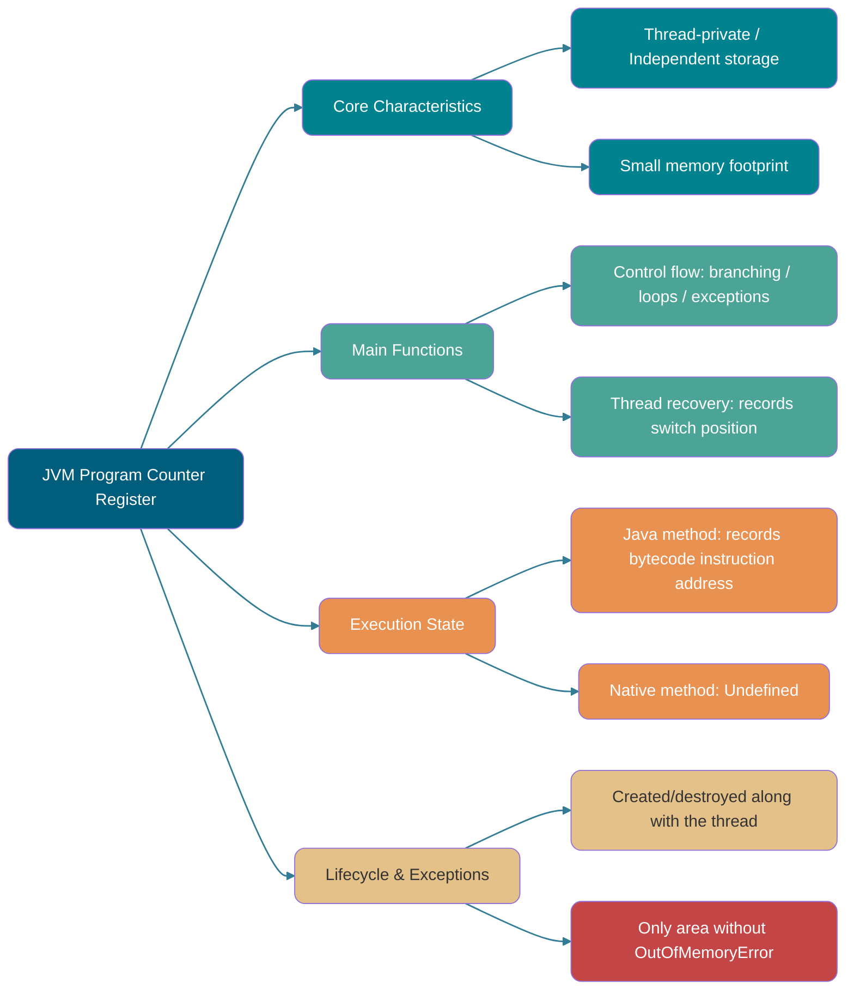
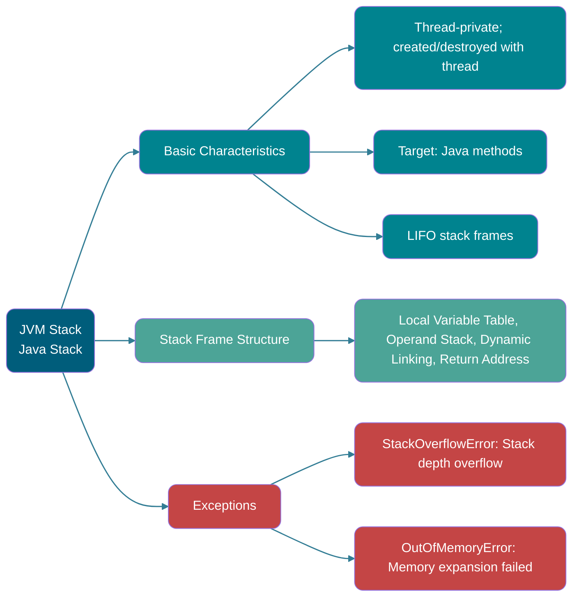
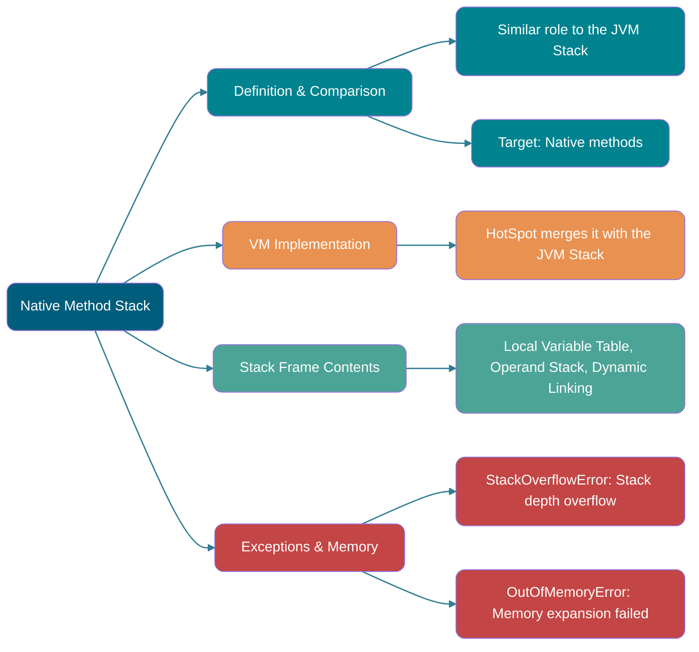
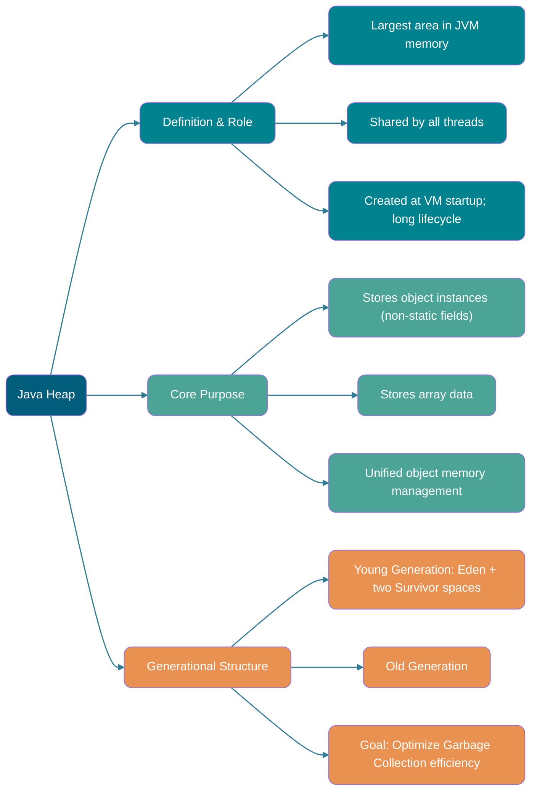
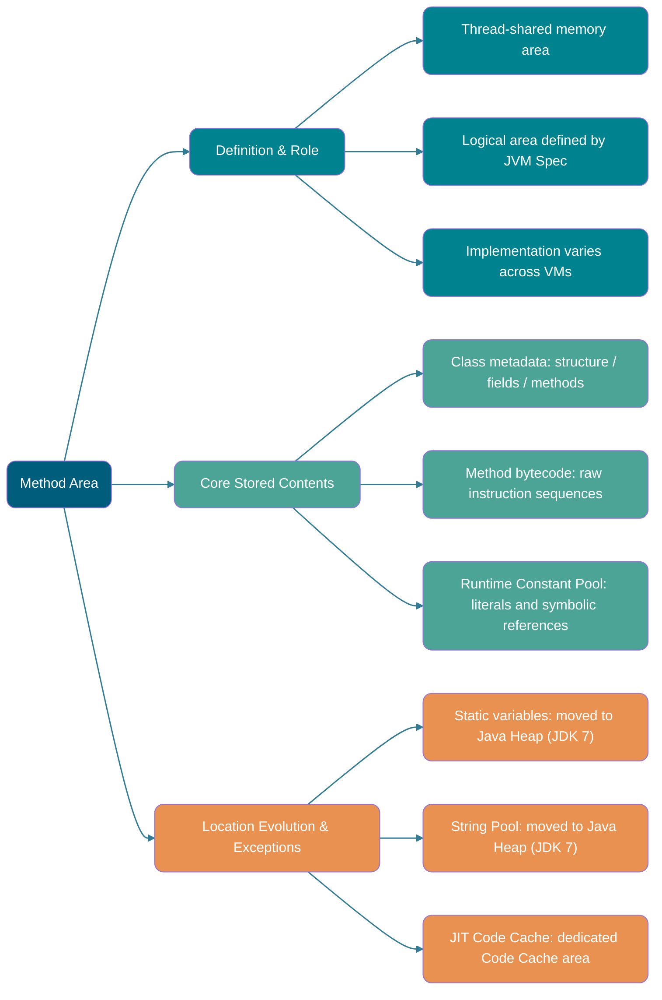
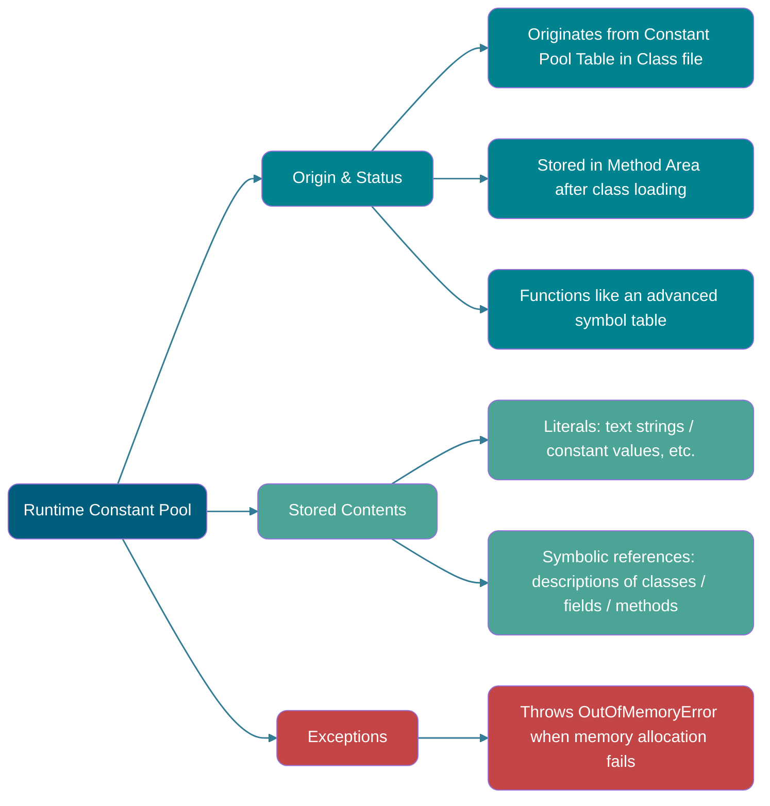
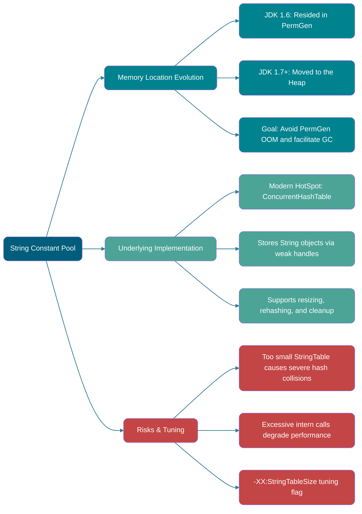
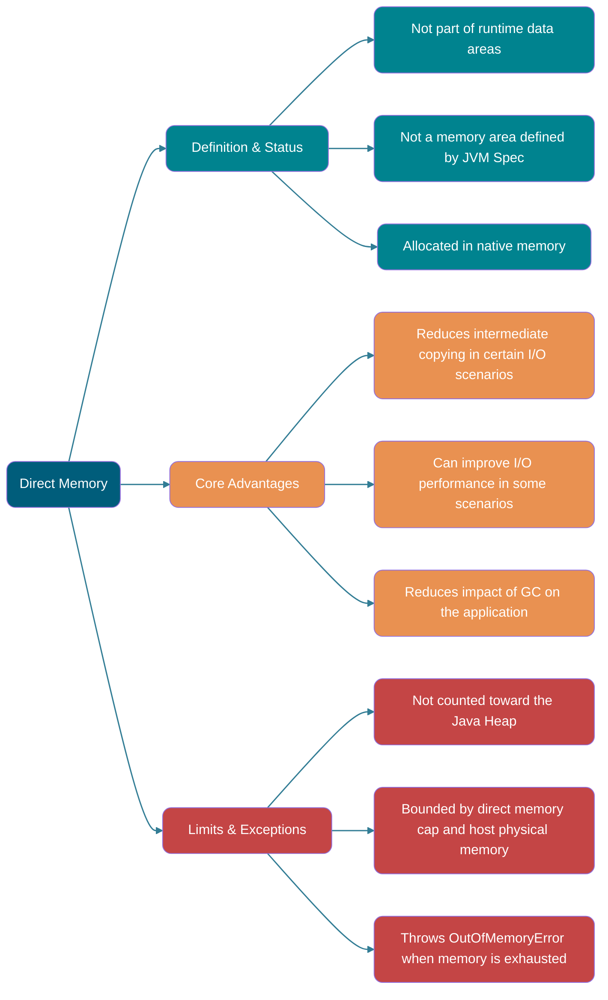

> Unless otherwise specified, this article targets the HotSpot Virtual Machine.
>
> This article is summarized and supplemented based on *Understanding the Java Virtual Machine: JVM Advanced Features and Best Practices*.
>
> Common interview questions:
>
> - Introduce the Java memory areas (runtime data areas).
> - The creation process of a Java object (five steps; it is recommended that you can write them out from memory and know what the JVM does at each step).
> - The two ways to access and locate an object (Handle and Direct Pointer).

## Preface

For Java programmers, under the virtual machine's automatic memory management mechanism, it is no longer necessary to write a corresponding `delete`/`free` operation for every `new` operation like C/C++ programmers do, making memory leaks and out-of-memory issues less likely to occur. However, precisely because Java programmers hand memory control over to the Java Virtual Machine, once memory leak or overflow problems do occur, troubleshooting them will be a very arduous task if you do not understand how the virtual machine uses memory.

## Runtime Data Areas

While executing a Java program, the Java Virtual Machine divides the memory it manages into several different data areas.

JDK 1.8 differs slightly from earlier versions. Here, we use JDK 1.7 and JDK 1.8 as examples.

**JDK 1.7**:


**JDK 1.8**:


**Thread-private:**

- Program Counter Register
- Java Virtual Machine Stack
- Native Method Stack

**Thread-shared:**

- Heap
- Method Area

Direct Memory is often discussed alongside these areas, but it is not a runtime data area defined by *The Java Virtual Machine Specification*, nor should it be treated as a "thread-shared runtime data area" within the specification.

The Java Virtual Machine Specification's rules for runtime data areas are quite flexible. Taking the Heap as an example: the Heap can be contiguous or non-contiguous. Its size can be fixed or dynamically expanded at runtime. Virtual machine implementers may use any garbage collection algorithm to manage the Heap, or even perform no garbage collection at all.

### Program Counter Register



The Program Counter Register (PC Register) is a relatively small memory area that can be regarded as a line-number indicator for the bytecode currently being executed by the thread. When the bytecode interpreter works, it selects the next bytecode instruction to execute by changing the value of this counter; functions such as branching, looping, jumping, exception handling, and thread recovery all depend on this counter.

In addition, so that a thread can resume at the correct execution position after a context switch, each thread needs an independent Program Counter Register. The counters of different threads do not affect each other and are stored independently; we refer to this type of memory area as "thread-private" memory.

From the introduction above, we know that the Program Counter Register mainly serves two purposes:

- The bytecode interpreter reads instructions sequentially by modifying the Program Counter Register, thereby implementing code control flow such as sequential execution, branching, looping, and exception handling.
- In multithreaded environments, the Program Counter Register records the execution position of the current thread, so that when the thread is switched back in, it knows where it last left off.

The lifecycle of the Program Counter Register is completely synchronized with the thread:

- **Creation**: Created when the thread is created.
- **Destruction**: Destroyed when the thread terminates.

When executing a **Java method** (non-native), the Program Counter Register records **the address of the JVM bytecode instruction currently being executed**. When a thread executes a **native method**, the value of the Program Counter Register is **Undefined**, because what is being executed is not JVM bytecode instructions.

⚠️ Note: The Program Counter Register is the only memory area in the JVM Specification for which no `OutOfMemoryError` condition is defined. The specification only states this rule and does not require all implementations to adopt a specific fixed-size representation.

### Java Virtual Machine Stack



Like the Program Counter Register, the Java Virtual Machine Stack (hereafter referred to as the Stack) is also thread-private. Its lifecycle is identical to that of the thread—it is created when the thread is created and destroyed when the thread dies.

The Stack is definitely a core component of the JVM runtime data areas. Aside from some Native method calls implemented through the Native Method Stack (discussed later), all other Java method calls are implemented through the Stack (in coordination with other runtime data areas such as the Program Counter Register).

Data for method calls must be passed through the Stack: each method call pushes a corresponding Stack Frame onto the Stack, and once each method call completes, its Stack Frame is popped off.

The Stack consists of Stack Frames, and each Stack Frame contains: a Local Variable Table, an Operand Stack, Dynamic Linking, and Method Return Address. Similar to the stack data structure, both are Last-In, First-Out (LIFO) structures supporting only push and pop operations.


The **Local Variable Table** mainly stores various data types known at compile time (`boolean`, `byte`, `char`, `short`, `int`, `float`, `long`, `double`) and object references (the `reference` type, which differs from the object itself; it may be a reference pointer to the starting address of an object, or a handle representing the object, or another location associated with the object).


The **Operand Stack** mainly serves as a staging area for method execution, storing intermediate computation results produced during execution. In addition, temporary variables generated during calculations are also placed on the Operand Stack.

**Dynamic Linking** is a capability of a Stack Frame. Each Stack Frame holds a reference to the Runtime Constant Pool of the type to which the current method belongs, used to convert method symbolic references in the method code into concrete method references and convert variable accesses into offsets within the corresponding runtime storage structure; resolving previously unresolved symbols may also trigger class loading. Selecting a virtual method implementation based on the actual runtime type of the receiver belongs to dynamic dispatch of method invocation instructions and should not be simply equated with dynamic linking here.


Although stack space is not infinite, under normal method invocations there is usually no problem. However, if a function enters infinite recursion, too many Stack Frames will be pushed onto the Stack, consuming excessive space and causing the stack depth to grow too deep. When the stack depth requested by a thread exceeds the maximum depth allowed for the current Java Virtual Machine Stack, a `StackOverflowError` is thrown.

**There are two ways a Java method can return**:

- **Normal return**: Executing a `return` statement, passing the return value to the caller.
- **Abrupt (exception) return**: An exception is thrown during method execution and not caught within the method.

Regardless of which way the method returns, its Stack Frame is popped. In other words, **a Stack Frame is created when a method is invoked and destroyed when the method finishes—whether the method completes normally or abruptly via an exception.**

In addition to `StackOverflowError`, the Stack may also encounter `OutOfMemoryError`: if the memory size of the Stack can be dynamically expanded, an `OutOfMemoryError` exception is thrown when the virtual machine fails to allocate sufficient memory while expanding the Stack.

To briefly summarize, two errors can occur in the Stack during program execution:

- **`StackOverflowError`:** Thrown when the stack space required by a thread's execution exceeds the limit allowed by the JVM.
- **`OutOfMemoryError`:** If the Stack memory size can be dynamically expanded, thrown when the virtual machine cannot apply for sufficient memory space during dynamic expansion.


### Native Method Stack



Its role is very similar to that of the JVM Stack, with one difference: **the JVM Stack serves Java methods (i.e., bytecode) executed by the virtual machine, whereas the Native Method Stack serves Native methods used by the virtual machine.** In the HotSpot Virtual Machine, it is merged directly into the Java Virtual Machine Stack.

When executing native methods, a virtual machine implementation may use traditional native stacks (commonly called C stacks). *The Java Virtual Machine Specification* does not mandate that the Native Method Stack adopt the same Local Variable Table, Operand Stack, and Dynamic Linking structure as JVM Stack Frames.

Once a native method finishes executing, the corresponding implementation-specific stack data is released. The Native Method Stack can also throw both `StackOverflowError` and `OutOfMemoryError`.

### Heap



The Java Heap is the largest memory area managed by the Java Virtual Machine; it is shared by all threads and created when the virtual machine starts up. **The sole purpose of this memory area is to store object instances, and almost all object instances as well as arrays allocate memory here.**

In the Java world, "almost" all objects are allocated on the Heap. However, the JIT compiler can perform scalar replacement based on escape analysis, thereby eliminating the actual allocation of some objects. This type of optimization in HotSpot cannot simply be described as "allocating objects directly on the Java Virtual Machine Stack."

The Java Heap is the primary area managed by the garbage collector, and is therefore also called the **GC Heap (Garbage Collected Heap)**. From the perspective of garbage collection, because modern collectors generally adopt generational garbage collection algorithms, the Java Heap can be further divided into the Young Generation and the Old Generation; in finer detail, there are Eden, Survivor, Old, and other spaces. The purpose of further subdivision is to reclaim memory better or allocate memory faster.

In HotSpot of JDK 7 and earlier versions, GC was usually explained in terms of the following three parts, where the Permanent Generation was an implementation of the Method Area and did not belong to the Java Heap:

1. Young Generation
2. Old Generation
3. Permanent Generation

In the figure below, the Eden space and the two Survivor spaces S0 and S1 belong to the Young Generation, the middle layer belongs to the Old Generation, and the bottom layer belongs to the Permanent Generation.


**After JDK 8, PermGen (Permanent Generation) was replaced by Metaspace, which uses native memory.** (I will explain this in detail in the Method Area section.)

In most cases, objects are first allocated in the Eden space. After a Young Generation garbage collection, if an object survives, it enters S0 or S1, and its age increases by 1 (the initial age becomes 1 after moving from Eden to a Survivor space). An object enters the Old Generation once it reaches the tenuring threshold; this threshold is jointly affected by the collector, adaptive policies, and the `-XX:MaxTenuringThreshold` flag, and its default value is not 15 for every collector. For classic generational collectors that use a 4-bit age field, the upper limit of this flag is 15.

```bash
MaxTenuringThreshold of 20 is invalid; must be between 0 and 15
```

**Why can the age only be 0–15?**

Because the field that records the age is inside the object header, and the size of this field is typically 4 bits. The largest binary number representable by 4 bits is `1111`, which is 15 in decimal. Therefore, an object's age is limited to 0 through 15.

Here we briefly introduce this in conjunction with object memory layout.

In the HotSpot Virtual Machine, the memory layout of an object can be divided into 3 regions: Object Header (Header), Instance Data, and Padding. The Object Header includes two parts: Mark Word and Klass Word (Klass pointer). Detailed discussion of object memory layout appears later in this article, so we will not repeat it here.

This age information is stored in the Mark Word (which also stores other runtime metadata belonging to the object itself, such as its hash code, lock state, etc.). The `markOop.hpp` from an older version of HotSpot source code below shows the structure of the Mark Word at that time; the corresponding implementation and object header layout in modern JDKs have since changed:


We can see that the object age indeed occupies 4 bits.

> **🐛 Correction (see: [issue552](https://github.com/Snailclimb/JavaGuide/issues/552))**: "When HotSpot traverses all objects, it accumulates the space occupied by objects in ascending order of age. When the accumulated size up to a certain age exceeds half of the Survivor space, the smaller of that age and `MaxTenuringThreshold` is taken as the new tenuring threshold."
>
> **The code for dynamic age calculation is as follows:**
>
> ```c++
> uint ageTable::compute_tenuring_threshold(size_t survivor_capacity) {
>  // survivor_capacity is the size of the survivor space
> size_t desired_survivor_size = (size_t)((((double) survivor_capacity)*TargetSurvivorRatio)/100);// TargetSurvivorRatio is 50
> size_t total = 0;
> uint age = 1;
> while (age < table_size) {
> total += sizes[age];// sizes array stores the total object size for each age
> if (total > desired_survivor_size) break;
> age++;
> }
> uint result = age < MaxTenuringThreshold ? age : MaxTenuringThreshold;
>   ...
> }
> ```

The most common error in the Heap is `OutOfMemoryError`, and it can manifest in several forms, such as:

1. **`java.lang.OutOfMemoryError: GC Overhead Limit Exceeded`**: Occurs when the JVM spends too much time performing garbage collection and can reclaim very little heap space.
2. **`java.lang.OutOfMemoryError: Java heap space`**: Triggered when creating a new object if there is not enough space in the Heap to store the newly created object. (This is related to the configured maximum heap size and constrained by physical memory. The maximum heap memory can be configured via the `-Xmx` flag; if not explicitly configured, a default value is used—see: [Default Java 8 max heap size](https://stackoverflow.com/questions/28272923/default-xmxsize-in-java-8-max-heap-size))
3. ...

### Method Area



The Method Area is a logical region of the JVM runtime data areas and is a memory area shared by all threads.

*The Java Virtual Machine Specification* only defines the concept of a Method Area and its responsibilities; how the Method Area is actually implemented is up to each virtual machine. That is, different virtual machine implementations implement the Method Area differently.

When the virtual machine loads a class, it parses the corresponding information from the Class file and stores this **metadata** in the Method Area. Specifically, the Method Area mainly stores the following core data:

1. **Class metadata**: Includes the complete structure of the class, such as class name, superclass, implemented interfaces, access modifiers, and detailed information about fields and methods (names, types, modifiers, etc.).
2. **Method bytecode**: The raw instruction sequence of each method.
3. **Runtime Constant Pool**: Unique to each class and converted from the Constant Pool Table in the Class file; it stores various literals generated at compile time as well as symbolic references to types, fields, and methods.

It is important to note that although the following categories of data are logically related to classes, in the HotSpot Virtual Machine they are not stored inside the Method Area:

- **Static variables**: Starting in JDK 7, class static variables are stored in the Java Heap together with their corresponding `java.lang.Class` objects.
- **String Constant Pool (String Pool)**: Also starting in JDK 7, the String Constant Pool was **moved to the Java Heap**.
- **JIT-compiled code cache (JIT Code Cache)**: Native machine code compiled by the JIT compiler from hot methods' bytecode is stored in a **separate memory area named "Code Cache"**, rather than the Method Area itself. This enables more efficient execution and memory management.


**What is the relationship between the Method Area, Permanent Generation, and Metaspace?** Their relationship is very similar to that between interfaces and classes in Java: classes implement an interface. Here, the classes are the Permanent Generation and Metaspace, and the interface is the Method Area. In other words, the Permanent Generation and Metaspace are two ways HotSpot implements the Method Area defined in the JVM Specification. Furthermore, the Permanent Generation was the Method Area implementation before JDK 1.8, whereas from JDK 1.8 onward the Method Area implementation became Metaspace.


**Why was the Permanent Generation (PermGen) replaced with Metaspace?**

The diagram below is from *Understanding the Java Virtual Machine* (3rd Edition), Section 2.2.5:


1. The capacity of the Permanent Generation was constrained by the `-XX:MaxPermSize` upper limit, which could be configured; Metaspace switched to using native memory and can be bounded via `-XX:MaxMetaspaceSize`. Both can overflow, and the actual risk depends on configuration and the growth of class metadata.

> When Metaspace overflows, the following error is thrown: `java.lang.OutOfMemoryError: Metaspace`

You can use `-XX:MaxMetaspaceSize` to set the maximum Metaspace size. If unset, class metadata space can continue growing until constrained by conditions such as available native memory. `-XX:MetaspaceSize` is not the initial capacity of Metaspace; rather, it is the initial high-water mark threshold that triggers metadata GC, after which the JVM dynamically adjusts this threshold.

2. Metaspace stores class metadata, so how much class metadata can be loaded is no longer governed by `MaxPermSize`, but by the actual available memory of the system, allowing more classes to be loaded.

3. In JDK 8, when merging the HotSpot and JRockit codebases, JRockit never had a Permanent Generation, so after the merge there was no need to maintain a separate Permanent Generation area.

4. The Permanent Generation introduced unnecessary complexity for GC and had relatively low collection efficiency.

**What are the commonly used flags for the Method Area?**

Before JDK 1.8, when the Permanent Generation had not yet been completely removed, the following flags were commonly used to tune the Method Area size:

```java
-XX:PermSize=N // Initial size of the Method Area (PermGen)
-XX:MaxPermSize=N // Maximum size of the Method Area (PermGen); exceeding this value throws OutOfMemoryError: java.lang.OutOfMemoryError: PermGen
```

Comparatively speaking, garbage collection occurs relatively infrequently in this area, though data does not stay there "permanently" once it enters the Method Area.

In JDK 1.8, the Method Area's Permanent Generation in HotSpot was completely removed (a transition that had already begun in JDK 1.7) and replaced with Metaspace, which uses native memory. Below are some commonly used flags:

```java
-XX:MetaspaceSize=N // Sets the initial high-water mark threshold that triggers metadata GC
-XX:MaxMetaspaceSize=N // Sets the maximum size of Metaspace
```

A major difference from the Permanent Generation is that if `MaxMetaspaceSize` is not specified, Metaspace has no fixed upper limit imposed by this flag, and continuous growth of class metadata can consume a large amount of native memory.

### Runtime Constant Pool



In addition to descriptive information such as class version, fields, methods, and interfaces, a Class file also contains a **Constant Pool Table** for storing various literals and symbolic references generated at compile time.

Literals are representations of fixed values in source code—meaning we can know their values directly from their literal text. Literals include integers, floating-point numbers, and string literals. Common symbolic references include class symbolic references, field symbolic references, method symbolic references, and interface method symbolic references.

*Understanding the Java Virtual Machine* (3rd Edition), Section 7.3.4 explains symbolic references and direct references as follows:


After a class is loaded, the Constant Pool Table is stored in the Runtime Constant Pool of the Method Area.

The Runtime Constant Pool functions similarly to the symbol table in traditional programming languages, although it contains a broader range of data than a typical symbol table.

Since the Runtime Constant Pool is part of the Method Area, it is naturally constrained by Method Area memory; when the constant pool can no longer allocate memory, an `OutOfMemoryError` is thrown.

### String Constant Pool



The **String Constant Pool (String Pool)** is an area dedicated by the JVM to strings (`String` class) to improve performance and reduce memory consumption, primarily to avoid repeated creation of identical strings.

```java
// 1. Look up the String object "ab" in the String Pool; if absent, create "ab" and place it in the String Pool
// 2. Assign the reference of the String object "ab" to aa
String aa = "ab";
// Directly return the String object "ab" from the String Pool and assign it to reference bb
String bb = "ab";
System.out.println(aa==bb); // true
```

The implementation of the String Constant Pool in the HotSpot Virtual Machine can be viewed in `src/hotspot/share/classfile/stringTable.cpp`. In modern HotSpot, the native `StringTable` uses a concurrent hash table and stores `String` objects on the Heap via weak handles, supporting resizing, rehashing, and cleanup of dead entries; `-XX:StringTableSize` is used to set the initial number of buckets. Therefore, the claim of a "fixed-length array + linked list" applies only to some older implementations and cannot be generalized to current HotSpot.

Prior to JDK 1.7, the String Constant Pool was stored in the Permanent Generation. JDK 1.7 moved the String Constant Pool and class static variables into the Java Heap.


**Why did JDK 1.7 move the String Constant Pool into the Heap?**

Primarily because GC reclamation efficiency in the Permanent Generation (an implementation of the Method Area) was too low—GC there was only triggered during a Full GC. Java programs typically create a large number of strings waiting to be reclaimed; placing the String Constant Pool in the Heap allows string memory to be reclaimed more efficiently and promptly.

Related question: [Does the JVM Constant Pool store objects or references? - Answer by RednaxelaFX on Zhihu](https://www.zhihu.com/question/57109429/answer/151717241)

Finally, let's share a quote from Zhou Zhiming in [issue#112](https://github.com/fenixsoft/jvm_book/issues/112) of the [*Understanding the Java Virtual Machine (3rd Edition)* sample code & errata](https://github.com/fenixsoft/jvm_book) GitHub repository:

> **The Runtime Constant Pool, Method Area, and String Constant Pool are logical concepts that do not change with specific virtual machine implementations—they are public and abstract; Metaspace and Heap are physical concepts tied to a specific virtual machine implementation—they are private and concrete.**

### Direct Memory



Direct Memory is a special memory buffer that is allocated in native memory rather than in the Java Heap or Method Area. The exact allocation mechanism is a virtual machine implementation detail and does not necessarily mean it must be allocated via JNI.

Direct Memory is neither part of the JVM runtime data areas nor a memory area defined in *The Java Virtual Machine Specification*, yet it is used frequently and can also trigger `OutOfMemoryError`.

**NIO (New I/O)**, introduced in JDK 1.4, brought in an I/O model based on **Channels** and **Buffers**. A direct byte buffer can allocate content outside the Java Heap and operate on it through a `DirectByteBuffer` object in the Java Heap. The JVM makes a best effort to perform native I/O directly on such buffers, thereby reducing data copying through intermediate buffers in certain scenarios. In NIO, only selectable channels combined with `Selector` and similar components provide non-blocking I/O capabilities, so NIO as a whole should not be expanded as "Non-Blocking I/O".

Direct Memory is not counted toward the Java Heap, but it is still constrained by the host's total memory, processor address space, and other limits. For NIO direct buffers, total allocation can also be capped using [`-XX:MaxDirectMemorySize`](https://docs.oracle.com/en/java/javase/25/docs/specs/man/java.html#extra-options-for-java).

A related concept is **Off-heap Memory**. Some articles equate Direct Memory with Off-heap Memory, which personally I find not entirely accurate.

Off-heap Memory is a general term for memory allocated outside the Java Heap, typically backed by native memory provided by the operating system. Whether and how it is managed by the JVM or JDK depends on the specific allocation mechanism. For example, in OpenJDK/HotSpot, the native memory corresponding to a `DirectByteBuffer` is associated with the buffer object on the Java Heap and participates in cleanup through mechanisms such as `Cleaner` after the object becomes unreachable. Because cleanup timing is not directly controlled by the application, using off-heap memory can reduce pressure on the Java Heap, but you still need to watch out for native memory leaks and `OutOfMemoryError`.

## Exploring Objects in the HotSpot Virtual Machine

From the overview above, we now have a general picture of JVM memory. Next, let's examine in detail the entire lifecycle of object allocation, memory layout, and object access in the HotSpot Virtual Machine's Java Heap.

### Object Creation

I recommend being able to write out the Java object creation process from memory and understanding what happens at each step.

```mermaid
graph TD
    %% Color definitions
    classDef root fill:#004D61,color:#fff,rx:10,ry:10;
    classDef step fill:#005D7B,color:#fff,rx:10,ry:10;
    classDef detail fill:#4CA497,color:#fff,rx:10,ry:10;
    classDef logic fill:#E99151,color:#fff,rx:10,ry:10;

    %% Core workflow
    Start("Triggered by new instruction"):::root

    Start --> S1["Step 1: Class Loading Check"]:::step
    S1 --> S1_1["Check whether constant pool has class symbolic reference"]:::detail
    S1_1 --> S1_2["Check whether class is loaded / resolved / initialized"]:::detail

    S1_2 --> S2["Step 2: Memory Allocation"]:::step
    S2 --> S2_Method{"Allocation Method"}:::logic
    S2_Method -->|"Contiguous Heap"| S2_A["Bump the Pointer"]:::logic
    S2_Method -->|"Fragmented Heap"| S2_B["Free List"]:::logic
    S2_A & S2_B --> S2_Safe["Concurrency Safety: TLAB or CAS retry"]:::detail

    S2_Safe --> S3["Step 3: Zero Initialization"]:::step
    S3 --> S3_1["Initialize allocated memory space to zero"]:::detail
    S3_1 --> S3_2["Ensures instance fields are usable without explicit initial values"]:::detail

    S3_2 --> S4["Step 4: Set Object Header"]:::step
    S4 --> S4_1["Mark Word: hash code / GC age / lock state"]:::detail
    S4_1 --> S4_2["Klass Pointer: metadata pointer to class"]:::detail

    S4_2 --> S5["Step 5: Execute init Method"]:::step
    S5 --> S5_1["Initialize according to programmer intent"]:::detail
    S5_1 --> S5_2["Execute constructor"]:::detail

    S5_2 --> End(("Object Creation Complete")):::root

    %% Link styling
    linkStyle default stroke:#005D7B,stroke-width:1.5px,opacity:0.8
```



#### Step 1: Class Loading Check

When the virtual machine encounters a `new` instruction, it first checks whether the instruction's argument can locate a symbolic reference for that class in the constant pool, and checks whether the class represented by that symbolic reference has already been loaded, resolved, and initialized. If not, the corresponding class loading process must be executed first.

#### Step 2: Memory Allocation

Once the **class loading check** passes, the virtual machine **allocates memory** for the newly created object. The amount of memory required by the object can be fully determined once class loading finishes; allocating space for the object is equivalent to carving out a block of fixed size from the Java Heap. There are two **allocation methods**: **"Bump the Pointer"** and **"Free List"**. **Which method is chosen depends on whether the Java Heap is contiguous, which in turn depends on whether the garbage collector in use has compaction capabilities.**

**Two memory allocation methods** (supplementary knowledge you need to master):

- Bump the Pointer:
  - Applicable scenario: When heap memory is regular/contiguous (i.e., without memory fragmentation).
  - Principle: All used memory is placed on one side and unused memory on the other, with a dividing pointer in between. Allocation simply moves this pointer toward the unused memory by the size of the object.
  - GC collectors using this allocation method: Serial, ParNew.
- Free List:
  - Applicable scenario: When heap memory is fragmented (non-contiguous).
  - Principle: The virtual machine maintains a list recording which memory blocks are available. When allocating, it finds a sufficiently large block to assign to the object instance and updates the list afterward.
  - GC collectors using this allocation method: CMS.

Choosing between the two methods depends on whether the Java Heap memory is contiguous. Whether the Java Heap is contiguous depends on whether the GC collector's algorithm is "Mark-Sweep" or "Mark-Compact" (also called "Mark-Sweep-Compact"). Notably, memory under the Copying algorithm is also contiguous.

**Concurrency issues in memory allocation (supplementary knowledge you need to master)**

An important concern when creating objects is thread safety. Because object creation happens very frequently in real-world development, the virtual machine must ensure thread safety. Typically, the virtual machine uses two approaches to guarantee thread safety:

- **CAS + failure retry:** CAS is an implementation of optimistic locking. Optimistic locking means performing an operation without acquiring a lock under the assumption that there are no conflicts, and retrying if a conflict causes a failure until it succeeds. **The virtual machine uses CAS combined with failure retries to guarantee the atomicity of allocation pointer updates.**
- **TLAB:** Pre-allocates a small block of memory in the Eden space for each thread (Thread Local Allocation Buffer). When the JVM allocates memory for an object created by a thread, it first allocates from that thread's TLAB; only when the object is larger than the remaining space in the TLAB or the TLAB is exhausted does it fall back to CAS-based memory allocation.

#### Step 3: Zero Initialization

After memory allocation is complete, the virtual machine needs to initialize the allocated memory space to zero values (excluding the Object Header). This step ensures that instance fields of the object can be used directly in Java code without assigning initial values—the program sees the zero value corresponding to each field's data type.

#### Step 4: Set Object Header

After zero initialization finishes, **the virtual machine performs necessary configuration on the object**, such as recording which class this object is an instance of, how to locate the class's metadata, the object's hash code, and its GC generational age. **This information is stored in the Object Header.** Additionally, the exact layout of the Object Header depends on the JDK version and JVM configuration; for example, Biased Locking was disabled by default starting in JDK 15, and its implementation was later removed.

#### Step 5: Execute `<init>` Method

After the steps above complete, from the virtual machine's perspective a new object already exists, but from a Java program's perspective object creation has only just begun—the `<init>` method has not executed yet, and all fields are still at their zero values. Therefore, executing the `new` instruction is generally followed by executing the `<init>` method to initialize the object according to the programmer's intent, at which point a truly usable object is completely produced.

### Object Memory Layout

In the HotSpot Virtual Machine, the memory layout of an object can be divided into 3 regions: **Object Header (Header)**, **Instance Data**, and **Padding**.

The Object Header consists of two pieces of information:

1. Mark Word: Stores runtime data belonging to the object itself, such as its hash code (HashCode), GC generational age, lock state, etc. Biased thread ID and biased timestamp only apply to older HotSpot versions that still implemented and enabled Biased Locking.
2. Klass Pointer: A pointer from the object to its class metadata, through which the virtual machine determines which class this object is an instance of.

**The Instance Data section holds the actual meaningful information stored by the object**, namely the field contents of various types defined in the program.

**The Padding section does not necessarily exist and carries no special meaning; it serves purely as alignment placeholder bytes.** HotSpot allocates objects along alignment boundaries—default alignment is typically 8 bytes, and can be affected by options such as `-XX:ObjectAlignmentInBytes`. Therefore, the total size of an object must be padded to a multiple of the alignment boundary; the Object Header itself is not guaranteed to always be a multiple of 8 bytes—for instance, when Compressed Class Pointers are enabled, a common Object Header size is 12 bytes.

### Object Access and Locating

We create objects in order to use them; our Java programs manipulate concrete objects on the Heap through `reference` data on the Stack. How objects are accessed depends on the virtual machine implementation, and the two mainstream approaches are: **Using Handles** and **Direct Pointers**.

#### Handles

If handles are used, a chunk of memory is carved out of the Java Heap as a handle pool. What is stored in `reference` is the object's handle address, and the handle itself contains the concrete address pointers to both the object's instance data and its type data.


#### Direct Pointers

If direct pointer access is used, what is stored in `reference` is directly the object's memory address.


Each of these two object access approaches has its own advantages. The biggest advantage of using handles is that `reference` stores a stable handle address: when an object is moved (such as during GC), only the instance data pointer inside the handle needs to be updated, while the `reference` itself does not need to be modified. The biggest advantage of using direct pointers is speed, as it saves the overhead of one pointer indirection.

HotSpot Virtual Machine primarily uses direct pointers for object access.

## References

- *Understanding the Java Virtual Machine: JVM Advanced Features and Best Practices (2nd Edition)*
- *Write Your Own Java Virtual Machine*
- Chapter 2. The Structure of the Java Virtual Machine: <https://docs.oracle.com/javase/specs/jvms/se8/html/jvms-2.html>
- Internal Structure of JVM Stack Frames - Dynamic Linking: <https://chenxitag.com/archives/368>
- When does the `"literal"` in `new String("literal")` enter the String Constant Pool in Java? - Answer by Mu Nvhai on Zhihu: <https://www.zhihu.com/question/55994121/answer/147296098>
- Does the JVM Constant Pool store objects or references? - Answer by RednaxelaFX on Zhihu: <https://www.zhihu.com/question/57109429/answer/151717241>
- <http://www.pointsoftware.ch/en/under-the-hood-runtime-data-areas-javas-memory-model/>
- <https://dzone.com/articles/jvm-permgen-%E2%80%93-where-art-thou>
- <https://stackoverflow.com/questions/9095748/method-area-and-permgen>
