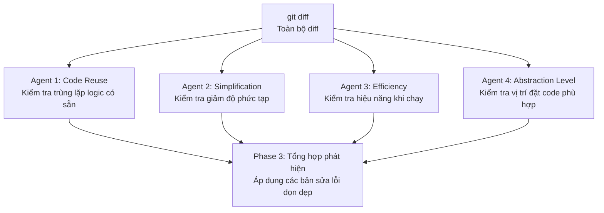

Xin chào, mình là Tiểu G. Claude Code thực tế cung cấp khá nhiều lệnh rất hữu ích như code review, tinh giản code, tác vụ định kỳ (scheduled tasks)... nhưng mình nhận thấy nhiều bạn dùng hằng ngày vẫn chưa biết đến hoặc chưa biết cách dùng sao cho hiệu quả.

Nhiều người nghĩ rằng chỉ cần trò chuyện trực tiếp với Claude Code là đủ rồi, không cần tìm hiểu các lệnh này làm gì. Nhưng dưới góc độ một người đã sử dụng lâu năm, mình khẳng định việc nắm vững các lệnh này chắc chắn sẽ mang lại trải nghiệm tốt hơn nhiều.

Tất nhiên, hiểu ở đây không có nghĩa là bạn phải học vẹt hay ghi nhớ từng lệnh. Chỉ cần biết chúng tồn tại là đủ! Khi thực sự cần, bạn chỉ việc gõ `/` rồi chọn lệnh tương ứng từ danh sách gợi ý.

> **Lưu ý về phiên bản**: Bài viết này được tổng hợp dựa trên tài liệu chính thức và hành vi client của Claude Code v2.1.218 (2026-07-25). Các lệnh được cập nhật rất nhanh, do đó tài liệu chuẩn xác nhất luôn là `/help`, danh sách lệnh `/` và trang Commands chính thức.

## Menu `/` không chỉ chứa các lệnh tích hợp sẵn

Khi gõ `/` trong Claude Code, bạn sẽ thấy toàn bộ các điểm truy cập có thể gọi trực tiếp trong môi trường hiện tại. Bên cạnh các lệnh tích hợp sẵn (built-in commands) của Claude Code, danh sách này còn hiển thị Bundled Skills, các Skills do người dùng tự viết, cũng như các lệnh do plugin và MCP Server cung cấp. Những mục nào thực sự xuất hiện còn phụ thuộc vào phiên bản, nền tảng hệ điều hành, gói tài khoản và môi trường hiện tại của bạn.

[Tài liệu Commands chính thức](https://code.claude.com/docs/en/commands) mô tả hầu hết các lệnh built-in là những lệnh có "hành vi được viết trực tiếp bên trong CLI", ví dụ như `/clear`, `/compact`, `/model`, `/diff`, `/context` và `/permissions`. Ngược lại, [Bundled Skills](https://code.claude.com/docs/en/slash-commands#bundled-skills) hoạt động dựa trên Prompt: Claude sẽ nạp các chỉ dẫn tương ứng, sau đó gọi công cụ hoặc điều phối các subagent để hoàn thành nhiệm vụ. Các lệnh `/simplify`, `/batch`, `/debug`, `/loop`, `/run`, `/verify`, `/code-review` và `/claude-api` đều thuộc nhóm này. Bảng lệnh chính thức sẽ gắn nhãn `Skill` sau các mục này; một số ít tính năng điều phối song song nhiều subagent chạy nền sẽ được gắn nhãn `Workflow`.

`/review` là lệnh built-in dùng để thực hiện một lượt review nhanh, ở chế độ chỉ đọc (read-only) đối với GitHub Pull Request; khi chạy không tham số, trước tiên nó sẽ liệt kê danh sách các Open PR để bạn chọn. Nếu muốn kiểm tra tính đúng đắn và cơ hội dọn dẹp cho diff hiện tại, hãy dùng `/code-review`; để thực hiện review đa Agent trên PR với mức độ kiểm tra tùy chỉnh, bạn có thể chạy `/code-review <level> <mã PR>`. Khi cần review chuyên sâu trên cloud, hãy sử dụng `/code-review ultra` (hiện tại `/ultrareview` là alias của lệnh này).

## /simplify: Tinh giản và tái cấu trúc code (Refactoring)

Một phần thay đổi mã nguồn đã chạy ổn định, nhưng bên trong có thể vẫn còn những hàm helper trùng lặp, các nhánh rẽ lồng nhau quá sâu, hoặc logic nghiệp vụ bị đặt sai tầng kiến trúc. Đây chính là lúc bạn nên chạy `/simplify`. Lệnh này sẽ kiểm tra thay đổi hiện tại và cố gắng áp dụng các bản sửa lỗi mang tính dọn dẹp (cleanup fixes).

Từ phiên bản Claude Code v2.1.154, Anthropic đã định vị lại `/simplify` là **cleanup-only review**. Khả năng tái sử dụng, đơn giản hóa, hiệu năng và tầng trừu tượng thuộc phạm vi xử lý của nó; còn các bug logic nghiệp vụ hãy giao cho `/code-review`.

### Cách xử lý một thay đổi code

Khi chạy không kèm tham số, `/simplify` thường đọc các thay đổi gia tăng từ `git diff`. Nếu workspace không có thay đổi chưa commit, nó sẽ chuyển sang kiểm tra commit gần nhất. Bạn cũng có thể chỉ định tên class, ví dụ `/simplify MarketDataService`, để nó tập trung vào toàn bộ file đó. Phạm vi áp dụng cụ thể vẫn tuân theo hành vi client của phiên bản hiện hành.

Sau khi lấy được diff, bốn Agent sẽ song song đọc cùng một bản diff:



Code Reuse Agent trước tiên sẽ tìm kiếm các cài đặt sẵn có trong dự án. Ví dụ, nếu bạn mới viết hàm `requireNonBlank()` trùng lặp với `InputValidator.requireNonBlank()`, nó sẽ đề xuất tái sử dụng hàm có sẵn. Simplification Agent xử lý các method tương tự nhau, các biến trạng thái trung gian dư thừa và các nhánh rẽ quá sâu; Efficiency Agent sẽ lưu ý việc khởi tạo object lặp đi lặp lại trong vòng lặp, các concurrent container không cần thiết và các phép tính toán lặp lại.

Abstraction Level Agent chú trọng đến vị trí đặt code. Quy tắc nghiệp vụ lọt vào Controller, validation dùng chung rải rác ở nhiều Service, hoặc utility tầng thấp phụ thuộc ngược vào domain object nghiệp vụ đều thuộc nhóm này. Sau khi cả 4 kết quả được trả về, Claude Code sẽ lọc bỏ cảnh báo giả (false positives) và áp dụng những sửa đổi dọn dẹp mà nó đánh giá là an toàn.

> **Cảnh báo rủi ro**: `/simplify` sẽ trực tiếp sửa code, nhưng nó không đảm bảo tính đúng đắn về mặt nghiệp vụ. Với các luồng liên quan đến transaction, bảo mật, concurrency và tiền tệ, hãy chạy `/code-review` hoặc `/security-review` trước, sau đó vẫn phải kiểm tra kỹ diff và chạy test đầy đủ.

### Chỉ định hướng quan tâm

Bạn có thể truyền trực tiếp hướng quan tâm vào tham số:

```bash
/simplify duplicate helpers
/simplify SQL performance
/simplify unnecessary abstraction
/simplify MarketDataService
```

Khi đã biết vấn đề đại khái nằm ở file nào hay thuộc loại code smell nào, việc truyền tham số sẽ mang lại kết quả trúng đích hơn nhiều so với chạy lệnh trần.

### Ca thực tế: Lỗi Spring Transaction Invalidation

Trường hợp này diễn ra ở các phiên bản `/simplify` ban đầu, khi nó còn tích cực tìm kiếm correctness bug. Theo định vị chính thức hiện tại, loại vấn đề này nên giao cho `/code-review` hoặc `/security-review`, sau đó mới dùng `/simplify` để dọn dẹp và refactor.

Có lần mình viết xong một module xác thực người dùng, tự test thấy ổn nên chuẩn bị commit. Theo thói quen, mình chạy lệnh review trước, nó lập tức chỉ ra 6 vấn đề tiềm ẩn, và sau khi kiểm tra lại thì toàn bộ đều là lỗi thực tế.


Một trong những vấn đề nghiêm trọng là **Spring Transaction Invalidation (mất tác dụng của transaction)**, khi nhiều góc nhìn review cùng chỉ về một đoạn mã.

Method tầng ngoài của `WatchlistService` trước tiên lấy Redis distributed lock và thực hiện double-check, sau đó gọi một method `protected` để ghi xuống database:

```java
public void initializeDefaultWatchlist(Long userId) {
    // Redis distributed lock + double-check (idempotent)
    // ...
    doInitializeDefaultWatchlist(userId);  // Gọi nội bộ trong cùng một class
    // ...
}

@Transactional(rollbackFor = Exception.class)
protected void doInitializeDefaultWatchlist(Long userId) {
    groupService.save(defaultGroup);        // INSERT group
    stockService.saveBatch(initialStocks);  // INSERT 5 mã cổ phiếu
}
```

Đặt `@Transactional` trên method này không giải quyết được vấn đề transaction. Mặc định Spring sử dụng proxy-based AOP, việc gọi trực tiếp `doInitializeDefaultWatchlist()` bên trong cùng một class sẽ bypass (bỏ qua) proxy, khiến transaction interceptor không bắt được lệnh gọi này.

Nếu `saveBatch` ném ra ngoại lệ giữa chừng, bản ghi group đã được `save` ghi trước đó sẽ không rollback, để lại trong database một group rỗng không có cổ phiếu nào.

> **Điều kiện tiên quyết**: Dưới cơ chế proxy-based AOP mặc định của Spring, việc tự gọi nội bộ (self-invocation) sẽ bypass proxy khiến `@Transactional` mất tác dụng; nếu dùng AspectJ weaving hoặc gọi qua proxy object thì kết quả sẽ khác.

- **Góc nhìn Quality / correctness** đánh dấu lỗi tự gọi nội bộ làm mất hiệu lực `@Transactional`, đánh giá mức độ nghiêm trọng cao (High).
- **Efficiency Agent** loại trừ khả năng lock TTL không đủ, thu hẹp nguyên nhân về lỗi transaction.
- **Code Reuse Agent** xác nhận việc tự viết distributed lock là hợp lý vì không có giải pháp thay thế sẵn có.

Giải pháp sửa đổi lúc đó là chuyển từ declarative transaction (khai báo) sang **programmatic transaction (lập trình)**, sử dụng `TransactionTemplate` để kiểm soát trực tiếp ranh giới transaction. Các cách sửa khác gồm: chuyển method transactional sang một Spring Bean khác, gọi qua proxy object, hoặc nâng ranh giới transaction lên public method bên ngoài.

```java
@RequiredArgsConstructor
public class WatchlistService {

    private final TransactionTemplate transactionTemplate;

    private void doInitializeDefaultWatchlist(Long userId) {
        transactionTemplate.executeWithoutResult(status -> {
            groupService.save(defaultGroup);
            stockService.saveBatch(initialStocks);
        });
    }
}
```


Đợt quét này còn phát hiện thêm 5 vấn đề khác, bao gồm khả năng tái sử dụng code, bảo mật và hiệu năng:

| Phát hiện | Agent | Hướng khắc phục |
| --- | --- | --- |
| Hai Controller đều tự định nghĩa `requireNonBlank()`, trùng lặp với `InputValidator` sẵn có | Reuse | Xóa private method, chuyển sang dùng `InputValidator.requireNonBlank()` |
| Regex trong exception handler bị compile lại mỗi lần `replaceAll`, và character class thiếu `+/=`, khiến base64 token bị lọt không được mask | Quality + Efficiency | Tách ra thành `static final Pattern`, mở rộng character class bao phủ base64 |
| Dùng `ConcurrentHashMap` + `@Scheduled` để dọn dẹp thủ công Ticket hết hạn sau 30 giây | Efficiency | Thay thế bằng Caffeine cache sẵn có của dự án (tự động loại bỏ theo TTL) |
| `Map` cục bộ trong `@Bean` method dùng `ConcurrentHashMap` | Efficiency | Đổi thành `HashMap` (chỉ ghi đơn luồng, không cần concurrency safety) |
| Lỗi chính tả trong comment: "兖底" thành "兜底" (fallback) | Quality | Sửa lại cho đúng |

Kết quả cuối cùng: 5 file được sửa đổi, giảm ròng 38 dòng code, khắc phục 6 vấn đề, biên dịch thành công ngay lần đầu tiên.

### Ca thực tế: Review theo module chỉ định

`/simplify` còn có thể chỉ định class hoặc module cụ thể để review:


```bash
/simplify MarketDataService
```

Trước đây mình từng chạy review chuyên biệt cho service dữ liệu thị trường `MarketDataService` (khoảng 570 dòng). Class này tổng hợp nhiều nguồn dữ liệu, cung cấp Caffeine local cache + Redis distributed cache + circuit breaker fallback. Lần review đó tìm ra 8 vấn đề, trong đó có hai correctness bug mức độ High. Theo định vị lệnh hiện nay, loại lỗi này nên ưu tiên giao cho `/code-review`.

**Bug: Chu kỳ `year` bị âm thầm hạ cấp xuống `month`.** Trong method `normalizePeriod` có một khối switch:

```java
case "year", "yearly", "y" -> "month";  // Bug! Đúng ra phải là "year"
```

Tất cả các chu kỳ khác đều được ánh xạ chính xác (`day → "day"`, `week → "week"`, `month → "month"`), duy chỉ có `year` bị map nhầm thành `month`. Phía gọi yêu cầu biểu đồ nến năm nhưng thực tế lại nhận về nến tháng mà không hề có bất kỳ lỗi hay cảnh báo nào ném ra.

### Khi nào nên dùng `/simplify`

Trước khi tạo PR, hoặc ngay sau khi hoàn thành một đợt refactor nhiều file, bạn có thể dùng `/code-review` để kiểm tra logic trước, sau đó để `/simplify` dọn dẹp code trùng lặp và giảm độ phức tạp cục bộ. Nó sẽ kết hợp mã nguồn hiện có của dự án để đưa ra gợi ý, ví dụ như chuyển sang dùng helper sẵn có hoặc dời logic nghiệp vụ bị đặt nhầm ở Controller về lại Service.

Nó không phù hợp để thay thế việc audit toàn bộ dự án. Khi chạy trần, nó chủ yếu kiểm tra diff gia tăng hiện tại; code style hãy giao cho linter/formatter, còn tính đúng đắn và bảo mật hãy giao cho `/code-review`, `/security-review` cùng các công cụ SAST.

## /code-review và /review: Kiểm tra mã nguồn (Code Review)

Khi workspace cục bộ có một bản diff chưa commit, hãy dùng `/code-review` trước tiên để kiểm tra tính đúng đắn, các trường hợp biên (edge cases) và bug tiềm ẩn. Nếu đã gửi thành Pull Request, hãy dùng `/review` để chọn hoặc chỉ định PR. Với các module nhạy cảm như đăng nhập, thanh toán, phân quyền và tải lên file, bạn cần dùng thêm `/security-review`.

`/simplify` giải quyết một lớp bài toán khác: logic code đã được xác nhận hoạt động bình thường, và bạn muốn dọn dẹp code thừa, tối ưu cài đặt kém hiệu quả và căn chỉnh lại tầng trừu tượng. Thứ tự thông thường là `/code-review` trước, rồi đến `/simplify`.

### `/code-review` tạo báo cáo như thế nào

`/code-review` đọc các thay đổi từ `git diff` hoặc PR được chỉ định, phân tích song song và lọc kết quả dựa trên độ tin cậy. Báo cáo được phân loại theo các mức Critical, High, Medium, Low. Mỗi vấn đề đều chỉ rõ số dòng cụ thể, kèm theo nguyên nhân và đề xuất sửa đổi. Mặc định nó chỉ báo cáo; khi truyền thêm cờ `--fix`, nó mới bắt đầu thử sửa một phần các vấn đề.

### Cách sử dụng

```bash
/code-review high    # Chỉ xem các vấn đề mức độ nghiêm trọng cao
/code-review --fix   # Review và tự động sửa một phần vấn đề
/code-review ultra   # Review chuyên sâu trên cloud
```

Nếu muốn review PR cụ thể, dùng `/review`:

```bash
/review              # Liệt kê các Open PR trong repo để bạn chọn
/review 123          # Review PR chỉ định
```

Đối với review ở cấp độ từng file, bạn nên dùng ngôn ngữ tự nhiên: ví dụ "review src/auth/login.service.ts".

Sau khi có báo cáo, bạn có thể nhập tiếp "Fix all Critical issues" để Claude sửa đổi dựa trên kết quả review.

### Lựa chọn giữa /code-review, /review và /security-review

- Diff hiện tại hoặc thay đổi cục bộ: `/code-review`
- Pull Request đã tạo: `/review 123`
- Các module nhạy cảm như đăng nhập, thanh toán, phân quyền, upload, webhook: `/security-review`
- Cần review sâu trên cloud trước khi merge PR quan trọng: `/code-review ultra`

### /code-review ultra: Review chuyên sâu trên Cloud

`/code-review ultra` chuyển quá trình review lên sandbox trên cloud, với nhiều Agent cùng phân tích một PR. Lệnh này rất phù hợp để bổ sung một vòng kiểm tra kỹ lưỡng trước khi merge các PR cốt lõi. Lệnh cũ `/ultrareview` vẫn được giữ lại làm alias, nhưng Anthropic khuyến nghị dùng `/code-review ultra`.

```bash
/code-review ultra        # Review sâu ngữ cảnh diff / PR hiện tại
/code-review ultra 123    # Review sâu mục tiêu chỉ định (xem chi tiết tại /help)
```

Thực thi trên cloud không phụ thuộc vào môi trường máy cục bộ, nhưng bù lại thời gian chờ đợi và lượng Token tiêu thụ đều sẽ tăng lên. Hiện Anthropic vẫn gắn nhãn tính năng này là research preview, chức năng và biểu phí dựa theo tài liệu chính thức cùng `/help` cục bộ.

### Thứ tự thực hiện giữa `/code-review` và `/simplify`

Đối với một thay đổi mà bạn chưa chắc chắn về tính đúng đắn, hãy chạy `/code-review` trước. Sau khi các lỗi logic, điều kiện biên và vấn đề bảo mật đã được xử lý xong, mới dùng `/simplify` để loại bỏ code dư thừa. Nếu bạn vừa viết xong prototype và đã có test chứng minh hành vi không đổi, bạn cũng có thể để `/simplify` dọn dẹp trực tiếp.

### Ca thực tế

Có lần mình viết một module xác thực người dùng, tự test xong xuôi chuẩn bị commit. Tiện tay chạy thử `/code-review`, nó phát hiện ngay ba vấn đề:

**Critical: API reset mật khẩu không có Rate Limiting.** Kẻ tấn công có thể gọi API reset liên tục không giới hạn để spam hộp thư của người dùng. Lúc tự test mình hoàn toàn không nghĩ tới điều này — môi trường test chỉ có mỗi mình, lấy đâu ra nhu cầu giới hạn tần suất.

**High: Thời gian hết hạn của Token lấy từ config nhưng không có giá trị fallback.** Nếu mục cấu hình bị bỏ trống, thời gian hết hạn sẽ thành 0, nghĩa là Token vừa sinh ra đã lập tức hết hạn. `/code-review` đề xuất thêm `Math.max(config.tokenExpiry, 3600)` để làm giá trị bảo hiểm dự phòng.

**Medium: Log ghi userId dưới dạng plain text.** Dù không hẳn là thông tin tối mật, nhưng trong các kịch bản đòi hỏi tuân thủ bảo mật khắt khe thì việc mask (che mờ) thông tin này vẫn tốt hơn.

Hai trong ba vấn đề liên quan trực tiếp đến bảo mật. Nếu chỉ dựa vào việc tự test thủ công lúc đó, cả hai tình huống tần suất reset và config rỗng đều sẽ bị bỏ sót.

### Đừng dùng nó để thay thế Static Analysis

Mặc định `/code-review` chỉ đưa ra gợi ý, chỉ khi truyền rõ `--fix` nó mới sửa code. Nó cũng sẽ đọc file `CLAUDE.md`: các quy chuẩn lập trình, lựa chọn công nghệ và yêu cầu bảo mật của dự án được viết càng chi tiết thì trong quá trình review càng có nhiều ràng buộc dự án được áp dụng.

Các công cụ như SonarQube quét ổn định theo các rule cố định, trong khi `/code-review` lại kết hợp ngữ cảnh để phân tích Spring proxy, ranh giới transaction và chuỗi phân quyền. Hai bên bao quát các vấn đề khác nhau và không thể thay thế lẫn nhau.

## `/loop` và `/goal`: Lặp lại định kỳ và Điều kiện hoàn thành

Boris Cherny đã nhiều lần chia sẻ về cách dùng `/loop`.


Cứ mỗi nửa tiếng kiểm tra PR một lần, trọng tâm là thời điểm kích hoạt — hãy dùng `/loop`. Bắt đầu sửa các test bị hỏng ngay bây giờ và duy trì cho đến khi tất cả đều pass, trọng tâm là tiêu chí nghiệm thu — hãy dùng `/goal`.

`/loop` tạo các tác vụ lặp lại trong session hiện tại; `/goal` bắt đầu làm việc ngay lập tức, liên tục lên kế hoạch, thực thi và kiểm chứng xoay quanh điều kiện hoàn thành. Nếu giao nhầm nhiệm vụ migration cho `/loop`, bạn sẽ dễ nhận lại một tác vụ chạy định kỳ mà không hề có điểm dừng rõ ràng.

### Lựa chọn giữa ba giải pháp lập lịch

Các cơ chế lập lịch khả dụng hiện nay gồm Cloud tasks, Desktop tasks và `/loop`:

| Tiêu chí | **Cloud Tasks** | **Desktop Tasks** | **/loop** |
| --- | --- | --- | --- |
| Nơi thực thi | Anthropic Cloud | Máy của bạn | Máy của bạn |
| Cần bật máy không | Không | Có | Có |
| Cần session đang hoạt động | Không | Không | **Có; giữ ở foreground hoặc giao supervisor chạy nền** |
| Còn sau khi khởi động lại | Còn | Còn | Theo cấp session; không chạy khi đóng; dùng `--resume` / `--continue` khôi phục cùng session thì task định kỳ chưa quá hạn 7 ngày vẫn phục hồi được |
| Truy cập file cục bộ | Không (phải clone lại) | Có | Có |
| MCP Servers | Cấu hình riêng từng task | File cấu hình và connector | Kế thừa từ session hiện tại |
| Khoảng thời gian tối thiểu | 1 giờ | 1 phút | 1 phút |

Khi máy tính không thể duy trì online liên tục, hãy chọn Cloud task. Khi bắt buộc phải tương tác với file cục bộ và cấu hình MCP, Desktop task sẽ phù hợp hơn. Còn `/loop` chỉ nên dùng cho các đợt polling tạm thời trong session hiện tại, không thích hợp cho các tác vụ đòi hỏi thực thi lâu dài và tin cậy.

### `/loop`: Lặp lại thực thi theo khoảng thời gian

Trong Prompt cần nêu rõ nội dung thực thi và khoảng thời gian (interval):

```bash
/loop 30m "Review diff hiện tại, liệt kê các vấn đề về tính đúng đắn" # Chạy prompt review mỗi 30 phút
/loop 1h "Chạy một lượt unit test, kiểm tra xem có test nào fail không" # Kiểm tra test mỗi giờ
/loop 5m "Kiểm tra trạng thái các PR đang mở trên GitHub"             # Theo dõi PR mỗi 5 phút
```

Đừng gõ `/loop 30m /code-review`. Các lệnh như `/code-review` bị cấm gọi trực tiếp bởi mô hình; khi đi vào recurring task, nó sẽ chỉ bị xem như văn bản thông thường. Khi cần review định kỳ, hãy mô tả trực tiếp nội dung cần kiểm tra bằng ngôn ngữ tự nhiên, hoặc chuyển sang dùng công cụ được phép gọi trong môi trường đó.

Khoảng thời gian có thể đặt ở phía trước, như `/loop 30m kiểm tra build status`; hoặc viết sau Prompt, như `/loop kiểm tra build status every 2 hours`. Nếu bỏ qua interval, Claude sẽ tự động chọn thời gian thực thi tiếp theo, thường dao động từ 1 phút đến 1 giờ; trên Bedrock, Vertex AI, Microsoft Foundry sẽ cố định là 10 phút.

### `/goal`: Làm việc liên tục đến khi thỏa mãn tiêu chí nghiệm thu

Khi bạn cần "bắt đầu ngay bây giờ, liên tục sửa cho tới khi test pass hoàn toàn", hãy dùng `/goal`. Nó sẽ xoay quanh điều kiện hoàn thành để liên tục lập kế hoạch, thực thi và kiểm chứng; bạn vẫn phải ghi rõ điều kiện dừng, ranh giới phân quyền và trường hợp nào bắt buộc phải dừng lại hỏi ý kiến con người:

```bash
/goal "Sửa toàn bộ unit test thất bại trong module auth cho đến khi pass hết; nếu liên quan đến cấu hình production thì dừng lại hỏi"
/goal "Chuyển đổi các component trong src/legacy sang Tailwind CSS, hoàn thành khi toàn bộ visual regression test hiện có pass"
/goal "Hoàn thành migration sang ESM, điều kiện hoàn thành là build và test đều pass hoàn toàn"
```

Tiêu chuẩn nghiệm thu có thể thực thi được sẽ quyết định khi nào `/goal` kết thúc. Các hành động rủi ro cao như thanh toán, deploy, xóa dữ liệu, sửa đổi cấu hình production không được gộp vào quyền mặc định, mà phải ghi rõ trong Prompt là "dừng lại và hỏi ý kiến".

### Ứng dụng vào bài toán thực tế

Trạng thái PR, kết quả test, đồng bộ tài liệu đều rất thích hợp để kiểm tra theo thời gian. Các tác vụ định kỳ ban đầu nên duy trì ở chế độ chỉ đọc (read-only), phát hiện vấn đề thì báo cáo:

```bash
/loop 5m "Dùng lệnh gh kiểm tra trạng thái các PR đang mở, đánh dấu PR bị conflict và PR an toàn để merge"
/loop 2h "Chạy test suite, báo cáo các lỗi mới phát sinh cùng commit liên quan, không sửa code"
/loop 2h "Kiểm tra các thay đổi code gần đây, cập nhật tài liệu public tương ứng"
```

Khi phát hiện test thất bại, nếu muốn Claude sửa ngay lập tức, hãy khởi chạy riêng một `/goal`. Các đợt chuyển đổi công nghệ quy mô lớn cũng làm theo cách tương tự, lấy kết quả build và test làm điều kiện kết thúc:

```bash
/goal "Đổi toàn bộ require/module.exports của CommonJS trong dự án sang import/export của ESM, hoàn thành khi build và test pass hoàn toàn"
```

Khi dự án có nhiều hạng mục kiểm tra cố định, bạn có thể gom các lệnh `/loop` vào một file command tùy chỉnh để tạo đồng loạt sau khi khởi động dự án.

### Quản lý các task đã lập lịch

Sau khi tạo task, bạn có thể tra cứu và dừng chúng trực tiếp bằng ngôn ngữ tự nhiên:

```bash
Hiện tại tôi có những task định kỳ nào?
Dừng cái task kiểm tra deploy lại giúp tôi.
```

Bên dưới tương ứng với ba công cụ:

| Công cụ | Nhiệm vụ |
| --- | --- |
| `CronCreate` | Tạo task, nhận cron expression, prompt cần thực thi, cờ lặp lại |
| `CronList` | Liệt kê toàn bộ task đang chạy, hiển thị ID, thời gian lập lịch, prompt |
| `CronDelete` | Xóa task theo ID |

### Giới hạn vận hành

Scheduler sẽ kiểm tra các task đến hạn mỗi giây một lần, nhưng nếu Claude đang bận trả lời đoạn hội thoại hiện tại thì task sẽ không chạy ngay mà phải xếp hàng đợi. Recurring Task cũng có độ trễ ngẫu nhiên (jitter): hiện tại tối đa trễ 30 phút; nếu interval nhỏ hơn 1 giờ, trần trễ là một nửa interval. Những lịch trình yêu cầu chính xác đến từng phút tuyệt đối không nên giao cho `/loop`.

Task tuần hoàn sẽ tự động hết hạn sau 7 ngày kể từ khi tạo, và thực thi lần cuối trước khi xóa. Nó phụ thuộc vào Session hiện tại; nếu Session được supervisor quản lý thì khi đóng terminal nó vẫn tiếp tục, ngược lại trong thời gian đóng nó sẽ không chạy và cũng không chạy bù. Khi dùng `--resume` hoặc `--continue` để khôi phục cùng session, các task chưa quá hạn có thể được khôi phục.

Lệnh `/loop` tần suất cao và `/goal` chạy dài đều liên tục tiêu hao Token. Với các nhánh trọng yếu, hãy commit trước một phiên bản có thể rollback, các đợt kiểm tra định kỳ mặc định chỉ nên báo cáo; `/goal` cũng cần ghi rõ tiêu chí nghiệm thu, hành động cần phê duyệt và cơ chế thoát khi không thể tiếp tục. Khi cần chạy lâu dài và tin cậy, hãy chuyển sang Cloud hoặc Desktop Scheduled Tasks, đừng xem `/loop` như một hệ thống CI/CD thay thế.

## /debug: Xử lý sự cố runtime của Claude Code

Khi không kết nối được MCP Server, Hook không kích hoạt, hoặc lệnh gọi công cụ bị từ chối, vấn đề thường nằm ở cấu hình Claude Code hoặc session hiện tại. Hãy dùng các lệnh tương ứng để xem trạng thái thực tế trước: `/mcp` kiểm tra kết nối và ủy quyền, `/hooks` xem các Hook đã được nạp, `/permissions` xem các rule phân quyền đang có hiệu lực và nguồn gốc của chúng. Nếu thông tin trạng thái vẫn chưa giải thích được vấn đề, hãy chạy `/debug`.

`/debug` là một Bundled Skill. Nó sẽ bật debug log cho session hiện tại, đọc log cùng các đường dẫn cấu hình liên quan, sau đó dựa vào mô tả của bạn để phân tích nguyên nhân:

```bash
/debug MCP Server báo đã kết nối nhưng không có công cụ nào khả dụng
/debug Tại sao lệnh gọi công cụ này bị rule phân quyền từ chối
/debug Tại sao Hook không được kích hoạt
```

Mặc định debug log không được bật trước. Nếu khi khởi động Claude Code bạn không truyền cờ `--debug`, thì sau khi chạy `/debug` bạn cần tái hiện lại lỗi một lần nữa để nó tìm nguyên nhân trong log mới; các lỗi xảy ra trước đó sẽ không được ghi bù. Với các lỗi xảy ra ngay từ giai đoạn khởi động như khởi tạo MCP, bạn có thể thoát ra rồi chạy `claude --debug "mcp"` để khởi động lại và lấy đầy đủ log hơn.

`/debug` giải quyết các vấn đề vận hành và cấu hình của chính Claude Code. Còn bug trong code nghiệp vụ thì bạn vẫn phải dùng debugger của dự án, log ứng dụng và unit test để truy vết.

## /run và /verify: Đưa mã nguồn vào chạy thử nghiệm

Claude Code v2.1.145+ cung cấp hai Bundled Skills là `/run` và `/verify`. Lệnh trước dùng để khởi động ứng dụng và quan sát kết quả, lệnh sau thiên về kiểm tra build và kiểm tra runtime cơ bản.

### /run: Khởi động ứng dụng và quan sát

```bash
/run
```

`/run` sẽ cố gắng nhận diện cách khởi động của dự án và bật ứng dụng lên. Sau khi sửa xong logic đăng nhập, bạn có thể để nó khởi động service rồi kiểm tra xem luồng đăng nhập có hoạt động đúng kỳ vọng hay không.

### /verify: Build hoặc chạy để xác minh thay đổi

```bash
/verify
```

`/verify` không đòi hỏi phải đi qua toàn bộ luồng tương tác phức tạp, mà chủ yếu thực hiện kiểm tra build và run, rất thích hợp để loại trừ sớm lỗi biên dịch và các vấn đề runtime hiển nhiên.

### /run-skill-generator: Ghi lại cách khởi động dự án

```bash
/run-skill-generator
```

Claude thường suy đoán cách khởi động từ README, `package.json`, `Makefile`... Các dự án multi-module, biến môi trường đặc thù hoặc script khởi động tự viết rất dễ khiến nó đoán sai. Hãy chạy `/run-skill-generator` một lần để xác nhận và lưu lại quy trình chuẩn, các lần chạy `/run` và `/verify` tiếp theo sẽ tái sử dụng cấu hình này.

## /batch: Điều phối nhiều tác vụ song song

`/batch` thích hợp khi cần bàn giao đồng thời nhiều thay đổi tương đối độc lập với nhau. Ví dụ một tập yêu cầu liên quan đồng thời đến page, component, quản lý prompt và lịch sử:

```bash
/batch  1. Xóa giao diện danh sách theo dõi, quản lý trực tiếp qua giao diện phân tích, hiển thị tùy chọn ở góc phải mỗi hàng cổ phiếu, hỗ trợ xóa và phân nhóm.
  2. Tách component danh sách theo dõi, tách riêng component hiển thị biểu đồ K-line và phòng thảo luận.
  3. Tối ưu hóa quản lý prompt, ví dụ hỗ trợ xóa và đổi tên.
  4. Lịch sử hiện tại hỗ trợ 10 bản ghi, hãy tối ưu thiết kế phần này.
```

Claude trước tiên sẽ phân rã yêu cầu thành nhiều Unit (đơn vị công việc), thường từ 5 đến 30 unit, chờ bạn xác nhận kế hoạch rồi mới khởi động các Worker chạy nền. Mỗi Worker sử dụng một Git Worktree độc lập để sửa đổi module tương ứng, tránh việc nhiều Agent cùng ghi đè trực tiếp lên một workspace.


Sau khi Worker hoàn thành, tiến trình chính sẽ lần lượt kiểm tra các thay đổi, mỗi unit thường tương ứng với một PR độc lập.

> **Cảnh báo rủi ro**: `/batch` thích hợp cho các tác vụ lớn có ranh giới rõ ràng, module tương đối độc lập; không phù hợp cho các thay đổi quy mô lớn trên các luồng cốt lõi có độ ghép nối (coupling) cao. Các file dùng chung (như package.json, bảng định tuyến, kiểu dữ liệu chung, script migration database) rất dễ xảy ra xung đột. Khuyến nghị commit sạch sẽ workspace trước khi dùng.


## Các lệnh hỗ trợ trước và sau khi thực thi

`/context`, `/permissions` và `/diff` lần lượt trả lời ba câu hỏi: context hiện tại còn bao nhiêu, Claude được phép thực hiện những thao tác nào, và nó vừa thực sự sửa đổi những gì.

### Với session dài, hãy xem /context trước

Khi các tác vụ dài bắt đầu bỏ sót ràng buộc hoặc đọc lại file nhiều lần, hãy kiểm tra dung lượng context:

```bash
/context
```

`/context` sẽ liệt kê không gian bị chiếm dụng bởi output của tool, lịch sử trò chuyện và các file quy tắc. Nếu session hiện tại vẫn đáng để tiếp tục, hãy chạy `/compact` kèm theo yêu cầu giữ lại thông tin:

```bash
/compact Chỉ giữ lại mục tiêu refactor hiện tại, các thay đổi đã xong, TODO còn lại và các ràng buộc quan trọng
```

Chạy `/compact` trần rất dễ khiến các ràng buộc đang dùng bị nén mất. Ví dụ trên nêu rõ việc giữ lại mục tiêu, thay đổi đã xong, TODO và ràng buộc cốt lõi sẽ giúp quá trình làm việc sau đó liền mạch hơn.

### Siết chặt /permissions trước các tác vụ tự động hóa

`/loop`, `/goal` và `/batch` sẽ để Claude chạy liên tục trong thời gian dài. Trước khi bắt đầu, hãy chạy:

```bash
/permissions
```

Giao diện tương tác này sẽ liệt kê các rule phân quyền đang có hiệu lực, kèm theo file cấu hình nguồn của từng rule. Các rule chia thành ba nhóm:

- `allow`: Khớp quy tắc là thực thi ngay, không hỏi lại.
- `ask`: Mỗi lần khớp đều yêu cầu người dùng xác nhận.
- `deny`: Chặn hoàn toàn thao tác.

Các rule được khớp theo thứ tự `deny → ask → allow`, trong đó `deny` có độ ưu tiên cao nhất. Các thao tác xác định và rủi ro thấp như build, test có thể đưa vào `allow` tùy nhu cầu; các hành động như push lên remote branch, chạy script deploy nên đặt là `ask`; các thao tác ghi vào database production hay hành động phá hủy ngoài phạm vi task bắt buộc phải đặt là `deny`.

Quyền hạn do chính client Claude Code thực thi chứ không phụ thuộc vào việc mô hình có "nhớ" yêu cầu của bạn hay không. Vì vậy, các prompt như "đừng deploy" chỉ đóng vai trò nhắc nhở hành vi; các thao tác bắt buộc phải cấm cần được cụ thể hóa bằng rule `deny` hoặc PreToolUse Hook.

### Sửa xong hãy xem /diff trước

Tóm tắt bằng văn bản của Claude có thể bỏ sót những file nó tiện tay chỉnh sửa. Hãy chạy:

```bash
/diff
```

Trình xem diff tương tác sẽ hiển thị chính xác các file và dòng thực sự bị thay đổi trong workspace. Sau khi chạy `/simplify`, `/batch`, hãy căn cứ vào diff ở đây để quyết định giữ lại, sửa tiếp hay rollback.

Ngoài ra, `/statusline` có thể hiển thị cố định model, thư mục, context và chi phí trên status bar; trước và sau các tác vụ dài, hãy dùng `/usage` hoặc `/cost` để xem mức tiêu thụ tài nguyên.

## Kết hợp các lệnh theo quy mô tác vụ

Những thay đổi tính năng thông thường không cần phải chạy qua toàn bộ các lệnh. Trước tiên dùng `/code-review` kiểm tra diff hiện tại; sau khi xác nhận logic thì chạy `/simplify`; tiếp theo dùng `/verify` chạy build và kiểm tra runtime cần thiết, cuối cùng xác nhận lại bằng mắt qua `/diff`.

Chỉ khi có yêu cầu trên nhiều module mới cân nhắc dùng `/batch`. Trước khi bắt đầu hãy kiểm tra `/permissions`, sau khi từng Worker hoàn thành thì review riêng rẽ; với module nhạy cảm thì bổ sung `/security-review`, khi tạo thành PR thì dùng `/review` để kiểm tra trước khi merge.

`/loop` và `/goal` cũng không thuộc về một quy trình cố định. Lệnh trước chỉ xử lý kiểm tra định kỳ, lệnh sau xử lý các nhiệm vụ liên tục có tiêu chí nghiệm thu rõ ràng. Khi session dài ra mới cần xem `/context`, cần thiết thì chạy `/compact` có giới hạn phạm vi giữ lại.

## Chế độ Non-Interactive: Dùng Claude Code trong Script và CI

Script và CI thông thường chỉ cần thực thi Prompt một lần, lấy kết quả rồi thoát, không cần duy trì session tương tác.

### `claude -p`: Chế độ Non-Interactive

```bash
claude -p "summarize this diff" --output-format json
```

`-p` tiếp nhận Prompt và xuất trực tiếp kết quả sau khi thực thi. Thêm cờ `--output-format json` giúp script có thể phân tích cú pháp (parse) trực tiếp phản hồi có cấu trúc.

### `--bare`: Bỏ qua tự động nạp (Auto-loading)

Khi việc phân tích một lần không phụ thuộc vào Hooks, Skills, MCP, Auto Memory và `CLAUDE.md`, bạn có thể thêm `--bare`:

```bash
claude --bare -p "explain this function"
```

`--bare` giảm bớt quá trình nạp tự động nên khởi động nhanh hơn, nhưng đồng thời cũng không có được các ngữ cảnh dự án này, do đó không thích hợp cho việc sửa đổi code phức tạp.

### `--teleport`: Kéo session từ Web về máy cục bộ

```bash
claude --teleport
```

Khi các tác vụ trong Claude Code trên nền web cần truy cập vào repository hoặc dòng lệnh ở máy cục bộ, bạn có thể dùng `--teleport` để nối session trên web về terminal cục bộ và tiếp tục xử lý.

## Phụ lục: Kết nối Claude Code với các mô hình bên thứ ba

Một số nhà cung cấp dịch vụ có endpoint tương thích với Anthropic API, nhờ đó Claude Code có thể kết nối với các mô hình bên thứ ba như MiniMax, GLM. Yêu cầu ở đây là tính tương thích với Anthropic API, các tính năng như tool calling, streaming response và long context vẫn cần được kiểm chứng từng phần. Trước khi tích hợp cũng cần xác nhận điều khoản dịch vụ, vị trí xử lý dữ liệu và phương thức lưu trữ API key, tuyệt đối không dùng proxy không rõ nguồn gốc.

### 1. Lấy API Key

- Nền tảng mở MiniMax: [https://platform.minimaxi.com/user-center/basic-information/interface-key](https://platform.minimaxi.com/user-center/basic-information/interface-key)
- Nền tảng mở GLM: [https://www.bigmodel.cn/usercenter/proj-mgmt/apikeys](https://www.bigmodel.cn/usercenter/proj-mgmt/apikeys)


### 2. Sử dụng công cụ cấu hình nhà cung cấp

**CC Switch** là một công cụ quản lý cấu hình cộng đồng, có thể quản lý cấu hình nhà cung cấp, Skills, MCP và prompt cho Claude Code. Việc có áp dụng hay không tùy thuộc vào yêu cầu bảo mật của team đối với công cụ bên thứ ba, lưu trữ key và ghi log qua proxy.

Địa chỉ dự án: [https://github.com/farion1231/cc-switch](https://github.com/farion1231/cc-switch)


Khởi động CC Switch, bấm dấu `+` ở góc trên bên phải, chọn nhà cung cấp MiniMax/GLM có sẵn, điền API Key và tên mô hình rồi thêm vào.


### 3. Kiểm tra tính hiệu lực

Tại bất kỳ thư mục nào, gõ lệnh `claude` để khởi động Claude Code, chọn **Trust This Folder**.


### 4. Checklist kiểm thử tích hợp

Đoạn chat thành công mới chỉ chứng minh request cơ bản hoạt động. Claude Code còn phụ thuộc vào tool calling và thực thi nhiều bước, khuyến nghị bạn nên kiểm chứng từng mục trong một repo thử nghiệm:

- [ ] Có xuất output stream ổn định không
- [ ] Có gọi được Bash / Read / Edit / Write không
- [ ] Có chạy được subagent không
- [ ] Có xử lý được long context và nén context không
- [ ] Có hỗ trợ gọi công cụ MCP không
- [ ] Có hoàn thành được vòng lặp "sửa code → chạy test → khắc phục" trên dự án thực tế không

## Cách lựa chọn giữa các nhóm lệnh

`/code-review` kiểm tra diff hiện tại, `/review` kiểm tra PR đã tạo. Sau khi xác nhận logic mà vẫn còn code thừa và phức tạp thì chạy `/simplify`.

`/loop` kích hoạt theo khoảng thời gian, `/goal` thực thi liên tục xoay quanh tiêu chí nghiệm thu. Lệnh trước hợp cho kiểm tra định kỳ, lệnh sau hợp cho sửa test hỏng hoặc hoàn thành migration công nghệ.

`/run` dùng để khởi động ứng dụng và quan sát hành vi thực tế, `/verify` ưu tiên kiểm tra build và run. Dự án phức tạp hãy để `/run-skill-generator` ghi lại quy trình khởi động chuẩn trước.

`/batch`, `/simplify`, `/goal` đều có thể đem lại các sửa đổi trên diện rộng. Trước khi chạy nhớ kiểm tra `/permissions`, sau khi chạy hãy xem `/diff` và chạy test. Khi session quá dài, hãy dùng `/context` để tìm nguyên nhân chiếm dụng trước khi quyết định có chạy `/compact` hay không.

## Tài liệu tham khảo

- [Claude Code commands](https://code.claude.com/docs/en/commands)
- [Claude Code CLI reference](https://code.claude.com/docs/en/cli-usage)
- [Debug your configuration](https://code.claude.com/docs/en/debug-your-config)
- [Best practices for Claude Code](https://code.claude.com/docs/en/best-practices)
- [Configure permissions](https://code.claude.com/docs/en/permissions)
- [Extend Claude with skills](https://code.claude.com/docs/en/skills)
- [Automate with hooks](https://code.claude.com/docs/en/hooks)
