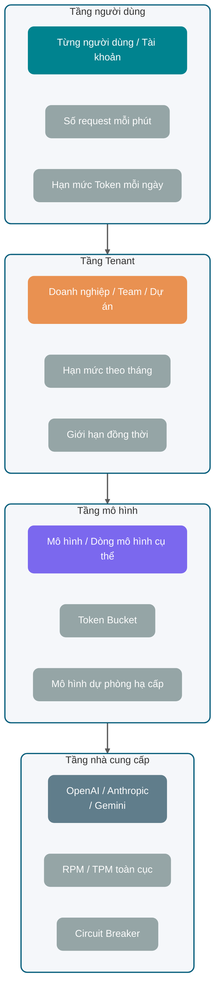
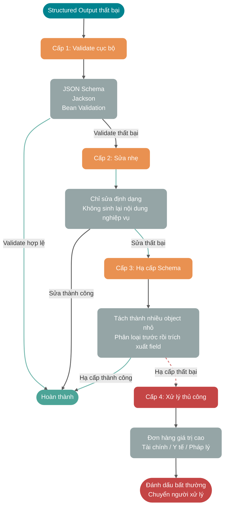

Gọi thông một LLM API trên môi trường local mới chỉ chứng minh rằng mạng và tham số cơ bản đã hoạt động. Khi đưa vào nghiệp vụ thực tế, hàng loạt vấn đề sẽ ập đến: độ trễ ký tự đầu tiên (TTFT), JSON bị cụt giữa chừng, lỗi 429, người dùng hủy request và thực thi trùng lặp:

- Người dùng chờ 8 giây vẫn chưa thấy chữ đầu tiên xuất hiện, tưởng hệ thống bị treo nên nhấn F5 tải lại trang ngay.
- Mô hình trả về nửa chừng một chuỗi JSON, frontend parse thất bại, còn log backend chỉ trơ trọi một đoạn cụt: `{"answer": "Nguyên nhân gốc rễ là`.
- Nhà cung cấp thỉnh thoảng trả về mã lỗi 429, service của bạn bắt đầu retry điên cuồng, càng retry lại càng bị bóp nghẽn (throttled).
- Người dùng nhấn nút Hủy, trình duyệt đã ngắt kết nối, nhưng backend vẫn tiếp tục tiêu tốn Token.
- Cùng một request nghiệp vụ do retry mà chạy tới hai lần, dẫn đến việc ghi database, trừ phí và gửi thông báo đều bị trùng lặp.

Gửi một HTTP request chỉ là một đoạn ngắn trong toàn bộ chuỗi gọi. Cổng tiếp nhận nghiệp vụ, ghép Prompt, định tuyến mô hình, phản hồi dạng streaming, lưu trữ trạng thái vào database và hệ thống giám sát (observability) đều cần được thiết kế đồng bộ, đặc biệt là cách xử lý việc hủy bỏ, retry, hạn mức (quota) và các kết quả xuất ra dở dang.

Bài viết mặc định bạn đã hiểu các khái niệm cơ bản như Token, Context Window (cửa sổ ngữ cảnh), Temperature, Top-p. Nếu vẫn còn băn khoăn, bạn nên đọc trước bài [Cơ chế hoạt động của LLM: Token, Context Window và tham số lấy mẫu ảnh hưởng thế nào đến kết quả](./llm-operation-mechanism.md) và [Prompt Engineering cho LLM là gì? Kỹ thuật viết Prompt hiệu quả](../agent/prompt-engineering.md).

Lưu ý: Năng lực và tham số của các nhà cung cấp như OpenAI, Anthropic, Gemini thay đổi rất nhanh. Hệ thống production nên quản lý động thông qua console, response header hoặc hệ thống cấu hình tập trung (configuration center), thay vì phụ thuộc vào các con số tĩnh trong tài liệu.

## Một chuỗi gọi LLM chuẩn Production gồm những giai đoạn nào?

Nếu chỉ chăm chăm nhìn vào dữ liệu mà nhà cung cấp trả về, bạn sẽ rất khó tìm ra nguyên nhân khi một lệnh gọi LLM gặp sự cố. Request sẽ phải đi qua hệ thống nghiệp vụ, hệ thống ngữ cảnh, model gateway, nhà cung cấp bên ngoài và tầng hiển thị frontend. Bất kỳ phân đoạn nào thiếu quản lý trạng thái và xử lý lỗi đều có thể biểu hiện ra ngoài thành "mô hình hoạt động chập chờn, không ổn định".

```mermaid
flowchart LR
    User["Request người dùng"]:::client
    App["Business Service"]:::business
    Prompt["Ghép Prompt"]:::business
    Gateway["Model Gateway"]:::gateway
    Provider["API nhà cung cấp"]:::external
    Stream["Sự kiện streaming"]:::infra
    Parser["Parser tăng dần"]:::infra
    Sink["Frontend / Lưu DB / Giám sát"]:::success

    User --> App --> Prompt --> Gateway --> Provider --> Stream --> Parser --> Sink

    classDef client fill:#00838F,color:#FFFFFF,stroke:none,rx:10,ry:10
    classDef business fill:#E99151,color:#FFFFFF,stroke:none,rx:10,ry:10
    classDef gateway fill:#7B68EE,color:#FFFFFF,stroke:none,rx:10,ry:10
    classDef external fill:#607D8B,color:#FFFFFF,stroke:none,rx:10,ry:10
    classDef infra fill:#9B59B6,color:#FFFFFF,stroke:none,rx:10,ry:10
    classDef success fill:#4CA497,color:#FFFFFF,stroke:none,rx:10,ry:10

    linkStyle default stroke-width:2px,stroke:#333333,opacity:0.8
```



Bóc tách chi tiết, một request hoàn chỉnh thường bao gồm 8 giai đoạn:

1. **Tiếp nhận request nghiệp vụ**: Xác thực danh tính người dùng, kiểm tra tenant, gói dịch vụ, quyền tính năng và kích thước payload của request.
2. **Ghép ngữ cảnh (Context Assembly)**: Nối ghép System Prompt, input người dùng, lịch sử trò chuyện, tài liệu RAG truy xuất được, Tool Schema và các ràng buộc về định dạng đầu ra.
3. **Ước tính ngân sách Token**: Ước tính input Token, dự trù output Token, quyết định xem có cần cắt tỉa lịch sử, nén ngữ cảnh hoặc chuyển sang mô hình nhỏ hơn hay không.
4. **Định tuyến qua Model Gateway**: Lựa chọn mô hình, nhà cung cấp, vùng (region), tham số timeout, chính sách retry và bucket giới hạn tần suất (rate limiting).
5. **Gọi API của nhà cung cấp**: Phản hồi đồng bộ hoặc streaming, có thể truyền qua SSE, WebSocket hoặc body HTTP thông thường.
6. **Parse phản hồi**: Xử lý delta, finish reason, tool call, usage, trường hợp mô hình từ chối trả lời (refusal), JSON có cấu trúc và ngắt kết nối bất thường.
7. **Ghi nhận trạng thái (State Persistence)**: Lưu trữ câu trả lời hoàn chỉnh, các đoạn text tăng dần, lượng Token tiêu thụ, chi phí cuộc gọi, nguyên nhân lỗi và trạng thái nghiệp vụ.
8. **Giám sát và cảnh báo (Observability & Alerting)**: Ghi lại `traceId`, `providerRequestId`, TTFT, tổng thời gian xử lý, số lần retry, số lần gặp lỗi 429 và tỷ lệ parse thất bại.

Các lệnh gọi mô hình tốt nhất nên được gom về một đầu mối duy nhất tại tầng `LLMGateway` hoặc lớp client dùng chung. Tầng này sẽ chịu trách nhiệm quản lý API Key, timeout, retry, rate limit, logging và chuyển đổi nhà cung cấp dự phòng. Nếu không, mỗi module nghiệp vụ sẽ tự sinh ra một bộ định nghĩa lỗi hơi khác nhau, khiến việc tái hiện và xử lý lỗi khi vận hành trở nên vô cùng khó khăn.


## Phản hồi đồng bộ và phản hồi Streaming khác nhau ở điểm nào?

Gọi đồng bộ (synchronous) đòi hỏi phải đợi mô hình sinh xong toàn bộ nội dung rồi mới trả về kết quả hoàn chỉnh một lần duy nhất. Còn phản hồi streaming hoạt động theo cơ chế vừa sinh vừa trả về: mỗi khi mô hình tạo ra một đoạn text hoặc một sự kiện, nhà cung cấp sẽ đẩy phần tăng dần (delta) đó tới bên gọi thông qua kết nối liên tục. Tài liệu chính thức của OpenAI mô tả HTTP streaming trong ngữ cảnh SSE; Anthropic Messages API cũng hỗ trợ trả về các sự kiện tăng dần qua SSE; Gemini API tương tự cung cấp các giao diện tiêu chuẩn, streaming và thời gian thực. Các trường dữ liệu và năng lực mô hình cụ thể có thể thay đổi, **hãy luôn đối chiếu theo tài liệu chính thức mới nhất**.

**Vì sao Streaming lại giúp giảm TTFT?**

TTFT (Time To First Token) là khoảng thời gian từ lúc gửi request đi cho đến khi nhận được Token đầu tiên có thể hiển thị được. Với phản hồi đồng bộ, người dùng phải đợi mô hình hoàn thành toàn bộ câu trả lời; ví dụ nếu mô hình cần sinh 800 Token thì backend bắt buộc phải đợi cả 800 Token xong xuôi mới trả kết quả về. Trong khi đó, với phản hồi streaming, chỉ cần đợi đến đoạn text đầu tiên là người dùng đã có thể nhìn thấy nội dung dần dần hiện ra.

Streaming không làm cho mô hình tính toán ít Token đi, cũng không tự nhiên giúp tiết kiệm tiền. Thứ mà nó rút ngắn là thời gian chờ đợi ký tự đầu tiên, chứ không nhất thiết rút ngắn tổng thời gian sinh ra toàn bộ câu trả lời.

| Tiêu chí so sánh | Phản hồi đồng bộ (Sync) | Phản hồi Streaming |
| :--- | :--- | :--- |
| **Độ trễ ký tự đầu (TTFT)** | Cao, phải đợi kết quả hoàn chỉnh | Thấp, nhận được đoạn đầu tiên là hiển thị được ngay |
| **Tổng thời gian End-to-End** | Phụ thuộc vào toàn bộ thời gian sinh | Thường vẫn phụ thuộc vào toàn bộ thời gian sinh |
| **Trải nghiệm frontend** | Giống như submit form rồi chờ đợi | Giống ứng dụng chat hiển thị chữ chạy từng ký tự |
| **Triển khai backend** | Đơn giản, lấy toàn bộ chuỗi rồi xử lý | Phức tạp, phải xử lý sự kiện tăng dần, hủy bỏ, đứt luồng |
| **Parse cấu trúc** | Đơn giản, parse chuỗi JSON hoàn chỉnh một lần | Cần gom đủ nội dung hoặc dùng incremental parser |
| **Kịch bản phù hợp** | Văn bản ngắn, tác vụ chạy nền, transaction nghiêm ngặt | Chat, viết lách, sinh báo cáo, câu trả lời dài |
| **Kịch bản không phù hợp** | Câu trả lời dài có tương tác trực tiếp với người dùng | Chuỗi xử lý giao dịch mạnh, bắt buộc phải validate trọn vẹn kết quả trước |

Văn bản dài phục vụ hiển thị cho người dùng thường ưu tiên phản hồi streaming; các tác vụ xử lý theo lô (batch processing) ở background hoặc các tác vụ đòi hỏi phải có đầy đủ object mới được commit sẽ thích hợp hơn với phản hồi đồng bộ.

## Chọn giao thức streaming nào giữa SSE, WebSocket và HTTP chunked?

Đầu ra streaming có một số hình thức truyền tải phổ biến, đừng nhầm lẫn chúng thành một thứ duy nhất.

| Giao thức | Đặc điểm cốt lõi | Kịch bản phù hợp | Giới hạn & Biên giới |
| :--- | :--- | :--- | :--- |
| **SSE** | `EventSource` nguyên bản của trình duyệt, server đẩy một chiều xuống client, định dạng `text/event-stream` | Chat văn bản, mô hình xuất text tăng dần, thông báo trạng thái | Giao tiếp một chiều; nếu cần điều khiển hai chiều phức tạp phải gọi thêm HTTP request riêng |
| **WebSocket** | Kết nối liên tục hai chiều (full-duplex), cả client và server đều có thể gửi tin bất kỳ lúc nào | Voice Agent thời gian thực, cộng tác nhiều người, cần ngắt lời liên tục | Quản lý kết nối phức tạp hơn, gateway, auth, heartbeat đều phải tự quản lý cẩn thận |
| **HTTP chunked** | Cơ chế truyền tải phân đoạn (chunked transfer) của HTTP/1.1, body phản hồi được gửi thành từng khối | Proxy streaming từ backend sang backend, truyền tải tầng thấp | Là cơ chế truyền tải (transport), không phải giao thức sự kiện tầng ứng dụng; HTTP/2 trở đi có cơ chế streaming riêng |


Ưu điểm lớn nhất của SSE là sự đơn giản. Phía trình duyệt chỉ cần vài dòng code là có thể lắng nghe sự kiện, phía server chỉ cần ghi dữ liệu theo từng đoạn `data:`. Tài liệu MDN về EventSource cũng nhấn mạnh sự khác biệt so với WebSocket: SSE là luồng dữ liệu đơn hướng từ server tới client.

WebSocket phù hợp với các tương tác thời gian thực phức tạp hơn. Ví dụ trong một Voice Agent, client phải liên tục stream audio lên, server phải liên tục trả về trạng thái ASR, LLM, TTS, đồng thời phải hỗ trợ người dùng ngắt lời giữa chừng (barge-in). Với kịch bản này, dùng WebSocket sẽ tự nhiên hơn rất nhiều.

HTTP chunked nằm ở tầng thấp hơn. Rất nhiều framework phía server khi không có header `Content-Length` sẽ dùng chunked response; nó cho phép "vừa ghi vừa gửi", nhưng không hỗ trợ bạn định nghĩa loại sự kiện, ngữ nghĩa kết nối lại hay ranh giới thông điệp. Tầng nghiệp vụ vẫn phải tự thiết kế giao thức cho riêng mình.

### Ranh giới sự kiện (Event Boundary) trong giao thức SSE

SSE thường được truyền qua HTTP response với Media Type là `text/event-stream`, định dạng thông điệp là một luồng sự kiện văn bản UTF-8. Mỗi sự kiện gồm nhiều dòng trường dữ liệu, giữa các sự kiện được phân tách bằng một **dòng trống**; thực tế ký tự xuống dòng có thể là `\n` hoặc `\r\n`, vì vậy ranh giới sự kiện thường thấy là `\n\n` hoặc `\r\n\r\n`.

Các trường dữ liệu thường gặp:

| Trường | Tác dụng |
| :--- | :--- |
| `data` | Payload nghiệp vụ; cho phép nhiều dòng `data:`, client sẽ ghép nối lại theo chuẩn |
| `event` | Tên sự kiện tùy chỉnh; loại sự kiện mặc định của trình duyệt là `message` |
| `id` | Mã định danh sự kiện; kết hợp với cơ chế tự reconnect của trình duyệt để tiếp tục từ điểm ngắt |
| `retry` | Khoảng thời gian khuyến nghị chờ để kết nối lại (tính bằng mili-giây) |

**Dòng trống mới chính là ký tự phân tách sự kiện**. Một ký tự xuống dòng đơn lẻ chỉ kết thúc dòng trường hiện tại chứ không kết thúc sự kiện. Phía server nếu tự viết chuỗi `data:` thủ công mà quên gắn prefix cho từng dòng của văn bản thì client có thể làm mất các dòng phía sau; ngược lại, vô tình ghi thêm dòng trống sẽ khiến sự kiện bị kết thúc sớm. Danh sách Markdown và code block rất dễ gặp phải các tình huống này.

Trong phần hỏi đáp kiến thức của dự án *Nền tảng phỏng vấn thông minh SpringAI + Kho tri thức RAG*, giao thức SSE đã được sử dụng: mô hình vừa sinh dữ liệu, trình duyệt vừa hiển thị hiệu ứng gõ máy chữ; chuỗi xử lý không quá dài nhưng các chi tiết giao thức đều được đảm bảo chuẩn chỉnh.

### Cách viết SSE với Spring Boot + Spring AI

Ở phía Java, cách làm phổ biến là đặt **`Content-Type: text/event-stream`**, sau đó dùng Reactive Streams để đẩy dữ liệu ra. Spring cung cấp sẵn `ServerSentEvent<T>` nhằm tránh việc nối chuỗi `data:` và `\n\n` thủ công dẫn tới sai sót:

```java
@GetMapping(value = "/chat/stream", produces = MediaType.TEXT_EVENT_STREAM_VALUE)
public Flux<ServerSentEvent<String>> stream() {
    return Flux.interval(Duration.ofMillis(500))
        .map(seq -> ServerSentEvent.<String>builder()
            .id(Long.toString(seq))
            .event("token")
            .data("chunk-" + seq)
            .retry(Duration.ofSeconds(3))
            .build());
}
```

Khi tích hợp với LLM, nguồn dữ liệu tăng dần thường là interface streaming do SDK hoặc framework cung cấp. Lấy ví dụ với Spring AI, khi bật streaming ở `ChatClient`, bạn sẽ nhận được một `Flux<String>`, sau đó map sang SSE để đẩy về frontend:

```java
Flux<String> tokens = chatClient.prompt()
    .system(systemPrompt)
    .user(userPrompt)
    .stream()
    .content();
```

Về mặt kỹ thuật, bạn cần nắm rõ: WebMVC kết hợp với `Flux` chỉ là sử dụng kiểu reactive ở đầu ra Controller để làm SSE, bên dưới bản chất vẫn chạy trên Servlet container. Thread pool, số lượng kết nối và timeout vẫn phải được quản lý theo dạng "request kéo dài" (long-lived request). Virtual Threads trên Java 21 có thể giúp giảm thiểu đáng kể chi phí "chiếm dụng một platform thread chỉ để ngồi chờ", điều này đặc biệt hữu ích với các chuỗi sinh văn bản kéo dài hàng chục giây.

### Xử lý khi nội dung mô hình sinh có chứa ký tự xuống dòng

Khi tự viết text SSE thô thủ công, mỗi dòng nội dung đều phải có tiền tố `data:`, và dòng trống mới biểu thị sự kết thúc của một sự kiện. Trình duyệt sẽ ghép nhiều dòng `data:` trong cùng một sự kiện lại với nhau bằng ký tự xuống dòng.

Khi dùng Spring `ServerSentEvent` và message encoder tương ứng, đừng tự tiện thay thế ký tự `\n` trong nội dung thành chuỗi ký tự nguyên bản `\\n`. Việc tự ý thay thế này sẽ làm biến đổi text nghiệp vụ, đồng thời bắt frontend phải làm thêm một bước unescape rất dễ xung đột ký tự. Cứ chuyển chuỗi nguyên bản cho encoder xử lý:

```java
.map(chunk -> ServerSentEvent.<String>builder()
    .event("token")
    .data(chunk)
    .build())
```

Nếu chuỗi xử lý trung gian phải đi qua API gateway tự phát triển hoặc client không hỗ trợ SSE, bạn có thể đóng gói mỗi đoạn delta thành JSON, ví dụ `{"sequence":12,"delta":"Dòng 1\nDòng 2"}`, rồi để JSON encoder lo phần escape. Dù chọn giải pháp nào, cũng phải test kỹ các trường hợp LF, CRLF, dòng trống, khối code và sự kiện bị dở dang khi đứt kết nối.

### Cấu hình Streaming trên Nginx và Gateway

Chỉ cần phía trước có đặt Nginx hoặc các reverse proxy có cơ chế đệm response (response buffering), chuỗi `text/event-stream` có thể bị gom lại cho đủ một khối lớn rồi mới xả xuống, khiến cảm giác TTFT ở phía người dùng lập tức biến thành gọi API đồng bộ.

Cấu hình tối thiểu thường là:

```nginx
location /api/ {
    proxy_pass http://backend;
    proxy_buffering off;
    proxy_cache off;
    proxy_read_timeout 300s;
    proxy_set_header Connection "";
    add_header Cache-Control no-cache;
}
```

Đồng thời kết hợp với `proxy_read_timeout` (hoặc cấu hình tương đương) để giữ cho các phiên sinh dữ liệu dài không bị ngắt; nếu không, kết nối sẽ bị middleware ngắt đột ngột khi vượt quá timeout im lặng (silent timeout).

### 4 kịch bản ngoại lệ của Streaming

Trạng thái kết thúc của chuỗi streaming cần được thiết kế riêng biệt. Các trạng thái Hủy bỏ (Cancel), Hết thời gian (Timeout), Đứt luồng (Interruption) và Kết nối lại (Reconnect) không thể gom chung vào một trạng thái "Thất bại" duy nhất.


**Người dùng hủy (User Cancellation).**

Khi người dùng đóng trang, nhấn nút dừng sinh (Stop Generating) hoặc chuyển sang cuộc hội thoại khác, sự kiện hủy phải được kích hoạt ngay lập tức. Phía backend cần đồng thời hủy:

- Request đang gửi tới API của nhà cung cấp.
- Luồng phân tích (stream parsing) đang chạy.
- Các tác vụ tiếp nối như TTS, gọi tool, lưu database.
- Bộ đệm tăng dần (buffer) chưa kịp commit.

Tuyệt đối không được chỉ dừng hiển thị ở frontend. Frontend dừng mà request phía nhà cung cấp vẫn tiếp tục sinh thì Token và chi phí vẫn bị tiêu hao.

**Timeout.**

Timeout cần được chia thành ít nhất ba tầng:

- Timeout kết nối: Không thể kết nối tới nhà cung cấp.
- Timeout TTFT: Đã kết nối thành công nhưng mãi không nhận được sự kiện đầu tiên.
- Timeout tổng thời lượng: Vẫn có dữ liệu trả về liên tục nhưng vượt quá thời gian tối đa mà nghiệp vụ cho phép.

Cả ba trường hợp này cần được ghi nhận riêng biệt. Timeout TTFT thường cảnh báo mô hình đang bị quá tải xếp hàng, ngữ cảnh quá dài hoặc mạng nhà cung cấp chập chờn; còn timeout tổng thời lượng có thể đơn giản là do người dùng yêu cầu mô hình viết quá dài.

**Đứt luồng (Stream Interruption).**

Khi đứt luồng, đừng vội coi nội dung dở dang là đã thành công. Cách làm chuẩn xác là kiểm tra `finish_reason` hoặc trạng thái sự kiện cuối cùng. Nếu không có tín hiệu kết thúc bình thường, hãy đánh dấu phiên gọi này là `INTERRUPTED`. Phía frontend nên hiển thị "Đã bị ngắt quãng, bạn có thể bấm sinh lại", thay vì âm thầm lưu lại một nửa câu trả lời cụt lủn coi như câu trả lời hoàn chỉnh.

**Kết nối lại (Reconnection).**

`EventSource` của SSE có khả năng tự động kết nối lại, nhưng đầu ra của LLM không giống như bản tin tin tức thông thường. Việc reconnect có thể tiếp tục truyền từ điểm ngắt hay không phụ thuộc vào việc server của bạn có lưu trữ sequence number, các đoạn chunk tăng dần và trạng thái gọi nhà cung cấp hay không. Trong phần lớn trường hợp, luồng phía nhà cung cấp đã đứt hẳn, không thể nối lại ở mức từng Token được nữa.

Cách làm ổn định hơn:

- Server sinh `messageId` và `sequence` tăng dần cho mỗi phản hồi streaming.
- Các đoạn text đã gửi được ghi vào cache ngắn hạn (ví dụ Redis).
- Khi frontend kết nối lại, server sẽ bù phát lại các đoạn đã cache trước.
- Nếu luồng phía nhà cung cấp đã kết thúc hoặc mất hiệu lực, hãy báo cho người dùng biết để sinh lại từ đầu, thay vì giả vờ như đang viết tiếp liền mạch.

## Lỗi nào có thể Retry, lỗi nào tuyệt đối không được Retry?

Retry là khả năng mà các kỹ sư backend quen thuộc nhất nhưng cũng dễ lạm dụng nhất.

Việc retry khi gọi LLM API có hai điểm vô cùng đặc thù:

1. **Request rất tốn tiền**: Request thất bại vẫn có thể bị tính vào quota hạn mức, thậm chí đã tiêu tốn một phần Token.
2. **Kết quả đầu ra không xác định (Non-deterministic)**: Ngay cả khi dùng cùng một Prompt, câu trả lời lần thứ hai cũng có thể khác hoàn toàn so với lần đầu.


### Bảng đối chiếu các loại lỗi

| Loại lỗi | Ví dụ | Khuyến nghị Retry? | Phương thức xử lý |
| :--- | :--- | :--- | :--- |
| **Mạng chập chờn tức thời** | Connection reset, giật DNS, read timeout | Có | Exponential backoff + Jitter, giới hạn số lần tối đa |
| **Nhà cung cấp trả về 5xx** | 500, 502, 503, 504 | Có | Thử lại trong thời gian ngắn, vượt ngưỡng thì đổi mô hình hoặc hạ cấp |
| **Nhà cung cấp quá tải** | Anthropic 529, các lỗi overloaded tương tự | Có | Thử lại chậm hơn, kích hoạt circuit breaker ngắt nhà cung cấp nếu cần |
| **429 Rate Limit** | Vượt quá giới hạn RPM, TPM, RPD, Concurrency | Thận trọng | Ưu tiên đọc `Retry-After` và header giới hạn, xếp hàng hoặc hạ cấp |
| **Đứt luồng streaming** | Không nhận được sự kiện kết thúc chuẩn | Tùy ngữ cảnh | Tác vụ tương tác người dùng không tự retry; tác vụ nền có thể retry có kiểm soát idempotent |
| **400 Lỗi tham số** | Schema không hợp lệ, thiếu trường, vượt context | Không nên | Sửa request, tuyệt đối không retry cùng một payload lỗi |
| **401/403 Lỗi xác thực** | API Key không hợp lệ, không đủ quyền | Không nên | Bắn cảnh báo và vô hiệu hóa ngay Key đó |
| **Mô hình từ chối vì an toàn** | Vi phạm chính sách an toàn nội dung (Content Policy) | Không nên | Đi vào luồng xử lý từ chối của nghiệp vụ |
| **Parse thất bại** | JSON không hoàn chỉnh, sai kiểu dữ liệu | Có thể thử lại hạn chế | Gửi kèm nguyên nhân lỗi để mô hình sửa định dạng, tối đa 1-2 lần |

Tài liệu chính thức về rate limit của OpenAI khuyến nghị sử dụng backoff số mũ ngẫu nhiên (randomized exponential backoff) cho lỗi rate limit, đồng thời nhắc nhở rằng request thất bại vẫn bị tính vào giới hạn mỗi phút. Tài liệu lỗi của Anthropic liệt kê rõ các mã như 429 rate limit, 500 api error, 504 timeout, 529 overloaded. Khi tích hợp các nhà cung cấp khác, bạn cũng cần dựa vào bảng mã lỗi của họ để phân định rõ ràng giữa các trạng thái có thể retry, không thể retry và trạng thái quá tải.

### Exponential Backoff và Jitter

Exponential Backoff (lùi số mũ) sẽ tăng dần thời gian chờ sau mỗi lần thất bại, cho đến khi chạm mức chờ tối đa hoặc vượt số lần retry cho phép. Jitter (dao động ngẫu nhiên) sẽ cộng thêm một khoảng thời gian ngẫu nhiên vào thời gian chờ, nhằm tránh hiện tượng tất cả các request cùng retry một lúc (thundering herd), đánh sập hệ thống vừa mới gượng dậy lại rơi vào tình trạng rate limit tiếp.

Công thức thực tế:

```text
sleep = min(maxDelay, baseDelay * 2^retryCount) + random(0, jitter)
```

Trên môi trường production, tuyệt đối đừng quên hai ràng buộc cứng:

- **Số lần retry tối đa**: Thông thường 2-3 lần là đủ, không retry vô hạn.
- **Deadline tổng thể**: Request của người dùng có SLA tổng thể, ví dụ 15 giây; hết giờ là phải báo thất bại ngay, đừng vì retry mà kéo dài lê thê tới 1 phút.

### Idempotency Key và cơ chế khử trùng lặp

Bất cứ khi nào có cơ chế retry, bài toán Idempotency (tính lũy đẳng) bắt buộc phải được đưa ra thảo luận.

Idempotency Key có thể được sinh từ các chiều nghiệp vụ, ví dụ:

```text
tenantId:userId:conversationId:messageId:attemptGroup
```

Khi server nhận được request, trước tiên kiểm tra xem Key này đã tồn tại hay chưa:

- Nếu đã thành công: Trả về ngay kết quả lịch sử trước đó.
- Nếu đang trong quá trình sinh: Trả về địa chỉ đăng ký lắng nghe (subscription handle) của chính tác vụ streaming đó.
- Nếu thất bại và được phép retry: Tạo một `attempt` mới nhưng vẫn gắn vào cùng một message nghiệp vụ.
- Nếu thất bại và không thể retry: Trả về trực tiếp nguyên nhân thất bại.

Cách làm này giúp bạn tránh được hai cái bẫy kinh điển:

1. Người dùng bấm nút "Gửi lại" liên tục, khiến backend tạo ra hàng loạt phiên gọi mô hình chạy song song.
2. Gateway bị timeout nên tự động retry, trong khi lần gọi đầu thực tế đã lưu DB thành công, dẫn đến lần gọi thứ hai ghi thêm một bản ghi tin nhắn trùng lặp.

### Xử lý phản hồi trùng lặp

Phản hồi sau khi retry có thể bị trùng lặp, xung đột hoặc chồng lấn một phần.

Đối với các ứng dụng trò chuyện (chat), khuyến nghị nên phân định rõ các định danh trong nhiều lần gọi mô hình của cùng một tin nhắn người dùng:

- `message_id`: ID tin nhắn nghiệp vụ, hiển thị cho người dùng thấy.
- `attempt_id`: ID của lần thử gọi mô hình, phục vụ hệ thống theo dõi.
- `provider_request_id`: ID request phía nhà cung cấp, dùng để đối soát và tra cứu log.
- `stream_sequence`: Số thứ tự đoạn chunk tăng dần, dùng để lọc trùng và gửi bù.

Khi ghi dữ liệu vào database, chỉ cho phép duy nhất một attempt được đánh dấu là `final`. Các attempt khác được giữ lại làm bản ghi chẩn đoán, không được đưa vào context của người dùng ở các lượt hội thoại tiếp theo. Làm như vậy vừa giúp điều tra sự cố dễ dàng, vừa không làm ô nhiễm Prompt của các lượt chat sau.

## Vì sao phải Rate Limit? Triển khai Rate Limit thế nào?

Ý thức về Rate Limit ở rất nhiều đội ngũ kỹ thuật chỉ bắt đầu xuất hiện khi họ nhận được mã lỗi 429 đầu tiên.

Chờ đến khi nhận lỗi 429 từ nhà cung cấp mới bắt tay vào làm rate limit chứng tỏ hệ thống của bạn đang thiếu năng lực quản trị dung lượng nội bộ. Lỗi 429 chỉ nên đóng vai trò là tín hiệu bảo vệ từ bên ngoài, chứ không thể thay thế cho việc quản lý ngân sách, xếp hàng chờ và kiểm soát đồng thời ở phía ứng dụng của bạn.

### Kiến trúc Rate Limit 4 tầng

| Tầng | Đối tượng giới hạn | Mục đích cốt lõi | Chiến lược phổ biến |
| :--- | :--- | :--- | :--- |
| **Tầng người dùng** | Từng user hoặc tài khoản | Ngăn chặn lạm dụng, thao tác nhầm, script cào dữ liệu | Số request mỗi phút (RPM), trần Token mỗi ngày |
| **Tầng Tenant** | Doanh nghiệp, team, dự án | Kiểm soát chi phí theo gói và đảm bảo tính công bằng | Quota theo tháng, trần kết nối đồng thời, hàng đợi ưu tiên |
| **Tầng mô hình** | Mô hình hoặc dòng mô hình cụ thể | Tránh việc các mô hình "hot" bị nghẽn tải | Token Bucket theo mô hình, hạ cấp sang mô hình dự phòng |
| **Tầng nhà cung cấp** | OpenAI, Anthropic, Gemini... | Bảo vệ tài nguyên bên ngoài dùng chung và API Key | RPM, TPM toàn cục, kiểm soát đồng thời, Circuit Breaker |



Tài liệu chính thức của Gemini chia nhỏ các chiều giới hạn thành RPM, TPM đầu vào, RPD và chỉ rõ rằng giới hạn áp dụng theo dự án (project) chứ không phải theo từng API Key đơn lẻ; tài liệu của OpenAI cũng minh họa các response header rate limit bao gồm số lượng request, số Token, hạn ngạch còn lại. Các con số và mối tương quan giữa các mô hình thay đổi rất nhanh, hệ thống production không được fix cứng các con số tĩnh trong tài liệu mà phải quản lý linh hoạt qua dashboard, response header hoặc hệ thống config.

### Vì sao ngân sách Token quan trọng hơn số lượng Request?

Rate limit của API truyền thống thường tính theo QPS (Queries Per Second). Với LLM API, chỉ nhìn vào QPS là hoàn toàn không đủ.

Chi phí giữa hai request có thể chênh lệch một trời một vực:

- Request A: Input 500 Token, output 100 Token.
- Request B: Input 80K Token, output 8K Token.

Cả hai đều chỉ tính là 1 request HTTP, nhưng áp lực tạo ra lên quá trình inference của mô hình, hạn mức quota của nhà cung cấp và hóa đơn thanh toán là hoàn toàn khác biệt.

Do đó, rate limit bắt buộc phải xem xét đồng thời nhiều chiều:

- **RPM**: Số lượng request mỗi phút.
- **TPM**: Số lượng Token mỗi phút.
- **Số kết nối đồng thời**: Số lượng request đang trong quá trình sinh dữ liệu.
- **Kích thước Context**: Số input Token của từng request riêng lẻ.
- **Đầu ra tối đa**: Tham số `max_tokens` hoặc tương đương.
- **Ngân sách ngày / tháng**: Tổng chi phí của tenant hoặc người dùng.

Request bắt buộc phải trừ ngân sách trước rồi mới được gửi tới nhà cung cấp.

Khi một request đi vào gateway, trước tiên cần ước lượng `input_tokens + reserved_output_tokens`, sau đó thử trừ dần vào các bucket của người dùng, tenant, mô hình và nhà cung cấp. Nếu trừ không đủ thì tuyệt đối không gửi sang nhà cung cấp mà đưa vào hàng đợi, hạ cấp hoặc từ chối phục vụ ngay.

### So sánh các thuật toán Rate Limit phổ biến

| Thuật toán | Kịch bản phù hợp | Ưu điểm | Nhược điểm |
| :--- | :--- | :--- | :--- |
| **Cửa sổ cố định (Fixed Window)** | Tác vụ nền đơn giản, API quản trị | Dễ triển khai, dễ thống kê | Dễ bị đột biến lưu lượng (spike) ở ranh giới cửa sổ |
| **Cửa sổ trượt (Sliding Window)** | Giới hạn request cấp người dùng | Ranh giới mượt mà hơn | Chi phí triển khai và lưu trữ dữ liệu cao hơn |
| **Thùng Token (Token Bucket)** | Gọi mô hình, quản lý ngân sách Token | Chấp nhận một lượng lưu lượng đột biến nhất định; chuẩn công nghiệp | Tham số cần tinh chỉnh kỹ lưỡng |
| **Thùng rò rỉ (Leaky Bucket)** | Làm phẳng tuyệt đối lưu lượng đi ra | Lưu lượng ra đều đặn, bảo vệ tốt upstream | Trải nghiệm kém khi có lưu lượng đột biến |
| **Semaphore đồng thời** | Sinh streaming, tác vụ kéo dài | Giới hạn trực tiếp số tài nguyên kết nối bị chiếm dụng | Không kiểm soát được chi phí Token của từng request |
| **Hàng đợi ưu tiên (Priority Queue)** | Đa tenant, nhiều cấp độ dịch vụ VIP | Bảo vệ các request có độ ưu tiên cao | Cần xử lý vấn đề đói tài nguyên (starvation) và timeout |

Các hệ thống production thường kết hợp các chiến lược này lại với nhau:

- Cấp người dùng: Cửa sổ trượt + Trần Token mỗi ngày.
- Cấp Tenant: Thùng Token + Ngân sách theo tháng.
- Cấp mô hình: Thùng Token + Semaphore đồng thời.
- Cấp nhà cung cấp: Thùng Token toàn cục + Circuit Breaker.
- Request Streaming: Semaphore đồng thời + Giới hạn tổng thời lượng.

Để tìm hiểu chi tiết về các thuật toán rate limit, bạn có thể tham khảo bài viết: [Chi tiết về giới hạn tần suất dịch vụ (Rate Limiting)](https://javaguide.cn/high-availability/limit-request.html).

### Cần xử lý thế nào khi nhận mã lỗi 429?

Mã HTTP 429 biểu thị có quá nhiều request. Khi backend nhận lỗi 429, khuyến nghị xử lý theo thứ tự sau:

1. **Đọc header `Retry-After` hoặc rate limit header của nhà cung cấp**: Nếu có thời gian hồi phục cụ thể, hãy tuân thủ nghiêm ngặt.
2. **Xác định chiều bị giới hạn**: Do chạm trần số request, chạm trần Token hay cạn kiệt quota ngày.
3. **Request ngắn có thể đưa vào hàng đợi**: Ví dụ các tác vụ tóm tắt văn bản ở background có thể đẩy vào delay queue.
4. **Hạn chế retry các request tương tác của người dùng**: Người dùng không thể chờ đợi lâu, hãy hiển thị thông báo thử lại sau hoặc chuyển sang mô hình gọn nhẹ hơn.
5. **Kích hoạt Circuit Breaker khi nhà cung cấp liên tục trả 429**: Ngăn không cho toàn bộ request tiếp tục "đâm đầu vào tường".

Một chuỗi hạ cấp điển hình:

```text
Mô hình ưu tiên khả dụng -> Gọi bình thường
Mô hình ưu tiên trả về 429 -> Chuyển sang mô hình dự phòng cùng cấp
Mô hình dự phòng cũng bị rate limit -> Chuyển sang mô hình nhẹ và rút ngắn max_tokens
Vẫn không khả dụng -> Đưa vào hàng đợi hoặc trả về "Hệ thống đang bận"
```

Cần tránh một ngộ nhận: Hạ cấp không có nghĩa là âm thầm giảm chất lượng một cách lén lút. Nếu mô hình nhẹ làm suy giảm chất lượng câu trả lời, hãy thông báo rõ ràng trên giao diện, ví dụ "Hiện đang chạy ở chế độ phản hồi nhanh; với các câu hỏi phức tạp, khuyến nghị bạn thử lại sau".

## Vì sao cần trả về dữ liệu có cấu trúc (Structured Output)?

Rất nhiều dự án ban đầu viết Prompt theo kiểu:

```text
Hãy phân tích câu hỏi của người dùng và xuất ra JSON với các trường intent, confidence, answer.
```

Sau đó phía backend chỉ việc gọi `JSON.parse()`.

Cách làm này rất phổ biến ở giai đoạn làm Demo, nhưng khi đưa lên môi trường production sẽ vấp phải vô số trường hợp ngoại lệ:

- Mô hình tự thêm một câu trước đoạn JSON: "Dạ vâng, dưới đây là kết quả phân tích:".
- Thiếu các trường bắt buộc.
- Các giá trị Enum bị mô hình tự "bịa" ra (hallucination).
- Kiểu số bị trả về dưới dạng chuỗi (string).
- Khi gọi streaming chỉ nhận được một nửa object JSON dở dang.
- Khi mô hình từ chối trả lời vì lý do an toàn, nội dung hoàn toàn không tuân theo Schema nghiệp vụ.

Mục tiêu cốt lõi của Structured Output là đảm bảo chương trình máy tính có thể phân tích và tiêu thụ kết quả đầu ra của mô hình một cách ổn định, chứ không dừng lại ở việc kết quả trông có vẻ giống JSON.

### Phân biệt JSON Mode, JSON Schema và Structured Outputs

| Phương thức | Mức độ ràng buộc | Giá trị kỹ thuật | Rủi ro |
| :--- | :--- | :--- | :--- |
| **Ngôn ngữ tự nhiên thuần túy** | Hầu như không có | Phù hợp để hiển thị câu trả lời | Không phù hợp cho chương trình tự động parse |
| **Yêu cầu JSON qua Prompt** | Yếu | Đơn giản, dùng được cho mọi mô hình | Dễ bị lẫn văn bản giải thích hoặc thiếu trường |
| **JSON Mode** | Trung bình | Thường đảm bảo cú pháp hợp lệ là JSON | Chưa chắc khớp đúng với Schema trường nghiệp vụ |
| **JSON Schema** | Mạnh | Định nghĩa rõ trường, kiểu, bắt buộc, enum | Tập con hỗ trợ giữa các nhà cung cấp là khác nhau |
| **Structured Outputs** | Rất mạnh | Nhà cung cấp tăng cường ràng buộc ở tầng giải mã (decode) hoặc SDK | Bị giới hạn bởi mô hình, SDK và tập con Schema hỗ trợ |
| **Function Calling / Tool Use** | Hướng hành động | Phù hợp để mô hình chọn công cụ và tham số | Không phải giải pháp toàn năng thay thế câu trả lời tự nhiên cuối cùng |


Tài liệu chính thức về Structured Outputs của OpenAI nhấn mạnh khả năng ép đầu ra tuân thủ nghiêm ngặt theo JSON Schema do lập trình viên cung cấp, đồng thời có thêm cấu hình `strict: true`. Tài liệu của Gemini nêu rõ structured output sử dụng `response_format` cùng JSON Schema và hỗ trợ một tập con của chuẩn JSON Schema. Tài liệu của Anthropic cũng cung cấp Structured Outputs song song với Strict Tool Use; hai tính năng này giải quyết các bài toán có phần khác nhau. Do các mô hình, tham số và tập con Schema thay đổi liên tục, hãy luôn bám sát tài liệu chính thức mới nhất.

### Khác biệt kỹ thuật giữa JSON thông thường và Structured Output

Đầu ra ngôn ngữ tự nhiên thông thường giống như "văn bản người viết cho người đọc", còn Structured Output giống như "API do service này viết cho service khác gọi".

Lấy ví dụ về kịch bản nhận diện ý định (Intent Recognition):

```json
{
  "intent": "refund_request",
  "confidence": 0.86,
  "entities": {
    "order_id": "202605080001",
    "reason": "Hàng bị hư hỏng"
  },
  "need_human_review": false
}
```

Khi có Schema bảo đảm, backend có thể khẳng định chắc chắn:

- `intent` bắt buộc phải nằm trong tập enum hữu hạn.
- `confidence` chắc chắn phải là kiểu số (number).
- `order_id` có thể null nhưng kiểu dữ liệu phải luôn là string.
- `need_human_review` bắt buộc phải tồn tại với kiểu boolean.
- Khi parse thất bại có thể kích hoạt quy trình tự sửa hoặc chuyển cho con người can thiệp.

Schema đã biến chuỗi JSON do mô hình sinh ra thành một bản hợp đồng dữ liệu (data contract) có thể kiểm chứng được.

### Chiến lược Fallback khi Structured Output thất bại

Structured Output vẫn có thể thất bại. Thất bại không hẳn do lỗi của nhà cung cấp mà có thể do Schema quá phức tạp, Prompt bị mâu thuẫn, output bị cắt cụt do chạm trần Token hoặc bị bộ lọc an toàn từ chối.

Khuyến nghị thiết lập cơ chế fallback 4 cấp độ:

1. **Validate cục bộ**: Dùng JSON Schema, Jackson, Bean Validation để kiểm tra các trường và kiểu dữ liệu.
2. **Sửa nhẹ (Lightweight Repair)**: Chỉ yêu cầu mô hình sửa lại định dạng lỗi, không sinh lại nội dung nghiệp vụ.
3. **Hạ cấp Schema**: Tách object phức tạp thành nhiều object nhỏ, hoặc phân loại ý định trước rồi mới trích xuất các trường dữ liệu.
4. **Xử lý thủ công hoặc theo Rule**: Với các đơn hàng giá trị cao, tài chính, y tế, pháp lý, tuyệt đối không phụ thuộc hoàn toàn vào cơ chế tự sửa.



Một nguyên tắc thực tế quan trọng: Khi Structured Output thất bại, đừng bao giờ nhét bừa chuỗi ngôn ngữ tự nhiên thô vào các hệ thống hạ nguồn. Việc một đoạn text hiển thị được cho người dùng xem không đồng nghĩa với việc nó có thể được chương trình thực thi an toàn.

## Triển khai gọi LLM trong Backend Java như thế nào?

Đoạn mã giả Java dưới đây độc lập với mọi SDK cụ thể. Ngân sách Token, rate limit, retry, parse streaming, tính lũy đẳng (idempotency) và giám sát đều được quy tụ về cùng một gateway:

```java
public interface LLMClient {
    LLMResponse chat(LLMRequest request);

    void stream(LLMRequest request, StreamHandler handler);
}

public interface StreamHandler {
    void onStart(String messageId);

    void onDelta(String messageId, long sequence, String delta);

    void onComplete(String messageId, LLMUsage usage);

    void onError(String messageId, Throwable error);
}

public final class LLMGateway {
    private final LLMClient client;
    private final RateLimiter rateLimiter;
    private final IdempotencyStore idempotencyStore;
    private final TokenEstimator tokenEstimator;
    private final Observation observation;

    public LLMGateway(
            LLMClient client,
            RateLimiter rateLimiter,
            IdempotencyStore idempotencyStore,
            TokenEstimator tokenEstimator,
            Observation observation) {
        this.client = client;
        this.rateLimiter = rateLimiter;
        this.idempotencyStore = idempotencyStore;
        this.tokenEstimator = tokenEstimator;
        this.observation = observation;
    }

    public LLMResponse chatWithRetry(BusinessCommand command) {
        String idemKey = command.idempotencyKey();
        LLMRequest request = buildRequest(command);
        String requestFingerprint = command.requestFingerprint();
        IdempotencyClaim claim = idempotencyStore.claim(idemKey, requestFingerprint);

        if (claim.isCompleted()) {
            return claim.toResponse();
        }
        if (!claim.isOwner()) {
            throw new LLMException("Request with the same idempotency key is already running");
        }

        TokenBudget budget = tokenEstimator.estimate(request);
        try {
            rateLimiter.acquire(command.tenantId(), request.model(), budget);
        } catch (RuntimeException ex) {
            idempotencyStore.releaseClaim(idemKey, requestFingerprint);
            throw ex;
        }

        RetryPolicy retryPolicy = RetryPolicy.defaultPolicy();
        Throwable lastError = null;

        for (int attempt = 0; attempt <= retryPolicy.maxRetries(); attempt++) {
            String attemptId = idemKey + ":attempt:" + attempt;
            long startNanos = System.nanoTime();

            try {
                idempotencyStore.startAttempt(idemKey, requestFingerprint, attemptId);
                LLMResponse response = client.chat(request.withAttemptId(attemptId));

                ParsedAnswer parsed = parseAndValidate(response.content(), command.schema());
                idempotencyStore.markSuccess(idemKey, attemptId, response, parsed);
                observation.recordSuccess(request, response.usage(), startNanos, attempt);
                return response;
            } catch (LLMException ex) {
                lastError = ex;
                observation.recordFailure(request, ex, startNanos, attempt);

                if (!retryPolicy.canRetry(ex, attempt)) {
                    idempotencyStore.markFailed(idemKey, attemptId, ex);
                    throw ex;
                }

                sleep(retryPolicy.nextDelay(ex, attempt));
            }
        }

        throw new LLMException("LLM request failed after retries", lastError);
    }

    public void stream(BusinessCommand command, StreamHandler downstream) {
        String idemKey = command.idempotencyKey();
        LLMRequest request = buildRequest(command).enableStream();
        String messageId = command.messageId();
        String requestFingerprint = command.requestFingerprint();
        IdempotencyClaim claim = idempotencyStore.claim(idemKey, requestFingerprint);
        if (!claim.isOwner()) {
            downstream.onError(messageId,
                    new LLMException("Duplicate or conflicting idempotency key"));
            return;
        }

        TokenBudget budget = tokenEstimator.estimate(request);
        try {
            rateLimiter.acquire(command.tenantId(), request.model(), budget);
        } catch (RuntimeException ex) {
            idempotencyStore.releaseClaim(idemKey, requestFingerprint);
            downstream.onError(messageId, ex);
            return;
        }

        StreamBuffer buffer = new StreamBuffer(messageId);
        idempotencyStore.startAttempt(idemKey, requestFingerprint, messageId);

        client.stream(request, new StreamHandler() {
            @Override
            public void onStart(String ignored) {
                downstream.onStart(messageId);
            }

            @Override
            public void onDelta(String ignored, long sequence, String delta) {
                if (buffer.seen(sequence)) {
                    return;
                }
                buffer.append(sequence, delta);
                idempotencyStore.appendDelta(messageId, sequence, delta);
                downstream.onDelta(messageId, sequence, delta);
            }

            @Override
            public void onComplete(String ignored, LLMUsage usage) {
                String fullText = buffer.fullText();
                try {
                    ParsedAnswer parsed = parseAndValidate(fullText, command.schema());
                    idempotencyStore.markSuccess(idemKey, messageId, fullText, parsed, usage);
                } catch (Exception ex) {
                    idempotencyStore.markFailed(idemKey, messageId, ex);
                    downstream.onError(messageId, ex);
                    return;
                }
                downstream.onComplete(messageId, usage);
            }

            @Override
            public void onError(String ignored, Throwable error) {
                idempotencyStore.markInterrupted(idemKey, messageId, buffer.fullText(), error);
                downstream.onError(messageId, error);
            }
        });
    }

    private LLMRequest buildRequest(BusinessCommand command) {
        return LLMRequest.builder()
                .model(command.model())
                .systemPrompt(command.systemPrompt())
                .userPrompt(command.userPrompt())
                .context(command.context())
                .responseSchema(command.schema())
                .timeout(command.timeout())
                .metadata("tenantId", command.tenantId())
                .metadata("messageId", command.messageId())
                .build();
    }

    private ParsedAnswer parseAndValidate(String content, JsonSchema schema) {
        try {
            return ParsedAnswer.fromJson(content, schema);
        } catch (Exception ex) {
            throw new NonRetryableLLMException("Structured output validation failed", ex);
        }
    }

    private void sleep(Duration duration) {
        try {
            Thread.sleep(duration.toMillis());
        } catch (InterruptedException ex) {
            Thread.currentThread().interrupt();
            throw new LLMException("Retry sleep interrupted", ex);
        }
    }
}
```

Đoạn code trên đã lược bớt chi tiết cài đặt của tầng storage và concurrency control. Lệnh gọi `claim` bắt buộc phải dựa trên Redis `SET NX`, ràng buộc unique của database hoặc cập nhật nguyên tử có điều kiện, tuyệt đối không được dùng cơ chế ngây thơ "truy vấn trước rồi mới insert". Idempotency Key còn phải gắn liền với fingerprint (dấu vân tay) của request; nếu cùng một key nhưng payload request khác nhau thì phải ném ra lỗi xung đột (conflict) chứ không được trả về kết quả cũ.

Các điểm mấu chốt khác:

- **Tầng nghiệp vụ không bao giờ gọi trực tiếp SDK nhà cung cấp**, tất cả đều đi qua `LLMGateway`.
- **Ước tính Token và trừ hạn mức bucket trước**, tránh trường hợp gửi request đi rồi mới phát hiện hết quota.
- **Bản ghi Idempotency bao trọn toàn bộ message nghiệp vụ**, còn `attempt` chỉ là lần thử retry nội bộ hệ thống.
- **Xử lý tách biệt giữa gọi đồng bộ và streaming**; streaming phải ghi nhận `sequence` để tránh trùng lặp khi client kết nối lại và nhận bù dữ liệu.
- **Parse dữ liệu cấu trúc trước khi lưu database**, nếu thất bại thì chuyển sang trạng thái lỗi rõ ràng thay vì làm bẩn dữ liệu nghiệp vụ.

Trong dự án thực tế, bạn cần bổ sung thêm:

- Cơ chế quản lý API Key Pool và định tuyến nhà cung cấp.
- Thứ tự ưu tiên của các mô hình và chính sách hạ cấp tự động.
- Quản lý phiên bản của Prompt.
- Kiểm duyệt an toàn nội dung (Content Moderation) cả đầu vào lẫn đầu ra.
- Tính toán chi phí Token thực tế (usage cost).
- Đối chiếu đồng bộ giữa `traceId` nội bộ và `providerRequestId` của nhà cung cấp.
- Cơ chế truyền tín hiệu hủy streaming từ client tới request HTTP đang gọi lên nhà cung cấp.
- Hợp đồng đầu ra của SSE: cách xử lý ký tự xuống dòng và ranh giới sự kiện phải nhất quán với phía frontend; tắt proxy buffering tại gateway và nới rộng read timeout.

## Không có số liệu giám sát (Metrics) thì không có sự ổn định

Hệ thống giám sát (observability) cho ứng dụng AI không thể chỉ dừng lại ở việc ghi nhận hai trạng thái đơn giản "gọi thành công / thất bại".

Tối thiểu bạn phải theo dõi các chỉ số sau:

| Chỉ số | Ý nghĩa | Công dụng |
| :--- | :--- | :--- |
| **TTFT** | Thời gian trả về Token đầu tiên | Đánh giá tình trạng xếp hàng, context quá dài, nhà cung cấp chập chờn |
| **E2E Latency** | Tổng thời gian xử lý đầu-cuối | Đánh giá trải nghiệm người dùng và cam kết SLA |
| **Input Tokens** | Số lượng Token đầu vào | Phân tích chi phí, phát hiện phình to ngữ cảnh (prompt bloat) |
| **Output Tokens** | Số lượng Token sinh ra | Phân tích chi phí, phát hiện câu trả lời dài bất thường |
| **Retry Count** | Số lần retry | Nhận diện nhà cung cấp bất ổn hoặc chính sách retry quá khắt khe |
| **429 Rate** | Tỷ lệ bị giới hạn tần suất | Đánh giá xem quota và cấu hình bucket rate limit có hợp lý không |
| **Parse Failure Rate** | Tỷ lệ parse dữ liệu cấu trúc thất bại | Đánh giá lỗi từ Schema, Prompt hoặc sự không tương thích của mô hình |
| **Cancel Rate** | Tỷ lệ người dùng chủ động hủy | Đánh giá phản hồi có quá chậm hoặc câu trả lời quá dài dòng không |
| **Provider Error Rate** | Tỷ lệ lỗi của từng nhà cung cấp | Làm căn cứ để định tuyến, hạ cấp và kích hoạt Circuit Breaker |

Trong log ghi nhận, khuyến nghị lưu trữ đầy đủ các trường sau:

```text
trace_id
tenant_id
user_id
conversation_id
message_id
attempt_id
model
provider
prompt_version
input_tokens
output_tokens
ttft_ms
latency_ms
retry_count
finish_reason
error_type
provider_request_id
```

Nếu thiếu các trường này, việc điều tra sự cố trên production sẽ cực kỳ bế tắc. Khi người dùng phàn nàn "vừa nãy AI không trả lời", bạn thậm chí không biết lỗi xảy ra ở nhà cung cấp nào, mô hình nào, ở lần attempt thứ mấy, và liệu chunk delta đầu tiên đã từng được nhận hay chưa.

## Câu hỏi phỏng vấn thường gặp

### 1. Chuỗi hoàn chỉnh của một lệnh gọi LLM API gồm những bước nào?

Một lệnh gọi bắt đầu từ lúc tiếp nhận request nghiệp vụ: xác thực người dùng, kiểm tra tenant, quyền hạn và tính hợp lệ của tham số; tiếp theo là ghép System Prompt, input người dùng, lịch sử trò chuyện, dữ liệu RAG, định nghĩa công cụ và Schema đầu ra; sau đó ước tính ngân sách Token, đi qua Model Gateway để định tuyến, rate limit, kiểm tra timeout, chính sách retry và chọn nhà cung cấp; khi nhà cung cấp trả về kết quả đồng bộ hoặc sự kiện streaming, backend tiến hành parse các đoạn tăng dần, validate dữ liệu có cấu trúc, lưu trữ trạng thái và ghi nhận lượng Token tiêu thụ; cuối cùng, TTFT, tổng thời gian xử lý, mã lỗi, số lần retry và chi phí Token được gửi tới hệ thống giám sát.

Vì vậy, gọi LLM phải được quản trị như một chuỗi sản xuất hoàn chỉnh, không thể coi nó đơn thuần là một HTTP request thông thường.

### 2. Vì sao Streaming lại cải thiện được trải nghiệm người dùng?

Streaming cho phép mô hình vừa sinh vừa trả về dữ liệu, giúp người dùng nhìn thấy Token đầu tiên sớm hơn rất nhiều, nhờ đó giảm đáng kể TTFT. Nó không đảm bảo tổng thời gian sinh ra toàn bộ kết quả sẽ nhanh hơn, cũng không mặc nhiên giúp giảm lượng Token tiêu thụ. Backend sẽ phải gánh thêm các bài toán kỹ thuật phức tạp: xử lý hủy bỏ, timeout, đứt kết nối, kết nối lại, chuỗi JSON dở dang và lưu DB theo từng đoạn tăng dần.

### 3. Khi nào nên chọn SSE, khi nào nên chọn WebSocket?

Nếu nhu cầu chỉ đơn thuần là server đẩy văn bản tăng dần của mô hình xuống trình duyệt thì SSE đơn giản hơn và đặc biệt thích hợp cho luồng dữ liệu một chiều; khi triển khai thực tế, đừng quên rằng **`text/event-stream` rất nhạy cảm với ký tự xuống dòng và ranh giới sự kiện**, đồng thời cơ chế buffering của reverse proxy có thể biến luồng streaming thành gom cục xử lý theo lô. Nếu client cũng cần liên tục đẩy dữ liệu lên server—như luồng âm thanh thoại thời gian thực, điều khiển hai chiều, cộng tác nhiều người hoặc hỗ trợ ngắt lời tức thì—thì WebSocket là lựa chọn tối ưu hơn. HTTP chunked thuộc về cơ chế truyền tải tầng dưới, tầng nghiệp vụ vẫn phải tự xây dựng ranh giới thông điệp và loại sự kiện.

### 4. Những mã lỗi nào của LLM API được phép Retry?

Mạng chập chờn tức thời, connection reset, một số lỗi 5xx (500, 502, 503, 504) và lỗi nhà cung cấp quá tải (như Anthropic 529) thông thường có thể retry có kiểm soát; lỗi 429 cần kết hợp kiểm tra header `Retry-After`, header giới hạn, đưa vào hàng đợi hoặc hạ cấp mô hình; lỗi tham số 400, lỗi xác thực 401/403 và lỗi bị từ chối do vi phạm an toàn nội dung tuyệt đối không được retry. Khi parse dữ liệu cấu trúc thất bại, có thể thử gửi lại yêu cầu sửa lỗi định dạng 1-2 lần, nhưng không được retry vô hạn.

### 5. Những lệnh gọi LLM nào bắt buộc phải đảm bảo tính lũy đẳng (Idempotency)?

Sinh văn bản thuần túy không nhất thiết đòi hỏi tính lũy đẳng về mặt nghiệp vụ, dù retry vẫn có thể gây tốn chi phí và sinh ra nhiều câu trả lời thừa. Tuy nhiên, khi lệnh gọi có liên quan đến việc ghi database, trừ tiền, gửi thông báo hoặc thực thi các thao tác ghi của công cụ (tool call), hệ thống bắt buộc phải ngăn chặn một request nghiệp vụ bị thực thi nhiều lần. Bạn có thể dùng ID tin nhắn nghiệp vụ kết hợp với fingerprint của request để tạo Idempotency Key; nhiều lần attempt gọi mô hình sẽ cùng gắn vào một tin nhắn nghiệp vụ, và chỉ cho phép duy nhất một attempt trở thành kết quả cuối cùng.

### 6. Vì sao Rate Limit không thể chỉ dựa vào QPS?

Bởi vì chi phí và áp lực tài nguyên của LLM API được quyết định chủ yếu bởi số lượng Token. Một request 500 Token và một request 80K Token đều chỉ là 1 request HTTP, nhưng tài nguyên tiêu hao lại chênh lệch nhau hàng chục đến hàng trăm lần. Rate limit trên môi trường production bắt buộc phải giám sát đồng thời RPM, TPM, số lượng kết nối đồng thời, kích thước context đầu vào, số Token sinh ra tối đa và ngân sách chi tiêu của từng tenant.

### 7. JSON Mode và Structured Outputs khác nhau như thế nào?

JSON Mode chỉ tập trung đảm bảo "kết quả đầu ra là một chuỗi JSON hợp lệ về mặt cú pháp", nhưng không hề bảo đảm nó khớp với Schema nghiệp vụ của bạn. Structured Outputs hoặc cơ chế ép chuẩn JSON Schema mang tính ràng buộc chặt chẽ hơn nhiều, có thể bắt buộc tuân thủ đúng tên trường, kiểu dữ liệu, các trường bắt buộc và các giá trị enum. Function Calling hoặc Tool Use lại chuyên dùng để mô hình sinh ra các tham số gọi công cụ. Mỗi nhà cung cấp hỗ trợ một tập con JSON Schema khác nhau, do đó trước khi triển khai cần đọc kỹ tài liệu và xây dựng lớp tương thích phù hợp.

### 8. Xử lý Structured Output trong luồng Streaming như thế nào?

Tuyệt đối không được vừa nhận được từng đoạn delta là lập tức gọi `JSON.parse()` cho toàn bộ object. Cách làm an toàn hơn là: trong giai đoạn streaming, chỉ hiển thị văn bản hoặc lưu các đoạn chunk vào bộ nhớ đệm; đợi đến khi nhận được sự kiện kết thúc bình thường thì ghép lại thành chuỗi hoàn chỉnh rồi mới tiến hành validate với Schema. Nếu SDK của nhà cung cấp có hỗ trợ công cụ gom sự kiện có cấu trúc (accumulator), bạn có thể dùng công cụ chính thức đó; nếu không, hãy tự quản lý buffer, số thứ tự `sequence` và trạng thái kết thúc của phiên gọi.

## Checklist trước khi đưa lên Production

Hàng rào kiểm duyệt trước khi release lên production tối thiểu phải bao quát 4 chuỗi xử lý lỗi:
1. Tín hiệu hủy từ client có được truyền thông suốt tới nhà cung cấp hay không.
2. Các lỗi cho phép retry có bị giới hạn bởi deadline tổng thể và bản ghi claim lũy đẳng nguyên tử hay không.
3. RPM, TPM, kết nối đồng thời và ngân sách tenant có cùng có hiệu lực đồng thời hay không.
4. Khi parse Structured Output thất bại có chuyển sang trạng thái lỗi rõ ràng, có thể hành động được hay không.

Hệ thống log giám sát phải xâu chuỗi được `messageId`, `attemptId` và `providerRequestId`, đồng thời ghi nhận đầy đủ TTFT, tổng thời gian xử lý, lượng Token tiêu thụ, lý do kết thúc và kết quả parse. Nếu thiếu bất kỳ mắt xích nào, việc điều tra đứt luồng streaming, thực thi trùng lặp và chi phí hóa đơn bất thường sẽ trở nên vô cùng nan giải.

## Tài liệu tham khảo

- [OpenAI Streaming API responses](https://developers.openai.com/api/docs/guides/streaming-responses)
- [OpenAI Structured model outputs](https://developers.openai.com/api/docs/guides/structured-outputs)
- [OpenAI Rate limits](https://developers.openai.com/api/docs/guides/rate-limits)
- [Anthropic Streaming Messages](https://platform.claude.com/docs/en/build-with-claude/streaming)
- [Anthropic Errors](https://platform.claude.com/docs/en/api/errors)
- [Anthropic Structured outputs](https://platform.claude.com/docs/en/build-with-claude/structured-outputs)
- [Gemini Structured outputs](https://ai.google.dev/gemini-api/docs/structured-output)
- [Gemini Rate limits](https://ai.google.dev/gemini-api/docs/rate-limits)
- [MDN Using server-sent events](https://developer.mozilla.org/en-US/docs/Web/API/Server-sent_events/Using_server-sent_events)
- [MDN EventSource](https://developer.mozilla.org/en-US/docs/Web/API/EventSource)
- [Spring `ServerSentEvent` Javadoc](https://docs.spring.io/spring-framework/docs/current/javadoc-api/org/springframework/http/codec/ServerSentEvent.html)
- [MDN 429 Too Many Requests](https://developer.mozilla.org/en-US/docs/Web/HTTP/Reference/Status/429)
- [MDN Transfer-Encoding](https://developer.mozilla.org/en-US/docs/Web/HTTP/Reference/Headers/Transfer-Encoding)
