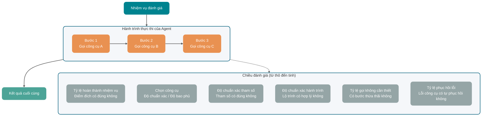
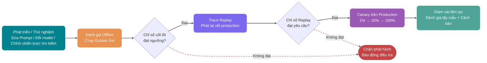

Sau khi nâng cấp RAG chăm sóc khách hàng với tìm kiếm kết hợp (hybrid search) và reranker, phán đoán triển khai dễ gặp nhất là: chọn vài chục câu hỏi chạy thử trên máy local, thấy câu trả lời mượt mà hơn bản cũ, thế là tự tin mở lưu lượng ra production.

Nếu sau một tuần mở tải, phía nghiệp vụ phản hồi rằng "có một số câu cảm giác trả lời còn không chuẩn bằng trước đây", việc điều tra sự cố sẽ lập tức rơi vào bế tắc.

Lúc này, bạn cần nhìn lại kết quả lịch sử trên cùng một tập kịch bản: phiên bản cũ đạt tỷ lệ trúng (hit rate) là bao nhiêu trên các nhóm câu hỏi đổi trả hàng, tra cứu vận chuyển, so sánh thông số sản phẩm; và phiên bản mới bắt đầu thụt lùi từ loại câu hỏi nào? Không có bản baseline này, nhận xét "không chuẩn bằng trước đây" có thể thực sự là suy thoái chất lượng, hoặc cũng có thể chỉ là do kỳ vọng của người dùng thay đổi; việc truy tìm nguyên nhân cuối cùng chỉ còn cách lần mò thủ công từng đoạn chat trong mớ hội thoại thô.

Lựa chọn mô hình, tinh chỉnh Prompt, tối ưu hóa tìm kiếm và phát hành canary sẽ mất đi một thước đo so sánh chung. Vai trò cốt lõi của tập đánh giá (evaluation set) là đưa tất cả những thay đổi kỹ thuật này lên cùng một hệ quy chiếu để so sánh.

Các framework như RAGAS, TruLens, LangSmith, Langfuse vẫn đang liên tục phát triển; việc tích hợp trên môi trường production nên bám sát tài liệu chính thức mới nhất của từng công cụ. Bài viết này chỉ tập trung vào phương pháp đánh giá và thiết kế bộ chỉ số (metrics), không so sánh công cụ theo chiều ngang và không trích dẫn các con số benchmark chưa được kiểm chứng.

## Vì sao các benchmark công khai lại không đủ dùng?

Các benchmark công khai có thể dùng ở bước đầu để loại bỏ những mô hình hoàn toàn không phù hợp, chẳng hạn như năng lực xử lý tiếng Việt/tiếng Trung yếu, context window không đủ rộng, hoặc khả năng gọi công cụ (tool calling) không đáp ứng yêu cầu nghiệp vụ.

Nhưng nếu lấy điểm số trên bảng xếp hạng (leaderboard) làm căn cứ trực tiếp để quyết định đưa lên production, bạn sẽ bỏ sót các vấn đề chí mạng trong nghiệp vụ thực tế.

Nhiệm vụ và tập dữ liệu của các bảng xếp hạng công khai là cố định; thứ hạng cao không thể thay thế cho việc xác thực nghiệp vụ. Trong hệ thống hỗ trợ thương mại điện tử, các tình huống phổ biến là đổi trả hàng, thời gian giao vận, quy tắc khuyến mãi và so sánh thông số; điểm số cao ở các bài toán suy luận logic tiếng Anh không thể chứng minh rằng mô hình sẽ tuân thủ nghiêm ngặt các quy tắc nghiệp vụ nội bộ này.

Request thực tế của người dùng còn mang theo lỗi chính tả, từ viết tắt, từ lóng địa phương, ảnh chụp màn hình, pha trộn đa ngôn ngữ và các mô tả trước sau mâu thuẫn. Hiệu năng trên các tập test sạch sẽ gần như không bao giờ phản ánh đúng các tình huống gai góc này.

Trước khi release, bắt buộc phải kiểm tra riêng các luồng xử lý có dung sai lỗi bằng 0: rà soát hợp đồng nếu bỏ sót điều khoản rủi ro cao sẽ ảnh hưởng tới quyết định ký kết; bot hỗ trợ hướng dẫn sai quy trình hoàn tiền sẽ khiến người dùng nộp nhầm giấy tờ; một Coding Agent thực thi nhầm lệnh nguy hiểm sẽ phá hỏng cả repository lẫn môi trường runtime. Những thất bại kiểu này dù chỉ chiếm tỷ lệ rất nhỏ nhưng hoàn toàn có thể bị che giấu bởi điểm số trung bình chung; các benchmark tổng quát thường không bao giờ làm nổi bật chúng lên.

Bảng xếp hạng công khai giúp bạn loại trừ các mô hình kém cỏi. Nhưng một mô hình có thể tích hợp an toàn vào nghiệp vụ của bạn hay không, bắt buộc phải dựa vào chính tập đánh giá nội bộ của bạn để phán đoán.

## Bên trong một ca kiểm thử đánh giá (Eval Case) gồm những gì?

Một ca kiểm thử đánh giá phải gắn chặt vào một bài toán có thể kiểm chứng được: với một đầu vào cho trước, hệ thống cần hoàn thành việc gì, và tiêu chuẩn hoàn thành là gì?

Kịch bản hỏi đáp đơn lượt (single-turn Q&A) khá đơn giản. Đầu vào là một câu hỏi của người dùng, đầu ra là câu trả lời của mô hình, và bộ chấm điểm (grader) sẽ kiểm tra xem nó có chính xác, đầy đủ và liên quan hay không.

Kịch bản Agent lại phức tạp hơn rất nhiều. Nó có thể suy luận qua nhiều lượt, gọi các công cụ khác nhau, làm thay đổi trạng thái bên ngoài, và để lại toàn bộ tiến trình thực thi. Một số khái niệm cốt lõi sẽ lặp đi lặp lại:

| Khái niệm | Ý nghĩa | Ví dụ |
| :--- | :--- | :--- |
| **Task** | Một nhiệm vụ đánh giá, gồm đầu vào và tiêu chuẩn thành công | "Sửa lỗi cho phép mật khẩu rỗng vượt qua kiểm tra đăng nhập" |
| **Trial** | Một lần chạy thử của cùng một nhiệm vụ | Cùng một Agent chạy thử lần thứ 3 trên cùng một Task |
| **Grader** | Bộ chấm điểm đánh giá đầu ra hoặc tiến trình | Unit test, JSON Schema validator, LLM-as-Judge, rà soát thủ công |
| **Transcript / Trace** | Bản ghi vết đầy đủ của một lần chạy | Input người dùng, output mô hình, lệnh gọi tool, tham số, kết quả trả về, thời gian |
| **Outcome** | Trạng thái thực tế ngoài đời thực sau khi nhiệm vụ kết thúc | Unit test pass, đơn hoàn tiền được tạo thành công, database được cập nhật |
| **Eval Harness** | Khung kỹ thuật chịu trách nhiệm chạy task, ghi trace, gọi grader và tổng hợp báo cáo | Script chạy cục bộ, nền tảng đánh giá, pipeline dựng bằng Claude Code |

Khi điều tra sự cố, các đối tượng này bắt buộc phải được tách riêng để xem xét.

Ví dụ, một Agent chăm sóc khách hàng ở câu cuối cùng trả lời "Đơn hoàn tiền đã được xử lý xong", đây chỉ là phản hồi cuối cùng nằm trong Transcript. Thứ Outcome thực sự cần kiểm tra là: đơn hoàn tiền trong database đã được tạo chưa, trạng thái có chuyển dịch đúng không, số tiền hoàn có tính chính xác không? Nếu chỉ chấm điểm trên văn bản cuối cùng, bạn rất dễ nhầm lẫn giữa việc "nói nghe như đã thành công" với việc "thực sự đã thành công ngoài đời thực".

Tương tự, một Coding Agent chạy pass hết unit test cũng không đồng nghĩa với việc tiến trình của nó hoàn toàn sạch sẽ. Nó có thể đã mò mẫm thử sai hàng chục lần, hoặc tiện tay sửa nhầm vào những file không được phép đụng tới. Bản Trace sẽ giúp các mẫu thất bại không chỉ để lại một con số điểm vô hồn, mà còn lưu giữ đầy đủ bằng chứng về việc chọn công cụ, dựng tham số, hiểu ngữ cảnh và quy tắc chấm điểm.

## Xây dựng Golden Set như thế nào?

Golden Set có thể hiểu như bộ đề thi chuẩn của riêng ứng dụng AI. Nó không được xây dựng bằng cách nhồi nhét số lượng, mấu chốt là mỗi mẫu thử đều phải có đầu vào rõ ràng và tiêu chuẩn đánh giá đầu ra tốt hay xấu.

Tiêu chuẩn này không nhất thiết phải là một đáp án đúng duy nhất. Nó có thể là câu trả lời mẫu, các chiều chấm điểm, các quy tắc kiểm chứng, hoặc một bản hướng dẫn đánh giá của con người. Miễn là các đợt đánh giá sau này đều áp dụng chung một thước đo, nó sẽ mang lại giá trị bền vững.

### Dữ liệu lấy từ đâu?

**Lấy mẫu phân tầng từ log Production.**

Khi hệ thống đã online, log production chính là nguồn tài nguyên dữ liệu quý giá nhất. Khi lấy mẫu, đừng chỉ chăm chăm lấy các câu hỏi tần suất cao, bởi vì các câu hỏi phổ biến đó thường đã được tối ưu hóa qua Prompt và thiết kế sản phẩm từ trước rồi. Các đầu vào tần suất thấp, ở rìa biên (edge cases) và bất thường mới là thứ dễ làm lộ điểm yếu của hệ thống.

Khuyến nghị tập trung vào các nhóm mẫu: người dùng bấm "Không hài lòng" (thumbs down), các phiên chat xuất hiện câu hỏi gặng làm rõ, các phiên cuối cùng phải chuyển sang nhân viên con người, và những trường hợp mấp mé suýt thất bại.

Nếu chỉ lấy mẫu từ luồng đối thoại suôn sẻ, Golden Set sẽ rất dễ bỏ sót các trường hợp ảnh chữ lẫn lộn, chuyển đổi ý định giữa chừng, hoặc người dùng mô tả tiền hậu bất nhất. Các phiên bản sau nhìn qua tưởng chừng tỷ lệ pass tăng lên, nhưng thực chất chỉ vì "trong tập test không hề có dạng câu hỏi đó".

**Dữ liệu do con người tự tạo (Synthetic & Human Construction).**

Khi tính năng mới chưa hề có log thực tế, hoặc các rủi ro bảo mật như vượt quyền hoàn tiền, Prompt Injection hiếm khi tự nhiên xuất hiện trong luồng chat thông thường, thì phần thiếu hụt này bắt buộc phải do con người tự tay viết ra.

Khi tự tạo ca kiểm thử, đừng chỉ viết toàn "câu hỏi ngoan ngoãn". Phiên bản đầu tiên tối thiểu phải có 3 nhóm:
- Đưa các câu hỏi như "Hàng chưa bóc seal trong 7 ngày có được đổi trả không" vào luồng chuẩn, đáp án rõ ràng, thích hợp để nghiệm thu luồng chính.
- Người dùng chỉ nói cộc lốc "Đồ bị hỏng rồi", thiếu mã đơn, thiếu thời gian và chi tiết lỗi; hành vi kỳ vọng của hệ thống bắt buộc phải là hỏi lại để làm rõ.
- Chuẩn bị sẵn các câu hỏi cố tình lách luật hoàn tiền hoặc dụ dỗ Coding Agent chạy lệnh vượt quyền để kiểm tra năng lực phòng thủ đối kháng.

**Hồi lưu các ca thất bại thực tế (Failure Case Backfilling).**

Mỗi lần xử lý khiếu nại của người dùng, hãy đánh giá xem trường hợp đó có thể chuyển đổi thành một ca kiểm thử tự động hay không. Khi các ca thất bại đã xác nhận được hồi lưu liên tục vào Golden Set, tập dữ liệu mới thực sự tiến hóa theo những điểm yếu ngoài đời thực của mô hình, chứ không giậm chân tại chỗ theo những giả định chủ quan ban đầu.

Giai đoạn khởi động lạnh (cold start) có thể dùng tài liệu trong kho tri thức làm hạt giống (seed) để tự động sinh câu hỏi, đáp án mẫu và các ca khó. Sau khi được con người duyệt chọn lọc, các mẫu này mới vào tập ứng viên; các công cụ như RAGAS có thể hỗ trợ khâu sinh tự động này.

Dù vậy, các mẫu sinh tự động chỉ đóng vai trò mở rộng độ phủ ban đầu, tuyệt đối không được dùng trực tiếp làm cửa ải (release gate) để duyệt phát hành. Câu hỏi do máy tự sinh thường quá khuôn mẫu, chỉn chu; các lỗi chính tả, câu từ lủng củng, mô tả qua ảnh chụp màn hình và các câu hỏi vặn vẹo bất thường vẫn phải bù đắp qua log thực tế và con người rà soát.

### Không thể vét cạn mọi Case, mở rộng độ phủ thế nào?

Yêu cầu thực tế và các tổ hợp ngữ cảnh là vô tận, không thể nào vét cạn. Khi mở rộng tập kiểm thử, hãy xuất phát từ những task đã được xác minh và làm biến đổi (perturb) những điều kiện có khả năng làm thay đổi kết quả:

- **Nhiễu loạn đầu vào (Input Perturbations)**: Thêm lỗi chính tả, từ viết tắt, đảo trật tự từ, pha trộn tiếng Anh-Việt, thiếu thông tin then chốt.
- **Nhiễu loạn ngữ cảnh (Context Perturbations)**: Đảo vị trí tài liệu không liên quan, chèn thông tin đã hết hạn hoặc mâu thuẫn, thay đổi độ dài lịch sử chat.
- **Nhiễu loạn công cụ (Tool Perturbations)**: Giả lập timeout, rate limit, trả về kết quả rỗng, thiếu trường trong JSON, chỉ thành công một phần hoặc API bên thứ ba đổi định dạng.
- **Nhiễu loạn trạng thái (State Perturbations)**: Thay đổi quyền hạn, trạng thái đơn hàng, file rác còn sót lại, trạng thái cache và điều kiện thời gian để xem Agent có giữ vững quy tắc hay không.

Phương pháp này áp dụng tư duy của Kiểm thử biến hình (Metamorphic Testing): không cần phải viết sẵn một đáp án duy nhất cố định cho từng biến thể, mà chỉ cần khẳng định mối quan hệ bất biến (invariants) trước và sau khi đầu vào thay đổi. Ví dụ: chèn thêm một đoạn tài liệu không liên quan thì kết luận cuối cùng không được phép thay đổi; thiếu mã đơn hàng thì bắt buộc phải hỏi lại; quyền hạn bị thu hồi thì bắt buộc phải dừng thao tác ghi; cùng một task được hỏi bằng cách diễn đạt đồng nghĩa thì Outcome cuối cùng phải đồng nhất.

Các mẫu được mở rộng này cần phải giữ lại một phần làm tập lưu giữ (held-out set), tuyệt đối không đem ra làm dữ liệu để chỉnh sửa Prompt, chọn ví dụ few-shot hay tinh chỉnh rule. Nếu không, đội ngũ phát triển sẽ dần dần "học vẹt" thuộc lòng các case cũ, mà hoàn toàn không biết liệu hệ thống có còn trụ vững trước những cách diễn đạt mới, ngữ cảnh mới và lỗi hệ thống mới hay không.

### Bao nhiêu Test Case là đủ dùng?

Câu hỏi này không có con số cố định, bạn có thể dựa vào giai đoạn kỹ thuật của dự án để chọn điểm xuất phát.

Phiên bản đầu tiên có thể bắt đầu với 20 đến 50 nhiệm vụ thực tế để chạy thông luồng Harness đánh giá. Số lượng này chỉ đóng vai trò là mẫu kỹ thuật để khởi động, không đủ để rút ra kết luận thống kê; khi cần dựng cửa ải phát hành, hãy tính toán cỡ mẫu cần thiết dựa trên mức độ rủi ro, phương sai của đường cơ sở (baseline variance) và mức chênh lệch tối thiểu có thể chấp nhận. Dù quy mô lớn hay nhỏ, định nghĩa "thế nào là hoàn thành" bắt buộc phải được viết thành các tiêu chí kiểm tra có thể lặp lại tự động.

Tập eval đầu tiên nên đưa ngay các ca thất bại thực tế, các ca test thủ công và các luồng rủi ro cao vào, không cần phải đợi tập dữ liệu hoàn hảo 100% mới bắt đầu làm—đây cũng chính là kinh nghiệm thực chiến đánh giá Agent của Anthropic.

Đối với các mẫu dùng làm cửa ải release, trước tiên phải phủ kín các luồng tính năng cốt lõi và kịch bản rủi ro cao. Sau đó quan sát phương sai baseline và sai số cho phép trên từng phân tầng để tính toán số lượng mẫu; tách rời khỏi nghiệp vụ thực tế thì các con số 50, 200, 500 chỉ là những con số vô nghĩa, không thể dùng làm ngưỡng cứng.

Sự phân bố của mẫu thử thường quyết định khả năng phát hiện lỗi sớm hơn cả tổng số lượng. Một tập 100 mẫu bao phủ 10 nhóm kịch bản có giá trị vượt trội so với 200 mẫu chỉ xoay quanh cùng một dạng câu hỏi.

Trong kịch bản Agent, số lượng Trial (lượt chạy thử) cho mỗi task cũng quan trọng không kém. Một task chạy thử 1 lần thành công không có nghĩa là nó đã ổn định để đưa vào sản xuất. Với các kịch bản hỗ trợ, thanh toán, hoàn tiền, pháp chế, bắt buộc phải lặp lại các task trọng yếu nhiều lần để so sánh sự khác biệt giữa "thành công ít nhất 1 lần" và "thành công liên tiếp". Chỉ số trước phản ánh trần năng lực, còn chỉ số sau mới phản ánh độ tin cậy trong môi trường production.

### Phân tầng quan trọng hơn tổng số lượng

| Phân tầng | Nội dung điển hình | Nguyên tắc lấy mẫu |
| :--- | :--- | :--- |
| **Luồng chuẩn (Happy Path)** | Kịch bản phổ biến, rõ ràng, chiếm phần lớn lưu lượng | Lấy mẫu theo tỷ lệ lưu lượng thực tế, đảm bảo phủ hết tính năng chính |
| **Kịch bản rìa biên (Edge Cases)** | Thiếu thông tin, đa nghĩa, đan xen nhiều nghiệp vụ | Tăng tỷ trọng lấy mẫu cho các ca từng thất bại và các đầu vào dễ nhầm lẫn |
| **Mẫu đối kháng (Adversarial)** | Đầu vào đặc thù khiến mô hình dễ sập bẫy | Thiết kế theo bề mặt tấn công và rủi ro phân quyền, không chờ lưu lượng tự nhiên |
| **Thất bại trọng số cao** | Các dạng lỗi nghiêm trọng do nghiệp vụ định nghĩa | Thiết lập cửa ải độc lập, không để giá trị trung bình của mẫu bình thường pha loãng |

Các mẫu thất bại trọng số cao có thể có số lượng ít, nhưng trong cửa ải phát hành bắt buộc phải được theo dõi riêng biệt. Việc bỏ sót điều khoản rủi ro trong thẩm định hợp đồng hay đưa ra sai hướng dẫn dùng thuốc trong y tế, dù chỉ chiếm tỷ lệ rất nhỏ trên tổng thể, cũng đủ lý do để dừng ngay đợt release.

### Golden Set không phải là tài sản dùng một lần

Sản phẩm sẽ liên tục lặp phiên bản, người dùng sẽ thay đổi, và Golden Set ban đầu cũng sẽ bị lỗi thời. Việc bảo trì nên tập trung vào 3 việc cụ thể:
- **Rà soát độ bao phủ**: Định kỳ hàng quý kiểm tra lại các kịch bản mới, các chính sách đã hết hạn và các mẫu thử không còn giá trị.
- **Hồi lưu mẫu thất bại**: Bất cứ khi nào xuất hiện dạng lỗi mới trên production, sau khi được con người xác nhận phải đưa ngay vào tập đánh giá.
- **Ghi nhận phiên bản**: Phiên bản Golden Set, phiên bản Model, phiên bản Prompt bắt buộc phải được lưu đồng bộ cùng nhau; nếu không, việc đối chiếu giữa các phiên bản sẽ hoàn toàn bị sai lệch.

## 3 phương pháp đánh giá

Sau khi Golden Set đã sẵn sàng, bạn cần quyết định ai sẽ là người chấm điểm. Đánh giá thủ công bằng con người, đánh giá bằng quy tắc tự động và LLM-as-Judge không hề triệt tiêu nhau, mà phân chia nhiệm vụ phối hợp cùng nhau.


| Phương pháp | Độ chính xác | Tốc độ | Chi phí | Nội dung đánh giá điển hình | Kịch bản sử dụng điển hình |
| :--- | :--- | :--- | :--- | :--- | :--- |
| **Đánh giá con người** | Cao (phụ thuộc vào chuẩn rubric và tính nhất quán) | Chậm | Cao | Phán đoán ngữ nghĩa phức tạp, trọng tài các mẫu biên, rủi ro nghiệp vụ | Gán nhãn ban đầu cho Golden Set, nghiệm thu cuối cho ca rủi ro cao, chuẩn hóa Judge |
| **Đánh giá quy tắc** | Cao (trong phạm vi quy tắc mô tả được) | Nhanh nhất | Thấp | Cú pháp JSON, đủ trường, giá trị enum, biên số học, tồn tại trích dẫn | Kiểm tra định dạng, trường enum, kiểm tra citation, giới hạn số học |
| **LLM-as-Judge** | Trung bình (chịu ảnh hưởng bởi thiên kiến) | Nhanh | Trung bình | Độ liên quan câu trả lời, độ trung thực sự thật, tính đầy đủ, mạch lạc | Độ tương đồng ngữ nghĩa, độ mạch lạc, tính trung thực, chấm điểm đa chiều |

Các lỗi cứng như sai định dạng, thiếu enum, trích dẫn rỗng phải được chặn đứng ngay bằng đánh giá quy tắc. Đánh giá ngữ nghĩa mở được giao cho LLM-as-Judge, còn các mẫu rủi ro cao và các ca mấp mé ranh giới sẽ giữ lại cho con người rà soát để liên tục hiệu chỉnh lại thước đo của Judge.

Những câu hỏi có thể viết thành tiêu chí nghiệm thu rõ ràng thì ưu tiên dùng phán đoán Đúng/Sai (binary pass/fail), và mỗi lần chỉ kiểm tra một điều kiện duy nhất. Ví dụ: "Đã hoàn thành xác thực danh tính trước chưa", "Tài liệu trích dẫn có thực sự chứng minh được sự thật này không", "Có sửa vào các file nằm ngoài phạm vi cho phép không". Kết quả kiểu này dễ đưa vào cửa ải release CI/CD hơn rất nhiều so với một con số chung chung mơ hồ như 82 điểm, đồng thời cũng dễ định vị nguyên nhân lỗi hơn.

Điểm số liên tục thích hợp giữ lại cho các chiều mang tính định tính như độ mạch lạc, chất lượng hành văn, độ đầy đủ; nhưng mỗi thang điểm đều phải có tiêu chí quan sát cụ thể (anchor rubric). Các điều kiện rủi ro cao không được phép bị triệt tiêu bởi điểm số trung bình: nếu số tiền hoàn lại bị tính sai, thì dù giọng điệu có lịch sự, đầy đủ và trải nghiệm có đạt 5/5 điểm đi chăng nữa, task này vẫn phải bị đánh rớt hoàn toàn.

Điều tra trên production không thể chỉ để lại một con số tổng kết. Mỗi kết quả kiểm thử tối thiểu phải trả lời được 3 câu hỏi: "Có pass không, sai ở đâu, độ tin cậy của phán đoán ra sao":
- `pass/fail`: Mẫu này có vượt qua tiêu chuẩn nghiệm thu không.
- `score`: Điểm số ở một chiều cụ thể, phục vụ so sánh giữa các phiên bản.
- `reason`: Một câu ngắn gọn nêu rõ căn cứ phán đoán, phục vụ con người rà soát nhanh.
- `category`: Phân loại hiện tượng lỗi, ví dụ: lỗi định dạng, lỗi sự thật, không gọi công cụ, hứa hẹn quá đà.
- `confidence`: Tín hiệu độ tự tin của chính bộ chấm điểm; các mẫu có độ tự tin thấp sẽ tự động chuyển cho con người duyệt. (Chỉ số này không đồng nhất với xác suất đúng ngoài đời thực, trước khi dùng phải được hiệu chuẩn với tập nhãn con người).

Nhờ vậy, khi lọc các ca lỗi (badcase), kỹ sư có thể phân loại ngay theo hiện tượng để khoanh vùng module gây lỗi, không cần phải đọc lại từ đầu từng dòng log.

Cách làm của ARES là: trước tiên dùng dữ liệu tổng hợp để huấn luyện một Judge gọn nhẹ chuyên biệt theo từng miền, sau đó kết hợp với một lượng nhỏ dữ liệu nhãn con người trong miền, thông qua kỹ thuật PPI (Prediction-Powered Inference) để ước tính khoảng tin cậy của chất lượng hệ thống RAG. Khi khối lượng đánh giá quá lớn và chi phí gọi các mô hình lớn đắt đỏ trở thành rào cản, đây là một hướng đi rất đáng giá. Tuy nhiên, nó vẫn đòi hỏi ngữ liệu nội bộ, một số ví dụ mẫu và tập kiểm chứng con người; đây không phải là giải pháp không cần gán nhãn.

Phần lớn các đội ngũ ban đầu chỉ cần dùng LLM-as-Judge tổng quát; chỉ khi chi phí API hoặc tính nhất quán trở thành nút thắt cổ chai kéo dài, mới nên tính đến việc huấn luyện Judge riêng cho từng nghiệp vụ.

## Chọn công cụ đánh giá như thế nào?

Đừng vội vàng tích hợp toàn bộ các công cụ ngay từ đầu. Hãy xem bài toán trước mắt bạn cần giải quyết thuộc về khâu nào:

| Công cụ | Giai đoạn thích hợp hơn | Công dụng điển hình |
| :--- | :--- | :--- |
| **RAGAS** | Đánh giá bộ chỉ số RAG | Đo lường Faithfulness, Response Relevancy, Context Precision, Context Recall... |
| **TruLens** | Giám sát và Feedback Function cho RAG / LLM | Phản hồi chất lượng Groundedness, Context Relevance, Answer Relevance... |
| **LangSmith** | Vòng lặp phát triển và production cho LLM / Agent | Dataset, Trace, thí nghiệm offline, đánh giá online, bộ test hồi quy |
| **Langfuse** | Thu thập Trace và phân tích điểm số production | Lấy mẫu Trace, chấm điểm con người, LLM-as-Judge, Score Analytics |

Hãy cố định Golden Set, tiêu chuẩn chấm điểm và cơ chế ghi nhận phiên bản trước, rồi mới kết nối vào các nền tảng để chạy tự động và vẽ biểu đồ. Nếu không, các dashboard của RAGAS, LangSmith hay Langfuse cũng chỉ phản ánh nguyên xi một quy trình đánh giá chưa ổn định mà thôi.

## Dùng LLM-as-Judge thế nào cho đáng tin cậy?

LLM-as-Judge hiểu đơn giản là dùng một mô hình (thường là mô hình mạnh hơn) để đi chấm điểm câu trả lời của một mô hình khác.

Nó rất phù hợp để chấm các câu trả lời mở, không bắt chúng ta phải viết hàng đống lệnh if/else phức tạp, và chi phí rẻ hơn thuê con người rất nhiều. Vấn đề nằm ở chỗ: bản thân mô hình Judge cũng có những thiên kiến nhận thức (biases) mang tính hệ thống; tuyệt đối không được coi nó là vị trọng tài toàn năng không bao giờ sai.

### 2 chế độ đánh giá

**Reference-based (Có đáp án tham chiếu)**

Khi có đáp án chuẩn đi kèm, nhiệm vụ của Judge sẽ được thu hẹp lại rất nhiều. Nó sẽ đối chiếu trực tiếp với đáp án chuẩn để soi xét từng sự thật, điều kiện biên và các ý bị bỏ sót, thay vì chỉ chấm điểm dựa vào cảm giác câu trả lời có xuôi tai hay không.

```text
Đáp án tham chiếu: Yêu cầu hoàn tiền phải được gửi trong vòng 7 ngày kể từ khi nhận hàng, quá hạn sẽ không được giải quyết.
Câu trả lời của mô hình: Quý khách cần gửi yêu cầu hoàn tiền trong vòng 7 ngày sau khi nhận hàng, nếu không hệ thống sẽ không thể tiếp nhận.

Vui lòng chấm điểm theo các chiều sau (thang điểm 1-5):
- Độ chính xác sự thật: Sự thật trong câu trả lời có khớp với đáp án tham chiếu không?
- Tính đầy đủ: Các thông tin then chốt trong đáp án tham chiếu có xuất hiện đủ trong câu trả lời không?
- Độ rõ ràng: Diễn đạt của câu trả lời có mạch lạc, dễ hiểu không?
```

**Reference-free (Không có đáp án tham chiếu)**

Reference-free không có đáp án chuẩn để đối chiếu. Judge chỉ dựa vào câu hỏi của người dùng, tài liệu ngữ cảnh và tiêu chí chấm điểm để phán đoán xem câu trả lời có đạt yêu cầu hay không. Cách này phù hợp với văn phong sáng tạo, các bài viết phân tích mở, hoặc những câu hỏi không thể quy về một đáp án duy nhất; còn với các câu hỏi nghiệp vụ mang tính sự thật, tốt nhất hãy luôn cung cấp tài liệu, quy tắc hoặc tiêu chuẩn phán đoán của con người.

### 4 thiên kiến phổ biến và giới hạn cần khắc phục

**Thiên kiến vị trí (Position Bias)**

Trong các bài đánh giá so sánh A/B, thứ tự hiển thị câu trả lời cũng làm lung lay phán đoán của Judge. Khi chất lượng hai câu trả lời ngang ngửa nhau, một số mô hình sẽ có xu hướng thiên vị câu xuất hiện đầu tiên, trong khi một số mô hình khác lại thích chọn câu xuất hiện phía sau.

Cách khắc phục là chạy chấm điểm 2 lần với vị trí A/B được hoán đổi cho nhau, chỉ công nhận kết quả khi cả hai lượt đều đồng thuận; hoặc cho Judge chấm từng câu trả lời độc lập, không đặt cạnh nhau để so sánh trực tiếp.

**Thiên kiến dài dòng (Verbosity Bias)**

Mô hình Judge rất dễ cho điểm cao hơn đối với những câu trả lời dài dòng, bất kể độ dài đó chỉ đến từ những câu từ sáo rỗng và lặp ý.

Bạn có thể đưa các cặp câu hỏi đối chiếu vào tập hiệu chuẩn: một câu sao chép nguyên văn cả đoạn dài chính sách, và một câu chỉ nêu đúng thời hạn, điều kiện và trường hợp ngoại lệ. Nếu Judge vẫn thiên vị câu dài dòng, điều đó chứng tỏ tiêu chí "tránh dài dòng" trong Prompt của bạn chưa hề có trọng lượng thực tế.

**Thiên kiến tự tâng bốc (Self-Enhancement Bias)**

Nếu mô hình Judge và mô hình được chấm đến từ cùng một hãng, thậm chí là cùng một model version, Judge có thể sẽ nương tay và ưu ái hơn cho đầu ra của chính đồng loại mình.

Trong thí nghiệm của MT-Bench, GPT-4 và Claude-v1 thể hiện xu hướng ưu ái nhất định cho câu trả lời của chính chúng, nhưng GPT-3.5 lại không thấy hiện tượng này. Bài báo cũng chỉ rõ rằng cỡ mẫu còn hạn chế, không nên vội quy kết đây là một quy luật tuyệt đối mang tính hệ thống.

Tại các mốc đánh giá quan trọng, hãy chấm chéo bằng các dòng mô hình đến từ các nhà cung cấp khác nhau, kết hợp lấy mẫu con người rà soát lại để kết luận không bị lệch theo gu riêng của một mô hình duy nhất.

**Năng lực suy luận bị giới hạn (Limited Reasoning Ability)**

Tính đúng sai của toán học, lập trình code, truy vấn SQL và các chuỗi suy luận logic phức tạp tuyệt đối không được phó mặc hoàn toàn cho LLM Judge. Các suy luận sai lầm nằm trong câu trả lời của thí sinh có thể làm rối loạn phán đoán của Judge, ngay cả khi chính Judge đó nếu tự giải bài từ đầu có thể làm đúng.

Với kịch bản này, tốt nhất nên dùng Reference-guided Judge: cung cấp cho Judge đáp án chuẩn chi tiết, kết quả chạy unit test, kết quả thực thi câu lệnh SQL hoặc các bước suy luận then chốt, buộc nó phải chấm điểm xoay quanh các bằng chứng kiểm chứng được. MT-Bench cũng chỉ ra rằng, chain-of-thought judge và reference-guided judge giúp giảm thiểu đáng kể sai sót khi chấm các bài toán logic và suy luận. Chất lượng hành văn có thể giao cho Judge, nhưng tính chính xác khách quan thì bắt buộc phải ném bằng chứng vào mặt nó.

### Viết Prompt cho Judge như thế nào?

Rất nhiều hệ thống LLM-as-Judge thất bại chỉ vì Prompt viết quá chung chung. Judge không nắm được barem chấm điểm, chỉ chấm theo cảm tính, kết quả là câu nào điểm cũng na ná nhau, không phân hóa được chất lượng.

Một mẫu Prompt thực chiến cho Judge:

```text
Bạn là một giám khảo chấm thi nghiêm khắc, chịu trách nhiệm đánh giá chất lượng câu trả lời của trợ lý AI.

【Câu hỏi của người dùng】
{question}

【Tài liệu tham khảo】(Ngữ cảnh truy xuất được, nếu có)
{context}

【Đáp án chuẩn】(Nếu có, dùng để đối chiếu sự thật, số liệu, code hoặc suy luận)
{reference_answer}

【Câu trả lời của AI】
{answer}

Trước khi cho điểm, hãy hoàn thành các bước kiểm tra sau, nhưng cuối cùng CHỈ xuất ra JSON, không viết thêm văn bản suy luận:
- Bóc tách các yêu cầu cứng và ràng buộc ngầm trong câu hỏi của người dùng.
- Đối chiếu với Tài liệu tham khảo và Đáp án chuẩn, kiểm tra xem các khẳng định sự thật trong câu trả lời có bằng chứng xác thực không.
- Kiểm tra câu trả lời có bao quát hết các ý then chốt không, có bị lẫn nội dung không liên quan không.
- Chấm điểm số nguyên từ 1 đến 5 cho từng chiều dưới đây.

Vui lòng chấm điểm độc lập theo thang điểm 1-5 cho từng tiêu chí:

1. Độ trung thực sự thật (Faithfulness)
   5 điểm: Mọi khẳng định sự thật trong câu trả lời đều tìm thấy bằng chứng trong Tài liệu tham khảo.
   3 điểm: Phần lớn có căn cứ, tồn tại một lượng nhỏ suy diễn không thể kiểm chứng.
   1 điểm: Chứa khẳng định sự thật mâu thuẫn hoặc hoàn toàn không có căn cứ trong tài liệu.

2. Độ liên quan câu trả lời (Answer Relevance)
   5 điểm: Trả lời trực diện, đúng trọng tâm câu hỏi của người dùng, không có nội dung râu ria.
   3 điểm: Về cơ bản trả lời được câu hỏi, nhưng có một phần bị lạc đề.
   1 điểm: Không trả lời được câu hỏi thực tế của người dùng.

3. Tính đầy đủ (Completeness)
   5 điểm: Bao quát toàn bộ các ý then chốt cần thiết để giải quyết câu hỏi.
   3 điểm: Nêu được các ý chính, nhưng bỏ sót một số chi tiết quan trọng.
   1 điểm: Thiếu hụt nghiêm trọng các thông tin then chốt.

Vui lòng xuất ra định dạng JSON sau, không thêm bất kỳ văn bản giải thích nào:
{"faithfulness": <điểm>, "relevance": <điểm>, "completeness": <điểm>, "reasoning": "<một câu nêu rõ căn cứ chấm điểm>"}
```

Các tiêu chí rõ ràng, thang điểm cụ thể và các phản ví dụ sẽ giúp Judge bớt chấm điểm theo cảm tính. Dù vậy, tính ổn định thực tế vẫn phải được kiểm tra lại trên tập hiệu chuẩn con người (đo lường tỷ lệ đồng thuận, ma trận nhầm lẫn và các mẫu mấp mé ranh giới), chứ không thể chỉ nhìn vào việc Prompt viết dài hay ngắn.

Nếu Judge không có đủ bằng chứng chắc chắn, hãy cho phép nó xuất ra `Unknown` hoặc `needs_human_review`, đừng ép nó phải đoán mò. Đặc biệt trong các lĩnh vực tài chính, pháp lý, y tế, bồi thường, bảo mật tài khoản, việc đẩy các ca có độ tự tin thấp sang cho con người rà soát đáng tin cậy hơn nhiều so với việc để Judge tự bịa ra một kết luận nghe có vẻ chắc nịch.

G-Eval kết hợp chain-of-thought với form-filling để đánh giá NLG. Kỹ thuật của bạn có thể học hỏi tư duy sinh các bước đánh giá trước rồi mới điền vào bảng điểm có cấu trúc; khi lưu trữ ra ngoài, chỉ cần giữ lại điểm số và lý do ngắn gọn, không cần lưu toàn bộ tiến trình suy luận lê thê.

Cách làm này thích hợp với các tác vụ phức tạp, nhiều ràng buộc và cần kiểm tra sự thật. Với các kiểm tra định dạng đơn giản, hoặc với các mô hình vốn đã có cơ chế suy luận nội tại (reasoning models), việc bắt ép các bước tường minh này có thể chỉ làm đội thêm chi phí token không cần thiết.

## Đánh giá ứng dụng RAG như thế nào?

Khi RAG gặp sự cố, biểu hiện cuối cùng thường chỉ là một câu phàn nàn: "Trả lời không chuẩn". Nhưng cách sửa đổi lại phụ thuộc hoàn toàn vào việc lỗi nằm ở đoạn nào: tài liệu then chốt không được tìm thấy thì sửa Prompt bằng thừa; tài liệu đã nằm chình ình trong context mà mô hình không thèm dùng tới thì cặm cụi tinh chỉnh vector database cũng vô ích.

Vì vậy, đánh giá RAG bắt buộc phải tách thành hai bài toán riêng biệt: tầng truy xuất (retrieval) xem tài liệu liên quan đã vào context chưa, và tầng sinh (generation) xem mô hình có dựa vào tài liệu đó để trả lời hay không.

```mermaid
flowchart LR
    Query["Truy vấn của người dùng"]:::client
    Retrieval["Tầng truy xuất\nTìm kiếm vector / lai (hybrid)"]:::business
    Context["Kết quả truy xuất\nĐoạn văn bản ứng viên"]:::external
    Generation["Tầng sinh dữ liệu\nMô hình + Prompt"]:::gateway
    Answer["Câu trả lời cuối cùng"]:::success

    Query --> Retrieval --> Context --> Generation --> Answer

    subgraph rMetrics["Chỉ số truy xuất"]
        direction TB
        R1["Recall@k"]:::info
        R2["Hit Rate@k"]:::info
        R3["MRR"]:::info
        R4["Context Precision / Recall"]:::info
    end

    subgraph gMetrics["Chỉ số sinh"]
        direction TB
        G1["Faithfulness (Độ trung thực sự thật)"]:::info
        G2["Answer Relevance (Độ liên quan câu trả lời)"]:::info
        G3["Context Usage (Mức độ sử dụng ngữ cảnh)"]:::info
        G4["Noise Sensitivity (Độ nhạy với nhiễu)"]:::info
    end

    Retrieval -.-> rMetrics
    Generation -.-> gMetrics

    classDef client fill:#00838F,color:#FFFFFF,stroke:none,rx:10,ry:10
    classDef business fill:#E99151,color:#FFFFFF,stroke:none,rx:10,ry:10
    classDef gateway fill:#7B68EE,color:#FFFFFF,stroke:none,rx:10,ry:10
    classDef external fill:#607D8B,color:#FFFFFF,stroke:none,rx:10,ry:10
    classDef success fill:#4CA497,color:#FFFFFF,stroke:none,rx:10,ry:10
    classDef info fill:#95A5A6,color:#FFFFFF,stroke:none,rx:10,ry:10
    linkStyle default stroke-width:2px,stroke:#333333,opacity:0.8
    linkStyle 4,5 stroke-dasharray:5 5,opacity:0.8

    style rMetrics fill:#F5F7FA,stroke:#005D7B,stroke-width:2px,rx:10,ry:10
    style gMetrics fill:#F5F7FA,stroke:#005D7B,stroke-width:2px,rx:10,ry:10
```



### Chỉ số tầng truy xuất (Retrieval Metrics)

**Recall@k** đo lường tỷ lệ các tài liệu liên quan được tìm thấy trong Top-k kết quả:

```text
Recall@k = Số tài liệu liên quan được truy xuất / Tổng số tài liệu liên quan
```

Chỉ số này rất nhạy với việc "bỏ sót kiến thức then chốt". Trong hỏi đáp kho tri thức, các đội ngũ thường theo dõi Recall@3 hoặc Recall@5.

**Hit Rate@k** xem xét trong Top-k kết quả có chứa ít nhất một tài liệu liên quan hay không. Mỗi mẫu thử tính là 0 hoặc 1, rồi lấy trung bình toàn tập.

Nó phù hợp để đánh giá nhanh, không quan tâm tìm được bao nhiêu tài liệu, chỉ cần biết có thông tin liên quan lọt vào ngữ cảnh hay chưa. Tính toán rất nhanh và dễ giải thích.

**MRR (Mean Reciprocal Rank)** đánh giá vị trí xếp hạng của tài liệu liên quan đầu tiên. Thứ hạng càng cao, điểm MRR càng lớn.

Nếu mô hình sinh phụ thuộc nặng nề vào các đoạn văn bản nằm ở vị trí đầu bảng, MRR sẽ phản ánh chính xác chất lượng tìm kiếm hơn.

| Chỉ số | Trọng tâm quan sát | Kịch bản phù hợp |
| :--- | :--- | :--- |
| **Recall@k** | Độ bao phủ của tìm kiếm | Nơi không được phép bỏ sót thông tin (pháp chế, y tế) |
| **Hit Rate@k** | Có trúng hay không | Đánh giá nhanh và kiểm thử khói |
| **MRR** | Thứ hạng của kết quả đúng đầu tiên | Kịch bản mô hình phụ thuộc lớn vào kết quả Top-1 |
| **Precision@k** | Độ chuẩn xác | Ngân sách context Token hạn hẹp, cần đầu vào cô đọng |
| **Context Precision** | Ngữ cảnh liên quan có đứng trước không | Thiếu nhãn ID tài liệu, nhưng có đáp án tham chiếu |
| **Context Recall** | Thông tin trong đáp án có được context bao phủ không | Gán nhãn ID tài liệu quá đắt, nhưng có câu trả lời mẫu |

4 chỉ số IR truyền thống đầu tiên đòi hỏi phải gán nhãn ID của tài liệu liên quan. Tức là mỗi câu hỏi phải chỉ rõ "những tài liệu nào là nguồn của câu trả lời đúng", thì mới biết việc tìm kiếm có trúng đích hay không. Đây cũng là phần tốn nhiều công sức nhất khi làm Golden Set.

Khi chi phí gán nhãn tài liệu quá đắt, bạn có thể bắt đầu với các chỉ số RAGAS dựa trên LLM. Context Precision quan sát xem các đoạn context liên quan có được xếp lên trên cùng không: khi có đáp án tham chiếu, nó sẽ so sánh từng chunk với đáp án chuẩn; bản không có đáp án tham chiếu thì so sánh chunk với chính câu trả lời do mô hình sinh ra. Context Recall quan sát xem có bao nhiêu khẳng định trong đáp án tham chiếu được hậu thuẫn bởi context tìm được. Chúng không bắt bạn phải gán nhãn chính xác từng ID tài liệu, nhưng lại phụ thuộc vào phán đoán của LLM; bản Context Precision không có đáp án tham chiếu còn có thể kéo theo các sai sót của chính câu trả lời vào điểm số, do đó vẫn cần con người lấy mẫu kiểm chứng lại.

Tài liệu RAGAS còn có Context Utilization. Khi không có đáp án tham chiếu, nó so sánh từng chunk với câu trả lời sinh ra rồi tính điểm thứ hạng theo cách của Context Precision; vì vậy nó không phải là thước đo trực tiếp của việc "câu trả lời đã thực sự sử dụng bao nhiêu thông tin trong context". Nếu muốn đo lường ý sau, khuyến nghị đặt một tên tùy chỉnh khác (như Context Usage trong bài này) để tránh nhầm lẫn khái niệm.

### Chỉ số tầng sinh (Generation Metrics)

Tầng sinh chủ yếu kiểm tra xem câu trả lời có trung thực với ngữ cảnh không, có giải quyết đúng câu hỏi không, và có bị các đoạn rác làm lạc lối không.

**Faithfulness (Độ trung thực sự thật)**

Chỉ số này kiểm tra xem trong câu trả lời có xuất hiện những chi tiết bịa đặt vượt ra ngoài phạm vi tài liệu tìm được hay không. Mọi sự thật trong câu trả lời đều tìm thấy căn cứ trong tài liệu thì điểm Faithfulness sẽ cao; mô hình bắt đầu "chém gió" thêm những điều tài liệu không nói thì điểm Faithfulness sẽ thấp. RAGAS cũng đi theo hướng này: phân tách câu trả lời thành từng mệnh đề rồi kiểm tra xem từng mệnh đề có suy ra được từ ngữ cảnh hay không.

**Answer Relevance (Độ liên quan câu trả lời)**

Xem xét câu trả lời có giải quyết đúng điều người dùng thực sự hỏi hay không. Nếu người dùng hỏi "Làm thế nào để hoàn tiền", mô hình lại dán nguyên một đoạn văn bản quy định bảo hành dài dằng dặc, dù nội dung đó lấy 100% từ tài liệu tìm được, nhưng không hề chỉ ra cổng nộp đơn, thời hạn, giấy tờ cần thiết và bước đi tiếp theo, thì độ liên quan vẫn bị coi là kém.

**Context Usage (Mức độ sử dụng ngữ cảnh - Chỉ số tùy chỉnh)**

Chỉ số này không nhìn vào việc kết quả tìm kiếm có liên quan hay không, mà nhìn vào việc những tài liệu đã nhét vào Prompt có thực sự được câu trả lời tận dụng hay không. Ví dụ chính sách hoàn tiền đã nằm trong Top-3, câu trả lời vẫn trơ trọi một câu "Vui lòng liên hệ hotline", thì vấn đề có thể nằm ở thứ tự sắp xếp ngữ cảnh, cách thức inject Prompt, hoặc hiện tượng mô hình bỏ quên đoạn giữa (Lost-in-the-Middle). Chi tiết về hiện tượng này có thể xem tại [Cơ chế hoạt động của LLM: Token, Context Window và tham số lấy mẫu ảnh hưởng thế nào đến kết quả](./llm-operation-mechanism.md).

**Noise Sensitivity (Độ nhạy với nhiễu)**

Khi tăng Top-k lên lớn, context ứng viên rất dễ bị lẫn các chunk bán liên quan hoặc hoàn toàn không liên quan. Chỉ số Noise Sensitivity của RAGAS sẽ kiểm tra các khẳng định sai lệch trong câu trả lời và phán đoán xem những sai lệch đó có bắt nguồn từ các chunk liên quan hay không liên quan trong context; điểm số từ 0 đến 1, càng thấp càng tốt. Điểm này cao chứng tỏ cần xem lại cách chunking, reranker và thứ tự sắp xếp context; nếu tài liệu chuẩn đã lên đầu mà vẫn bị nhiễu, hãy bổ sung thêm ràng buộc trong Prompt: "Chỉ được dùng các thông tin thực sự liên quan".

### 2 cái bẫy thường gặp khi đánh giá RAG

**Bẫy 1: Dùng trực tiếp kết quả tìm kiếm làm đáp án chuẩn.**

Nhiều người để tiết kiệm công sức gán nhãn đã lấy luôn tài liệu tìm được coi là đáp án chuẩn, rồi so sánh độ tương đồng giữa câu trả lời sinh ra với "đáp án chuẩn" này.

Làm như vậy sẽ đánh đồng chất lượng tìm kiếm với chất lượng sinh. Tài liệu tìm được chỉ là ứng viên, không phải chân lý. Điểm số tính ra kiểu này thực chất chỉ đo xem "mô hình có chịu nhắc lại nguyên văn tài liệu không", chứ không đo được mô hình có trả lời đúng hay không.

**Bẫy 2: Chỉ chấm điểm câu trả lời cuối cùng, không tách đoạn.**

Chỉ nhìn vào chất lượng câu trả lời cuối cùng, bạn sẽ không thể biết vấn đề nằm ở khâu tìm kiếm hay khâu sinh text. Tìm kiếm kém hay sinh text dở thì biểu hiện cuối cùng đều là "trả lời sai", nhưng hướng khắc phục lại hoàn toàn trái ngược nhau. Đánh giá tách đoạn là tiền đề bắt buộc để định vị sự cố.

## Đánh giá ứng dụng Agent như thế nào?

Đánh giá Agent khó hơn RAG rất nhiều. RAG thông thường còn bóc tách được thành 2 chặng "truy xuất" và "sinh", còn Agent sẽ suy luận qua nhiều lượt, gọi công cụ, sửa đổi trạng thái, đọc kết quả phản hồi rồi tiếp tục ra quyết định. Một sai sót nhỏ ở bước trước có thể bị khuếch đại lên gấp bội ở các bước sau.

Trước khi thiết kế chỉ số, hãy phân loại rõ Agent của bạn thuộc loại nào. Agent đàm thoại và Agent thực thi tác vụ có thể dùng chung một số chỉ số, nhưng cửa ải release sẽ không giống nhau:

| Loại Agent | Kết quả đầu ra chính | Ưu tiên kiểm tra điều gì |
| :--- | :--- | :--- |
| **Đối thoại / Cung cấp thông tin** | Câu trả lời, giải thích, kết quả tìm kiếm, lời khuyên | Tính chính xác sự thật, bằng chứng hỗ trợ, tính thời sự, từ chối an toàn, phản hồi người dùng |
| **Thực thi tác vụ** | Gửi mail, hoàn tiền, sửa code, ghi database (đổi trạng thái bên ngoài) | Outcome thực tế, phân quyền, công cụ và tham số, bước then chốt, phục hồi lỗi, tác dụng phụ |
| **Lai giữa đối thoại và thực thi** | Chat nhiều lượt để gom đủ thông tin rồi mới gọi tool | Thông tin thu thập đủ chưa, xác nhận trước khi làm, trạng thái cuối, giải thích kết quả |

Đừng vội vã bê nguyên một bộ tiêu chí trừu tượng áp đặt lên mọi Agent. Cách làm an toàn hơn là xuất phát từ việc "thứ gì có thể quan sát và kiểm chứng được", rồi ánh xạ các yêu cầu chất lượng vào từng tầng tương ứng:

| Tầng kiểm tra | Đối tượng cần kiểm chứng | Bằng chứng hoặc chỉ số thường dùng |
| :--- | :--- | :--- |
| **Trạng thái cuối cùng** | Sau khi xong việc, đáp án hoặc trạng thái bên ngoài có đúng không | Tỷ lệ hoàn thành nhiệm vụ, khẳng định sự thật, trạng thái DB, kết quả test |
| **Quyết định & Thực thi** | Lựa chọn công cụ, tham số và các hành động nghiệp vụ bắt buộc | Chọn công cụ, độ chuẩn xác tham số, assert bước then chốt, tỷ lệ gọi thừa |
| **Độ ổn định vận hành** | Đổi cách hỏi, gặp sự cố hoặc chạy lại nhiều lần có giữ vững phong độ | Tỷ lệ phục hồi lỗi, chạy lặp nhiều Trial, độ trễ, Token, tỷ lệ lỗi Harness |
| **Tương tác & Ranh giới** | Có giữ vững ranh giới phân quyền và rủi ro, giải thích rõ ràng không | Thao tác vượt quyền, xác nhận hành động nguy hiểm, từ chối an toàn, chuyển con người |

Khi chấm điểm Agent, bắt buộc phải tách bạch giữa Outcome và Transcript.

Outcome là trạng thái cuối cùng ngoài đời thực: đơn hàng đã hoàn tiền thành công chưa, unit test đã pass chưa, file code đã được sửa đúng yêu cầu chưa. Transcript là toàn bộ quá trình: nó đã gọi những công cụ nào, truyền tham số gì, công cụ trả về cái gì, tổng cộng chạy hết bao nhiêu lượt.

Một Coding Agent pass hết test vẫn có thể đã tiện tay sửa nhầm vào file không liên quan; một Agent hỗ trợ trả lời "đã hoàn tiền" vẫn có thể đã bỏ qua bước xác minh danh tính; một Agent phân tích dữ liệu vẽ được biểu đồ đẹp mắt vẫn có thể đã đọc nhầm cột tiền thành cột số lượng. Những vấn đề này đều ẩn giấu bên trong quá trình, chỉ nhìn vào câu trả lời cuối cùng sẽ hoàn toàn bị che mắt.

Với các hành động làm biến đổi trạng thái (hoàn tiền, chuyển khoản, xóa database, gửi mail), bắt buộc phải kiểm tra nghiêm ngặt các bước then chốt. Với các tác vụ tra cứu, tổng hợp thông tin thì ưu tiên xem outcome có đạt yêu cầu không, khi thất bại mới lật lại transcript để tìm nguyên nhân.

Hành trình tham chiếu (reference trajectory) chỉ nên đánh dấu những mốc hành động không thể bỏ qua, không nên trói buộc cứng nhắc thứ tự gọi từng bước nhỏ. Miễn là kết quả đúng đắn, quyền hạn tuân thủ và không làm biến đổi sai trạng thái, Agent hoàn toàn có thể đi theo các lộ trình hợp lý khác nhau để về đích.



### Tỷ lệ hoàn thành nhiệm vụ (Task Completion Rate)

Tỷ lệ hoàn thành nhiệm vụ trước tiên nhìn vào điểm đích: bóc tách nhiệm vụ thành các tiêu chí hoàn thành có thể kiểm chứng được, sau đó đánh giá từng tiêu chí:

```text
Tỷ lệ hoàn thành nhiệm vụ = Số nhiệm vụ vượt qua mọi tiêu chí / Tổng số nhiệm vụ
```

### Các chỉ số gọi công cụ (Tool Calling Metrics)

Công thức `Số lệnh gọi đúng / Tổng số lệnh gọi` chỉ phản ánh độ chuẩn xác (precision) trong số các lệnh đã gọi, hoàn toàn không phát hiện được lỗi bỏ sót (recall) khi đáng lẽ phải gọi tool mà Agent lại không gọi. Tập nhãn cần liệt kê tập hợp công cụ bắt buộc, rồi tính toán độc lập:

- **Độ chuẩn xác chọn công cụ (Tool Selection Precision)**: Trong số các công cụ đã gọi, có bao nhiêu lệnh là thực sự cần thiết và chính xác.
- **Độ bao phủ chọn công cụ (Tool Selection Recall)**: Trong số các công cụ bắt buộc phải gọi, có bao nhiêu công cụ đã thực sự được kích hoạt.
- **Khớp hoàn toàn tập công cụ (Tool Set Exact Match)**: Tỷ lệ các nhiệm vụ có tập hợp công cụ được chọn khớp chính xác 100% với kỳ vọng.
- **Độ chuẩn xác tham số (Argument Accuracy)**: Khi gọi công cụ, các tham số sinh ra có đúng chuẩn schema và nghiệp vụ không.
- **Tỷ lệ gọi không cần thiết (Unnecessary Call Rate)**: Tỷ lệ các lệnh gọi công cụ hoàn toàn thừa thãi.

Tỷ lệ gọi thừa cao chứng tỏ Agent đang loay hoay gọi tool một cách mù quáng khi không hề thu thập thêm được thông tin mới, vừa tốn token vô ích, vừa dễ chạm rate limit và gây ra các tác dụng phụ ngoài ý muốn.

### Độ chuẩn xác hành trình (Trajectory Accuracy)

Chỉ số này so sánh chuỗi công cụ và tham số mà Agent thực tế đã chạy với hành trình mốc then chốt do chuyên gia định nghĩa.

Khi định nghĩa mốc then chốt, hãy giữ độ mịn vừa phải. Agent hoàn tiền có thể bắt buộc "Xác thực danh tính -> Tra cứu đơn -> Xét chính sách -> Gọi tool hoàn tiền", nhưng không cần bắt bẻ từng câu chữ suy luận nội tâm; siết quá chặt sẽ dễ chấm rớt oan những cách giải quyết linh hoạt khác của Agent.

Với các hành động ghi vào hệ thống, tài chính, quyền hạn, dữ liệu nhạy cảm, việc kiểm tra chặt chẽ các mốc then chốt là bắt buộc. Với các tác vụ nghiên cứu, viết lách, đọc hiểu code mở, hãy dùng trace như một công cụ chẩn đoán hơn là thước đo phán quyết.

### Tỷ lệ phục hồi lỗi (Error Recovery Rate)

Công cụ không phải lúc nào cũng chạy mượt mà. Khi API trả về lỗi 500 hoặc validation error, Agent có nhận biết được vấn đề để đổi hướng thử lại, hoặc giải thích rõ ràng cho người dùng hay không, cũng cần được đánh giá độc lập:

```text
Tỷ lệ phục hồi lỗi = Số lần phục hồi thành công sau lỗi / Tổng số lần công cụ gặp lỗi
```

Cần phân định rạch ròi giữa việc "khắc phục lỗi để hoàn thành nhiệm vụ" với việc "dừng lại an toàn và chuyển cho con người". Cả hai đều là hành vi đúng đắn, nhưng cần được ghi nhận vào các bộ đếm khác nhau.

### Tính nhất quán qua nhiều lần chạy (Consistency Across Trials)

Đầu ra của Agent có tính ngẫu nhiên, một task chạy pass 1 lần không đồng nghĩa với việc nó đã ổn định. Môi trường production bắt buộc phải theo dõi kết quả qua nhiều lượt Trial:

- **pass@k**: Xác suất thành công ít nhất 1 lần trong $k$ lần thử (đo lường trần năng lực).
- **pass^k**: Xác suất thành công liên tiếp trong toàn bộ $k$ lần thử (đo lường độ ổn định sản xuất).

Nếu một Agent có tỷ lệ thành công độc lập mỗi lần là 90%, thì xác suất nó chạy thành công liên tiếp 5 lần ($0.90^5$) chỉ còn khoảng 59%. Các nghiệp vụ rủi ro cao như thanh toán, hoàn tiền, tuân thủ pháp lý bắt buộc phải lấy `pass^k` làm chỉ số nghiệm thu release.

### Đánh giá khi môi trường và thời gian liên tục biến động

Nếu mục đích là so sánh thay đổi của Prompt, model hay router, việc đánh giá bắt buộc phải có tính tái lập (reproducible); nhưng nếu tính năng của sản phẩm là tìm kiếm thông tin thời gian thực ngoài Web, việc đánh giá bắt buộc phải chạm vào môi trường thực tế đang biến động. Hai bài toán này phải được tách thành 2 đường ray riêng biệt:

| Đường ray đánh giá | Cách xử lý môi trường | Mục đích chính |
| :--- | :--- | :--- |
| **Hồi quy snapshot cố định** | Đóng băng ngữ liệu tìm kiếm, mock response công cụ, seed DB và mốc thời gian mục tiêu | So sánh các thay đổi về code, Prompt, model, RAG và orchestration |
| **Đầu dò năng lực thời gian thực** | Truy cập trực tiếp Web, API và các hệ thống bên thứ ba hiện hành | Kiểm tra tính thời sự, tương thích công cụ và khả năng thích nghi môi trường thật |

Các ca kiểm thử trong đường ray snapshot cố định phải ghi rõ mốc thời gian tham chiếu (ví dụ "tính đến thời điểm 2026-05-01"), tránh dùng các từ tương đối mơ hồ như "hôm nay". Kết quả tìm kiếm, nội dung HTML cào được, response mock, index kho tri thức và seed database đều phải gắn chặt với bản ghi đánh giá.

Khi đánh giá Web Search trực tiếp, không thể dùng một đáp án tĩnh vĩnh viễn. Mỗi Trial tối thiểu phải ghi nhận:
- Mốc thời gian mục tiêu của task, thời điểm chạy thực tế và múi giờ.
- Câu lệnh tìm kiếm, URL đã truy cập, thời điểm cào trang và ngày xuất bản/cập nhật của bài viết.
- Bản snapshot nội dung hoặc mã băm (content hash) của văn bản mà Agent thực tế đã đọc.
- Bằng chứng trích dẫn cho từng khẳng định sự thật, và xác minh xem nguồn đó có thực sự hỗ trợ cho khẳng định đó không.
- Yêu cầu về độ tươi mới của bằng chứng và phạm vi nguồn tin (ví dụ chỉ chấp nhận thông cáo báo chí chính thức, dữ liệu được trễ tối đa bao lâu).

Khi đầu dò thời gian thực báo lỗi, hãy phân loại thành 4 nguyên nhân:
1. **Trôi dạt nội dung (Content Drift)**: Sự thật ngoài đời thực đã thay đổi.
2. **Lỗi công cụ/môi trường**: API bên thứ ba bị timeout hoặc cấu trúc HTML của trang web bị đổi.
3. **Lỗi Harness**: Script đánh giá không lưu đầy đủ snapshot đầu vào.
4. **Lỗi Agent**: Cùng một bằng chứng chuẩn nhưng Agent suy luận sai.

### Đánh giá riêng cho từng Skill

Khi các năng lực như review code, tóm tắt PR, TDD, xử lý hoàn tiền được đóng gói thành Skill, chúng cần được kiểm thử độc lập trước khi ghép vào luồng chung:

| Loại ca kiểm thử | Trọng tâm kiểm tra | Ví dụ |
| :--- | :--- | :--- |
| **Ca kiểm tra kích hoạt** | Cần kích hoạt thì kích hoạt; chat phiếm thì phải giữ im lặng | Người dùng nói chuyện xã giao thì không được bật Skill hoàn tiền |
| **Ca kiểm tra logic chính** | Rẽ đúng các nhánh chính và các nhánh rủi ro cao | Đơn đã giao hàng bắt buộc phải kiểm tra trạng thái trước khi hoàn tiền |
| **Ca kiểm tra chất lượng đầu ra** | Đầu ra có đáp ứng đúng chuẩn định dạng và nghiệp vụ không | Bản tóm tắt PR có nêu đủ thay đổi, rủi ro và kế hoạch test không |
| **Ca kiểm tra xử lý ngoại lệ** | Thiếu tham số, tool lỗi, yêu cầu vượt quyền có dừng lại an toàn không | Khi tra cứu đơn hàng bị lỗi, phải dừng quy trình và giải thích lý do |

## Dựng Eval Harness như thế nào?

Mọi phương pháp đánh giá cuối cùng đều phải được hiện thực hóa trên một Harness tự động.

Eval Harness chịu trách nhiệm vận hành tự động: chuẩn bị đầu vào, gọi hệ thống cần test, ghi lại Trace, chạy các Grader, tổng hợp báo cáo và lưu trữ kết quả. Không có Harness, việc đánh giá sẽ mãi mãi dậm chân ở mức "tôi thử gõ tay vài câu thấy cũng ổn".


Một Eval Harness tối thiểu phải làm được 4 việc:
1. **Đọc tập dữ liệu kiểm thử**: Đọc các mẫu thử gồm đầu vào và tiêu chuẩn thành công.
2. **Gọi hệ thống cần test**: Gửi request tới model, Agent, service RAG hoặc interface nghiệp vụ.
3. **Thực thi bộ chấm điểm (Grader)**: Điều phối các quy tắc, LLM-as-Judge và hàng đợi con người.
4. **Lưu trữ kết quả**: Lưu điểm số, trạng thái pass/fail, lý do lỗi, Trace, phiên bản model, phiên bản Prompt, commit SHA.

Trong kiểm thử Agent, đặc biệt lưu ý việc cô lập môi trường (environment isolation). Mỗi Trial phải khởi động từ một môi trường sạch sẽ, tránh việc file rác, dữ liệu cache hay bản ghi DB từ lần chạy trước làm sai lệch kết quả lần chạy sau.

Nếu đội ngũ chưa có nền tảng đánh giá riêng, bạn có thể tận dụng ngay các Coding Agent như Claude Code hay Codex để dựng một Harness tinh gọn:
1. Đưa Prompt, định nghĩa công cụ và quy tắc nghiệp vụ vào ngữ cảnh.
2. Yêu cầu Coding Agent phác thảo phương án đánh giá: các chiều, chỉ số, ngưỡng chấp nhận, phân bố mẫu và phân loại lỗi.
3. Chuẩn bị Golden Set quy mô nhỏ dưới dạng JSON hoặc bảng biểu chuẩn hóa.
4. Sinh script chạy đánh giá và Prompt cho Judge.
5. Chạy hàng loạt rồi để nó phân tích kết quả, chỉ ra các badcase điển hình và đề xuất cách sửa.

Các quy tắc kỹ thuật cần chốt cứng trong script hoặc Prompt chấm điểm:
- Grader phải đọc kết quả thực tế do hệ thống xuất ra, không được tự suy đoán từ input.
- Điểm số, trạng thái pass/fail và lý do phải được serialize thành JSON có cấu trúc.
- Quy tắc dựng tham số cho công cụ phải được viết rõ trong Prompt.
- Giữ log debug cục bộ khi phát triển; khi chạy lô lớn chỉ lưu JSON kết quả để tránh nghẽn lưu trữ.
- Khi sửa Prompt của Judge hoặc luật chấm, phải đối chiếu lại với nhãn con người trước.

## Đánh giá Structured Outputs như thế nào?

Đánh giá đầu ra có cấu trúc mang tính xác định rất cao, cực kỳ phù hợp để tự động hóa bằng quy tắc, không nhất thiết phải tốn tiền gọi LLM-as-Judge.

Quy trình kiểm tra gồm 3 tầng lũy tiến:
1. **Tính hợp lệ định dạng (Format Validity)**: Đầu ra có phải là JSON hợp lệ không? Dùng `JSON.parse()` kiểm tra tự động trong 1 mili-giây.
2. **Tuân thủ Schema (Schema Compliance)**: JSON hợp lệ đó có vượt qua JSON Schema không (đủ trường bắt buộc, đúng kiểu, nằm trong enum cho phép)?
3. **Độ chính xác ngữ nghĩa của trường (Field Semantic Accuracy)**: Giá trị của trường có đúng với thực tế nghiệp vụ không (ví dụ gán đúng enum loại ticket, điểm confidence nằm trong khoảng hợp lý)?

Cần đánh giá chi tiết tới từng trường riêng biệt, không nên chỉ nhìn vào tỷ lệ pass chung của cả object. Một object có 10 trường, đúng 9 trường nhưng sai đúng 1 trường trọng yếu về tiền bạc thì toàn bộ kết quả vẫn là một thảm họa.

## Hệ thống chỉ số đánh giá toàn diện

Các chỉ số nêu trên được quy tụ vào bảng tham chiếu kỹ thuật dưới đây:

*(Lưu ý: Nhóm "Thông tin động" là các tiêu chí tùy chỉnh được đúc kết trong tài liệu này cho kịch bản Web Search trực tiếp; hãy định nghĩa rõ mẫu số và quy tắc trọng tài trước khi áp dụng).*

| Chiều | Chỉ số | Cách tính toán | Kịch bản áp dụng |
| :--- | :--- | :--- | :--- |
| **Chất lượng truy xuất** | Recall@k | Tài liệu liên quan tìm được / Tổng tài liệu liên quan | Kho tri thức RAG |
| | Hit Rate@k | Tỷ lệ query có ít nhất 1 tài liệu đúng trong Top-k | Kiểm thử khói nhanh RAG |
| | MRR | Thứ hạng nghịch đảo trung bình của tài liệu đúng đầu tiên | RAG phụ thuộc Top-1 |
| | Precision@k | Tài liệu đúng trong Top-k / k | Context eo hẹp Token |
| | Context Precision | Tỷ lệ các chunk liên quan được xếp lên trên đầu | Đánh giá RAG qua LLM |
| | Context Recall | Tỷ lệ khẳng định trong đáp án mẫu được context hỗ trợ | RAG thiếu nhãn ID tài liệu |
| **Chất lượng sinh text** | Faithfulness | Khẳng định có căn cứ / Tổng khẳng định trong câu trả lời | RAG, hỏi đáp sự thật |
| | Answer Relevance | Đánh giá câu trả lời có giải quyết đúng câu hỏi không | Chat tổng quát, CSKH |
| | Completeness | Đánh giá câu trả lời có bao quát hết ý then chốt không | Giải thích chính sách, pháp lý |
| | Context Usage | Đánh giá ngữ cảnh tìm được có được dùng trong câu trả lời không | Chẩn đoán RAG tìm tốt nhưng đáp dở |
| | Noise Sensitivity | Tỷ lệ khẳng định sai bị dẫn dắt bởi context (càng thấp càng tốt) | RAG có Top-k lớn, ngữ cảnh lẫn lộn |
| **Thông tin động** | Độ chính xác tại mốc mục tiêu | Sự thật có chuẩn xác tại thời điểm tham chiếu không | Web Search, tin tức, tra cứu tỷ giá |
| | Độ tươi mới của bằng chứng | Trích dẫn có nằm trong khoảng thời gian cho phép không | Thông tin nhạy cảm thời gian |
| | Tỷ lệ hỗ trợ của trích dẫn | Khẳng định sự thật có được URL dẫn chứng chứng minh không | Agent nghiên cứu, câu trả lời có nguồn |
| | Độ phủ nguồn bắt buộc | Kết luận có bao quát các domain chính thống bắt buộc không | Nghiên cứu tuân thủ đa nguồn |
| **Gọi công cụ (Tool)** | Độ chuẩn xác chọn tool | Lệnh gọi tool đúng và cần thiết / Tổng lệnh gọi tool | Agent |
| | Độ bao phủ chọn tool | Lệnh gọi tool cần thiết đã gọi / Tổng lệnh gọi bắt buộc | Agent |
| | Khớp hoàn toàn tập tool | Tỷ lệ task có tập tool khớp chính xác 100% với kỳ vọng | Agent |
| | Độ chuẩn xác tham số | Tham số đúng chuẩn / Tổng tham số đã sinh | Agent |
| | Tỷ lệ gọi không cần thiết | Lệnh gọi công cụ thừa thãi / Tổng lệnh gọi tool | Tối ưu hóa hiệu năng Agent |
| | Tỷ lệ hoàn thành nhiệm vụ | Số nhiệm vụ hoàn thành toàn bộ tiêu chí / Tổng nhiệm vụ | Đo lường E2E của Agent |
| | Tỷ lệ phục hồi lỗi | Số lần phục hồi thành công / Tổng số lần tool gặp lỗi | Độ bền bỉ (Robustness) của Agent |
| **Độ ổn định Agent** | pass@k | Xác suất thành công ít nhất 1 lần trong k lần chạy | Đo lường trần năng lực |
| | pass^k | Xác suất thành công liên tiếp trong cả k lần chạy | Tác vụ rủi ro cao trên Production |
| | Số turn / Số tool trung bình | Giá trị trung bình của số turn hoặc số tool mỗi task | Chẩn đoán chi phí và lạc lối |
| **Chất lượng Skill** | Độ bao phủ kích hoạt | Kích hoạt đúng / Số mẫu đáng lẽ phải kích hoạt | Router của Skill |
| | Tỷ lệ kích hoạt nhầm | Kích hoạt sai / Số mẫu không được phép kích hoạt | Router của Skill |
| | Độ đạt chuẩn của sản phẩm | Sản phẩm đầu ra đạt chuẩn / Tổng sản phẩm sinh ra | Tóm tắt PR, báo cáo, review code |
| | Tỷ lệ hội tụ an toàn | Tỷ lệ dừng an toàn khi gặp đầu vào bất thường hoặc lỗi | Tool hỏng, thiếu tham số, vượt quyền |
| **Định dạng & Schema** | Tỷ lệ hợp lệ định dạng | Số output parse được JSON / Tổng số output | Structured Outputs |
| | Tỷ lệ vượt qua Schema | Số JSON khớp Schema / Tổng số JSON hợp lệ | Structured Outputs |
| | Độ chính xác Enum | Giá trị enum đúng chuẩn / Tổng số trường có enum | Phân loại, xuất cờ trạng thái |
| **Chi phí & Độ trễ** | TTFT | Thời gian chờ đợi để nhận Token đầu tiên | Trải nghiệm phản hồi streaming |
| | E2E Latency | Tổng thời gian từ lúc gửi request đến khi hoàn thành | SLA hiệu năng hệ thống |
| | Input / Output Tokens | Số lượng Token đầu vào và đầu ra đã tiêu hao | Quản trị chi phí vận hành |
| | Tỷ lệ Retry | Tỷ lệ các request bị kích hoạt thử lại | Chẩn đoán độ ổn định hạ tầng |
| **An toàn & Tuân thủ** | Chặn đứng yêu cầu vi phạm | Mẫu vi phạm bị chặn / Tổng số mẫu vi phạm | Kiểm duyệt an toàn nội dung |
| | Tỷ lệ từ chối nhầm | Mẫu an toàn bị từ chối oan / Tổng số mẫu an toàn | Kiểm duyệt an toàn nội dung |
| | Tỷ lệ thao tác vượt quyền | Thao tác không được phép / Tổng số thao tác chạy | Agent thực thi tác vụ |
| | Tỷ lệ ảo giác (Hallucination) | Tỷ lệ các khẳng định sự thật không có căn cứ | Hỏi đáp sự thật |
| **Trải nghiệm người dùng** | Tỷ lệ hài lòng (CSAT) | Phản hồi tích cực / Tổng phản hồi có hiệu lực | Ứng dụng hỗ trợ, trợ lý ảo |
| | Tỷ lệ hỏi gặng làm rõ | Phiên chat cần làm rõ / Tổng số phiên chat | Agent đàm thoại |
| | Tỷ lệ chuyển sang người | Phiên chat phải chuyển người / Tổng số phiên chat | Agent CSKH (đối chiếu quy trình) |

Các chỉ số phản hồi của người dùng, hỏi gặng và chuyển sang con người là các chỉ số đại diện (proxy metrics), không thể tách rời bối cảnh để phán đoán tốt xấu. Những câu hỏi cần thiết phải làm rõ sẽ làm tăng tỷ lệ hỏi gặng, và việc chuyển giao kịp thời cho con người ở các ca rủi ro cao là hành vi hoàn toàn đúng đắn. Hãy xem xét chúng song song với tỷ lệ hoàn thành nhiệm vụ và kiểm toán mẫu hội thoại.

Với một hệ thống RAG CSKH ban đầu, bạn chỉ cần theo dõi Recall@k, Faithfulness, Answer Relevance, độ trễ và tỷ lệ hài lòng/chuyển người; với một Agent, hãy bắt đầu từ tỷ lệ hoàn thành nhiệm vụ, các mốc gọi công cụ then chốt, khả năng phục hồi lỗi và chi phí token. Hãy giữ cho bộ chỉ số ban đầu gọn gàng và dễ giải thích.

## Đánh giá Offline → Trace Replay → Canary trên Production

Chỉ có Golden Set là chưa đủ. Quy trình đánh giá hoàn chỉnh phải bao quát cả 3 giai đoạn: phát hiện lỗi khi dev, chặn đứng hồi quy trước khi release, và giám sát liên tục sau khi lên production.



### Đánh giá Offline

Trước khi release, chạy phiên bản ứng viên trên cùng một bản Golden Set cố định, đặt kết quả mới cạnh kết quả của phiên bản ổn định trước đó trên cùng một bảng. Các thay đổi về Prompt, model, chiến lược tìm kiếm đều phải gắn chặt với bản ghi đánh giá này.

Cần thống nhất trước quy chuẩn: Faithfulness tụt từ 0.82 xuống 0.79 thì có tính là lỗi hồi quy bị chặn release hay không? Việc thống nhất ranh giới này giúp tránh tranh cãi cảm tính khi đóng băng phát hành.

### Trace Replay (Phát lại vết thực tế)

Golden Set không thể bao phủ hết mọi ngóc ngách của production. Kỹ thuật Trace Replay sẽ lấy mẫu các request thực tế từ production, mang theo toàn bộ đầu vào và ngữ cảnh môi trường lúc đó (tài liệu đã tìm được, kết quả trả về của tool, Prompt tại thời điểm đó), rồi cho mô hình hoặc Prompt mới chạy lại để soi chiếu sự khác biệt.

Trace Replay đòi hỏi hệ thống production phải lưu vết ngữ cảnh cực kỳ đầy đủ. Nếu thông tin môi trường cũ không được ghi lại, thì cái gọi là "replay" thực chất chỉ là mang câu hỏi cũ đi chạy với hệ thống mới, hoàn toàn không tái hiện được môi trường thực thi lúc bấy giờ.

Với Web Search hoặc API động, chỉ lưu URL và tham số là chưa đủ; nội dung HTML đã cào, payload API, timestamp và content hash bắt buộc phải được lưu trữ để giải thích tại sao hệ thống cũ lại đưa ra quyết định như vậy.

Về cấu trúc thiết kế chi tiết cho việc ghi log Trace, bạn có thể tham khảo mục giám sát trong bài viết [Thực chiến kỹ thuật gọi LLM API](./llm-api-engineering.md).

### Canary trên Production

Phát hành Canary là cửa ải cuối cùng trước khi mở tải toàn diện: dẫn một phần nhỏ lưu lượng thật (1% -> 10% -> 100%) vào phiên bản mới để so sánh với nhóm đối chứng (control group):
- Với các tác vụ xuất dữ liệu cấu trúc: dùng quy tắc tự động đánh giá 100%.
- Với câu trả lời dạng văn bản mở: lấy mẫu lưu lượng canary để chạy LLM-as-Judge bất đồng bộ theo lô hàng ngày.
- Phản hồi thực tế của người dùng (tỷ lệ hài lòng, hỏi gặng, chuyển người) được dùng làm chỉ số bổ trợ.

Tiêu chuẩn vượt qua canary phải được chốt trước khi thử nghiệm. Đừng đặt ra những quy tắc ngây thơ như "tụt 3% là dừng". Hãy xác định biên độ không thua kém (non-inferiority margin) dựa trên phương sai lịch sử, mức độ rủi ro và công thức tính cỡ mẫu thống kê.

### Giám sát liên tục

Sau khi đã mở tải 100%, công tác đánh giá vẫn không được phép dừng lại. Phân bố dữ liệu sẽ trôi dạt, hành vi người dùng sẽ thay đổi, kho tri thức được cập nhật, và chính các nhà cung cấp mô hình cũng có thể âm thầm nâng cấp trọng số ngầm bên dưới.

Tỷ lệ lấy mẫu đánh giá lại phụ thuộc vào lưu lượng hàng ngày, ngân sách API cho Judge và mức độ rủi ro của nghiệp vụ. Tác vụ rủi ro cao có thể chạy quy tắc 100% kết hợp lấy mẫu ngữ nghĩa; tác vụ hỏi đáp thông thường có thể lấy mẫu với tỷ lệ thấp hơn. Thiết lập cảnh báo dựa trên biểu đồ kiểm soát (control charts) hoặc khoảng tin cậy lịch sử thay vì các quy tắc cứng nhắc kiểu "liên tiếp 3 ngày".

Luôn duy trì song song cả hai đường ray: hồi quy snapshot cố định và đầu dò năng lực thời gian thực. Nếu chỉ có đầu dò thời gian thực tụt dốc, hãy kiểm tra dữ liệu bên ngoài, schema của tool và nguồn tin; nếu cả hai đường ray cùng cắm đầu đi xuống, hãy ưu tiên rà soát các thay đổi chung về model, Prompt, tìm kiếm hoặc logic orchestration của Agent.

### Phân tích Badcase và hồi lưu mẫu lỗi

Các mẫu lỗi cần được gom lại trong suốt toàn bộ vòng đời: từ các ca test hồi quy bị rớt, cảnh báo giám sát production, bản ghi QA kiểm thử, ticket hỗ trợ khách hàng cho đến phản hồi bấm nút "Không hài lòng" của người dùng. Hãy quản lý chúng trong một sổ cái thất bại thống nhất, lưu giữ đầy đủ bằng chứng, phân loại lỗi, khả năng tái hiện, nguyên nhân gốc rễ và mã test hồi quy.

Một báo cáo badcase chuẩn chỉnh không chỉ thông báo "tỷ lệ pass bị giảm", mà phải trả lời được: mẫu này vì sao thất bại, trách nhiệm thuộc về tầng kiến trúc nào, hành động khắc phục là gì và làm thế nào để ngăn chặn tái diễn:

1. **Nhóm trường bằng chứng**: Input, output, trace, lệnh gọi tool, tài liệu tìm được, phiên bản Prompt, phiên bản model, snapshot môi trường và error log.
2. **Nhóm trường hiện tượng**: Ảo giác sự thật, trả lời lạc đề, không gọi tool, sai tham số, hứa hẹn quá đà, sai định dạng.
3. **Nhóm trường định vị**: Tầng nghi vấn, kết quả tái hiện, thí nghiệm cô lập biến số và bằng chứng loại trừ.
4. **Nhóm trường nguyên nhân gốc rễ**: Nguyên nhân chính, yếu tố phụ, module chịu trách nhiệm, phân loại lỗi, độ tin cậy và đề xuất sửa đổi.
5. **Nhóm trường hồi lưu**: Người phụ trách, PR sửa lỗi, mã ca kiểm thử hồi quy và mã chạy xác minh.

Ánh xạ các hiện tượng lỗi vào các tầng kiến trúc tương ứng và dùng thí nghiệm đối chứng để thu hẹp phạm vi:

| Hiện tượng | Tầng ưu tiên kiểm tra | Bằng chứng cần thu thập |
| :--- | :--- | :--- |
| **Tài liệu then chốt không vào được context** | Phân tách văn bản, đánh index, tìm kiếm, Reranker | Tài liệu ứng viên, điểm similarity, bộ lọc metadata, phiên bản index |
| **Tài liệu đúng, nhưng câu trả lời vẫn sai sự thật** | Định dạng Prompt, thứ tự context, năng lực mô hình sinh | Prompt thực tế, vị trí chunk, model ID, kết quả chạy lại với cùng bằng chứng |
| **Đáng lẽ phải gọi tool nhưng lại không gọi** | Nhận diện ý định, Skill router, mô tả công cụ, bộ lập kế hoạch | Điểm định tuyến, Schema công cụ, Transcript |
| **Chọn đúng tool, nhưng tham số hoặc thứ tự bị sai** | Lập kế hoạch của Agent, cơ chế sinh tham số, ràng buộc Schema | Tham số thực tế, tham số bắt buộc, assert mốc then chốt |
| **Tool báo thành công, nhưng trạng thái ngoài không đổi** | Adapter của tool, API downstream, quản lý transaction, tính lũy đẳng | Response API, trạng thái DB, audit log, idempotency key |
| **Cùng một snapshot nhưng các Trial chênh lệch rất lớn** | Temperature mô hình, xử lý đồng thời, biến dùng chung, rò rỉ môi trường | Tham số ngẫu nhiên, trạng thái ban đầu của Trial, cache key, log concurrency |
| **Nhiều Case cùng lăn ra lỗi tại một thời điểm** | Dependency bên ngoài, mạng, hạn ngạch quota, nhà cung cấp sập, Eval Harness | Mã trạng thái HTTP, log timeout, quota metrics, log Harness, health check đối chứng |
| **Judge và con người bất đồng quan điểm kéo dài** | Định nghĩa tiêu chí (Rubric), Prompt của Judge, model Judge, quy chuẩn gán nhãn | Tập hiệu chuẩn con người, ma trận nhầm lẫn, các mẫu có độ tự tin thấp |

Khi định vị, hãy tái hiện lại đúng snapshot ban đầu, rồi lần lượt cô lập từng biến số duy nhất: giữ nguyên bằng chứng đổi model; giữ nguyên model đổi kết quả tìm kiếm; gọi thẳng tool không qua Agent; giữ nguyên câu trả lời đổi Judge chấm điểm. Cách làm này giúp xác định chính xác lỗi đến từ model, API bên thứ ba, kiến trúc ứng dụng hay do chính bộ chấm điểm bị sai.

Một khi sự cố production đã được khắc phục, nó bắt buộc phải được chuyển hóa thành một ca kiểm thử hồi quy tự động cho các phiên bản tương lai.

## Tự động hóa kiểm thử hồi quy qua CI

Tích hợp việc đánh giá offline vào quy trình CI (Continuous Integration) là cách duy nhất để chuyển hóa việc kiểm thử từ "nhớ thì làm" thành "bắt buộc phải chạy".

Trong CI cần phân định rõ 2 bộ test:
- **Bộ kiểm thử năng lực (Capability Suite)**: Chứa những task khó mà hệ thống hiện tại chưa xử lý ổn định, dùng để theo dõi xem việc đổi model hay sửa Prompt có thực sự mang lại tiến bộ hay không (tỷ lệ pass ban đầu có thể thấp).
- **Bộ kiểm thử hồi quy (Regression Suite)**: Chứa những task sống còn đã từng vượt qua và bắt buộc phải luôn luôn ổn định. Khi các task trong bộ năng lực đã đạt độ ổn định bền vững và có giá trị nghiệp vụ rõ ràng, hãy thăng hạng chúng vào bộ hồi quy để làm cửa ải chặn release.

### Thiết lập ngưỡng như thế nào?

**Ngưỡng tuyệt đối**: Thiết lập sàn chất lượng tối thiểu bắt buộc vào quy tắc phát hành (ví dụ: điểm Faithfulness không được phép thấp hơn 0.75).

**Ngưỡng tương đối**: So sánh với phiên bản ổn định trước đó, chỉ số không được phép suy thoái quá một tỷ lệ nhất định (ví dụ: tỷ lệ hoàn thành nhiệm vụ không được tụt quá 5% so với baseline).

Kết hợp cả hai: ngưỡng tuyệt đối giữ sàn phòng thủ; ngưỡng tương đối chống thụt lùi.

### Cân bằng giữa tốc độ và độ bao phủ

Chạy 500 ca kiểm thử qua các LLM Judge mạnh trong CI có thể ngốn từ 10 đến 30 phút. Nếu pipeline quá chậm chạp, các kỹ sư sẽ tìm mọi cách để lách qua CI.

Tại bước kiểm tra Pull Request (PR), chỉ nên chạy bộ kiểm thử hồi quy cốt lõi tinh gọn, ưu tiên các bộ chấm điểm bằng quy tắc và các Judge nhẹ đã được hiệu chuẩn. Toàn bộ Golden Set đầy đủ có thể để chạy khi merge vào nhánh chính (main) hoặc chạy định kỳ hàng đêm (nightly build), còn các đợt Trace Replay quy mô lớn sẽ chạy trước các đợt phát hành quan trọng.

Môi trường chạy đánh giá của Agent bắt buộc phải được quản lý phiên bản. Việc dùng chung thư mục làm việc bẩn, cache dùng chung hay database tạm thời giữa các lượt Trial có thể sinh ra các lỗi Harness làm méo mó điểm số; trong báo cáo phải tách bạch rạch ròi giữa lỗi môi trường (harness error) và lỗi thực sự của mô hình.

### Cấu trúc bản ghi đánh giá trong Backend Java

```java
// Bản ghi một lần chạy đánh giá
public record EvalRecord(
        String evalId,              // ID duy nhất của đợt chạy eval
        String taskId,              // ID nhiệm vụ đánh giá
        String trialId,             // Thứ tự lượt chạy của cùng một nhiệm vụ
        String promptVersion,       // Phiên bản Prompt, liên kết với kho Prompt
        String modelId,             // ID mô hình (ví dụ gpt-4o-2024-08-06)
        String datasetVersion,      // Phiên bản của Golden Set
        Instant taskAsOf,           // Mốc thời gian mục tiêu của nhiệm vụ động
        String timezone,            // Múi giờ tham chiếu
        String environmentVersion,  // Phiên bản môi trường: seed DB, index, mock công cụ
        String evidenceSnapshotUri, // Địa chỉ lưu snapshot bằng chứng: web, API, context
        String inputHash,           // Hash của đầu vào để đối chiếu cùng ca test qua các phiên bản
        String rawInput,            // Đầu vào nguyên bản
        String referenceOutput,     // Đáp án tham chiếu (nếu có)
        String actualOutput,        // Đầu ra thực tế của mô hình
        String transcriptUri,       // Địa chỉ lưu file Trace / Transcript chi tiết
        String outcomeStatus,       // Trạng thái cuối: SUCCESS, FAILED, PARTIAL
        Map<String, Double> scores, // Map điểm số theo từng chiều đánh giá
        String judgeModel,          // Mô hình được dùng làm Judge
        String graderVersion,       // Phiên bản của Grader hoặc Prompt chấm điểm
        String judgeReasoning,      // Lý do chấm điểm ngắn gọn của Judge
        String errorCategory,       // Phân loại hiện tượng lỗi để gom nhóm badcase
        String rootCauseLayer,      // Tầng nguyên nhân gốc rễ: DATA, MODEL, AGENT, TOOL, ENV, GRADER
        Double confidence,          // Tín hiệu độ tự tin đã qua hiệu chuẩn
        Instant evaluatedAt,        // Thời điểm đánh giá
        String gitCommit            // Commit SHA của mã nguồn tương ứng
) {}

// Bản ghi tổng kết đợt chạy đánh giá
public record EvalRunSummary(
        String runId,
        String promptVersion,
        String modelId,
        String datasetVersion,
        int totalCases,
        Map<String, Double> avgScores,       // Điểm trung bình từng chiều
        Map<String, Double> passRates,       // Tỷ lệ đạt từng chiều (vượt ngưỡng)
        Map<String, Double> baselineScores,  // Điểm của phiên bản ổn định trước để so sánh
        boolean passedRegression,            // Có vượt qua bài kiểm tra hồi quy không
        List<String> regressionDetails,      // Chi tiết các chiều bị thụt lùi và biên độ
        Instant startedAt,
        Instant completedAt
) {}
```

Cấu trúc này phục vụ trực tiếp cho 3 bài toán truy vấn then chốt:
- **Tra cứu phiên bản**: Dùng cùng một `inputHash` để so sánh đầu ra giữa các `promptVersion` khác nhau.
- **Theo dõi xu hướng**: Thống kê điểm số theo thời gian `evaluatedAt` để vẽ biểu đồ diễn biến chất lượng.
- **Điều tra hồi quy**: Xác định sau `gitCommit` nào thì các chỉ số bị suy giảm để truy vết trách nhiệm.

## Câu hỏi phỏng vấn thường gặp

### 1. Vì sao không thể chỉ dựa vào các benchmark công khai để đánh giá chất lượng ứng dụng AI?

Các benchmark công khai sử dụng dữ liệu sạch và bài toán tổng quát, trong khi hệ thống production phải đối mặt với một phân bố dữ liệu hoàn toàn khác: thuật ngữ chuyên ngành, đầu vào lủng củng nhiều lỗi, các quy tắc phân quyền nghiêm ngặt và những lỗi rủi ro cao có dung sai bằng 0. Điểm số bảng xếp hạng chỉ dùng để sàng lọc thô ban đầu, không thể thay thế cho Golden Set nghiệp vụ trước khi phát hành.

### 2. Xây dựng Golden Set như thế nào cho chuẩn chỉnh?

Thu thập từ 3 nguồn: lấy mẫu từ log production ưu tiên các ca bị đánh giá tiêu cực, các ca phải hỏi lại và các ca chuyển sang nhân viên; tự tay xây dựng các kịch bản chuẩn, kịch bản rìa biên và các ca tấn công đối kháng; và hồi lưu có hệ thống các ca thất bại thực tế ngoài đời. Khi khởi động lạnh, hãy bắt đầu với vài chục ca lỗi thực tế hoặc ca test thủ công để chạy thông luồng, sau đó tính toán cỡ mẫu chính thức cho cửa ải release dựa trên phương sai phân tầng và sai số cho phép.

### 3. LLM-as-Judge có những thiên kiến chính nào và cách khắc phục ra sao?

Thiên kiến vị trí (Position Bias) khắc phục bằng cách hoán đổi vị trí A/B khi chấm đối đầu. Thiên kiến dài dòng (Verbosity Bias) khắc phục bằng tiêu chí súc tích rõ ràng trong barem và các mẫu đối chứng. Thiên kiến tự tâng bốc (Self-Enhancement Bias) khắc phục bằng cách chấm chéo qua các dòng mô hình của hãng khác và kết hợp con người kiểm tra ngẫu nhiên. Với các bài toán có tính đúng sai khách quan (toán, code, SQL), không để Judge chấm theo cảm tính văn phong mà phải cung cấp đáp án mẫu, kết quả test và log thực thi.

### 4. Vì sao đánh giá RAG bắt buộc phải tách thành 2 chặng: truy xuất và sinh?

Khi người dùng hỏi "Làm thế nào để hoàn tiền" mà bot trả lời sai, trước tiên phải xem tài liệu chính sách hoàn tiền có được tìm thấy hay không. Nếu không tìm thấy, vấn đề nằm ở chunking, vector database, trọng số tìm kiếm lai và reranker. Nếu tài liệu đã nằm trong context mà câu trả lời vẫn thiếu bước làm, vấn đề nằm ở Prompt, cách sắp xếp ngữ cảnh hoặc do chính mô hình sinh. Chỉ nhìn vào điểm số E2E chung cuộc sẽ không bao giờ biết phải sửa ở tầng nào.

### 5. Vì sao đánh giá Agent lại phức tạp hơn RAG rất nhiều?

Agent thực hiện chuỗi suy luận và gọi công cụ qua nhiều lượt liên tục; việc nó về đích thành công không đồng nghĩa với việc tiến trình thực thi an toàn. Với các tác vụ làm thay đổi trạng thái (hoàn tiền, gửi mail, sửa code), bắt buộc phải kiểm tra nó đã chọn tool nào, truyền tham số ra sao, khi lỗi có biết tự phục hồi không, và trong Trace có hành động vượt quyền hay bước thừa thãi không. Với các tác vụ nghiên cứu mở, hãy dùng Trace làm công cụ chẩn đoán để tránh phạt oan các cách tiếp cận hợp lệ khác.

### 6. Đánh giá Offline, Trace Replay và Canary trên Production giải quyết những bài toán gì?

Các lỗi đã biết được kiểm tra hồi quy bằng Golden Set offline; các kịch bản thực tế phức tạp và phân bố dữ liệu chưa được gán nhãn được bù đắp bằng Trace Replay; còn phản hồi thực tế của người dùng và sự dịch chuyển lưu lượng được kiểm chứng qua phát hành Canary. Ba loại bằng chứng này xuất hiện ở các giai đoạn khác nhau và không thể thay thế cho nhau.

### 7. Cân bằng giữa tốc độ và độ bao phủ trong CI như thế nào?

Tại bước kiểm tra Pull Request chỉ chạy bộ hồi quy cốt lõi tinh gọn; toàn bộ Golden Set đầy đủ để chạy ở nhánh chính hoặc định kỳ hàng đêm; còn Trace Replay quy mô lớn chạy trước các đợt phát hành lớn. Cỡ mẫu của từng tầng được tính toán dựa trên ngân sách thời gian chờ đợi, quota API và độ nhạy mong muốn. Đánh giá bản release phải kết hợp cả sàn chất lượng tuyệt đối, biên độ suy thoái tương đối và khoảng tin cậy thống kê.

### 8. Cần làm gì khi LLM-as-Judge và con người có kết quả không đồng nhất?

Tách riêng các mẫu có kết luận mâu thuẫn để đưa vào tập hiệu chuẩn. Nếu con người chấm 3 điểm vì "sự thật đúng nhưng thiếu một bước quy trình", trong khi Judge lại cho 5 điểm vì câu chữ trôi chảy, điều đó chứng tỏ barem chấm điểm của bạn chưa đủ độ mịn. Hãy đo lường sự tương đồng bằng hệ số Cohen's kappa, Precision, Recall và Weighted kappa, không nên chỉ dựa vào một con số "80% tỷ lệ đồng thuận thô" chưa tính đến phân bố ngẫu nhiên.

### 9. Task, Trial, Grader và Transcript trong đánh giá Agent là gì?

Task định nghĩa đầu vào và tiêu chuẩn hoàn thành có thể kiểm chứng; Trial là một lần chạy thử của Task đó (chạy lặp nhiều lần để đo độ ổn định xác suất). Grader là bộ chấm điểm (quy tắc, LLM Judge hoặc con người); Transcript (Trace) lưu lại toàn bộ câu trả lời, lệnh gọi tool, tham số, kết quả trả về và các bước trung gian. Khi chấm Agent, Outcome dùng để xác nhận trạng thái cuối cùng, còn Transcript dùng để định vị các sai sót trong tiến trình.

### 10. Đánh giá riêng cho một Agent Skill như thế nào?

Thiết kế ca kiểm thử bám sát các khâu có thể gãy đổ:
- **Định tuyến (Routing)**: Đúng việc thì kích hoạt; chat phiếm thì phải giữ im lặng.
- **Luồng chính**: Phủ kín luồng chuẩn và các nhánh rẽ rủi ro cao.
- **Sản phẩm đầu ra**: Kiểm tra định dạng, các trường bắt buộc và quy chuẩn nghiệp vụ.
- **Xử lý ngoại lệ**: Khi thiếu tham số, tool hỏng hoặc yêu cầu vượt quyền có dừng lại an toàn không.

Bóc tách các khâu này mới biết lỗi xảy ra ở khâu định tuyến, quy trình hay do khâu sinh sản phẩm cuối cùng.

### 11. Eval Harness đóng vai trò gì trong ứng dụng AI?

Eval Harness tự động hóa toàn bộ chuỗi mắt xích: kết nối tập dữ liệu, hệ thống cần test, trace, bộ chấm điểm, báo cáo và quản lý phiên bản thành một quy trình có thể lặp lại tự động. Với Agent, nó đảm bảo việc cô lập môi trường sạch sẽ, không để file rác và trạng thái rò rỉ làm méo mó điểm số. Giai đoạn đầu có thể dùng các Coding Agent (như Claude Code) để hỗ trợ dựng Harness tinh gọn, sinh script và phân tích kết quả; các quy chuẩn nghiệp vụ và quyết định release cuối cùng vẫn phải do con người phê duyệt.

### 12. Đánh giá các tác vụ thời gian thực và Web Search biến động liên tục như thế nào?

Tách thành 2 đường ray riêng biệt: Hồi quy snapshot cố định đóng băng mốc thời gian, nội dung HTML, mock response và seed database để đánh giá xem việc đổi model hay sửa Prompt có làm thụt lùi hệ thống không. Đầu dò năng lực thời gian thực truy cập trực tiếp Web và API hiện hành để kiểm tra tính thời sự, trích dẫn nguồn và sự thích nghi môi trường. Không gộp hai đường ray thành một điểm số chung; khi lỗi xảy ra, phân loại rạch ròi giữa trôi dạt nội dung, lỗi môi trường bên ngoài, lỗi của Harness hay do Agent suy luận sai.

### 13. Khi gặp Badcase, làm thế nào để phân biệt lỗi do model, API bên thứ ba, kiến trúc hay code?

Lưu giữ bản snapshot tái hiện gồm input, trace, trạng thái ngoài và môi trường, rồi ánh xạ hiện tượng vào các tầng kiến trúc. Tài liệu không được tìm thấy thì xem dữ liệu và tìm kiếm; tài liệu đúng nhưng trả lời sai thì xem Prompt và model; tool báo thành công nhưng DB không đổi thì xem adapter, transaction và tính lũy đẳng; nhiều ca cùng timeout thì xem hạ tầng, quota và harness. Luôn cô lập từng biến số duy nhất trong khi giữ nguyên các điều kiện khác; sau khi sửa xong, hồi lưu ca lỗi, tầng nguyên nhân và mã chạy xác minh vào bộ test hồi quy để đóng kín vòng lặp.

## Lưu trữ tài sản đánh giá để phục vụ cho đợt phát hành tiếp theo

Mỗi báo cáo đánh giá bắt buộc phải gắn liền với phiên bản tập dữ liệu, Prompt template, model ID, cấu hình tìm kiếm, phiên bản grader, commit SHA, mốc thời gian tham chiếu và snapshot môi trường. Với RAG, điểm tìm kiếm và điểm sinh phải được tách riêng; với Agent, bắt buộc phải lưu cả Outcome lẫn Trace; với kiểm thử an toàn, phải báo cáo cả tỷ lệ chặn sót lẫn tỷ lệ từ chối nhầm; với các tác vụ động ngoài Web, phải lưu lại bằng chứng thực tế đã cào được tại thời điểm đó.

Quyết định phát hành canary phải đi kèm cỡ mẫu, biên độ ảnh hưởng và khoảng tin cậy thống kê. Khi các thất bại production được chuyển hóa thành các ca test hồi quy tự động vĩnh viễn, đợt release tiếp theo mới có thể kiểm chứng ngay lập tức xem những lỗi cũ có còn ngóc đầu dậy hay không.

## Tài liệu tham khảo

### Tài liệu chính thức và bài báo khoa học

- [Tài liệu chính thức RAGAS](https://docs.ragas.io/)
- [Danh sách chỉ số khả dụng của RAGAS](https://docs.ragas.io/en/latest/concepts/metrics/available_metrics/)
- [Tài liệu RAGAS Context Precision](https://docs.ragas.io/en/latest/concepts/metrics/available_metrics/context_precision/)
- [Tài liệu RAGAS Context Recall](https://docs.ragas.io/en/latest/concepts/metrics/available_metrics/context_recall/)
- [Tài liệu RAGAS Noise Sensitivity](https://docs.ragas.io/en/latest/concepts/metrics/available_metrics/noise_sensitivity/)
- [Tài liệu RAGAS v0.1 Context Utilization](https://docs.ragas.io/en/v0.1.21/concepts/metrics/context_utilization.html)
- [Tài liệu chính thức TruLens](https://www.trulens.org/)
- [Tài liệu đánh giá LangSmith](https://docs.langchain.com/langsmith/evaluation)
- [Tài liệu đánh giá Langfuse](https://langfuse.com/docs/evaluation/overview)
- [Bài báo MT-Bench: Judging LLM-as-a-Judge with MT-Bench and Chatbot Arena](https://arxiv.org/abs/2306.05685)
- [Bài báo ARES: An Automated Evaluation Framework for Retrieval-Augmented Generation Systems](https://arxiv.org/abs/2311.09476)
- [Framework OpenAI Evals](https://github.com/openai/evals)
- [OpenAI: Evaluation best practices](https://platform.openai.com/api/docs/guides/evaluation-best-practices)
- [Bài báo G-Eval: NLG Evaluation using GPT-4 with Better Human Alignment](https://arxiv.org/abs/2303.16634)
- [Anthropic: Demystifying evals for AI agents](https://www.anthropic.com/engineering/demystifying-evals-for-ai-agents)
- [Bài báo WebArena: A Realistic Web Environment for Building Autonomous Agents](https://arxiv.org/abs/2307.13854)

### Tài liệu thực chiến kỹ thuật

- [Alibaba Technology: Đánh giá Agent: Phương pháp luận và thiết kế hệ thống](https://mp.weixin.qq.com/s/7a2L-GatYYwI6s1uK9mTjA)
- [Alibaba Cloud Developers: Giải pháp đánh giá Agent nghiệp vụ dạng công trình Harness dựa trên Agent hàng đầu (Claude Code)](https://mp.weixin.qq.com/s/n9zkbKTi3Q1j-L2vgmO1Vw)
