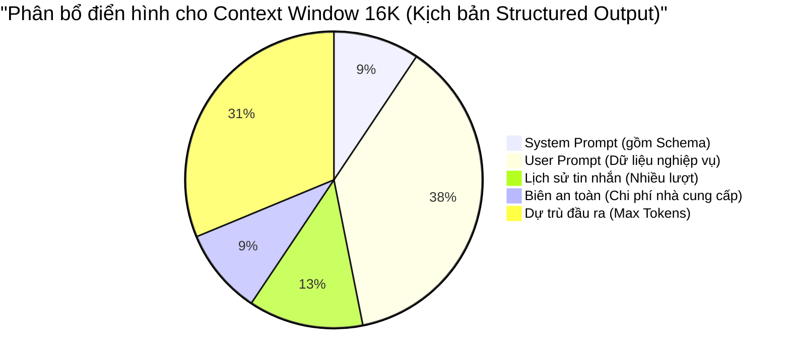

Nhiệt độ (Temperature) đã thiết lập về 0 nhưng việc parse dữ liệu trả về có cấu trúc (structured output) vẫn thi thoảng thất bại; nhét đầy tài liệu vào ngữ cảnh nhưng mô hình vẫn bỏ sót các ràng buộc then chốt nằm ở đoạn giữa. Những hiện tượng này cần phải được điều tra độc lập từ các góc độ phân tách Token, dung lượng ngữ cảnh và chiến lược giải mã (decoding strategy).

Để khắc phục các vấn đề này, trước tiên phải xem xét một lượt gọi được cấu thành từ những Token nào, sau đó đối chiếu lại ngân sách ngữ cảnh cùng các tham số giải mã như Temperature, Top-p, Top-k. Số lượng Token và phạm vi tham số nêu trong bài chỉ nhằm mục đích giải thích cơ chế; việc tính phí thực tế và trần năng lực của mô hình luôn phải căn cứ theo tài liệu API và trường `usage` trong phản hồi của mô hình mục tiêu.

## Tại sao Token và ngữ cảnh lại quyết định chi phí và hiệu quả?

Khi bạn gõ cụm từ "Hôm nay thời tiết thật" trên bàn phím, bộ gõ sẽ tự động gợi ý từ "đẹp". Mô hình ngôn ngữ lớn cũng dự đoán nội dung tiếp theo theo cách tương tự, chỉ khác là nó tham chiếu tới hàng nghìn hoặc thậm chí hàng trăm nghìn từ ngữ phía trước. Mỗi bước, mô hình sinh ra một Token (mảnh văn bản), ghép nó vào ngữ cảnh rồi tiếp tục dự đoán Token kế tiếp, cho đến khi kết thúc câu trả lời.

Quá trình này được gọi là **sinh tự hồi quy (Autoregressive Generation)**.

Sinh tự hồi quy xâu chuỗi các khái niệm sau lại với nhau:

- **Token**: Mảnh văn bản mà mô hình "bổ sung" tại mỗi bước.
- **Context Window (Cửa sổ ngữ cảnh)**: Giới hạn tổng Token tối đa mà mô hình có thể xử lý trong một lượt gọi; system prompt, lịch sử hội thoại, đầu vào hiện tại và ngân sách đầu ra đều chiếm dụng dung lượng này.
- **Temperature / Top-p**: Chiến lược để mô hình chọn mảnh văn bản ứng viên nào.
- **Max Tokens**: Giới hạn số bước tối đa mà mô hình được phép sinh ra.

Khi Tokenizer tiếp nhận văn bản, nó sẽ chia văn bản thành các đoạn có độ dài khác nhau. Ví dụ câu `你好，我是小 G。` có thể cho ra kết quả minh họa như sau:

- Văn bản gốc: `你好，我是小 G。`
- Phân tách: `[你好]` `[，]` `[我是]` `[小 G]` `[。]`
- Thống kê: Văn bản gốc 9 ký tự → Số Token là 5 → Tỷ lệ nén khoảng 1.8 lần


Kết quả phân tách này chỉ dùng để minh họa quy trình. Kết quả thực tế phụ thuộc vào Tokenizer của mô hình mục tiêu; cùng một đoạn văn bản nếu đổi sang nhà cung cấp hoặc phiên bản mô hình khác thì chuỗi Token có thể thay đổi. OpenAI cũng cung cấp [công cụ Tokenizer](https://platform.openai.com/tokenizer) để trực tiếp quan sát kết quả phân tách.

Nếu cố định cắt theo từng ký tự, bộ từ vựng sẽ nhỏ nhưng chuỗi lại quá dài; nếu cố định cắt theo từng từ, chuỗi sẽ ngắn lại nhưng số lượng từ ghép tiếng Trung hay tiếng Việt sẽ khiến bộ từ vựng phình to nhanh chóng. Các **thuật toán tách từ phụ (subword tokenization)** như BPE, Unigram cân bằng giữa hai thái cực này: cố gắng giữ nguyên các đoạn có tần suất xuất hiện cao làm một khối, và tiếp tục chia nhỏ các từ ít gặp. Vì vậy, Token không có quan hệ tương ứng một-một cố định với ký tự hay từ. Một từ tiếng Anh có thể chiếm nhiều Token; tiếng Trung hay tiếng Việt cũng có thể một từ chiếm nhiều Token, hoặc nhiều chữ gộp thành một Token.

Khi lập kế hoạch dung lượng, bạn có thể ước tính sơ bộ bằng các giá trị kinh nghiệm: 1 Token tiếng Anh tương đương khoảng 3~4 ký tự; tiếng Trung thường dao động trong khoảng 1~2 chữ Hán, và nội dung xen lẫn nhiều ngôn ngữ sẽ còn biến động tiếp. Dữ liệu chính thức của DeepSeek đưa ra quy đổi: 1 ký tự tiếng Anh tiêu tốn khoảng 0.3 Token, 1 ký tự tiếng Trung tiêu tốn khoảng 0.6 Token—tức là mỗi Token tương đương khoảng 3.3 ký tự tiếng Anh hoặc 1.7 ký tự tiếng Trung.

Phiên bản Tokenizer cũng làm thay đổi tỷ lệ quy đổi này. Các mô hình thời kỳ đầu (như GPT-3.5) có tỷ lệ nén tiếng Trung thấp hơn, khoảng 1 chữ tương đương 1.5~2 Token; GPT-4o sử dụng Tokenizer `o200k_base` với bộ từ vựng khoảng 200.000 từ, trong khi Qwen2.5 có bộ từ vựng khoảng 150.000 từ. Trong các bài test thực tế hiện tại, văn bản tin tức đạt khoảng 1.5 chữ/Token, tài liệu kỹ thuật đạt khoảng 1.2 chữ/Token, nhưng những con số này không nên dùng trực tiếp để thanh toán chi phí tài chính.

Hiện tượng "tiệm cận 1 chữ 1 Token" chỉ có thể xuất hiện ở một số từ ngữ có tần suất cực cao. Trong giai đoạn dự trù ngân sách, bạn có thể dùng giá trị kinh nghiệm để chừa ra biên độ an toàn, nhưng khi tính phí và giám sát hệ thống thì bắt buộc phải đọc trường `usage` trả về từ API. Việc các từ ngữ tối nghĩa, chữ hiếm và thuật ngữ chuyên ngành ít gặp bị tách thành độ mịn nào cũng ảnh hưởng trực tiếp đến hiệu quả xử lý văn bản của mô hình.

**Token đặc biệt (Special Tokens)**: Ngoài Token tương ứng với nội dung văn bản, bên trong mô hình còn sử dụng một số ký hiệu đặc biệt, những ký hiệu này cũng được tính vào tổng lượng Token:

| Special Token | Mục đích sử dụng | Ví dụ |
| --- | --- | --- |
| BOS (Beginning of Sequence) | Đánh dấu bắt đầu chuỗi | `<s>` |
| EOS (End of Sequence) | Đánh dấu kết thúc chuỗi | `</s>` |
| PAD (Padding) | Độn thêm vào chuỗi ngắn khi xử lý theo lô (batch) | `<pad>` |
| Ký hiệu gọi công cụ | Ranh giới Function Calling | `<tool_call/>` |

Những Token đặc biệt này thông thường ẩn đối với người dùng, nhưng vẫn chiếm dung lượng của context window. Khi cần đếm chính xác, khuyến nghị sử dụng công cụ Tokenizer chính thức thay vì ước lượng thủ công.

### Chi phí Token của đầu vào đa phương thức (Multimodal)

Các mô hình hỗ trợ thị giác sẽ chuyển đổi hình ảnh thành biểu diễn nội bộ và quy đổi thành Token đầu vào theo quy tắc riêng của từng bên. Con số này không thể chỉ ước tính dựa trên việc "có một bức ảnh":

- Mô hình thị giác của OpenAI tính phí dựa trên loại mô hình, kích thước hình ảnh và chế độ `detail`. Lấy các mô hình áp dụng quy tắc chia ô (tiling) 512 pixel làm ví dụ: chế độ detail thấp dùng một lượng định mức cố định; chế độ detail cao sẽ cộng thêm Token dựa trên số lượng ô sau khi đã co giãn ảnh.
- Anthropic ước lượng Token dựa trên số pixel của ảnh sau khi co giãn, với công thức xấp xỉ chính thức là `tokens ≈ width × height / 750`. Một bức ảnh 1024×1024 không bị co giãn sẽ tiêu tốn khoảng 1398 Token, chứ không phải con số cố định 5 hay 85 Token.
- Gemini áp dụng các quy tắc chia ô khác nhau cho ảnh nhỏ và ảnh lớn. Con số 258 Token trong tài liệu chính thức đi kèm điều kiện kích thước cụ thể, không thể áp dụng bừa cho mọi bức ảnh 1024×1024.

Phiên bản mô hình sẽ làm thay đổi quy tắc tính phí hình ảnh. Trước khi release lên production, bạn nên dùng API đếm Token hoặc công thức chính thức của nhà cung cấp, và kiểm thử bao quát các trường hợp ảnh thumbnail, ảnh chụp màn hình, ảnh cuộn dài và request gửi kèm nhiều ảnh. Có thể tham khảo [OpenAI Images & Vision Guides](https://developers.openai.com/api/docs/guides/images-vision), [Anthropic Vision](https://platform.claude.com/docs/en/build-with-claude/vision) và [Gemini Token Counting](https://ai.google.dev/gemini-api/docs/tokens).

Khi hình ảnh đưa vào hệ thống RAG đa phương thức, chi phí này sẽ tác động đồng thời đến cả ngân sách lẫn độ trễ:

- Token của hình ảnh phải được tính chung với Token văn bản vào ngân sách của một lượt gọi.
- Xử lý hình ảnh hàng loạt sẽ kéo dài thời gian chờ từ đầu tiên (TTFT), đòi hỏi phải kiểm thử chịu tải riêng.
- Nếu tác vụ chỉ cần kết quả OCR, bạn có thể trích xuất văn bản trước rồi chỉ gửi văn bản thuần vào mô hình.

### Ranh giới dung lượng của Context Window

Các con số 128K, 200K hay 1M được công bố trên mô hình thể hiện trần Token tối đa mà một lần gọi có thể tiếp nhận. Cửa sổ càng lớn thì tài liệu và lịch sử hội thoại đưa vào trong một lượt càng nhiều, nhưng dung lượng này còn phải chia sẻ cho system prompt, định nghĩa công cụ và đầu ra của mô hình. Đa số mô hình gộp chung cả đầu vào và đầu ra để tính, trong khi một số nhà cung cấp (như Google Gemini) lại đặt giới hạn riêng rẽ cho đầu vào và đầu ra.


- **Nội dung cố định**: System Prompt, Tool Schema và các ký hiệu định dạng.
- **Đầu vào lượt này**: User Prompt, tin nhắn lịch sử và các đoạn trích từ RAG.
- **Ngân sách sinh nội dung**: Token đầu ra mà mô hình chuẩn bị sinh ra.

Lấy dung lượng danh nghĩa trừ đi các phần này, phần còn lại mới là khoảng trống thực sự khả dụng cho dữ liệu nghiệp vụ.

Lưu ý: Context Window ≠ Độ dài sinh tối đa (Maximum Generation Length). Nhiều mô hình hỗ trợ ngữ cảnh 128K hoặc thậm chí 1M, nhưng giới hạn đầu ra của một lượt gọi lại tùy thuộc vào từng mô hình và API; tên tham số cũng có thể là `max_tokens`, `max_completion_tokens` hoặc `max_output_tokens`. Đừng dựa vào tên nhà cung cấp để suy đoán giới hạn trần, hãy đọc kỹ bảng năng lực của mô hình mục tiêu trước khi gọi.

Định dạng tin nhắn nhiều lượt của các mô hình suy luận (reasoning models) cũng cần phân biệt theo từng nhà cung cấp:

- [Chế độ suy luận của DeepSeek](https://api-docs.deepseek.com/guides/thinking_mode) trả về `reasoning_content` và `content` cuối cùng tách biệt nhau. Khi không có gọi công cụ, `reasoning_content` của lượt trước không cần truyền vào ngữ cảnh của lượt sau, và dù có truyền vào cũng sẽ bị bỏ qua; khi có gọi công cụ, `reasoning_content` của lượt hiện tại bắt buộc phải được truyền ngược lại cùng với kết quả công cụ cho đến khi lượt đó hoàn thành.
- [Mô hình suy luận của OpenAI](https://developers.openai.com/api/docs/guides/reasoning) không để lộ chuỗi suy nghĩ (chain-of-thought) gốc cho ứng dụng. Responses API có thể dùng `previous_response_id` để tiếp nối ngữ cảnh hoặc truyền ngược lại reasoning item theo yêu cầu API; ứng dụng chỉ nhận được bản tóm tắt suy luận tùy chọn chứ không nhận được văn bản suy luận nội bộ.

Dù Token suy luận không nhất thiết xuất hiện trong tin nhắn văn bản của lượt tiếp theo, nhưng trong lượt hiện tại nó vẫn tiêu tốn ngân sách sinh và có thể bị tính vào giới hạn đầu ra cũng như hạn ngạch ngữ cảnh. Đừng từ đó mà vội kết luận rằng "quá trình suy luận không chiếm cửa sổ hoặc không tính phí".

### Ràng buộc tính toán đằng sau Ngữ cảnh dài

**Cơ chế tự chú ý (Self-Attention)** của Transformer mang lại 3 loại chi phí nặng nề khi ngữ cảnh kéo dài:

- Chi phí tính toán tăng theo cấp số nhân bậc hai: Nhu cầu tính toán tỷ lệ thuận bậc hai với độ dài chuỗi ($O(N^2)$). Token đầu vào tăng gấp đôi, năng lực xử lý đòi hỏi có thể tăng lên gấp 4 lần.
- Độ trễ suy luận gia tăng: Khi ngữ cảnh dài ra, mô hình khi sinh từng Token mới cần phải chú ý đến lượng Token lịch sử nhiều hơn, khiến độ trễ từ đầu tiên (TTFT) tăng lên rõ rệt.
- Gia tăng rủi ro bảo mật: Ngữ cảnh dài hơn đồng nghĩa với bề mặt tấn công rộng hơn.

Các kỹ thuật như FlashAttention, GQA/MQA, Sliding Window Attention, Ring Attention có thể giảm bớt khối lượng tính toán hoặc dung lượng bộ nhớ VRAM chiếm dụng, nhưng không biến toàn bộ bài toán ngữ cảnh dài thành chi phí tuyến tính; $O(N^2)$ vẫn là độ phức tạp lý thuyết mà cơ chế self-attention tiêu chuẩn phải đối mặt.

### Biểu hiện thực tế khi Ngữ cảnh bị tràn

System Prompt đã ghi rõ ràng "Bắt buộc phải xuất ra JSON", nhưng mô hình lại bỏ qua ràng buộc này—đây là một trong những hiện tượng dễ quan sát thấy nhất khi ngữ cảnh quá dài. Câu trả lời cũng có thể bị đi lạc đề ở nửa sau, hoặc vì nhét quá nhiều đoạn trích RAG mà không nắm bắt được bằng chứng thực sự liên quan.

Đưa thông tin vào cửa sổ ngữ cảnh không đồng nghĩa với việc mô hình có thể khai thác đồng đều mọi vị trí. Hiện tượng "Lạc lõng ở giữa" (Lost in the Middle) miêu tả việc mô hình dễ dàng tận dụng phần đầu và phần cuối nhưng lại thu hồi kém đối với nội dung nằm ở đoạn giữa. Việc mở rộng cửa sổ lên 1M cũng không tự động xóa bỏ được vấn đề này.

Ngữ cảnh dài còn kéo theo các cái giá có thể giám sát trực tiếp được: Token đầu vào tăng theo khối lượng nội dung khiến hóa đơn tiền tệ tăng vọt; thời gian prefill và TTFT cũng dài ra. Khi xuất hiện các dấu hiệu này, việc đầu tiên cần làm là kiểm tra số lượng đoạn trích RAG, cắt tỉa lịch sử tin nhắn và vị trí đặt thông tin then chốt, chứ không phải tiếp tục nhồi nhét cho đầy cửa sổ.

### Chênh lệch giá giữa Token đầu vào và Token đầu ra

Phần lớn các nhà cung cấp sẽ tính phí riêng rẽ giữa Token đầu vào (input), Token đầu vào từ cache (cached input) và Token đầu ra (output); các mô hình suy luận còn có thể tách riêng reasoning tokens. Đơn giá đầu ra thường cao hơn đơn giá đầu vào, nhưng không tồn tại một tỷ lệ cố định "2~4 lần" trong toàn ngành: phiên bản mô hình, gói xử lý theo lô (batch), tỷ lệ trúng cache và cấp độ dịch vụ đều làm thay đổi mức giá.

Bảng giá thay đổi rất thường xuyên, không nên ghi cứng vào các bài viết lý thuyết. Việc hạch toán chi phí cần đọc từ trang giá hiện tại của nhà cung cấp, và lưu giữ `model_version`, các loại `usage` cùng đơn giá hóa đơn thực tế trong Gateway.

Khi hạch toán chi phí, bạn cần ghi nhận độc lập giữa đầu vào, đầu vào từ cache, đầu ra và reasoning tokens do nhà cung cấp trả về. Trong RAG, trước hết hãy kiểm soát số lượng đoạn trích để tránh nội dung không liên quan đẩy Token đầu vào lên cao; còn đầu ra và quá trình suy luận thì dùng giới hạn sinh để ràng buộc. Vì reasoning tokens thường được tính vào biểu giá phía đầu ra, nên với các mô hình suy luận cần đặc biệt theo dõi lượng tiêu thụ này.

### Tư duy tiết kiệm chi phí của Prompt Caching

Việc đánh giá hàng loạt (batch evaluation) thường xuyên gửi lặp lại cùng một System Prompt và chỉ thay thế mẫu thử ở đoạn cuối; các cuộc hội thoại nhiều lượt cũng liên tục mang theo một đoạn lịch sử cố định. Những request dạng này có thể tận dụng **Prompt Caching** để tái sử dụng phần tiền tố. Khi các request tiếp theo thỏa mãn các điều kiện về mô hình, độ dài tiền tố, nội dung và thời gian hiệu lực (TTL), phần trúng cache sẽ được tính theo đơn giá cached input và giảm bớt một phần tính toán prefill.

Các tác vụ có tiền tố cố định dài và tỷ lệ lặp lại cao sẽ thu được lợi ích rõ rệt nhất:

- Hội thoại nhiều lượt (System Prompt + Message lịch sử không đổi).
- Ứng dụng RAG (các đoạn trích truy xuất có tỷ lệ trùng lặp cao).
- Đánh giá theo lô (cùng một System Prompt, đánh giá các bản CV/bài viết khác nhau).

Ngưỡng kích hoạt, tuổi thọ bộ nhớ đệm và mức chiết khấu giá giữa OpenAI Prompt Caching, Anthropic Prompt Caching và DeepSeek Context Caching là không giống nhau, một số bên còn phân biệt giữa tự động cache, cache tường minh và kéo dài cache. Trước khi cấu hình, hãy tra cứu tài liệu chính thức hiện hành, tránh ghi cứng thời gian cache và tỷ lệ chiết khấu vào mã nguồn nghiệp vụ.

Cách sắp xếp nội dung request sẽ ảnh hưởng trực tiếp đến tỷ lệ trúng cache:

1. Đặt nội dung không đổi lên phía trước (System Prompt, định nghĩa công cụ, RAG Context), và đặt nội dung biến động về phía sau (User Prompt).
2. Dựa vào các trường trong phản hồi của nhà cung cấp để giám sát Token đọc từ cache và ghi vào cache, xác thực tỷ lệ trúng cache.
3. Cố gắng hoàn thành các tác vụ chạy theo lô trong khung thời gian hiệu lực của cache.

### Công thức ngân sách Token cho một lượt gọi

Hình dung "cửa sổ ngữ cảnh" như một chiếc thùng có dung tích cố định, biểu đồ dưới đây minh họa việc phân bổ ngân sách Token cho một lượt gọi điển hình:



Các con số trong biểu đồ chỉ mang tính minh họa. Với mô hình sinh thông thường, trước hết hãy kiểm tra xem bất đẳng thức sau có thỏa mãn hay không:

**window ≥ input_tokens + max_output_tokens**

Đối với mô hình suy luận, bạn phải tính toán riêng theo định nghĩa tham số của API mục tiêu. Một số API quy định `max_output_tokens` hoặc `max_completion_tokens` bao gồm cả Token suy luận và câu trả lời hiển thị, lúc này nếu cộng thêm một lần `reasoning_tokens` nữa sẽ bị trùng lặp; một số API khác lại giới hạn riêng biệt giữa quá trình tư duy và câu trả lời cuối cùng. Trước khi lên production, bạn có thể dùng `usage` trả về từ các lượt gọi thực tế để suy ngược thành phần và hiệu chỉnh lại công thức ngân sách.

Trong đó `input_tokens` tối thiểu bao gồm:

- system prompt (gồm schema / định nghĩa công cụ)
- user prompt (gồm văn bản thực tế sau khi đã thay thế biến)
- tin nhắn lịch sử (khi đối thoại nhiều lượt)
- RAG context (nếu có nhúng vào)

Độ dài đầu ra của các tác vụ có cấu trúc thường dễ kiểm soát hơn, bạn có thể xác định `max_output_tokens` trước, sau đó chừa ra biên độ an toàn từ 10%~20% cho đầu vào. Khi ngân sách vẫn không đủ, hãy cắt giảm theo thứ tự: giảm Top-K của RAG, gộp các đoạn trích trùng lặp, tóm tắt hoặc cắt bớt các trường dữ liệu quá dài; nếu một lượt không thể chứa hết, hãy tách tác vụ thành đánh giá theo đợt hoặc quy trình sinh hai giai đoạn.

## Tham số lấy mẫu ảnh hưởng thế nào đến độ ổn định của kết quả?

### Từ Logits đến Lấy mẫu xác suất

Tại mỗi bước, mô hình chấm điểm (gọi là **logits**) cho **mọi** Token ứng viên trong bộ từ vựng; điểm càng cao thể hiện mô hình càng tin rằng Token đó nên xuất hiện ở vị trí này.

Ví dụ, giả sử mô hình đang hoàn thiện câu "Hôm nay thời tiết thật \_\_", nó có thể cho ra điểm số như sau:

| Token ứng viên | Điểm số gốc (logit) |
| --- | --- |
| đẹp (好) | 5.0 |
| không tệ (不错) | 3.2 |
| tuyệt (棒) | 2.1 |
| tồi tệ (糟糕) | 0.5 |
| màu tím (紫色) | -8.0 |

Điểm số gốc vẫn chưa phải là xác suất, nó phải đi qua hàm **softmax** mới tạo thành phân phối xác suất cho các Token ứng viên. Sau khi biến đổi, kết quả xấp xỉ là:

| Token ứng viên | Xác suất |
| --- | --- |
| đẹp | 81.21% |
| không tệ | 13.42% |
| tuyệt | 4.47% |
| tồi tệ | 0.90% |
| màu tím | ~0.00% |

Sau khi có phân phối xác suất, mô hình mới lấy mẫu để quyết định xuất ra Token nào.

Các tham số giải mã (Temperature, Top-p, Top-k...) chính là công cụ can thiệp vào quy trình "chấm điểm → tính xác suất → bốc thăm" này:

- Temperature: Điều chỉnh "độ dốc" của phân phối xác suất, làm cho các lựa chọn điểm cao vượt trội hơn, hoặc làm cho các lựa chọn trở nên đồng đều hơn.
- Top-p / Top-k: Cắt bỏ trực tiếp các ứng viên kém tin cậy, thu hẹp "hồ bốc thăm".
- Dòng tham số Penalty: Giảm điểm của các từ đã từng xuất hiện, chống nói lặp.

### "Mức độ mạo hiểm" của Temperature


Nguyên lý hoạt động của Temperature rất đơn giản: trước khi tính softmax, toàn bộ điểm số gốc sẽ được **chia cho** giá trị nhiệt độ T:

$$p(t) = \text{softmax}(z_t / T)$$

Đưa ví dụ "Hôm nay thời tiết thật \_\_" vào công thức, ta có thể thấy nhiệt độ làm thay đổi cùng một tập logits như thế nào:

| Nhiệt độ | Sự thay đổi của phân phối xác suất | Kết quả ví dụ |
| --- | --- | --- |
| T = 0.2 | Phân phối trở nên rất dốc, Token xác suất cao tập trung tuyệt đối | "đẹp" đạt khoảng 99.99% |
| T = 1.0 | Giữ nguyên phân phối gốc | "đẹp" khoảng 81.21%, "không tệ" khoảng 13.42% |
| T = 1.5 | Phân phối trở nên bằng phẳng, Token xác suất thấp nhận được nhiều cơ hội hơn | "đẹp" khoảng 66.85%, "không tệ" khoảng 20.14%, "tuyệt" khoảng 9.67% |

Nhiệt độ càng thấp, kết quả càng tất định; nhiệt độ càng cao, kết quả càng ngẫu nhiên.

Gợi ý kỹ thuật (giá trị kinh nghiệm, không phải quy tắc cứng):

| Kịch bản | Nhiệt độ khuyến nghị | Giải thích |
| --- | --- | --- |
| Trích xuất có cấu trúc / Xuất JSON | 0 ~ 0.3 | Kết hợp với schema chặt chẽ + chiến lược retry khi parse lỗi |
| Đánh giá / Phân tích / Review mã nguồn | 0.4 ~ 0.8 | Cân bằng giữa tính tất định và sự phong phú trong diễn đạt |
| Sáng tạo nội dung (Viết văn, Brainstorming) | 0.8 ~ 1.2+ | Tăng tính đa dạng, nhưng phải chấp nhận rủi ro sai lệch định dạng |

Nếu API mục tiêu hỗ trợ `seed`, bạn có thể lưu giữ nó cùng với phiên bản mô hình cố định, Prompt cố định và tham số lấy mẫu cố định. Tuy nhiên, `seed` thường chỉ mang lại tính tái lập ở mức nỗ lực tối đa (best-effort), không đảm bảo nhất quán từng từ một; hơn nữa tham số API hiện tại của DeepSeek cũng chưa công khai `seed`.

Các tình huống sau vẫn có thể dẫn đến kết quả không nhất quán:

- Phiên bản mô hình được cập nhật (trọng số bên dưới thay đổi).
- Gọi qua các vùng khác nhau (các cụm máy chủ khác nhau có thể triển khai phiên bản build khác nhau).
- Việc triển khai giải mã phía server, tính toán song song trên GPU và cấu hình backend có sự thay đổi.

Trong quy trình CI/CD, bạn chỉ nên để việc gọi LLM thật cho các bài smoke test; các bài unit test logic cần tính tái lập tuyệt đối thì vẫn nên dùng Mock.

### "Hồ bốc thăm" của Top-p và Top-k

Temperature điều chỉnh hình dạng của phân phối xác suất. Còn Top-p và Top-k thì cắt cụt tập hợp ứng viên, loại bỏ hoàn toàn các phương án đuôi ra khỏi phạm vi lấy mẫu.

Vẫn dùng ví dụ "Hôm nay thời tiết thật \_\_":

| Token ứng viên | Xác suất | Xác suất tích lũy |
| --- | --- | --- |
| đẹp | 81.21% | 81.21% |
| không tệ | 13.42% | 94.63% |
| tuyệt | 4.47% | 99.10% |
| tồi tệ | 0.90% | ~100% |
| màu tím | ~0.00% | 100% |

`Top-k = 3` cố định giữ lại 3 từ có xác suất cao nhất là "đẹp, không tệ, tuyệt", các ứng viên còn lại không được tham gia lấy mẫu nữa. `Top-p = 0.9` thì cộng dồn xác suất từ cao xuống thấp; trong ví dụ này "đẹp + không tệ" đã đạt 94.63%, nên tập ứng viên chỉ giữ lại 2 từ này; nếu từ đứng đầu tự nó đã vượt quá 90%, thì chỉ giữ lại duy nhất 1 từ đó.

Top-k kiểm soát số lượng cố định, còn Top-p kiểm soát xác suất tích lũy, do đó số lượng ứng viên của Top-p sẽ biến đổi linh hoạt theo phân phối. Khi kết hợp với Temperature, các hành vi phổ biến như sau:

| Tổ hợp | Hiệu quả | Kịch bản áp dụng |
| --- | --- | --- |
| T=0 (thường xử lý theo Greedy Decoding) | Mỗi bước chọn từ có điểm cao nhất; kết quả vẫn chịu ảnh hưởng bởi phiên bản mô hình và backend server | Structured output, kịch bản yêu cầu ngẫu nhiên thấp |
| T thấp + Top-p=0.9 | Tương đối ổn định, nhưng cho phép một chút thay đổi tự nhiên trong cách dùng từ | Báo cáo phân tích, tóm tắt nội dung |
| T trung bình cao + Top-p=0.95 | Tính đa dạng cao, nhưng loại trừ được các phương án kỳ dị vô lý | Sáng tác nội dung, hội thoại tự nhiên |

Lưu ý: Greedy decoding tuy ổn định nhất nhưng có thể dễ rơi vào vòng lặp lặp từ hơn.

### Điều kiện dừng và Rủi ro bị cắt ngắn

Khi việc sinh Token đạt tới Max Tokens, mô hình sẽ dừng lại ngay lập tức, bất kể JSON có đang thiếu dấu ngoặc đóng hay danh sách còn đang viết dở. Khi server nhận được `finish_reason=length`, hệ thống bắt buộc phải đánh dấu kết quả là đã bị cắt ngắn (truncated), không được chuyển tiếp cho các khâu hạ tầng thực thi tiếp.

Stop Sequences sẽ kết thúc việc sinh sớm khi mô hình tạo ra các chuỗi ký tự được chỉ định, ví dụ `"\n\n"` hoặc `"```"`. Nếu từ dừng vô tình trùng lặp với văn bản nghiệp vụ, nó cũng sẽ cắt ngắn các trường thông tin then chốt. Việc xử lý structured output cần bao quát cả hai kịch bản thất bại: chạm trần độ dài và chạm nhầm từ dừng.

Đối với mô hình suy luận, bạn còn phải xác nhận xem giới hạn sinh có bao gồm đồng thời cả quá trình suy luận lẫn câu trả lời cuối cùng hay không. Một số API dùng chung một ngân sách sinh, Token suy luận dùng càng nhiều thì khoảng trống còn lại cho câu trả lời hiển thị càng ít; một số API khác kiểm soát lượng suy luận gián tiếp qua các tham số như `reasoning_effort`. Khi phát hiện `finish_reason=length`, bạn phải đưa cả Token suy luận và câu trả lời cuối cùng vào diện điều tra.

### Penalty và vấn đề lặp từ

Có thể bạn đã từng gặp trường hợp mô hình liên tục lặp lại cùng một câu, hoặc liên tục nhắc lại cùng một quan điểm trong một bài viết dài. Các tham số Penalty sinh ra để giảm bớt vấn đề này, bằng cách **hạ điểm số của các Token đã từng xuất hiện** trong quá trình giải mã:

| Tham số | Tác dụng | Cách hiểu trực quan |
| --- | --- | --- |
| Repetition Penalty | Giảm xác suất của tất cả các Token đã từng xuất hiện | "Từ nào nói rồi, nói lại là bị trừ điểm" |
| Presence Penalty | Cứ xuất hiện là bị trừ điểm cố định (không quan tâm số lần) | "Khuyến khích nói về chủ đề mới" |
| Frequency Penalty | Xuất hiện càng nhiều lần thì bị trừ điểm càng nặng | "Cùng một từ mà nói đến lần thứ ba? Phạt nặng" |

Đối tượng JSON thường xuất hiện lặp đi lặp lại các tên trường như `"name"`, `"score"`. Nếu đặt Repetition Penalty quá cao, mô hình sẽ trừ điểm cả những sự lặp lại cấu trúc cần thiết này, dẫn đến kết quả bị thiếu trường. Trong hỏi đáp RAG, nếu bật Presence Penalty quá đà, mô hình sẽ có xu hướng đưa vào các từ mới không hề có trong tài liệu truy xuất, làm giảm độ trung thực của câu trả lời đối với bằng chứng.

Các nhà cung cấp định nghĩa Penalty không hoàn toàn giống nhau. Khi chưa có căn cứ tinh chỉnh rõ ràng, hãy giữ nguyên giá trị mặc định, và dựa vào độ dài đầu ra, ràng buộc Prompt cùng Schema để kiểm soát cấu trúc, luồng điều tra lỗi sẽ sáng tỏ hơn nhiều.

### Giới hạn tham số ở chế độ Chain-of-Thought (CoT)

Phạm vi tham số được hỗ trợ của các mô hình suy luận phụ thuộc vào từng API cụ thể, không thể quy chụp chế độ suy luận của DeepSeek và mô hình suy luận của OpenAI vào cùng một hành vi.

- Chế độ suy luận của DeepSeek V4 trả về `reasoning_content` cùng `content` cuối cùng, và liệt kê rõ ràng các tham số lấy mẫu không được hỗ trợ hoặc không có hiệu lực.
- OpenAI không trả về chuỗi suy nghĩ nội bộ ban đầu. Responses API có thể trả về reasoning item và phần tóm tắt tùy chọn; các mô hình suy luận khác nhau có thể hỗ trợ các tham số `temperature`, `top_p` khác nhau.

Trước khi gọi, hãy lọc bỏ các tham số không được hỗ trợ dựa theo bảng năng lực mô hình. Độ ổn định cấu trúc vẫn phải dựa vào Structured Outputs, kiểm tra phía server và xử lý ngoại lệ, chứ không thể chỉ dựa vào việc chỉnh Temperature.

### Phản hồi Streaming và Độ trễ từ đầu tiên (TTFT)

API đồng bộ phải đợi toàn bộ nội dung sinh xong mới trả về; API streaming thì cứ sinh được một hoặc vài Token là đẩy ngay phần gia tăng, nhờ đó người dùng thấy Token đầu tiên sớm hơn rất nhiều, độ trễ từ đầu tiên (TTFT, Time-To-First-Token) cũng thấp hơn. Ở đây rất dễ nhầm lẫn giữa TTFT, tổng thời gian xử lý và chi phí:

- Phản hồi streaming không nhất thiết làm giảm tổng thời gian xử lý (E2E latency), vì tổng lượng Token mà mô hình sinh ra không hề giảm bớt.
- Phản hồi streaming không tự động tiết kiệm tiền, chi phí tính theo Token vẫn giữ nguyên và vẫn chịu ảnh hưởng của rate limit cũng như hạn ngạch.
- Nếu cần xuất dữ liệu có cấu trúc (như JSON), kịch bản streaming phải tính đến việc xử lý "JSON bán thành phẩm" ở tầng frontend hoặc gateway.

### Logprobs và Điều tra độ tin cậy

Một số API (như OpenAI) hỗ trợ trả về **log probability** (logprobs) cho từng Token được sinh ra, có thể hiểu nôm na là "mức độ chắc chắn" của mô hình đối với Token đó. logprob càng tiệm cận 0 thì mô hình càng chắc chắn; giá trị càng âm (như -5.0) thì chứng tỏ mô hình càng "do dự".

Kịch bản ứng dụng trong kỹ thuật:

- **Đánh giá độ tin cậy**: Khi trích xuất "Số tiền: 1000", nếu Token tương ứng có logprob rất thấp, chứng tỏ mô hình không chắc chắn, có thể cần chuyển cho con người rà soát lại.
- **Phát hiện bất thường**: Giám sát logprob trung bình của mô hình trên production, nếu đột ngột giảm mạnh có thể cảnh báo hiện tượng Prompt drift hoặc dữ liệu đầu vào bất thường.
- **So sánh đa ứng viên**: Lấy Top-N Token ứng viên cùng xác suất của chúng để phục vụ sửa lỗi hoặc xếp hạng lại lần hai.

Lưu ý: logprobs sẽ làm tăng dung lượng phản hồi và không phải nhà cung cấp nào cũng hỗ trợ. Vui lòng tra cứu tài liệu API trước khi dùng.

### Khuyến nghị cấu hình tham số lấy mẫu

| Kịch bản | Temperature | Top-p | Penalty | Khuyến nghị khác |
| --- | --- | --- | --- | --- |
| JSON / Structured Output | 0 ~ 0.3 | 1.0 | Mặc định | Kết hợp Strict Mode + Chiến lược retry |
| Code review / Phân tích kỹ thuật | 0.4 ~ 0.7 | 0.9 | Mặc định | Kết hợp với CoT Prompting |
| Đối thoại nhiều lượt | 0.6 ~ 0.8 | 0.9 | Bật vừa phải | Kiểm soát độ dài tin nhắn lịch sử |
| Sáng tác nội dung / Brainstorming | 0.8 ~ 1.2 | 0.95 | Bật theo nhu cầu | Chấp nhận tính đa dạng, làm tốt hậu xử lý |
| Mô hình suy luận | Tra tài liệu | Tra tài liệu | Tra tài liệu | Lọc tham số không hỗ trợ, giữ kiểm tra phía server |

## Dữ liệu cần lưu giữ khi vận hành thực tế

Lập kế hoạch dung lượng dựa trên Token, nhưng tính phí và cảnh báo phải căn cứ theo trường `usage` do API trả về. Với mỗi lượt gọi trên production, tối thiểu cần lưu lại: phiên bản mô hình, Token đầu vào, Token từ cache, Token suy luận (nếu nhà cung cấp có trả về), Token đầu ra, chiến lược cắt tỉa ngữ cảnh và các tham số lấy mẫu.

Ngữ cảnh dài chỉ giúp tăng lượng thông tin có thể chứa đựng, chứ không đảm bảo mô hình có thể khai thác đồng đều mọi vị trí. Các tác vụ có cấu trúc bắt buộc phải phối hợp cùng Schema và kiểm tra phía server; khi cần tái lập các thử nghiệm, hãy cố định phiên bản mô hình, Prompt, đầu vào cùng các tham số giải mã, và chấp nhận tính bất định nhỏ vốn có từ dịch vụ của các nhà cung cấp đám mây.
