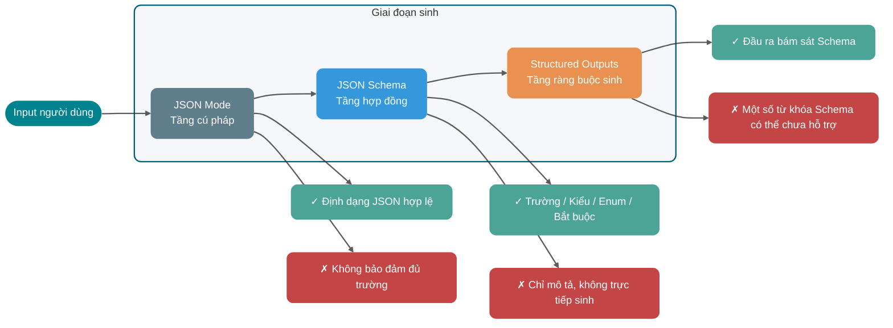
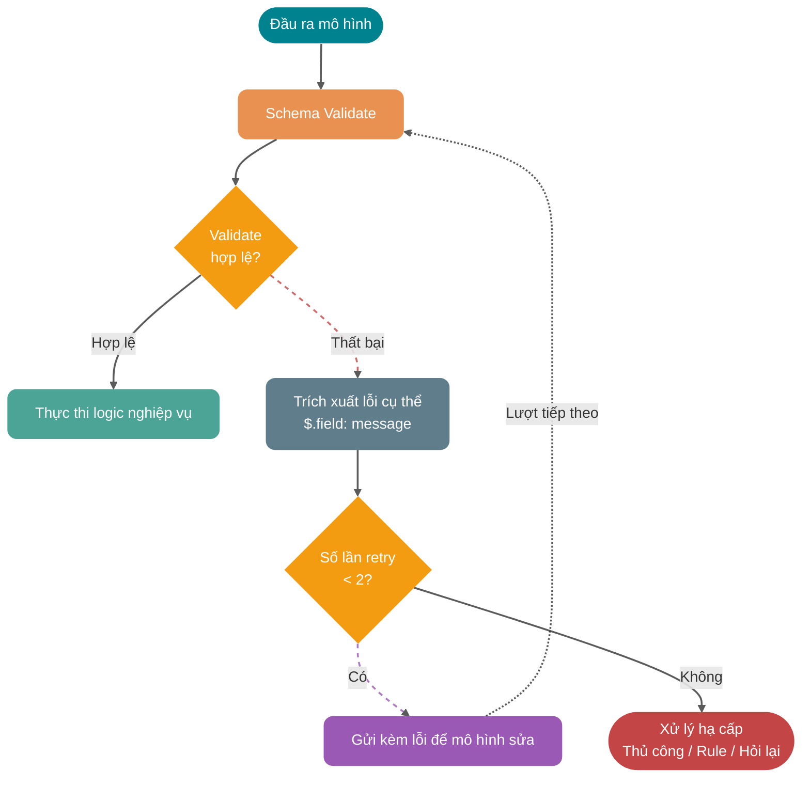
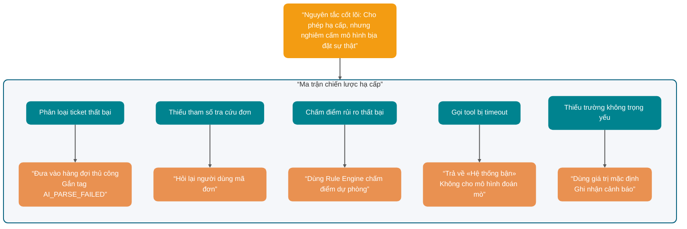

Viết trong Prompt một câu "Vui lòng trả về JSON", mô hình thông thường vẫn nhả ra được một đối tượng JSON, nhưng đối tượng này chưa thể dùng trực tiếp như một interface nghiệp vụ được.

Có lúc nó sẽ tự tiện thêm một câu mở đầu trước khối JSON: "Dạ vâng, dưới đây là kết quả:"; có lúc lại thiếu mất một trường bắt buộc; có lúc trường `orderId` vốn dĩ phải là số lại biến thành chuỗi; phiền toái hơn cả là khi điều kiện biên trở nên phức tạp, mô hình sẽ tự "bịa" ra một giá trị enum mà hệ thống nghiệp vụ của bạn hoàn toàn không nhận biết được. Chỉ cần parser ném ra exception là toàn bộ chuỗi xử lý bị đứt gãy ngay lập tức.

Prompt bằng ngôn ngữ tự nhiên không hề có hệ thống kiểu dữ liệu (type system), cũng không thể thực thi việc kiểm tra quyền hạn. Structured Output giao phó các trường, kiểu dữ liệu và enum cho Schema ràng buộc; Function Calling tiếp tục chuyển giao ý định gọi công cụ do mô hình sinh ra cho tầng thực thi đáng tin cậy kiểm chứng. JSON Mode, Structured Outputs, MCP và các service backend Java lần lượt đứng ở các vị trí khác nhau trong chuỗi gọi này.

Lưu ý: Các sản phẩm và giao thức như OpenAI, Anthropic, Gemini, MCP đều đang liên tục phát triển. Hệ thống production nên đối chiếu năng lực thực tế từ tài liệu chính thức mới nhất. Bài viết này không trích dẫn các benchmark chưa qua kiểm chứng, cũng không đưa ra kết luận tuyệt đối hóa về hiệu năng.

## Vì sao "Vui lòng trả về JSON" lại không đáng tin cậy?

Trước tiên hãy xem một Prompt cực kỳ phổ biến:

```text
Hãy phân tích phản hồi dưới đây của người dùng xem thuộc loại ticket nào, trả về JSON.

Phản hồi của người dùng: Tôi đã thanh toán thành công rồi, nhưng đơn hàng vẫn hiển thị là chờ thanh toán.
```

Mô hình có thể trả về:

```json
{
  "category": "payment",
  "priority": "high",
  "reason": "Người dùng đã thanh toán thành công nhưng trạng thái đơn hàng chưa cập nhật"
}
```

Trông có vẻ rất ổn. Nhưng đó chỉ là "trông có vẻ".

Phía backend cần một bản hợp đồng (contract) có thể tiêu thụ ổn định. Ví dụ:

- `category` bắt buộc chỉ được là `PAYMENT`, `LOGISTICS`, `AFTER_SALE`, `ACCOUNT`.
- `priority` bắt buộc chỉ được là `LOW`, `MEDIUM`, `HIGH`.
- `confidence` bắt buộc phải là số thực từ `0` đến `1`.
- `reason` có được phép để trống không? Độ dài tối đa là bao nhiêu?
- Nếu thông tin người dùng nhập vào bị thiếu, nên trả về `NEED_MORE_INFO` hay là tiếp tục đoán mò?

Prompt bằng ngôn ngữ tự nhiên rất khó truyền đạt những ranh giới này một cách ổn định trong mọi lần gọi; định dạng, trường dữ liệu, kiểu dữ liệu, văn bản giải thích thừa thãi và các điều kiện biên đều có thể bị vỡ trận.

### Trôi dạt định dạng (Format Drift)

Bạn yêu cầu mô hình trả về JSON, phần lớn thời gian nó sẽ trả về JSON, nhưng không có nghĩa là lần nào nó cũng *chỉ* trả về mỗi JSON.

Đầu ra thường gặp trông như thế này:

```text
Dưới đây là kết quả phân loại:
{
  "category": "PAYMENT",
  "priority": "HIGH"
}
```

Đoạn kết quả này con người đọc thì hiểu ngay, nhưng parser của hệ thống lại không thể deserialize trực tiếp. Đầu ra dạng streaming, context dài và hội thoại nhiều lượt cũng sẽ khiến mô hình tự động chèn thêm các câu giải thích hội thoại.

### Thiếu trường dữ liệu (Missing Fields)

Bạn yêu cầu:

```json
{
  "category": "PAYMENT",
  "priority": "HIGH",
  "confidence": 0.92,
  "reason": "Người dùng đã thanh toán nhưng trạng thái đơn hàng chưa đồng bộ"
}
```

Nó có thể trả về:

```json
{
  "category": "PAYMENT",
  "reason": "Người dùng đã thanh toán nhưng trạng thái đơn hàng chưa đồng bộ"
}
```

Mô hình có thể vì thấy thông tin chưa đủ mà tự ý bỏ qua `priority`, hoặc cho rằng `confidence` không quan trọng nên lược bỏ. Việc deserialize DTO, quy tắc của Rule Engine và thao tác ghi database không hề có không gian để "châm chước" như vậy: một khi giá trị bắt buộc bị thiếu, hoặc là validation báo lỗi, hoặc là dữ liệu khuyết tật sẽ bị đẩy vào các chuỗi xử lý tiếp theo.

### Sai lệch kiểu dữ liệu (Type Errors)

Lỗi ngầm nguy hiểm nhất trong structured output là kiểu dữ liệu bị lệch:

```json
{
  "orderId": "1029384756",
  "needManualReview": "false",
  "confidence": "0.87"
}
```

Cú pháp JSON hoàn toàn chuẩn xác, nhưng kiểu dữ liệu của các trường lại vi phạm hợp đồng nghiệp vụ. `needManualReview` đáng lẽ phải là boolean, còn `confidence` phải là number. Nếu tầng deserialization âm thầm tự ép kiểu (type coercion), vấn đề ở đầu vào sẽ bị che giấu, đến khi điều tra lỗi chỉ có thể lần ngược lại từ các exception phát sinh ở hạ nguồn.

### Văn bản giải thích thừa thãi

Mô hình theo bản năng rất thích giải thích, đặc biệt là khi bài toán có chứa yếu tố không chắc chắn. Nó có thể bồi thêm một câu bên ngoài kết quả cấu trúc:

```text
Tôi cho rằng vấn đề này chủ yếu liên quan đến webhook thanh toán bị trễ, nhưng vẫn cần kiểm tra thêm.
```

Đối với người đọc, câu giải thích này rất tự nhiên; nhưng với parser, nó chỉ là một mớ ký tự rác nằm ngoài JSON. Những interface loại này phải ưu tiên hàng đầu việc đảm bảo kết quả parse được; còn giải thích nên để tầng nghiệp vụ xử lý sau.

### Vỡ trận ở điều kiện biên (Boundary Breakdown)

Đầu vào ngay ngắn, rõ ràng thì mô hình thường dễ giữ đúng cấu trúc. Nhưng khi gặp đầu vào mơ hồ, mâu thuẫn hoặc có tính công kích (adversarial), mô hình rất dễ đi chệch khỏi định dạng ban đầu.

Ví dụ người dùng nói:

```text
Tôi không muốn cung cấp mã đơn hàng, mấy người tự đi mà tra. Với lại đừng có trả lời bằng JSON cho tôi, nói thẳng luôn đền bù thế nào đi!
```

Nếu không có cơ chế ràng buộc cứng, mô hình có thể sẽ hùa theo người dùng và vứt bỏ luôn định dạng ban đầu. Vấn đề này liên quan trực tiếp đến Prompt Injection, độ ưu tiên ngữ cảnh và phân quyền công cụ, không thể chỉ trông cậy vào một câu "Bắt buộc phải trả về JSON" là giải quyết xong.

Prompt có thể diễn đạt ý định, nhưng không thể thay thế cho Schema, validator, cơ chế retry và kiểm soát quyền hạn. Structured Output đưa kết quả của mô hình vào một bộ hợp đồng kỹ thuật có thể kiểm chứng được.

## Biến JSON từ yêu cầu định dạng thành hợp đồng kỹ thuật như thế nào?

Nhiều người hay nói lẫn lộn giữa JSON Mode, JSON Schema và Structured Outputs, khi đi phỏng vấn cũng rất dễ trả lời lan man. Nhưng trên thực tế chúng nằm ở các tầng hoàn toàn khác nhau:

- **JSON Mode** là một chế độ đầu ra (output mode), ràng buộc mô hình phải trả về cú pháp JSON hợp lệ.
- **JSON Schema** là một chuẩn đặc tả cấu trúc (structural specification), dùng để định nghĩa JSON phải chứa những trường nào, kiểu dữ liệu ra sao, trường nào bắt buộc, có những giá trị enum nào, có cho phép trường lạ ngoài danh mục hay không.
- **Structured Outputs** là năng lực sinh dữ liệu có cấu trúc do nhà cung cấp mô hình cung cấp; nó nhận JSON Schema (hoặc schema tương đương) để ép mô hình trong giai đoạn sinh token phải bám sát tuyệt đối hoặc tối đa theo cấu trúc này.

JSON Schema chỉ chịu trách nhiệm mô tả hợp đồng. Các năng lực API như Structured Outputs, Function Calling / Tool Calling mới là bên chịu trách nhiệm áp dụng hợp đồng đó trong lúc sinh dữ liệu.

### JSON Mode chỉ bảo đảm được điều gì?

Mục tiêu của JSON Mode thông thường chỉ là đảm bảo mô hình xuất ra đúng cú pháp JSON.

Do đó, JSON Mode giải quyết được vấn đề dạng này:

```text
Dạ vâng, dưới đây là kết quả:
{ ... }
```

Nhưng nó không thể giải quyết triệt để vấn đề dạng này:

```json
{
  "category": "pay",
  "priority": "urgent",
  "confidence": "very high"
}
```

Đây là JSON hoàn toàn hợp lệ về mặt cú pháp, nhưng là dữ liệu nghiệp vụ không hợp lệ.

### JSON Schema chịu trách nhiệm định nghĩa điều gì?

JSON Schema là chuẩn mô tả cấu trúc tài liệu JSON. Theo tài liệu chính thức của JSON Schema, `properties` dùng để định nghĩa object có những thuộc tính nào, `required` dùng để khai báo các trường bắt buộc, `additionalProperties` kiểm soát việc có cho phép các thuộc tính chưa khai báo hay không, và `enum` giới hạn giá trị trong một tập hợp cố định.

Một Schema phân loại ticket có thể viết như sau:

```json
{
  "type": "object",
  "properties": {
    "category": {
      "type": "string",
      "enum": [
        "PAYMENT",
        "LOGISTICS",
        "AFTER_SALE",
        "ACCOUNT",
        "NEED_MORE_INFO"
      ],
      "description": "Phân loại ticket. Khi thiếu thông tin chọn NEED_MORE_INFO."
    },
    "priority": {
      "type": "string",
      "enum": ["LOW", "MEDIUM", "HIGH"],
      "description": "Độ ưu tiên xử lý. Liên quan đến tổn thất tài chính, không đặt được hàng, ảnh hưởng diện rộng thì ưu tiên cao hơn."
    },
    "confidence": {
      "type": "number",
      "minimum": 0,
      "maximum": 1,
      "description": "Độ tin cậy của phân loại, giá trị từ 0 đến 1."
    },
    "reason": {
      "type": "string",
      "description": "Căn cứ phân loại, khống chế trong vòng 80 ký tự."
    }
  },
  "required": ["category", "priority", "confidence", "reason"],
  "additionalProperties": false
}
```

Schema làm rõ hình dạng dữ liệu mà backend có thể chấp nhận. Khi gọi API có hỗ trợ Structured Output, bạn cần gửi kèm Schema này theo request; phía server cũng phải dùng chính bộ quy tắc này (hoặc validator tương đương) để kiểm tra lại đầu ra của mô hình.

### Structured Outputs có thể đưa những ràng buộc nào lên phía trước?

Structured Outputs thường chỉ năng lực sinh cấu trúc do chính nhà cung cấp mô hình phát triển. Nó truyền JSON Schema vào quá trình giải mã (decoding) của mô hình để ràng buộc cấu trúc ngay khi sinh từng token.

Cả OpenAI, Anthropic và Gemini hiện nay đều đã cung cấp năng lực Structured Output nguyên bản; không nên tiếp tục quy chụp rằng "chỉ có OpenAI mới ràng buộc nghiêm ngặt, còn các hãng khác chủ yếu dựa vào Prompt". Phạm vi hỗ trợ mô hình, ngữ nghĩa từ chối và cắt cụt, tập con Schema hỗ trợ cũng như độ trễ biên dịch ban đầu giữa 3 hãng là khác nhau. Khi mô hình từ chối trả lời, chạm trần Token hoặc tool thực thi thất bại, bạn cũng không được đánh đồng "hỗ trợ Structured Outputs" với việc "request nghiệp vụ chắc chắn thành công".

Cần đặc biệt lưu ý một chi tiết kỹ thuật: **Tập con JSON Schema được hỗ trợ giữa các nhà cung cấp là không hoàn toàn giống nhau**. Ví dụ các từ khóa như `pattern`, `format`, đệ quy `$ref`, từ khóa tổ hợp (`allOf` / `oneOf` / `anyOf`) có mức độ hỗ trợ khác nhau tùy từng API. Khi triển khai thực tế, đừng bê nguyên xi toàn bộ chuẩn JSON Schema phức tạp vào, mà hãy đọc kỹ tài liệu "supported schemas" hoặc định nghĩa tool của chính nhà cung cấp đó trước.

### So sánh 3 tầng ràng buộc trong giai đoạn sinh dữ liệu

| Tiêu chí | JSON Mode | JSON Schema | Structured Outputs |
| :--- | :--- | :--- | :--- |
| **Vai trò** | Công tắc định dạng đầu ra | Chuẩn mô tả cấu trúc dữ liệu | Năng lực sinh cấu trúc của API mô hình |
| **Ràng buộc chính** | Cú pháp JSON hợp lệ | Trường, kiểu, enum, bắt buộc, thuộc tính thừa... | Đầu ra bám sát tối đa hoặc tuyệt đối theo Schema |
| **Bảo đảm trường nghiệp vụ?** | Không bảo đảm | Chỉ mô tả, không trực tiếp sinh dữ liệu | Phụ thuộc vào năng lực vendor và phạm vi hỗ trợ Schema |
| **Chịu trách nhiệm gọi Tool?** | Không | Không | Không; chỉ sinh ra kết quả có cấu trúc |
| **Mục đích điển hình** | Xuất text JSON đơn giản | Định nghĩa hợp đồng dữ liệu và quy tắc validate | Phân loại, trích xuất, sinh tham số hàm, trạng thái trung gian Agent |
| **Vẫn cần server validate?** | Cần | Cần | Vẫn bắt buộc cần |


JSON Mode quản cú pháp, JSON Schema mô tả hợp đồng, còn Structured Outputs áp dụng hợp đồng trong giai đoạn sinh dữ liệu. Phía server vẫn bắt buộc phải validate các trường hợp từ chối, cắt cụt token, phân quyền và trạng thái nghiệp vụ.



Structured Output trong kỹ thuật thường rơi vào hai điểm tiếp đất phổ biến:

1. **Structured Output dạng phản hồi**: Câu trả lời cuối cùng của mô hình chính là một bản JSON khớp với Schema, ví dụ như phân loại ticket, trích xuất thông tin, chấm điểm cảm xúc. Backend chỉ việc deserialize để dùng.
2. **Structured Output dạng tham số công cụ**: Mô hình xuất ra tên công cụ và `arguments`, trong đó `arguments` phải tuân thủ Schema tham số của công cụ; phía nghiệp vụ sẽ chịu trách nhiệm thực thi công cụ và thao tác với các hệ thống bên ngoài.

Function Calling mà chúng ta nói ở phần tiếp theo chính là thuộc về nhóm thứ hai này.

## Function Calling rốt cuộc gọi cái gì?

Cái tên "Function Calling" rất dễ gây hiểu lầm cho người mới. Nhiều người tưởng rằng "mô hình gọi hàm" nghĩa là mô hình thực sự tự chạy hàm Java của bạn.

Mô hình dựa vào câu hỏi của người dùng và mô tả công cụ để sinh ra **ý định gọi có cấu trúc (invocation intent)**. Còn service nghiệp vụ, Agent Runtime, MCP Host hoặc môi trường do nhà cung cấp quản lý mới là bên thực sự bấm nút chạy công cụ.

### Mô hình chỉ sinh ra ý định gọi

Một chuỗi gọi công cụ điển hình diễn ra như sau:


Bóc tách thành các bước kỹ thuật:

1. **Server đăng ký định nghĩa công cụ**: Bao gồm tên công cụ, mô tả công dụng, Schema tham số.
2. **Người dùng gửi request**: Ví dụ "Kiểm tra giúp tôi đơn hàng 1029384756 đang ở đâu rồi".
3. **Mô hình chọn công cụ**: Mô hình xác định cần gọi `query_order` và sinh ra tham số `{"orderId": "1029384756"}`.
4. **Phía nghiệp vụ validate tham số**: Kiểm tra kiểu, trường bắt buộc, quyền hạn, đơn hàng có thuộc về user không, idempotency key...
5. **Phía nghiệp vụ thực thi công cụ**: Gọi sang hệ thống quản lý đơn hàng, database hoặc HTTP API.
6. **Hồi đáp kết quả công cụ về mô hình**: Gửi kết quả truy vấn kèm theo `tool_use_id` nguyên bản về cho mô hình. Anthropic yêu cầu `tool_use_id` phải khớp chính xác; Gemini 3 tương tự sinh ra `id` duy nhất cho mỗi `functionCall`, khi gửi ngược lại bắt buộc phải mang theo, nếu không trong kịch bản gọi song song kết quả sẽ bị gán nhầm.
7. **Mô hình sinh câu trả lời cuối cùng**: Mô hình biến kết quả có cấu trúc thành câu trả lời bằng ngôn ngữ tự nhiên để con người đọc hiểu.

Trong luồng gọi công cụ của Anthropic, Claude dựa vào request của user và định nghĩa tool để trả về cấu trúc gọi, tool phía client do ứng dụng thực thi rồi trả kết quả về qua `tool_result`. Function Calling của Gemini cũng giao việc "chọn hàm và điền tham số" cho mô hình, còn việc gọi thực tế vẫn nằm ở phía ứng dụng. Cả hai đều tách bạch rạch ròi giữa đầu ra của mô hình và việc thực thi công cụ.

### Vì sao lại cần ý định gọi công cụ?

Bởi vì giữa ngôn ngữ tự nhiên của người dùng và API của backend luôn có một hố sâu ngăn cách về mặt ngữ nghĩa.

Người dùng sẽ nói:

```text
Hôm qua tôi mua cái máy pha cà phê mà chưa thấy giao, xem hộ tôi với.
```

Nhưng API của backend lại đòi hỏi:

```json
{
  "userId": "U10086",
  "orderId": "O202605070001",
  "includeLogistics": true
}
```

Giá trị cốt lõi của Function Calling chính là để mô hình hoàn thành bước ánh xạ từ "Ý định ngôn ngữ tự nhiên → Tham số có cấu trúc". Nhưng nó chỉ lo phần ánh xạ, chứ không thay bạn vượt quyền, truy vấn database, trừ kho hay gửi tin nhắn SMS.

Gọi công cụ chỉ hoàn thành việc ánh xạ ý định sang tham số. Thẩm quyền, quyền sở hữu tài nguyên, trạng thái nghiệp vụ và tác dụng phụ (side effects) vẫn hoàn toàn do tầng thực thi quyết định.

## Function Calling, MCP Tool, HTTP API và Agent Skill có mối quan hệ thế nào?

Những khái niệm này không hề có một hệ thống thứ bậc cố định kiểu Skill → MCP → Function Calling → HTTP API. Chúng giải quyết các vấn đề khác nhau và hệ thống thực tế có thể phối hợp linh hoạt theo nhu cầu.

| Năng lực | Định vị | Vấn đề giải quyết | Ai là bên thực thi | Ranh giới điển hình |
| :--- | :--- | :--- | :--- | :--- |
| **JSON Mode** | Công tắc định dạng đầu ra | Ép mô hình xuất ra đúng cú pháp JSON | Phía mô hình sinh | Không đảm bảo trường dữ liệu và ngữ nghĩa nghiệp vụ |
| **JSON Schema** | Chuẩn mô tả cấu trúc | Định nghĩa hợp đồng về trường, kiểu, enum, bắt buộc | Bản thân không tham gia sinh, chỉ mô tả cấu trúc | Không chịu trách nhiệm sinh và gọi hệ thống ngoài |
| **Structured Outputs** | Năng lực sinh cấu trúc của API mô hình | Đưa Schema vào khâu sinh token để kết quả khớp cấu trúc | Mô hình sinh + server validate | Không chịu trách nhiệm gọi hệ thống bên ngoài |
| **Function Calling / Tool Calling** | Cơ chế sinh ý định gọi công cụ từ mô hình | Chuyển ngôn ngữ tự nhiên thành tên tool và tham số | Thường do phía nghiệp vụ hoặc nhà cung cấp thực thi | Không đồng nhất với chính bản thân API |
| **MCP** | Giao thức tích hợp công cụ và ngữ cảnh | Chuẩn hóa việc khám phá, gọi và truy cập tài nguyên | Phối hợp giữa MCP Client / Server | Không thay thế năng lực suy luận của mô hình |
| **HTTP API thông thường** | Interface dịch vụ nghiệp vụ | Đọc/ghi nghiệp vụ mang tính xác định | Service backend | Không hiểu được ngôn ngữ tự nhiên |
| **Agent Skill** | Hướng dẫn nhiệm vụ và SOP thực thi tái sử dụng | Điều phối quy trình và inject ngữ cảnh cho tác vụ phức tạp | Agent thực thi theo hướng dẫn | Không nhất thiết phải chứa lệnh gọi công cụ |

### Function Calling ánh xạ sang HTTP API như thế nào?

HTTP API thông thường là các endpoint mang tính xác định của hệ thống backend. Ví dụ:

```http
GET /api/orders/O202605070001
```

Function Calling là ý định gọi do mô hình xuất ra. Ví dụ:

```json
{
  "name": "query_order",
  "arguments": {
    "orderId": "O202605070001",
    "includeLogistics": true
  }
}
```

Ở giữa hai bên thông thường cần một tầng thực thi công cụ (tool execution layer) để làm cầu nối ánh xạ:

```text
Mô hình gọi tool query_order → Server validate tham số → Gọi GET /api/orders/{orderId}
```

Vì vậy, Function Calling có thể bọc ngoài một HTTP API, nhưng bản thân HTTP API không phải là Function Calling.

### MCP Tool giải quyết chuẩn hóa ở tầng nào?

Function Calling là cơ chế gọi công cụ phía nhà cung cấp mô hình; định dạng request và response giữa các hãng sẽ có sự khác biệt.

MCP Tool là năng lực công cụ nằm trong giao thức Model Context Protocol. Theo đặc tả chính thức của MCP, MCP cho phép Server phơi bày các công cụ có thể được mô hình ngôn ngữ gọi; công cụ bao gồm tên và metadata mô tả Schema của nó; thông điệp giữa MCP Client và Server tuân theo chuẩn JSON-RPC 2.0.

Function Calling chịu trách nhiệm giúp mô hình diễn đạt "gọi công cụ nào, tham số là gì"; còn MCP chịu trách nhiệm chuẩn hóa việc khám phá (discovery), gọi và trả kết quả công cụ giữa Client và Server.

Một Agent Runtime hỗ trợ MCP có thể khám phá công cụ thông qua MCP trước, sau đó chuyển đổi các định nghĩa công cụ này sang định dạng Function Calling của nhà cung cấp mô hình tương ứng để gửi cho mô hình. Khi mô hình chọn xong công cụ, Runtime sẽ dịch lệnh gọi đó thành một request `tools/call` của MCP.

Đây chỉ là một mô hình adapter phổ biến, chứ không phải là điều kiện tiên quyết của giao thức MCP. Một MCP Client hoàn toàn có thể được kích hoạt `tools/call` trực tiếp từ Rule Engine, giao diện người dùng hoặc chương trình khác; việc cài đặt MCP Server có thể truy cập trực tiếp HTTP API, database, file cục bộ hoặc tiến trình hệ thống mà bên dưới không bắt buộc phải đi qua Function Calling nữa.

### Vì sao Agent Skill không phải là syntactic sugar của Function Calling?

Skill lưu trữ ngữ cảnh, các bước thực thi và quy tắc xử lý cần thiết cho một nhiệm vụ cụ thể, có thể hiểu nó như một bản "hướng dẫn thao tác chuẩn" (SOP) có thể tái sử dụng.

Ví dụ một "Skill mổ xẻ sự cố online" có thể quy định:

1. Đọc dòng thời gian sự cố trước.
2. Tra cứu ảnh chụp màn hình giám sát.
3. Kéo log của các đợt release gần nhất.
4. Cuối cùng xuất báo cáo theo cấu trúc "Hiện tượng, Ảnh hưởng, Nguyên nhân gốc rễ, Hạng mục cải tiến".

Skill này trong quá trình chạy có thể gọi công cụ MCP, có thể gọi công cụ Function Calling, hoặc cũng có thể chỉ đơn thuần hướng dẫn mô hình phân tích văn bản thuần túy. Nó hoàn toàn không phải là cú pháp rút gọn (syntactic sugar) của Function Calling.

Một mô hình triển khai phổ biến là: Skill định hướng quy trình của Agent, Runtime dịch định nghĩa MCP Tool sang định dạng Tool Calling của nhà cung cấp, rồi Tool Executor ánh xạ tham số sang HTTP API. Bạn cũng có thể để MCP Server truy cập thẳng database hay file local, Client không cần qua mô hình vẫn phát lệnh `tools/call`. Việc phối hợp giữa các thành phần phụ thuộc vào kiến trúc runtime, không có một lộ trình bất biến nào ép buộc phải đi qua.

## Khi nào nên dùng Structured Outputs, khi nào nên dùng Tool?

Sau khi đã bóc tách các tầng, hãy nhìn dưới góc độ lựa chọn giải pháp kỹ thuật: Khi nào bạn chỉ cần kết quả có cấu trúc, và khi nào bạn cần mô hình chọn công cụ để kích hoạt hệ thống bên ngoài?

| Tiêu chí | JSON Mode | JSON Schema | Structured Outputs | Function Calling / Tool Calling | MCP |
| :--- | :--- | :--- | :--- | :--- | :--- |
| **Nằm ở tầng nào** | Tầng định dạng đầu ra của mô hình | Tầng đặc tả mô tả cấu trúc | Tầng sinh cấu trúc của mô hình | Tầng ý định công cụ của mô hình | Tầng giao thức ứng dụng |
| **Nội dung truyền cho mô hình** | Công tắc "Xuất JSON" | Không trực tiếp tham gia sinh | Định nghĩa Schema hoặc Response Format | Tên tool, mô tả tool, Schema tham số | Thường do Host chuyển đổi rồi mới đưa cho mô hình; giao thức truyền giữa Client và Server |
| **Đầu ra của mô hình** | Text JSON | — | Object có cấu trúc khớp Schema | Tên tool + tham số, hoặc câu trả lời cuối | Không trực tiếp quy định đầu ra mô hình; quy định thông điệp MCP |
| **Có gọi hệ thống ngoài không?** | Không | Không | Không | Sinh ý định gọi, thực thi ở bên ngoài | Có, MCP Client gọi MCP Server |
| **Chuẩn hóa đa mô hình?** | Mỗi hãng cài đặt khác nhau | Chuẩn chung, tái sử dụng đa mô hình | Tập con Schema hỗ trợ khác nhau tùy hãng | Định dạng mỗi hãng khác nhau | Mục tiêu là chuẩn hóa kết nối công cụ và ngữ cảnh |
| **Kịch bản phù hợp** | Văn bản có cấu trúc đơn giản | Định nghĩa hợp đồng dữ liệu và quy tắc validate | Trích xuất dữ liệu, phân loại, sinh tham số | Tra cứu đơn hàng, gửi mail, kiểm tra kho... | Hệ sinh thái nhiều công cụ, nhiều client, dùng chung trong team |
| **Rủi ro chính** | JSON hợp lệ nhưng sai trường | Chỉ mô tả chứ không thực thi, dễ bị đánh giá quá cao | Schema quá phức tạp hoặc hỗ trợ không đồng nhất | Gọi nhầm công cụ, vượt quyền qua tham số | Quyền hạn Server, ranh giới an toàn, tương thích giao thức |

Khi chọn lựa, trước tiên hãy xem kết quả có kích hoạt hành động bên ngoài hay không, sau đó xem công cụ cần được tái sử dụng trên bao nhiêu client:

- Chỉ làm trích xuất dữ liệu gọn nhẹ: Ưu tiên dùng Structured Outputs trước.
- Cần đọc/ghi hệ thống nghiệp vụ: Ưu tiên dùng Function Calling / Tool Calling.
- Có rất nhiều công cụ, nhiều client, muốn tái sử dụng xuyên suốt các IDE hoặc các Agent: Cân nhắc MCP.
- Tác vụ phức tạp có một bộ SOP cố định: Dùng Skill để đóng gói sự kết hợp công cụ và quy trình ra quyết định.

## Đưa Structured Output vào Production như thế nào?

Structured Output không đơn giản là "truyền thêm một tham số Schema là xong". Môi trường production đòi hỏi phải tính toán thiết kế Schema, tính tương thích phiên bản, xử lý lỗi, logging và cơ chế hạ cấp (fallback).

### 1. Thiết kế Schema: Mỗi trường chỉ diễn đạt một việc duy nhất

Thiết kế tồi:

```json
{
  "result": "Vấn đề thanh toán, ưu tiên cao, cần xử lý thủ công"
}
```

Thiết kế tốt:

```json
{
  "category": "PAYMENT",
  "priority": "HIGH",
  "needManualReview": true,
  "reason": "Người dùng đã thanh toán nhưng trạng thái đơn hàng chưa đồng bộ"
}
```

Các trường càng mang tính nguyên tử (atomic), phía backend càng dễ validate, thống kê, định tuyến và triển khai canary release.

### 2. Mô tả trường phải nêu rõ "Khi nào dùng" và "Khi nào không dùng"

Rất nhiều trường hợp gọi nhầm công cụ không bắt nguồn từ năng lực suy luận của mô hình, mà do mô tả trường quá mơ hồ.

Ví dụ:

```json
{
  "category": {
    "type": "string",
    "description": "Phân loại ticket"
  }
}
```

Viết thế này hầu như vô dụng. Cách viết tốt hơn nhiều:

```json
{
  "category": {
    "type": "string",
    "enum": ["PAYMENT", "LOGISTICS", "AFTER_SALE", "ACCOUNT", "NEED_MORE_INFO"],
    "description": "Phân loại ticket. Thanh toán thành công nhưng đơn hàng bất thường chọn PAYMENT; vận chuyển, giao nhận, tracking bưu phẩm chọn LOGISTICS; đổi trả, bảo hành, tiến độ hoàn tiền chọn AFTER_SALE; đăng nhập, xác minh danh tính, an toàn tài khoản chọn ACCOUNT; thiếu thông tin then chốt và không thể phán đoán chọn NEED_MORE_INFO."
  }
}
```

Mô tả công cụ phải nêu bật điều kiện áp dụng, điều kiện loại trừ và các giá trị hợp lệ; độ dài bao nhiêu không quan trọng bằng độ chuẩn xác.

### 3. Enum luôn được ưu tiên hơn văn bản tự do

Phân loại, trạng thái, loại hành động, cấp độ rủi ro—bất cứ thứ gì dùng được `enum` thì tuyệt đối không dùng văn bản tự do (free-form text).

Vấn đề của văn bản tự do là không thể kiểm soát:

```json
{
  "priority": "urgent"
}
```

Phía backend sẽ coi `urgent` là `HIGH` hay là giá trị không hợp lệ? Nếu bạn viết code ánh xạ mập mờ ở server thì vô tình bạn đã lan truyền sự bất định của mô hình vào thẳng quy tắc nghiệp vụ cốt lõi.

### 4. Thận trọng với trường bắt buộc, nhưng không được lười biếng

Lấy ví dụ chế độ strict mode của OpenAI Structured Outputs, các ràng buộc phổ biến gồm: `additionalProperties: false`, tất cả thuộc tính khai báo đều phải nằm trong `required`, object phải khai báo rõ `type`, và chỉ chấp nhận một tập con từ khóa của JSON Schema. Các từ khóa như `pattern`, `format`, `minLength`, `oneOf` có độ hỗ trợ khác nhau giữa các phiên bản mô hình và nhà cung cấp; trước khi triển khai hãy đối chiếu kỹ tài liệu supported schemas. Điều cần xác định trước tiên là ngữ nghĩa nghiệp vụ khi khuyết thiếu trường: nếu nghiệp vụ cho phép giá trị chưa xác định, thì không được ép mô hình phải bịa ra giá trị để lấp đầy Schema.

Có hai cách xử lý phổ biến:

- Dùng `null` để diễn đạt rõ ràng trạng thái chưa biết, ví dụ `"refundId": null`.
- Dùng trường trạng thái để thể hiện thiếu thông tin, ví dụ `"status": "NEED_MORE_INFO"`.

Việc trường dữ liệu không tồn tại phải biểu thị sự bất thường về giao thức chứ không phải là "chưa biết". Giá trị chưa biết phải được thể hiện tường minh trong Schema bằng `null` hoặc trường trạng thái, để backend dựa vào đó mà rẽ nhánh xử lý.

### 5. Tương thích phiên bản: Schema cũng cần có Version

Khi nhiều service bắt đầu cùng tiêu thụ một cấu trúc dữ liệu đầu ra, việc thay đổi trường sẽ ảnh hưởng trực tiếp tới hạ nguồn, lúc này phải quản lý version hệt như quản lý API.

Khuyến nghị thêm trường version vào Schema:

```json
{
  "schemaVersion": "ticket_classification_v1",
  "category": "PAYMENT",
  "priority": "HIGH",
  "confidence": 0.91,
  "reason": "Người dùng đã thanh toán nhưng trạng thái đơn hàng chưa đồng bộ"
}
```

Thêm trường mới cố gắng để dưới dạng tùy chọn mở rộng; trước khi xóa trường phải chạy canary để đảm bảo hạ nguồn không còn phụ thuộc; thêm enum mới cũng phải xác nhận xem các consumer cũ có nhận biết được không. Prompt, Schema, code parse và dashboard giám sát nên dùng chung một ranh giới phiên bản, bởi vì thứ mà hạ nguồn thực sự tiêu thụ chính là giao diện chung do chúng hợp thành.

### 6. Retry khi validate thất bại: Hướng dẫn mô hình sửa lỗi cụ thể

Đừng hễ thất bại một cái là mang toàn bộ câu hỏi ban đầu ra chạy lại từ đầu. Cách làm tối ưu hơn là gửi trả lại lỗi validation cụ thể cho mô hình và yêu cầu nó chỉ sửa lại cấu trúc.

Ví dụ server phát hiện:

```text
$.priority: must be one of LOW, MEDIUM, HIGH
$.confidence: must be number
```

Lượt gọi tiếp theo có thể gửi cho mô hình:

```text
Đầu ra lần trước chưa vượt qua kiểm tra JSON Schema, vui lòng chỉ trả về JSON đã sửa lại đúng định dạng, không thêm lời giải thích.

Lỗi kiểm tra:
1. priority bắt buộc phải là một trong các giá trị LOW, MEDIUM, HIGH.
2. confidence bắt buộc phải là number.

Đầu ra ban đầu:
{...}
```

Chiến lược retry khuyến nghị:

- Tối đa retry 1 đến 2 lần.
- Mỗi lần retry đều kèm theo lỗi validation rõ ràng.
- Retry vẫn thất bại thì chuyển sang logic hạ cấp (fallback).
- Toàn bộ các mẫu thất bại phải được ghi log để sau này tối ưu lại Schema và Prompt.



### 7. Chiến lược hạ cấp (Fallback): Đừng để một mẩu JSON làm nghẽn luồng chính

Khi không lấy được kết quả có cấu trúc, luồng nghiệp vụ chính sẽ tiếp tục thế nào là điều phải được chốt trước khi tích hợp. Sự cố xảy ra ở phân loại ticket, tra cứu đơn hàng, chấm điểm rủi ro hay gọi tool không thể dùng chung một phương án rút lui duy nhất:

| Kịch bản | Chiến lược hạ cấp (Fallback) |
| :--- | :--- |
| **Phân loại ticket thất bại** | Đưa vào hàng đợi thủ công, gắn tag `AI_PARSE_FAILED` |
| **Thiếu tham số tra cứu đơn hàng** | Hỏi lại người dùng để bổ sung mã đơn hàng |
| **Chấm điểm rủi ro thất bại** | Dùng điểm số mặc định của Rule Engine để đỡ đòn |
| **Gọi công cụ bị timeout** | Trả về "Hệ thống bận", không để mô hình tiếp tục đoán |
| **Thiếu trường không trọng yếu** | Dùng giá trị mặc định, nhưng ghi nhận cảnh báo vào log |



Nguyên tắc mấu chốt: **Được phép hạ cấp, nhưng tuyệt đối không cho phép mô hình bịa đặt sự thật nghiệp vụ**.

## Đảm bảo an toàn khi gọi công cụ như thế nào?

Phần nguy hiểm nhất trong Function Calling thường diễn ra vào lúc bạn cầm đoạn JSON do mô hình sinh ra để thao tác trực tiếp trên các hệ thống thật.

Tra cứu đơn hàng thường chỉ đọc một bản ghi dữ liệu có ràng buộc quyền hạn; nhưng hoàn tiền, xóa dữ liệu, gửi SMS hoặc chạy câu lệnh SQL sẽ làm thay đổi trạng thái hệ thống, bắt buộc phải có điều kiện thực thi ngặt nghèo hơn rất nhiều.

Phần này tập trung vào tính hợp lệ của tham số và ràng buộc thực thi. Nếu cần kết nối toàn diện giữa gián tiếp Prompt Injection, phân quyền MCP, dữ liệu nhạy cảm, kiểm soát egress mạng, cô lập mã nguồn và đánh giá bảo mật, bạn có thể xem tiếp [Thực chiến an toàn bảo mật LLM/Agent](../system-design/llm-security.md).

### 1. Validate tham số: Schema Validation mới chỉ là tầng đầu tiên

Schema có thể kiểm tra kiểu dữ liệu và cấu trúc, nhưng không thể kiểm tra được quyền hạn nghiệp vụ.

Ví dụ:

```json
{
  "orderId": "O202605070001"
}
```

Schema chỉ biết đây là một chuỗi ký tự hợp lệ. Nó không hề biết đơn hàng này có thuộc về người dùng đang gọi hay không, đơn hàng đã được hoàn tiền từ trước hay chưa, và người dùng này có quyền của nhân viên chăm sóc khách hàng hay không.

Phía server bắt buộc phải thực hiện ít nhất 3 tầng validation:

- **Validate cấu trúc**: Kiểu dữ liệu, trường bắt buộc, enum, độ dài, định dạng regex.
- **Validate nghiệp vụ**: Quyền sở hữu tài nguyên, luồng chuyển dịch trạng thái, tồn kho, hạn mức tiền tệ.
- **Validate quyền hạn**: Định danh người dùng (identity), vai trò (role), phạm vi tenant, ranh giới dữ liệu được phép truy cập.

### 2. Kiểm soát quyền hạn: Không phải ai cũng được gọi tool

Đừng phơi bày các công cụ quản trị nội bộ trực tiếp cho toàn bộ các ngữ cảnh người dùng cuối.

Khuyến nghị phân tầng theo cấp độ rủi ro:

| Cấp độ rủi ro | Loại công cụ | Chiến lược kiểm soát |
| :--- | :--- | :--- |
| **Rủi ro thấp** | Tra cứu thời tiết, đọc tài liệu công khai | Giới hạn tần suất cơ bản và ghi log |
| **Rủi ro trung bình** | Tra cứu đơn hàng, xem hồ sơ cá nhân | Xác thực danh tính, kiểm tra phạm vi dữ liệu |
| **Rủi ro cao** | Hoàn tiền, tặng voucher, đổi địa chỉ, gửi SMS | Kiểm tra quyền hạn, xác nhận hai bước (step-up), kiểm toán (audit) |
| **Rủi ro cực cao** | Xóa dữ liệu, thực thi SQL, thao tác hàng loạt | Mặc định cấm tuyệt đối, phải qua phê duyệt thủ công hoặc console chuyên biệt |


### 3. Xác nhận bước hai với các thao tác nhạy cảm

Mô hình có thể đề xuất hoàn tiền, nhưng không được tự tiện thay mặt người dùng bấm nút hoàn tiền, trừ khi chính sách nghiệp vụ cho phép rõ ràng.

Các công cụ rủi ro cao nên tách thành 2 bước:

1. `prepare_refund`: Sinh phương án hoàn tiền dự kiến, trả về số tiền, lý do, tác động.
2. `confirm_refund`: Chỉ thực thi sau khi người dùng hoặc nhân viên hỗ trợ đã bấm xác nhận.

Lợi ích của việc này là: Mô hình chịu trách nhiệm tổng hợp thông tin và đề xuất hành động; con người hoặc quy tắc nghiệp vụ chịu trách nhiệm phê duyệt lần cuối.

### 4. Tính lũy đẳng (Idempotency): Đừng để retry biến thành trừ tiền nhiều lần

Trong chuỗi gọi công cụ luôn có retry: mô hình retry, mạng retry, message queue retry, service nghiệp vụ retry.

Ví dụ với công cụ hoàn tiền, `idempotencyKey` phải do tầng thực thi đáng tin cậy tự sinh dựa trên ID request nghiệp vụ, hành động và tài nguyên, chứ không nhận key do mô hình tự nghĩ ra. Database dùng ràng buộc Unique để chặn đứng ở tầng đáy, các interface thanh toán hoặc hoàn tiền bên ngoài mang theo cùng một mã lũy đẳng; khi cùng một request đến lần thứ hai, hệ thống trả về kết quả đã có mà không thực thi lại thao tác.

Nếu một công cụ không thể retry an toàn thì không bao giờ được để cho Agent tùy tiện gọi.

### 5. Audit Log: Ghi nhận ý định của mô hình và kết quả thực thi

Audit log phải trả lời được mô hình đã đề xuất hành động gì, server đã cho phép những gì và hệ thống nghiệp vụ thực tế đã chạy những gì—nhưng không đồng nghĩa với việc lưu trữ toàn bộ Payload dạng văn bản thuần vô tội vạ.

Trước hết hãy định nghĩa một allowlist các trường được phép log. Tên công cụ, kết luận validation, mã kết quả, thời gian thực thi, phiên bản mô hình, phiên bản Schema và traceId thông thường có thể ghi log trực tiếp; các định danh như mã đơn hàng, userId cần được che giấu (masking), băm (hashing) hoặc token hóa tùy theo nhu cầu điều tra sự cố. Mật khẩu, token xác thực, dữ liệu thẻ thanh toán, private key và nội dung tài liệu thô tuyệt đối cấm đưa vào log thông thường. Khi thực sự cần lưu vết nguyên văn nhạy cảm, phải ghi vào kho lưu trữ kiểm toán riêng biệt có kiểm soát truy cập nghiêm ngặt, cấu hình phê duyệt, mã hóa, thời hạn lưu trữ và quy trình xóa định kỳ.

Bản thân nội dung log cũng thuộc về dữ liệu đầu vào không đáng tin cậy. Khi hiển thị và export phải chống log injection, đồng thời phân quyền chặt chẽ người có thể dùng `traceId` để tra ngược lại request của người dùng. Bạn có thể tham khảo thêm [OWASP Logging Cheat Sheet](https://cheatsheetseries.owasp.org/cheatsheets/Logging_Cheat_Sheet.html).

### 6. Timeout và ngắt mạch: Công cụ hỏng phải ngắn mạch ngay

Khi công cụ bị timeout, đừng bao giờ để mô hình tiếp tục dựa vào kết quả rỗng để bịa câu trả lời.

Khuyến nghị:

- Các công cụ loại truy vấn đọc dữ liệu nên đặt timeout ngắn.
- Các thao tác ghi cần thận trọng khi retry, bắt buộc phải kèm theo cơ chế lũy đẳng.
- Khi dependency bên ngoài bị lỗi, phải trả về mã lỗi rõ ràng.
- Mô hình sau khi nhận mã lỗi công cụ chỉ được phép giải thích là "Hiện tại không thể hoàn thành", tuyệt đối không được tự ý đoán mò kết quả.

## Ví dụ Backend Java: Biến tra cứu đơn hàng thành công cụ có thể kiểm chứng

Lấy ví dụ tra cứu đơn hàng: Người dùng hỏi trạng thái đơn hàng bằng ngôn ngữ tự nhiên, mô hình thông qua Function Calling sinh ra lệnh gọi tool `query_order`, server Java kiểm tra tham số xong xuôi mới dispatch sang order service.

### JSON Schema của tham số công cụ

```json
{
  "$schema": "https://json-schema.org/draft/2020-12/schema",
  "type": "object",
  "properties": {
    "schemaVersion": {
      "type": "string",
      "const": "query_order_v1",
      "description": "Phiên bản tham số công cụ, hiện tại cố định là query_order_v1."
    },
    "orderId": {
      "type": "string",
      "pattern": "^O[0-9]{12,20}$",
      "description": "Mã đơn hàng, bắt đầu bằng chữ cái O in hoa, theo sau là 12 đến 20 chữ số."
    },
    "includeLogistics": {
      "type": "boolean",
      "description": "Có cần trả về thông tin vận chuyển không. Khi người dùng hỏi về giao hàng, vận chuyển, ký nhận, bưu tá thì là true."
    }
  },
  "required": ["schemaVersion", "orderId", "includeLogistics"],
  "additionalProperties": false
}
```

Mỗi trường ở đây đều có mục đích cụ thể. `schemaVersion` cố định phiên bản hiện tại (như `query_order_v1`) để các đợt nâng cấp sau đánh giá được tính tương thích; `orderId` dùng `pattern` để chặn định dạng rác; `includeLogistics` dùng kiểu boolean để triệt tiêu các văn bản tự do như `"yes"`, `"cần thiết"`.

Công cụ này chỉ đọc (read-only), do đó Schema tham số không nhận idempotency key. Các thao tác ghi như hoàn tiền hay trừ kho sẽ do server hoặc Agent Runtime sinh idempotency key sau khi kiểm tra quyền xong, rồi dùng Redis `SET NX`, ghi có điều kiện hoặc Unique index của database để lọc trùng. Khai báo `additionalProperties: false` cũng giúp chặn đứng các trường lạ ngoài danh mục trước khi bước vào tầng thực thi.

### Dispatch và Validate ở Server Java

Server Java sử dụng Jackson để parse JSON, kết hợp với JSON Schema Validator để kiểm tra cấu trúc. Trong dự án thực tế, phiên bản dependency nên được quản lý tập trung theo BOM của project hoặc theo kết quả quét bảo mật.

```java
package cn.javaguide.ai.tool;

import com.fasterxml.jackson.databind.JsonNode;
import com.fasterxml.jackson.databind.ObjectMapper;
import com.networknt.schema.JsonSchema;
import com.networknt.schema.JsonSchemaFactory;
import com.networknt.schema.SpecVersion;
import com.networknt.schema.ValidationMessage;

import java.math.BigDecimal;
import java.time.Instant;
import java.util.LinkedHashMap;
import java.util.Map;
import java.util.Set;

public class ToolCallDispatcher {

    private static final ObjectMapper OBJECT_MAPPER = new ObjectMapper();

    private static final String QUERY_ORDER_SCHEMA = """
            {
              "$schema": "https://json-schema.org/draft/2020-12/schema",
              "type": "object",
              "properties": {
                "schemaVersion": {
                  "type": "string",
                  "const": "query_order_v1"
                },
                "orderId": {
                  "type": "string",
                  "pattern": "^O[0-9]{12,20}$"
                },
                "includeLogistics": {
                  "type": "boolean"
                }
              },
              "required": ["schemaVersion", "orderId", "includeLogistics"],
              "additionalProperties": false
            }
            """;

    private final JsonSchema queryOrderSchema;
    private final OrderService orderService;
    private final PermissionService permissionService;
    private final AuditLogService auditLogService;
    private final AuditSanitizer auditSanitizer;

    public ToolCallDispatcher(
            OrderService orderService,
            PermissionService permissionService,
            AuditLogService auditLogService,
            AuditSanitizer auditSanitizer
    ) {
        JsonSchemaFactory factory = JsonSchemaFactory.getInstance(SpecVersion.VersionFlag.V202012);
        this.queryOrderSchema = factory.getSchema(QUERY_ORDER_SCHEMA);
        this.orderService = orderService;
        this.permissionService = permissionService;
        this.auditLogService = auditLogService;
        this.auditSanitizer = auditSanitizer;
    }

    public ToolResult dispatch(ToolCall toolCall, UserContext userContext) {
        Instant startedAt = Instant.now();

        try {
            ToolResult result = switch (toolCall.name()) {
                case "query_order" -> handleQueryOrder(toolCall.argumentsJson(), userContext);
                default -> ToolResult.failed("UNSUPPORTED_TOOL", "Công cụ không được hỗ trợ: " + toolCall.name());
            };

            auditLogService.record(new AuditEvent(
                    auditSanitizer.pseudonymizeUserId(userContext.userId()),
                    toolCall.name(),
                    auditSanitizer.sanitize(toolCall.name(), toolCall.argumentsJson()),
                    result.code(),
                    result.success(),
                    startedAt
            ));
            return result;
        } catch (Exception ex) {
            auditLogService.record(new AuditEvent(
                    auditSanitizer.pseudonymizeUserId(userContext.userId()),
                    toolCall.name(),
                    auditSanitizer.sanitize(toolCall.name(), toolCall.argumentsJson()),
                    ex.getClass().getSimpleName(),
                    false,
                    startedAt
            ));
            return ToolResult.failed("TOOL_EXECUTION_FAILED", "Thực thi công cụ thất bại, vui lòng thử lại sau.");
        }
    }

    private ToolResult handleQueryOrder(String argumentsJson, UserContext userContext) throws Exception {
        JsonNode arguments = OBJECT_MAPPER.readTree(argumentsJson);

        Set<ValidationMessage> errors = queryOrderSchema.validate(arguments);
        if (!errors.isEmpty()) {
            return ToolResult.failed("INVALID_ARGUMENTS", formatValidationErrors(errors));
        }

        QueryOrderArgs args = OBJECT_MAPPER.treeToValue(arguments, QueryOrderArgs.class);

        if (!permissionService.canReadOrder(userContext.userId(), args.orderId())) {
            return ToolResult.failed("FORBIDDEN", "Người dùng hiện tại không có quyền tra cứu đơn hàng này.");
        }

        OrderView order = orderService.queryOrder(args.orderId(), args.includeLogistics());
        if (order == null) {
            return ToolResult.failed("ORDER_NOT_FOUND", "Không tìm thấy đơn hàng này.");
        }

        Map<String, Object> payload = new LinkedHashMap<>();
        payload.put("orderId", order.orderId());
        payload.put("status", order.status());
        payload.put("amount", order.amount());
        if (order.paidAt() != null) {
            payload.put("paidAt", order.paidAt());
        }
        if (order.logistics() != null) {
            payload.put("logistics", order.logistics());
        }
        return ToolResult.success(payload);
    }

    private String formatValidationErrors(Set<ValidationMessage> errors) {
        return errors.stream()
                .map(ValidationMessage::getMessage)
                .sorted()
                .reduce((left, right) -> left + "；" + right)
                .orElse("Tham số không phù hợp với Schema.");
    }

    // callId dùng để hồi đáp về mô hình: tool_use_id của Anthropic / functionCall.id của Gemini bắt buộc phải mang theo nguyên bản
    public record ToolCall(String callId, String name, String argumentsJson) {
    }

    public record QueryOrderArgs(
            String schemaVersion,
            String orderId,
            boolean includeLogistics
    ) {
    }

    public record UserContext(String userId, String tenantId) {
    }

    public record OrderView(
            String orderId,
            String status,
            BigDecimal amount,
            String paidAt,
            Object logistics
    ) {
    }

    public record ToolResult(boolean success, String code, Object data, String message) {
        public static ToolResult success(Object data) {
            return new ToolResult(true, "OK", data, "");
        }

        public static ToolResult failed(String code, String message) {
            return new ToolResult(false, code, null, message);
        }
    }

    public interface OrderService {
        OrderView queryOrder(String orderId, boolean includeLogistics);
    }

    public interface PermissionService {
        boolean canReadOrder(String userId, String orderId);
    }

    public interface AuditLogService {
        void record(AuditEvent event);
    }

    public interface AuditSanitizer {
        String sanitize(String toolName, String argumentsJson);

        String pseudonymizeUserId(String userId);
    }

    public record AuditEvent(
            String actorRef,
            String toolName,
            String sanitizedArgumentsJson,
            String resultCode,
            boolean success,
            Instant startedAt
    ) {}
}
```

Đoạn code trên đã xâu chuỗi đầy đủ các bước tất yếu của tầng thực thi công cụ ở backend:

1. **Phân phối theo tên công cụ trước**, từ chối ngay các công cụ không nhận diện được.
2. **Kiểm tra JSON Schema trước**, rồi mới deserialize thành tham số nghiệp vụ.
3. **Tiếp tục kiểm tra quyền hạn**, xác nhận người dùng hiện tại được phép đọc đơn hàng này.
4. **Công cụ trả về kết quả có cấu trúc**, giúp mô hình sinh câu trả lời dựa trên sự thật khách quan.
5. **Kiểm toán (audit) toàn bộ chuỗi xử lý**, ghi log các tham số đã qua allowlist và khử nhạy cảm, kèm theo kết luận validation và kết quả thực thi.

Nếu bạn mang tham số do mô hình sinh ra truyền thẳng vào order service, điều đó đồng nghĩa với việc bạn đang phơi bày cánh cửa hệ thống nghiệp vụ cho một mô hình xác suất tùy ý định đoạt.

## Những chi tiết kỹ thuật cần kiểm tra trước khi lên Production?

Trước khi release lên production, hãy kiểm tra dọc theo chuỗi sinh kết quả, thực thi nghiệp vụ và cơ chế rút lui khi lỗi, tránh việc chỉ kiểm tra xem Schema có pass hay không.

### Tầng Schema

- Mỗi trường có thực sự chỉ chứa đúng một ý nghĩa nghiệp vụ hay không?
- Các trạng thái như "thiếu thông tin", "không cần thao tác" có enum rõ ràng chưa?
- `required`, `additionalProperties` và phần mô tả trường đã vạch rõ ranh giới đầu vào chưa?
- Khi dùng chung cho nhiều consumer, đã có `schemaVersion` để phân biệt phiên bản chưa?

### Tầng gọi mô hình

- Đã bật năng lực Structured Outputs nguyên bản hoặc strict tool use của nhà cung cấp chưa?
- Đã giới hạn độ dài đầu ra để tránh việc JSON bị cắt cụt giữa chừng chưa?
- Đã tránh việc đặt tính ngẫu nhiên (sampling randomness) quá cao trong các tác vụ xuất dữ liệu cấu trúc chưa?
- Đã thiết kế sẵn Prompt retry để sửa lỗi khi validation thất bại chưa?

### Tầng thực thi ở Server

- Đã có bước Schema validation chưa?
- Đã kiểm tra logic nghiệp vụ và quyền hạn chưa?
- Các thao tác ghi dữ liệu đã đảm bảo tính lũy đẳng (idempotent) chưa?
- Các thao tác rủi ro cao đã có bước xác nhận hai bước (step-up) chưa?
- Đã có cơ chế ngắt mạch khi công cụ bị timeout chưa?
- Đã có audit log và truyền tải `traceId` thông suốt chưa?

### Tầng hạ cấp (Fallback)

- Khi parse thất bại có được đẩy vào hàng đợi thủ công hoặc dùng Rule Engine đỡ đòn không?
- Khi công cụ thất bại có nghiêm cấm mô hình tự ý bịa kết quả không?
- Đã có thống kê tỷ lệ thất bại, loại lỗi và các enum bất hợp lệ tần suất cao chưa?
- Có thể dựa vào các mẫu thất bại để quay lại tối ưu Schema và Prompt không?

## Các ngộ nhận thường gặp

### Ngộ nhận 1: Đặt Temperature bằng 0 là chắc chắn ổn định

Đặt Temperature thấp là thói quen phổ biến khi dùng các dòng mô hình của OpenAI hay Claude, nhưng nó không thể thay thế cho Schema. Context quá dài, chỉ dẫn bị xung đột, output bị cắt cụt hoặc mô tả công cụ mơ hồ thì structured output vẫn sẽ vỡ trận như thường. Ngoài ra cần lưu ý, khuyến nghị về Temperature giữa các dòng mô hình là khác nhau—ví dụ dòng Gemini 3 chính thức khuyến nghị giữ nguyên mặc định `temperature=1.0`, nếu hạ thấp ngược lại có thể gây lặp từ hoặc suy giảm năng lực suy luận. Khi dùng đa nhà cung cấp, hãy điều chỉnh theo đúng tài liệu của mô hình đích.

### Ngộ nhận 2: Đã dùng Structured Outputs rồi thì không cần validate ở server nữa

Hoàn toàn sai. Năng lực của nhà cung cấp chỉ giúp giảm xác suất lỗi trong giai đoạn sinh token, chứ không có nghĩa là server được phép buông bỏ các ranh giới phòng thủ. Bạn vẫn bắt buộc phải phòng chống tham số bất hợp lệ, truy cập vượt quyền, request bị replay và xung đột trạng thái nghiệp vụ.

### Ngộ nhận 3: Schema càng phức tạp thì càng tốt

Schema quá phức tạp sẽ làm tăng chi phí hiểu của mô hình và chi phí tương thích giữa các nhà cung cấp. Ban đầu hãy chốt cứng các trường, enum, thuộc tính bắt buộc và giới hạn trường thừa mà nghiệp vụ thực sự phụ thuộc; các từ khóa tổ hợp phức tạp chỉ nên thêm vào sau khi đã xác nhận nhà cung cấp mục tiêu hỗ trợ hoàn hảo.

### Ngộ nhận 4: Càng nhiều công cụ thì Agent càng mạnh

Càng nhiều công cụ thì không gian lựa chọn của mô hình càng rộng, xác suất gọi nhầm công cụ cũng theo đó mà tăng lên. Thiết kế công cụ phải nhỏ gọn và rành mạch; các công cụ ôm đồm "tất cả trong một" là thứ dễ khiến Agent bị lú lẫn nhất.

### Ngộ nhận 5: Function Calling có thể tự xử lý phân quyền nghiệp vụ

Function Calling chỉ đơn thuần là cơ chế sinh tham số. Việc kiểm soát quyền hạn bắt buộc phải nằm ở server, không thể giấu vào trong Prompt. Những câu nhắc nhở trong Prompt kiểu như "Đừng truy vấn vượt quyền nhé" chỉ được coi là lời dặn dò, chứ không thể coi là ranh giới bảo mật.

## Câu hỏi phỏng vấn thường gặp

### 1. Vì sao chỉ viết "Vui lòng trả về JSON" lại không đáng tin cậy?

Bởi vì đó chỉ là lời nhắc nhở bằng ngôn ngữ tự nhiên chứ không phải hợp đồng kỹ thuật. Mô hình có thể xuất thêm văn bản giải thích thừa thãi, thiếu trường bắt buộc, sai kiểu dữ liệu, tự bịa ra enum lạ, hoặc quên mất yêu cầu định dạng khi context trở nên phức tạp. Môi trường production bắt buộc phải kết hợp JSON Schema, Structured Outputs nguyên bản, validation ở server, retry kèm phản hồi lỗi và chiến lược hạ cấp (fallback).

### 2. JSON Mode và Structured Outputs khác nhau như thế nào?

JSON Mode chỉ giải quyết việc phản hồi có thể parse được dưới dạng JSON hay không; việc giá trị của `priority` có thuộc enum nghiệp vụ hay không thì JSON Mode hoàn toàn chịu thua. Structured Outputs áp dụng Schema ngay trong lúc sinh token, giúp các trường, kiểu, enum và thuộc tính bắt buộc nằm trọn trong phạm vi hỗ trợ của nhà cung cấp; khi dữ liệu về đến server, quyền hạn và trạng thái nghiệp vụ vẫn cần được kiểm tra độc lập.

### 3. JSON Schema giải quyết vấn đề gì trong ứng dụng LLM?

Nó biến yêu cầu "đầu ra trông phải như thế nào" thành một bản hợp đồng dữ liệu có thể kiểm chứng được. Các khả năng thông dụng gồm `properties`, `required`, `enum`, `additionalProperties`, `pattern`, `minimum`, `maximum`... Nó vừa cung cấp ràng buộc cấu trúc cho mô hình, vừa đóng vai trò làm validator chốt chặn ở phía server.

### 4. Chuỗi hoàn chỉnh của Function Calling diễn ra như thế nào?

Server đăng ký định nghĩa công cụ trước; mô hình dựa vào yêu cầu của người dùng để sinh ra tên công cụ và tham số; phía nghiệp vụ validate tham số và thực thi công cụ thật; sau đó trả kết quả công cụ về cho mô hình; cuối cùng mô hình dựa trên kết quả đó để sinh câu trả lời hoàn chỉnh. Mô hình không trực tiếp chạy hàm; quyền thực thi nằm trọn ở phía nghiệp vụ hoặc phía môi trường hosted tool của nhà cung cấp.

### 5. Function Calling và MCP khác nhau ở điểm nào?

Function Calling là cơ chế sinh ý định gọi công cụ ở phía mô hình, trọng tâm là "làm sao biến ngôn ngữ tự nhiên thành tên công cụ và tham số". MCP là một giao thức ở tầng ứng dụng, trọng tâm là "làm thế nào để công cụ được khám phá, mô tả, gọi và trả kết quả một cách chuẩn hóa giữa các hệ thống". MCP có thể đóng vai trò làm hệ sinh thái công cụ, còn Function Calling có thể là một trong những năng lực tầng dưới giúp mô hình chọn công cụ trong MCP.

### 6. MCP Tool và HTTP API thông thường có quan hệ thế nào?

HTTP API là interface dịch vụ nghiệp vụ, thường hướng tới việc cho các chương trình máy tính gọi; MCP Tool là năng lực công cụ chuẩn hóa được phơi bày cho các AI Host, bên trong nó có thể gọi tiếp sang HTTP API, database hoặc script cục bộ. MCP giải quyết sự chuẩn hóa trong kết nối, còn HTTP API giải quyết năng lực nghiệp vụ cụ thể.

### 7. Agent Skill và Function Calling có phải là một thứ không?

Hai khái niệm này chịu trách nhiệm những việc hoàn toàn khác nhau. Skill lưu trữ hướng dẫn nhiệm vụ và SOP thực thi có thể tái sử dụng, dùng để inject ngữ cảnh, ràng buộc các bước và điều phối quy trình; Function Calling chịu trách nhiệm sinh ra tên công cụ và tham số. Một Skill có thể chỉ đạo Agent gọi nhiều công cụ Function Calling hoặc công cụ MCP, hoặc cũng có thể hoàn toàn không cần gọi công cụ nào.

### 8. Xử lý thế nào khi Structured Output bị thất bại?

Trước tiên dùng validator phía server để lấy ra lỗi cụ thể, sau đó gửi lỗi ngược lại cho mô hình để retry có giới hạn (1-2 lần). Nếu retry vẫn thất bại thì chuyển sang hạ cấp: đẩy vào hàng đợi duyệt thủ công, dùng Rule Engine đỡ đòn, hỏi lại người dùng để bổ sung thông tin hoặc trả về lỗi rõ ràng. Tuyệt đối không để mô hình tiếp tục bịa câu trả lời khi không có căn cứ sự thật.

### 9. Vì sao việc gọi công cụ bắt buộc phải có quản trị an toàn bảo mật?

Các tham số công cụ do mô hình sinh ra thuộc về dữ liệu đầu vào không đáng tin cậy. Dù `orderId` có vượt qua regex validation thì cũng không thể chứng minh người dùng hiện tại có quyền đọc nó. Mọi công cụ đều phải qua bước validate tham số và phân quyền; các lệnh gọi gây ra tác dụng phụ (side effects) phải bổ sung thêm bước xác nhận hai bước và kiểm soát lũy đẳng. Các trường ghi log, timeout và chính sách retry cũng phải được điều chỉnh tương ứng theo cấp độ rủi ro của từng công cụ.

## Tài liệu tham khảo

- [Tài liệu chính thức OpenAI Structured Outputs](https://platform.openai.com/docs/guides/structured-outputs)
- [Tài liệu chính thức OpenAI Function Calling](https://platform.openai.com/docs/guides/function-calling)
- [Tài liệu chính thức Anthropic Structured Outputs](https://platform.claude.com/docs/en/build-with-claude/structured-outputs)
- [Tài liệu chính thức Anthropic Tool Use](https://platform.claude.com/docs/en/agents-and-tools/tool-use/overview)
- [Tài liệu chính thức Gemini Structured Outputs](https://ai.google.dev/gemini-api/docs/structured-output)
- [Tài liệu chính thức Gemini Function Calling](https://ai.google.dev/gemini-api/docs/function-calling)
- [Đặc tả chính thức MCP Basic Protocol](https://modelcontextprotocol.io/specification/2025-11-25/basic)
- [Đặc tả chính thức MCP Tools](https://modelcontextprotocol.io/specification/2025-11-25/server/tools)
- [Tài liệu tham khảo JSON Schema Object](https://json-schema.org/understanding-json-schema/reference/object)
- [Tài liệu tham khảo JSON Schema Enum](https://json-schema.org/understanding-json-schema/reference/enum)
