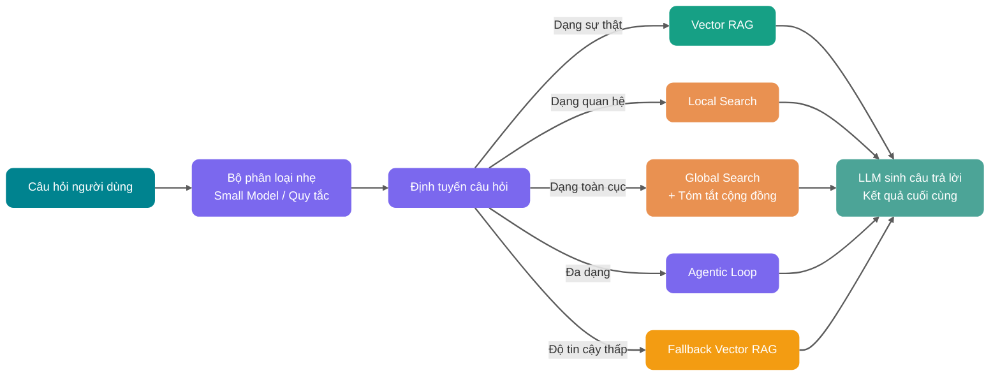

"Những điểm rủi ro nào được các phòng ban này liên tục nhắc đến trong nửa năm qua, và mối liên hệ giữa chúng là gì?" Những câu hỏi dạng này đòi hỏi phải tổng hợp thông tin đa tài liệu về phòng ban, rủi ro, dự án, nhà cung cấp và thời gian. Truy xuất vector dense Top-K có thể tìm ra các đoạn văn bản tương đồng, nhưng sẽ không tự động lưu giữ và liên kết mối quan hệ giữa các đối tượng này với nhau.

GraphRAG bổ sung cấu trúc đồ thị vào luồng truy xuất, sử dụng thực thể, mối quan hệ hoặc bản tóm tắt chủ đề để tổ chức các bằng chứng xuyên suốt nhiều tài liệu. Việc có đáng để đưa GraphRAG vào hay không phụ thuộc vào việc các mẫu thất bại (failed samples) của hệ thống RAG hiện tại có tập trung nhiều vào các mối quan hệ đa bước (multi-hop) và khả năng quy nạp toàn cục (global summarization) hay không.

## RAG là gì?


RAG (Retrieval-Augmented Generation, hay Tạo sinh tăng cường truy xuất) là một khung kiến trúc kết hợp giữa hệ thống truy xuất thông tin và mô hình ngôn ngữ lớn (LLM).

Tư tưởng cốt lõi của nó rất trực quan: trước khi yêu cầu LLM trả lời câu hỏi hoặc sinh văn bản, hệ thống sẽ truy xuất các ngữ cảnh liên quan từ các nguồn tri thức bên ngoài như cơ sở dữ liệu, tập tài liệu, knowledge base của doanh nghiệp, sau đó chuyển giao cả "câu hỏi gốc + ngữ cảnh truy xuất" cho LLM. Nhờ đó, model có thể đưa ra câu trả lời chính xác hơn, cập nhật kịp thời hơn và phù hợp hơn với tri thức chuyên ngành đặc thù.

Đối tượng truy xuất của RAG truyền thống thường là Chunk, tức là từng đoạn văn bản riêng lẻ. Nó rất phù hợp để giải quyết các câu hỏi mà "câu trả lời nằm gọn trong một vài đoạn trích cụ thể", chẳng hạn như hỏi đáp quy chế nội bộ, tra cứu tài liệu API, tìm kiếm sự thật mang tính cục bộ trong kho dữ liệu.

## GraphRAG là gì?


GraphRAG (Graph-based Retrieval-Augmented Generation) là một nhóm giải pháp ứng dụng cấu trúc đồ thị vào việc tăng cường truy xuất. Hệ thống có thể mô hình hóa tường minh các thực thể, mối quan hệ và ngữ cảnh có cấu trúc từ tài liệu; khi truy vấn, hệ thống sẽ lần theo các mối quan hệ đồ thị để thu thập bằng chứng đầy đủ trước khi chuyển giao cho LLM sinh câu trả lời.

GraphRAG là một khái niệm bao hàm rộng, và các triển khai khác nhau sẽ có phương thức đánh index cũng như truy vấn hoàn toàn khác nhau. Các khái niệm như tóm tắt cộng đồng (Community Summary), Global Search, Local Search và DRIFT Search chủ yếu bắt nguồn từ trường phái GraphRAG của Microsoft; trong khi đó, các triển khai xoay quanh Neo4j có thể trực tiếp vận dụng đồ thị thuộc tính (labeled property graph), câu lệnh Cypher, kết hợp tìm kiếm toàn văn (full-text) và truy xuất vector mà không bắt buộc phải sinh tóm tắt cộng đồng trước.

GraphRAG đưa các node, edge, path (đường đi) và tóm tắt cộng đồng vào ngữ cảnh truy xuất; cơ sở dữ liệu đồ thị chỉ là một phương án triển khai để lưu trữ cấu trúc dữ liệu này.

RAG vector truyền thống truy xuất các Chunk—những khối văn bản rời rạc. Còn GraphRAG truy xuất trên một "mạng lưới quan hệ tri thức" gồm các node, edge, path, tóm tắt cộng đồng, rồi kết hợp với bằng chứng văn bản gốc để trả lời câu hỏi.

Lấy một ví dụ so sánh:

- **Vector RAG** giống như việc vào thư viện và tìm vài trang sách có nội dung tương đồng về mặt ngữ nghĩa.
- **GraphRAG** giống như việc đã lập sẵn sơ đồ quan hệ nhân vật, dòng thời gian sự kiện và mục lục chủ đề, sau đó lần theo các manh mối quan hệ này để gom nhặt đầy đủ bằng chứng.

Vector RAG rất giỏi phán đoán "đoạn văn này có giống câu hỏi của tôi hay không", còn GraphRAG lại vượt trội trong việc thấu hiểu "các đối tượng này thực chất được kết nối với nhau như thế nào".

## RAG vector truyền thống có những hạn chế gì?


Một truy vấn vector thông thường sẽ mã hóa tài liệu và câu hỏi vào cùng một không gian vector, lấy ra Top-K Chunk theo độ tương đồng, rồi đưa các Chunk đó cho LLM đọc. Chuỗi xử lý này ngắn gọn, thích hợp cho các câu hỏi mà bằng chứng chỉ tập trung ở một vài đoạn trích, ví dụ:

- "Quy trình hoàn tiền diễn ra như thế nào?"
- "Quy tắc giới hạn rate limit của API này là bao nhiêu?"
- "Cấu hình vector database trong Spring AI như thế nào?"

Các ràng buộc then chốt của loại câu hỏi này thường được viết chung cùng một chỗ với câu trả lời; sau khi recall trúng đoạn văn chính xác, model chỉ cần trích xuất và sắp xếp lại.

Nhưng các câu hỏi đòi hỏi thông tin xuyên suốt nhiều tài liệu thì hoàn toàn khác. Trách nhiệm phụ trách, chuỗi phụ thuộc hệ thống và nhật ký sự cố có thể nằm rải rác ở các Chunk khác nhau, và câu trả lời đòi hỏi phải liên kết các bằng chứng này lại trước tiên.

### 1. Chunk là những hòn đảo thông tin cô lập

Việc cắt đoạn biến tài liệu dài thành các đơn vị có thể truy xuất được, nhưng đồng thời cũng làm xé vụn các sự thật trải dài qua nhiều chương mục. Lấy ví dụ về một hệ thống phần mềm: định nghĩa kiến trúc, người phụ trách, cơ sở dữ liệu phụ thuộc và báo cáo sự cố có thể nằm ở các chương khác nhau; khi nạp vào index, chúng không còn chia sẻ chung một định danh nghiệp vụ rõ ràng nữa.

Độ tương đồng ngữ nghĩa có thể đẩy các đoạn văn liên quan lên đầu, nhưng không đồng nghĩa với việc các đoạn văn đó đã được nhận diện là bằng chứng thượng nguồn và hạ nguồn của cùng một hệ thống. Sự tương đồng về ngữ nghĩa và tính toàn vẹn của mối quan hệ cấu trúc là hai việc hoàn toàn khác nhau.

### 2. Độ tương đồng vector không giỏi suy luận đa bước (Multi-Hop Reasoning)

Giả sử người dùng hỏi:

> "Người phụ trách Hệ thống A gần đây đã tham gia những buổi họp rút kinh nghiệm (post-mortem) nào liên quan đến luồng thanh toán?"

Để trả lời câu hỏi này, hệ thống phải thực hiện 4 bước nhảy có ràng buộc: từ Hệ thống A tìm ra người phụ trách, sau đó định vị các báo cáo sự cố mà người đó tham gia, cuối cùng lọc theo điều kiện luồng thanh toán.

Cả "Tài liệu mô tả Hệ thống A" lẫn "Báo cáo sự cố thanh toán" đều có thể được recall, nhưng bản thân cơ chế Top-K sẽ không thể chỉ dẫn cho retriever biết rằng nó phải lần theo đường dẫn `Hệ thống -> Người phụ trách -> Báo cáo sự cố -> Luồng thanh toán` để bù đắp bằng chứng đầy đủ.

### 3. Câu hỏi mang tính toàn cục rất khó trả lời bằng các đoạn trích Top-K

Còn một nhóm câu hỏi khác thậm chí còn nan giải hơn:

- "Các khiếu nại của khách hàng đợt này chủ yếu tập trung vào những nhóm vấn đề nào?"
- "Những rủi ro kiến trúc nào xuất hiện lặp đi lặp lại nhiều nhất trong knowledge base của công ty suốt một năm qua?"
- "Chủ đề chiến lược chung mà các báo cáo này cùng hướng tới là gì?"

Những câu hỏi dạng này đòi hỏi phải tổng hợp và quy nạp chủ đề trên toàn bộ kho ngữ liệu, trong khi một lượt truy xuất Top-K đơn lẻ chỉ nhìn thấy một cửa sổ cục bộ hạn hẹp:

- Recall quá ít đoạn trích: Không thể nhìn thấy bức tranh toàn cảnh và các mẫu hình (patterns) chung.
- Recall quá nhiều đoạn trích: Chi phí Token và mức độ nhiễu loạn ngữ cảnh sẽ cùng nhau bùng nổ.

Việc tăng Top-K, bổ sung rerank hay viết lại query có thể cải thiện chất lượng ứng viên, nhưng chúng vẫn lấy việc xếp hạng đoạn trích làm trung tâm. Khi chuỗi quan hệ hoặc các chủ đề toàn cục thiếu đi sự biểu diễn tường minh, vấn đề sẽ không thể tự động biến mất chỉ bằng cách tăng số lượng ứng viên được recall.

## Khác biệt giữa GraphRAG và Vector RAG truyền thống


| Tiêu chí | Vector RAG truyền thống | GraphRAG |
| --- | --- | --- |
| Đối tượng truy xuất | Các Chunk văn bản | Thực thể, quan hệ, đường đi (path), tóm tắt cộng đồng, đoạn trích gốc |
| Năng lực cốt lõi | Khớp độ tương đồng ngữ nghĩa | Suy luận quan hệ, duyệt đồ thị (traversal), quy nạp chủ đề toàn cục |
| Cấu trúc dữ liệu | Chủ yếu là Vector Index | Đồ thị tri thức + Vector Index + Full-text Index |
| Câu hỏi phù hợp | Hỏi đáp sự thật cục bộ, giải thích đoạn văn | Hỏi đáp quan hệ đa bước, quy nạp đa tài liệu, phân tích nghiệp vụ phức tạp |
| Khả năng giải thích | Phụ thuộc vào đoạn trích dẫn | Hiển thị rõ ràng các node, quan hệ, đường đi đồ thị và nguồn gốc |
| Chi phí xây dựng | Vừa phải, tập trung vào chia Chunk và Embedding | Rất cao, đòi hỏi trích xuất, khử trùng lặp thực thể, mô hình hóa, đánh giá |
| Độ trễ truy vấn | Thường rất thấp (vài ms đến vài chục ms) | Phụ thuộc vào độ sâu duyệt đồ thị, tóm tắt cộng đồng và số lượt gọi LLM |
| Chi phí bảo trì | Chỉ cần cập nhật Chunk và vector | Phải bảo trì thực thể, mối quan hệ, cụm cộng đồng và các bản tóm tắt |
| Rủi ro lớn nhất | Bỏ sót đoạn trích bằng chứng | Xây dựng đồ thị sai lệch dẫn đến thông tin sai lệch mang tính hệ thống |

Việc có nên đưa cấu trúc đồ thị vào hay không cần phải được phán đoán từ chính các mẫu thất bại của hệ thống RAG hiện tại. Việc từ khóa không khớp, Chunk bị cắt đứt khác hoàn toàn với việc suy luận thực thể đa bước hay quy nạp toàn cục; hai vấn đề đầu tiên nên được giải quyết trước bằng cách tối ưu parsing, chunking và hybrid search.

Trích xuất thực thể và quan hệ, khử trùng lặp (disambiguation), lưu trữ đồ thị, sinh tóm tắt và cập nhật gia tăng đều đòi hỏi khối lượng công việc kỹ thuật đồ sộ. Khi đánh giá, hãy ghi nhận số Token đánh index, thời gian xử lý, dung lượng lưu trữ, độ trễ truy vấn P95 và chất lượng câu trả lời trên cùng một tập ngữ liệu để so sánh xem truy xuất đồ thị có thực sự giải quyết được bài toán mục tiêu hay không.

Nếu người phỏng vấn hỏi "GraphRAG khác gì so với RAG thông thường", bạn có thể trả lời:

> Vector RAG thông thường lấy Chunk văn bản làm đối tượng truy xuất chính, rất phù hợp cho việc tra cứu sự thật mang tính cục bộ. GraphRAG lưu giữ bổ sung cấu trúc thực thể, mối quan hệ và cấu trúc chủ đề: câu truy vấn có thể mở rộng dọc theo các mối quan hệ từ điểm hit ngữ nghĩa, hoặc đọc các bản tóm tắt cộng đồng để xử lý các câu hỏi mang tính toàn cục. Đổi lại, việc khử trùng lặp thực thể, trích xuất quan hệ, cập nhật gia tăng và kiểm soát phân quyền đều trở thành một phần phức tạp của hệ thống.

Nếu người phỏng vấn hỏi tiếp "Khi nào thì KHÔNG NÊN dùng GraphRAG", bạn có thể bổ sung:

> Nếu câu hỏi chủ yếu là hỏi đáp tài liệu đơn giản, hoặc lượng dữ liệu nhỏ, mối quan hệ không phức tạp, thì Vector RAG kết hợp với Hybrid Search và Rerank sẽ mang lại hiệu quả kinh tế vượt trội hơn nhiều. GraphRAG chỉ nên áp dụng khi các badcase của Vector RAG đã chỉ rõ nguyên nhân bắt nguồn từ suy luận quan hệ đa bước, quy nạp đa tài liệu và các ràng buộc cấu trúc chặt chẽ.

## Các khái niệm cốt lõi của GraphRAG

Để hiểu rõ GraphRAG, trước tiên hãy bóc tách các khái niệm then chốt sau:


### Đồ thị tri thức (Knowledge Graph): Biến tri thức thành mạng lưới quan hệ có thể duyệt qua

Đồ thị tri thức (Knowledge Graph) sử dụng các node (nút) và edge (cạnh) để biểu diễn các thực thể, khái niệm và mối quan hệ giữa chúng.

- **Node (Nút)**: Đại diện cho thực thể hoặc khái niệm, ví dụ người dùng, hệ thống, đơn hàng, sự cố, nhà cung cấp, điều khoản chính sách.
- **Edge (Cạnh)**: Biểu diễn mối quan hệ giữa các thực thể, ví dụ phụ trách, phụ thuộc, ảnh hưởng, trực thuộc, gây ra, tham chiếu.
- **Property (Thuộc tính)**: Thông tin bổ sung gắn trên node hoặc edge, ví dụ mốc thời gian, phiên bản, độ tin cậy, ID tài liệu nguồn.

Lấy một ví dụ:

```text
User Service --PHỤ_THUỘC--> Redis Cluster
Redis Cluster --TỪNG_XẢY_RA--> Sự cố cạn kiệt Connection Pool
Sự cố cạn kiệt Connection Pool --ẢNH_HƯỞNG--> API Đặt hàng
Trương Tam --PHỤ_TRÁCH--> User Service
```

Sau khi các mối quan hệ này được đưa vào đồ thị, hệ thống có thể trả lời câu hỏi:

> "Hệ thống do Trương Tam phụ trách gần đây có những rủi ro nào có thể gây ảnh hưởng đến luồng đặt hàng?"

Vector RAG chỉ nhìn thấy vài đoạn văn rời rạc; còn đồ thị tri thức nhìn thấy sự kết nối rõ ràng giữa đối tượng này với đối tượng khác.

### Thực thể (Entity): Đối tượng nghiệp vụ nhỏ nhất của GraphRAG

**Thực thể (Entity)** là các node hạt nhân bên trong đồ thị.

Trong GraphRAG, thực thể không nhất thiết phải là các khái niệm cứng nhắc theo kiểu NLP truyền thống như "Tên người, Địa danh, Tổ chức". Nó hoàn toàn có thể là:

- Một hệ thống nghiệp vụ, ví dụ "Trung tâm Đơn hàng (Order Center)"
- Một thành phần kỹ thuật, ví dụ "Nhóm Consumer Kafka"
- Một điều khoản quy định, ví dụ "Yêu cầu che giấu dữ liệu nhạy cảm (Data Masking)"
- Một chủ đề rủi ro, ví dụ "Vượt quyền truy cập (Permission Bypass)"
- Một sự kiện dự án, ví dụ "Stress test luồng thanh toán"

Chất lượng trích xuất thực thể quyết định trực tiếp giới hạn trên của GraphRAG. Trích xuất quá thô, đồ thị sẽ nghèo nàn chi tiết; trích xuất quá vụn vặt, đồ thị sẽ tràn ngập các node trùng lặp và rác dữ liệu.

Bước này rất giống với việc xây dựng mô hình miền (Domain Modeling) trong phần mềm. Một số lưu ý kỹ thuật quan trọng:

- **Dùng JSON Schema để ràng buộc chặt chẽ định dạng trích xuất**: Tránh phân tích văn bản tự do, giảm thiểu chi phí xử lý hậu kỳ.
- **Các ví dụ Few-shot phải bao quát cả mẫu đúng, mẫu sai và trường hợp biên (edge cases)**: Hướng dẫn rõ cho LLM biết điều gì *không* được trích xuất.
- **Đặt giới hạn số lượng thực thể tối đa**: Ngăn chặn việc LLM trích xuất quá đà trong các đoạn văn bản dài.
- **Bắt buộc mỗi thực thể phải có trường `source_text_span`**: Dùng để truy vết nguồn gốc và phục vụ việc kiểm tra đối soát thủ công.

### Mối quan hệ (Relationship): Ghi nhận tường minh sự liên kết giữa các đối tượng

Mối quan hệ (Relationship) dùng để ghi lại sự phụ thuộc, ảnh hưởng, bao hàm hay phân công trách nhiệm giữa các thực thể.

Vector RAG có thể cho bạn biết "Trung tâm Đơn hàng" và "Sự cố thanh toán" rất gần nhau về mặt ngữ nghĩa, nhưng nó không thể khẳng định một cách tự nhiên rằng mối quan hệ giữa hai bên là "phụ thuộc", "ảnh hưởng", "gây ra" hay chỉ là "vô tình cùng xuất hiện".

GraphRAG nỗ lực làm tường minh hóa các mối quan hệ này:

```text
Order Center --GỌI--> Payment Gateway
Payment Gateway --PHỤ_THUỘC--> Risk Control Service
Risk Control Service --TỪNG_GÂY_RA--> Quá thời gian giao dịch (Timeout)
```

Khi đã có mối quan hệ rõ ràng, việc truy xuất không còn đơn thuần là "xếp hạng theo độ tương đồng" nữa, mà có thể mở rộng theo các đường đi (path):

- Từ một thực thể tìm ra các node lân cận (neighbors).
- Từ một loại quan hệ tìm ra luồng thượng nguồn và hạ nguồn.
- Từ một sự cố tìm ra toàn bộ phạm vi ảnh hưởng (blast radius).
- Từ một chủ đề tìm ra các cụm cộng đồng liên quan.

Đây chính là chìa khóa then chốt giúp GraphRAG xử lý mượt mà các bài toán suy luận đa bước.

### Phát hiện cộng đồng (Community Detection): Tìm cụm chủ đề từ các nút đồ thị

**Phát hiện cộng đồng (Community Detection)** là một thuật toán đồ thị kinh điển nhằm gom các node có mật độ liên kết chặt chẽ với nhau thành một cụm cộng đồng (community).

Phát hiện cộng đồng xử lý cấu trúc liên kết bên trong đồ thị. Lấy ví dụ trong một kho tài liệu, nếu các node sau đây liên tục xuất hiện mối liên kết qua lại:

```text
Payment Gateway, Risk Control Service, Transaction Timeout, Chiến lược Rate Limiting, Phát hành Canary, Leo thang cảnh báo
```

Thuật toán đồ thị có thể gom nhóm các node này vào chung một cộng đồng; và nhãn "Độ ổn định thanh toán" sẽ là tiêu đề được tạo ra trong giai đoạn sinh tóm tắt cho tập hợp node đó.

Trường phái GraphRAG của Microsoft thường trích xuất thực thể, quan hệ và các tuyên bố (claims) chính trước, sau đó áp dụng các thuật toán như Leiden, Louvain để phân chia cộng đồng theo thứ bậc, và sinh tóm tắt cho từng cộng đồng. Các câu hỏi mang tính toàn cục sẽ sử dụng các bản tóm tắt này để sàng lọc chủ đề, trong khi văn bản gốc vẫn luôn được lưu giữ làm bằng chứng có thể truy vết.

### Truy xuất toàn cục (Global Search) và Truy xuất cục bộ (Local Search)

Trong GraphRAG, bạn sẽ thường xuyên bắt gặp hai thuật ngữ: **Global Search (Truy xuất toàn cục)** và **Local Search (Truy xuất cục bộ)**.

Chúng phục vụ cho các phạm vi truy vấn hoàn toàn khác nhau. **Local Search** mở rộng từ các thực thể đã biết đến các node lân cận và văn bản liên kết, phù hợp cho:

- "Trung tâm Đơn hàng phụ thuộc vào những service nào?"
- "Nhà cung cấp này gây ảnh hưởng đến những dự án nào?"
- "Luồng gọi thượng nguồn và hạ nguồn của sự cố này là gì?"

Điểm khởi đầu của truy xuất là thực thể, và ngữ cảnh trả về sẽ bao gồm các node lân cận, đường đi quan hệ và các đoạn trích văn bản gốc tương ứng.

**Global Search** được dùng cho các câu hỏi mang tính khái quát chủ đề trên toàn bộ kho ngữ liệu:

- "Chủ đề rủi ro nào xuất hiện lặp đi lặp lại trong loạt báo cáo này?"
- "Khiếu nại của khách hàng chủ yếu được gom thành những nhóm nào?"
- "Điểm nghẽn kiến trúc phổ biến nhất trong tài liệu kỹ thuật là gì?"

Loại truy vấn này sẽ tổng hợp các bản tóm tắt cộng đồng hoặc chủ đề trước, sau đó LLM mới quy nạp và xếp hạng; nó không thể thay thế cho việc xác minh tính xác thực trên văn bản gốc.

**DRIFT Search** bổ sung tóm tắt cộng đồng vào bên cạnh các node lân cận của thực thể. Khi câu hỏi có một thực thể rõ ràng nhưng câu trả lời lại cần thêm bối cảnh liên cộng đồng, nó sẽ bổ sung thông tin chủ đề mà Local Search đơn thuần chưa bao quát hết.

| Chế độ tìm kiếm | Kịch bản áp dụng | Cơ chế cốt lõi |
| --- | --- | --- |
| Basic Search | Tra cứu sự thật thông thường | Vector search Top-K tiêu chuẩn |
| Local Search | Hỏi đáp xoay quanh thực thể cụ thể | Mở rộng từ node lân cận và khái niệm liên kết |
| DRIFT Search | Trọng tâm thực thể + Liên kết đa cộng đồng | Mở rộng cục bộ + Ngữ cảnh tóm tắt cộng đồng |
| Global Search | Quy nạp chủ đề toàn cục | Map-Reduce trên các bản tóm tắt cộng đồng |

## Quy trình xây dựng và truy vấn của GraphRAG

### Giai đoạn xây dựng: Từ tài liệu chuyển hóa thành đồ thị

Chuỗi xử lý biến tài liệu thành đồ thị diễn ra như sau:


Quy trình đánh index sẽ đi qua các bước tuần tự:

| Bước | Nhiệm vụ thực hiện | Rủi ro then chốt |
| --- | --- | --- |
| Phân tích tài liệu | Trích xuất văn bản từ PDF, Web, Markdown, Database | Lỗi OCR, bảng biểu lệch cột, lẫn lộn phiên bản |
| Cắt đoạn văn bản | Chia tài liệu dài thành TextUnit hoặc Chunk | Cắt quá vụn mất quan hệ, cắt quá lớn tốn chi phí trích xuất |
| Trích xuất thực thể | Nhận diện hệ thống, con người, tổ chức, khái niệm, sự kiện | Trùng tên thực thể, từ viết tắt, thực thể rác |
| Trích xuất quan hệ | Nhận diện quan hệ phụ thuộc, bao hàm, ảnh hưởng, nhân quả | Sai hướng quan hệ, quan hệ chung chung, độ tin cậy thấp |
| Chuẩn hóa đồ thị | Gộp các thực thể trùng lặp, bổ sung thuộc tính và nguồn | Khử trùng lặp thực thể tốn kém, cần quy tắc và bộ test |
| Phát hiện cộng đồng | Gom cụm các nhóm chủ đề có mật độ liên kết dày đặc | Đồ thị quá thưa hoặc quá bẩn làm giảm chất lượng cộng đồng |
| Sinh tóm tắt | Tạo tóm tắt cho cộng đồng, thực thể và quan hệ | LLM tóm tắt có thể làm mất ràng buộc hoặc sinh ảo giác |
| Lưu trữ index | Ghi vào Graph Database, Vector Database, Full-text Index | Cập nhật gia tăng và lọc phân quyền vô cùng phức tạp |

So với việc chỉ duy trì Chunk và Vector, truy xuất đồ thị đòi hỏi phải xử lý thêm việc chuẩn hóa thực thể, nguồn gốc quan hệ, cập nhật cộng đồng và tóm tắt, khiến phạm vi vận hành phình to đáng kể.

### Giai đoạn truy vấn: Phân loại câu hỏi trước tiên

Bước quan trọng nhất trong giai đoạn truy vấn của GraphRAG là **định tuyến truy vấn (Query Routing)**.

Tùy vào câu hỏi người dùng đưa ra, phương thức truy xuất sẽ hoàn toàn khác biệt:

| Dạng câu hỏi | Phương thức truy xuất phù hợp hơn | Ví dụ |
| --- | --- | --- |
| Sự thật cục bộ | Vector Search hoặc Graph Search cục bộ | "Thời gian timeout của API này là bao nhiêu?" |
| Quan hệ thực thể | Graph Search cục bộ (Local Search) | "Trung tâm Đơn hàng phụ thuộc vào những service nào?" |
| Suy luận đa bước | Duyệt đồ thị + Bổ sung bằng chứng vector | "Người phụ trách X từng tham gia sự cố nào ảnh hưởng luồng thanh toán?" |
| Quy nạp toàn cục | Tóm tắt cộng đồng + Global Search | "Chủ đề rủi ro chính trong loạt báo cáo này là gì?" |
| Lọc chính xác | Truy vấn đồ thị hoặc truy vấn có cấu trúc | "Trong Q4 2025, những dự án nào phụ thuộc vào Nhà cung cấp A?" |

Mối quan hệ giữa dạng câu hỏi và chế độ truy xuất được minh họa như sau:


Một hệ thống trưởng thành tuyệt đối không ném mọi câu hỏi vào GraphRAG. Rất nhiều câu hỏi đơn giản, sử dụng vector search sẽ rẻ hơn, nhanh hơn và ổn định hơn rất nhiều.

## GraphRAG phù hợp với kịch bản nào? Không phù hợp với kịch bản nào?

Việc có phù hợp với GraphRAG hay không phụ thuộc vào việc bằng chứng để trả lời câu hỏi có bắt buộc phải đi qua quan hệ thực thể, đường đi đồ thị hay chủ đề đa tài liệu mới lắp ghép hoàn chỉnh được hay không. Nó sẽ mở rộng phạm vi quản trị dữ liệu từ Chunk và Vector sang Thực thể, Quan hệ, Bản tóm tắt và Vòng đời phiên bản của chúng.

Những dạng bài toán sau đây rất thích hợp để cân nhắc giải pháp đồ thị:

- **Hỏi đáp phức tạp trong Enterprise Knowledge Base**: Câu hỏi đòi hỏi xâu chuỗi thông tin xuyên phòng ban, xuyên quy chế, xuyên dự án, ví dụ: "Quy trình này liên quan đến những phòng ban nào? Mỗi phòng ban chịu trách nhiệm gì?" hay "Quy định này mâu thuẫn với những quy chế lịch sử nào?".
- **Phân tích kiến trúc IT và phạm vi ảnh hưởng sự cố**: Service, API, Database, Message Queue, người phụ trách, cảnh báo và sự cố vốn dĩ có quan hệ phụ thuộc tự nhiên, ví dụ: "Cụm Redis gặp sự cố sẽ ảnh hưởng đến những API lõi nào?" hay "Những hệ thống nào đang cùng phụ thuộc vào một component có rủi ro cao?".
- **Tài chính, kiểm soát rủi ro, tuân thủ pháp lý, chuỗi cung ứng**: Các lĩnh vực này quan tâm sâu sắc đến mối liên kết giữa các đối tượng hơn là độ tương đồng văn bản, ví dụ mối quan hệ giữa khách hàng và tài khoản, doanh nghiệp và người đại diện pháp luật, nhà cung cấp và dự án, điều khoản hợp đồng và quy chuẩn quản lý.
- **Quy nạp chủ đề đa tài liệu**: Khi cần phân tích biên bản phỏng vấn, báo cáo nghiên cứu, ticket hỗ trợ, bài học sự cố để tìm ra các mô hình tổng quát, tóm tắt cộng đồng có thể gom ngữ liệu thành các nhóm chủ đề trước rồi mới giao cho LLM quy nạp toàn cục.

Trong các điều kiện dưới đây, việc tập trung tối ưu Vector Search hoặc Hybrid Search trước sẽ mang lại chi phí thấp hơn nhiều:

- **Dữ liệu ít, câu hỏi đơn giản**: Nếu knowledge base chỉ có vài chục tài liệu, câu hỏi chủ yếu xoay quanh việc "quy tắc này là gì", Vector RAG kết hợp Hybrid Search và Rerank sẽ mang lại ROI cao hơn nhiều.
- **Chất lượng tài liệu quá kém**: Nếu tài liệu gốc thiếu chủ ngữ, phiên bản lộn xộn, thuật ngữ không đồng nhất, bảng biểu parse sai lệch, đồ thị trích xuất ra sẽ cực kỳ bẩn. Sai lầm của Vector RAG thường chỉ là "tìm nhầm vài đoạn văn", còn sai lầm của GraphRAG có thể là "toàn bộ mạng lưới quan hệ bị đảo ngược hướng".
- **Yêu cầu thời gian thực cực cao**: Trích xuất thực thể, quan hệ, phát hiện cộng đồng và sinh tóm tắt đều làm tăng vọt chi phí cập nhật. Nếu dữ liệu bắt buộc phải tìm kiếm được trong vòng vài giây sau khi tạo, cần hết sức thận trọng khi đánh giá chi phí cập nhật đồ thị gia tăng.
- **Team thiếu năng lực mô hình hóa đồ thị và đánh giá**: GraphRAG đòi hỏi phải liên tục trả lời các câu hỏi: "Thực thể nào đáng mô hình hóa, thiết kế quan hệ ra sao, khử trùng lặp thế nào, đánh giá lỗi đồ thị bằng cách nào, đặt bộ lọc quyền hạn ở đâu". Nếu không có ai chịu trách nhiệm giải quyết những câu hỏi này, GraphRAG rất dễ biến thành một chiếc hộp đen đắt đỏ và mất kiểm soát.

Thứ tự phán đoán rất rõ ràng: nếu văn bản liên quan chưa vào được candidate set, hãy kiểm tra parsing, chunking và retrieval trước; nếu văn bản ứng viên đã đầy đủ nhưng hệ thống không thể liên kết chúng theo quan hệ nghiệp vụ, lúc đó mới tiến hành kiểm chứng GraphRAG.

## Neo4j GraphRAG giải quyết tốt bài toán gì?

Trường phái Neo4j đặt Graph Database vào vị trí trung tâm của chuỗi truy vấn. Vector search hoặc Full-text search định vị các node thực thể hoặc tài liệu trước, sau đó các câu lệnh Cypher sẽ duyệt qua các mối quan hệ được kiểm soát để tra cứu các node lân cận, đường đi và thuộc tính, cuối cùng đoạn trích gốc và đường đi đồ thị mới được giao cho LLM.

Một lượt truy vấn có thể bóc tách thành: Xác định node xuất phát, thực thi duyệt quan hệ, lắp ráp thuộc tính node và bằng chứng văn bản gốc, sinh câu trả lời. Schema, hướng quan hệ và ràng buộc truy vấn trong đồ thị do ứng dụng trực tiếp kiểm soát, chứ không phải là chi tiết để model tự ý suy đoán sau khi sinh câu trả lời.

Thư viện Python `neo4j-graphrag` bao quát trọn vẹn việc nạp đồ thị, đánh vector index và cung cấp đa dạng các loại retriever. Chuỗi truy xuất có thể linh hoạt kết hợp Full-text, Vector và truy vấn Cypher tùy theo câu hỏi:

| Chế độ truy xuất | Cách làm | Dạng câu hỏi phù hợp |
| --- | --- | --- |
| **VectorRetriever** | Tìm kiếm độ tương đồng trên Neo4j Vector Index, trả về node khớp và điểm số | Tìm kiếm ngữ nghĩa thông thường, tìm thực thể ứng viên |
| **VectorCypherRetriever** | Dùng vector search định vị node xuất phát, sau đó chạy Cypher mở rộng ngữ cảnh | "Sau khi tìm thấy tài liệu tương tự, kéo theo toàn bộ thực thể, đường đi, thuộc tính liên quan về" |
| **HybridRetriever / HybridCypherRetriever** | Kết hợp Vector Index và Full-text Index, khi cần dùng Cypher bổ sung ngữ cảnh đồ thị | Knowledge base doanh nghiệp nơi cả từ khóa lẫn ngữ nghĩa đều quan trọng |
| **Text2Cypher** | LLM dựa vào Graph Schema để sinh câu lệnh Cypher, kết quả trả về giao cho LLM tổ chức câu trả lời | Lọc cấu trúc chính xác, truy vấn đa điều kiện, hỏi đáp dạng báo cáo số liệu |
| **ToolsRetriever** | Đóng gói nhiều retriever thành các tool để LLM tự chọn theo ý định câu hỏi | Định tuyến câu hỏi phức tạp, kết hợp đa retriever |
| **Vector DB bên ngoài + Neo4j** | Vector lưu ở Pinecone/Weaviate/Qdrant, sau đó ánh xạ ngược về node trong Neo4j | Tận dụng hạ tầng vector sẵn có, không muốn chuyển toàn bộ vector sang Neo4j |

Cần phân biệt rạch ròi ranh giới giữa `VectorCypherRetriever` và `Text2Cypher`. `VectorCypherRetriever` dùng kết quả vector để chốt node xuất phát, sau đó thực thi câu lệnh Cypher được ràng buộc chặt chẽ từ trước; khi hit trúng "Payment Gateway", nó có thể lần theo các edge `[:DEPENDS_ON]`, `[:AFFECTS]`, `[:OWNER]` để đọc thông tin thượng nguồn, hạ nguồn, phạm vi ảnh hưởng và người phụ trách với đường đi được bảo toàn nguyên vẹn.

`Text2Cypher` thích hợp cho các bài toán lọc cấu trúc kiểu: "Trong Q4 2025, những dự án ưu tiên cao nào phụ thuộc vào Nhà cung cấp A?". Nó bắt buộc phải bị giới hạn trong whitelist schema, kiểm tra cú pháp, tài khoản database quyền read-only, giới hạn số bản ghi trả về và timeout nghiêm ngặt. Đối với các truy vấn rủi ro cao, nên ưu tiên dùng template Cypher cố định hoặc tầng semantic layer, tuyệt đối không thả lỏng cho LLM quyền thực thi Cypher tùy tiện.

Trong các lĩnh vực như kiểm soát rủi ro tài chính, chuỗi cung ứng, quản trị tài sản IT, phân quyền hệ thống và phân tích sự cố, mối quan hệ giữa các đối tượng vốn dĩ đã vô cùng quan trọng. Lợi thế cốt lõi của Neo4j GraphRAG là: **Cho phép LLM kết nối trực tiếp vào các mối quan hệ nghiệp vụ đã được xác thực, thay vì mỗi lần đều bắt model phải đi đoán mò quan hệ từ văn bản.**

## Các hệ sinh thái triển khai GraphRAG khác

Ngoài Neo4j, còn có một số hướng tiếp cận phổ biến đáng lưu ý:

| Hướng triển khai | Tư tưởng cốt lõi | Phù hợp khi nào |
| --- | --- | --- |
| **LangChain + Neo4j** | Dùng `Neo4jGraph` kết nối Neo4j, dùng `GraphCypherQAChain` chuyển ngôn ngữ tự nhiên thành Cypher | Đang sử dụng LangChain / LangGraph, muốn nhanh chóng tích hợp Graph DB vào Agent hoặc pipeline RAG |
| **LlamaIndex PropertyGraphIndex** | Dùng `kg_extractors` trích xuất thực thể và quan hệ từ Chunk để dựng Property Graph Index có thể query | Quy trình nạp tài liệu, đánh index và query vốn dĩ đã xây dựng trên hệ sinh thái LlamaIndex |
| **FalkorDB GraphRAG SDK** | Triển khai GraphRAG trên graph database hỗ trợ OpenCypher, Full-text index, Vector similarity và Range index | Muốn thử nghiệm Graph DB ngoài Neo4j, hoặc đặc biệt quan tâm đến độ trễ thấp và truy vấn đồ thị multi-tenant |
| **Đồ thị tự phát triển nhẹ nhàng + Vector DB** | Dùng bảng quan hệ nghiệp vụ lưu các thực thể cốt lõi, Vector DB phụ trách recall văn bản, dùng bảng quan hệ bù ngữ cảnh | Giai đoạn đầu muốn kiểm chứng xem GraphRAG có giá trị không mà chưa muốn kéo cả cụm Graph DB phức tạp vào |

Ba hướng tiếp cận này có sự đánh đổi khác nhau: Graph Database chuyên sâu tối ưu hóa việc duyệt đường đi online; các framework như LangChain, LlamaIndex giúp tái sử dụng tối đa các component ingestion và agent sẵn có; còn giải pháp tự phát triển nhẹ nhàng giúp kiểm soát phạm vi thử nghiệm ban đầu bằng cách thu hẹp các loại thực thể và quan hệ.

Nếu doanh nghiệp đã có sẵn đồ thị nghiệp vụ ổn định và truy vấn đòi hỏi các ràng buộc quan hệ tường minh, hãy đánh giá Neo4j. Nếu hệ thống đã chuẩn hóa trên LangChain hoặc LlamaIndex, hãy ưu tiên kiểm chứng các component đồ thị của framework đó. Còn nếu mục tiêu chỉ là xác thực xem việc mở rộng quan hệ có giải quyết được một tập badcase hay không, việc dùng một vài bảng quan hệ (edge tables) để mô hình hóa sẽ giúp bạn quan sát hiệu quả nhanh nhất.

## Những thách thức kỹ thuật trong GraphRAG

Graph Database chỉ đảm nhận việc lưu trữ và duyệt đồ thị. Khâu trích xuất văn bản trước khi nạp vào đồ thị, khử trùng lặp thực thể, quản lý phiên bản, lọc phân quyền và bảo trì gia tăng mới là những yếu tố quyết định liệu mối quan hệ đó có thể dùng cho truy xuất được hay không.

Nếu như Vector RAG chủ yếu bảo trì tài liệu, Chunk và index; thì truy xuất đồ thị còn phải đảm bảo thực thể, mối quan hệ, nguồn gốc và quyền hạn luôn duy trì được tính nhất quán. Các sự cố thường trực nhất đều tập trung ở khâu đồng bộ các đối tượng này.

### 1. Thực thể rất dễ bị trích xuất trùng lặp, sai lệch hoặc quá vụn vặt

Cùng một thực thể có thể xuất hiện dưới nhiều cái tên khác nhau:

```text
Order Center, Order Service, order-service, OMS
```

Chúng có thực sự là cùng một thực thể hay không? Khi nào thì gộp, khi nào thì tách?

Điều này tuyệt đối không thể phó mặc cho LLM tự đoán. Trong production, bạn bắt buộc phải trang bị:

- Từ điển thuật ngữ (Term dictionary)
- Bảng ánh xạ bí danh (Alias table)
- Khớp nối theo quy tắc xác định
- Quy trình đối soát thủ công (Human review)
- Ngưỡng điểm tin cậy
- Bộ dữ liệu đánh giá kiểm thử

Nếu khâu khử trùng lặp thực thể làm không tốt, đồ thị sẽ biến thành một đống node trùng lặp rác rưởi, và các đường đi truy xuất chắc chắn sẽ bị đứt gãy.

### 2. Chiều quan hệ bị ngược sẽ khiến câu trả lời sai lệch mang tính hệ thống

Mối quan hệ thậm chí còn dễ bị lỗi hơn cả thực thể.

"Hệ thống A phụ thuộc vào Hệ thống B" và "Hệ thống B phụ thuộc vào Hệ thống A" chỉ khác nhau một chiều mũi tên, nhưng ý nghĩa kỹ thuật thì hoàn toàn trái ngược. Các quan hệ nhân quả, ảnh hưởng, bao hàm rất thường xuyên bị LLM trích xuất ngược chiều.

Trong môi trường production, khuyến nghị gắn các trường thuộc tính này cho từng mối quan hệ:

| Trường | Tác dụng |
| --- | --- |
| `source_doc_id` | Truy vết tài liệu nguồn |
| `source_span` | Truy vết chính xác vị trí đoạn văn gốc |
| `confidence` | Ghi nhận điểm tin cậy trích xuất |
| `relation_type` | Kiểm soát loại quan hệ theo danh mục chuẩn |
| `updated_at` | Hỗ trợ cập nhật gia tăng |
| `extraction_model_version` | Hỗ trợ so sánh diff và A/B testing khi nâng cấp LLM trích xuất |

Một đồ thị thiếu khả năng truy vết nguồn gốc bằng chứng tuyệt đối không nên đưa vào các hệ thống hỏi đáp có mức độ rủi ro cao.

### 3. Tóm tắt cộng đồng không hề miễn phí

Tóm tắt cộng đồng phục vụ cho việc quy nạp thông tin trên toàn bộ kho ngữ liệu, và mỗi lần sinh hay cập nhật đều đòi hỏi thêm các lượt gọi LLM tốn kém:

- Trích xuất thực thể và quan hệ.
- Sinh mô tả cho từng thực thể.
- Sinh tóm tắt cho từng cộng đồng.
- Làm mới các bản tóm tắt liên quan mỗi khi có phiên bản tài liệu mới cập nhật.

Khi quy mô ngữ liệu phình to, việc trích xuất và làm mới tóm tắt sẽ nhân đôi nhân ba chi phí đánh index. Hãy luôn dùng một tập câu hỏi toàn cục nhỏ để kiểm chứng chất lượng câu trả lời trước khi quyết định đưa vào mô hình tóm tắt cộng đồng đa tầng và Global Search.

### 4. Cập nhật một tài liệu có thể làm xáo trộn cả một vùng đồ thị

Trong Vector RAG thông thường, cập nhật một tài liệu chỉ đơn giản là xóa Chunk cũ và ghi Chunk cùng vector mới vào.

Nhưng trong GraphRAG, việc cập nhật cùng một tài liệu đó có thể kéo theo hàng loạt đối tượng cần tính toán lại hoặc bị vô hiệu hóa:

- Các node thực thể
- Các edge quan hệ
- Ranh giới phân chia cộng đồng
- Tóm tắt của cộng đồng
- Mô tả của thực thể
- Vector index
- Index phân quyền

Rebuild toàn bộ sẽ đẩy chi phí lên trời, còn cập nhật gia tăng lại đòi hỏi phải ghi nhận nguồn gốc và phạm vi phụ thuộc cực kỳ phức tạp. Hệ thống lúc này không chỉ bảo trì một vector index, mà đang quản lý cả một mạng lưới chằng chịt các thực thể, mối quan hệ và bản tóm tắt luôn biến động theo tài liệu.

### 5. Lọc quyền hạn không thể chỉ dừng lại ở cấp độ tài liệu

Knowledge base doanh nghiệp không bao giờ né tránh được bài toán phân quyền.

Trong Vector RAG, cách làm thông thường là lọc Metadata trước hoặc trong khi search. Nhưng trong GraphRAG, bạn còn phải đối mặt với các tình huống:

- Người dùng được xem Node A, nhưng có được xem các Node lân cận của nó không?
- Người dùng được xem một cạnh, nhưng có được xem thực thể ở đầu bên kia của cạnh đó không?
- Bản tóm tắt cộng đồng có bị trộn lẫn thông tin từ các tài liệu mà người dùng không có quyền truy cập không?
- Tóm tắt toàn cục có vô tình làm lộ các chủ đề dự án mật không?

Khi nhiều nguồn tài liệu cùng tham gia sinh ra một bản tóm tắt cộng đồng, nội dung của tài liệu không có quyền truy cập có thể đã bị ghi vĩnh viễn vào trong bản tóm tắt đó. Ở giai đoạn truy vấn, việc lọc theo document ID đơn thuần không thể bóc tách phần thông tin này ra được. Do đó, ranh giới quyền hạn bắt buộc phải được xử lý ngay từ khâu sinh tóm tắt:

- Chia phân vùng quyền hạn ổn định để sinh tóm tắt riêng biệt; khi query chỉ dùng các phân vùng mà người dùng có toàn quyền truy cập; nếu tổ hợp quyền hạn biến động liên tục thì tuyệt đối không sinh trước các bản tóm tắt đa quyền hạn.
- Bản tóm tắt phải lưu giữ đầy đủ ID của các tài liệu nguồn để phục vụ kiểm toán và vô hiệu hóa khi tài liệu thay đổi. ID tài liệu nguồn không thể "lọc bỏ" các nội dung nhạy cảm đã hòa tan vào văn bản tóm tắt, vì vậy không được dùng phép giao quyền hạn (permission intersection) làm điều kiện cho phép truy cập.
- Đối với các ngữ liệu có tính bảo mật cao hoặc phân quyền thay đổi liên tục, hãy điều hướng qua chế độ Local Search đã được xác thực, nơi các bằng chứng thô phải vượt qua kiểm tra quyền hạn trước khi được đưa vào context của model.

## Bạn sẽ triển khai GraphRAG vào dự án thực tế như thế nào?

Phiên bản đầu tiên nên bắt đầu từ một baseline Vector RAG vững chắc và một lượng nhỏ các mối quan hệ có giá trị cao, chỉ mở rộng quy mô đồ thị sau khi đã chứng minh được hiệu quả rõ rệt.

### Giai đoạn 1: Xây dựng vững chắc baseline Vector RAG

Trước hết hãy làm thật tốt các năng lực nền tảng:

- Phân tích tài liệu (parsing) ổn định.
- Chiến lược Chunk đo lường và đánh giá được.
- Hybrid Search kết hợp Vector Search + BM25.
- Cơ chế Rerank có thể cắm rút linh hoạt.
- Trích dẫn nguồn gốc có thể truy vết chính xác.
- Bộ lọc quyền hạn hoạt động tin cậy.

Nếu những điều cơ bản này còn chưa làm xong, việc vội vã đưa GraphRAG vào chỉ làm cho vấn đề trở nên rối rắm và khó kiểm soát hơn.

### Giai đoạn 2: Thu thập các ca thất bại liên quan đến quan hệ

Việc có cần đưa đồ thị vào hay không phải bắt đầu từ việc phân loại các mẫu thất bại trên production:

| Dạng Badcase | Có phù hợp với GraphRAG không |
| --- | --- |
| Đơn thuần không recall được từ khóa | Tối ưu BM25 và Query Rewrite trước |
| Chia Chunk không hợp lý làm đứt ngữ cảnh | Tối ưu lại chiến lược Chunking trước |
| Đòi hỏi suy luận quan hệ xuyên thực thể | Rất thích hợp để đưa cấu trúc đồ thị vào |
| Đòi hỏi quy nạp chủ đề toàn cục | Rất thích hợp để đưa tóm tắt cộng đồng vào |
| Đòi hỏi lọc chính xác và ràng buộc quyền hạn | Thích hợp kết hợp với truy vấn có cấu trúc |

Chỉ khi bài toán suy luận quan hệ và quy nạp toàn cục xuất hiện liên tục trong các mẫu thất bại, khoản đầu tư vào đồ thị mới có mục tiêu kiểm chứng rõ ràng; nếu không, hãy ưu tiên xử lý các vấn đề nền tảng ở bảng trên trước.

### Giai đoạn 3: Bắt đầu từ đồ thị nhẹ nhàng (Lightweight Graph)

Phiên bản đầu tiên không nhất thiết phải làm một đồ thị tri thức đồ sộ, toàn diện.

Hãy bắt đầu từ một phiên bản tinh gọn:

- Chỉ trích xuất các thực thể cốt lõi, ví dụ Hệ thống, API, Người phụ trách, Sự cố, Điều khoản quy chế.
- Chỉ giữ lại một lượng nhỏ các mối quan hệ giá trị cao, ví dụ Phụ thuộc, Phụ trách, Ảnh hưởng, Trực thuộc, Tham chiếu.
- Đồ thị chỉ dùng để mở rộng ngữ cảnh truy xuất, không dùng trực tiếp làm nguồn chân lý phán đoán sự thật cuối cùng.
- Mỗi mối quan hệ đều bắt buộc phải lưu giữ bằng chứng văn bản gốc.

Cách tiếp cận này giúp bạn kiểm chứng xem GraphRAG có thực sự cải thiện các chỉ số nghiệp vụ hay không với chi phí kỹ thuật thấp nhất.

### Giai đoạn 4: Bổ sung phát hiện cộng đồng và truy xuất toàn cục

Khi quy mô ngữ liệu mở rộng và các câu hỏi mang tính toàn cục tăng lên, lúc này mới cân nhắc đến phát hiện cộng đồng và tóm tắt cộng đồng.

Giai đoạn này cần đặc biệt chú trọng đánh giá:

- Việc phân chia cộng đồng có phù hợp với trực giác nghiệp vụ không.
- Bản tóm tắt cộng đồng có bỏ sót các ràng buộc quan trọng không.
- Câu trả lời toàn cục có trích dẫn nguồn ổn định và chính xác không.
- Người dùng ở các cấp quyền hạn khác nhau có nhìn thấy thông tin tóm tắt an toàn không.

Nếu công cụ đánh giá chưa theo kịp, tuyệt đối không mở tính năng Global Search cho các kịch bản nghiệp vụ có rủi ro cao.

### Giai đoạn 5: Tích hợp bộ định tuyến Hybrid RAG theo nhu cầu

Nếu cùng một giao diện hỏi đáp phải xử lý đồng thời cả câu hỏi sự thật, câu hỏi quan hệ và câu hỏi quy nạp toàn cục, bạn có thể định tuyến động dựa trên phân loại câu hỏi:



Các điểm thiết kế mấu chốt: bộ phân loại ở cổng vào phải có khả năng giải thích được, chiến lược hạ cấp (fallback) phải rõ ràng, và nhật ký định tuyến phải truy vết được đầy đủ.

## Đánh giá GraphRAG trong thực tế như thế nào?

Quy trình đánh giá phải tách biệt giữa việc "đồ thị có tìm thấy đúng bằng chứng cấu trúc hay không" và "model có trả lời trung thực dựa trên bằng chứng đó hay không", từ đó quan sát xem những chuyển biến này tác động thế nào đến kết quả nghiệp vụ:

### Chỉ số tầng truy xuất (Retrieval Layer)

- **Tỷ lệ Recall Thực thể / Tỷ lệ Recall Quan hệ**: Kết quả truy xuất có chứa đầy đủ các thực thể và quan hệ cần thiết để trả lời câu hỏi không.
- **Tính nhất quán của cộng đồng (Community Consistency)**: Lấy mẫu đối soát xem việc phân chia cụm cộng đồng có phản ánh đúng các chủ đề nghiệp vụ thực tế không.

### Chỉ số tầng sinh câu trả lời (Generation Layer)

- **Faithfulness (Độ trung thực)**: Câu trả lời sinh ra có được chống lưng vững chắc bởi ngữ cảnh đồ thị và văn bản hay không; có thể tính toán thông qua RAGAS.
- **Answer Relevance (Độ liên quan câu trả lời)**, **Context Precision (Độ chính xác ngữ cảnh)**: Lần lượt đo lường xem câu trả lời có giải quyết đúng trọng tâm câu hỏi không, và ngữ cảnh đưa vào model có bị thừa thãi nhiễu loạn không.

### Chỉ số tầng nghiệp vụ (Business Layer)

- **Tỷ lệ người dùng chấp nhận câu trả lời, tỷ lệ chuyển tiếp nhân viên hỗ trợ, tỷ lệ click vào nguồn trích dẫn**: Dùng để phán đoán hiệu quả ứng dụng thực tế.
- **Bộ kiểm thử hồi quy (Regression Test Set)**: Bổ sung các câu hỏi thất bại và các câu hỏi rủi ro cao từ production; số lượng bổ sung tùy thuộc vào traffic, tần suất thay đổi tài liệu và năng lực gắn nhãn thủ công của đội ngũ.

## So sánh với các hướng tiếp cận nâng cao RAG khác

GraphRAG không phải là con đường duy nhất để nâng cấp RAG. Việc hiểu rõ tọa độ so sánh ngang sẽ giúp bạn đưa ra lựa chọn công nghệ chuẩn xác:

| Phương án | Vấn đề giải quyết được | Vấn đề chưa giải quyết được |
| --- | --- | --- |
| **Đa vector (ColBERT / Late Interaction)** | Khớp mịn ở cấp độ Token bên trong Chunk | Bài toán quan hệ xuyên văn bản |
| **HyDE / Query Rewriting** | Khác biệt về hình thái diễn đạt giữa query và doc | Suy luận cấu trúc đa bước |
| **Self-RAG / Corrective RAG** | Độ tin cậy và phát hiện ảo giác của câu trả lời | Cấu trúc topo của khâu truy xuất |
| **GraphRAG** | Truy xuất quan hệ và quy nạp chủ đề toàn cục | Chi phí trích xuất, khử trùng lặp và bảo trì đồ thị |

GraphRAG là một con đường chuyên sâu giải quyết bài toán truy xuất quan hệ và quy nạp toàn cục, nhưng không phải là lựa chọn duy nhất. RAPTOR, truy xuất lặp đa bước (Iterative Multi-hop Retrieval), Agentic Retrieval hay các câu lệnh SQL quan hệ hướng nghiệp vụ cũng có thể bao quát được một phần trong số đó; hãy luôn dùng cùng một bộ đánh giá để so sánh lợi ích và chi phí thực tế.

## Checklist lựa chọn công nghệ

Hãy phân định rõ loại hình thất bại: nếu hoàn toàn không recall được văn bản, hãy tối ưu hóa khâu parsing, BM25, vector search và rerank trước; nếu đã recall được văn bản liên quan nhưng bài toán phụ thuộc vào quan hệ thực thể tường minh, chuỗi bằng chứng đa bước hoặc chủ đề xuyên suốt nhiều tài liệu, lúc đó mới đánh giá cấu trúc đồ thị. Trong giai đoạn thử nghiệm, hãy giới hạn thực thể và quan hệ trong một số lượng nhỏ các nhóm giá trị cao, đồng thời lưu giữ đầy đủ vị trí văn bản gốc, phiên bản và thông tin quyền hạn cho từng mối quan hệ.

## Tổng kết

GraphRAG mở rộng đối tượng truy xuất từ các Chunk văn bản phẳng sang thực thể, mối quan hệ, đường đi và các bản tóm tắt cộng đồng. Những bài toán như suy luận đa bước, phân tích phạm vi ảnh hưởng và quy nạp chủ đề xuyên tài liệu chỉ có thể biểu đạt cấu trúc bằng chứng cần thiết thông qua đồ thị.

Cái giá phải trả cũng vô cùng rõ ràng: chất lượng trích xuất, khử trùng lặp thực thể, hướng mũi tên quan hệ, đồng bộ phiên bản và ranh giới phân quyền đều đòi hỏi sự quản trị dữ liệu độc lập và khắt khe. Khi doanh nghiệp đã có sẵn đồ thị nghiệp vụ, truy vấn đồ thị của Neo4j có thể trực tiếp tham gia vào khâu tìm kiếm; còn các hệ thống vận hành trên LangChain hay LlamaIndex có thể kiểm chứng trước các component đồ thị tích hợp sẵn. Lựa chọn công nghệ cuối cùng vẫn phụ thuộc vào tech stack hiện tại, quy mô ontology đồ thị và năng lực bảo trì vận hành của đội ngũ.

Hãy luôn quy kết nguyên nhân từ các mẫu thất bại: khi văn bản gốc chưa được recall, hãy tập trung tối ưu parsing, chunking và retrieval; chỉ khi văn bản gốc đã có mặt nhưng hệ thống bất lực trong việc thiết lập các mối quan hệ nghiệp vụ cần thiết, đó mới là lúc bạn nên đầu tư vào GraphRAG.

## Tài liệu tham khảo

- [Neo4j: What Is GraphRAG?](https://neo4j.com/blog/genai/what-is-graphrag/)
- [Neo4j GraphRAG Python Package](https://neo4j.com/docs/neo4j-graphrag-python/current/)
- [Neo4j GraphRAG RAG User Guide](https://neo4j.com/docs/neo4j-graphrag-python/current/user_guide_rag.html)
- [LangChain Neo4j Integration](https://docs.langchain.com/oss/python/integrations/graphs/neo4j_cypher)
- [LlamaIndex PropertyGraphIndex](https://developers.llamaindex.ai/python/framework/module_guides/indexing/lpg_index_guide/)
- [FalkorDB Docs](https://docs.falkordb.com/)
- [RAPTOR: Recursive Abstractive Processing for Tree-Organized Retrieval](https://arxiv.org/abs/2401.18059)
- [GraphRAG: Thực tiễn truy xuất tri thức doanh nghiệp từ RAG đến GraphRAG](https://juejin.cn/post/7618261670406438964)
- [RAGAS Evaluation Framework](https://docs.ragas.io/)
