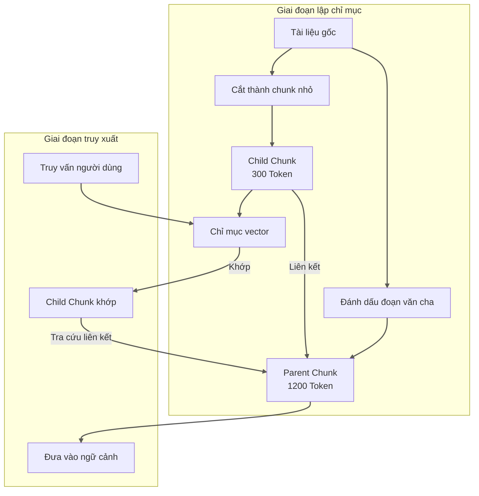
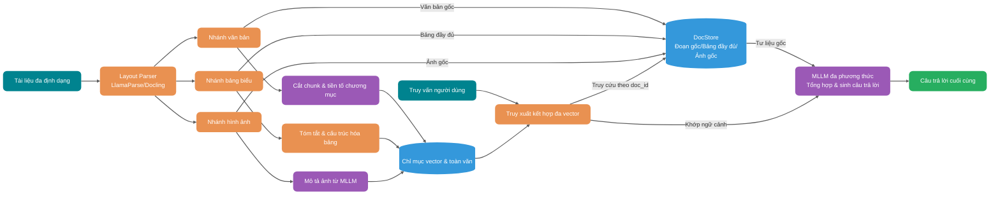

Trước khi hệ thống RAG có thể truy xuất, các tệp PDF, Word, Excel hoặc bản quét (scanned) phải được chuyển đổi thành nội dung có thể tìm kiếm. Nếu thứ tự đọc của tệp PDF nhiều cột, quan hệ hàng - cột trong bảng biểu, cấp bậc tiêu đề hay các lỗi OCR bị xử lý sai ở bước này, thì việc thay đổi mô hình Embedding hay Vector Database ở các khâu sau cũng không thể khôi phục lại lượng thông tin đã mất.

Bài viết này bám sát quy trình từ lúc tài liệu được tải lên, phân tích cú pháp (parsing), phân đoạn (chunking), kiểm định chất lượng cho đến khi lưu trữ đa phương thức vào kho dữ liệu, làm rõ các phương pháp kỹ thuật và ranh giới thực tế của từng khâu.

## Tài liệu từ lúc tải lên đến khi vào kho phải trải qua những khâu nào?

Tài liệu từ lúc được tải lên đến khi được nạp vào Vector Database tối thiểu phải đi qua sáu khâu:


Việc kiểm định chất lượng không thể để dồn đến sau khi đã vào kho mới thực hiện. Bổ sung các bước kiểm định lấy mẫu phân tầng ngay trong giai đoạn phân tích cú pháp và Chunking giúp chặn đứng từ sớm các tệp hỏng, ký tự rác và hiện tượng cắt đoạn bất thường, tránh để dữ liệu kém chất lượng ghi ồ ạt vào Vector Database.

Các vấn đề thường gặp và tác động tiêu cực đến hạ nguồn ở từng khâu:

| Khâu | Vấn đề điển hình | Tác động cuối cùng |
| --- | --- | --- |
| Tải tệp lên | Giả mạo định dạng, kích thước vượt ngưỡng, xung đột mã hóa ký tự | Trình phân tích cú pháp (parser) bị crash hoặc thất bại âm thầm |
| Kiểm tra định dạng | Đuôi mở rộng không khớp với MIME type thực tế | Chọn sai parser xử lý |
| Phân tích Layout | PDF nhiều cột, ô bảng gộp (merged cells), đầu trang/chân trang | Mất cấu trúc, ngữ cảnh bị lệch hàng |
| Làm sạch khử nhiễu | Lỗi ký tự rác (mojibake), ký tự đặc biệt, dòng trống lặp lại, sót mục lục | Nhiễu lọt vào chỉ mục, sai lệch Embedding |
| Chunking | Cắt đứt ngữ nghĩa, đứt đoạn ngữ cảnh, chunk quá lớn hoặc quá nhỏ | Truy xuất không chính xác, câu trả lời chắp vá |
| Metadata | Không lưu nguồn, số trang, phiên bản, quyền truy cập | Không thể lọc dữ liệu, không thể trích dẫn nguồn |
| Nạp vào kho | Số chiều vector không đồng nhất, vượt quá giới hạn Token | Truy xuất thất bại, hỏng chỉ mục |

Mô hình Embedding và Vector Database chỉ có thể xử lý phần văn bản được đưa vào. Nếu thứ tự đọc của tệp PDF nhiều cột bị đảo lộn, quan hệ cột của bảng biểu bị mất hoặc chữ nhận diện OCR bị sai chính tả lọt vào chỉ mục, thì ở khâu truy xuất không thể nào tái hiện lại cấu trúc gốc từ các vector.

## Lựa chọn chiến lược Chunking phù hợp như thế nào?


### Cắt theo độ dài cố định: Thiết lập đường cơ sở (Baseline) đánh giá

Cắt theo độ dài cố định (Fixed-Length Chunking) chỉ cần thiết lập kích thước khối (`chunk_size`) và độ chồng lặp giữa các khối liền kề (`chunk_overlap`), ví dụ cứ mỗi 512 Token thì cắt một khối và gối đầu 50 đến 100 Token.

Cách làm này cài đặt rất đơn giản, thời gian cắt cực nhanh, phù hợp làm đường cơ sở (baseline) đánh giá cho tài liệu ngắn hoặc các câu hỏi FAQ đơn lẻ. Hạn chế của nó là hoàn toàn không nhận biết được ranh giới đoạn văn, bảng biểu hay khối mã.

Lấy ví dụ một điều khoản chính sách sau bán hàng ghi:

> Ngoại trừ các trường hợp sau đây, tất cả đều được áp dụng chính sách đổi trả hàng không cần lý do trong 7 ngày: (1) Hàng hóa đặt làm theo yêu cầu; (2) Thực phẩm tươi sống dễ hư hỏng; (3) Sản phẩm kỹ thuật số tải trực tuyến...

Nếu danh sách này vô tình rơi trúng ranh giới cắt của khối cố định, khối trước chỉ còn "Ngoại trừ các trường hợp sau đây, tất cả đều được áp dụng chính sách đổi trả...", còn khối sau chỉ có "(1) Hàng hóa đặt làm theo yêu cầu...". Dù hệ thống truy xuất trúng khối nào thì ngữ cảnh cũng không hoàn chỉnh, khiến mô hình dễ dàng bỏ sót các điều kiện ràng buộc. Trước khi đánh giá các phương án phân đoạn phức tạp hơn, bạn nên dùng phương pháp cắt cố định này chạy thử trên tập câu hỏi để làm chuẩn so sánh, xem liệu các phương pháp cắt theo cấu trúc có cải thiện đáng kể lỗi đứt gãy câu ở ranh giới hay không.

### Cắt ký tự đệ quy: Bảo toàn ranh giới đoạn văn và câu

Cắt ký tự đệ quy (Recursive Character Splitting) thử lần lượt từng dấu phân cách theo danh sách ưu tiên định sẵn (ví dụ: `["\n\n", "\n", ".", " ", ""]`). Chỉ khi một đoạn văn tự nhiên vượt quá kích thước khối mục tiêu thì nó mới lùi lại một bước để chia nhỏ theo dấu xuống dòng hoặc dấu chấm câu, nhờ đó giữ cho các chương, đoạn văn và câu văn được nguyên vẹn nhất có thể trong giới hạn Token kiểm soát.

Những tài liệu có hệ thống tiêu đề không chuẩn mực, độ dài đoạn văn không đồng đều (như blog kỹ thuật, sổ tay sản phẩm và báo cáo nghiên cứu) thường ưu tiên chọn giải pháp này. `RecursiveCharacterTextSplitter` của LangChain là một ví dụ điển hình. Đối với tài liệu kỹ thuật tiếng Việt hoặc tiếng Anh thông thường, bạn có thể bắt đầu thử nghiệm với kích thước khối 400–800 Token và độ chồng lặp 10%–15%. Đối với tệp mã nguồn, nên dùng các bộ tách nhận biết ngôn ngữ như `RecursiveCharacterTextSplitter.from_language(Language.PYTHON, ...)`, ưu tiên cắt dọc theo các ranh giới cú pháp như `class`, `def` để tránh làm đứt đôi thân hàm.

### Phân đoạn ngữ nghĩa: Gom cụm theo ranh giới chủ đề

Phân đoạn ngữ nghĩa (Semantic Chunking) không phụ thuộc trực tiếp vào số lượng ký tự cố định, mà dùng dấu tách câu để tách văn bản thành danh sách các câu, sau đó tính khoảng cách Cosine của Embedding giữa các câu liền kề hoặc qua cửa sổ trượt. Khi khoảng cách ngữ nghĩa thay đổi đột ngột vượt qua ngưỡng định sẵn (như ngưỡng phân vị percentile hoặc ngưỡng độ lệch chuẩn), hệ thống mới thực hiện ngắt khối, gom các câu có ngữ nghĩa liền mạch vào chung một Chunk.

Cái giá phải trả của chiến lược này là ở giai đoạn dựng ngoại tuyến, hệ thống phải tính toán Embedding cho một lượng câu rất lớn, khiến thời gian và chi phí lập chỉ mục cao hơn đáng kể so với cắt ký tự. Nếu không cấu hình ràng buộc độ dài khối tối thiểu và tối đa (`min_chunk_size` / `max_chunk_size`), những chỗ đổi chủ đề liên tục sẽ sinh ra các khối cực nhỏ chỉ có một hoặc hai câu, trong khi những đoạn văn dài cùng một chủ đề lại có thể vượt quá ngân sách ngữ cảnh. Trước khi đưa lên production, cần kiểm tra phân phối độ dài trung bình, P95 và tỷ lệ các khối quá nhỏ sau khi phân đoạn.

### Cắt theo cấu trúc tài liệu: Tái sử dụng ranh giới bố cục và cú pháp

Khi bản thân tài liệu đã có cấu trúc bố cục hoặc cú pháp rõ ràng, việc cắt trực tiếp dọc theo ranh giới cấu trúc thường ổn định hơn nhiều so với việc chỉ thống kê số lượng ký tự.

Trong các tài liệu có bố cục cố định như báo cáo tài chính, hợp đồng pháp lý, mỗi trang đơn lẻ thường tương ứng với một đơn vị chủ đề tương đối độc lập. Một thử nghiệm benchmark của NVIDIA trên các báo cáo tài chính và tài liệu pháp lý cho thấy phương pháp cắt theo trang (Page-Level Chunking) đạt độ chính xác trung bình 0.648, phương sai cũng thấp hơn so với việc cắt theo số Token cố định. Tuy nhiên, cắt theo trang không phải lúc nào cũng vượt trội trên mọi tập dữ liệu: trên tập dữ liệu FinanceBench, độ chính xác của cách cắt 1024 Token (0.579) lại nhỉnh hơn một chút so với cắt theo trang (0.566). Nếu tệp PDF chỉ là tài liệu Word thông thường được xuất ra với bố cục dàn trang thả nổi ngẫu nhiên, dấu ngắt trang không mang ranh giới ngữ nghĩa thì việc cắt theo trang sẽ không đem lại hiệu quả. Ngoài ra, các truy vấn tra cứu sự thật thường chuộng các khối nhỏ 256–512 Token, trong khi các truy vấn phân tích liên đoạn văn lại phù hợp hơn với khối 1024+ Token hoặc cắt theo trang.

Các cấu trúc tài liệu phổ biến và phương án cắt khởi điểm khuyến nghị:

| Loại tài liệu | Phương thức cắt khuyến nghị | Công cụ / Ý tưởng thường dùng |
| --- | --- | --- |
| Markdown | Cắt theo cấp bậc tiêu đề (H1/H2/H3) | `MarkdownHeaderTextSplitter` + đệ quy lần hai cho các chương quá dài |
| HTML | Cắt theo thẻ ngữ nghĩa (`h1`~`h6`, `p`, `div`) | `HTMLHeaderTextSplitter` / `HTMLSectionSplitter` |
| PDF | Cắt theo tiêu đề chương mục, bảng biểu hoặc trang | Docling, LlamaParse, `chunk_by_title` |
| Mã nguồn | Cắt theo cây cú pháp (AST), class, hàm | Tree-sitter, `RecursiveCharacterTextSplitter.from_language` |
| Văn bản pháp luật / Hợp đồng | Cắt theo phần, chương, mục, điều, khoản | Nhận diện cấu trúc bằng Regex + điền ngược đường dẫn phân cấp |

### Parent-Child Chunk: Tách biệt độ mịn truy xuất và độ mịn đọc hiểu

Tìm kiếm vector cần các khối văn bản nhỏ, tập trung vào chủ đề cụ thể để nâng cao độ chính xác khi khớp mẫu, trong khi mô hình tạo sinh lại cần các đoạn văn dài có đầy đủ tiền đề và ngữ cảnh xung quanh. Kỹ thuật Parent-Child Chunk (phân khối Cha-Con) tách rời hai mục tiêu này: dùng các khối con (Child Chunk) khoảng 200–400 Token để sinh vector và lập chỉ mục, đồng thời thông qua trường `parent_id` liên kết tới khối cha (Parent Chunk) khoảng 1000–1500 Token hoặc chương mục tương ứng; khi truy xuất trực tuyến trúng khớp khối con, hệ thống sẽ khử trùng lặp theo `parent_id` và lấy khối cha tương ứng nạp vào context của LLM.



Mô hình này rất hữu hiệu trong các tài liệu sổ tay kỹ thuật dày cộm, tập hợp quy chế và hướng dẫn xử lý sự cố. Cái giá phải trả là phía lưu trữ phải duy trì thêm kho tài liệu khối cha (DocStore), và khâu truy xuất phải thực hiện thêm một lượt truy vấn theo khóa chính.

### Kiểm soát độ chồng lặp (Overlap): Giảm thiểu tình trạng cắt đứt ranh giới

Dù sử dụng cách cắt cố định hay cắt đệ quy, việc ngắt quãng tại ranh giới khối đều có thể chia cắt cùng một sự việc. Việc thiết lập cửa sổ chồng lặp (Overlap) cho phép các câu nằm sát ranh giới xuất hiện đồng thời ở cả hai Chunk liền kề. Tuy nhiên, tỷ lệ chồng lặp quá lớn sẽ làm phình to dung lượng chỉ mục, đồng thời khiến kết quả thu hồi Top-K xuất hiện nhiều đoạn văn bản trùng lặp.

Văn bản thông thường có thể bắt đầu với khối dài 512 Token, độ gối đầu 50–100 Token để thiết lập đường cơ sở; đối với mã nguồn, điều khoản pháp lý và bảng biểu độc lập, nên ưu tiên giữ nguyên vẹn đơn vị cú pháp hoặc điều khoản, chỉ sử dụng cắt chồng lặp khi bên trong đơn vị đó quá dài. Trong các bài nghiên cứu, bạn có thể thấy báo cáo về việc các chiến lược cắt khác nhau tạo ra sự chênh lệch độ chính xác tới hàng chục phần trăm (ví dụ: [thử nghiệm trên 30 mẫu hỏi đáp y tế](https://pubmed.ncbi.nlm.nih.gov/41301150/) so sánh giữa cắt thích ứng và cắt cố định), nhưng những kết luận như vậy phụ thuộc rất lớn vào ngữ liệu cụ thể và cách thiết kế câu hỏi. Khi triển khai thực tế, bắt buộc phải căn cứ vào tập benchmark đánh giá riêng của doanh nghiệp để xác định tham số.

## Mất mát ngữ nghĩa là gì, và tại sao lại xảy ra?


Mất mát ngữ nghĩa (Semantic Loss) là hiện tượng các điều kiện tiên quyết, đối tượng chỉ định hoặc quan hệ cấu trúc trong tài liệu gốc bị suy yếu hoặc lược bỏ trong quá trình phân tích, làm sạch và phân đoạn, khiến cho việc chỉ nhìn vào một Chunk đơn lẻ sau khi cắt không thể hiểu đúng ý nghĩa ban đầu.

### Bốn kịch bản mất mát ngữ nghĩa thường gặp

1. **Điều kiện bị tách rời khỏi kết luận**: Một đoạn quy tắc nghiệp vụ có nửa đầu nêu điều kiện đăng ký, nửa sau nêu quy trình phê duyệt, và điều khoản ngoại lệ ở giữa "Nếu đáp ứng điều kiện X thì cần nộp thêm giấy tờ Y" lại rơi đúng vào ranh giới cắt, khiến cả hai khối trước và sau đều thiếu đi ràng buộc then chốt.
2. **Mất từ chỉ định và ngữ cảnh nền**: Chunk chỉ giữ lại phần nội dung đơn độc mà làm mất tiêu đề chương mục chứa nó. Khi mô hình đọc câu "Trong ba năm qua tỷ lệ này liên tục giảm", nó không thể biết "tỷ lệ này" đang nói về tỷ lệ lỗi của nhà cung cấp nào hay tỷ lệ đổi trả của mảng nghiệp vụ nào.
3. **Phá vỡ quan hệ hàng - cột trong bảng biểu**: Bảng nhiều hàng nhiều cột bị bộ trích xuất văn bản thông thường dàn phẳng thành một chuỗi ký tự thuần túy mất căn chỉnh, làm mất hoàn toàn mối liên kết đối ứng giữa tiêu đề cột, khóa dòng và các ô giá trị số.
4. **Cắt đứt hoặc phân mảnh từ chuyên ngành**: Dấu gạch nối ngắt dòng trong PDF tiếng Anh (như `micro-\nservice`), lỗi nhận dạng OCR (như nhận diện `OAuth2` thành `0Auth2`) hoặc việc cắt cứng nhắc theo ký tự đã băm vụn mã sản phẩm, tên API hoặc mã hiệu nội bộ, khiến cả tìm kiếm vector lẫn tìm kiếm từ khóa đều không thể khớp trúng.

### Tại sao Embedding của một khối đơn lẻ không cứu được ngữ cảnh bị mất

Mô hình Embedding tiêu chuẩn mỗi lần mã hóa chỉ nhận văn bản của một Chunk duy nhất. Nếu chủ ngữ xuyên đoạn văn, phạm vi áp dụng và tiêu đề bảng không được giữ lại trong khối hiện tại, vector được sinh ra sẽ chỉ phản ánh câu chữ bề mặt cục bộ.

Về mặt kỹ thuật, có thể bù đắp ngữ cảnh theo bốn hướng, sắp xếp theo chi phí triển khai từ thấp đến cao:

1. **Điền ngược đường dẫn chương mục (Title / Breadcrumb Prepends)**: Khi cắt nhỏ, ghép nối tiêu đề tài liệu và tiêu đề các cấp cha vào đầu mỗi Chunk (ví dụ: `[Hệ thống đơn hàng > Quy định hoàn tiền > Hàng hóa đặc biệt] Nội dung...`), đồng thời ghi vào Metadata. Cách làm này hầu như không tốn thêm tài nguyên tính toán nhưng lại giải quyết triệt để vấn đề đại từ chỉ định mơ hồ.
2. **Mở rộng nhiều cổng truy xuất (Bản tóm tắt và câu hỏi giả định)**: Tạo bản tóm tắt ngắn hoặc 2–3 câu hỏi người dùng có thể hỏi cho các Chunk quan trọng (ví dụ câu hỏi khẩu ngữ "Làm sao lấy lại tiền" tương ứng với đoạn văn bản "Quy trình nộp đơn xin hoàn tiền"), rồi liên kết cả vector câu hỏi lẫn vector văn bản gốc vào cùng một Chunk, thu hẹp khoảng cách giữa câu hỏi khẩu ngữ của người dùng và văn bản hành chính quy chuẩn.
3. **Phân đoạn tăng cường ngữ cảnh (Contextual Chunking)**: Phương pháp do nhóm Anthropic đề xuất là sau khi cắt đoạn, gọi một mô hình ngôn ngữ nhỏ kết hợp với toàn bộ tài liệu để sinh ra 50–100 Token mô tả bối cảnh cho từng Chunk, ghép nối vào trước Chunk rồi mới tạo Embedding và chỉ mục BM25. Hiệu quả cải thiện rõ rệt, nhưng khâu nạp dữ liệu ngoại tuyến sẽ tốn thêm chi phí Token LLM (có thể dùng Prompt Caching để tiết kiệm chi phí).
4. **Phân đoạn trễ (Late Chunking)**: Đưa toàn bộ tài liệu dài (nằm trong giới hạn cửa sổ của mô hình Embedding ngữ cảnh dài, ví dụ 8192 Token) vào tầng mã hóa của Transformer để trạng thái ẩn (hidden state) của từng Token dung nạp sự chú ý (attention) của toàn văn, cuối cùng mới thực hiện Mean Pooling các vector Token theo ranh giới Chunk. Cách làm này không cần gọi mô hình tạo sinh mà vẫn giữ trọn vẹn thông tin tham chiếu toàn văn, rất thích hợp cho các mô hình Embedding cục bộ hỗ trợ ngữ cảnh dài.

## Xử lý bài toán mất mát cấu trúc như thế nào?


Các định dạng tệp khác nhau bị mất cấu trúc trong giai đoạn phân tích cú pháp vì những nguyên nhân hoàn toàn khác nhau, không thể giao toàn bộ cho cùng một bộ trích xuất văn bản thuần túy.

### Bố cục PDF nhiều cột và bảng biểu phức tạp

Bản chất của PDF là một tập hợp các lệnh vẽ đồ họa giao diện, thứ tự lưu trữ của các đối tượng văn bản bên dưới chưa chắc đã trùng với thứ tự đọc của con người. Các bài báo khoa học hai cột hoặc báo cáo tài chính nếu chỉ dùng PyPDF cơ bản để trích xuất theo luồng sẽ thường ghép nửa câu trên cột trái với nửa câu trên cột phải vào cùng một dòng; khi gặp các ô gộp nhiều hàng hoặc bảng tài chính không có đường kẻ khung, việc xô lệch hàng cột còn nghiêm trọng hơn.

Những tài liệu loại này đòi hỏi phải đưa vào bộ phân tích cú pháp nhận biết bố cục (Layout-Aware Parser), trước tiên dùng mô hình thị giác nhận diện hộp bao (Bounding Box) của tiêu đề, cột nội dung chính, bảng biểu, công thức và đầu trang/chân trang, khôi phục lại thứ tự đọc đúng rồi mới trích xuất nội dung. Về giải pháp mã nguồn mở, bạn có thể đánh giá Docling (tích hợp TableFormer chuyên xử lý cấu trúc bảng), MinerU, Marker; về dịch vụ thương mại hoặc cloud, có thể đánh giá LlamaParse, Azure Document Intelligence, v.v. Đối với các tài liệu giá trị cao như hợp đồng, báo cáo tài chính, nếu bảng biểu trích xuất ra có số cột không đều hoặc kiểm tra số liệu không khớp, cần gắn nhãn các trang đó để chuyển sang hàng đợi đối soát thủ công.

### Khôi phục cấp bậc tiêu đề Word

Tài liệu Word (`.docx`) thường dựa vào kiểu đoạn văn (paragraph style như `Heading 1`, `Heading 2`, Normal) để tổ chức cấu trúc, nhưng tài liệu thực tế của doanh nghiệp thường định dạng rất tùy tiện: có tác giả bôi đậm và phóng to đoạn văn thường để làm tiêu đề, có tài liệu từ đầu đến cuối chỉ dùng Heading 1, hoặc vừa đặt Heading 1 xong liền đặt tiếp Heading 2 mà không có nội dung ở giữa.

Khi phân tích tệp Word, không chỉ cần đọc paragraph style hoặc outline level, mà còn phải dùng cấu trúc ngăn xếp (stack) để duy trì đường dẫn phân cấp tiêu đề hiện tại, tránh việc tiêu đề cha bị tiêu đề con liền kề ghi đè mất, hoặc làm mất phần nội dung giới thiệu trước tiêu đề đầu tiên:

```python
from docx import Document


def extract_sections(doc_path):
    """
    Trích xuất nội dung chương mục theo cấp bậc tiêu đề Word và bảo toàn đường dẫn chương mục đầy đủ (section_path).
    """
    doc = Document(doc_path)
    heading_stack = []  # Các phần tử là (level, heading_text)
    current_content = []

    def current_path():
        return " / ".join(text for _, text in heading_stack) if heading_stack else "Lời mở đầu tài liệu"

    for para in doc.paragraphs:
        text = para.text.strip()
        if not text:
            continue

        style_name = para.style.name if para.style else ""
        if style_name.startswith("Heading"):
            # Trước khi gặp tiêu đề mới, xuất toàn bộ phần nội dung đã tích lũy của đoạn trước
            if current_content:
                yield {
                    "section_path": current_path(),
                    "content": "\n".join(current_content),
                }
                current_content = []

            # Phân tích cấp độ tiêu đề (ví dụ: "Heading 2" -> 2), pop các tiêu đề cùng cấp hoặc sâu hơn ra khỏi stack
            parts = style_name.split()
            level = int(parts[1]) if len(parts) > 1 and parts[1].isdigit() else 1
            while heading_stack and heading_stack[-1][0] >= level:
                heading_stack.pop()
            heading_stack.append((level, text))
        else:
            current_content.append(text)

    if current_content:
        yield {
            "section_path": current_path(),
            "content": "\n".join(current_content),
        }
```

### Liên kết trường trong Excel

Ý nghĩa của một ô trong Excel được định đoạt bởi tiêu đề hàng, tiêu đề cột, các ô gộp và tên Sheet. Nếu xé lẻ các ô thành văn bản thuần túy, mối liên hệ giữa tên trường và giá trị số sẽ bị cắt đứt hoàn toàn.

Khi xử lý Excel hoặc CSV, trước tiên cần nhận diện vùng dữ liệu hợp lệ và các tiêu đề đa cấp, sau đó chuyển đổi tùy theo mục đích sử dụng của tài liệu:

- **Báo cáo chi tiết và thống kê**: Ghép từng hàng (hoặc nhóm bản ghi tổng hợp) thành bản ghi JSON hoặc hàng Markdown chứa đầy đủ cặp key-value của tiêu đề, đính kèm tên Sheet, tiêu chí thống kê và đơn vị tính.
- **Bảng cấu hình và ánh xạ tham số**: Gom thành dạng "Tên tham số - Giá trị mặc định - Mô tả" tạo thành các mục hoàn chỉnh khép kín.
- **Bảng số liệu quy mô lớn**: Nếu người dùng thường xuyên hỏi các phép tính tổng, tính tăng trưởng cùng kỳ hoặc lọc điều kiện, việc chỉ dựa vào tìm kiếm vector trên các khối văn bản rất khó tính đúng. Khuyến nghị nên đồng bộ bảng có cấu trúc vào cơ sở dữ liệu quan hệ và truy vấn thông qua Text2SQL hoặc tool calling.

### Kiểm soát chất lượng OCR cho tài liệu quét

Các tệp PDF dạng quét và tài liệu ảnh phụ thuộc vào OCR để chuyển đổi thành văn bản. Độ chính xác nhận dạng chịu ảnh hưởng lớn từ độ phân giải, vết con dấu che khuất, độ nghiêng và ghi chú viết tay. Các lỗi phổ biến tập trung ở ba điểm: Nhầm lẫn ký tự (như số `0` với chữ cái `O`, số `1` với chữ cái `l`), làm hỏng việc tra cứu mã sản phẩm, số hợp đồng; đường kẻ bảng bị đứt làm xô lệch dòng giữa các cột; và việc phân cột hoặc ghi chú bên lề bị trộn lẫn vào văn bản chính làm đảo lộn đoạn văn.

Khi xử lý tài liệu quét, nên thực hiện khử nghiêng và lọc nhiễu ảnh trước khi OCR, đồng thời lựa chọn các engine OCR hỗ trợ phân tích bố cục (như PaddleOCR, Surya, Google Document AI hoặc AWS Textract). Đối với các trường then chốt như mã hiệu, số định danh, số tiền, trước khi nạp vào kho cần kiểm tra bằng biểu thức chính quy (Regex) hoặc quy tắc nghiệp vụ như "tổng các mục con bằng tổng số tiền", nếu trang nào kiểm tra thất bại thì phát cảnh báo hoặc chuyển kiểm tra thủ công.

## Thiết kế chiến lược kiểm định phân tầng như thế nào?


Chất lượng tài liệu tải lên trong môi trường production không đồng đều. Đường ống xử lý tài liệu bắt buộc phải thiết lập các cửa kiểm soát chất lượng qua ba giai đoạn: Tải lên, Phân tích cú pháp và Phân đoạn, đồng thời chuẩn bị sẵn đường dẫn hạ cấp (fallback) rõ ràng cho các tài liệu gặp lỗi.

### Ba cửa kiểm soát chất lượng

Cửa thứ nhất là kiểm tra định dạng tệp ở giai đoạn tải lên, trước khi lưu xuống đĩa hoặc đưa vào hàng đợi phân tích, kiểm tra đuôi mở rộng, MIME type thực tế (dựa trên Magic Bytes qua Apache Tika để ngăn việc đổi đuôi file `.exe` hoặc tệp nén hỏng thành `.pdf`), dung lượng tệp và trạng thái mã hóa.

```java
public class DocumentValidationException extends RuntimeException {
  private final ValidationErrorType errorType;
  private final String fileName;
  private final Object rejectedValue;

  public enum ValidationErrorType {
    FILE_TOO_LARGE,     // Dung lượng tệp vượt quá giới hạn
    UNSUPPORTED_FORMAT, // Định dạng không được hỗ trợ
    MIME_TYPE_MISMATCH, // Đuôi mở rộng không khớp với MIME type thực tế
    CORRUPTED_FILE,     // Tệp bị hỏng hoặc mã hóa không đọc được
    EMPTY_FILE,         // Tệp rỗng
    ENCODING_ERROR      // Lỗi mã hóa ký tự
  }
}
```

Cửa thứ hai là kiểm tra kết quả phân tích cú pháp. Sau khi parser trích xuất văn bản, kiểm tra xem số ký tự rút ra có bị rỗng hoặc ngắn bất thường hay không (ví dụ một tệp PDF quét 50 trang mà parser văn bản thuần túy chỉ rút được vài chục ký tự trắng, chứng tỏ cần chuyển sang nhánh OCR), đồng thời thống kê tỷ lệ ký tự rác (như ký tự thay thế `` và các ký tự điều khiển không nhìn thấy).

```java
public class ParseResultValidator {

  public ValidationResult validate(DocumentParseResult parseResult) {
    List<String> errors = new ArrayList<>();

    if (parseResult.getContent().isEmpty()) {
      errors.add("Kết quả phân tích cú pháp rỗng, có thể là tài liệu quét dạng ảnh thuần túy hoặc tệp bị mã hóa");
    }

    double garbledRate = calculateGarbledRate(parseResult.getContent());
    if (garbledRate > 0.05) { // Ký tự rác vượt quá 5%
      errors.add("Tỷ lệ ký tự rác quá cao: " + String.format("%.2f%%", garbledRate * 100));
    }

    int contentLength = parseResult.getContent().length();
    if (contentLength < 50) {
      errors.add("Nội dung hợp lệ quá ngắn, có thể phân tích chưa hoàn chỉnh");
    }
    if (contentLength > 10_000_000) {
      errors.add("Văn bản tài liệu đơn lẻ vượt quá giới hạn, cần phân chia theo chương mục");
    }

    if (parseResult.hasStructure()) {
      validateStructure(parseResult.getStructure()).forEach(errors::add);
    }

    return new ValidationResult(errors);
  }
}
```

Cửa thứ ba là kiểm tra chất lượng phân đoạn. Sau khi Chunking xong, kiểm tra số lượng khối sinh ra, độ dài nhỏ nhất/lớn nhất, độ lệch chuẩn độ dài để phát hiện xem có xuất hiện nhiều khối vụn vặt chỉ vài ký tự hay các khối khổng lồ vượt quá giới hạn Token đầu vào của mô hình Embedding hay không.

```java
public class ChunkingQualityReport {
  private final int totalChunks;
  private final int totalCharacters;
  private final double averageChunkSize;
  private final int minChunkSize;
  private final int maxChunkSize;
  private final double chunkSizeStdDev;

  private final List<String> warnings = new ArrayList<>();
  private final List<String> errors = new ArrayList<>();

  public boolean isAcceptable() {
    if (chunkSizeStdDev > averageChunkSize * 0.5) {
      warnings.add("Phân phối kích thước Chunk biến động lớn, vui lòng kiểm tra xem dấu phân cách cấu trúc có phù hợp với tài liệu hiện tại không");
    }

    if (minChunkSize < 20) {
      warnings.add("Tồn tại các Chunk vụn quá nhỏ, khuyến nghị nên gộp vào khối liền kề");
    }

    if (maxChunkSize > 5000) {
      errors.add("Tồn tại Chunk quá dài, có khả năng vượt quá giới hạn Token của mô hình Embedding");
    }

    return errors.isEmpty();
  }
}
```

### Chiến lược hạ cấp khi có bất thường

Khi kiểm tra không đạt yêu cầu, không được âm thầm vứt bỏ các trang lỗi mà phải phân luồng theo nguyên nhân thất bại:

| Loại lỗi kiểm tra | Chiến lược xử lý |
| --- | --- |
| Tệp rỗng hoặc giả mạo định dạng | Từ chối nạp vào kho ngay lập tức, ghi log kiểm toán và trả về mã lỗi rõ ràng cho caller |
| PDF quét dạng ảnh thuần | Tự động định tuyến sang đường ống OCR + phân tích bố cục để trích xuất lại |
| Parser phức tạp thất bại | Đổi sang parser dự phòng để thử lại; nếu vẫn thất bại thì chuyển vào hàng đợi kiểm duyệt thủ công |
| Phân đoạn cấu trúc bất thường | Gộp các khối vụn hoặc lùi về phương pháp cắt ký tự đệ quy có tiền tố chương mục |
| Một số trang phân tích thất bại | Ghi nhận số trang bị thiếu và đánh dấu trạng thái tài liệu là "khả dụng một phần"; tạm dừng phát hành đối với hợp đồng, quy chế |

Một tài liệu 100 trang nếu có 10 trang bảng biểu phân tích thất bại, tuyệt đối không được đánh dấu 90 trang còn lại là "đã nạp vào kho hoàn chỉnh". Đối với hợp đồng, quy chế, báo cáo tài chính đòi hỏi bằng chứng phải đầy đủ, việc thiếu trang phải chặn quy trình phát hành và thông báo cho con người xử lý; đối với tài liệu tham khảo thông thường cho phép nạp một phần, bắt buộc phải ghi rõ các trang bị thiếu vào metadata của tài liệu để ngăn hệ thống đưa ra câu trả lời khẳng định trên phần dữ liệu bị khuyết.

## Xử lý nội dung đa phương thức như thế nào?

Tài liệu thực tế của doanh nghiệp chứa rất nhiều sơ đồ kiến trúc, ảnh chụp màn hình giao diện, lưu đồ quy trình, bảng biểu liên trang và biểu đồ thống kê. Nếu đường ống phân tích cú pháp vứt bỏ các phần tử phi văn bản này, những câu hỏi liên quan đến sơ đồ và quy trình sẽ bị trả lời sai vì thiếu bằng chứng.

### Ba hướng xử lý nội dung hình ảnh

Trước tiên, trong giai đoạn phân tích cú pháp cần lọc bỏ các hình ảnh không mang thông tin như logo trên đầu trang, hoa văn nền, biểu tượng trang trí thuần túy (có thể loại bỏ dựa trên ngưỡng kích thước, tỷ lệ khung hình hoặc tần suất lặp lại ở cùng tọa độ qua nhiều trang), chỉ nạp vào kho các ảnh chụp màn hình, sơ đồ kiến trúc và lưu đồ mang thông tin nghiệp vụ. Có ba phương án thường dùng:

1. **Embedding đa phương thức (như CLIP / SigLIP / ColPali) + Trả về ảnh gốc**: Mã hóa trực tiếp hình ảnh vào không gian vector căn chỉnh giữa hình và chữ (hoặc tạo biểu diễn đa vector trực tiếp từ ảnh chụp trang tài liệu như ColPali). Khi truy vấn, dùng vector văn bản để khớp với vector ảnh; khi trúng khớp, lấy ảnh gốc từ object storage ra giao cho mô hình ngôn ngữ lớn đa phương thức (MLLM) trả lời. Cần lưu ý mô hình CLIP thông thường hoạt động tốt trên ảnh tự nhiên, nhưng khả năng phân biệt đối với các sơ đồ kiến trúc hệ thống dày đặc chữ Hán nhỏ, đường nối phức tạp hoặc ảnh chụp màn hình báo lỗi lại khá hạn chế.
2. **MLLM sinh mô tả chi tiết ảnh + Tìm kiếm văn bản**: Khi nạp dữ liệu ngoại tuyến, gọi mô hình thị giác (kết hợp tiêu đề ngữ cảnh của ảnh và đoạn văn tham chiếu đến ảnh trong nội dung chính) để sinh mô tả văn bản chi tiết, ghi phần mô tả này vào Vector Database và chỉ mục toàn văn thông thường, đồng thời lưu URI của ảnh gốc trong Object Storage vào Metadata.
3. **Bộ truy xuất đa vector (Multi-Vector Retriever)**: Chuẩn hóa bước thứ hai thành mô hình kiến trúc kỹ thuật — trong chỉ mục vector lưu bản tóm tắt có cấu trúc của ảnh (chứa chữ trong ảnh, luồng luân chuyển các node, kết luận cốt lõi) phục vụ tìm kiếm; DocStore (như Object Storage + cơ sở dữ liệu Key-Value) lưu ảnh gốc độ phân giải cao. Khi truy xuất trúng tóm tắt, căn cứ vào `doc_id` lấy ảnh gốc cùng với ngữ cảnh văn bản đưa vào MLLM.

```python
# Ví dụ Multi-Vector Retriever của LangChain
# Lưu ý: LangChain 0.3 có thể import từ langchain.retrievers.multi_vector; LangChain 1.0+ chuyển sang langchain_classic
from langchain_classic.retrievers.multi_vector import MultiVectorRetriever
from langchain_core.stores import InMemoryByteStore

# Vector store lưu tóm tắt văn bản của ảnh/bảng, dùng để tìm kiếm khớp mẫu
vectorstore = Chroma(
    collection_name="multimodal_summaries",
    embedding_function=OpenAIEmbeddings(),
)

# DocStore lưu byte ảnh gốc hoặc toàn bộ nội dung bảng (production nên thay bằng S3 + Redis/PostgreSQL)
docstore = InMemoryByteStore()

retriever = MultiVectorRetriever(
    vectorstore=vectorstore,
    byte_store=docstore,
    id_key="doc_id",
    search_kwargs={"k": 5},
)
```

### Bảo toàn cấu trúc của nội dung bảng biểu

Khi bảng biểu bị cắt nhỏ như văn bản thông thường, không chỉ tiêu đề cột bị tách khỏi giá trị mà các dòng bị cắt ở giữa còn mất hoàn toàn thông tin tiêu đề. Trong thực tế kỹ thuật, người ta thường kết hợp các cách làm sau:

1. **Bảo tồn định dạng có cấu trúc**: Sử dụng các công cụ như Docling, LlamaParse để khôi phục bảng thành bảng Markdown, HTML `<table>` (giữ thông tin gộp ô `rowspan` / `colspan`) hoặc mảng dòng JSON. Nếu một bảng lớn vượt quá giới hạn độ dài Chunk, khi tách theo dòng bắt buộc phải lặp lại tiêu đề bảng hoàn chỉnh ở đầu mỗi khối con.
2. **Sinh tóm tắt ngữ nghĩa cho bảng**: Các bảng tài chính hoặc giám sát dày đặc số liệu thuần túy rất khó căn chỉnh với câu hỏi ngôn ngữ tự nhiên trong không gian vector. Có thể tạo một đoạn tóm tắt văn bản cho mỗi bảng chứa chương mục tương ứng, tiêu đề bảng, khoảng thời gian, các chiều thống kê và chỉ số cốt lõi (ví dụ: "Bảng tổng hợp doanh số các dòng sản phẩm khu vực Miền Đông năm 2024, gồm sản lượng và tốc độ tăng trưởng theo quý Q1/Q2 của Điện thoại A và Điện thoại B, Đơn vị tính: chiếc"), lập chỉ mục vector cho tóm tắt này; khi truy xuất trúng khớp, đưa toàn bộ bảng Markdown/JSON vào context tạo sinh.

### Ràng buộc ngữ cảnh cho biểu đồ (Charts)

Ý nghĩa của biểu đồ đường, biểu đồ cột và biểu đồ tròn phụ thuộc rất lớn vào tiêu đề biểu đồ (Caption), tên trục tọa độ, chú giải (Legend), đơn vị đo lường và các đoạn văn phân tích trích dẫn biểu đồ trong nội dung chính. Khi gọi MLLM ngoại tuyến để trích xuất thông tin biểu đồ, nên truyền cả tiêu đề biểu đồ và các đoạn văn liền kề trước sau trên trang đó vào, yêu cầu mô hình xuất ra mô tả có cấu trúc (gồm đối tượng thống kê, khoảng thời gian, đơn vị, các điểm cực trị và kết luận xu hướng) cùng bảng số liệu tương ứng, tránh việc chỉ nhìn ảnh trần mà đọc nhầm "triệu đồng" thành "đồng" hoặc lẫn lộn các chuỗi dữ liệu trong chú giải.

### Chuỗi RAG đa phương thức hoàn chỉnh

Xâu chuỗi việc phân tích văn bản, bảng biểu, hình ảnh cùng việc lập chỉ mục tóm tắt và lấy lại tư liệu gốc, ta có kiến trúc xử lý đa phương thức hoàn chỉnh như sau:



Thiết kế cốt lõi của chuỗi xử lý này là tách rời biểu diễn truy xuất và tư liệu tạo sinh: Trong chỉ mục vector và chỉ mục toàn văn lưu trữ các khối văn bản, giải thích bảng và mô tả ảnh dễ dàng khớp ngữ nghĩa; trong DocStore lưu giữ bảng biểu đầy đủ chưa nén, đoạn văn cha và ảnh gốc độ phân giải cao, khi truy xuất trúng khớp mới dựa vào `doc_id` ghép nối chuyển cho mô hình tạo sinh.

## Xây dựng đường ống xử lý tài liệu từ con số 0 như thế nào?


Khi xây dựng đường ống xử lý tài liệu cho doanh nghiệp, khuyến nghị nên tiến hành theo từng giai đoạn dựa trên độ phức tạp của định dạng, không nên ngay từ đầu đã áp dụng các mô hình thị giác đắt đỏ lên toàn bộ các tệp:

1. **Giai đoạn một (Đường cơ sở văn bản thuần có cấu trúc)**: Hoàn thiện việc phân tích cú pháp cho Markdown, HTML và các tài liệu Word chuẩn quy cách, cài đặt cơ chế cắt đệ quy theo cấp bậc tiêu đề, ghi `doc_id`, `section_path`, thời gian cập nhật, quyền hạn ACL vào Metadata, chạy thông suốt tập đánh giá cơ bản.
2. **Giai đoạn hai (PDF bố cục phức tạp & quản trị bảng biểu)**: Đối với PDF nhiều cột, bảng biểu có ô gộp và tài liệu quét, tích hợp các bộ phân tích cú pháp nhận biết bố cục như Docling, MinerU hoặc LlamaParse cùng đường ống OCR, hoàn thiện ba tầng kiểm định chất lượng, ghép lặp lại tiêu đề cho các bảng quá dài và hàng đợi hạ cấp cho tài liệu bất thường.
3. **Giai đoạn ba (Phân khối Cha-Con & mở rộng đa phương thức)**: Khi phân tích các trường hợp lỗi phát hiện thấy sự mâu thuẫn giữa việc truy xuất độ mịn cao và tính toàn vẹn của ngữ cảnh dài, đưa vào kỹ thuật Parent-Child Chunking hoặc tăng cường ngữ cảnh chương mục; khi nghiệp vụ phụ thuộc nhiều vào lưu đồ quy trình, sơ đồ kiến trúc hoặc biểu đồ tài chính, tích hợp mô tả biểu đồ từ MLLM và truy xuất Multi-Vector theo nhu cầu.

## Tổng kết

Khâu xử lý và phân đoạn tài liệu quyết định việc trong chỉ mục có bằng chứng hoàn chỉnh và chính xác ngay từ đầu hay không. Khi đưa lên production và các lần tinh chỉnh tham số cắt hoặc parser sau này, tối thiểu cần kiểm tra đối chiếu bốn tiêu chí:

1. **Bảo toàn bố cục và cấu trúc**: Lấy mẫu kiểm tra thứ tự đọc của PDF nhiều cột, quan hệ đối ứng hàng - cột của bảng biểu qua nhiều trang, đường dẫn chương mục (`section_path`) của Word/Markdown và độ chính xác OCR của các trường thông tin then chốt trên tài liệu quét.
2. **Độ mịn khối và tính trọn vẹn ngữ cảnh**: Xác nhận Chunk không cắt đứt điều kiện tiên quyết và kết luận, bảng dài bị chia cắt vẫn giữ tiêu đề, thống kê và giám sát phân phối độ dài khối cùng tỷ lệ khối vụn.
3. **Metadata đầy đủ và có thể tra cứu**: Mỗi Chunk đều được liên kết với ID tài liệu nguồn, số phiên bản, số trang, đường dẫn chương mục và ACL phân quyền, hỗ trợ lọc trước và truy vết nguồn câu trả lời.
4. **Kiểm thử hồi quy trên tập benchmark cố định**: Mỗi lần đổi công cụ phân tích cú pháp hoặc điều chỉnh `chunk_size` / `chunk_overlap`, đều phải so sánh Context Recall và độ chính xác của câu trả lời cuối cùng trên cùng một tập câu hỏi bao gồm bảng biểu, điều kiện xuyên đoạn và thuật ngữ chuyên ngành.

## Tài liệu tham khảo

- [Databricks: Mastering Chunking Strategies for RAG](https://community.databricks.com/t5/technical-blog/the-ultimate-guide-to-chunking-strategies-for-rag-applications/ba-p/113089)
- [Firecrawl: Best Chunking Strategies for RAG in 2026](https://www.firecrawl.dev/blog/best-chunking-strategies-rag)
- [Premiere AI: RAG Chunking Strategies 2026 Benchmark Guide](https://blog.premai.io/rag-chunking-strategies-the-2026-benchmark-guide/)
- [Weaviate: Chunking Strategies to Improve LLM RAG Pipeline Performance](https://weaviate.io/blog/chunking-strategies-for-rag)
- [Omdena: Document Parsing for RAG - A Complete Guide for 2026](https://www.omdena.com/blog/document-parsing-for-rag)
- [DataCamp: Multimodal RAG - A Hands-On Guide](https://www.datacamp.com/tutorial/multimodal-rag)
- [LangChain: Multi-Vector Retriever for RAG on Tables, Text, and Images](https://www.langchain.com/blog/semi-structured-multi-modal-rag)
- [Procycons: PDF Data Extraction Benchmark 2025](https://procycons.com/en/blogs/pdf-data-extraction-benchmark/)
- [LlamaIndex: Mastering PDF Parsing](https://www.llamaindex.ai/blog/mastering-pdfs-extracting-sections-headings-paragraphs-and-tables-with-cutting-edge-parser-faea18870125)
