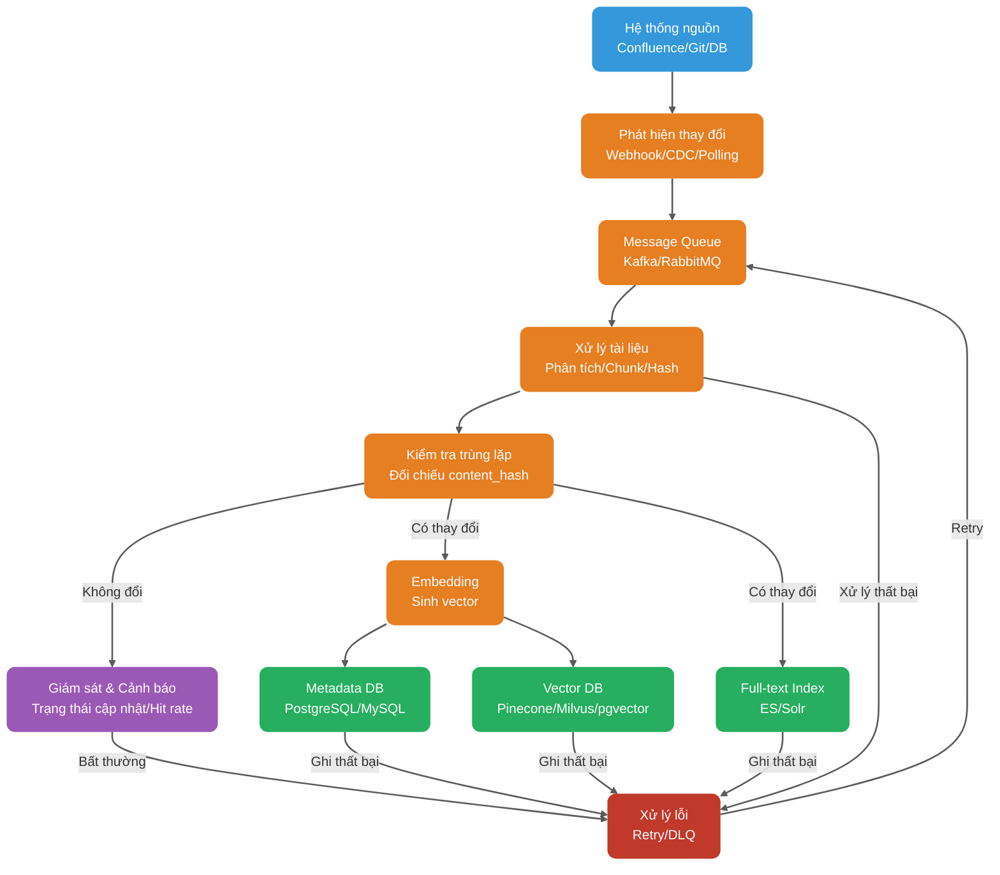
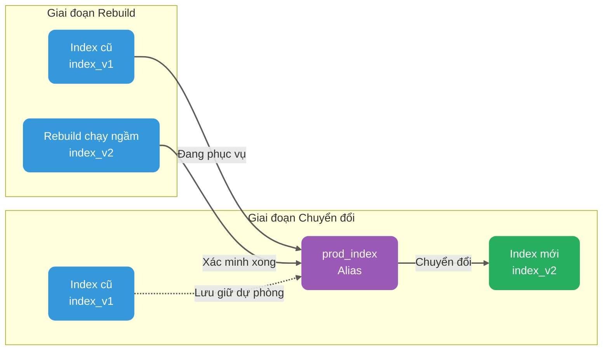

Sau khi hệ thống RAG phục vụ knowledge base doanh nghiệp đầu tiên được đưa lên production, nhiều team kỹ thuật đều vấp phải một vấn đề rất thực tế: tài liệu rõ ràng đã được cập nhật, nhưng câu trả lời của model vẫn y nguyên như cũ.

Lúc này đừng vội đổ lỗi cho LLM. Nguyên nhân phổ biến hơn là knowledge base chưa hề được đồng bộ cập nhật, hoặc pipeline cập nhật mới chỉ dừng lại ở việc "ghi thêm nội dung mới" mà bỏ quên các chi tiết cốt lõi như xử lý phiên bản cũ, phân quyền truy cập và tính nhất quán giữa các chỉ mục (index consistency).

Khi tài liệu biến động thường xuyên, các vấn đề sẽ càng bộc lộ rõ rệt hơn: mỗi lần đều rebuild toàn bộ index thì chi phí và thời gian xử lý không thể kham nổi; chỉ cập nhật phần thay đổi thì lại sợ bỏ sót các chunk cũ; chỉ insert vector mới mà không dọn dẹp phiên bản cũ thì nội dung hết hạn vẫn tiếp tục bị recall; còn khi đổi Embedding model, liệu có phải re-index toàn bộ dữ liệu lịch sử hay không cũng là bài toán không thể né tránh.

Việc cập nhật knowledge base đòi hỏi phải xử lý đồng thời tính nhất quán giữa các phiên bản, quyền hạn và nhiều hệ thống lưu trữ khác nhau. Bám sát vòng đời của ba loại sự kiện: thêm mới (insert), chỉnh sửa (update) và xóa bỏ (delete), bài viết này sẽ giải thích chi tiết cách thức phối hợp giữa đồng bộ gia tăng (incremental sync), rebuild toàn bộ (full rebuild), phát hành canary, rollback và giám sát observability.

## Cập nhật knowledge base cần giải quyết những vấn đề gì?

Trước khi đi vào các giải pháp cụ thể, chúng ta cần làm rõ các mục tiêu cốt lõi.

Sau khi cập nhật hoàn tất, kết quả truy xuất phải tuyệt đối nhất quán với tài liệu hiện hành, không được phép vượt quyền truy cập; khi đồng bộ thất bại, hệ thống phải định vị được chính xác tài liệu và đầu ghi gặp sự cố, đồng thời có khả năng khôi phục về trạng thái index lành mạnh liền trước đó.

Tính động (dynamism) đề cập đến việc khi tài liệu biến đổi, index phải bắt kịp kịp thời. Chữ "kịp thời" ở đây không nhất thiết phải là mức sub-second, nó có thể là vài phút, hoặc tính theo ngày, tùy thuộc vào yêu cầu thời gian thực của nghiệp vụ. Một kho quy chế nội bộ có thể chỉ cần đồng bộ một lần mỗi ngày, nhưng knowledge base hỗ trợ khách hàng và các điều khoản tuân thủ pháp lý thì cần tốc độ nhanh hơn nhiều.

Tính chính xác (accuracy) đòi hỏi nội dung được recall sau khi cập nhật phải ăn khớp hoàn toàn với tài liệu hiện tại, không thể có chuyện tài liệu đã sửa đổi nhưng model vẫn tiếp tục trích dẫn phiên bản cũ. Một khi điều này xảy ra, người dùng sẽ nhận thấy sự sai lệch rất rõ ràng.

Tính nhất quán (consistency) lại càng phức tạp hơn. Cùng một tài liệu có thể tồn tại nhiều phiên bản, trong khi vector database, cơ sở dữ liệu metadata và công cụ tìm kiếm toàn văn (full-text search) lại là các hệ thống phân tán độc lập. Bất kỳ đầu ghi nào bị sót hoặc có độ trễ sao chép đều có thể dẫn đến hiện tượng bất nhất dữ liệu.

Khả năng rollback giúp hệ thống khi gặp sự cố có thể nhanh chóng chuyển hướng traffic về trạng thái lành mạnh gần nhất, thay vì trông chờ vào việc kỹ sư phải đi sửa dữ liệu thủ công trong hoảng loạn. Còn khả năng quan sát (observability) đòi hỏi toàn bộ quy trình cập nhật phải được giám sát chặt chẽ, kết quả cập nhật phải đo lường được và nguyên nhân thất bại phải truy vết được đến từng mắt xích cụ thể.

Những mục tiêu này nghe qua tưởng như là điều hiển nhiên, nhưng rất nhiều dự án chỉ mới làm được bước đầu tiên là "cập nhật", các bước phía sau hoàn toàn phó mặc cho may rủi. Hậu quả là tài liệu đã sửa qua 10 phiên bản nhưng câu trả lời vẫn dừng ở phiên bản đầu tiên; hay một tài liệu mật đã bị xóa nhưng nhiều tháng sau vẫn tiếp tục bị recall và hiển thị cho người dùng.

## Tại sao Embedding model bắt buộc phải duy trì tính nhất quán tuyệt đối?

Điểm này cần phải được nhấn mạnh độc lập: Embedding model được sử dụng khi đánh index bắt buộc phải giống hệt 100% với model được sử dụng khi truy vấn.

Embedding model ánh xạ văn bản thành vector trong không gian nhiều chiều, và không gian vector của các model khác nhau hoàn toàn không tương thích với nhau. Cùng một câu nói nhưng mã hóa bằng `text-embedding-3-small` của OpenAI và mã hóa bằng `all-MiniLM-L6-v2` của sentence-transformers sẽ tạo ra các vector không có bất kỳ giá trị toán học nào để so sánh. Nếu lúc đánh index dùng Model A mà lúc truy vấn lại dùng Model B, điều đó tương đương với việc bạn đang tính toán độ tương đồng giữa hai chiều không gian hoàn toàn tách biệt.

Biểu hiện cụ thể còn phụ thuộc vào số chiều của vector (dimension). Nếu số chiều khác nhau, vector thường không thể nạp chung vào cùng một index, và hầu hết các vector database sẽ từ chối thẳng thừng lệnh insert hoặc query. Nếu số chiều tình cờ trùng nhau nhưng model khác nhau, điểm số tương đồng cosine cũng hoàn toàn vô nghĩa và kết quả recall không thể tin cậy được. Đây không đơn giản là hiện tượng "ngẫu nhiên", mà là toàn bộ nền tảng xếp hạng đã bị phá hỏng từ gốc.

Trong môi trường production, có hai kịch bản rất dễ bị lơ là:

**Thứ nhất là nâng cấp model.** Phía nghiệp vụ nhận thấy model mới cho chất lượng tốt hơn, muốn chuyển từ `text-embedding-3-small` sang `text-embedding-3-large`. Điều này đồng nghĩa với việc toàn bộ dữ liệu lịch sử bắt buộc phải được mã hóa lại và đánh index lại từ đầu. Về mặt kỹ thuật, có thể áp dụng chiến lược chạy song song hai index (dual-index) và chuyển luồng canary để giảm thiểu rủi ro, nhưng bước rebuild toàn bộ là không thể né tránh.

**Thứ hai là việc dùng lẫn lộn giữa model chạy local và API bên ngoài.** Môi trường dev/test dùng model sentence-transformers nội bộ, còn môi trường production lại gọi API của OpenAI. Sự khác biệt này cực kỳ phổ biến trong các team có nhiều lập trình viên cùng làm việc: chạy test ở local thấy rất mượt mà, nhưng vừa deploy lên production thì tỷ lệ recall tụt dốc không phanh.

Cách làm chuẩn xác là ghi thẳng thông tin Embedding model vào metadata của từng chunk, và mỗi khi query đều thực hiện kiểm tra đối chiếu phiên bản model. Nếu phát hiện không khớp, hệ thống phải từ chối truy vấn hoặc ghi log cảnh báo mức độ cao kèm theo hạ cấp (degrade) xuống chiến lược recall an toàn hơn.

| Trường | Giải thích | Ví dụ |
| --- | --- | --- |
| `embedding_model` | Tên model | `text-embedding-3-large` |
| `embedding_model_version` | Phiên bản model | `2025-01-15` |
| `embedding_dimension` | Số chiều vector | `3072` |

Khi cần nâng cấp Embedding model, khuyến nghị thực hiện theo quy trình chuẩn sau:

1. Xây dựng index mới hoàn toàn và dùng model mới để re-index toàn bộ dữ liệu.
2. Chạy song song cả index cũ và index mới trong một khoảng thời gian, so sánh tỷ lệ recall và chất lượng câu trả lời.
3. Sau khi xác nhận index mới hoạt động ổn định, chuyển toàn bộ traffic sang index mới thông qua cơ chế alias (bí danh chỉ mục).
4. Giữ lại index cũ trong một khoảng thời gian làm vùng đệm để phục vụ rollback khẩn cấp nếu cần.
5. Sau khi chắc chắn hệ thống không có bất kỳ vấn đề gì, tiến hành xóa bỏ index cũ.

Tư duy này rất giống với chiến lược triển khai Blue-Green trong cơ sở dữ liệu: tuyệt đối không sửa đổi trực tiếp tại chỗ (in-place), hãy dựng một môi trường mới, xác minh hoàn tất rồi mới chuyển đổi luồng truy cập.

## Thiết kế hệ thống Metadata hỗ trợ cập nhật như thế nào?

Thiết kế metadata bài bản là điều kiện tiên quyết cho việc cập nhật gia tăng và rollback. Rất nhiều hệ thống RAG sau một thời gian vận hành bị rơi vào trạng thái "mất trí nhớ", không phải vì hệ thống không biết nội dung văn bản, mà vì nó không biết vector này thuộc về tài liệu nào, phiên bản số mấy, nạp vào kho khi nào và quyền hạn truy cập ra sao.

Mỗi Chunk tối thiểu cần phải mang theo các trường metadata sau:

```json
{
  "doc_id": "doc-uuid-001",
  "chunk_id": "chunk-uuid-001",
  "content_hash": "sha256:abc123...",
  "version_id": 3,
  "chunk_strategy": "semantic",
  "chunk_size": 512,
  "chunk_overlap": 50,
  "source_id": "confluence-page-123",
  "source_type": "confluence",
  "title": "Tài liệu API Trung tâm Đơn hàng",
  "section_path": "Tài liệu kỹ thuật / Hệ thống đơn hàng / Quy chuẩn API",
  "page": 5,
  "tenant_id": "tenant-001",
  "acl": ["role:admin", "team:order-team"],
  "created_at": "2025-03-01T10:00:00Z",
  "updated_at": "2025-04-15T14:30:00Z",
  "embedding_model": "text-embedding-3-large",
  "embedding_model_version": "2025-01-15",
  "embedding_dimension": 3072,
  "is_deleted": false
}
```

Chiến lược phân đoạn (chunking strategy) cũng phải được đánh version. Cách thức chia chunk, tỷ lệ chồng lấn (overlap), parser phân tích một khi thay đổi sẽ gây tác động không hề thua kém việc đổi Embedding model, do đó cũng cần kích hoạt rebuild hoặc chạy song song hai index để canary. Việc lưu lại các trường `chunk_strategy`, `chunk_size`, `chunk_overlap` sẽ tạo căn cứ vững chắc cho việc đánh giá và rollback sau này.

`content_hash` là trái tim của cơ chế cập nhật gia tăng. Nó không phải là mã hash của cả file tài liệu gốc, mà là hash của phần thân văn bản đã làm sạch hoặc của chính nội dung Chunk đó. Các thuật toán phổ biến: MD5 có tốc độ nhanh nhưng tiềm ẩn rủi ro va chạm hash (collision), chỉ phù hợp kịch bản không quá khắt khe; SHA-256 có tỷ lệ va chạm cực thấp, khuyến nghị dùng cho production; SimHash thích hợp để phán đoán xem nội dung có xấp xỉ giống nhau hay không (thường dùng khử trùng lặp web), nhưng không thể định vị chính xác vị trí thay đổi chi tiết.

Trong môi trường production, `content_hash` chủ yếu dùng để trả lời câu hỏi: "Đoạn văn này có bị thay đổi hay không?". Khi nạp dữ liệu, hệ thống tính toán hash và so sánh với bản ghi đã có trong database. Nếu trùng khớp, chứng tỏ nội dung không thay đổi, có thể bỏ qua bước sinh Embedding; nếu khác nhau, bắt buộc phải mã hóa lại.

`version_id` ghi lại số lần sửa đổi của tài liệu. Mỗi lần tài liệu cập nhật, `version_id` tăng thêm 1. Khi phối hợp cùng `content_hash`, nó giúp truy vết lịch sử thay đổi và hỗ trợ rollback cực kỳ thuận tiện.

`is_deleted` là cờ đánh dấu xóa mềm (soft delete). Nếu chỉ xóa bản ghi khỏi vector database mà không lưu lại trạng thái xóa trong cơ sở dữ liệu metadata, bạn sẽ đánh mất căn cứ cho việc kiểm toán (audit), khôi phục và đối soát đồng bộ giữa các index. Khi nhận được sự kiện xóa, hãy gán `is_deleted = true`; khi người dùng upload lại, tạo phiên bản mới hoặc khôi phục bản ghi và tính lại `content_hash`; khi query, mặc định chỉ lọc các bản ghi có `is_deleted = false`.

Xóa mềm không chỉ giúp phân biệt tài liệu cũ/mới, mà nó còn tạo ra một vùng đệm an toàn phục vụ việc kiểm toán, khôi phục khi lỡ tay xóa nhầm, dọn dẹp vật lý bất đồng bộ và duy trì tính nhất quán giữa các hệ thống phân tán.

`tenant_id` và `acl` là nền tảng của kiến trúc đa người thuê (multi-tenant) và kiểm soát quyền truy cập. Tất cả các nội dung có khả năng lọt vào context của model bắt buộc phải vượt qua bước kiểm tra quyền hạn. Thông thường bước này được lọc trước hoặc trong khi retrieval dựa theo tenant, role và resource ACL, tránh để các tài liệu không có quyền chiếm dụng Top-K hoặc bị rò rỉ cho LLM. Các quy tắc phân quyền phức tạp (như ABAC động, kế thừa đa tổ chức) có thể được kiểm tra lại lần thứ hai sau khi recall danh sách ứng viên, nhưng bước kiểm tra thứ hai này bắt buộc phải diễn ra trước khi lắp ráp ngữ cảnh đưa vào model; trước khi trả về trích dẫn nguồn, hệ thống cũng nên đối soát lại thêm một lần nữa như một lớp phòng thủ chiều sâu.

## Đồng bộ thao tác Thêm, Sửa, Xóa tài liệu như thế nào?

Quá trình tài liệu đi từ hệ thống nguồn đến vector database phải trải qua nhiều công đoạn. Bất kỳ mắt xích nào gặp sự cố đều sẽ dẫn đến tình trạng bất nhất dữ liệu.



Ở đây cần đặc biệt lưu ý đến tình huống thành công một phần (partial success). Vector database, cơ sở dữ liệu metadata và full-text search engine thường không nằm trong cùng một transaction phân tán; một thao tác ghi đồng thời vào 3 đầu mối rất dễ xảy ra trường hợp đầu này ghi được nhưng đầu kia thất bại. Giải pháp bền vững nhất là coi cơ sở dữ liệu metadata làm "nguồn chân lý duy nhất" (source of truth), ghi nhận trạng thái index của từng Chunk (ví dụ: `index_status = 'ready' / 'partial_failed'`). Một tiến trình background định kỳ quét và retry các đầu ghi thất bại, đồng thời thông qua cơ chế đối soát (reconciliation) để quét sạch các điểm sai lệch.

### Thêm mới tài liệu (Insert)

Thêm mới là thao tác đơn giản nhất trong ba loại. Quy trình thông thường là: phân tích tài liệu, trích xuất văn bản chính, tiêu đề và cấu trúc phân cấp; chia Chunk theo chiến lược đã định; tính toán `content_hash` cho từng Chunk; kiểm tra xem hash đã tồn tại hay chưa; nếu chưa tồn tại thì sinh vector và ghi đồng thời vào vector database, metadata database và full-text index.

Tính lũy thừa (idempotency) là tối quan trọng. Thao tác thêm mới bắt buộc phải có khả năng thực thi lặp lại an toàn. Dù message queue có bắn trùng lặp một message, hay worker bị crash và khởi động lại để xử lý tiếp, hệ thống tuyệt đối không được sinh ra các bản ghi trùng lặp.

### Sửa đổi tài liệu (Update)

Chỉnh sửa phức tạp hơn thêm mới rất nhiều, và câu hỏi mấu chốt là: xử lý dữ liệu của phiên bản cũ như thế nào?

Cần phải tránh tình trạng câu truy vấn nhìn thấy đồng thời cả hai phiên bản, đồng thời cũng phải tránh việc trong quá trình đang cập nhật thì tạm thời không thể tra cứu được bất kỳ phiên bản nào. Cách làm chuẩn mực là ghi phiên bản mới ở trạng thái ẩn trước, sau đó chuyển đổi phiên bản hoạt động một cách nguyên tử (atomic cutover):

1. Dựa vào `doc_id` truy vấn metadata database để lấy thông tin phiên bản đang active và danh sách `chunk_id` cũ.
2. Ghi các Chunk mang `version_id` mới, vector tương ứng và bản ghi full-text vào hệ thống với cờ `status = 'building'`, không cho tham gia vào luồng tìm kiếm online.
3. Sau khi xác minh cả 3 đầu ghi đều thành công, chuyển đổi nguyên tử con trỏ phiên bản active sang phiên bản mới trong metadata database hoặc qua index alias.
4. Đánh dấu phiên bản cũ là đã xóa và đưa vào hàng đợi dọn dẹp bất đồng bộ theo chính sách lưu trữ.

Nếu vector database hỗ trợ cập nhật nguyên tử dựa trên khóa chính (primary key), ví dụ lệnh `upsert` của Milvus, bạn có thể ghi đè trực tiếp các bản ghi có cùng khóa chính. Nhưng hãy hết sức cẩn thận: `upsert` chỉ ghi đè được các entity có cùng khóa chính. Nếu tài liệu sau khi sửa đổi làm thay đổi số lượng Chunk hoặc làm lệch ranh giới `chunk_id`, các chunk tàn dư của phiên bản cũ vẫn sẽ tồn tại trừ khi được dọn dẹp tường minh theo `doc_id + version_id`.

Nếu storage không thể thay thế nguyên tử toàn bộ tài liệu, hãy sử dụng bộ lọc `active_version`, index alias hoặc chuyển đổi song song hai index. Việc xóa bản ghi cũ trước rồi mới ghi bản ghi mới sẽ tạo ra một khoảng trống dịch vụ; còn ghi bản ghi mới trước mà không lọc phiên bản sẽ khiến truy vấn trả về thông tin đá nhau chan chát.

Một cạm bẫy cực kỳ phổ biến là chỉ ghi vector mới mà không chịu xóa vector cũ.

Nếu tài liệu bị sửa đổi 10 lần mà vector database vẫn lưu giữ trọn vẹn 10 phiên bản có thể tìm kiếm được, truy vấn của người dùng chắc chắn sẽ chạm phải thông tin lỗi thời. Pipeline chỉnh sửa bắt buộc phải vô hiệu hóa phiên bản cũ và dọn dẹp vector cũ theo chính sách định sẵn, nếu không knowledge base sẽ liên tục bị biến dạng theo thời gian.

### Xóa tài liệu (Delete)

Xóa bỏ được phân chia thành xóa mềm (soft delete) và xóa vật lý (physical delete).

Xóa mềm là chuyển cờ `is_deleted` thành `true`. Nó rất thuận tiện cho việc lưu giữ lịch sử biến động và xử lý các sự cố lỡ tay xóa nhầm, nhưng không đáp ứng được các yêu cầu tuân thủ pháp lý đòi hỏi phải xóa sạch dữ liệu ngay lập tức.

Xóa vật lý là gỡ bỏ hoàn toàn bản ghi khỏi vector database, metadata database, full-text index và các tầng cache liên quan. Thời gian lưu trữ xóa mềm bao lâu cần được quyết định dựa trên mục tiêu phục hồi nghiệp vụ (RPO/RTO), phân loại độ nhạy cảm của dữ liệu và quy định pháp lý, không được xem một số ngày cố định là giá trị mặc định cho mọi trường hợp.

Xóa mềm tạo điều kiện thuận lợi cho phục hồi và kiểm toán, nhưng làm tăng chi phí lưu trữ và chi phí đánh giá bộ lọc. Xóa vật lý triệt để hơn, bắt buộc cho các yêu cầu tuân thủ và dữ liệu nhạy cảm, nhưng chi phí khôi phục rất đắt đỏ. Trong production, mô hình phổ biến nhất là "Xóa mềm + Xóa vật lý có độ trễ + Audit log thao tác xóa". Nếu là tài liệu nhạy cảm, bạn còn phải chủ động làm sạch các tầng cache vệ tinh như rerank cache, LLM context cache.

Thao tác xóa còn tiềm ẩn một hiểm họa ngầm: "dữ liệu ma" sau khi thay đổi quyền hạn. Ví dụ một tài liệu ban đầu mở cho toàn bộ nhân viên, sau đó đổi thành "chỉ quản lý cấp cao mới được xem". Nếu trường `acl` trong vector database không được cập nhật, nhân viên bình thường khi tìm kiếm vẫn có thể recall ra tài liệu này. Cách làm đúng đắn là: sự kiện thay đổi quyền hạn bắt buộc phải kích hoạt quy trình re-index tài liệu, đảm bảo trường `acl` trong metadata luôn là mới nhất. Nếu vector database hỗ trợ cập nhật nguyên tử trường ACL, có thể chỉ cập nhật metadata mà không cần tính toán lại vector.

## Cập nhật gia tăng và Rebuild toàn bộ phù hợp kịch bản nào?

Mô hình kết hợp phổ biến là sử dụng cập nhật gia tăng để xử lý các biến động hằng ngày, và chỉ thực hiện rebuild toàn bộ khi nâng cấp model, thay đổi chiến lược chunking hoặc khi dữ liệu bị bất nhất nghiêm trọng. Việc có cần định kỳ rebuild toàn bộ hay không phụ thuộc vào kiến trúc index, tần suất cập nhật và kết quả đối soát dữ liệu thực tế.

| Tiêu chí | Cập nhật gia tăng (Incremental) | Tái thiết toàn bộ (Full Rebuild) |
| --- | --- | --- |
| Điều kiện kích hoạt | Sự kiện thay đổi tài liệu | Tác vụ định kỳ (Cron) hoặc kích hoạt thủ công |
| Phạm vi bao phủ | Chỉ các tài liệu có thay đổi | Toàn bộ knowledge base |
| Chi phí tính toán | Thấp, chỉ xử lý phần dữ liệu delta | Rất cao, phải mã hóa lại toàn bộ kho dữ liệu |
| Độ trễ cập nhật | Thấp, đạt mức gần thời gian thực | Cao, có thể mất hàng giờ đồng hồ |
| Tính nhất quán | Phụ thuộc vào độ chính xác phát hiện thay đổi | Đảm bảo tính nhất quán dựa trên snapshot của hệ thống nguồn |
| Kịch bản áp dụng | Biến động hằng ngày, cập nhật tần suất cao | Nâng cấp model, đổi chiến lược chunk, phục hồi thảm họa |
| Rủi ro chính | Bỏ sót sự kiện dẫn đến dữ liệu bị cũ | Tốn tài nguyên CPU/GPU; rủi ro gián đoạn nếu switch lỗi |

### Cập nhật gia tăng phù hợp khi nào?

Cập nhật gia tăng phù hợp với các hệ sinh thái có tần suất thay đổi tài liệu vừa phải, đòi hỏi tính cập nhật cao và quy mô kho tri thức tương đối lớn. Ví dụ mỗi ngày có từ vài chục đến vài trăm lượt sửa đổi tài liệu, nghiệp vụ chấp nhận độ trễ vài phút, và chi phí rebuild toàn bộ là quá tốn kém.

Cập nhật gia tăng phụ thuộc hoàn toàn vào cơ chế phát hiện thay đổi (change detection). Ba phương án phổ biến gồm:

1. Webhook / Kiến trúc hướng sự kiện (Event-driven): Các hệ thống nguồn (Confluence, Git, Database) chủ động bắn thông báo khi có thay đổi, hệ thống RAG đăng ký nhận và xử lý. Độ trễ thấp nhất, nhưng đòi hỏi hệ thống nguồn phải hỗ trợ webhook.
2. CDC (Change Data Capture): Lắng nghe binlog hoặc transaction log của database để tóm bắt biến động dữ liệu. Cực kỳ hiệu quả cho các nguồn dữ liệu có cấu trúc.
3. Polling định kỳ: Quét hệ thống nguồn theo chu kỳ cố định (ví dụ mỗi 5 phút một lần), đối chiếu mốc thời gian `updated_at`. Triển khai đơn giản nhưng có độ trễ và gây áp lực truy vấn lên hệ thống nguồn.

Mô hình ổn định nhất trong production là: Hướng sự kiện làm chính + Polling quét vét định kỳ để chống sót. Ở giữa nên đặt thêm một Message Queue (như Kafka, RocketMQ) để phân tách (decouple) hệ thống nguồn khỏi pipeline xử lý RAG nặng nề.

### Rebuild toàn bộ phù hợp khi nào?

Rebuild toàn bộ bắt buộc phải thực hiện trong các tình huống sau:

- Nâng cấp Embedding model. Đây là yêu cầu toán học cứng, không có ngoại lệ.
- Thay đổi chiến lược Chunk. Ví dụ đổi từ cắt cố định 500 Token sang Semantic Chunking. Có thể rebuild toàn bộ hoặc dùng index đa phiên bản để di chuyển dần, nhưng luồng truy vấn phải phân biệt rạch ròi phiên bản chiến lược.
- Thay đổi cấu trúc dữ liệu schema, ví dụ bổ sung hoặc định nghĩa lại các trường metadata cốt lõi.
- Phục hồi sau sự cố nghiêm trọng, chẳng hạn pipeline gia tăng bị đứt gãy lâu ngày khiến dữ liệu sai lệch quá lớn.
- Bảo trì sức khỏe định kỳ cho index. Một số vector database sau các đợt xóa tần suất cao sẽ để lại các cờ tombstone, gây phân mảnh bộ nhớ và làm suy giảm tỷ lệ recall. Hành vi cụ thể phụ thuộc vào thuật toán index (ví dụ HNSW + cơ chế dọn dẹp tombstone), cần đối chiếu tài liệu kỹ thuật của từng loại vector database.

Mối lo ngại lớn nhất của full rebuild là làm gián đoạn dịch vụ. Giải pháp an toàn nhất là chuyển đổi thông qua cơ chế Index Alias:



Các bước thực hiện chuẩn chỉ:

1. Dịch vụ truy vấn truy cập thông qua index alias `prod_index`, hiện đang trỏ vào `index_v1`.
2. Khởi chạy tác vụ background để xây dựng index mới `index_v2` độc lập hoàn toàn.
3. Sau khi `index_v2` vượt qua các bài kiểm thử xác minh, chuyển alias `prod_index` trỏ thẳng sang `index_v2` một cách nguyên tử. Cơ chế alias của Milvus / Zilliz hỗ trợ chuyển đổi tức thì giữa các collection; hãy xác minh tính năng tương đương nếu dùng các công cụ khác.
4. Giữ lại index cũ `index_v1` trong một khoảng thời gian dự phòng (ví dụ 7 ngày) để rollback tức thì nếu có sự cố.
5. Sau khi xác nhận hệ thống vận hành hoàn hảo, tiến hành xóa index cũ.

### Chiến lược vận hành ổn định trong production

Quy trình gia tăng thông qua Webhook hoặc CDC chịu trách nhiệm đón các biến động thường nhật, còn polling và reconciliation được dùng để phát hiện các trường hợp ghi sót, xóa sót hoặc tin nhắn đến sai thứ tự. Rebuild toàn bộ chỉ được kích hoạt theo nhu cầu: khi nâng cấp model, di chuyển chiến lược index hoặc khi kiểm tra tính nhất quán liên tục báo lỗi. Một số hệ thống có thể xếp lịch rebuild chu kỳ, nhưng chu kỳ đó phải căn cứ vào thuật toán index, tỷ lệ xóa, chi phí tài nguyên và chỉ số bất nhất dữ liệu, tuyệt đối không ấn định lịch cứng nhắc theo tuần hay theo tháng một cách mù quáng.

## Làm thế nào để pipeline cập nhật luôn ổn định và tin cậy?

### Cập nhật lũy thừa (Idempotent): Bạn đồng hành của Message Queue

Message queue vốn dĩ luôn tiềm ẩn khả năng bắn trùng lặp thông điệp (duplicate delivery). Mạng chập chờn, consumer bị crash rồi restart, hay offset chưa kịp commit đều có thể khiến một message bị xử lý lặp lại nhiều lần.

Chìa khóa của cập nhật lũy thừa là căn cứ khử trùng lặp vững chắc, thông thường dựa trên ràng buộc duy nhất (unique constraint) của `doc_id + content_hash` hoặc `doc_id + version_id`. Nhưng hãy nhớ rằng, trong môi trường đa luồng concurrent, tư duy "kiểm tra trước rồi mới ghi" rất lỏng lẻo: hai message giống nhau hoặc bị đảo thứ tự cùng ập đến một lúc vẫn có thể ghi đè hoặc tạo ra các bản ghi trùng lặp.

Các mô hình thiết kế đáng tin cậy gồm:

1. Ràng buộc duy nhất ở tầng DB: Tạo unique index trên `doc_id + content_hash` hoặc `doc_id + version_id`, để database tự động từ chối các bản ghi trùng lặp.
2. Khóa lạc quan (Optimistic Lock) / Khóa phân tán: Phải giành được lock trước khi ghi phiên bản mới, ngăn chặn các tác vụ ghi đè đồng thời.
3. Transactional Outbox: Sự kiện thay đổi được ghi vào bảng outbox trong cùng một transaction, sau đó consumer mới lấy ra xử lý lũy thừa.

Đoạn mã mẫu dưới đây kết hợp giữa unique constraint và máy trạng thái (state machine). Trường `index_status` nhận các giá trị `pending`, `processing`, `partial_failed` và `ready`; `claim_token` cùng `claimed_at` dùng để khóa tác vụ nguyên tử, chống tranh chấp giữa nhiều worker và cho phép các tác vụ bị timeout được tiếp quản an toàn:

```python
from uuid import uuid4


def process_document_change(event):
    doc_id = event['doc_id']
    content = event['content']
    version_id = event.get('version_id', 1)
    chunk_hash = compute_hash(content)

    # Sử dụng toàn bộ content hash để tránh va chạm tiền tố giữa các nội dung khác nhau
    chunk_id = f"{doc_id}_{version_id}_{chunk_hash}"

    # Sự kiện trùng lặp sẽ không tạo bản ghi mới; bản ghi thất bại vẫn tiếp tục xử lý từ trạng thái cũ
    db.execute("""
        INSERT INTO chunks (
            doc_id, chunk_id, content_hash, version_id, is_deleted, index_status
        )
        VALUES (
            :doc_id, :chunk_id, :content_hash, :version_id, false, 'pending'
        )
        ON CONFLICT (doc_id, chunk_id) DO NOTHING
    """, {
        'doc_id': doc_id,
        'chunk_id': chunk_id,
        'content_hash': chunk_hash,
        'version_id': version_id
    })

    claim_token = str(uuid4())
    claimed = db.fetch_one("""
        UPDATE chunks
        SET index_status = 'processing',
            claim_token = :claim_token,
            claimed_at = CURRENT_TIMESTAMP
        WHERE doc_id = :doc_id
          AND chunk_id = :chunk_id
          AND (
              index_status IN ('pending', 'partial_failed')
              OR (
                  index_status = 'processing'
                  AND claimed_at < CURRENT_TIMESTAMP - INTERVAL '10 minutes'
              )
          )
        RETURNING chunk_id
    """, {
        'doc_id': doc_id,
        'chunk_id': chunk_id,
        'claim_token': claim_token
    })

    # Không giành được task, chứng tỏ bản ghi đã hoàn tất hoặc đang được worker khác xử lý
    if claimed is None:
        logger.info(f"Doc {doc_id} is ready or being processed, skipping")
        return

    try:
        # Lệnh upsert bắt buộc lấy chunk_id làm khóa lũy thừa, chạy lại nhiều lần không sinh thêm vector thừa
        embedding = embedding_model.encode(content)
        vector_db.upsert(doc_id, chunk_id, embedding, {
            'doc_id': doc_id,
            'content_hash': chunk_hash,
            'version_id': version_id,
            'updated_at': now()
        })

        db.execute("""
            UPDATE chunks
            SET index_status = 'ready',
                claim_token = NULL,
                claimed_at = NULL
        WHERE doc_id = :doc_id
          AND chunk_id = :chunk_id
          AND claim_token = :claim_token
        """, {
            'doc_id': doc_id,
            'chunk_id': chunk_id,
            'claim_token': claim_token
        })
    except Exception as e:
        db.execute("""
            UPDATE chunks
            SET index_status = 'partial_failed',
                claim_token = NULL,
                claimed_at = NULL
        WHERE doc_id = :doc_id
          AND chunk_id = :chunk_id
          AND claim_token = :claim_token
        """, {
            'doc_id': doc_id,
            'chunk_id': chunk_id,
            'claim_token': claim_token
        })
        logger.error(f"Failed to process {doc_id}: {e}")
        raise
```

Ràng buộc duy nhất đảm bảo việc khử trùng lặp, cập nhật có điều kiện giúp tranh chấp tác vụ nguyên tử, và trạng thái `partial_failed` cho phép các lần retry tiếp theo có thể tiếp tục ghi vector. Mệnh đề `RETURNING` kiểu PostgreSQL giúp nhận kết quả khóa tác vụ chuẩn xác mà không bị phụ thuộc vào hành vi bất nhất của `rowcount` trên các database driver khác nhau. Nếu database nghiệp vụ và vector database không thể nằm chung một transaction, việc ghi vector bắt buộc phải lấy `chunk_id` làm khóa lũy thừa; khi đó dù vector đã ghi thành công nhưng cập nhật trạng thái bị lỗi, lần retry sau vẫn có thể chạy lại `upsert` an toàn. Trên production, cần bổ sung cron job định kỳ quét các bản ghi `processing` quá hạn hợp đồng thuê (lease time).

### Xử lý các sự kiện đến sai thứ tự (Out-of-Order)

Thứ tự truyền tải của message queue không phải lúc nào cũng lý tưởng. Trong pipeline RAG, việc nhận được version v3 trước khi nhận version v2 là chuyện cơm bữa. Nếu không kiểm soát thứ tự, phiên bản cũ sẽ ghi đè lên phiên bản mới.

Các biện pháp bắt buộc gồm:

1. Mỗi sự kiện tài liệu phải mang theo `source_version`, `updated_at` hoặc chuỗi `revision` tăng đơn điệu.
2. Trước khi ghi, bắt buộc kiểm tra `event.version >= current_version`; nếu là sự kiện cũ thì lập tức loại bỏ hoặc ghi vào audit log.
3. Đảm bảo xử lý có thứ tự theo partition cho cùng một `doc_id`, ví dụ cấu hình message key của Kafka là `doc_id` để toàn bộ message của cùng một tài liệu luôn rơi vào cùng một partition.
4. Đặt metric giám sát các sự kiện cũ bị loại bỏ để kịp thời phát hiện sự bất thường từ hệ thống nguồn.

### Cơ chế Retry và Hàng đợi Dead Letter (DLQ)

Mọi mắt xích trong chuỗi xử lý đều có nguy cơ thất bại: mạng chập chờn, API bị rate limit, vector database tạm thời quá tải, parser gặp định dạng lạ...

Chiến lược chuẩn mực là: Retry với Exponential Backoff (lùi hàm mũ) + Dead Letter Queue (DLQ) để hứng lỗi cuối cùng.

```python
def process_with_retry(event, max_retries=3):
    # max_retries là số lần retry tối đa sau khi lần thử đầu tiên thất bại
    for attempt in range(max_retries + 1):
        try:
            process_document_change(event)
            return  # Thành công, thoát hàm
        except TransientError as e:
            if attempt == max_retries:
                break
            wait_time = 2 ** (attempt + 1)  # Lùi hàm mũ: 2s, 4s, 8s
            logger.warning(f"Attempt {attempt + 1} failed: {e}, retrying in {wait_time}s")
            time.sleep(wait_time)
        except PermanentError as e:
            # Lỗi vĩnh viễn (như sai định dạng), không retry mà đưa thẳng vào DLQ
            logger.error(f"Permanent error, sending to DLQ: {e}")
            dlq.send(event, reason=str(e))
            return

    # Vượt quá số lần retry tối đa, chuyển vào DLQ và kích hoạt cảnh báo
    logger.error(f"Max retries exceeded for {event['doc_id']}")
    dlq.send(event, reason="max_retries_exceeded")
    alert.trigger(f"Document update failed after {max_retries} retries: {event['doc_id']}")
```

Việc phân loại lỗi là cực kỳ quan trọng. Lỗi tạm thời (transient error) như timeout, rate limit hoàn toàn có thể retry; nhưng lỗi vĩnh viễn (permanent error) như dữ liệu sai schema, thiếu trường bắt buộc thì tuyệt đối không được retry mù quáng, vì có thử lại bao nhiêu lần cũng sẽ thất bại, chỉ tổ gây lãng phí tài nguyên hệ thống.

Message trong DLQ không được để tích tụ mãi. Hãy thiết lập quy trình review định kỳ (ví dụ mỗi tuần một lần), tìm ra nguyên nhân gốc rễ, sửa lỗi xong rồi mới nạp lại vào pipeline.

### Cơ chế Rollback: Lối thoát khẩn cấp khi sự cố xảy ra

Rollback không phải là chiếc phao cứu sinh vạn năng, mà là một lối thoát hiểm khẩn cấp. Một cơ chế rollback tốt phải giúp kỹ sư nhanh chóng đưa hệ thống quay về trạng thái ổn định gần nhất.

Chuyển đổi index alias là cách thức rollback nhanh nhất. Sau khi trỏ alias, nếu phát hiện index mới có lỗi, chỉ cần trỏ ngược alias về index cũ là xong—với điều kiện tiên quyết là index cũ chưa bị xóa.

Đối với rollback khi nâng cấp model, trước khi nâng cấp cần lưu lại `model_name`, `model_version` của model cũ và index tương ứng. Nếu model mới có biểu hiện bất thường, hãy ưu tiên chuyển đồng thời cả query model và index về phiên bản cũ; chỉ khi index cũ đã bị dọn dẹp thì mới phải rebuild lại dựa trên model cũ.

Rollback dữ liệu có thể tận dụng các trường `updated_at` và `version_id`. Khi cần khôi phục về một mốc thời gian cụ thể, hãy restore từ snapshot lịch sử. Snapshot có thể là vector database snapshot, hoặc được lưu trữ trong object storage độc lập.

Rollback quyền hạn đòi hỏi sự cẩn trọng cao độ nhất. Nếu việc phân quyền bị lỗi làm rò rỉ dữ liệu nhạy cảm, bước đầu tiên không phải là từ từ đi sửa index, mà là lập tức cô lập phạm vi ảnh hưởng: hạ các knowledge base hoặc endpoint tìm kiếm của tenant liên quan, vô hiệu hóa index có vấn đề, ép buộc xác thực quyền trước khi trích xuất. Chỉ khi không thể khoanh vùng được phạm vi ảnh hưởng thì mới cân nhắc tạm dừng toàn bộ dịch vụ.

```python
def rollback_to_version(target_version_id):
    # Lấy thông tin snapshot của phiên bản mục tiêu
    snapshot = get_snapshot(version_id=target_version_id)
    if not snapshot:
        raise ValueError(f"No snapshot found for version {target_version_id}")

    # Đưa dịch vụ vào trạng thái bảo trì
    service.set_status('maintenance')

    # Phục hồi vector database từ snapshot
    vector_db.restore(snapshot)

    # Mở lại dịch vụ
    service.set_status('active')

    # Bắn cảnh báo thông báo rollback
    alert.trigger(f"System rolled back to version {target_version_id}")
```

### Triển khai Canary: Kiểm chứng chiến lược mới trên luồng traffic nhỏ

Chiến lược cập nhật knowledge base cũng cần phải được phát hành dạng canary tương tự như release ứng dụng, tuyệt đối không được "all-in" một lần cho tất cả.

Các phương thức canary phổ biến gồm: Canary theo số lượng tài liệu (ví dụ cập nhật trước 10% tài liệu); canary theo nhóm người dùng (ví dụ cho 5% người dùng trải nghiệm kết quả từ index mới); hoặc canary theo loại câu hỏi (ví dụ kiểm chứng trước các câu hỏi tra cứu chính xác vốn rất nhạy cảm với sự thay đổi của index).

Trong giai đoạn canary, cần theo dõi sát sao các chỉ số dưới đây. Các ngưỡng cảnh báo sau chỉ mang tính chất minh họa và cần được hiệu chỉnh dựa trên baseline lịch sử, tập đánh giá offline và kết quả A/B test thực tế:

| Chỉ số | Ý nghĩa | Ngưỡng cảnh báo |
| --- | --- | --- |
| `retrieval_hit_rate@10` | Tỷ lệ trong Top-10 kết quả recall có chứa câu trả lời đúng | Tụt giảm > 5% |
| `avg_answer_latency` | Độ trễ trung bình của câu trả lời | Tăng > 20% |
| `citation_accuracy` | Độ chính xác của nguồn trích dẫn | Tụt giảm > 3% |
| `user_feedback_negative_rate` | Tỷ lệ người dùng đánh giá tiêu cực (thumbs down) | Tăng > 2% |

Bất kỳ chỉ số trọng yếu nào chạm ngưỡng cảnh báo, bạn đều cần tạm dừng ngay quy trình canary để truy tìm nguyên nhân. Đừng bao giờ đợi đến khi đã mở cho 100% người dùng mới tá hỏa phát hiện chất lượng recall đã tụt dốc thê thảm.

## Những cạm bẫy thường gặp khi cập nhật knowledge base

### Cạm bẫy 1: Chỉ insert vector mới mà không xóa vector cũ

Đây là lỗi phổ biến nhất. Tài liệu được sửa đổi 5 lần thì trong vector database tồn tại cùng lúc 5 phiên bản. Khi người dùng query, hệ thống recall ra phiên bản cũ và model sẽ trả lời dựa trên những thông tin lỗi thời đó.

Hướng giải quyết rất đơn giản nhưng bắt buộc phải làm: khi sửa đổi tài liệu, phải đồng bộ xử lý dọn dẹp vector cũ. Có thể dựa vào `doc_id` để thanh lọc các bản ghi cũ trước khi nạp vector mới.

### Cạm bẫy 2: Dùng lẫn lộn các Embedding model

Đánh index bằng Model A nhưng lúc truy vấn lại dùng Model B, khiến không gian vector hoàn toàn không tương thích.

Cách xử lý là đưa `embedding_model` và `embedding_model_version` thành các trường metadata bắt buộc. Trước khi query, kiểm tra đối chiếu phiên bản model, nếu không khớp phải từ chối hoặc hạ cấp dịch vụ.

### Cạm bẫy 3: Đổi chiến lược Chunk nhưng không rebuild dữ liệu lịch sử

Đổi từ cắt độ dài cố định sang Semantic Chunking, hoặc đổi từ 500 Token sang 800 Token, nhưng chỉ áp dụng cho tài liệu mới nạp, còn dữ liệu cũ vẫn giữ nguyên chiến lược cũ. Điều này khiến trong cùng một knowledge base tồn tại hỗn tạp nhiều logic phân đoạn khác nhau, làm cho việc đánh giá recall trở nên vô cùng hỗn loạn.

Giải pháp là gắn version cho chiến lược Chunk. Có thể rebuild toàn bộ, hoặc ghi vào index mang version mới rồi di chuyển dần tài liệu cũ, xác minh xong mới switch; tuyệt đối không để hai chiến lược tồn tại lẫn lộn mà không có nhãn phiên bản rõ ràng.

### Cạm bẫy 4: Tài liệu đã xóa nhưng vẫn bị recall

Cơ chế xóa mềm chưa chuẩn chỉnh, hoặc logic xóa mới chỉ dọn dẹp vector database mà bỏ quên full-text index.

Thao tác xóa bắt buộc phải nhất quán trên cả 3 đầu: vector database, metadata database và full-text index. Cách làm an toàn là dùng Outbox Pattern ghi nhận sự kiện thay đổi, consumer thực thi lũy thừa; kết hợp định kỳ chạy đối soát (reconciliation) giữa hệ thống nguồn, metadata, vector database và full-text index để khắc phục các sự kiện xóa sót, ghi sót hoặc sai thứ tự.

### Cạm bẫy 5: Metadata quyền hạn không được đồng bộ

Quyền hạn tài liệu từ "Công khai" đổi thành "Chỉ Admin mới xem được", nhưng trường `acl` trong vector database lại không được làm mới.

Sự thay đổi về quyền hạn bắt buộc phải kích hoạt quy trình re-index tài liệu. Nếu vector database hỗ trợ cập nhật nguyên tử trường ACL, có thể chỉ cập nhật metadata mà không cần rebuild vector, nhưng điều kiện là database phải có sẵn năng lực này.

### Cạm bẫy 6: Bỏ sót phát hiện thay đổi

Webhook bị rớt mạng, CDC bị lag độ trễ, hoặc chu kỳ polling quá dài đều dẫn đến việc tài liệu trên nguồn đã đổi từ lâu nhưng index vẫn đứng yên bất động.

Giải pháp là kết hợp Hướng sự kiện + Polling quét vét định kỳ. Đồng thời thiết lập giám sát độ tươi mới của dữ liệu (data freshness monitoring), định kỳ so sánh `updated_at` giữa nguồn và index. Nếu thời gian trên nguồn mới hơn thời gian trong index vượt quá một ngưỡng nhất định, lập tức bắn cảnh báo và tự động kích hoạt re-index nếu cần.

## Đảm bảo khả năng quan sát (Observability) của pipeline cập nhật như thế nào?

Pipeline cập nhật knowledge base bắt buộc phải có hệ thống giám sát đầy đủ, nếu không bạn sẽ hoàn toàn rơi vào cảnh "mù mờ". Tài liệu đã cập nhật hay chưa, gãy ở bước nào, sau khi gãy có được bù đắp không—tất cả những điều này tuyệt đối không thể chờ đến khi người dùng khiếu nại mới phát hiện ra.

Các chỉ số giám sát cốt lõi cần bắt đầu theo dõi gồm:

| Chỉ số | Ý nghĩa | Ngưỡng cảnh báo khuyến nghị |
| --- | --- | --- |
| `index_lag_seconds` | Thời gian từ lúc tài liệu thay đổi đến khi index hoàn tất | > 5 phút |
| `failed_updates_total` | Tổng số thao tác cập nhật bị thất bại | > 0 liên tục trong 10 phút |
| `dlq_size` | Số lượng message tồn đọng trong Dead Letter Queue | > 100 |
| `retrieval_hit_rate` | Tỷ lệ recall chính xác | Giảm > 5% so với chu kỳ trước |
| `stale_docs_count` | Số lượng tài liệu cũ: nguồn đã đổi nhưng index chưa đổi | > 10 |
| `source_to_queue_lag_seconds` | Độ trễ từ lúc nguồn đổi đến khi sự kiện vào queue | > 1 phút |
| `queue_to_index_lag_seconds` | Độ trễ từ lúc vào queue đến khi hoàn thành index | > 5 phút |
| `index_success_rate` | Tỷ lệ đánh index thành công | < 99% |
| `partial_index_count` | Số tài liệu ghi thành công một phần nhưng chưa hoàn tất | > 0 liên tục trong 30 phút |
| `acl_mismatch_count` | Số lượng bất nhất giữa ACL nguồn và ACL trong index | > 0 |

Mỗi thao tác cập nhật đều phải ghi nhận Audit Log chi tiết, bao gồm: `doc_id`, `change_type` (thêm / sửa / xóa), `timestamp`, `operator` (tự động / thủ công), `result` (thành công / thất bại), và `error_message`. Khi sự cố thực sự nổ ra, các trường dữ liệu này sẽ giúp bạn nhanh chóng khoanh vùng chính xác bản ghi nào, mắt xích nào và thời điểm nào đã gây ra lỗi.

## Checklist kiểm tra trước khi lên Production

Trước khi go-live, bắt buộc phải nghiệm thu 4 điều kiện tiên quyết:

1. Pipeline index và query sử dụng đồng nhất cùng một Embedding model và phiên bản release;
2. Tất cả các ứng viên trước khi đưa vào context của model đều phải hoàn thành bước kiểm tra phân quyền;
3. Cập nhật tài liệu được chuyển đổi nguyên tử qua phiên bản active hoặc index alias; các thất bại trên vector database, metadata database, full-text index và cache đều có thể được phát hiện bởi các tác vụ đối soát bù trừ;
4. `doc_id`, `content_hash`, `version_id`, máy trạng thái index và audit log phải được xâu chuỗi xuyên suốt toàn bộ pipeline.

## Tổng kết

Việc bảo trì knowledge base trong RAG không đơn thuần là viết một cron job định kỳ chạy lại index. Nó bao hàm toàn bộ bài toán về phát hiện biến động, tính nhất quán phân tán, ghi dữ liệu lũy thừa, kiểm soát phiên bản, phát hành canary, cơ chế rollback và năng lực quan sát toàn diện.

Những kết luận quan trọng cần ghi nhớ:

Tính nhất quán của Embedding model là quy tắc bất di bất dịch. Đổi model bắt buộc phải rebuild toàn bộ index, không có đường tắt.

Thiết kế metadata là nền móng cho cập nhật gia tăng. Các trường `doc_id`, `content_hash`, `version_id`, `is_deleted` là cơ sở cho ghi lũy thừa, truy vết phiên bản và thực thi rollback.

Thao tác xóa bắt buộc phải nhất quán trên cả 3 đầu: vector database, metadata database và full-text index. Nếu không, dữ liệu ma sớm muộn cũng sẽ xuất hiện.

Cập nhật gia tăng phục vụ biến động hằng ngày, rebuild toàn bộ phục vụ bảo trì sức khỏe định kỳ. Kết hợp hài hòa cả hai, hệ thống mới không bị trôi dạt dữ liệu theo thời gian dài.

Chuyển đổi Index Alias là phương thức tiêu chuẩn công nghiệp cho canary và rollback trong production: dựng index mới, xác minh xong rồi chuyển đổi, giữ lại index cũ làm vùng đệm an toàn.

Tính lũy thừa, cơ chế retry và hàng đợi DLQ là bộ khung đảm bảo độ tin cậy của pipeline nạp dữ liệu. Còn Observability là lá chắn cuối cùng: không biết việc cập nhật có thành công hay không cũng đồng nghĩa với việc chưa hề cập nhật.

Công tác bảo trì RAG knowledge base không kết thúc khi ứng dụng được đưa lên production, mà đó mới thực sự là thời điểm công việc vận hành bắt đầu.

## Tài liệu tham khảo

- [How to Update RAG Knowledge Base Without Rebuilding Everything](https://particula.tech/blog/update-rag-knowledge-without-rebuilding)
- [RAG Knowledge Base Management: Updates & Refresh](https://apxml.com/courses/optimizing-rag-for-production/chapter-7-rag-scalability-reliability-maintainability/rag-knowledge-base-updates)
- [RAG in Practice: Versioning, Observability, and Evaluation in Production](https://pub.towardsai.net/rag-in-practice-exploring-versioning-observability-and-evaluation-in-production-systems-85dc28e1d9a8)
- [RAG in Production: Deployment Strategies & Practical Considerations](https://coralogix.com/ai-blog/rag-in-production-deployment-strategies-and-practical-considerations/)
- [23 RAG Pitfalls and How to Fix Them](https://www.nb-data.com/p/23-rag-pitfalls-and-how-to-fix-them)
- [Incremental Indexing Strategies for Large RAG Systems](https://medium.com/@vasanthancomrads/incremental-indexing-strategies-for-large-rag-systems-e3e5a9e2ced7)
- [RAG Series: Embedding Versioning with pgvector](https://www.dbi-services.com/blog/rag-series-embedding-versioning-with-pgvector-why-event-driven-architecture-is-a-precondition-to-ai-data-workflows/)
