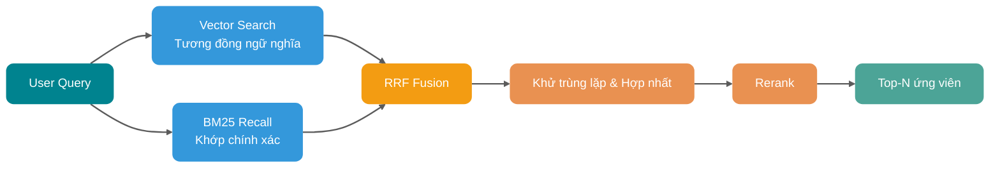
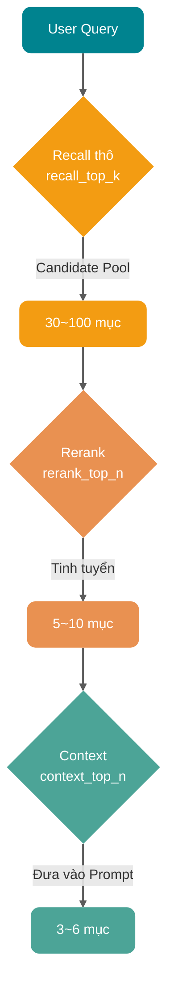
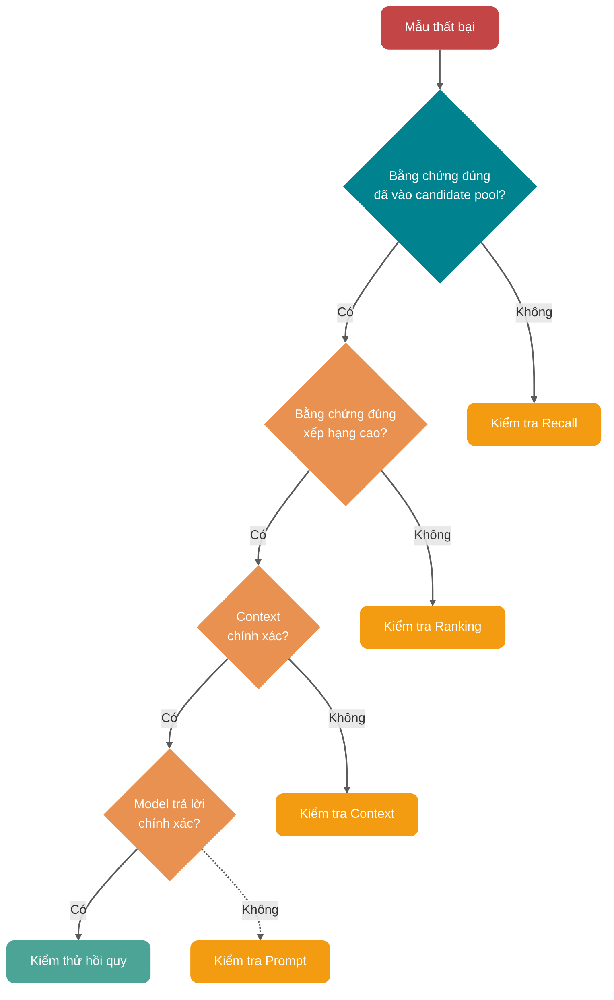

Khi RAG trả lời sai, việc chỉ đổi Embedding model hoặc tăng Top-K khó có thể giải quyết triệt để vấn đề. Lỗi phân tích bảng biểu trong PDF, điều kiện bị cắt đứt do chia Chunk, lọc quyền hạn quá muộn, hay candidate pool thiếu bằng chứng chính xác đều khiến model sinh câu trả lời nhận phải ngữ cảnh sai lệch.

Khi tinh chỉnh, cần định vị từng phân đoạn từ tài liệu, index, truy xuất (recall), xếp hạng lại (rerank), ngữ cảnh (context) cho đến khâu sinh câu trả lời (generation), sau đó sử dụng một bộ đánh giá (benchmark) cố định để replay và kiểm chứng các thay đổi. Về cách chuẩn bị tập đánh giá cũng như cách chấm điểm độc lập cho retrieval và generation, bạn có thể tham khảo trước bài [Đánh giá RAG: Từ tập dữ liệu offline đến khả năng quan sát online](./rag-evaluation.md).

## RAG tối ưu hóa thực chất là tối ưu cái gì?

RAG hoạt động giống như một dây chuyền xử lý bằng chứng: tài liệu thô ban đầu được phân tích (parse), làm sạch, cắt đoạn (chunking), gắn nhãn (metadata) và đánh chỉ mục (index); khi câu hỏi của người dùng gửi đến, nó sẽ trải qua khâu thấu hiểu truy vấn (query understanding), truy xuất (recall), xếp hạng lại (rerank), xây dựng ngữ cảnh (context construction), và cuối cùng mới giao cho LLM sinh câu trả lời.

Bất kỳ mắt xích nào trong chuỗi này gặp trục trặc đều sẽ ảnh hưởng dây chuyền đến các khâu hạ nguồn.

| Giai đoạn | Vấn đề điển hình | Biểu hiện cuối cùng |
| --- | --- | --- |
| Phân tích tài liệu (Document Parsing) | Bảng biểu bị lệch cột, mất tiêu đề, thiếu số trang | Trích dẫn không chuẩn xác, mất các điều kiện tiên quyết quan trọng |
| Phân đoạn Chunk (Chunking) | Khối quá lớn, quá nhỏ, ranh giới ngữ nghĩa bị cắt đứt | Nhiễu truy xuất lớn, hoặc đoạn trích được recall bị thiếu ngữ cảnh |
| Metadata | Không lưu nguồn, thời gian, quyền hạn, đường dẫn chương mục | Không thể lọc, không thể trích dẫn nguồn, dễ bị vượt quyền truy cập |
| Truy xuất (Recall) | Chỉ dùng vector search, bỏ qua từ khóa và điều kiện có cấu trúc | Bỏ sót mã lỗi (error code), SKU, mã phiên bản, thuật ngữ chuyên môn |
| Xếp hạng lại (Rerank) | Nhồi trực tiếp toàn bộ Top-K cho model | Đoạn trích đúng bị xếp phía sau, model bỏ lỡ trọng tâm |
| Ngữ cảnh (Context) | Không khử trùng lặp (dedup), không nén, không sắp xếp | Lãng phí Token, model bị phân tâm bởi nhiễu |
| Sinh câu trả lời (Generation) | Prompt không giới hạn chặt chẽ ranh giới bằng chứng | Câu trả lời nghe mượt mà nhưng trích dẫn và sự thật không khớp nhau |
| Đánh giá (Evaluation) | Chỉ dựa vào cảm tính chủ quan, không xây dựng test set | Thay đổi dựa trên linh cảm, production liên tục bị regression |

Một lần tinh chỉnh RAG có hiệu quả hay không cuối cùng phải dựa vào tính khả dụng, khả năng truy vết nguồn gốc, độ ổn định của câu trả lời, cũng như độ trễ (latency) và chi phí tài nguyên phải đánh đổi. Đối với mỗi mẫu thất bại (failed sample), tối thiểu phải ghi nhận kết quả 5 bước kiểm tra: bằng chứng đúng có được recall hay không, thứ hạng của nó trong candidate pool, nội dung gì thực sự lọt vào context, câu trả lời có bị ràng buộc bởi bằng chứng hay không, và liệu thay đổi đó có thể tái hiện được trên bộ mẫu cố định hay không. Thiếu những ghi nhận này, mọi thảo luận về việc lựa chọn vector database đều thiếu căn cứ phán đoán rõ ràng.

```mermaid
flowchart LR
    %% ========== Khai báo màu classDef ==========
    classDef client fill:#00838F,color:#FFFFFF,stroke:none,rx:10,ry:10
    classDef business fill:#E99151,color:#FFFFFF,stroke:none,rx:10,ry:10
    classDef infra fill:#9B59B6,color:#FFFFFF,stroke:none,rx:10,ry:10
    classDef success fill:#4CA497,color:#FFFFFF,stroke:none,rx:10,ry:10

    %% ========== Khai báo Node ==========
    Doc[/Tài liệu thô/]:::client
    Parse[Phân tích tài liệu]:::business
    Chunk[Phân đoạn Chunk]:::business
    Meta[Gắn nhãn Metadata]:::infra
    Index[Đánh chỉ mục Index]:::infra
    Query[User Query]:::client
    Recall[Truy xuất lai Hybrid Recall]:::business
    Rerank[Rerank xếp hạng lại]:::business
    Compress[Nén ngữ cảnh]:::business
    LLM[LLM sinh câu trả lời]:::business
    Answer[Câu trả lời cuối cùng]:::success

    %% ========== Liên kết ==========
    Doc --> Parse --> Chunk --> Meta --> Index
    Query --> Recall
    Index --> Recall
    Recall --> Rerank --> Compress --> LLM --> Answer

    linkStyle default stroke-width:2px,stroke:#333333,opacity:0.8
```

## Vòng lặp tối ưu hóa khép kín của RAG

RAG trong môi trường production đòi hỏi năng lực đánh giá và replay (chạy lại kiểm chứng). Nếu không, bạn không thể biết một thay đổi đã khắc phục được những vấn đề gì và vô tình tạo ra thêm những lỗi hồi quy (regression) nào.

Mỗi lần điều chỉnh kích thước Chunk, chiến lược viết lại query, model Rerank, hay tham số Top-K, bạn đều cần chạy lại trên cùng một bộ câu hỏi kiểm thử để so sánh Context Recall, Context Precision, Faithfulness, Answer Relevancy, độ trễ và chi phí.

Nếu không có replay, bạn sẽ không thể biết hệ thống đã tốt lên thật hay chỉ là đang chuyển sang một kiểu sai khác.

## Quản trị dữ liệu trước, tối ưu truy xuất sau

Nếu dữ liệu trước khi truy xuất đã bị phân tích sai lệch hoặc đánh mất cấu trúc vốn có, các khâu recall và generation phía sau sẽ không tài nào khôi phục lại được bằng chứng nguyên vẹn.

### Phân tích tài liệu quyết định giới hạn trên

PDF, Word, HTML, Markdown, bản ghi database, log ticket trông qua đều là văn bản, nhưng cấu trúc thực tế lại phân hóa rất lớn. Đặc biệt với các bảng biểu trong PDF, hình ảnh, header/footer, chú thích chân trang, bảng kéo dài qua nhiều trang, nếu chỉ dùng phương pháp trích xuất văn bản thuần túy, kết quả thường thấy là:

- Quan hệ giữa các cột trong bảng bị mất, giá cả, phiên bản, điều kiện bị trộn lẫn vào nhau.
- Header và footer bị ghi lặp đi lặp lại vào từng Chunk, làm ô nhiễm không gian vector.
- Hình ảnh và lưu đồ quy trình mất hoàn toàn, câu trả lời bị thiếu mất các bước cốt lõi.
- Thứ bậc tiêu đề biến mất, model không biết một đoạn văn đang thuộc về chương mục nào.

Đối với tài liệu kỹ thuật R&D, văn bản chính sách hay sổ tay sản phẩm, **chất lượng phân tích tài liệu (parsing) thường quan trọng hơn nhiều so với việc thay đổi embedding model**.

Một số gợi ý thực tế:

| Loại tài liệu | Cách xử lý đề xuất | Mục tiêu cốt lõi |
| --- | --- | --- |
| Markdown / HTML | Giữ nguyên phân cấp tiêu đề, danh sách, khối code | Không phá vỡ cấu trúc tự nhiên |
| Tài liệu PDF | Phân tích bài viết, bảng biểu, số trang, chú thích ảnh | Giữ vững ranh giới bằng chứng |
| Tài liệu dạng bảng | Chuyển thành bản ghi dòng có cấu trúc hoặc Markdown table | Giữ nguyên quan hệ giữa các trường |
| Tài liệu mã nguồn | Phân tầng theo package, class, method, comment block | Giữ trọn ngữ nghĩa lời gọi hàm |
| Ticket / Nhật ký chat | Phân đoạn theo phiên hội thoại, mốc thời gian, vai trò | Giữ vững thứ tự ngữ cảnh |

Khi tỷ lệ bảng biểu và hình ảnh cao, có thể bổ sung OCR hoặc mô tả có cấu trúc đa phương thức (multimodal) cho các tài liệu có tỷ lệ hit thấp. Đừng vội ném toàn bộ file cho vision model xử lý: hãy bắt đầu từ các tài liệu giá trị cao và các mẫu thất bại thường gặp, quan sát xem lợi ích thu được từ việc phân tích có bù đắp được chi phí và thời gian xử lý tăng thêm hay không.

### Vai trò của Metadata

Cả điều kiện lọc trong truy vấn lẫn thông tin nguồn dẫn của câu trả lời cuối cùng đều phụ thuộc vào Metadata. Metadata vừa quyết định Chunk nào đủ điều kiện lọt vào candidate pool, vừa giúp kết quả có thể truy ngược lại văn bản gốc, số trang và phiên bản tương ứng.

Tối thiểu nên lưu các trường sau cho mỗi Chunk:

- `source_id`: ID tài liệu gốc, thuận tiện cho việc truy vết và khử trùng lặp.
- `source_type`: PDF, trang web, ticket, code, bản ghi database, v.v.
- `title`: Tiêu đề tài liệu.
- `section_path`: Đường dẫn chương mục, ví dụ "Chính sách đổi trả / Phạm vi bảo hành / Hàng hóa đặc biệt".
- `page`: Số trang hoặc vị trí đoạn văn.
- `created_at` / `updated_at`: Lọc theo thời gian và xác định phiên bản cũ/mới.
- `tenant_id` / `acl`: Đa người thuê (multi-tenant) và kiểm soát quyền truy cập.
- `business_tags`: Dòng sản phẩm, ngôn ngữ, khu vực, phiên bản, module.

Bộ lọc quyền hạn (permission filtering) phải tham gia truy vấn trước khi thực hiện recall. Nếu vector database trả về Top-10 nhưng 8 kết quả trong đó không có quyền truy cập, việc lọc bỏ sau đó chỉ để lại 2 Chunk không phản ánh rằng hệ thống chỉ tìm thấy 2 nội dung liên quan; nghiêm trọng hơn, nếu cấu hình thiếu điều kiện phân quyền, context sẽ bị ô nhiễm dữ liệu nhạy cảm.

Do đó, phạm vi nào có thể biểu diễn bằng Metadata cần được thu hẹp trước. Ví dụ, hãy giới hạn `tenant_id`, loại tài liệu, phiên bản và thời gian cập nhật trước, sau đó mới tính toán độ tương đồng vector hoặc chạy truy xuất lai (hybrid search).

## Chiến lược Chunk: Đừng băm vụn tri thức

Ranh giới của Chunk quyết định một đơn vị recall có thể mang theo bao nhiêu điều kiện và kết luận. Nếu điều kiện bị cắt sang khối liền kề, dù phía sau có dùng Rerank thì nó cũng chỉ có thể lựa chọn trên những ứng viên không trọn vẹn.

### Kích thước Chunk không có kích cỡ vạn năng

Các mốc 512, 800, 1000 Token chỉ nên dùng để dựng index thực nghiệm ban đầu. Đối với những câu mang điều kiện tiên quyết như "Các trường hợp trên không áp dụng chính sách đổi trả 7 ngày không cần lý do", cắt quá vụn sẽ chỉ giữ lại kết luận trơ trọi; cắt quá lớn thì một câu liên quan sẽ kéo theo cả đoạn giải thích không liên quan vào context.

Vòng thử nghiệm đầu tiên có thể bắt đầu từ các khoảng sau:

- FAQ, chính sách ngắn, mô tả API: Bắt đầu từ 200 đến 500 Token.
- Tài liệu kỹ thuật, hướng dẫn tutorial, tài liệu giải pháp: Bắt đầu từ 400 đến 800 Token.
- Luật định, hợp đồng, chính sách tài chính: Quan tâm nhiều hơn đến tính trọn vẹn của điều khoản, ưu tiên cắt theo tiêu đề, điều, khoản, điểm.
- Knowledge base về mã nguồn: Đừng chỉ cắt theo Token, ưu tiên cắt theo file, class, hàm, khối comment.

Xây dựng index riêng cho các tham số ứng viên này, dùng cùng một bộ câu hỏi để so sánh Context Recall, Context Precision, độ chính xác câu trả lời và số Token trung bình của context, từ đó giữ lại bộ cấu hình phù hợp nhất với tập tài liệu hiện tại.

### Phân đoạn ngữ nghĩa (Semantic Chunking) phù hợp với tài liệu ổn định

Semantic chunking kết hợp quan hệ giữa tiêu đề, đoạn văn và các câu lân cận để xác định ranh giới, không ngắt cứng theo số ký tự cố định. Khi chủ đề tài liệu đan xen, câu hỏi thiên về dạng khái niệm và hệ thống chấp nhận khâu tiền xử lý offline tương đối phức tạp, bạn hoàn toàn có thể đưa phương pháp này vào thử nghiệm:

- Chủ đề tài liệu đan xen, một trang nói liền lúc nhiều khái niệm.
- Câu hỏi người dùng thiên về dạng khái niệm tổng quát hơn là tra cứu một trường cụ thể.
- Tần suất cập nhật knowledge base không quá cao, chấp nhận được chi phí tiền xử lý offline phức tạp.

Phương pháp cắt này cũng có ranh giới áp dụng rõ ràng:

- Khi tài liệu cập nhật gia tăng (incremental update) thường xuyên, tài liệu thay đổi cần tính lại Embedding của câu hoặc đoạn văn, chi phí offline cao hơn chia đoạn theo cấu trúc. Thông thường semantic chunking đánh giá nội dung liền kề bên trong một tài liệu đơn lẻ, không bắt buộc phải gom cụm (re-cluster) lại toàn bộ knowledge base mỗi lần cập nhật.
- Bản thân tài liệu đã có cấu trúc rất rõ ràng, chẳng hạn phân cấp tiêu đề Markdown.
- Truy vấn chủ yếu là tra cứu chính xác mã số, trường thông tin, trạng thái, mục cấu hình.

Khi tài liệu API đã có sẵn OpenAPI path, method và bảng tham số, hãy cắt theo các cấu trúc này. Nếu chuyển sang dùng sentence embedding để phân ranh giới, các tham số và điều kiện trả về rất dễ bị xé lẻ ra.

### Parent-Child Chunk là một giải pháp dung hòa thực tế

Parent-Child Chunk tách biệt độ mịn của khâu truy xuất (recall) và độ mịn của khâu đọc hiểu (reading). Xây dựng vector index bằng các child chunk nhỏ khoảng 300 Token, và liên kết nó với một parent passage lớn hơn khoảng 1200 Token; khi khớp trúng child chunk, ta sẽ đưa parent passage vào context. Bằng cách này, câu hỏi vừa có thể hit trúng những cách diễn đạt chi tiết, vừa giữ lại được các điều kiện tiên quyết và giải thích liền kề mà không cần phải tăng Top-K một cách mù quáng. Tài liệu dài, hướng dẫn, giải thích chính sách và sổ tay xử lý sự cố đều rất thích hợp với mô hình quan hệ này.

### Thêm các điểm truy cập ngữ nghĩa cho Chunk

"Làm sao để lấy lại tiền" và "Quy trình gửi yêu cầu hoàn tiền" diễn đạt cùng một nhu cầu, nhưng độ tương đồng bề mặt văn bản chưa chắc đã đủ cao. Khi gặp sự khác biệt này, có thể cung cấp thêm các điểm truy cập (entry point) cho cùng một Chunk trong giai đoạn đánh index:

- Tạo tóm tắt (summary) cho từng Chunk, đánh index cả tóm tắt lẫn nội dung chính.
- Sinh ra các câu hỏi tiềm năng mà Chunk có thể trả lời, dùng vector câu hỏi để hỗ trợ recall.
- Sinh vector tiêu đề cho các chương mục, giúp câu hỏi dạng khái niệm dễ hit trúng chủ đề trước.
- Sinh mô tả có cấu trúc cho code hoặc bảng biểu, tránh việc văn bản gốc khó tạo embedding hiệu quả.

Tóm tắt, câu hỏi và mô tả có cấu trúc đều đòi hỏi chi phí sinh và bảo trì. Hãy kiểm chứng trước trên tài liệu giá trị cao hoặc các mẫu thất bại thường gặp xem các entry point này có vớt lại được bằng chứng bị bỏ sót hay không trước khi quyết định mở rộng quy mô.

## Tối ưu hóa Recall: Đừng chỉ phụ thuộc vào độ tương đồng vector

Chuyển Query thành Embedding rồi lấy Top-K có thể dùng làm baseline. Tuy nhiên, các từ khóa chính xác như mã lỗi, mã model và số phiên bản rất dễ bị lấn át bởi các nội dung tương đồng về ngữ nghĩa nhưng sai về bản chất, do đó cần thêm tín hiệu recall từ khóa.

### Hybrid Search phù hợp với những truy vấn nào?

Vector retrieval tìm kiếm ứng viên dựa trên mức độ tiệm cận ngữ nghĩa, còn BM25 khớp ứng viên dựa trên sự xuất hiện của từ khóa. Hai luồng kết quả này có phạm vi bao phủ riêng biệt trên các loại truy vấn dưới đây:

| Loại truy vấn | Biểu hiện của Vector Search | Biểu hiện của BM25 | Đề xuất |
| --- | --- | --- | --- |
| "Làm thế nào để hủy gói thuê bao" | Khớp được với "tắt tự động gia hạn" | Có thể không khớp được từ khóa | Giữ lại vector recall |
| "Mã lỗi E1027" | Có thể recall ra lỗi chung chung | Khớp chính xác mã lỗi | Bắt buộc giữ lại keyword recall |
| "Thông số model ABX-4421" | Dễ tìm nhầm sang model tương tự | Khớp chính xác SKU | Bắt buộc giữ lại keyword recall |
| "Phân biệt các rejection policy trong Java thread pool" | Hiểu ngữ nghĩa khá tốt | Khớp tốt các từ khóa | Kết hợp Hybrid sẽ ổn định hơn |
| "Chính sách giá mới nhất v3.2" | Cần điều kiện ngữ nghĩa + thời gian | Khớp được số phiên bản | Metadata + Hybrid Search |

Pipeline thực tế sẽ chạy song song luồng ứng viên ngữ nghĩa và luồng ứng viên từ khóa, dùng RRF (Reciprocal Rank Fusion) hoặc trọng số chuẩn hóa tuyến tính để hợp nhất, sau đó khử trùng lặp và chuyển giao cho Rerank. Microsoft Azure AI Search, Google Vertex AI Vector Search và Weaviate đều xem Hybrid Search và RRF là các giải pháp tiêu chuẩn. RRF chỉ dung hợp dựa trên thứ hạng vị trí của ứng viên, không bắt buộc phải quy đổi điểm số BM25 và cosine similarity của vector về cùng một thang đo.

Nếu tài liệu có cấu trúc rất cao và truy vấn gần như không chứa từ khóa chuyên biệt, lợi ích từ Hybrid Search có thể không quá rõ rệt. Ngược lại, với các truy vấn mà mã lỗi, model sản phẩm, thông số cấu hình và danh từ riêng chiếm tỷ lệ lớn, bắt buộc phải duy trì kênh từ khóa để tránh việc các tài liệu na ná nhau nhưng thiếu thực thể chính xác bị đẩy lên đầu.

### Query Rewrite: Làm cho câu hỏi có thể truy xuất được trước

Câu hỏi người dùng nhập vào thường thiếu đối tượng, thời gian và phạm vi cần thiết cho việc truy xuất. Ví dụ:

- "Lỗi này sửa kiểu gì?"
- "Có lấy lại tiền được không?"
- "Sự cố rate limit trên production lại bị à?"

"Lỗi này sửa kiểu gì" không nói rõ mã lỗi và service nào, "Có lấy lại tiền được không" không nêu rõ trạng thái đơn hàng. Query Rewrite cần bổ sung những cách diễn đạt có thể truy xuất được, nhưng tuyệt đối không được tự ý thay đổi ý định gốc của người dùng.

Các chiến lược phổ biến gồm:

| Chiến lược | Kịch bản áp dụng | Ví dụ |
| --- | --- | --- |
| Chuẩn hóa truy vấn (Canonical Normalization) | Văn nói, từ viết tắt, thiếu ngữ cảnh | Đổi "tiền có rút lại được không" thành "chính sách hoàn tiền, điều kiện hoàn tiền, quy trình hoàn tiền" |
| Multi-Query | Ý định có thể diễn đạt bằng nhiều cách khác nhau | Truy xuất đồng thời "hủy gói thuê bao", "tắt tự động gia hạn", "dừng gói thành viên" |
| Phân rã truy vấn (Query Decomposition) | Câu hỏi chứa nhiều câu hỏi con | Tách "So sánh phí xử lý và giải quyết tranh chấp giữa Stripe và Square" thành 4 câu hỏi con |
| Step-back Query | Câu hỏi quá chi tiết, thiếu bối cảnh nền | Truy xuất "quy định thanh toán thuê bao" trước, sau đó mới trả lời câu hỏi hủy cụ thể |
| HyDE | Truy vấn quá ngắn, khác biệt lớn về hình thái so với tài liệu | Sinh câu trả lời giả định trước, rồi dùng vector của nó để truy xuất tài liệu thực tế |
| Self-Query | Câu hỏi chứa sẵn điều kiện lọc | Tách bộ lọc năm và danh mục từ "Tra cứu chính sách liên quan đến Java năm 2025" |

Các component như `MultiQueryRetriever`, `SelfQueryRetriever` của LangChain đã đóng gói sẵn các chiến lược này. Cho dù có dùng các component này hay không, Query gốc vẫn luôn phải tham gia recall và fusion cùng với kết quả viết lại: nếu model viết lại hiểu nhầm "hoàn tiền" thành "hủy gói thuê bao", Query gốc vẫn sẽ giữ lại được lối vào truy xuất chính xác.

### Top-K không phải cứ càng lớn càng tốt

Tăng Top-K giúp tăng cơ hội để bằng chứng đúng lọt vào candidate pool, nhưng đồng thời cũng đẩy chi phí Rerank, Prompt Token và tỷ lệ nhiễu lên cao. Candidate pool, kết quả rerank và context cuối cùng nên áp dụng các giới hạn trần riêng biệt:

- `recall_top_k`: Candidate pool của bước recall thô, ví dụ từ 30 đến 100.
- `rerank_top_n`: Số lượng giữ lại sau khi rerank, ví dụ từ 5 đến 10.
- `context_top_n`: Số lượng thực tế đưa vào context, ví dụ từ 3 đến 6.

`recall_top_k` dùng để chống bỏ sót bằng chứng, `rerank_top_n` dùng để kiểm soát chi phí tính toán khi xếp hạng tinh, còn `context_top_n` được quyết định bởi dung lượng bằng chứng mà LLM thực sự có thể hấp thụ hiệu quả. Cả ba tham số này cần được tinh chỉnh đồng thời trên cùng một bộ đánh giá.

## Rerank: Xếp hạng lại từ "liên quan" thành "có thể trả lời"

Truy xuất Dense Bi-Encoder mã hóa độc lập Query và Document rồi tính khoảng cách vector, rất phù hợp để lấy nhanh ứng viên từ kho dữ liệu hàng triệu văn bản. Ngược lại, Cross-Encoder hoặc model Rerank chuyên dụng mã hóa chung Query và Document ứng viên; dù chi phí tính toán cao hơn, chúng có khả năng phán đoán chính xác liệu ứng viên có chứa các điều kiện và kết luận cần thiết để trả lời câu hỏi hay không.

### Tại sao Rerank lại hữu ích?

Điểm số vector đo lường mức độ tương đồng về mặt diễn đạt; còn điểm số rerank phục vụ cho việc: "Đoạn văn này có thể trực tiếp trả lời câu hỏi hiện tại hay không".

Lấy một ví dụ:

Người dùng hỏi: "Tại sao thread pool lại kích hoạt chính sách từ chối (rejection policy)?"

Vector recall có thể tìm ra các đoạn trích sau:

1. Giải thích các tham số cốt lõi của thread pool.
2. Danh sách enum các rejection policy.
3. Điều kiện kích hoạt rejection policy khi hàng đợi đầy và số thread đạt ngưỡng `maximumPoolSize`.
4. Code mẫu minh họa cách sử dụng thread pool.

Đoạn 1 và 2 rất gần gũi về mặt ngữ nghĩa, nhưng đoạn 3 mới là trọng tâm câu trả lời. Giá trị của Rerank chính là kéo đoạn 3 lên vị trí đầu tiên.

### Đặt Rerank ở đâu trong pipeline?

Quy trình có thể chia thành năm bước: lọc sơ bộ bằng Metadata, Hybrid Search recall thô 30 đến 100 mục, khử trùng lặp và hợp nhất các đoạn liền kề, Rerank chọn ra 5 đến 10 mục, cuối cùng nén lại và đưa vào Prompt.

Rerank không thể khôi phục những tài liệu vốn dĩ không có mặt trong candidate pool. Hãy luôn kiểm tra Context Recall trước; nếu recall thô không có đoạn trích đúng, cần quay lại kiểm tra khâu phân tích tài liệu, chia Chunk và truy vấn, thay vì liên tục thay đổi model rerank trong vô vọng.

### Lựa chọn giữa LLM Rerank và Reranker chuyên dụng thế nào?

| Phương án | Ưu điểm | Nhược điểm | Kịch bản phù hợp |
| --- | --- | --- | --- |
| Cross-Encoder Reranker | Phán đoán liên quan chi tiết, chi phí kiểm soát được | Cần chọn model, có thể lệch ngôn ngữ/lĩnh vực | Pipeline production thông dụng |
| LLM chấm điểm | Xuất được lý do chấm điểm, quy tắc linh hoạt | Chậm, đắt, độ ổn định phụ thuộc Prompt; lý do chưa chắc là bản chất quyết định | Traffic nhỏ, giá trị cao, suy luận phức tạp |
| Rerank theo quy tắc | Rẻ, kiểm soát hoàn toàn | Chỉ xử lý được quy tắc tường minh | Ưu tiên thời gian, quyền hạn, phiên bản, nguồn |
| Rerank hỗn hợp | Linh hoạt, phù hợp nghiệp vụ phức tạp | Độ phức tạp kỹ thuật cao | Enterprise knowledge base, CSKH, kịch bản tuân thủ pháp lý |

Reranker chuyên dụng có thể đảm nhận việc phán đoán độ liên quan trên đường dẫn chính, còn các điều kiện xác định như thời gian, quyền hạn và phiên bản nên giao cho quy tắc xử lý; LLM chấm điểm phù hợp cho đánh giá offline hoặc các phán đoán phức tạp với traffic thấp. Khi chọn model, cần so sánh riêng biệt về ngôn ngữ mục tiêu, dữ liệu nghiệp vụ, độ trễ và chi phí.

## Context Engineering: Đừng biến model thành thùng rác

Sau khi recall hoàn tất, bạn còn phải quyết định những đoạn trích nào sẽ vào Prompt và theo thứ tự nào. Cửa sổ ngữ cảnh (context window) lớn hơn không đồng nghĩa với việc bạn có thể bỏ qua sự phân bổ chú ý (attention), độ trễ, chi phí và tỷ lệ tín hiệu trên nhiễu (SNR). Những đoạn trích không liên quan sẽ chiếm dụng vị trí đọc hiểu của model, gây ra:

- Nắm bắt sai bằng chứng, xem các đoạn tương tự nhưng không liên quan làm căn cứ sự thật.
- Bỏ qua các thông tin quan trọng nằm ở vị trí chính giữa ("lost in the middle").
- Câu trả lời dài dòng nhưng lạc đề.
- Trích dẫn sai nguồn gốc.
- Chi phí token và độ trễ từ đầu tiên (TTFT) tăng vọt.

Mỗi đoạn trích được đưa vào Prompt đều phải có khả năng củng cố cho một kết luận, điều kiện hoặc trường hợp ngoại lệ trong câu hỏi hiện tại.

### Nén ngữ cảnh (Context Compression)

Thao tác nén giữ lại bằng chứng xoay quanh Query hiện tại, thay vì tóm tắt chung chung toàn bộ các ứng viên. Các lựa chọn phổ biến:

| Phương thức nén | Cách làm | Rủi ro |
| --- | --- | --- |
| Trích xuất chọn lọc | Chỉ giữ lại các câu gốc liên quan trực tiếp đến câu hỏi | Có thể bỏ sót các điều kiện ngầm định |
| Tóm tắt bám sát truy vấn | Nén đoạn văn dài thành bản tóm tắt xoay quanh câu hỏi | Có thể gây sai lệch ngữ nghĩa khi viết lại |
| Trích xuất có cấu trúc | Trích xuất các trường, điều kiện, kết luận, ngoại lệ | Phụ thuộc vào thiết kế Schema trích xuất |

`ContextualCompressionRetriever` thể hiện sự kết hợp giữa "retriever cơ bản + bộ nén". Trong thực tế, có thể lọc theo quy tắc và khử trùng lặp trước, sau đó chỉ gọi LLM nén đối với các đoạn trích tương đối dài để tránh phải chịu chi phí gọi model trên từng Chunk đơn lẻ.

### Thứ tự sắp xếp ngữ cảnh cũng ảnh hưởng đến câu trả lời

Thứ tự trả về ban đầu thường là sự xáo trộn giữa các kênh recall, nguồn tài liệu và phiên bản, không thể trực tiếp dùng làm thứ tự trong Prompt. Hãy tổ chức theo các nguyên tắc sau:

- Bằng chứng liên quan nhất đặt lên phía trước.
- Các đoạn trích liền kề của cùng một tài liệu cố gắng giữ nguyên thứ tự ban đầu.
- Các đoạn trích mâu thuẫn nhau phải ghi rõ thời gian cập nhật và phiên bản.
- Đoạn trích được tham chiếu phải giữ lại thông tin nguồn gốc.
- Bằng chứng có độ tin cậy thấp không được trộn lẫn bừa bãi với bằng chứng có độ tin cậy cao.

So sánh đa tài liệu có thể nhóm theo chủ đề, phân tích diễn tiến có thể sắp xếp theo dòng thời gian, xử lý sự cố có thể tổ chức theo "Hiện tượng, Nguyên nhân, Các bước xử lý, Lưu ý". Context Engineering xử lý cấu trúc của các bằng chứng này bên trong input của model, chứ không chỉ đơn thuần là số lượng văn bản được recall.

### Prompt phải giới hạn ranh giới bằng chứng

Prompt tối thiểu cần nêu rõ các ranh giới sau:

- Chỉ trả lời dựa trên ngữ cảnh được cung cấp.
- Khi ngữ cảnh không đủ thông tin, phải nói rõ là không thể phán đoán.
- Mỗi kết luận quan trọng cố gắng kèm theo nguồn trích dẫn.
- Tuyệt đối không xem tài liệu phiên bản cũ hoặc tài liệu tương tự là sự thật của phiên bản hiện tại.

Việc đánh giá chất lượng bằng chứng và xác thực trích dẫn vẫn cần được thực thi bên ngoài Prompt. Lời nhắc (Prompt) có thể biểu đạt yêu cầu "từ chối trả lời khi thiếu bằng chứng", nhưng bản thân Prompt không thể tự kiểm tra xem model có thực sự tuân thủ hay không.

## Đánh giá: Định vị riêng biệt vấn đề Retrieval và Generation

Đánh giá RAG phải bóc tách từng phần. Nếu chỉ nhìn vào điểm số câu trả lời cuối cùng, rất khó biết mắt xích nào thực sự bị hỏng.

### Xây dựng bộ đánh giá tối thiểu (Minimal Evaluation Set)

Không cần thiết phải bắt đầu ngay với hàng nghìn mẫu. Hãy bắt đầu từ 50 đến 100 câu hỏi có giá trị cao:

- Các câu hỏi người dùng có tần suất cao.
- Các câu hỏi từng thất bại trên môi trường online.
- Các câu hỏi nghiệp vụ mang tính sống còn.
- Các câu hỏi suy luận đa bước (multi-hop reasoning).
- Các câu hỏi khớp chính xác, ví dụ mã lỗi, số phiên bản, SKU.
- Các câu hỏi dễ bị vượt quyền hoặc hết hạn hiệu lực.
- Các câu hỏi bắt buộc phải từ chối trả lời (rejection).

Mỗi mẫu đánh giá tốt nhất nên chứa:

- `question`: Câu hỏi gốc của người dùng.
- `golden_answer`: Câu trả lời lý tưởng chuẩn xác.
- `golden_context`: Các đoạn trích hoặc tài liệu bằng chứng bắt buộc phải hit trúng.
- `metadata_filter`: Các điều kiện lọc cần thiết.
- `answer_type`: Hỏi đáp sự thật, hướng dẫn quy trình, so sánh, từ chối trả lời, tóm tắt, v.v.

### Tách bạch chỉ số Retrieval và chỉ số Generation

| Chỉ số | Đối tượng đo lường | Giải thích |
| --- | --- | --- |
| Hit Rate@K | Khâu Recall | Bằng chứng đúng có xuất hiện trong Top-K kết quả đầu tiên hay không |
| MRR | Khâu Ranking | Bằng chứng đúng đầu tiên được xếp hạng cao đến mức nào |
| Context Recall | Độ đầy đủ của Recall | Toàn bộ bằng chứng cần thiết để trả lời có được tìm thấy hết không |
| Context Precision | Độ thuần khiết của Context | Trong số nội dung đưa vào context, có bao nhiêu phần thực sự liên quan |
| Faithfulness | Độ trung thực của Generation | Câu trả lời có được nâng đỡ một cách vững chắc bởi context hay không |
| Answer Relevancy | Độ liên quan của câu trả lời | Câu trả lời có thực sự giải đáp đúng câu hỏi người dùng đưa ra không |
| Citation Accuracy | Độ chính xác của trích dẫn | Vị trí trích dẫn có thực sự hỗ trợ cho kết luận tương ứng không |
| Latency / Cost | Chỉ số kỹ thuật hệ thống | Độ trễ P95, Token tiêu thụ, thời gian Rerank, tỷ lệ trúng cache |

Các công cụ như RAGAS, DeepEval, LangSmith đều hỗ trợ đánh giá xoay quanh tính liên quan của ngữ cảnh, độ trung thực và độ liên quan của câu trả lời. Tài liệu của RAGAS bóc tách khá rành mạch các chỉ số Context Precision, Context Recall, Faithfulness, Response Relevancy; DeepEval cũng hỗ trợ kết hợp các chỉ số retrieval và generation thành các bộ test end-to-end.

Tuy nhiên hãy luôn nhớ: **LLM-as-a-Judge không phải là chân lý tuyệt đối, nó chỉ là một tín hiệu hỗ trợ.**

Trước khi đưa lên production, hãy lấy mẫu review thủ công một tập kết quả để hiệu chỉnh xem evaluator tự động có bị thiên vị câu trả lời dài, có bỏ sót lỗi trích dẫn, hay có kém nhạy bén với các thuật ngữ chuyên ngành tiếng Việt hay không.

### Mọi thay đổi đều phải được đánh version

Kết quả của mỗi lần đánh giá bắt buộc phải tương ứng với các thông tin phiên bản sau:

- Version của bộ parser tài liệu.
- Version của chiến lược chia Chunk.
- Version của Embedding model.
- Version của các tham số Index.
- Version của Prompt Query Rewrite.
- Version của Rerank model.
- Version của Prompt Generation.
- Version của bộ dữ liệu đánh giá (evaluation set).

Khi chỉ số thay đổi sau đợt cập nhật knowledge base, những ghi chép này mới giúp bạn định vị được lỗi hồi quy phát sinh từ phía parsing, indexing, retrieval hay generation.

## Các sai lầm phổ biến

### Chỉ điều chỉnh Embedding

Lỗi phân tích bảng biểu PDF, Chunk làm mất điều kiện tiên quyết, Metadata chưa lọc quyền hạn, hoặc tài liệu đúng căn bản chưa hề lọt vào candidate pool—khi gặp các tình huống này, đổi Embedding model tốt đến đâu cũng không thể bù đắp lại bằng chứng bị thiếu. Cần phân định rõ vấn đề thuộc về recall, ranking, context hay generation trên tập đánh giá trước khi quyết định thay đổi Embedding.

### Không thực hiện đánh giá

Một câu trả lời đơn lẻ trông có vẻ mượt hơn không chứng minh hiệu quả tổng thể đã tăng lên. Khi Top-K tăng lên, một số câu hỏi có thể vớt lại được bằng chứng, nhưng những câu hỏi khác lại bị nhiễu loạn; không có một tập mẫu cố định, bạn rất khó nhìn thấy đồng thời cả hai chuyển biến này. Bộ đánh giá tối thiểu cần bao quát các câu hỏi tần suất cao, câu hỏi thất bại, câu hỏi khớp chính xác và câu hỏi cần từ chối.

### Mù quáng tăng Top-K

Top-K quá lớn sẽ làm tăng chi phí Rerank, Prompt Token và độ trễ của model, đồng thời kéo tỷ lệ tín hiệu trên nhiễu của context đi xuống. Khi cần tăng độ phủ recall, hãy tăng candidate pool của recall thô, sau đó dựa vào Rerank và khâu nén để gạt bỏ nhiễu; đừng ghép thẳng các ứng viên mới vào context. Top-K của recall thô, Top-N của rerank và Top-N của context phải được ghi nhận và đánh giá tách biệt.

### Nhồi nhét ngữ cảnh không liên quan cho model

Khi nhiều phiên bản chính sách xung đột, tài liệu sản phẩm na ná nhau và các đoạn văn liền kề nhưng không liên quan bị nhồi lẫn vào nhau, model có thể lắp ghép chúng thành những kết luận nghe thì hợp lý nhưng thực tế hoàn toàn sai. Trước khi đưa vào Prompt, bắt buộc phải khử trùng lặp, nén gọn, sắp xếp theo độ mạnh của bằng chứng, và giữ lại phiên bản cùng nguồn gốc rõ ràng.

### Bỏ qua khả năng từ chối trả lời (Rejection)

Khi kết quả retrieval có độ tin cậy thấp, các bằng chứng mâu thuẫn lẫn nhau, hoặc người dùng không có quyền truy cập vào tài liệu mấu chốt, hệ thống cần phải biết từ chối trả lời, hỏi lại làm rõ, hoặc chuyển giao cho nhân viên hỗ trợ. Cần bổ sung khâu phán đoán chất lượng bằng chứng sau khi retrieval, tùy vào kết quả để kích hoạt viết lại query, mở rộng phạm vi, tìm kiếm bên ngoài hoặc chủ động từ chối.

## Quy trình khắc phục sự cố thực tế

Khi hiệu quả RAG trên production bị suy giảm, quy trình kiểm tra cần xác nhận trước xem bằng chứng đúng đã lọt vào candidate pool hay chưa, sau đó mới kiểm tra thứ hạng, context và câu trả lời cuối cùng. Cách tiếp cận này giúp tránh việc sửa loạn xạ cùng lúc cả Prompt, model và tham số truy xuất.

### Bước 1: Phân loại các mẫu thất bại

Đầu tiên hãy xem xét 20 đến 50 câu hỏi thất bại, chia chúng thành các nhóm rõ ràng:

- Hoàn toàn không recall được tài liệu đúng.
- Recall được tài liệu đúng nhưng thứ hạng bị xếp quá thấp.
- Tài liệu đúng đã vào context nhưng câu trả lời không dùng tới.
- Câu trả lời có dùng context nhưng hiểu sai ý.
- Trích dẫn nguồn không tồn tại hoặc không liên quan.
- Đáng lẽ phải từ chối trả lời nhưng lại cố tình bịa chuyện.
- Lọc sai quyền hạn, thời gian, hoặc phiên bản.

Bước này mang lại giá trị rất lớn vì mỗi nhóm vấn đề sẽ có hướng xử lý hoàn toàn khác nhau.

### Bước 2: Kiểm tra xem bằng chứng đúng đã vào candidate pool chưa

Nếu Top-50 của recall thô không xuất hiện bằng chứng đúng, hãy kiểm tra:

- Tài liệu đã được nạp vào kho dữ liệu chưa.
- Phân tích tài liệu (parsing) có chính xác không.
- Chunk có vô tình cắt đứt các sự thật mấu chốt không.
- Bộ lọc Metadata có bị cấu hình quá khắt khe không.
- Query có cần viết lại, phân rã hay dùng HyDE không.
- Có cần bổ sung BM25 hoặc Hybrid Search không.

Lúc này việc tiếp tục tinh chỉnh Rerank là hoàn toàn vô nghĩa: candidate pool không có câu trả lời, rerank chỉ làm thay đổi thứ tự của các kết quả sai mà thôi.

### Bước 3: Bằng chứng đúng có trong candidate pool nhưng không vào được context

Nếu bằng chứng đúng đã nằm trong Top-50 nhưng lại không lọt được vào context cuối cùng, hãy kiểm tra:

- Rerank model có phù hợp với ngôn ngữ và lĩnh vực chuyên môn không.
- Input của Rerank có quá dài dẫn đến việc bị cắt cụt (truncate) không.
- Dung hợp điểm số (score fusion) có làm các kết quả từ khóa bị đè bẹp xuống dưới không.
- Việc gộp các Chunk liền kề có vô tình kéo theo quá nhiều nhiễu không.
- Tham số `rerank_top_n` có bị đặt quá nhỏ không.

Những dấu hiệu này lần lượt hướng về model rerank, trọng số dung hợp, kích thước candidate pool hoặc chiến lược khử trùng lặp.

### Bước 4: Context chính xác nhưng câu trả lời vẫn sai

Nếu bằng chứng đúng đã được đưa vào Prompt nhưng model vẫn trả lời sai, hãy kiểm tra:

- Prompt có yêu cầu bắt buộc trả lời dựa trên context không.
- Context có chứa các phiên bản mâu thuẫn lẫn nhau không.
- Bằng chứng có bị chìm nghỉm ở vị trí giữa của context không.
- Câu hỏi có đòi hỏi suy luận đa bước hoặc lập bảng so sánh không.
- Có cần bổ sung định dạng output có cấu trúc và ràng buộc trích dẫn không.
- Có cần nén trước rồi mới đưa vào sinh câu trả lời không.

Sau khi đã loại trừ chắc chắn 3 nhóm vấn đề trước đó, mới tiến hành tinh chỉnh Prompt, thứ tự context, khâu nén và lựa chọn LLM sinh câu trả lời.

### Bước 5: Thiết lập kiểm thử hồi quy (Regression Testing)

Mỗi khi khắc phục xong một mẫu thất bại, hãy đưa input tái hiện, bằng chứng kỳ vọng và tiêu chí đánh giá vào bộ dữ liệu test hồi quy. Các thay đổi tiếp theo sẽ dùng bộ test này để replay, nhờ đó bạn mới phát hiện được liệu một lần fix bug có vô tình tạo ra regression mới hay không.

## Trình tự triển khai thực tế từ con số 0

Khi xây dựng RAG doanh nghiệp từ đầu, trước tiên hãy đảm bảo việc phân tích tài liệu, khử nhiễu, phân cấp tiêu đề, số trang, bảng biểu và Metadata có thể được sử dụng chuẩn xác, đồng thời dùng bộ câu hỏi bao quát các trường hợp tần suất cao, thất bại, khớp chính xác, phân quyền và từ chối để chạy thông luồng đánh giá replay.

Sau khi đã có baseline vững vàng, lần lượt so sánh các chiến lược Chunk cố định độ dài, theo cấu trúc, Parent-Child và Semantic Chunking; dùng vector recall xử lý nội dung tương đồng ngữ nghĩa, dùng BM25 hoặc sparse vector để giữ lại từ khóa chính xác; cuối cùng bổ sung Query Rewrite cho các trường hợp câu hỏi văn nói, từ viết tắt, đa ý định và suy luận đa bước. Khi candidate pool mở rộng, thông qua Rerank, khử trùng lặp, cắt gọt, tóm tắt hoặc trích xuất có cấu trúc, ta mới tạo nên một context gọn gàng, ít nhiễu và nằm trong giới hạn Token.

Phía generation cần xử lý triệt để việc từ chối trả lời khi thiếu bằng chứng và trích dẫn các kết luận mấu chốt. Trong quá trình phát hành canary, hãy ghi nhận chỉ số theo từng version và liên tục thu thập các mẫu thất bại. Mỗi vòng lặp chỉ thay đổi một số lượng biến số tối thiểu, đồng thời ghi lại version của parser, chunk, embedding, index, query rewrite, rerank và prompt; các lợi ích offline được kiểm chứng trên tập hồi quy vẫn luôn cần được tiếp tục theo dõi sát sao trên luồng traffic canary thực tế.

## Tổng kết

Một quy trình tinh chỉnh replay bài bản bắt đầu từ nội dung có thể truy xuất được tạo ra bởi khâu parsing và metadata, đi qua chunking, hybrid search, query rewrite, rerank và tổ chức ngữ cảnh, cuối cùng kiểm tra bằng chứng và câu trả lời mà model thực sự tiếp nhận. Bộ đánh giá cố định cùng việc lưu vết phiên bản giúp cho mọi cải tiến ở từng mắt xích đều có thể được đo lường và so sánh lặp lại một cách khoa học.

## Tài liệu tham khảo

- [Production RAG: The Five Decisions Behind Every System That Works](https://www.bestblogs.dev/article/899eff0a)
- [RAG Optimization Dictionary: 20 RAG Optimization Methods Analyzed](https://cloud.tencent.com/developer/article/2634637)
- [Weaviate Hybrid Search Documentation](https://docs.weaviate.io/weaviate/concepts/search/hybrid-search)
- [Microsoft Azure AI Search: Hybrid Search RRF](https://learn.microsoft.com/en-us/azure/search/hybrid-search-ranking)
- [Google Vertex AI Vector Search: Hybrid Search](https://docs.cloud.google.com/vertex-ai/docs/vector-search/about-hybrid-search)
- [Cohere Rerank Documentation](https://docs.cohere.com/docs/rerank-overview)
- [LangChain Retriever API Documentation](https://api.python.langchain.com/en/latest/langchain/retrievers.html)
- [RAGAS Metrics Documentation](https://docs.ragas.io/en/stable/concepts/metrics/available_metrics/context_precision/)
- [DeepEval RAG Evaluation Guide](https://deepeval.com/guides/guides-rag-evaluation)
