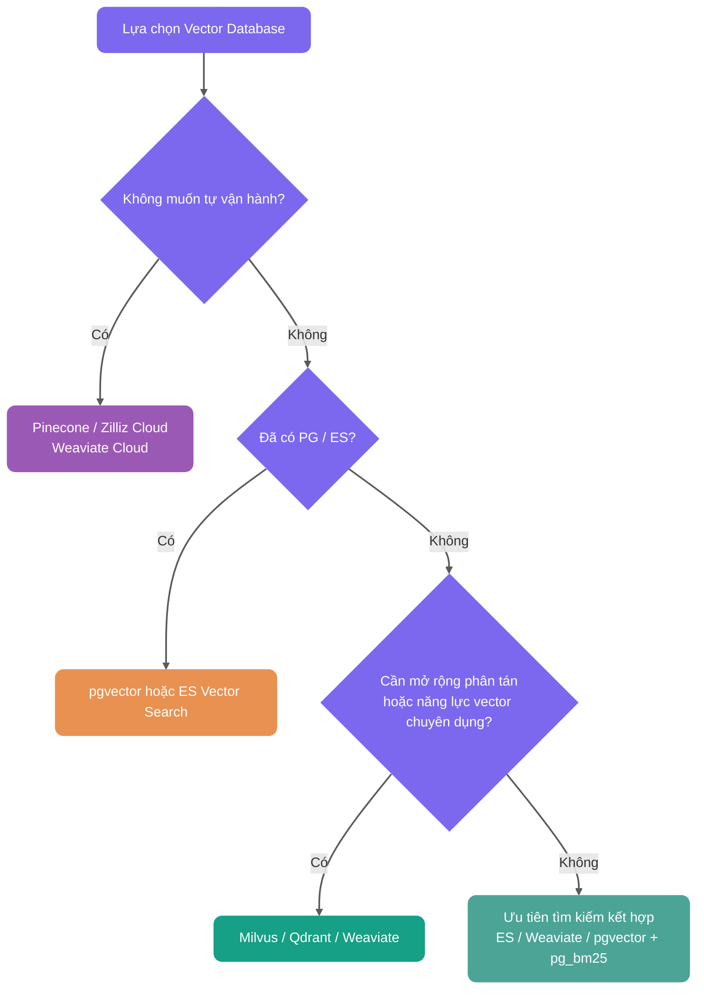

Lưu trữ Embedding vào các trường thông thường trong cơ sở dữ liệu và tính toán khoảng cách từng bản ghi một có thể dùng làm đường cơ sở (baseline) tìm kiếm chính xác khi khối lượng dữ liệu còn nhỏ. Tuy nhiên, khi quy mô dữ liệu, lượng truy cập đồng thời hoặc yêu cầu về độ trễ tăng lên, chi phí tính toán khi quét toàn bảng (full-table scan) sẽ tăng tuyến tính theo số lượng vector. Lúc này, bạn cần phải đánh giá việc sử dụng chỉ mục ANN hoặc các hệ thống tìm kiếm vector chuyên dụng.

Bài viết này bắt đầu từ các độ đo khoảng cách và thuật toán chỉ mục, sau đó kết hợp với PostgreSQL + pgvector để giải thích các tham số của HNSW, IVFFLAT, hành vi lọc dữ liệu và phương pháp lựa chọn giải pháp phù hợp.

## Mối quan hệ giữa Embedding và tìm kiếm vector là gì?

Vector Database không hiểu trực tiếp văn bản. Thứ nó lưu trữ và tìm kiếm chính là Embedding.

Quy trình Embedding là: Giao một đoạn văn bản cho mô hình Embedding, mô hình sẽ xuất ra một vector dày đặc có số chiều cố định (dense vector). Có thể hiểu nôm na đây là "tọa độ ngữ nghĩa của văn bản". Hai đoạn văn bản có ngữ nghĩa càng gần nhau thì khoảng cách giữa chúng trong không gian vector thường cũng càng gần nhau.


Chuỗi tìm kiếm vector trong RAG có thể được đơn giản hóa như sau:

```text
Chunk tài liệu -> Mô hình Embedding -> Vector tài liệu -> Ghi vào Vector Database
Câu hỏi người dùng -> Mô hình Embedding -> Vector truy vấn -> Tìm kiếm Top-K vector tài liệu tương đồng nhất
```

Các khái niệm cơ bản có thể xem tại [Khái niệm cơ bản về RAG](./rag-basis.md). Bài viết này tập trung vào nửa sau của quy trình: Làm thế nào để lưu trữ, lập chỉ mục và tìm kiếm các vector này một cách hiệu quả.

## Tại sao trong kịch bản RAG lại cần Vector Database?

Tìm kiếm ngữ nghĩa bằng vector là một trong những phương thức thu hồi (recall) phổ biến nhất của RAG. Hệ thống chuyển đổi cả tài liệu và câu hỏi của người dùng thành các vector đa chiều, sau đó tìm ra Top-K đoạn trích tương đồng nhất để làm ngữ cảnh (context) cho LLM. RAG cũng có thể sử dụng BM25, SQL, truy vấn đồ thị hoặc gọi API bên ngoài để truy xuất, tùy thuộc vào dạng thức dữ liệu.

Do đó, vấn đề thực sự cần giải quyết trong kịch bản RAG không chỉ là "có lưu được Embedding hay không", mà là liệu có thể tìm ra Top-K tài liệu liên quan nhất trong một tập hợp khổng lồ các vector đa chiều với độ trễ thấp hay không.

Cơ sở dữ liệu quan hệ truyền thống có thể lưu trữ vector và cũng có thể tính toán độ tương đồng thông qua các hàm hoặc biểu thức SQL. Nhưng nếu không có chỉ mục vector chuyên dụng, thông thường nó chỉ có thể quét toàn bộ bảng, rất khó đáp ứng yêu cầu tìm kiếm độ trễ thấp ở cấp độ production. Khi số lượng Chunk đạt tới hàng trăm nghìn, hàng triệu hoặc nhiều hơn, việc đưa vào Vector Database, công cụ tìm kiếm vector hoặc các extension cơ sở dữ liệu có năng lực chỉ mục vector như PostgreSQL + pgvector là điều bắt buộc.


### Tìm kiếm tương đồng vector đa chiều

Embedding thường là các vector dày đặc từ 768 đến 3072 chiều. Khi không có chỉ mục vector, ngay cả khi cơ sở dữ liệu có thể tính toán độ tương đồng Cosine, tích vô hướng hoặc khoảng cách Euclid, nó vẫn rất khó hoàn thành tìm kiếm Top-K nhanh chóng trên quy mô dữ liệu lớn.

Tìm kiếm vét cạn (brute-force search) là việc duyệt qua toàn bộ bảng để tính toán khoảng cách, với độ phức tạp là O(n). Lấy 1 triệu vector 1024 chiều làm ví dụ, một truy vấn đơn lẻ phải thực hiện xấp xỉ:

```text
1,000,000 × 1,024 phép tính nhân
```

Độ trễ thực tế rất dễ lên tới hàng giây, tùy thuộc vào phần cứng và cách triển khai. Đối với một hệ thống hỏi đáp thời gian thực, độ trễ tính bằng giây là điều cơ bản không thể chấp nhận được.

Tìm kiếm láng giềng gần đúng ANN (Approximate Nearest Neighbor) ra đời chính là để giải quyết vấn đề này. Vector Database giảm bớt số lần tính toán khoảng cách thông qua điều hướng đồ thị, phân chia không gian, lượng tử hóa (quantization), v.v., không còn phải tính toán qua tất cả các vector trong mỗi lần truy vấn.

Giá trị của ANN không nằm ở việc luôn trả về kết quả láng giềng gần nhất chính xác 100%, mà là thực hiện sự đánh đổi kỹ thuật giữa tỷ lệ thu hồi (Recall), độ trễ và mức tiêu hao tài nguyên. Với các tham số chỉ mục và điều kiện phần cứng phù hợp, ANN thường có thể tối ưu hóa việc tìm kiếm trên hàng triệu vector từ quét vét cạn mất vài giây xuống còn vài chục mili-giây hoặc thấp hơn. Tuy nhiên, hiệu quả cụ thể bắt buộc phải được đo lường trên dữ liệu nghiệp vụ, Top-K, điều kiện lọc, lưu lượng đồng thời và mục tiêu Recall thực tế, chứ không thể chỉ nhìn vào độ phức tạp lý thuyết.

| Chỉ số | Tìm kiếm vét cạn | Tìm kiếm bằng chỉ mục ANN |
| --- | --- | --- |
| Phương thức tìm kiếm | Tính toán khoảng cách toàn bộ | Chỉ tìm kiếm trên tập ứng viên |
| Tỷ lệ thu hồi (Recall) | Lý thuyết 100% | Phụ thuộc vào loại chỉ mục và tham số |
| Độ trễ | Càng nhiều dữ liệu càng chậm | Thường thấp hơn rất nhiều |
| Cái giá phải trả | Chi phí tính toán cao | Cần xây dựng chỉ mục, tốn thêm bộ nhớ RAM hoặc ổ đĩa |

Bảng trên chỉ mô tả ở mức độ định tính quy mô. Hiệu năng thực tế liên quan mật thiết đến cấu hình phần cứng, tải đồng thời, phân phối dữ liệu, điều kiện lọc, Top-K và các tham số chỉ mục (như `ef_search`, `nprobe`). Khi lựa chọn và tinh chỉnh tham số, bạn nên tham khảo [ann-benchmarks.com](https://ann-benchmarks.com), và quan trọng hơn là kiểm chứng trong chính môi trường nghiệp vụ của mình.

### Khả năng chịu tải dữ liệu quy mô lớn

Vector Database thường cung cấp các năng lực như lưu trữ bền vững (persistence), cập nhật gia tăng, phân mảnh (sharding) và dựng chỉ mục nền. Cơ sở dữ liệu truyền thống cũng có thể lưu vector như một trường dữ liệu; việc có cần Vector Database độc lập hay không cần kết hợp kiểm thử với tech stack hiện tại, số chiều vector, điều kiện lọc, QPS, độ trễ và mục tiêu Recall. Khi thiếu chỉ mục vector, sự gia tăng khối lượng dữ liệu sẽ trực tiếp làm tăng vọt chi phí quét chính xác.

### Tìm kiếm ngữ nghĩa khác gì so với tìm kiếm từ khóa?

Tìm kiếm từ khóa và tìm kiếm ngữ nghĩa bằng vector giải quyết hai loại bài toán khác nhau.

| Phương thức tìm kiếm | Nguyên lý | Hạn chế |
| --- | --- | --- |
| Từ khóa BM25 | Khớp câu chữ bề mặt, dựa trên thống kê tần suất từ | Dễ thất bại khi gặp từ đồng nghĩa hoặc diễn đạt khác, ví dụ "đổi trả hàng" và "quy trình hoàn tiền" |
| Tìm kiếm ngữ nghĩa vector | Embedding nắm bắt độ tương đồng ngữ nghĩa | Xử lý được từ đồng nghĩa, ngữ cảnh và ý định tiềm ẩn, nhưng phụ thuộc vào chất lượng Embedding |

Chiến lược phân đoạn tài liệu và mô hình Embedding cùng nhau quyết định giới hạn trần lý thuyết của việc thu hồi ngữ nghĩa, còn Vector Database chịu trách nhiệm hiện thực hóa trần hiệu quả đó trong mức độ trễ có thể chấp nhận được.

RAG cấp độ production thường cần thêm một số năng lực:

- Lọc metadata, ví dụ kết hợp `WHERE category='Java' AND version>='v2'` cùng với truy vấn tương đồng vector.
- Tìm kiếm kết hợp (Hybrid Search), dung hợp giữa vector, BM25 và thuật toán Reciprocal Rank Fusion (RRF).
- Cập nhật động, hỗ trợ ghi gia tăng. Tuy nhiên, việc cập nhật và xóa với tần suất cao sẽ khiến chỉ mục vector bị phình to (bloat), tích tụ dữ liệu rác, gây biến động về Recall hoặc độ trễ, đòi hỏi phải theo dõi liên tục thông qua `VACUUM`, `REINDEX`, kế hoạch thực thi (execution plan) và tập đánh giá nghiệp vụ.
- Phân quyền và cô lập đa khách thuê (multi-tenancy), đây là yêu cầu cơ bản của RAG doanh nghiệp.

## Lựa chọn độ tương đồng vector và độ đo khoảng cách như thế nào?

Vector Database không thực hiện khớp từ khóa, mà tính toán khoảng cách hoặc độ tương đồng giữa vector truy vấn và vector tài liệu. Trong kịch bản RAG, phổ biến nhất là khoảng cách Cosine, tích vô hướng và khoảng cách Euclid.

Lấy pgvector làm ví dụ, ba cách viết thông dụng như sau:

| Độ đo | Toán tử pgvector | Operator class | Đặc điểm | Kịch bản phù hợp |
| --- | --- | --- | --- | --- |
| Khoảng cách Euclid (L2 Distance) | `<->` | `vector_l2_ops` | Đo khoảng cách tuyệt đối trong không gian vector, giá trị càng nhỏ càng tương đồng | Mô hình hoặc chỉ mục được tối ưu rõ ràng theo L2 |
| Tích vô hướng (Inner Product) | `<#>` | `vector_ip_ops` | pgvector trả về giá trị âm của tích vô hướng, giá trị càng nhỏ càng tương đồng | Vector đã chuẩn hóa, ưu tiên hiệu quả tính toán |
| Khoảng cách Cosine (Cosine Distance) | `<=>` | `vector_cosine_ops` | Không nhạy cảm với độ dài vector, giá trị càng nhỏ càng tương đồng; độ tương đồng Cosine tính bằng `1 - distance` | Tìm kiếm ngữ nghĩa văn bản, dùng phổ biến nhất trong RAG |

Trong phỏng vấn nếu được hỏi "tại sao RAG thường dùng độ tương đồng Cosine", bạn có thể trả lời: Tìm kiếm ngữ nghĩa văn bản quan tâm nhiều hơn đến việc hướng vector có gần nhau hay không chứ không phải độ dài của bản thân vector; khoảng cách Cosine không nhạy cảm với độ dài, thích hợp hơn để đánh giá sự tương đồng ngữ nghĩa. Nếu đầu ra của mô hình Embedding đã được chuẩn hóa, tích vô hướng và Cosine thường tương đương nhau về mặt xếp hạng, và việc tính toán tích vô hướng sẽ trực tiếp hơn.

Cụ thể dùng loại nào không nên chọn theo cảm tính. Bạn phải xem mô hình Embedding đã chuẩn hóa hay chưa, metric khuyến nghị chính thức của mô hình là gì, và chỉ mục của Vector Database có hỗ trợ operator class tương ứng hay không.

Cạm bẫy dễ mắc phải nhất trong thực tế là: Toán tử truy vấn bắt buộc phải khớp với operator class của chỉ mục. Ví dụ chỉ mục sử dụng `vector_cosine_ops` thì truy vấn cũng phải dùng `<=>`, nếu không PostgreSQL có thể sẽ không sử dụng được chỉ mục vector này.

## Thuật toán chỉ mục vector là gì?

Vấn đề mà thuật toán chỉ mục vector cần giải quyết là: Trong một lượng lớn vector đa chiều, làm thế nào để tìm ra nhanh nhất một vài vector tương đồng nhất với vector truy vấn.

Khi không có chỉ mục, hệ thống buộc phải so sánh toàn bộ các vector trong cơ sở dữ liệu, đó chính là tìm kiếm vét cạn. Với hàng triệu hoặc hàng tỷ dữ liệu, độ trễ này là không thể chấp nhận.

Mục tiêu của chỉ mục vector là tổ chức dữ liệu từ trước, giúp quá trình truy vấn có thể bỏ qua phần lớn các vector không liên quan, chỉ thực hiện so sánh chính xác trong một tập ứng viên nhỏ hơn rất nhiều.

Dùng một hình ảnh so sánh đời thường:

- Không có chỉ mục: Đi gõ cửa từng nhà trên toàn thành phố để tìm một người.
- Có chỉ mục: Định vị khu vực trước, rồi đến con đường, sau đó đến tòa nhà cụ thể.

Trong thực tế, các thuật toán chỉ mục vector có thể chia đại thể thành hai nhóm:


Phần lớn trường hợp khi chúng ta nói về chỉ mục vector, chúng ta đang nói về các thuật toán ANN. Lợi ích do chỉ mục mang lại liên quan đến phân phối dữ liệu, phần cứng, Top-K, điều kiện lọc và mục tiêu Recall, không thể khái quát bằng một con số cố định. Khi tinh chỉnh tham số, cần ghi nhận đồng thời cả độ trễ truy vấn, mức chiếm dụng tài nguyên và tỷ lệ Recall.

### Láng giềng gần nhất chính xác (Exact Nearest Neighbor, ENN)

Mục tiêu của ENN là tìm ra vector tương đồng nhất một cách chính xác 100%. Các cấu trúc cây không gian truyền thống như KD-Tree, VP-Tree đều thuộc hướng tiếp cận này.

Vấn đề nằm ở chỗ, các cây không gian như KD-Tree, VP-Tree phát huy ưu thế tốt hơn trên dữ liệu số chiều thấp; khi số chiều tăng cao, hiệu quả tỉa nhánh (pruning) thường suy giảm mạnh, truy vấn có thể thoái hóa gần như quét vét cạn. Mức độ thoái hóa phụ thuộc vào phân phối dữ liệu và cách hiện thực, không thể lấy một con số chiều cố định làm ranh giới tuyệt đối.

### Láng giềng gần nhất xấp xỉ (Approximate Nearest Neighbor, ANN)

ANN là xu hướng chủ lưu của tìm kiếm vector hiện đại. Nó chấp nhận một sự đánh đổi kỹ thuật: Không đảm bảo tìm thấy láng giềng gần nhất tuyệt đối 100%, mà tìm ra kết quả đủ tương đồng với xác suất rất cao, dùng một chút tổn thất về Recall để đổi lấy tốc độ tăng lên vài bậc độ lớn.

Các thuật toán ANN phổ biến chủ yếu gồm ba loại:

- Thuật toán dựa trên đồ thị, ví dụ như HNSW. Nó tổ chức các vector thành mạng lưới đồ thị nhiều tầng, khi truy vấn sẽ di chuyển trên đồ thị giống như dẫn đường. HNSW thường đạt được sự cân bằng rất tốt giữa tốc độ truy vấn và tỷ lệ Recall, là loại thuật toán có biểu hiện toàn diện rất mạnh hiện nay.
- Thuật toán dựa trên lượng tử hóa, ví dụ như IVF-PQ. Thông qua kỹ thuật gom cụm và nén, nó nén lượng vector khổng lồ thành dữ liệu nhỏ hơn, giảm mức chiếm dụng RAM, phù hợp hơn cho các kịch bản siêu lớn.
- Thuật toán dựa trên băm, ví dụ như LSH. Thông qua các hàm băm đặc biệt, nó khiến các vector tương đồng có xác suất rơi vào cùng một bucket cao hơn, từ đó thu hẹp phạm vi tìm kiếm.

## Có những thuật toán chỉ mục vector nào?

Trong ứng dụng RAG, thuật toán chỉ mục sẽ ảnh hưởng trực tiếp đến tỷ lệ Recall, độ trễ phản hồi và mức tiêu hao tài nguyên.

Ở đây trước tiên cần phân biệt hai tầng khái niệm:

| Tầng | Ví dụ | Giải thích |
| --- | --- | --- |
| Vector Database | Milvus, Qdrant, pgvector | Hệ thống hoàn chỉnh chịu trách nhiệm lưu trữ, tìm kiếm và quản lý vector |
| Thuật toán chỉ mục được hỗ trợ | HNSW, IVF-PQ, IVFFLAT, Flat | Cách hiện thực nội bộ quyết định hiệu năng tìm kiếm và tỷ lệ Recall |

Các thuật toán chỉ mục chủ lưu có thể xem bảng tổng hợp dưới đây:

| Tên thuật toán | Cơ chế nguyên lý | Ưu thế cốt lõi | Nhược điểm chính | Mô tả phạm vi áp dụng phù hợp |
| --- | --- | --- | --- | --- |
| Flat (Tìm kiếm vét cạn) | Duyệt qua tất cả vector để tính khoảng cách | Chính xác 100%, không tổn thất | Truy vấn rất chậm khi dữ liệu lớn | Quy mô nhỏ, QPS thấp, đánh giá offline, làm baseline Recall |
| HNSW (Chỉ mục đồ thị) | Đồ thị thế giới nhỏ dẫn đường phân tầng (Hierarchical Navigable Small World) | Truy vấn nhanh, Recall cao | Tốn RAM, thời gian dựng chỉ mục lâu | Quy mô vừa và lớn, đòi hỏi Recall cao, độ trễ thấp; phổ biến ở mức triệu vector, hàng chục triệu cần đánh giá kỹ RAM |
| IVFFLAT (Gom cụm đảo) | Gom cụm + các bucket chỉ mục đảo | Hiệu quả bộ nhớ tốt, dựng khá nhanh | Cần huấn luyện trước, Recall hơi thấp hơn | Chú trọng bộ nhớ và tốc độ dựng, chấp nhận tổn thất một chút Recall |
| IVF-PQ (Lượng tử hóa tích) | Gom cụm + nén vector cực hạn | Hỗ trợ dữ liệu siêu lớn, chi phí thấp | Tổn thất độ chính xác khá rõ | Quy mô cực lớn, nhạy cảm với bộ nhớ, chấp nhận sai số lượng tử |
| IVF_RABITQ | Gom cụm + lượng tử hóa bit xoay ngẫu nhiên | Chiếm dụng RAM thấp, Recall tốt hơn PQ truyền thống | Thuật toán mới hơn, hệ sinh thái hỗ trợ đang hoàn thiện | Quy mô cực lớn, nhạy cảm với bộ nhớ, chấp nhận sai số lượng tử |

Nói thêm một chút về IVF_RABITQ: Đây là thuật toán lượng tử hóa thế hệ mới được đề xuất vào năm 2024, với ý tưởng cốt lõi là Random Rotation (xoay ngẫu nhiên) + Bit Quantization (lượng tử hóa bit). Khác với PQ truyền thống là cắt vector thành các vector con rồi mới gom cụm riêng rẽ, RABITQ sẽ xoay ngẫu nhiên vector trước để phân phối giữa các chiều đồng đều hơn, sau đó lượng tử hóa mỗi chiều thành 1 bit duy nhất, chỉ giữ lại bit dấu. Nhờ đó, nó có thể nén bộ nhớ đáng kể trong khi vẫn duy trì tỷ lệ Recall tương đối cao, và việc tính toán khoảng cách có thể được tăng tốc bằng các phép toán thao tác bit. Milvus 2.6.x đã cung cấp sẵn kiểu chỉ mục `IVF_RABITQ`.

## Dự án của bạn sử dụng thuật toán chỉ mục vector nào?

Lấy ví dụ dự án [《Nền tảng phỏng vấn thông minh SpringAI + Cơ sở tri thức RAG》](https://javaguide.cn/zhuanlan/interview-guide.html).

Trong dự án sử dụng extension pgvector của PostgreSQL và cấu hình chỉ mục HNSW.

Tại sao lại chọn HNSW? Bởi vì ở quy mô nghiệp vụ hiện tại, nó đạt được sự cân bằng rất tốt giữa tốc độ tìm kiếm, tỷ lệ Recall và độ phức tạp kỹ thuật.

Có thể hiểu HNSW như một mạng lưới đường cao tốc nhiều tầng.


Cơ chế cốt lõi của HNSW gồm ba điểm:

Điểm thứ nhất là xây dựng phân tầng. Tầng cao nhất của một node được quyết định bởi công thức `level = floor(-ln(random()) * mL)`, trong đó `mL` là hệ số nhân phân tầng. Điều này làm cho số lượng node ở các tầng càng cao giảm theo cấp số nhân, tạo thành cấu trúc hình kim tự tháp.

Điểm thứ hai là tìm kiếm tham lam (Greedy Search). Quá trình tìm kiếm bắt đầu từ tầng trên cùng, ở mỗi tầng đều di chuyển tới node láng giềng gần nhất với điểm truy vấn.

Điểm thứ ba là đi từ thô đến tinh. Tầng trên chịu trách nhiệm định vị nhanh vùng ngữ nghĩa, tầng dưới chịu trách nhiệm tìm kiếm chi tiết các láng giềng ứng viên.

Phương thức tìm kiếm này giúp định vị nhanh các láng giềng ứng viên mà không cần phải so sánh từng điểm một như tìm kiếm vét cạn.

HNSW thuộc thuật toán ANN, mục tiêu là đánh đổi giữa tốc độ và Recall, không đảm bảo Recall 100%. Việc điều chỉnh tham số có thể thay đổi tỷ lệ Recall và độ trễ, việc có đáp ứng yêu cầu hay không cần nhìn vào tập benchmark đánh giá nghiệp vụ và chất lượng câu trả lời cuối cùng.

HNSW có ba tham số tinh chỉnh thường gặp:

- `m`: Số lượng liên kết tối đa của mỗi node. `m` càng lớn thì đồ thị càng dày đặc, Recall càng cao, nhưng thời gian dựng và mức tiêu hao bộ nhớ RAM cũng tăng theo.
- `ef_construction`: Phạm vi tìm kiếm khi xây dựng chỉ mục. Giá trị càng lớn thì chất lượng chỉ mục càng tốt, nhưng quá trình dựng càng chậm.
- `ef_search`: Phạm vi tìm kiếm khi truy vấn. Tham số runtime này là quan trọng nhất, ảnh hưởng trực tiếp đến tốc độ truy vấn và tỷ lệ Recall.

Các tham số mặc định của HNSW trong pgvector là `m = 16`, `ef_construction = 64`, `ef_search = 40`. Bạn có thể tinh chỉnh theo hướng dẫn sau:

| Tham số | Dải phổ biến | Tác động khi tăng | Khuyến nghị tinh chỉnh |
| --- | --- | --- | --- |
| `m` | 8–64 | Đồ thị dày hơn, Recall cao hơn, nhưng RAM và thời gian dựng tăng | Khởi đầu bằng giá trị mặc định, nếu Recall chưa đủ thì tăng lên 24 hoặc 32 |
| `ef_construction` | 64–256+ | Chất lượng chỉ mục tốt hơn, dựng chậm hơn | Chỉ tăng lên khi khâu dựng offline chấp nhận được thời gian lâu hơn |
| `ef_search` | 40–200+ | Recall truy vấn cao hơn, độ trễ tăng | Thích hợp nhất để điều chỉnh online, dùng tập đánh giá để tìm điểm cân bằng giữa Recall và độ trễ |

Một cách làm thực tế là cố định `m` và `ef_construction` để dựng chỉ mục trước, sau đó điều chỉnh `ef_search` qua biến session:

```sql
SET hnsw.ef_search = 100;
```

Sau đó dùng `EXPLAIN ANALYZE` để xác nhận xem có khớp chỉ mục hay không, rồi dùng một tập câu hỏi gán nhãn thủ công để so sánh Recall, độ trễ và chất lượng câu trả lời cuối cùng dưới các mức `ef_search` khác nhau. `ef_search` không cần tăng vô hạn, khi đã đạt mức Recall nghiệp vụ chấp nhận được thì nên dừng lại, nếu không bạn chỉ đang đánh đổi độ trễ và CPU lấy một mức lợi ích rất nhỏ.

Khả năng mở rộng cũng cần được tính toán từ trước. HNSW rất tốn bộ nhớ RAM. Nếu quy mô dữ liệu trong tương lai tăng lên hàng chục triệu hoặc hàng trăm triệu, hoặc yêu cầu thông lượng ghi cao hơn, mức chiếm dụng RAM và chi phí dựng của HNSW có thể trở thành điểm nghẽn.

Lúc này bạn có thể cân nhắc IVFFLAT. IVFFLAT dựa trên tư tưởng chỉ mục đảo, gom cụm không gian vector thành nhiều bucket để thu hẹp phạm vi tìm kiếm. Bạn cũng có thể đưa vào các Vector Database chuyên dụng như Milvus, vốn hoàn thiện hơn trong các kịch bản phân tán và quy mô lớn.

Một điểm khác cũng rất dễ bị bỏ quên: Điều kiện lọc (filter).

Khi chỉ mục HNSW của pgvector gặp điều kiện lọc `WHERE`, cần đặc biệt chú ý xem kế hoạch thực thi. Chỉ mục xấp xỉ thường sẽ tìm các ứng viên theo khoảng cách vector trước rồi mới áp dụng điều kiện lọc. Nếu điều kiện lọc rất nghiêm ngặt, kết quả cuối cùng có thể ít hơn mức Top-K kỳ vọng, thậm chí trong một số dạng truy vấn nó sẽ thoái hóa thành quét chậm hơn.

Ví dụ truy vấn "trả về 10 tài liệu tương đồng có `category='Java'`", nếu trong tập ứng viên ban đầu chỉ có 3 bản ghi thỏa mãn điều kiện thì hệ thống chỉ có thể trả về đúng 3 bản ghi.

Các cách xử lý phổ biến gồm:

1. Tăng kích thước tập ứng viên: Thiết lập `ef_search` hoặc `LIMIT` lớn hơn để nhiều ứng viên lọt vào khâu lọc hơn.
2. Lọc trước (Pre-filtering): Lọc theo metadata trước rồi mới tìm kiếm vector, nhưng điều này có thể khiến chỉ mục mất tác dụng và thoái hóa thành tìm kiếm vét cạn.
3. Chỉ mục cục bộ (Partial Index): PostgreSQL hỗ trợ chỉ mục HNSW có điều kiện, ví dụ `CREATE INDEX ... WHERE category = 'Java'`, nhưng bạn cần tạo các chỉ mục độc lập cho các điều kiện lọc thông dụng.
4. Quét chỉ mục lặp (Iterative Index Scan): pgvector 0.8.0+ hỗ trợ tiếp tục quét thêm chỉ mục khi kết quả sau khi lọc không đủ số lượng, giúp giảm bớt bài toán "ANN trước rồi mới lọc dẫn đến thiếu Top-K". Tuy nhiên, nó vẫn cần phối hợp với các tham số như `hnsw.max_scan_tuples`, `ivfflat.max_probes` để kiểm soát chi phí.

## Sự khác biệt giữa chỉ mục HNSW và chỉ mục IVFFLAT là gì?

Sự khác biệt cốt lõi giữa hai thuật toán này rất đơn giản: HNSW dựa vào tính liên thông của đồ thị để tìm láng giềng, còn IVFFLAT dựa vào gom cụm để thu hẹp phạm vi tìm kiếm.

HNSW xây dựng cấu trúc đồ thị nhiều tầng. Khi truy vấn giống như di chuyển trên đường cao tốc, nhảy những bước lớn ở các tầng trên trước, sau đó mới xuống tầng đáy tìm kiếm cục bộ tinh chỉnh. Ưu điểm của nó là truy vấn nhanh, tỷ lệ Recall thường cao và ổn định; nhược điểm là tốn RAM, ngoài vector gốc còn phải lưu lượng lớn con trỏ liên kết giữa các node, và việc dựng chỉ mục thường chậm hơn.

IVFFLAT dùng K-Means để chia không gian vector thành nhiều bucket. Khi truy vấn sẽ tìm các bucket gần nhất trước, rồi chỉ thực hiện tìm kiếm vét cạn bên trong các bucket đó. Ưu điểm của nó là thân thiện hơn với bộ nhớ, cấu trúc đơn giản, dựng chỉ mục thường nhanh hơn; nhược điểm là cùng một mục tiêu Recall, hiệu năng truy vấn và độ ổn định thường không bằng HNSW. Nếu phân phối dữ liệu biến động rõ rệt, hệ thống có thể cần phải huấn luyện lại các tâm cụm (centroids).

| Đặc tính | HNSW (Chỉ mục đồ thị) | IVFFLAT (Gom cụm đảo) |
| --- | --- | --- |
| Nguyên lý bên dưới | Cấu trúc đồ thị thế giới nhỏ phân tầng | Cấu trúc gom cụm + bucket đảo |
| Tốc độ truy vấn | Thường nhanh hơn, Recall ổn định hơn | Phụ thuộc vào `lists` và `probes` |
| Tiêu hao bộ nhớ | Khá cao, vector gốc + con trỏ liên kết đồ thị | Thường thấp hơn HNSW |
| Tốc độ dựng | Khá chậm, cần chèn từng node tuần tự | Thường nhanh hơn, nhưng cần huấn luyện gom cụm |
| Tính động của dữ liệu | Thêm gia tăng thuận tiện; cần theo dõi sau khi xóa/sửa lớn | Cần dựng lại chỉ mục khi phân phối dữ liệu biến động lớn |
| Kịch bản áp dụng | Quy mô vừa và lớn, đòi hỏi Recall cao, độ trễ thấp | Chú trọng bộ nhớ và tốc độ dựng, chấp nhận mất một chút Recall |

Lựa chọn thế nào?

Nếu hướng tới độ trễ thấp, Recall cao và máy chủ có đủ bộ nhớ RAM, hãy ưu tiên HNSW. Nếu quan tâm nhiều hơn đến bộ nhớ, tốc độ dựng, có thể chấp nhận mất mát một chút Recall và sẵn sàng tinh chỉnh `lists` / `probes`, bạn có thể cân nhắc IVFFLAT.

## Có những Vector Database nào?

Việc chọn Vector Database không có giải pháp vạn năng (silver bullet), giải pháp phù hợp với dự án mới là giải pháp tốt.

### Mở rộng từ cơ sở dữ liệu truyền thống

Đại diện tiêu biểu gồm PostgreSQL + pgvector và MongoDB Atlas Vector Search.

Ưu thế của hướng đi này là thống nhất được tech stack, không cần đưa thêm một hệ thống cơ sở dữ liệu riêng biệt; dữ liệu vector và dữ liệu nghiệp vụ có thể được quản lý trong cùng một transaction; kinh nghiệm SQL sẵn có của đội ngũ có thể tái sử dụng; đồng thời rất thuận tiện để kết hợp điều kiện lọc SQL với tìm kiếm vector.

Giải pháp này phù hợp cho giai đoạn đầu của dự án hoặc các dự án quy mô vừa và nhỏ. Đặc biệt khi dữ liệu nghiệp vụ và dữ liệu vector đòi hỏi tính nhất quán mạnh, có thể quản lý trong cùng một transaction thì ưu thế của PostgreSQL + pgvector là rất rõ ràng. Với các đội ngũ đã sử dụng sẵn PostgreSQL, chi phí học hỏi và vận hành bảo trì đều rất thấp.

### Tiến hóa từ công cụ tìm kiếm

Đại diện tiêu biểu là Elasticsearch và OpenSearch.

Ưu thế của hướng đi này là năng lực tìm kiếm kết hợp rất mạnh, có thể hòa trộn giữa tìm kiếm từ khóa BM25 và tìm kiếm ngữ nghĩa vector. Nó cũng giữ nguyên thế mạnh của công cụ tìm kiếm truyền thống trong việc xử lý văn bản dài, tách từ (tokenization), bôi đậm (highlighting), phân tích tổng hợp (aggregations), cùng kiến trúc phân tán hoàn thiện.

Nếu nghiệp vụ của bạn vốn đã phụ thuộc vào tìm kiếm từ khóa — ví dụ như tìm kiếm thương mại điện tử, tra cứu tài liệu, lọc phức tạp và phân tích tổng hợp — hoặc đội ngũ đã có sẵn tech stack ES, thì việc tái sử dụng năng lực vector của ES / OpenSearch sẽ rất tự nhiên.

### Vector Database chuyên dụng thuần gốc

Đại diện tiêu biểu gồm Milvus, Weaviate, Qdrant.

Milvus có tính năng toàn diện và cộng đồng lớn; Weaviate tích hợp sẵn các module AI, hỗ trợ truy vấn GraphQL, tính dễ dùng rất tốt; Qdrant được viết bằng Rust, hiệu quả bộ nhớ cao, năng lực lọc dữ liệu cũng rất mạnh mẽ.

Các cơ sở dữ liệu này được tối ưu hóa chuyên biệt cho tìm kiếm vector, thường hỗ trợ nhiều thuật toán chỉ mục như HNSW, IVF, LSH, v.v., đồng thời chuyên nghiệp hơn trong các khía cạnh phân vùng (partitioning), đa khách thuê, cập nhật động và đo lường khoảng cách.

Khi quy mô vector đạt tới hàng trăm triệu hoặc cao hơn, hoặc khi yêu cầu về QPS và độ trễ cực kỳ khắt khe, Vector Database thuần gốc thường sẽ phù hợp hơn pgvector. Cái giá phải trả cũng rất rõ ràng: Thêm một hệ thống là thêm chi phí vận hành, giám sát, sao lưu và học hỏi.

### Dịch vụ Vector Database Cloud được quản lý

Đại diện tiêu biểu gồm Pinecone, Zilliz Cloud, Weaviate Cloud, v.v.

Ưu thế của chúng là giảm nhẹ gánh nặng vận hành, triển khai nhanh, thường cung cấp khả năng tự động co giãn và cam kết SLA độ sẵn sàng cao. Khi ngân sách dồi dào và đội ngũ không muốn tự vận hành hạ tầng, giải pháp này rất hấp dẫn.

Tuy nhiên, "được quản lý" (managed) không có nghĩa là bạn không cần quản lý gì cả. Bạn vẫn phải tự chịu trách nhiệm về tham số chỉ mục, đánh giá Recall, phân quyền cách ly và giám sát chi phí.

## Lựa chọn Vector Database như thế nào?

Bạn có thể dựa vào sơ đồ dưới đây để đưa ra nhận định sơ bộ:



Khi chọn giải pháp, trước tiên hãy nhìn vào tech stack hiện có và các ràng buộc nghiệp vụ:

- Đã có sẵn PostgreSQL, đồng thời tài nguyên máy chủ đơn lẻ, thông lượng ghi, truy vấn lọc và độ trễ đáp ứng được mục tiêu đánh giá thì có thể dùng pgvector trước.
- Đã có sẵn Elasticsearch / OpenSearch, và nghiệp vụ phụ thuộc chặt chẽ vào từ khóa, tách từ, bôi đậm và tổng hợp thì có thể tái sử dụng tìm kiếm vector của nó kết hợp với BM25.
- Cần mở rộng phân tán, cô lập tài nguyên độc lập, đa khách thuê hoặc cần nhiều năng lực chỉ mục chuyên dụng hơn thì mới đánh giá Milvus, Qdrant, Weaviate.
- Đội ngũ không có kế hoạch tự dựng cụm server thì có thể so sánh giá cả, lưu trữ dữ liệu nội địa và SLA giữa Pinecone, Zilliz Cloud, Weaviate Cloud.

Số lượng bản ghi dữ liệu chỉ dùng để ước tính dung lượng chứ không thể tự mình quyết định sản phẩm. Cùng là một triệu vector, nhưng với số chiều khác nhau, tỷ lệ lọc khác nhau, QPS, Top-K và phần cứng khác nhau, kết quả sẽ chênh lệch rất lớn.

## Tại sao bạn chọn PostgreSQL + pgvector?

Lấy ví dụ dự án [《Nền tảng phỏng vấn thông minh SpringAI + Cơ sở tri thức RAG》](https://javaguide.cn/zhuanlan/interview-guide.html). Dự án này cần lưu trữ đồng thời cả dữ liệu có cấu trúc (như sơ yếu lý lịch, bản ghi phỏng vấn) lẫn dữ liệu vector (tức Embedding tài liệu).

Bảng so sánh phương án:

| Phương án | Ưu điểm | Cái giá chính | Điều kiện phù hợp hơn |
| --- | --- | --- | --- |
| PostgreSQL + pgvector | Quản lý trên một DB duy nhất, vận hành đơn giản | Tải vector sẽ tranh chấp tài nguyên với truy vấn nghiệp vụ | Đã dùng PostgreSQL; độ trễ, Recall và dung lượng đo thực tế đạt yêu cầu |
| PostgreSQL + Milvus | Tách biệt dữ liệu nghiệp vụ và tải tính toán vector | Thêm một thành phần, độ phức tạp vận hành tăng lên | Cần mở rộng tìm kiếm vector độc lập trong khi vẫn giữ dữ liệu transaction trên PostgreSQL |
| Pinecone / Zilliz Cloud | Dịch vụ managed, giảm bớt gánh nặng vận hành cụm | Chi phí, lưu trữ dữ liệu và phụ thuộc nhà cung cấp | Đội ngũ coi trọng tốc độ đưa sản phẩm ra thị trường và chấp nhận chi phí tương ứng |

Những lý do chính để chọn pgvector:

Thứ nhất, kiến trúc đơn giản. Không đưa thêm thành phần phụ trợ bên ngoài, độ phức tạp khi triển khai và vận hành bảo trì thấp.

Thứ hai, hiệu năng đủ dùng. Tốc độ và tỷ lệ Recall của chỉ mục HNSW đáp ứng trọn vẹn yêu cầu nghiệp vụ hiện tại.

Thứ ba, tính nhất quán transaction tốt. Dữ liệu vector và dữ liệu nghiệp vụ nằm trong cùng một cơ sở dữ liệu, hỗ trợ transaction một cách tự nhiên.

Thứ tư, truy vấn SQL thuận tiện. Dễ dàng kết hợp với các điều kiện lọc `WHERE`, nhưng cần lưu ý điều kiện lọc có thể ảnh hưởng đến việc khớp chỉ mục vector nên bắt buộc phải kiểm tra kế hoạch thực thi.

```sql
-- Ví dụ tìm kiếm độ tương đồng Cosine trong pgvector
-- <=> là toán tử khoảng cách Cosine (0 = hoàn toàn giống nhau, 2 = hoàn toàn đối nghịch)
-- độ tương đồng Cosine = 1 - khoảng cách Cosine
SELECT content, 1 - (embedding <=> $1) as cosine_similarity
FROM vector_store
WHERE metadata->>'category' = 'Java'
ORDER BY embedding <=> $1  -- Tăng dần theo khoảng cách, càng nhỏ càng tương đồng
LIMIT 5;

-- ⚠️ Tiền đề then chốt: Toán tử khoảng cách sử dụng khi truy vấn bắt buộc phải đồng nhất
-- tuyệt đối với operator class (ví dụ vector_cosine_ops) được chỉ định khi tạo chỉ mục HNSW,
-- nếu không câu truy vấn sẽ không thể khớp chỉ mục, trực tiếp thoái hóa thành quét toàn bảng.
-- Cách kiểm chứng: Dùng EXPLAIN ANALYZE kiểm tra kế hoạch thực thi có chứa Index Scan hay không.
```

## Các chi tiết thực hành với pgvector gồm những gì?

Điểm cốt lõi của pgvector không phải là "có lưu được vector hay không", mà là chỉ mục, độ đo khoảng cách và câu lệnh truy vấn bắt buộc phải đồng bộ tương thích với nhau.

### Ví dụ tạo chỉ mục HNSW

```sql
-- Ví dụ kiểu embedding: vector(1536)
CREATE INDEX idx_document_embedding_hnsw
ON document_chunk
USING hnsw (embedding vector_cosine_ops)
WITH (m = 16, ef_construction = 64);
```

Nếu câu truy vấn sử dụng khoảng cách Cosine `<=>`, chỉ mục bắt buộc phải dùng `vector_cosine_ops`. Nếu câu truy vấn dùng `<->`, chỉ mục phải đổi thành `vector_l2_ops`.

### Ví dụ tạo chỉ mục IVFFLAT

```sql
CREATE INDEX idx_document_embedding_ivfflat
ON document_chunk
USING ivfflat (embedding vector_cosine_ops)
WITH (lists = 100);

-- Thiết lập số lượng bucket gom cụm cần quét khi truy vấn
SET ivfflat.probes = 10;
```

IVFFLAT đòi hỏi phải có một lượng dữ liệu nhất định rồi mới tạo chỉ mục, vì nó cần thực hiện gom cụm trước. Tài liệu của pgvector khuyến nghị điểm bắt đầu: Khi dữ liệu không quá 1 triệu dòng có thể lấy `rows / 1000`, khi vượt quá 1 triệu dòng có thể lấy `sqrt(rows)`; đây chỉ là giá trị khởi điểm và vẫn cần tinh chỉnh theo dữ liệu nghiệp vụ thực tế. `probes` càng lớn thì thông thường Recall càng cao nhưng truy vấn cũng chậm hơn.

### Bảo trì chỉ mục

Sau khi xóa hoặc cập nhật một lượng lớn dữ liệu, chỉ mục vector có thể xuất hiện hiện tượng phình to (bloat), tích tụ dữ liệu rác, thậm chí biến động về Recall và độ trễ. Bạn có thể thực hiện `VACUUM`, `REINDEX` vào các khung giờ thấp điểm, đồng thời quan sát kế hoạch thực thi và tập benchmark nghiệp vụ.

`VACUUM` vẫn rất quan trọng, nhưng nó không phải là công cụ vạn năng để khắc phục tỷ lệ Recall. Tình trạng sức khỏe của chỉ mục vector cần được đánh giá đồng thời qua độ trễ truy vấn, kiểm thử Recall và kế hoạch thực thi.

Mỗi lần điều chỉnh toán tử khoảng cách, operator class, điều kiện lọc hoặc tham số chỉ mục, bạn đều phải dùng `EXPLAIN ANALYZE` để kiểm tra xem có khớp chỉ mục hay không.

### Đặc tính các phiên bản

- pgvector 0.5+ bắt đầu hỗ trợ chỉ mục HNSW.
- pgvector 0.7+ bổ sung thêm các kiểu dữ liệu `halfvec`, `sparsevec`, `bit` và nhiều năng lực tính khoảng cách hơn, thích hợp để nén dung lượng lưu trữ hoặc xử lý vector thưa (sparse vector).
- pgvector 0.8.0+ hỗ trợ quét chỉ mục lặp (iterative index scans), có thể tiếp tục quét thêm chỉ mục khi kết quả sau lọc không đủ, giúp giảm bớt bài toán thiếu Top-K. Trong môi trường production, khuyến nghị nên cố định phiên bản và chạy kiểm thử hồi quy trước khi nâng cấp.

## Tại sao không chọn MySQL kết hợp với Vector Database?

Ưu thế lớn nhất của PostgreSQL trong kịch bản này là năng lực mở rộng rất mạnh. Lập trình viên có thể bổ sung rất nhiều năng lực thông qua các extension mà không cần can thiệp vào mã nguồn lõi của cơ sở dữ liệu.

Ví dụ:

- Tìm kiếm vector AI: Extension pgvector kết hợp chặt chẽ với hệ sinh thái bản địa của PostgreSQL, hỗ trợ ACID, JOIN, sao lưu phục hồi và lọc SQL, phù hợp cho các dự án RAG quy mô vừa và nhỏ muốn tinh gọn tech stack.
- Tìm kiếm toàn văn: `tsvector` tích hợp sẵn đáp ứng nhu cầu cơ bản, nâng cao hơn có thể cân nhắc pg_bm25.
- Dữ liệu chuỗi thời gian: TimescaleDB.
- Thông tin địa lý: PostGIS.

Mô hình "một hệ thống PG đảm đương nhiều năng lực nền tảng" này rất thân thiện với các dự án vừa và nhỏ. Dùng PostgreSQL trước để tinh gọn tech stack, khi quy mô dữ liệu, QPS, yêu cầu cô lập đa khách thuê tiếp tục tăng lên thì mới tách ra các thành phần chuyên dụng như Elasticsearch, Milvus, Qdrant, Weaviate, như vậy sẽ vững chắc hơn.

Về phía MySQL, cần phân biệt theo từng phiên bản. Dòng MySQL 8.x, bao gồm cả 8.4 LTS, không có kiểu dữ liệu `VECTOR` chính thức. MySQL 9.x đã đưa vào kiểu dữ liệu `VECTOR` và các hàm liên quan, nhưng xét từ năng lực chính thức, nó thiên về lưu trữ vector và hỗ trợ các hàm cơ bản, chứ chưa phải là một giải pháp tìm kiếm ANN production hoàn thiện.

Nếu dự án đã gắn chặt với MySQL, bạn có thể tiếp tục dùng MySQL để lưu trữ dữ liệu nghiệp vụ, rồi kết hợp với các thành phần tìm kiếm vector bên ngoài như pgvector, Milvus, Qdrant, Weaviate, Elasticsearch / OpenSearch. Không cần thiết phải gượng ép nhồi nhét mọi thứ vào MySQL chỉ vì làm RAG.


Về bài viết so sánh chi tiết giữa MySQL và PostgreSQL, bạn có thể tham khảo bài viết của tôi: [MySQL vs PostgreSQL: Lựa chọn như thế nào?](https://mp.weixin.qq.com/s/APWD-PzTcTqGUuibAw7GGw).

## Tổng kết

Lưu trữ vector và chỉ mục vector là hạ tầng không thể né tránh trong hệ thống RAG. Chọn sai giải pháp sẽ rất dễ dẫn đến bộ ba ác mộng "tìm kiếm chậm, Recall kém, chi phí tăng vọt".

Khi không có chỉ mục vector chuyên dụng, việc tìm kiếm Top-K trên các vector đa chiều quy mô lớn thông thường chỉ có thể quét toàn bảng. Chỉ mục ANN chấp nhận hy sinh một chút tính chính xác để thực hiện sự đánh đổi kỹ thuật giữa Recall, độ trễ và tiêu hao tài nguyên.

Trong các thuật toán chỉ mục chủ lưu: Flat là tìm kiếm vét cạn, phù hợp cho quy mô nhỏ, QPS thấp, đánh giá offline và làm baseline Recall; HNSW là chỉ mục đồ thị, truy vấn nhanh, Recall cao nhưng tốn nhiều RAM; IVFFLAT là gom cụm đảo, thân thiện với bộ nhớ hơn, dựng nhanh hơn nhưng cần tinh chỉnh tham số và chấp nhận mất một chút Recall; IVF-PQ thông qua lượng tử hóa tích hỗ trợ dữ liệu khổng lồ nhưng mang lại sai số độ chính xác.

HNSW phù hợp hơn cho độ trễ thấp và Recall cao, còn IVFFLAT thích hợp hơn cho các kịch bản nhạy cảm về bộ nhớ và chi phí dựng chỉ mục. Về lựa chọn cơ sở dữ liệu: PostgreSQL + pgvector phù hợp cho quy mô vừa và nhỏ; Milvus, Qdrant, Weaviate phù hợp hơn cho quy mô lớn hoặc tìm kiếm vector chuyên nghiệp; Pinecone, Zilliz Cloud phù hợp cho kịch bản ít tốn công vận hành.

Các câu hỏi thường gặp trong phỏng vấn:

- Embedding là gì? Tại sao cần chuyển đổi văn bản thành vector?
- Tại sao trong kịch bản RAG lại cần Vector Database?
- Độ tương đồng Cosine và khoảng cách Euclid khác nhau như thế nào? Trong kịch bản RAG nên dùng loại nào?
- Tại sao thuật toán ANN có thể chấp nhận kết quả không chính xác 100%?
- Có những thuật toán chỉ mục vector nào? Ưu nhược điểm của từng loại là gì?
- HNSW và IVFFLAT khác nhau như thế nào?
- Tham số `ef_search` của HNSW tinh chỉnh như thế nào? Tăng lên hoặc giảm đi sẽ ra sao?
- Sự khác biệt cốt lõi nhất giữa Vector Database và cơ sở dữ liệu truyền thống là gì?
- Nếu dữ liệu vector tăng từ 1 triệu lên 100 triệu, về mặt kiến trúc cần thực hiện những điều chỉnh gì?
- Chỉ mục HNSW của pgvector trong trường hợp nào sẽ bị mất tác dụng hoặc thoái hóa thành quét chậm hơn?
- Tại sao lại chọn PostgreSQL + pgvector?

Khi bắt tay vào làm, khuyến nghị bạn nên hiểu thật rõ cấu trúc đồ thị của HNSW và nguyên lý gom cụm của IVF trước, sau đó dùng pgvector hoặc Milvus dựng một Demo nhỏ nhất để so sánh Recall và độ trễ dưới các tham số chỉ mục khác nhau. Các tham số như `ef_search`, `nprobe` không nên chỉnh theo cảm tính, tốt nhất hãy dùng các câu hỏi nghiệp vụ thực tế để đánh giá.

Việc lựa chọn Vector Database và tinh chỉnh chỉ mục quyết định trực tiếp việc hệ thống RAG có thể đứng vững trên môi trường production hay không. Chọn sai, hệ quả sẽ là tìm kiếm chậm, Recall kém và chi phí nổ tung.
