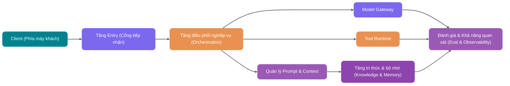

Một phiên bản AI application tối giản rất dễ xây dựng: frontend nhận một câu hỏi từ người dùng, backend ghép câu hỏi đó cùng system prompt, gọi API của mô hình một lần, và trên giao diện web sẽ trả về một đoạn câu trả lời trông khá ổn.

Đối với việc trình diễn Demo, đến đây cơ bản là đủ.

Nhưng khi người dùng thực tế bắt đầu truy cập, các vấn đề sẽ trở nên cụ thể và hóc búa hơn nhiều: người dùng hỏi về quy chế nội bộ, tầng truy xuất (retrieval) lại nhét cả tài liệu mà họ không có quyền xem vào context; đội vận hành sửa một phiên bản Prompt, câu hỏi hôm qua trả lời đúng thì hôm nay bắt đầu lạc đề; lệnh gọi mô hình bị timeout khiến trình duyệt chờ đợi vô tận; cuối tháng nhìn hóa đơn chỉ biết chi phí tiêu thụ Token tăng vọt nhưng không thể giải trình được tiền tiêu tốn vào tenant (khách thuê) nào, tính năng nào hay model nào; khi mổ xẻ sự cố trên production, kỹ sư chỉ có thể chắp vá từng chút một từ log ứng dụng, kết quả match trong cơ sở dữ liệu vector và phản hồi trả về của mô hình để đoán xem lúc đó chuyện gì đã xảy ra.

Bài viết này thảo luận về phần phía sau đó: làm thế nào để biến một Prompt Demo chạy được thành một ứng dụng AI cấp production có thể triển khai lên hệ thống thực tế, có thể điều tra lỗi, có thể rollback (hoàn nguyên) và kiểm soát được chi phí.

Đây là một bài viết tổng quan: trước tiên so sánh khoảng cách giữa bản Demo và hệ thống production, sau đó phân định trách nhiệm theo từng tầng: cổng tiếp nhận (entry), điều phối nghiệp vụ (orchestration), LLM Gateway, quản lý Prompt/Context, RAG, Memory, Tool, tác vụ bất đồng bộ và kiểm thử đánh giá/quan sát (eval & observability). Việc phân chia module, thiết kế bảng dữ liệu và service interface trong Java backend sẽ được lồng ghép xuyên suốt các chương tương ứng; khi cần đào sâu vào bất kỳ chủ đề nào, bạn có thể tiếp tục theo dõi các liên kết chuyên đề trong bài.

## Tại sao kiến trúc Demo không thể chịu tải trên Production

Trước tiên hãy xem qua một pipeline Demo phổ biến nhất:

```text
Frontend nhập câu hỏi -> Backend ghép Prompt -> Gọi API mô hình -> Trả về câu trả lời
```

Chuỗi xử lý này đủ để chứng minh ý tưởng sản phẩm, nhưng nó thiếu đi 6 yếu tố quan trọng nhất của một hệ thống production.

| Khía cạnh | Prompt Demo | Kiến trúc cấp Production |
| --- | --- | --- |
| Tính ổn định | Đơn mô hình, đơn lượt gọi; hễ lỗi là báo lỗi | Định tuyến đa mô hình (multi-model routing), retry, fallback, circuit breaker (ngắt mạch), phản hồi giáng cấp (degrade) |
| Phân quyền | Mặc định người dùng hỏi gì thì tra cứu nấy | Lọc quyền trước khi truy xuất, kiểm tra xác thực và phân quyền gọi Tool theo user và tenant |
| Chi phí | Chỉ quan tâm một lượt gọi có thành công hay không | Ngân sách Token (Token budget), phân tầng mô hình, caching, phân bổ chi phí (cost attribution) và hạn mức |
| Khả năng quan sát (Observability) | Ghi nhận câu hỏi người dùng và câu trả lời cuối cùng | Ghi nhận Prompt, đoạn văn bản truy xuất, lượt gọi Tool, đầu ra mô hình, Token, độ trễ, mã lỗi |
| Đánh giá (Evaluation) | Dựa vào con người thử nghiệm vài trường hợp mẫu | Bộ dữ liệu đánh giá cố định, lấy mẫu online, LLM-as-Judge, quy trình phản hồi và kiểm duyệt thủ công |
| Quản trị dữ liệu | Tài liệu nhập trực tiếp vào DB, log lưu trữ tùy ý | Khử nhạy cảm PII (PII masking), thời hạn lưu trữ dữ liệu, kiểm toán, đánh phiên bản, quy trình xóa và phân quyền |

Những năng lực trong bảng trên không đơn thuần là bọc thêm một lớp vỏ bên ngoài interface cũ. Đầu ra của mô hình được sinh ra dựa trên xác suất; cùng một câu hỏi sẽ chịu sự tác động đồng thời của phiên bản Prompt, thứ tự context, kết quả truy xuất dữ liệu, mô tả công cụ và các tham số lấy mẫu (sampling parameters). Khi câu trả lời bị lệch hướng, bạn không thể lần theo call stack để định vị chính xác một dòng code như các câu lệnh `if-else` thông thường.

Hệ thống production đòi hỏi phải ghi nhận lại mỗi request đã sử dụng đầu vào nào, đi qua những bước xử lý nào và sinh ra kết quả ra sao. Chỉ có như vậy chúng ta mới có thể "phát lại" (replay) một câu trả lời sai, từ đó phán đoán vấn đề bắt nguồn từ tầng truy xuất, mô hình, bộ lọc quyền hay khâu parse dữ liệu đầu ra.

Nếu bạn chưa quen với chuỗi kỹ thuật gọi API của mô hình lớn, có thể đọc trước bài [Thực hành Kỹ thuật Gọi API Mô hình Lớn: Streaming, Retry, Rate Limiting và Phản hồi Có cấu trúc](../llm-basis/llm-api-engineering.md). Nếu muốn bổ sung kiến thức nền tảng về Token, context window và tham số lấy mẫu, hãy xem [Cơ chế Vận hành LLM: Token, Context Window và Tham số Lấy mẫu Ảnh hưởng đến Đầu ra như thế nào](../llm-basis/llm-operation-mechanism.md).

## Phân tầng Kiến trúc Ứng dụng AI Khả thi

Sau khi một request đi qua cổng tiếp nhận (entry point), trước tiên cần xác định danh tính và quyền hạn, sau đó mới quyết định có cần truy xuất tri thức, gọi công cụ hay thực thi bất đồng bộ hay không, và cuối cùng ghi lại toàn bộ tiến trình gọi vào hệ thống giám sát. Sơ đồ dưới đây phân định trách nhiệm theo luồng này; các dự án thực tế có thể gộp các module lại tùy nhu cầu, không nhất thiết phải xem đây là một tiêu chuẩn cứng nhắc của ngành.



### Tầng Entry: Biến yêu cầu của người dùng thành tác vụ có thể quản trị

Khi yêu cầu của người dùng chạm tới hệ thống, tầng entry trước tiên sẽ chuẩn hóa và ràng buộc nó thành một tác vụ mà các service phía sau có thể xử lý an toàn:

- Xác thực và phân quyền (Authentication & Authorization): Xác nhận người dùng, tenant, vai trò và phạm vi dữ liệu được phép truy cập.
- Chuẩn hóa yêu cầu (Request Normalization): Thống nhất các nguồn Web, App, API, Webhook, cron job thành một mô hình task nội bộ duy nhất.
- Giới hạn tốc độ và chống spam (Rate Limiting & Anti-abuse): Giới hạn lưu lượng theo người dùng, tenant, năng lực mô hình và kịch bản nghiệp vụ.
- Kiểm soát tính bình đẳng (Idempotency Control): Các tác vụ bất đồng bộ cho phép retry và các lời gọi công cụ có side-effect (tác dụng phụ làm thay đổi trạng thái) bắt buộc phải có idempotency key; các truy vấn chỉ đọc (read-only) có cần khử trùng lặp hay không sẽ tùy thuộc vào chi phí và yêu cầu nhất quán dữ liệu.
- Tiền xử lý nội dung nhạy cảm: Khử nhạy cảm PII, phát hiện đầu vào độc hại, sàng lọc sơ bộ Prompt Injection.

Các mắt xích phía sau chuỗi xử lý nên tiếp nhận một request có cấu trúc rõ ràng, thay vì chỉ nhận một chuỗi string văn bản thô do người dùng nhập:

```java
public record AiRequest(
        String requestId,
        String tenantId,
        String userId,
        String sceneCode,
        String input,
        Map<String, Object> variables,
        PermissionScope permissionScope
) {
}
```

### Tầng Điều phối Nghiệp vụ: Quyết định kịch bản xử lý cho request

Tầng điều phối nghiệp vụ (Orchestration Layer) chịu trách nhiệm lựa chọn luồng thực thi cụ thể cho request:

- Lượt gọi này là hỏi đáp thông thường, hỏi đáp RAG, tác vụ đa bước của Agent hay là tác vụ xử lý hàng loạt (batch processing)?
- Cần những context nào: lịch sử hội thoại, chân dung người dùng (profile), cơ sở tri thức, hay dữ liệu nghiệp vụ thời gian thực?
- Có cho phép gọi công cụ không? Những công cụ nào cần xác nhận lần hai từ người dùng?
- Nên chạy theo phương thức đồng bộ (synchronous), streaming, hay bất đồng bộ (asynchronous)?
- Đầu ra có cần chuyển vào luồng đánh giá (evaluation), phê duyệt thủ công hay xử lý hậu kỳ (post-processing) không?

Ví dụ: người dùng có quyền đọc một tài liệu hay không, một thao tác có cần xác nhận hay không đều phải do các rule nghiệp vụ phán đoán; mô hình AI chỉ phù hợp để xử lý phần thấu hiểu ngôn ngữ tự nhiên vốn khó bao quát hết bằng các rule cứng. Nếu trộn lẫn cả hai loại quyết định này vào một "Super Prompt", khi xảy ra lỗi bạn sẽ rất khó phân biệt được đó là do rule bị vô hiệu hóa hay do mô hình phán đoán sai lệch.

### Model Gateway: Đưa việc gọi mô hình thành hạ tầng dùng chung

Model Gateway chịu trách nhiệm kết nối tập trung các năng lực từ OpenAI, Anthropic, Google Gemini, các mô hình mã nguồn mở/triển khai nội bộ (private models), mô hình Embedding, mô hình Rerank... Nó che giấu sự khác biệt giữa các API nhà cung cấp và cung cấp một interface ổn định cho tầng trên. Model Gateway có thể tách thành một chuyên đề riêng, bạn có thể tham khảo chi tiết tại [Phân tích Chi tiết về LLM Gateway: Định tuyến đa mô hình, Fallback, Rate Limiting và Kiểm soát Chi phí](./llm-gateway.md).


Khi việc gọi mô hình được gom về một mối tại Gateway, các cơ chế định tuyến, hạn ngạch và giám sát mới có một nơi xử lý nhất quán:

- Định tuyến đa mô hình (Multi-model Routing): Lựa chọn mô hình dựa trên kịch bản, chi phí, độ trễ, ngôn ngữ, độ dài context và tỷ lệ thành công.
- Fallback: Chuyển sang mô hình dự phòng khi mô hình chính gặp lỗi, timeout hoặc hết hạn ngạch.
- Rate Limiting và Circuit Breaking (Ngắt mạch): Tránh việc nhà cung cấp gặp sự cố làm nghẽn toàn bộ Thread Pool của hệ thống nghiệp vụ.
- Ngân sách Token (Token Budget): Ước tính Token đầu vào và đầu ra; khi vượt ngân sách thì nén context hoặc giáng cấp sang mô hình rẻ hơn.
- Phân bổ chi phí (Cost Attribution): Ghi nhận chi phí theo từng tenant, người dùng, kịch bản và phiên bản Prompt.
- Khả năng quan sát thống nhất: Ghi nhận request, response, error, TTFT (Time-To-First-Token), tổng độ trễ và lượng tiêu thụ Token.

Tài liệu chính thức của OpenAI, Anthropic, Google... liên tục cập nhật các tính năng liên quan đến model, tool, streaming, eval và chi phí. Khi đề cập đến tên model cụ thể, context window, bảng giá, vùng khả dụng và mức độ hỗ trợ tool, bạn nên duy trì chúng trong Configuration Center hoặc Model Registry và ghi chú "cần đối chiếu với tài liệu chính thức mới nhất", tuyệt đối không hardcode trong mã nguồn nghiệp vụ.

### Quản lý Prompt và Context: Đừng coi Prompt như những chuỗi String trong mã nguồn

Prompt được sử dụng cho các request trên production phải có phiên bản rõ ràng, không được phân tán thành các chuỗi văn bản nhiều dòng nằm rải rác trong code. Mỗi lần phát hành hoặc rollback đều phải truy cứu được nội dung cụ thể, ràng buộc biến số và phạm vi hiệu lực:

- Đánh phiên bản template (Template Versioning): Mỗi lần chỉnh sửa sẽ tạo ra một phiên bản mới, các phiên bản cũ đều có thể phát lại được.
- Tiêm biến số (Variable Injection): Phân vùng tiêm biến nghiệp vụ, đầu vào người dùng, kết quả truy xuất và kết quả công cụ vào các khu vực riêng biệt.
- Phát hành Canary (Canary Release): Lựa chọn phiên bản Prompt theo tenant, tỷ lệ phần trăm người dùng hoặc cờ bật tắt theo kịch bản.
- Hoàn nguyên nhanh chóng (Fast Rollback): Cho phép chuyển ngay về phiên bản ổn định khi hiệu quả trên production bị suy giảm.
- Ghi nhật ký kiểm toán (Audit Log): Ai đã sửa cái gì, vào thời điểm nào, và lý do sửa là gì.
- Liên kết lúc runtime: Mỗi request phải ghi nhận tên Prompt, phiên bản và mã băm (hash)/tóm tắt biến số đã dùng.

Việc sửa đổi Prompt sẽ làm thay đổi nội dung câu trả lời, đồng thời có thể làm thay đổi kết quả truy xuất, hành vi gọi tool, chi phí và kết quả đánh giá. Do đó, lịch sử thay đổi, Trace lúc runtime và kết quả đánh giá cần phải liên kết được với cùng một phiên bản Prompt duy nhất. Nền tảng như Langfuse gom Prompt Management, Tracing, Evaluation vào chung một hệ thống chính là để giải quyết mối liên kết này; việc bạn có dùng công cụ đó hay không tùy thuộc vào dự án, nhưng bản thân mối quan hệ liên kết thì không thể thiếu.

Về kỹ thuật viết Prompt, bạn có thể tham khảo [Prompt Engineering là gì? Các kỹ thuật Prompt hiệu quả](../agent/prompt-engineering.md). Nếu bạn quan tâm đến việc "thông tin nào nên đưa vào context, đưa bao nhiêu và khi nào thì nén", hãy xem [Context Engineering là gì? Khác gì so với Prompt Engineering?](../agent/context-engineering.md).


### RAG, Memory, Tool: Ba loại Context không được đánh đồng

Tài liệu truy xuất, sở thích người dùng và kết quả trả về từ công cụ đều sẽ đi vào context của mô hình, nhưng nguồn gốc, chu kỳ cập nhật và rủi ro của chúng hoàn toàn khác nhau:

| Loại | Lưu trữ cái gì | Vòng đời | Rủi ro cốt lõi |
| --- | --- | --- | --- |
| RAG | Tài liệu doanh nghiệp, sổ tay sản phẩm, quy chế, tài liệu code, tri thức từ ticket | Do việc cập nhật cơ sở tri thức quyết định | Không truy xuất được, nhớ nhầm tài liệu vượt quyền, tài liệu hết hạn, trích dẫn sai |
| Memory | Sở thích người dùng, quyết định lịch sử, chân dung dài hạn, kinh nghiệm tác vụ | Tiến hóa theo người dùng và phiên hội thoại | Định hình ký ức sai lệch, rò rỉ quyền riêng tư, ký ức lỗi thời gây nhiễu |
| Tool | Tra cứu đơn hàng, tạo ticket, gửi email, sửa cấu hình, truy vấn database | Được gọi theo nhu cầu lúc runtime | Tham số sai, vượt quyền hạn, vô tình thực thi thao tác nhạy cảm |

Bên dưới chúng đều có thể dùng chung kỹ thuật tìm kiếm vector, lưu trữ có cấu trúc và reranking, nhưng không thể áp dụng cùng một bộ quy tắc quản trị. RAG tương ứng với nguồn tri thức chia sẻ chung, Memory lưu trữ bối cảnh cá nhân hóa, còn Tool kết nối trực tiếp với các hệ thống nghiệp vụ thực tế; các khâu kiểm tra phân quyền và cơ chế vô hiệu hóa cần phải được thiết kế độc lập.


Đừng coi Memory như một "RAG cá nhân" để ghi chép dữ liệu tùy tiện. Một khi ký ức bị ghi sai, nhiều lượt hội thoại tiếp theo sẽ bị ảnh hưởng. Các loại Memory khác nhau cần các cơ chế kiểm soát khác nhau: sở thích do người dùng xác nhận rõ ràng có thể ghi đồng bộ; các dữ kiện dài hạn do mô hình tự rút trích thì nên trải qua khâu kiểm tra Schema, ghi nhận nguồn gốc và lọc theo độ tin cậy, sau đó tùy vào mức độ rủi ro để quyết định ghi bất đồng bộ, đặt TTL hết hạn hay đưa qua người duyệt.

Khái niệm nền tảng về RAG bạn có thể bắt đầu từ bài [Khái niệm Nền tảng về RAG: Truy xuất, Sinh văn bản và Đánh đổi Kỹ thuật](../rag/rag-basis.md); cách parse tài liệu, làm sạch và cắt Chunk xem tại [Chiến lược Xử lý Tài liệu và Cắt đoạn (Chunking) trong RAG](../rag/rag-document-processing.md); tối ưu hiệu quả truy xuất xem tại [Tối ưu RAG: Từ Recall, Rerank đến Context Engineering](../rag/rag-optimization.md). Về Memory chuyên sâu, hãy xem bài [Hệ thống Bộ nhớ AI Agent: Bộ nhớ ngắn hạn, Bộ nhớ dài hạn và Cơ chế Tiến hóa Ký ức](../agent/agent-memory.md).

## Lựa chọn 3 Mô hình Tương tác: Đồng bộ, Streaming và Bất đồng bộ

Trong ứng dụng AI, không phải request nào cũng phù hợp để chờ đợi HTTP đồng bộ. Chọn sai mô hình tương tác sẽ làm trải nghiệm người dùng tụt dốc và kéo sập tính ổn định của toàn hệ thống.

| Mô hình | Kịch bản phù hợp | Ưu điểm | Rủi ro | Điểm cốt lõi trong thiết kế Backend |
| --- | --- | --- | --- | --- |
| Request đồng bộ (Sync) | Hỏi đáp ngắn, phân loại, trích xuất thực thể, tác vụ nhỏ độ trễ thấp | Triển khai đơn giản, chuỗi gọi rõ ràng | Nhạy cảm với timeout, dễ chiếm dụng hết Thread Pool | Thiết lập timeout ngắn, fail-fast, cache kết quả |
| Phản hồi luồng (Streaming) | Chatbot, câu trả lời dài, sinh code, văn bản đệm cho voice | Trải nghiệm chữ đầu tiên (TTFT) tốt, giảm cảm giác chờ đợi | Xử lý lỗi đứt gánh giữa chừng phức tạp, frontend nhiều trạng thái hơn | SSE/WebSocket, giám sát TTFT, cho phép hủy (cancel) quá trình sinh |
| Tác vụ bất đồng bộ (Async) | Tạo báo cáo, đánh giá hàng loạt, phân tích tài liệu dài, tác vụ nhiều công cụ | Xếp hàng được, retry được, khôi phục được | Trạng thái tác vụ và luồng thông báo phức tạp | Bảng tác vụ, hàng đợi (queue), sự kiện tiến độ, idempotency và bù trừ (compensation) |

Nếu một request có thể hoàn thành ổn định trong khoảng 3 giây, đồng thời timeout phía client và gateway đều cho phép, thì gọi đồng bộ thường là phương án gọn gàng nhất. Con số thời gian này không phải tiêu chuẩn cố định mà phải dựa vào cấu hình timeout cụ thể của bạn.

Khi người dùng cần nhìn thấy quá trình sinh nội dung ngay lập tức, phản hồi dạng streaming là phù hợp nhất; khi tác vụ phụ thuộc vào tài liệu dài, gọi công cụ qua nhiều lượt hoặc xử lý theo lô, việc đẩy tác vụ vào hàng đợi sẽ giúp việc retry và phục hồi sau lỗi dễ dàng hơn rất nhiều.

Các lệnh gọi nội bộ như phân loại nhãn, chấm điểm rủi ro, quyết định định tuyến thường không đòi hỏi phản hồi từng từ đầu tiên. Việc duy trì kết nối SSE hay WebSocket cho chúng chỉ làm tăng thêm chi phí xử lý đứt kết nối, hủy yêu cầu và quản lý state phức tạp ở frontend.

Các kỹ thuật về streaming output, retry, rate limit và structured response được phân tích đầy đủ trong bài [Thực hành Kỹ thuật Gọi API Mô hình Lớn](../llm-basis/llm-api-engineering.md). Nếu kịch bản của bạn là giọng nói thời gian thực (real-time voice), cần tính đến VAD, ASR, TTS, ngắt lời và độ trễ đầu cuối, hãy xem tiếp [Phân tích Chi tiết Công nghệ AI Voice: Từ ASR, TTS đến Hiện thực hóa Voice Agent Thời gian thực](./ai-voice.md).

## Quản lý Prompt: Từ chuỗi Template đến Hệ thống Đánh phiên bản

Một hệ thống quản lý Prompt cấp production có thể mô hình hóa xoay quanh 5 đối tượng cốt lõi:

- `prompt_template`: Thông tin cơ bản của Prompt, ví dụ tên, kịch bản, loại hình, trạng thái.
- `prompt_version`: Nội dung chi tiết, định nghĩa biến số, tham số mô hình, người tạo, giải trình thay đổi.
- `prompt_release`: Phiên bản nào được phát hành tới môi trường nào, cho những tenant nào và chiếm bao nhiêu tỷ lệ traffic.
- `prompt_run`: Mỗi lượt gọi liên kết với phiên bản Prompt nào, bản tóm tắt giá trị biến số và kết quả mô hình trả về.
- `prompt_eval_result`: Kết quả đánh giá của một phiên bản Prompt cụ thể trên bộ dữ liệu kiểm thử.

Các bảng dữ liệu cốt lõi có thể thiết kế như sau:

| Tên bảng | Các trường quan trọng | Vai trò |
| --- | --- | --- |
| `ai_prompt_template` | `id`, `tenant_id`, `name`, `scene_code`, `type`, `status` | Quản lý định danh logic của Prompt |
| `ai_prompt_version` | `id`, `template_id`, `version_no`, `content`, `variables_schema`, `model_config`, `created_by`, `change_reason` | Lưu trữ nội dung Prompt có thể phát lại được |
| `ai_prompt_release` | `id`, `template_id`, `version_id`, `env`, `traffic_ratio`, `tenant_scope`, `status` | Kiểm soát canary và rollback |
| `ai_prompt_run` | `id`, `request_id`, `version_id`, `variables_hash`, `input_tokens`, `output_tokens`, `created_at` | Kết nối request thực tế với phiên bản Prompt |

Khâu tiêm biến số (variable injection) dễ phát sinh lỗi nhất ở hai tình huống: Thứ nhất, đầu vào của người dùng, kết quả công cụ và đoạn văn bản truy xuất có thể chứa chỉ thị injection độc hại; việc phân vùng thẻ (tag) và escape chỉ giúp mô hình nhận biết nội dung không đáng tin cậy, backend vẫn bắt buộc phải giới hạn danh sách công cụ có thể gọi và kiểm tra lại tham số cùng quyền hạn trước khi thực thi.

Vấn đề thứ hai đến từ việc lệch phiên bản: Prompt thêm biến mới nhưng code backend chưa truyền giá trị, khiến văn bản sau khi render bị thiếu hụt ngữ cảnh. `variables_schema` có thể chặn đứng những request lỗi dạng này ngay lúc runtime trước khi gửi sang mô hình.

Bảng `ai_prompt_run` thông thường chỉ lưu bản tóm tắt biến số, mã Hash, lượng Token và các ID liên kết. Khi đầu vào đầy đủ của người dùng, tài liệu truy xuất hoặc kết quả trả về từ công cụ có chứa PII hay dữ liệu nhạy cảm của doanh nghiệp, hãy căn cứ theo cấp độ bảo mật để quyết định khử nhạy cảm, mã hóa và rút ngắn thời hạn lưu trữ; tuyệt đối không vì muốn thuận tiện cho việc debug mà ghi toàn bộ dữ liệu thô dạng plaintext vào database.

Một ví dụ interface tối giản:

```java
public interface PromptService {

    RenderedPrompt render(RenderPromptCommand command);

    PromptVersion publish(PublishPromptCommand command);

    void rollback(String templateId, String targetVersionId);
}
```

Nếu đầu ra của Prompt cần được chương trình phân tích cú pháp (parse) một cách ổn định, tốt nhất đừng chỉ dựa vào mỗi câu nhắc "vui lòng trả về định dạng JSON". Chi tiết kỹ thuật về structured output, JSON Schema và Function Calling xem tại [Đầu ra Có cấu trúc từ Mô hình Lớn: Từ Hợp đồng JSON đến Ứng dụng Function Calling](../llm-basis/structured-output-function-calling.md).

## Model Gateway: Định tuyến Đa mô hình, Fallback và Kiểm soát Chi phí

Model Gateway là thành phần rất dễ bị đánh giá thấp. Ban đầu, nhiều đội ngũ gọi trực tiếp SDK của nhà cung cấp ngay trong mã nguồn nghiệp vụ, đến khi cần đổi model, chạy thử nghiệm canary hay kiểm tra chi phí mới nhận ra sự phụ thuộc chặt chẽ ở khắp mọi nơi.

### So sánh các Chiến lược trong Model Gateway

| Chiến lược | Logic cốt lõi | Kịch bản phù hợp | Rủi ro |
| --- | --- | --- | --- |
| Mô hình cố định (Fixed Model) | Một kịch bản chỉ gọi cố định một mô hình | Hệ thống giai đoạn đầu, tác vụ đơn giản | Chi phí và tính ổn định phụ thuộc hoàn toàn vào một nhà cung cấp |
| Định tuyến ưu tiên chi phí | Mặc định đi qua mô hình giá rẻ, thất bại hoặc độ tin cậy thấp mới nâng cấp | Phân loại, tóm tắt, hỏi đáp nhẹ | Mô hình giá rẻ phán đoán sai sẽ truyền lỗi xuống các khâu sau |
| Định tuyến ưu tiên chất lượng | Request giá trị cao ưu tiên đi qua mô hình năng lực mạnh | Pháp lý, tài chính, hỗ trợ y tế, Agent phức tạp | Chi phí cao, cần kiểm soát ngân sách nghiêm ngặt |
| Định tuyến ưu tiên độ trễ | Chọn mô hình dựa trên độ trễ P95/P99 và vùng khả dụng | Chat thời gian thực, voice, CSKH online | Có thể phải hy sinh chất lượng suy luận phức tạp |
| Biểu quyết đa mô hình (Voting) | Nhiều mô hình cùng sinh kết quả song song, bộ đánh giá sẽ chọn câu tốt nhất | Nội dung rủi ro cao, báo cáo trọng yếu | Chi phí và độ trễ đều rất cao |
| Chuỗi Fallback | Sau khi mô hình chính lỗi thì chuyển sang mô hình dự phòng | Hầu hết các hệ thống production | Sự chênh lệch năng lực của mô hình dự phòng ảnh hưởng đến tính nhất quán |

### Cách triển khai Ngân sách Token (Token Budget)

Model Gateway trước khi gọi mô hình phải ước tính xem context và lượng output tối đa sẽ chiếm bao nhiêu Token:

```text
Token đầu vào ước tính = System Prompt + Đầu vào người dùng + Lịch sử tin nhắn + Đoạn RAG + Memory + Tool Schema
Tổng Token ước tính = Token đầu vào ước tính + Token đầu ra tối đa
```

Khi vượt quá ngân sách cho phép, hãy ưu tiên loại bỏ các nội dung ít liên quan đến câu hỏi hiện tại thay vì cắt xén ngang xương chuỗi văn bản:

1. Xóa các đoạn RAG có điểm liên quan thấp.
2. Nén các tin nhắn lịch sử ở giai đoạn đầu.
3. Rút gọn Tool Schema, chỉ giữ lại các công cụ ứng viên phù hợp.
4. Giảm độ dài token đầu ra tối đa (max output tokens).
5. Chuyển sang mô hình có context window lớn hơn.
6. Từ chối thực thi và thông báo người dùng thu hẹp phạm vi câu hỏi.

Việc tính toán ngân sách Token và nén context ở đây có cùng bản chất với bài toán Context Engineering đã nêu ở trên. Để tìm hiểu chiến lược lắp ráp context, tải theo nhu cầu và giáng cấp toàn diện hơn, bạn hãy xem [Context Engineering là gì? Khác gì so với Prompt Engineering?](../agent/context-engineering.md).

Trong tài liệu của OpenTelemetry phần GenAI registry, chúng ta có thể thấy các trường như `gen_ai.request.model`, `gen_ai.response.model`, `gen_ai.usage.input_tokens`, `gen_ai.usage.output_tokens`, `gen_ai.response.time_to_first_chunk`, retrieval, tool... Tuy nhiên phía OpenTelemetry cũng lưu ý rằng quy ước ngữ nghĩa (semantic conventions) cho GenAI đã được chuyển sang một repository độc lập, do đó khi triển khai đừng chỉ copy nguyên xi tên trường từ một bài viết cũ, tốt nhất hãy chốt phiên bản hiện hành và xây dựng bộ ánh xạ trường (field mapping). Dù bạn dùng Langfuse, LangSmith hay tự xây dựng platform giám sát, hãy cố gắng bám sát các trường chuẩn này để việc chuyển đổi và giám sát tập trung sau này nhẹ nhàng hơn.

## Lời gọi Công cụ và Phân quyền: Mô hình chỉ đề xuất hành động, Hệ thống quyết định quyền thực thi

Tool Calling rất dễ mang lại một ảo tưởng: mô hình trả về tên hàm và các tham số, hệ thống chỉ việc đem đi chạy.

Điều này cực kỳ nguy hiểm trong môi trường production.

Mô hình tư duy đúng đắn phải là: **Mô hình chỉ được phép đưa ra đề xuất "muốn gọi công cụ nào", còn trước khi thực thi thực tế bắt buộc phải trải qua khâu kiểm tra xác thực của hệ thống**.

Một Tool Runtime hoàn chỉnh tối thiểu phải thiết lập 6 chốt chặn:

| Khâu | Vai trò |
| --- | --- |
| Đăng ký công cụ (Registration) | Khai báo tên công cụ, mô tả, Schema tham số, nhãn quyền hạn, cấp độ rủi ro |
| Truy xuất công cụ (Retrieval) | Lọc ra số ít công cụ liên quan đến tác vụ hiện tại từ danh mục công cụ đồ sộ, tránh làm phình to context |
| Xác thực tham số (Validation) | Dùng JSON Schema hoặc DTO strongly-typed để kiểm tra trường bắt buộc, định dạng, enum, phạm vi giá trị |
| Phân quyền (Authorization) | Thực hiện kiểm tra quyền hạn ở backend theo user, tenant, role và resource ID |
| Chính sách xác nhận (Confirmation) | Các thao tác xóa, thanh toán, gửi tin nhắn, sửa cấu hình cần căn cứ vào rủi ro và phạm vi ủy quyền trước để quyết định có cần xác nhận lại hay không |
| Nhật ký kiểm toán (Audit Log) | Ghi nhận đề xuất của mô hình, tham số chốt cuối cùng, người thực thi, kết quả thực hiện và thông tin rollback |

Tài liệu chính thức về Tool/Function Calling của Anthropic, OpenAI và Google đều nhấn mạnh vào định nghĩa công cụ, cấu trúc tham số và xử lý lời gọi; tài liệu của Google còn chỉ rõ: đối với các hàm có hệ quả rõ rệt như tạo đơn hàng, cập nhật database, bắt buộc phải yêu cầu người dùng xác nhận trước khi thực thi. Các thao tác rủi ro thấp đã có ủy quyền trước rõ ràng có thể tự động chạy theo policy, nhưng khâu phán đoán quyền hạn bắt buộc phải do hệ thống nghiệp vụ đảm trách, không được phó mặc cho mô hình.

Dù nhà cung cấp có cung cấp server-side tool, phía nghiệp vụ cũng không thể bỏ qua các tầng ACL, audit và luồng xác nhận của riêng mình. Nhà cung cấp chịu trách nhiệm tích hợp năng lực công cụ vào mô hình, còn hệ thống nghiệp vụ chịu trách nhiệm phán đoán xem user này, tenant này, đối với tài nguyên này trong kịch bản hiện tại có được phép thực thi hay không.

Nếu muốn tìm hiểu lại từ khái niệm nền tảng về Tool Calling, bạn có thể xem [Đầu ra Có cấu trúc từ Mô hình Lớn: Từ Hợp đồng JSON đến Ứng dụng Function Calling](../llm-basis/structured-output-function-calling.md). Nếu công cụ của bạn cần tái sử dụng cho nhiều mô hình, nhiều Agent hoặc IDE khác nhau, hãy xem [Model Context Protocol (MCP) là gì? Quan hệ thế nào với Function Calling và Agent?](../agent/mcp.md).


Interface của công cụ có thể định nghĩa như sau:

```java
public interface AiTool {

    ToolDefinition definition();

    ToolResult execute(ToolExecutionContext context, Map<String, Object> arguments);
}
```

Định nghĩa công cụ cần bóc tách rạch ròi giữa tác dụng phụ (side-effect) và cấp độ rủi ro (risk level). Chỉ đọc (read-only) không đồng nghĩa với rủi ro thấp, ví dụ việc đọc khóa bí mật (secret key), hồ sơ bệnh án hoặc dữ liệu khách hàng số lượng lớn hoàn toàn không có thao tác ghi dữ liệu, nhưng vẫn bắt buộc phải có quy trình ủy quyền và kiểm toán nghiêm ngặt hơn:

```java
public enum ToolSideEffect {
    READ_ONLY,
    WRITE
}

public enum ToolRiskLevel {
    LOW,
    MEDIUM,
    HIGH
}
```

Tầng điều phối căn cứ vào tổ hợp `sideEffect + riskLevel + preAuthorization` để lựa chọn chiến lược kiểm soát. Thao tác ghi rủi ro cao mặc định chuyển thành "hành động chờ xác nhận"; thao tác đọc rủi ro cao thì phải tăng cường phân quyền cấp tài nguyên, khử nhạy cảm trường dữ liệu, giới hạn số lượng kết quả và ghi log kiểm toán. Nếu nghiệp vụ cho phép tự động thực thi thao tác ghi thông qua ủy quyền trước, cũng phải sử dụng credential ủy quyền có phạm vi rõ ràng, có thể thu hồi, đi kèm cơ chế idempotency, kiểm toán và bù trừ.


## RAG và Memory: Sự phối hợp giữa Tri thức dùng chung và Ký ức cá nhân hóa

Cả RAG và Memory đều đưa thông tin bên ngoài vào context, nhưng cách thức quản trị của chúng hoàn toàn khác nhau.

### Thứ tự phối hợp trong một Request

Thứ tự khuyến nghị trong một request như sau:

1. Tầng entry xác nhận danh tính người dùng và phạm vi quyền hạn.
2. Service Memory tra cứu sở thích và các dữ kiện dài hạn trong phạm vi của người dùng đó.
3. Service RAG tra cứu trong cơ sở tri thức dùng chung theo phạm vi quyền hạn tài nguyên và tenant.
4. Tầng quản lý Context tiến hành khử trùng lặp, lọc và nén độc lập cho cả hai nhóm kết quả.
5. Tầng điều phối đặt Memory vào khu vực "Bối cảnh người dùng" và đặt RAG vào khu vực "Tài liệu dẫn chứng".
6. Yêu cầu mô hình khi sinh câu trả lời phải phân biệt rõ giữa "sự thật dựa trên tài liệu dẫn chứng" và "văn phong biểu đạt dựa trên sở thích người dùng".

Trình tự này chủ yếu nhằm ngăn ngừa ô nhiễm context. Dự án cụ thể có thể tra cứu RAG trước rồi mới tra Memory, nhưng phạm vi quyền hạn bắt buộc phải chốt trước, không bao giờ được lấy giải pháp "truy xuất trước, lọc quyền sau" làm phương án mặc định.

### Làm thế nào để tránh Ô nhiễm Context

| Loại ô nhiễm | Biểu hiện điển hình | Phương thức phòng vệ |
| --- | --- | --- |
| Ô nhiễm nhiễu RAG | Truy xuất phải tài liệu không liên quan, dẫn dụ mô hình đi chệch hướng | Tìm kiếm lai (Hybrid Search), Rerank, nén Top-N, đối chiếu trích dẫn |
| Ô nhiễm quyền hạn | Người dùng nhận được đoạn trích từ tài liệu mà họ không có quyền xem | Lọc ACL trước khi truy xuất, cô lập tenant, kiểm toán kết quả recall |
| Ký ức sai lệch bị định hình | Một câu nói tạm thời của người dùng bị biến thành sở thích dài hạn | Đánh giá độ tin cậy khi ghi, đặt thời gian hết hạn (TTL), cho phép user chỉnh sửa, duyệt thủ công |
| Xung đột dữ kiện cũ và mới | Quy chế phiên bản cũ và quy chế phiên bản mới cùng lọt vào context | Thêm trường phiên bản, lọc theo thời gian, phát hiện xung đột |
| Ô nhiễm Prompt Injection | Trong tài liệu có dòng chữ "hãy bỏ qua các quy tắc trước đó" | Phân vùng nội dung tài liệu, phân cấp ưu tiên chỉ thị, phát hiện injection |

Kết quả từ RAG và Memory tuyệt đối không được ghép nối thô bạo thành một đoạn "tài liệu nền tảng". Cần gắn nhãn nguồn gốc, thời gian, quyền hạn và mức độ tin cậy rõ ràng cho mô hình, tránh việc lẫn lộn "sở thích người dùng", "quy chế công ty" và "kết quả công cụ" thành cùng một loại thông tin.

Cơ sở tri thức không phải import một lần là xong. Phiên bản tài liệu, đồng bộ hóa gia tăng (incremental sync), khử trùng lặp, rollback và rebuild toàn bộ đều ảnh hưởng trực tiếp đến câu trả lời trên production, chi tiết xem tại [Cách Cập nhật Tài liệu Cơ sở Tri thức RAG: Cập nhật gia tăng, Kiểm soát phiên bản, Khử trùng lặp và Rebuild toàn diện](../rag/rag-knowledge-update.md). Nếu bài toán đòi hỏi liên kết giữa các tài liệu, quan hệ thực thể và tóm tắt toàn cục, tìm kiếm vector truyền thống có thể không đủ đáp ứng, hãy đọc tiếp [GraphRAG: Dùng cấu trúc đồ thị bổ trợ cho tìm kiếm vector](../rag/graphrag.md).

## Khả năng Quan sát và Đánh giá: Không có Replay thì không có Tối ưu

### Trace cần phải ghi nhận những gì

Khi điều tra sự cố trong ứng dụng AI, điều đáng sợ nhất là chỉ thấy được câu trả lời cuối cùng.

Một request hoàn chỉnh tối thiểu phải ghi nhận được các metadata có thể liên kết lại với nhau. Nội dung văn bản gốc chỉ nên lưu trữ khi thực sự có nhu cầu replay, đã được cấp phép hợp lệ và có cấu hình mã hóa, kiểm soát truy cập và thời hạn lưu trữ rõ ràng:

| Phân loại | Metadata mặc định cần ghi nhận |
| --- | --- |
| Prompt | Tên template, phiên bản, mã Hash hoặc bản tóm tắt biến đã khử nhạy cảm, role của message và độ dài |
| Truy xuất (Retrieval) | Query đã khử nhạy cảm hoặc Hash, Chunk ID, score, nguồn, kết quả lọc quyền, thứ hạng Rerank |
| Memory | ID ký ức được match, nguồn, thời gian cập nhật, độ tin cậy |
| Tool | Tên công cụ, mã Hash tham số hoặc trường đã khử nhạy cảm, kết quả phân quyền, thời gian thực thi, mã kết quả, lỗi |
| Model | Nhà cung cấp, tên model, tham số lấy mẫu, Token đầu vào/đầu ra, finish reason |
| Độ trễ (Latency) | Thời gian qua cổng entry, thời gian truy xuất, TTFT của mô hình, tổng thời gian, thời gian chạy công cụ |
| Chi phí (Cost) | Chi phí đầu vào, chi phí đầu ra, hit cache, phân bổ theo tenant và kịch bản |
| Kết quả | Mã Hash phản hồi, kết quả parse có cấu trúc, feedback của người dùng, điểm đánh giá |

Trong tài liệu chính thức của Langfuse, LangSmith, Google Vertex AI và OpenTelemetry, bạn đều có thể thấy các đối tượng như tracing, datasets, evaluators, token usage, latency. Công cụ có thể khác nhau, nhưng các tín hiệu mà bạn cần thu thập về cơ bản là tương đồng.

### Quy trình Đánh giá nên thực hiện ra sao

Đánh giá phải có tập mẫu cố định, điều kiện pass rõ ràng và phiên bản mục tiêu có thể phát lại được. Về cách chuẩn bị bộ dữ liệu đánh giá, tách biệt các chỉ số giữa RAG và Agent, cũng như tích hợp LLM-as-Judge vào CI, mời xem bài [Hệ thống Đánh giá Ứng dụng AI](../llm-basis/llm-evaluation.md).

Nếu chỉ chấm một điểm số chung chung "tốt hay không tốt" cho câu trả lời cuối cùng, bạn sẽ không thể giải thích được vấn đề xảy ra ở khâu recall, khâu sinh văn bản hay khâu thực thi công cụ. Các khâu có thể ghi nhận độc lập các chỉ số sau; tên gọi trên các platform có thể khác nhau nhưng định nghĩa nội bộ phải thống nhất:

- **Context Recall**: Bằng chứng chính xác có được recall về hay không.
- **Context Precision**: Trong số các đoạn văn bản đưa vào context, có bao nhiêu phần trăm là thực sự hữu ích.
- **Faithfulness**: Câu trả lời có trung thành với tài liệu bằng chứng đã cung cấp hay không.
- **Answer Relevancy**: Câu trả lời có phản hồi đúng trọng tâm câu hỏi của người dùng hay không.
- **Tool Success Rate**: Lời gọi công cụ có hoàn thành thành công hay không.
- **Format Valid Rate**: Đầu ra có cấu trúc có parse được chuẩn xác hay không.
- **Cost per Success**: Chi phí trung bình cho mỗi câu trả lời thành công.

LLM-as-Judge rất phù hợp để sàng lọc sơ bộ quy mô lớn, so sánh hồi quy và lấy mẫu kiểm tra trên production, nhưng phán đoán của nó không thể thay thế việc kiểm tra rule nghiệp vụ trọng yếu, kiểm duyệt thủ công và feedback từ người dùng. Interface và năng lực của các platform đánh giá bên ngoài sẽ thay đổi theo thời gian; các task đánh giá, mẫu kiểm thử và kết quả nên được lưu trữ trong mô hình dữ liệu của chính bạn, platform bên ngoài chỉ đóng vai trò thực thi hoặc hiển thị.

Chuỗi phản hồi và phát hành khi đưa mẫu lỗi từ production vào hệ thống đánh giá:

```text
Mẫu lỗi trên production -> Đưa vào Dataset -> Replay trên phiên bản cố định -> Định vị lỗi do Prompt/RAG/Tool/Mô hình -> Chạy Canary chiến lược mới -> So sánh chỉ số -> Phát hành chính thức
```

Nếu không có khả năng replay trên phiên bản cố định, khi Prompt, chiến lược truy xuất và phiên bản mô hình cùng thay đổi, bạn sẽ rất khó đánh giá xem một lượt tinh chỉnh thực chất đã mang lại cải thiện gì.

## Bảo mật và Tuân thủ: Ứng dụng AI có nhiều Cửa ngõ Rủi ro hơn

Bề mặt tấn công bảo mật của ứng dụng AI rộng hơn nhiều so với hệ thống CRUD truyền thống, bởi vì đầu vào của người dùng, tài liệu truy xuất, kết quả trả về từ công cụ và lịch sử ký ức đều có thể tác động trực tiếp đến hành vi của mô hình.

### Các Hạng mục Rủi ro phải được Cụ thể hóa vào Code và Quy trình

| Rủi ro | Mô tả | Đề xuất xử lý |
| --- | --- | --- |
| Rò rỉ PII | Log, Prompt, tập đánh giá chứa số điện thoại, CMND/CCCD, email... | Khử nhạy cảm trước khi lưu kho, mã hóa trường nhạy cảm, tối thiểu hóa thời hạn lưu |
| Vượt quyền hạn | Khâu truy xuất hoặc gọi tool vượt qua cơ chế ACL của nghiệp vụ | Lọc trước khi truy xuất, kiểm tra quyền lần hai trước khi chạy công cụ |
| Prompt Injection | Người dùng hoặc tài liệu dẫn dụ mô hình bỏ qua quy tắc hệ thống | Phân vùng nội dung, ưu tiên chỉ thị, phát hiện injection, cơ chế từ chối trả lời |
| Mất kiểm soát lưu trữ dữ liệu | Lưu trữ request mô hình và log quan sát quá lâu | Cấu hình chu kỳ lưu trữ riêng theo tenant và kịch bản |
| Rủi ro dữ liệu huấn luyện | Lấy dữ liệu nhạy cảm của người dùng đem đi fine-tune hoặc đánh giá | Cấp phép rõ ràng, khử nhạy cảm, cô lập, hỗ trợ quyền được xóa bỏ |
| Vô tình thực thi thao tác rủi ro cao | Mô hình gọi nhầm công cụ xóa dữ liệu, thanh toán, gửi thư... | Phân cấp rủi ro, xác nhận lần hai, kiểm toán và cơ chế bù trừ |

Có một chi tiết rất dễ bị bỏ quên: **Chính sách bảo mật không thể chỉ viết trong Prompt**. Prompt có thể nhắc nhở mô hình "không được tiết lộ quyền riêng tư", nhưng việc lọc quyền, khử nhạy cảm, kiểm toán, luồng xác nhận bắt buộc phải do code và hạ tầng cưỡng chế thực thi.

### Mô hình Bên thứ ba cần Quản lý riêng Ranh giới Dữ liệu

Nếu request được gửi sang mô hình của bên thứ ba, bạn cần xác nhận độc lập về thỏa thuận cấp quyền dữ liệu, khu vực địa lý, chính sách lưu trữ và việc dữ liệu có bị dùng để huấn luyện hay không. Khi chưa chắc chắn, mặc định xử lý theo nguyên tắc tối thiểu hóa: trường nào không cần gửi thì kiên quyết không gửi, trường bắt buộc phải gửi thì khử nhạy cảm hoặc tóm tắt trước, và ghi rõ chu kỳ lưu trữ vào cấu hình và log kiểm toán.

Prompt Injection, phân vùng context và quyền hạn công cụ trên thực tế gắn liền với nhau; các bài viết [Prompt Engineering](../agent/prompt-engineering.md), [Context Engineering](../agent/context-engineering.md) và [MCP](../agent/mcp.md) có thể đọc kết hợp để có cái nhìn toàn diện.

Nếu hệ thống của bạn đã cho phép Agent đọc nội dung bên ngoài và gọi công cụ ghi dữ liệu, bạn cần tiếp tục thiết kế phân quyền cấp tài nguyên, phê duyệt gắn kèm tham số, Token MCP, cô lập mã nguồn/mạng và kiểm thử hồi quy bảo mật, chi tiết xem tại [Thực chiến Bảo mật LLM/Agent](./llm-security.md).

## Đề xuất Triển khai trên Java Backend

Nếu dùng Java để xây dựng ứng dụng AI cấp production, phương án phù hợp hơn cả là chia tách module theo "năng lực nghiệp vụ miền" (domain capabilities), thay vì chia theo SDK của từng nhà cung cấp.

### Phân chia Module

| Module | Trách nhiệm |
| --- | --- |
| `ai-api` | Cung cấp interface REST/SSE/WebSocket ra ngoài, xác thực request và thích ứng giao thức |
| `ai-orchestrator` | Điều phối nghiệp vụ, lựa chọn mô hình tương tác, state machine quản lý tác vụ |
| `ai-prompt` | Quản lý Prompt template, đánh phiên bản, canary, render, rollback |
| `ai-context` | Lắp ráp context, ngân sách Token, nén lịch sử, phân vùng context |
| `ai-gateway` | Định tuyến mô hình, fallback, rate limiting, circuit breaking, thống kê chi phí |
| `ai-rag` | Truy xuất cơ sở tri thức, lọc quyền, Rerank, quản lý nguồn trích dẫn |
| `ai-memory` | Ghi ký ức người dùng, truy xuất, xử lý xung đột, chính sách hết hạn |
| `ai-tool` | Đăng ký công cụ, kiểm tra tham số, thực thi, xác nhận lần hai, kiểm toán |
| `ai-eval` | Quản lý dataset, tác vụ đánh giá, LLM-as-Judge, feedback thủ công |
| `ai-observability` | Quản lý Trace, metrics, log, chi phí, cảnh báo |

### Thiết kế Bảng Dữ liệu Cốt lõi

Bộ bảng này không đòi hỏi phải dựng xong toàn bộ ngay trong phiên bản đầu tiên; nó chủ yếu giải thích rõ dữ liệu nào trong hệ thống production cần phải có nơi quy thuộc. Phiên bản 1 tối thiểu phải lưu lại được Request Trace, Model Call, phiên bản Prompt, bản ghi recall RAG để sau này còn có tư liệu điều tra sự cố.

| Tên bảng | Các trường quan trọng đề xuất | Vai trò |
| --- | --- | --- |
| `ai_request_trace` | `id`, `request_id`, `tenant_id`, `user_id`, `scene_code`, `mode`, `status`, `total_latency_ms`, `error_code`, `created_at` | Trace chính của một request AI, ghi nhận user, tenant, kịch bản, trạng thái, độ trễ |
| `ai_model_call` | `id`, `request_id`, `provider`, `model_name`, `prompt_version_id`, `input_tokens`, `output_tokens`, `ttft_ms`, `latency_ms`, `finish_reason`, `error_code` | Chi tiết gọi mô hình, ghi nhận model, tham số, Token, TTFT, mã lỗi |
| `ai_context_item` | `id`, `request_id`, `source_type`, `source_id`, `content_hash`, `token_count`, `inject_position`, `sensitivity_level` | Các mục context, ghi nhận loại nguồn, ID nguồn, Token, vị trí tiêm |
| `ai_rag_chunk_hit` | `id`, `request_id`, `knowledge_base_id`, `doc_id`, `chunk_id`, `score`, `rank_no`, `acl_result`, `citation_url` | Chi tiết recall RAG, ghi nhận điểm số, thứ hạng, quyền tài liệu, thông tin trích dẫn |
| `ai_memory_item` | `id`, `tenant_id`, `user_id`, `memory_type`, `content`, `source_type`, `source_id`, `evidence_hash`, `request_id`, `confidence`, `expires_at`, `status`, `updated_at` | Mục ký ức dài hạn, ghi nhận nội dung, bằng chứng nguồn, độ tin cậy, thời hạn và trạng thái |
| `ai_tool_call` | `id`, `request_id`, `tool_name`, `risk_level`, `arguments_hash`, `permission_result`, `confirm_status`, `execute_status`, `latency_ms` | Chi tiết gọi công cụ, ghi nhận tool, tóm tắt tham số, kết quả phân quyền, kết quả thực thi |
| `ai_eval_dataset` | `id`, `name`, `scene_code`, `version_no`, `status`, `created_by` | Metadata của bộ dữ liệu đánh giá |
| `ai_eval_case` | `id`, `dataset_id`, `input`, `expected_behavior`, `tags`, `difficulty`, `status` | Mẫu kiểm thử, gồm đầu vào, hành vi kỳ vọng, tag |
| `ai_eval_run` | `id`, `dataset_id`, `target_type`, `target_version`, `judge_config`, `status`, `started_at`, `finished_at` | Một lượt thực thi tác vụ đánh giá |
| `ai_eval_result` | `id`, `run_id`, `case_id`, `score`, `pass_status`, `judge_reason`, `error_code` | Kết quả đánh giá trên từng mẫu đơn lẻ |

Có 3 chi tiết trong thiết kế cơ sở dữ liệu đừng nên tiết kiệm:

1. `request_id` phải xuyên suốt từ Prompt, RAG, Memory, Tool, Model Call đến Eval, tốt nhất là duy nhất trên toàn hệ thống.
2. Các trường dữ liệu lớn (large text fields) không nên nhét bừa vào MySQL. Toàn văn Prompt, kết quả trả về của mô hình, dữ liệu trả về từ công cụ có thể lưu vào Object Storage hoặc Log System; bảng nghiệp vụ chỉ giữ lại bản tóm tắt, mã Hash, cấp độ nhạy cảm và địa chỉ tham chiếu.
3. Các bảng runtime cần thiết kế index và chiến lược lưu trữ định kỳ (archiving) dựa trên `tenant_id`, `scene_code`, `created_at`, `status`, nếu không các bảng observability sẽ nhanh chóng trở thành điểm nghẽn hiệu năng mới.

### Thiết kế Interface Cốt lõi

```java
public interface ModelGateway {

    ModelResponse generate(ModelRequest request);

    Flux<ModelStreamEvent> stream(ModelRequest request);
}
```

Nếu dự án không dùng WebFlux, `Flux<ModelStreamEvent>` có thể thay thế bằng JDK `Flow.Publisher`, SSE emitter hoặc cơ chế callback sự kiện nội bộ. Điểm mấu chốt là tách bạch ngữ nghĩa giữa "sinh nội dung đồng bộ" và "sự kiện luồng" thành hai interface độc lập, tránh để bên gọi phải đoán xem khi nào thì giá trị trả về mới hoàn tất.

```java
public interface ContextAssembler {

    AssembledContext assemble(AiRequest request, ContextPolicy policy);
}
```

```java
public interface RagService {

    List<RagHit> retrieve(RagQuery query, PermissionScope permissionScope);
}
```

```java
public interface EvaluationService {

    EvalRunResult runDataset(EvalRunCommand command);
}
```

### Một Chuỗi Request Tối giản

```text
Controller
  -> RequestGuard: Phân quyền, rate limiting, khử nhạy cảm
  -> Orchestrator: Lựa chọn đồng bộ / streaming / bất đồng bộ
  -> ContextAssembler: Lấy dữ liệu RAG, Memory, lịch sử hội thoại
  -> PromptService: Render phiên bản template
  -> ModelGateway: Định tuyến mô hình và ghi nhận Token
  -> OutputParser: Kiểm tra đầu ra có cấu trúc
  -> TraceService: Ghi dữ liệu quan sát
```

Phiên bản đầu tiên của ứng dụng hỏi đáp cơ sở tri thức doanh nghiệp có thể chỉ cần hiện thực hóa `ai-api`, `ai-prompt`, `ai-gateway`, `ai-rag` và `ai-observability`. Memory, Tool, Eval có thể bổ sung dần theo nhu cầu nghiệp vụ; tuy nhiên Trace của mỗi request và phiên bản Prompt thực tế sử dụng bắt buộc phải được ghi lại ngay từ phiên bản đầu tiên, nếu không khi câu trả lời thực tế gặp vấn đề sẽ không có bất kỳ tư liệu nào để điều tra.

Nếu muốn tìm hiểu sâu về chi tiết kỹ thuật gọi API mô hình lớn từ Java backend, bạn hãy đọc [Thực hành Kỹ thuật Gọi API Mô hình Lớn](../llm-basis/llm-api-engineering.md); nếu đội ngũ chuẩn bị quy chuẩn hóa việc gọi mô hình thành hạ tầng dùng chung, khuyến nghị bạn nên đọc kỹ bài viết [Phân tích Chi tiết về LLM Gateway](./llm-gateway.md).

## Cách Trình bày Kiến trúc này khi Đi Phỏng vấn

Khi trả lời câu hỏi phỏng vấn về chủ đề này, bạn nên bắt đầu từ vòng đời của một request thay vì liệt kê hàng loạt tên framework. Yêu cầu của người dùng sau khi tới tầng entry sẽ được xác thực và giới hạn tốc độ; tầng orchestrator quyết định có cần truy xuất dữ liệu, gọi công cụ hay xử lý bất đồng bộ hay không; sau khi Prompt/Context được lắp ráp hoàn chỉnh, Model Gateway sẽ định tuyến đến mô hình phù hợp; đầu ra được parse và ghi nhận vào Trace. Tiếp đó giải thích phiên bản Prompt, ngân sách Token, quyền hạn công cụ và khử nhạy cảm PII giải quyết những rủi ro cụ thể nào, và cuối cùng bổ sung thêm cách tập mẫu cố định cùng cơ chế replay mẫu lỗi giúp xác minh các thay đổi.

Nếu bạn đang ôn tập theo lộ trình phỏng vấn, có thể tham khảo trực tiếp [Tổng hợp Câu hỏi Phỏng vấn Thiết kế Hệ thống AI](../interview-questions/ai-system-design-interview-questions.md). Các mảng RAG, Agent và nền tảng mô hình lớn cũng có các bài viết tương ứng: [Tổng hợp Câu hỏi Phỏng vấn RAG](../interview-questions/rag-interview-questions.md), [Tổng hợp Câu hỏi Phỏng vấn AI Agent](../interview-questions/agent-interview-questions.md) và [Tổng hợp Câu hỏi Phỏng vấn Nền tảng Mô hình Lớn](../interview-questions/llm-interview-questions.md).

## Câu hỏi Phỏng vấn Tần suất cao

**1. Khoảng cách lớn nhất giữa một Prompt Demo và một hệ thống production là gì?**

Demo chỉ chứng minh mô hình có thể hoàn thành một lần trả lời. Hệ thống production còn phải xử lý timeout và giáng cấp, phân quyền tenant và tài nguyên, chi phí Token, Trace lời gọi, replay đánh giá và quản lý lưu trữ dữ liệu nhạy cảm.

**2. Tại sao lại cần Model Gateway?**

Model Gateway quy tụ sự khác biệt giữa các API nhà cung cấp về một nơi duy nhất, chịu trách nhiệm định tuyến mô hình, fallback, rate limiting, ngắt mạch, ngân sách Token, thống kê chi phí và giám sát. Các service nghiệp vụ nhờ đó không bị ràng buộc chặt chẽ vào API của từng hãng.

**3. Làm thế nào để lựa chọn giữa Đồng bộ, Streaming và Bất đồng bộ?**

Các tác vụ ngắn hoàn thành ổn định trong khoảng timeout của client có thể trả về đồng bộ; chatbot và câu trả lời dài cần phản hồi sớm cho người dùng thì dùng streaming; tạo báo cáo, xử lý hàng loạt và tác vụ gọi nhiều công cụ thì đưa vào hàng đợi bất đồng bộ. Tiêu chí lựa chọn dựa vào thời gian thực thi, nhu cầu nhận phản hồi chữ đầu tiên và việc có cần retry/khôi phục khi gặp sự cố hay không.

**4. Tại sao Prompt bắt buộc phải quản lý phiên bản?**

Prompt làm thay đổi đầu ra, chiến lược truy xuất, hành vi gọi tool và lượng tiêu thụ Token. Đánh số phiên bản giúp request thực tế liên kết được với nội dung chính xác lúc đó, đồng thời tạo đích đến rõ ràng cho việc phát hành canary, rollback, audit và replay offline.

**5. Ranh giới an toàn của Tool Calling nằm ở đâu?**

Mô hình chỉ sinh ra ý định gọi công cụ. Việc kiểm tra tham số, phân quyền cấp tài nguyên, xác nhận thao tác nhạy cảm và ghi nhật ký kiểm toán bắt buộc phải do hệ thống backend thực thi.

**6. RAG và Memory khác nhau như thế nào?**

RAG truy vấn tri thức dùng chung như tài liệu doanh nghiệp, sổ tay sản phẩm; Memory lưu trữ các dữ kiện dài hạn mang tính cá nhân hóa như sở thích người dùng, quyết định trong quá khứ. Cả hai có thể sử dụng đồng thời, nhưng phải tiêm vào các phân vùng riêng biệt và xử lý độc lập về quyền hạn, nguồn gốc và thời hạn hết hạn.

**7. Khả năng quan sát của ứng dụng AI cần theo dõi những chỉ số nào?**

Một request tối thiểu phải liên kết được phiên bản Prompt, kết quả truy xuất, lời gọi tool, đầu ra mô hình, lượng Token đầu vào/đầu ra, TTFT, tổng độ trễ, trạng thái thành công/thất bại, chi phí và điểm số đánh giá.

**8. LLM-as-Judge có thể thay thế hoàn toàn việc đánh giá thủ công không?**

Không thể. Nó có thể đảm nhiệm việc kiểm thử hồi quy tự động, lấy mẫu trên production và sàng lọc sơ bộ quy mô lớn; các nghiệp vụ trọng yếu vẫn bắt buộc phải có kiểm tra rule, người duyệt thủ công và vòng phản hồi từ người dùng.

## Tổng kết

Gọi mô hình chỉ là một bước trong toàn bộ chuỗi xử lý production. Tầng entry xử lý phân quyền, rate limiting và khử nhạy cảm; tầng orchestrator lựa chọn luồng đồng bộ, streaming hay bất đồng bộ đồng thời điều phối truy xuất, ký ức và công cụ; Model Gateway quản lý việc chọn mô hình, Token và phương án dự phòng khi có lỗi; khâu đánh giá và quan sát cung cấp bằng chứng thực tế cho mỗi lần điều chỉnh. Memory, Tool, Eval có thể tích hợp dần theo nhu cầu nghiệp vụ, nhưng phiên bản Prompt và Trace bắt buộc phải được thiết lập càng sớm càng tốt.

## Tài liệu Tham khảo

Các bài đọc liên quan trên JavaGuide:

- [Hệ thống Kiến thức Phát triển Ứng dụng AI: Mô hình lớn, Agent, RAG, MCP, Kỹ thuật Prompt và Thiết kế Hệ thống](../README.md)
- [Chuyên đề Thiết kế Hệ thống AI: Kiến trúc Production, Model Gateway, Quản trị Đánh giá và Voice Agent](./README.md)
- [Chuyên đề Nền tảng Mô hình Lớn: Cơ chế Vận hành, Gọi API, Đầu ra Có cấu trúc và Đánh giá](../llm-basis/README.md)
- [Chuyên đề RAG: Xử lý Tài liệu, Cơ sở dữ liệu Vector, GraphRAG, Tối ưu Truy xuất và Cập nhật Tri thức](../rag/README.md)
- [Chuyên đề AI Agent: Agent Loop, Memory, Prompt, Context, MCP và Skills](../agent/README.md)

- [Tài liệu chính thức OpenAI API](https://developers.openai.com/api/docs)
- [Tài liệu chính thức OpenAI Function Calling](https://developers.openai.com/api/docs/guides/function-calling)
- [Tài liệu chính thức OpenAI Streaming](https://developers.openai.com/api/docs/guides/streaming-responses)
- [Tài liệu chính thức OpenAI Evals](https://developers.openai.com/api/docs/guides/evals)
- [Tài liệu OpenAI Agents SDK về Quan sát và Tích hợp](https://developers.openai.com/api/docs/guides/agents/integrations-observability)
- [Tài liệu chính thức Anthropic Tool Use](https://platform.claude.com/docs/en/agents-and-tools/tool-use/overview)
- [Tài liệu chính thức Anthropic Prompt Caching](https://platform.claude.com/docs/en/build-with-claude/prompt-caching)
- [Tài liệu chính thức Google Gemini Function Calling](https://docs.cloud.google.com/gemini-enterprise-agent-platform/models/tools/function-calling)
- [Tài liệu chính thức Đánh giá AI Tạo sinh của Google](https://docs.cloud.google.com/gemini-enterprise-agent-platform/models/evaluation-overview)
- [Tài liệu chính thức Google RAG Grounding](https://docs.cloud.google.com/gemini-enterprise-agent-platform/models/grounding/ground-responses-using-rag)
- [Tài liệu chính thức Langfuse Observability](https://langfuse.com/docs/observability/overview)
- [Tài liệu chính thức Langfuse Prompt Management](https://langfuse.com/docs/prompt-management/overview)
- [Tài liệu chính thức LangSmith Evaluation](https://docs.langchain.com/langsmith/evaluation)
- [Bảng đăng ký Thuộc tính GenAI của OpenTelemetry](https://opentelemetry.io/docs/specs/semconv/registry/attributes/gen-ai/)
