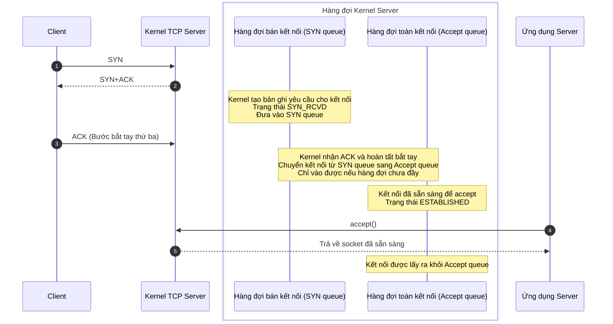
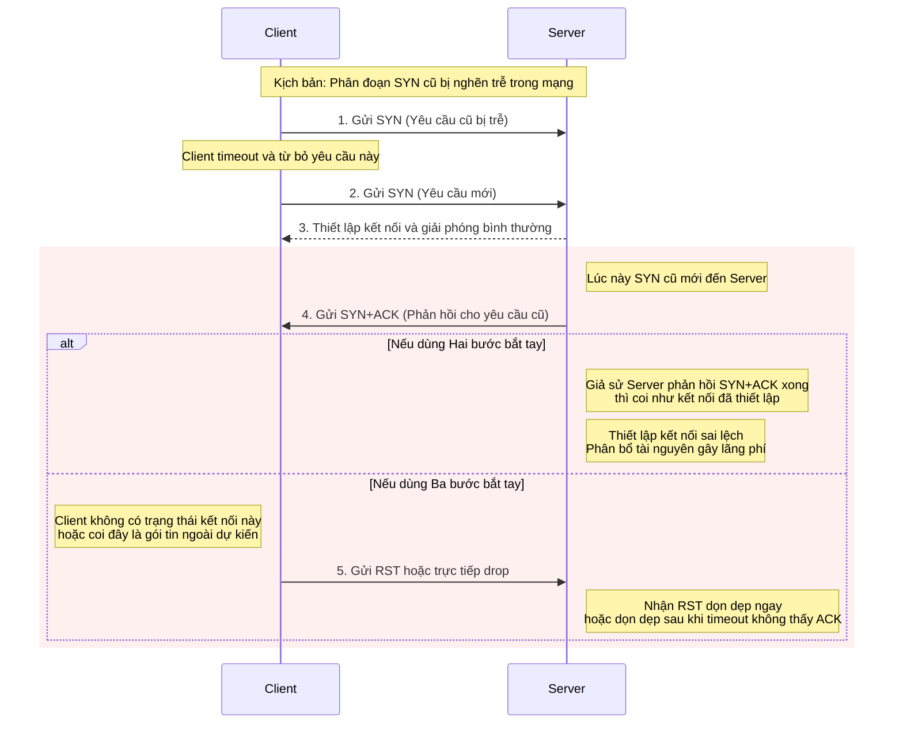
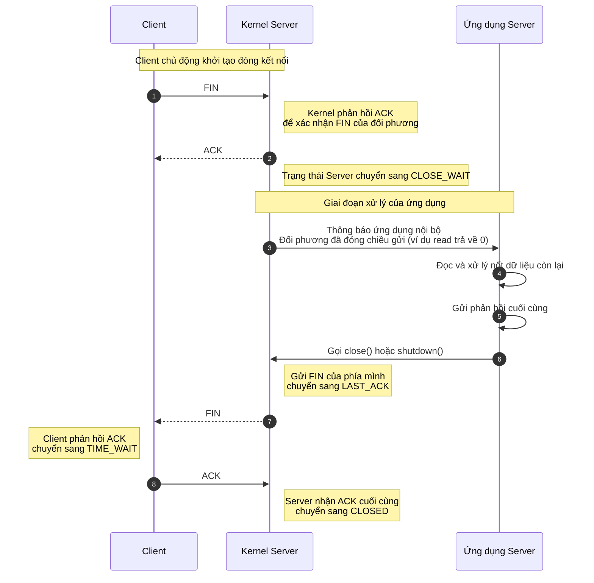
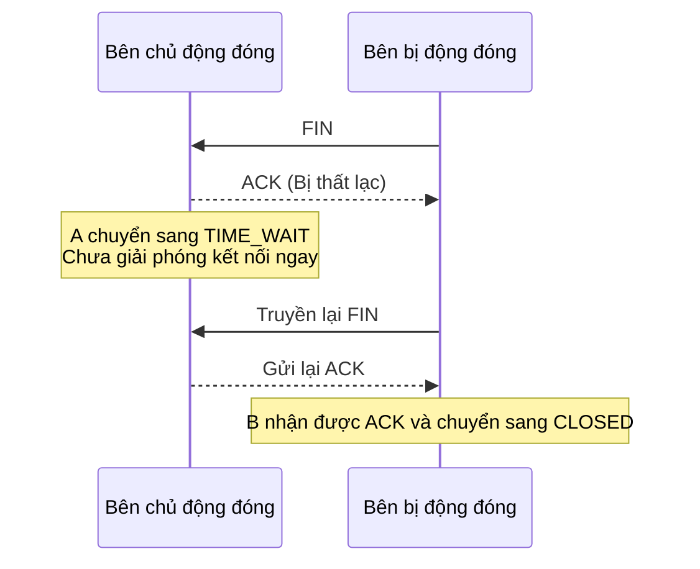

TCP ba bước bắt tay (Three-Way Handshake) và bốn bước bắt tay đóng (Four-Way Wave) thường rất dễ bị học vẹt thành một sơ đồ tuần tự đơn giản: Client gửi `SYN`, Server phản hồi `SYN+ACK`, cuối cùng Client gửi thêm một `ACK`; khi đóng kết nối, quy trình lại lần lượt đi qua `FIN`, `ACK`, `FIN`, `ACK`.

Tuy nhiên, khi thực sự xử lý sự cố mạng, phân tích gói tin (packet capture) hoặc trao đổi trong phỏng vấn kỹ thuật, việc chỉ học thuộc thứ tự là chưa đủ. Chẳng hạn: Tại sao thiết lập kết nối không phải là hai bước bắt tay? Sau khi Server nhận được bước bắt tay thứ ba, kết nối thực sự được lưu trữ trong hàng đợi nào? Tại sao ACK và FIN trong bốn bước đóng kết nối thường được gửi riêng biệt? Và trong điều kiện nào chúng có thể được gộp lại thành ba bước?

Bài viết này tập trung vào quy trình thiết lập và giải phóng kết nối TCP, liên kết và giải thích cặn kẽ những câu hỏi trên:

1. Từng bước trong TCP ba bước bắt tay đảm nhiệm việc gì?
2. Tại sao thiết lập kết nối cần ba bước bắt tay mà không phải hai hay bốn bước?
3. Hàng đợi bán kết nối (SYN Queue) và hàng đợi toàn kết nối (Accept Queue) lần lượt lưu trữ những gì?
4. Từng bước trong TCP bốn bước bắt tay đóng đảm nhiệm việc gì?
5. Cần hiểu các chi tiết như `TIME_WAIT`, `CLOSE_WAIT` và ba bước đóng kết nối ra sao?

> **Quy ước thuật ngữ**: Phần nội dung bài viết thống nhất sử dụng cách viết có dấu gạch dưới như `SYN_RCVD`, `TIME_WAIT`; các tài liệu RFC thường viết là `SYN-RECEIVED`, `TIME-WAIT`, trong khi lệnh Linux `ss` thường hiển thị dưới dạng `syn-recv`, `time-wait`. Chúng đều chỉ cùng một trạng thái TCP, chỉ khác nhau về cách biểu diễn tùy ngữ cảnh.

## Thiết lập kết nối: TCP Ba Bước Bắt Tay (Three-Way Handshake)


Trong kịch bản phổ biến nhất là "một đầu chủ động khởi tạo kết nối, một đầu bị động lắng nghe", kết nối TCP thường được thiết lập thông qua ba bước bắt tay:

1. **Bước bắt tay thứ nhất (SYN)**: Client gửi một phân đoạn SYN (Synchronize Sequence Numbers) đến Server, trong đó mang số thứ tự ban đầu (Initial Sequence Number, ISN) do Client tự sinh, ví dụ `seq=x`. Sau khi gửi, Client chuyển sang trạng thái `SYN_SENT` và chờ xác nhận từ Server.
2. **Bước bắt tay thứ hai (SYN+ACK)**: Sau khi Server nhận được SYN, nếu đồng ý thiết lập kết nối, Server sẽ phản hồi bằng một phân đoạn SYN+ACK. Phân đoạn này chứa hai thông tin mấu chốt:
   - **SYN**: Server cũng cần đồng bộ số thứ tự ban đầu của chính mình, do đó sẽ mang theo ISN do Server sinh ra, ví dụ `seq=y`.
   - **ACK**: Dùng để xác nhận đã nhận được SYN của Client, số xác nhận (acknowledgment number) được gán bằng số thứ tự ban đầu của Client cộng một, tức `ack=x+1`.
   - Sau khi gửi phân đoạn này, Server chuyển sang trạng thái `SYN_RCVD`.
3. **Bước bắt tay thứ ba (ACK)**: Sau khi Client nhận được SYN+ACK từ Server, Client sẽ gửi phân đoạn xác nhận cuối cùng đến Server. Vì phân đoạn SYN của Client tiêu tốn một số thứ tự, nên số thứ tự của phân đoạn ACK này thường là `seq=x+1`; nó dùng để xác nhận SYN của Server, với số xác nhận là `ack=y+1`. Sau khi gửi, Client chuyển sang trạng thái `ESTABLISHED`. Server sau khi nhận được ACK này cũng chuyển sang trạng thái `ESTABLISHED`.

Đến đây, hai bên đã hoàn tất việc đồng bộ số thứ tự ban đầu và xác nhận kết nối này có thể bắt đầu truyền dữ liệu hai chiều.

### Hàng đợi bán kết nối và Hàng đợi toàn kết nối là gì?



Trong quá trình TCP ba bước bắt tay, Kernel của Server thường dùng hai hàng đợi để quản lý các yêu cầu kết nối. Dưới đây lấy hành vi phổ biến trên Linux làm ví dụ; các hệ điều hành, phiên bản kernel, tùy chọn socket và môi trường triển khai khác nhau có thể có đôi chút khác biệt.

1. **Hàng đợi bán kết nối (SYN Queue)**:
   - Lưu trữ các yêu cầu "chưa hoàn tất bắt tay". Sau khi Server nhận SYN và phản hồi SYN+ACK, kết nối bước vào trạng thái `SYN_RCVD`, chờ ACK cuối cùng từ Client.
   - Nếu mãi không nhận được ACK, Kernel sẽ truyền lại (retransmit) SYN+ACK theo chiến lược đã định, cuối cùng sẽ timeout và dọn dẹp kết nối.
   - Tham số cấu hình liên quan phổ biến gồm `net.ipv4.tcp_max_syn_backlog`. Trong kịch bản tấn công SYN Flood, cơ chế `net.ipv4.tcp_syncookies` cũng sẽ tham gia xử lý.
2. **Hàng đợi toàn kết nối (Accept Queue)**:
   - Lưu trữ các kết nối "đã hoàn tất bắt tay nhưng ứng dụng chưa kịp gọi accept". Sau khi Server nhận được ACK cuối cùng, kết nối chuyển sang trạng thái `ESTABLISHED` và đi vào Accept Queue, chờ tầng ứng dụng gọi `accept()` để lấy ra xử lý.
   - Dung lượng hàng đợi chịu ảnh hưởng đồng thời bởi tham số `listen(fd, backlog)` và giới hạn hệ thống `net.core.somaxconn`. Trong thực tế, giới hạn hiệu dụng thường được ước tính gần đúng là `min(backlog, somaxconn)`, hành vi cụ thể tùy thuộc vào phiên bản kernel và cấu hình ứng dụng.

Tóm tắt lại:

| Hàng đợi | Vai trò | Trạng thái | Điều kiện lấy ra |
| --- | --- | --- | --- |
| Hàng đợi bán kết nối (SYN Queue) | Lưu kết nối chưa hoàn tất bắt tay | `SYN_RCVD` | Nhận được ACK / Hết hạn retransmission thất bại |
| Hàng đợi toàn kết nối (Accept Queue) | Lưu kết nối đã hoàn tất bắt tay, chờ ứng dụng accept | `ESTABLISHED` | Được tầng ứng dụng lấy ra qua `accept()` |

Khi hàng đợi toàn kết nối bị đầy, tham số `net.ipv4.tcp_abort_on_overflow` sẽ quyết định chiến lược xử lý:

- `0` (mặc định): Linux thông thường sẽ không lập tức trả về RST, mà có thể bỏ qua (drop) phân đoạn ACK ở bước bắt tay thứ ba, khiến Server tiếp tục duy trì trạng thái chưa hoàn tất bắt tay và truyền lại SYN+ACK. Phía Client sau khi gửi ACK thứ ba thường đã coi như `connect()` thành công; tuy nhiên Server lại chưa đưa kết nối này vào Accept Queue, dẫn đến việc dữ liệu sau đó do Client gửi có thể mãi không nhận được phản hồi bình thường, biểu hiện thành tắc nghẽn gói tin đầu tiên, timeout đọc dữ liệu hoặc liên tục retry.
- `1`: Lập tức phản hồi `RST` cho Client để kết nối thất bại nhanh chóng (fail-fast).

Khi điều tra sự cố, bạn có thể dùng `ss -ltn` để kiểm tra listening socket. Đối với trạng thái `LISTEN`, `Recv-Q` thường biểu thị số lượng kết nối hiện có trong backlog đang chờ ứng dụng accept, còn `Send-Q` biểu thị giới hạn trên của socket backlog. Nếu `Recv-Q` tiệm cận `Send-Q` trong thời gian dài, cần đặc biệt nghi ngờ ứng dụng accept không kịp, backlog quá nhỏ, thread pool bị treo, GC pause kéo dài hoặc có đột biến kết nối trong thời gian ngắn.

Khi hàng đợi bán kết nối bị đầy, nếu bật `tcp_syncookies=1`, Linux sẽ kích hoạt SYN Cookie khi SYN backlog tràn: Server mã hóa các thông tin cần thiết vào phân đoạn SYN+ACK trả về, thay vì cấp phát trạng thái bán kết nối đầy đủ cho từng yêu cầu. Nói cách khác, khi SYN Cookie có hiệu lực, Server không phân bổ tài nguyên trạng thái thông thường trong SYN Queue cho gói SYN đó; chỉ sau khi nhận được ACK hợp lệ cuối cùng, Kernel mới xác minh cookie và tái tạo lại thông tin cần thiết của kết nối.

Tuy nhiên, SYN Cookie là một biện pháp phòng hộ, không phải là giải pháp mở rộng dung lượng. Nó giúp giảm thiểu tác động của SYN Flood lên SYN Queue nhưng vẫn tiêu tốn CPU; nếu lưu lượng tấn công đã làm nghẽn băng thông mạng, SYN Cookie cũng không thể khôi phục tính khả dụng về mặt bản chất. Ngoài ra, ở chế độ SYN Cookie, một số tính năng mở rộng của TCP có thể bị hạn chế, dẫn đến suy giảm hiệu năng trên các đường truyền độ trễ cao, băng thông lớn. Cấu hình `tcp_syncookies=2` thiên về mục đích thử nghiệm, không khuyến nghị làm cấu hình mặc định trên môi trường production.

### Tại sao cần ba bước bắt tay?

TCP ba bước bắt tay chủ yếu thực hiện hai việc: **đồng bộ số thứ tự ban đầu của hai bên** và **xác nhận đường truyền gửi/nhận hai chiều đều khả dụng**. Việc phân phối dữ liệu tin cậy thực sự vẫn phụ thuộc vào cơ chế xác nhận (ACK), truyền lại (retransmission), điều khiển cửa sổ (flow control) và kiểm soát tắc nghẽn (congestion control) trong suốt quá trình truyền tải sau đó.

#### 1. Xác nhận năng lực gửi/nhận của hai bên và đồng bộ số thứ tự ban đầu

```mermaid
sequenceDiagram
  autonumber
  participant C as Client
  participant S as Server

  Note over C,S: Mục tiêu: Đồng bộ ISN hai bên và xác nhận liên lạc hai chiều

  C->>S: SYN seq=ISN_C
  Note right of S: Server biết hướng C→S thông suốt<br/>Client gửi được, Server nhận được
  Note right of S: Trạng thái Server: SYN_RCVD

  S->>C: SYN+ACK seq=ISN_S ack=ISN_C+1
  Note left of C: Client biết hướng S→C thông suốt<br/>Đồng thời biết Server đã nhận được SYN của mình

  C->>S: ACK seq=ISN_C+1 ack=ISN_S+1
  Note left of C: Trạng thái Client: ESTABLISHED
  Note right of S: Server biết Client đã nhận SYN+ACK<br/>Khép kín quy trình bắt tay, hoàn tất đồng bộ ISN
  Note right of S: Trạng thái Server: ESTABLISHED

  Note over C,S: Kết nối được thiết lập; có thể bắt đầu truyền dữ liệu
```

TCP dựa vào Sequence Number (SEQ) và Acknowledgment Number (ACK) để đảm bảo dữ liệu đúng thứ tự, loại bỏ trùng lặp và hỗ trợ truyền lại. Ba bước bắt tay thông qua việc trao đổi và xác nhận ISN của nhau giúp cả hai bên thống nhất về việc "bắt đầu gửi nhận dữ liệu từ số thứ tự nào", đồng thời tránh việc chỉ dựa vào thông tin một chiều mà đã bước vào trạng thái đã thiết lập kết nối.

Có thể ghi nhớ thông qua bảng sau:

| Bước | Phân đoạn tin | Xác nhận được điều gì |
| --- | --- | --- |
| 1 | C→S: SYN | Server biết: Client có thể gửi, Server có thể nhận, hướng C→S thông suốt |
| 2 | S→C: SYN+ACK | Client biết: Server có thể gửi, Client có thể nhận; đồng thời xác nhận Server đã nhận được SYN của mình |
| 3 | C→S: ACK | Server biết: Client đã nhận được SYN+ACK, hướng S→C cũng đã được Server xác nhận; bắt tay hoàn tất khép kín |

Lưu ý: Khi bước 2 hoàn thành, chỉ mới có Client xác nhận được liên lạc hai chiều thông suốt; Server lúc này vẫn chưa biết liệu gói SYN+ACK mình gửi đi có đến được Client hay không. Chỉ khi nhận được ACK ở bước thứ 3, Server mới thực sự xác nhận chu trình này đã khép kín — đây chính là lý do cốt lõi vì sao hai bước bắt tay là không đủ.

#### 2. Ngăn chặn các yêu cầu kết nối cũ đã hết hiệu lực bị thiết lập sai lầm



Hãy hình dung một kịch bản: Yêu cầu kết nối đầu tiên SYN1 do Client gửi đi bị tắc nghẽn trên mạng do độ trễ. Sau khi timeout, Client gửi lại yêu cầu SYN2, kết nối được thiết lập thành công, truyền dữ liệu xong và đã giải phóng kết nối. Đúng lúc này, gói SYN1 bị trễ mới mò tới Server.

- **Nếu dùng hai bước bắt tay**: Khi Server nhận được SYN1 đã mất hiệu lực này, Server có thể hiểu nhầm đây là một yêu cầu kết nối mới, lập tức cấp phát tài nguyên và thiết lập kết nối. Nhưng phía Client đã không còn ý định kết nối nữa nên sẽ không phối hợp truyền dữ liệu, Server sẽ đơn phương duy trì một kết nối vô ích.
- **Khi có bước bắt tay thứ ba**: Server nhận được SYN1 cũ và phản hồi SYN+ACK, sau đó vẫn phải chờ ACK cuối cùng từ Client. Vì Client hiện tại không có trạng thái kết nối này, Client có thể drop gói tin hoặc gửi lại một gói RST. Server không nhận được ACK hợp lệ thì cuối cùng sẽ thu hồi và dọn dẹp kết nối sai lệch này.

Vì vậy, ba bước bắt tay không chỉ đơn thuần là "gửi thêm một gói tin", mà nó giúp quy trình thiết lập kết nối tạo thành một chu trình khép kín, ngăn chặn các yêu cầu lịch sử bị trễ hoặc trùng lặp làm xáo trộn kết nối mới.

### Bước bắt tay thứ 2 đã gửi về ACK, tại sao vẫn phải gửi kèm SYN?

ACK trong bước bắt tay thứ hai có nhiệm vụ xác nhận "Server đã nhận được SYN của Client", tức là xác nhận yêu cầu từ chiều C→S đã đến đích.

Gửi kèm theo cờ SYN là vì Server cũng cần đồng bộ ISN của chính mình sang Client và yêu cầu Client phải xác nhận nó. Chỉ khi ISN của cả hai bên đều được đồng bộ, quá trình truyền dữ liệu tin cậy sau đó mới có chung một điểm xuất phát về số thứ tự.

Nói một cách ngắn gọn: ACK thể hiện "Tôi đã nhận được SYN của bạn", còn SYN thể hiện "Tôi cũng cần đồng bộ số thứ tự ban đầu của tôi, xin bạn hãy xác nhận".

> SYN (Synchronize Sequence Numbers) là tín hiệu đồng bộ được sử dụng khi TCP thiết lập kết nối. Client gửi SYN trước, Server đáp lại bằng SYN+ACK, cuối cùng Client xác nhận lại bằng ACK. Nhờ đó hai bên mới hoàn tất đồng bộ số thứ tự ban đầu, thiết lập một kết nối TCP sẵn sàng cho việc truyền tải dữ liệu tin cậy.

### Trong quá trình ba bước bắt tay có thể mang theo dữ liệu không?

Trong TCP thông thường, phân đoạn ACK ở bước bắt tay thứ ba có thể mang theo dữ liệu tầng ứng dụng. RFC 9293 cũng cho phép các gói tin trong giai đoạn đồng bộ kết nối chứa dữ liệu, nhưng bên nhận không được chuyển giao dữ liệu này lên ứng dụng trước khi xác nhận tính hợp lệ của nó; thông thường cần đợi kết nối chuyển sang trạng thái `ESTABLISHED` thì tầng ứng dụng mới đọc được phần dữ liệu này.

Nếu phân đoạn ACK của bước bắt tay thứ ba bị mất, nhưng Client sau đó gửi một gói tin vừa chứa dữ liệu vừa bật cờ ACK, thì Server khi nhận được có thể coi đó là xác nhận hợp lệ cho bước bắt tay thứ ba. Sau khi kết nối được công nhận là đã thiết lập, Server tiếp tục xử lý phần dữ liệu đó.

Cần lưu ý rằng điều này khác với TCP Fast Open (TFO). TFO bàn về việc gói SYN đầu tiên đã mang theo dữ liệu ứng dụng, đòi hỏi cả Client, Server và cấu hình hệ điều hành cùng hỗ trợ, chứ không phải hành vi mặc định của TCP thông thường.

## Ngắt kết nối: TCP Bốn Bước Bắt Tay Đóng (Four-Way Wave)


TCP là giao thức truyền thông song công toàn phần (Full-Duplex), chiều truyền dữ liệu của hai bên hoàn toàn độc lập với nhau. Khi đóng kết nối, thông thường hai chiều cần lần lượt hoàn thành quy trình "Tôi không gửi nữa" và "Tôi xác nhận bạn không gửi nữa", do đó về mặt logic thường được gọi là "bốn bước bắt tay đóng" (Four-Way Wave).

Tuy vậy cần lưu ý: bốn bước bắt tay đóng nói về các hành động logic, không nhất thiết lúc bắt gói tin (packet capture) cũng luôn thấy đủ 4 phân đoạn độc lập. Trong một số trường hợp, ACK và FIN có thể được gộp chung vào một phân đoạn.

Quy trình điển hình diễn ra như sau:

1. **Lần bắt tay đóng thứ nhất (FIN)**: Client (hoặc bất kỳ bên nào) khi quyết định đóng chiều gửi dữ liệu của mình sẽ gửi một phân đoạn FIN, báo hiệu mình không còn dữ liệu để gửi nữa. Phân đoạn này chứa một số thứ tự, ví dụ `seq=u`. Sau khi gửi, bên chủ động đóng chuyển sang trạng thái `FIN_WAIT_1`.
2. **Lần bắt tay đóng thứ hai (ACK)**: Server nhận được FIN sẽ phản hồi ACK với số xác nhận là `ack=u+1`. Sau khi gửi, Server chuyển sang trạng thái `CLOSE_WAIT`. Client nhận được ACK sẽ chuyển sang trạng thái `FIN_WAIT_2`. Lúc này kết nối rơi vào trạng thái **bán đóng (Half-Close)**: chiều gửi từ Client sang Server đã đóng, nhưng Server vẫn có thể tiếp tục gửi dữ liệu còn lại cho Client.
3. **Lần bắt tay đóng thứ ba (FIN)**: Khi Server xác nhận toàn bộ dữ liệu còn lại đã gửi xong, Server cũng sẽ gửi FIN, báo hiệu mình cũng chuẩn bị đóng chiều gửi. Phân đoạn này cũng chứa một số thứ tự, ví dụ `seq=v`, và thường tiếp tục mang theo số xác nhận hiện tại `ack=u+1`. Sau khi gửi, Server chuyển sang trạng thái `LAST_ACK`, chờ xác nhận cuối cùng từ Client.
4. **Lần bắt tay đóng thứ tư (ACK)**: Client nhận được FIN của Server sẽ phản hồi ACK cuối cùng với số xác nhận là `ack=v+1`. Sau khi gửi, Client chuyển sang trạng thái `TIME_WAIT`. Server nhận được ACK này sẽ chuyển sang `CLOSED`. Còn Client ở trạng thái `TIME_WAIT` chờ đủ thời gian 2MSL trước khi chính thức chuyển sang `CLOSED`.

Ở đây để tiện giải thích, chúng ta lấy Client làm bên chủ động đóng làm ví dụ. Trong thực tế, bên nào chủ động đóng kết nối thì bên đó sẽ bước vào `TIME_WAIT`, điều này không bắt buộc phải gắn cố định với vai trò "Client" hay "Server".

> Cần phân biệt rõ: **Bán đóng (Half-Close)** là trạng thái một chiều đã gửi FIN, chiều còn lại vẫn tiếp tục gửi dữ liệu; còn **Kết nối bán mở (Half-Open Connection)** thường chỉ kịch bản một đầu bị crash, khởi động lại hoặc mất trạng thái trong khi đầu kia vẫn tin rằng kết nối đang tồn tại. Hai khái niệm này hoàn toàn khác nhau.

Sơ đồ chuyển trạng thái phổ biến khi thiết lập và đóng kết nối TCP được thể hiện bên dưới. Các nhánh hiếm gặp hoặc bất thường như đồng thời mở (simultaneous open), đồng thời đóng (simultaneous close), RST, CLOSING đã được lược bớt để tập trung vào luồng chính.


### Tại sao cần bốn bước bắt tay đóng?

Bởi vì TCP là giao thức song công toàn phần (Full-Duplex). Việc bên A không còn dữ liệu muốn gửi không đồng nghĩa với việc bên B cũng lập tức hết dữ liệu cần gửi.

Ví dụ minh họa: A và B đang gọi điện thoại và cuộc gọi sắp kết thúc:

1. A bảo: "Tôi nói xong rồi, không còn gì nói nữa nhé." (A gửi FIN)
2. B trả lời: "Tôi biết rồi." Nhưng B có thể vẫn còn đôi lời muốn dặn dò. (B gửi ACK)
3. B nói nốt những lời còn lại, rồi bảo: "Tôi cũng nói xong rồi đấy." (B gửi FIN)
4. A đáp lại: "Được rồi, tôi nghe rõ." (A gửi ACK)

Ánh xạ vào TCP, điều này tương ứng với việc hai chiều độc lập đóng và độc lập xác nhận.

### Tại sao thông thường không thể gộp ACK và FIN do Server gửi thành ba bước?



Nguyên nhân mấu chốt là: thời điểm kích hoạt việc **phản hồi ACK** và **gửi FIN** thường hoàn toàn khác nhau.

- Khi Server nhận được FIN từ Client, TCP stack của Kernel cần lập tức phản hồi ACK để xác nhận "Tôi đã nhận được yêu cầu đóng chiều gửi của bạn". Lúc này Server chuyển sang `CLOSE_WAIT` và chờ ứng dụng nội bộ xử lý nốt dữ liệu còn tồn đọng.
- Chỉ khi ứng dụng phía Server xử lý xong xuôi và chủ động gọi hàm `close()` hoặc `shutdown()`, Kernel mới phát đi phân đoạn FIN của chính Server.
- Vì thế, việc "Kernel tự động trả ACK" và việc "ứng dụng quyết định gửi FIN" bị phân tách về mặt thời gian, thông thường không thể gộp lại. Chỉ khi Server cũng vừa vặn chuẩn bị đóng kết nối ngay lập tức thì gói FIN+ACK mới có cơ hội được gộp chung vào một phân đoạn.

### Tại sao CLOSE_WAIT lại bị tích tụ nhiều?

`CLOSE_WAIT` là trạng thái mà bên bị động đóng kết nối bước vào sau khi nhận được FIN và phản hồi ACK. Trong điều kiện bình thường, đây chỉ là trạng thái quá độ ngắn: ứng dụng đọc được tín hiệu đối phương đã đóng chiều gửi (EOF), xử lý xong dữ liệu còn lại, rồi gọi `close()` hoặc `shutdown()`, kết nối sẽ lập tức chuyển sang `LAST_ACK`.

Nếu trên máy chủ xuất hiện số lượng lớn kết nối ở trạng thái `CLOSE_WAIT`, thông thường nguyên nhân không nằm ở việc chưa tinh chỉnh thông số kernel, mà là do tầng ứng dụng không đóng kết nối kịp thời. Các nguyên nhân phổ biến gồm: nhánh xử lý ngoại lệ bỏ quên lệnh `close()`, logic hoàn trả kết nối của Connection Pool không đồng nhất với việc đóng socket thật sự, hoặc các business thread bị chặn bởi truy vấn chậm (slow query) / gọi dịch vụ bên ngoài, khiến code mãi không chạy tới đoạn đóng socket.

Khi kiểm tra, có thể dùng `ss -tan state close-wait` để rà soát những kết nối nào đang kẹt ở `CLOSE_WAIT`, sau đó kết hợp log ứng dụng, thread dump và giám sát connection pool để định vị đường dẫn code gây lỗi. Trọng tâm của `CLOSE_WAIT` nằm ở việc "ứng dụng cục bộ chưa chịu đóng kết nối", do đó việc chỉ chỉnh tham số TCP của hệ điều hành sẽ không giải quyết được tận gốc vấn đề.

### Trong trường hợp nào sẽ xuất hiện ba bước bắt tay đóng?

Bản chất việc bốn bước bắt tay đóng chuyển thành ba bước không phải là cắt bớt bước đóng kết nối, mà là **phân đoạn ACK của lần thứ hai và phân đoạn FIN của lần thứ ba được gộp chung vào một phân đoạn TCP duy nhất**.

Điều kiện điển hình là: sau khi bên bị động đóng nhận được FIN, phía mình không còn dữ liệu nào chờ gửi nữa, và ứng dụng cũng lập tức quyết định đóng kết nối ngay.

Điều này còn liên quan đến cơ chế TCP Delayed ACK (xác nhận trễ). Mục đích của Delayed ACK là giúp ACK có cơ hội được "đi nhờ" cùng gói cập nhật cửa sổ, gói phản hồi của ứng dụng hoặc các gói tin gửi đi khác, nhằm giảm bớt lưu lượng gói ACK thuần túy. RFC 1122 quy định ACK không được trễ quá mức, thời gian chờ cụ thể do từng implementation quyết định. Trong Linux và các hệ điều hành tương tự, nếu gói ACK "xác nhận FIN của đối phương" đang chờ được ghép đôi, mà ứng dụng nội bộ lại gọi `close()` hoặc `shutdown()` rất nhanh sau đó, Kernel có thể phát đi một gói FIN+ACK gộp: vừa xác nhận FIN của đối phương, vừa thông báo "phía tôi cũng dừng gửi dữ liệu".

Khi bắt gói tin, quy trình sẽ quan sát thấy:

1. Bên chủ động đóng gửi FIN;
2. Bên bị động đóng gửi FIN+ACK gộp;
3. Bên chủ động đóng phản hồi ACK và chuyển sang `TIME_WAIT`.

Có hai chi tiết kỹ thuật dễ gây hiểu nhầm:

- Ba bước bắt tay đóng không hề đi ngược lại ngữ nghĩa đóng toàn phần song công của TCP. Cả hai hướng truyền dữ liệu vẫn đều được đóng, chỉ là hành động "xác nhận" và "đóng chiều gửi" của bên bị động đóng tình cờ được đóng gói chung vào một phân đoạn TCP.
- Việc có thể gộp hay không còn phụ thuộc vào cách hiện thực TCP cụ thể, chiến lược Delayed ACK và thời điểm ứng dụng đóng socket. Nếu ACK đã được Kernel gửi đi độc lập trước đó thì khi gửi FIN không thể "quay ngược lại" để gộp; nếu bật chiến lược xác nhận nhanh như `TCP_QUICKACK` khiến ACK được gửi riêng rẽ càng sớm càng tốt, bạn sẽ dễ quan sát thấy đủ bốn bước bắt tay đóng hơn.

### Nếu ở lần bắt tay đóng thứ hai, ACK của Server không tới được Client thì sao?

Sau khi gửi FIN đầu tiên, Client chuyển sang trạng thái `FIN_WAIT_1` và khởi động bộ đếm thời gian truyền lại (retransmission timer). Nếu trong khoảng thời gian chờ mà không nhận được ACK xác nhận cho FIN, Client sẽ truyền lại FIN.

Server nếu nhận được FIN trùng lặp sẽ gửi lại ACK. Nếu do sự cố mạng mà ACK mãi không thể đến nơi, Client sau khi vượt quá ngưỡng số lần thử lại hoặc ngưỡng thời gian timeout nhất định có thể báo lỗi hoặc từ bỏ kết nối. Hành vi cụ thể phụ thuộc vào hệ điều hành và cấu hình: trên Linux, nếu socket đã bị ứng dụng đóng và trở thành orphaned socket, các lần thử lại sau đó chịu ảnh hưởng trực tiếp từ `tcp_orphan_retries`; còn timeout RTO trên kết nối đang hoạt động bình thường thì liên quan đến `tcp_retries2`.

### Tại sao sau lần bắt tay đóng thứ tư lại phải chờ 2MSL?

Ở lần bắt tay đóng thứ tư, gói ACK cuối cùng do bên chủ động đóng gửi sang bên bị động đóng có khả năng bị thất lạc trên mạng. Nếu bên bị động đóng không nhận được ACK, họ sẽ truyền lại gói FIN. Vì bên chủ động đóng vẫn còn nán lại trong trạng thái `TIME_WAIT`, nên họ có thể tiếp tục gửi lại gói ACK để xác nhận.

Nếu bên chủ động đóng vừa gửi xong ACK cuối cùng đã lập tức chuyển sang `CLOSED`, thì khi gói FIN truyền lại của đối phương mò tới, máy chủ phía mình đã không còn lưu giữ trạng thái kết nối tương ứng và buộc phải trả lời bằng gói RST, khiến đối phương gặp phải lỗi đóng bất thường hoặc connection reset.



**MSL (Maximum Segment Lifetime)** là thời gian sống tối đa của một phân đoạn mạng trong toàn hệ thống. 2MSL không phải là RTT tối đa của một lượt request-response, mà là một khoảng thời gian chờ an toàn mang tính bảo thủ: nó vừa tạo cơ hội xử lý việc FIN truyền lại nếu ACK cuối bị mất, vừa đảm bảo các gói tin còn trôi nổi, chậm trễ của kết nối cũ hoàn toàn biến mất khỏi mạng.

Cần lưu ý rằng MSL trong tài liệu RFC là khái niệm thuộc tầng giao thức, các hệ điều hành cụ thể có thể hiện thực khác nhau. Trong các bản Linux phổ biến, thời gian duy trì `TIME_WAIT` thường cố định là 60 giây, ứng với hằng số `TCP_TIMEWAIT_LEN` trong kernel, chứ không phải được tính động theo thời gian thực là "2 lần MSL" của mạng. Một hiểu lầm phổ biến khác: tham số `tcp_fin_timeout` kiểm soát thời gian timeout của `FIN_WAIT_2` cho orphaned connection chứ không điều khiển `TIME_WAIT`. Muốn giải tỏa áp lực cạn kiệt cổng do `TIME_WAIT` gây ra, hãy ưu tiên các giải pháp: tái sử dụng kết nối (connection reuse), mở rộng dải ephemeral port, kiểm soát bên chủ động đóng và tận dụng điều kiện của `tcp_tw_reuse`, thay vì tìm cách dùng `tcp_fin_timeout` để rút ngắn `TIME_WAIT`.

## Các câu hỏi thường gặp về TIME_WAIT: Tại sao phải chờ, có gây lỗi không, có tái sử dụng được không?

Nội dung phần này đã được biên soạn chi tiết thành một bài viết riêng, tham khảo tại [Giải thích chi tiết TCP TIME_WAIT: Tại sao phải chờ, có gây lỗi không, có tái sử dụng được không?](./tcp-time-wait.md).

## Tổng kết

Cốt lõi của TCP ba bước bắt tay không phải là "vừa vặn gửi ba gói tin", mà là thông qua `SYN`, `ACK` và việc đồng bộ số thứ tự ban đầu để cả Client và Server đều xác nhận kết nối có đủ năng lực giao tiếp hai chiều thông suốt. Bớt đi một bước bắt tay, Server sẽ không thể xác định liệu Client có nhận được gói `SYN+ACK` của mình hay không, đồng thời hệ thống rất dễ bị các yêu cầu kết nối trễ từ quá khứ làm xáo trộn.

Trong quá trình bắt tay, Server sẽ sử dụng hai hàng đợi: SYN Queue lưu trữ các kết nối chưa hoàn tất bắt tay, còn Accept Queue lưu trữ các kết nối đã thiết lập thành công đang chờ ứng dụng gọi `accept()`. Khi điều tra các vấn đề như kết nối thiết lập chậm, timeout ngẫu nhiên, tấn công SYN Flood hoặc ứng dụng accept không kịp, hai hàng đợi này là các điểm quan sát vô cùng quan trọng.

Cốt lõi của TCP bốn bước bắt tay đóng là hai chiều gửi của kết nối song công toàn phần cần được đóng độc lập với nhau. Bên chủ động đóng gửi FIN chỉ có nghĩa là "Tôi không gửi thêm dữ liệu nữa", chứ không có nghĩa là đối phương cũng lập tức hết dữ liệu để truyền. Do đó, ACK và FIN thông thường phải gửi riêng biệt; chỉ khi bên bị động đóng không còn dữ liệu chờ gửi, ứng dụng lập tức đóng kết nối, đồng thời ACK có thể kết hợp với cơ chế Delayed ACK để chờ đi chung, thì ACK và FIN mới có thể gộp thành một gói FIN+ACK (bắt gói tin trông như ba bước bắt tay đóng). Còn trạng thái `CLOSE_WAIT` thường nhắc nhở chúng ta: ứng dụng phía bị động đóng vẫn chưa thực sự gọi lệnh đóng kết nối.

Cuối cùng, trạng thái `TIME_WAIT` không hề là khoảng thời gian chờ đợi thừa thãi. Nó vừa tạo cơ hội xử lý việc FIN được truyền lại khi ACK cuối bị mất, vừa tránh để các gói tin còn trôi nổi của kết nối cũ làm ảnh hưởng đến các kết nối mới sau này. Việc hiểu rõ thời điểm kích hoạt của các trạng thái và gói tin này hữu ích hơn rất nhiều so với việc chỉ học vẹt "mấy lần bắt tay, mấy lần bắt tay đóng".

## Tài liệu tham khảo

- Mạng máy tính (Tái bản lần thứ 7) - Xie Xiren
- Illustrated HTTP
- TCP and UDP Tutorial: <https://www.9tut.com/tcp-and-udp-tutorial>
- Bắt đầu từ một sự cố online: Phân tích chi tiết TCP SYN Queue và Accept Queue: <https://mp.weixin.qq.com/s/YpSlU1yaowTs-pF6R43hMw>
- RFC 9293: Transmission Control Protocol (TCP): <https://www.rfc-editor.org/rfc/rfc9293>
- RFC 1122: Requirements for Internet Hosts - Communication Layers: <https://www.rfc-editor.org/rfc/rfc1122>
- RFC 1337: TIME-WAIT Assassination Hazards in TCP: <https://www.rfc-editor.org/rfc/rfc1337>
- tcp(7) - Linux manual page: <https://www.man7.org/linux/man-pages/man7/tcp.7.html>
- Tài liệu Linux Kernel ip-sysctl: <https://www.kernel.org/doc/Documentation/networking/ip-sysctl.txt>
- Mã nguồn Linux Kernel `include/net/tcp.h`: <https://codebrowser.dev/linux/linux/include/net/tcp.h.html>
- SoByte - Tại sao TCP cần trạng thái TIME_WAIT: <https://www.sobyte.net/post/2022-10/tcp-time-wait/>
