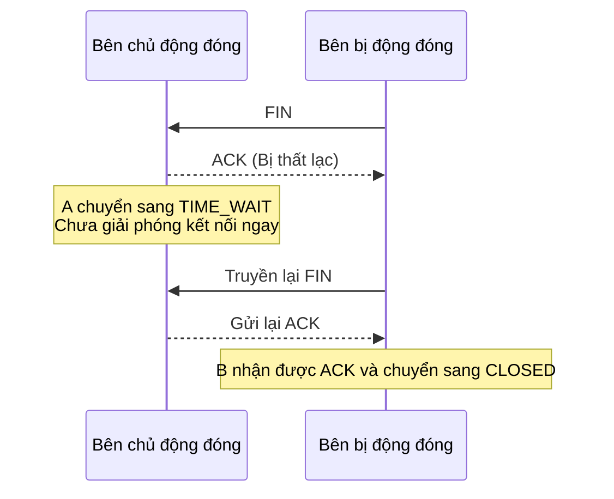

Ở bước cuối cùng của TCP bốn bước bắt tay đóng, bên chủ động đóng sau khi phát đi gói ACK sẽ không lập tức đóng kết nối ngay, mà chuyển sang trạng thái `TIME_WAIT`, theo mặc định phải chờ khoảng 60 giây.

Khoảng thời gian 60 giây này thường xuyên bị hiểu lầm: có người cho rằng đó là sự lãng phí tài nguyên, có người tìm cách dùng tham số kernel để tắt cưỡng bức, lại có người nhầm lẫn giữa `CLOSE_WAIT` và `TIME_WAIT` khi xử lý sự cố.

Bài viết này sẽ giải đáp những thắc mắc phổ biến nhất trong môi trường vận hành thực tế:

1. `TIME_WAIT` rốt cuộc đang chờ đợi điều gì?
2. Việc tích tụ một lượng lớn `TIME_WAIT` có thực sự gây ra lỗi không?
3. Có nên tùy tiện bật cờ `tcp_tw_reuse` không?
4. Phân biệt `TIME_WAIT` và `CLOSE_WAIT` như thế nào?

## TIME_WAIT không chỉ đơn giản là "chờ một lát rồi mới đóng"

Gói ACK đã được gửi đi thành công rồi, tại sao vẫn phải chiếm giữ cổng kết nối suốt hàng chục giây?

Bên chủ động đóng sau khi phát đi ACK cuối cùng sẽ không giải phóng kết nối ngay mà chuyển sang `TIME_WAIT`. Trong sơ đồ chuyển trạng thái kết nối của RFC 9293, ta có thể thấy `TIME_WAIT` sẽ xóa TCB (Transmission Control Block) và chuyển sang `CLOSED` sau khi hết thời gian chờ 2MSL.

Cần chú ý một chi tiết quan trọng: Không phải "cứ bên nào nhận được FIN thì bên đó sẽ vào TIME_WAIT". Bên bị động đóng sau khi nhận được FIN thường sẽ chuyển sang `CLOSE_WAIT` trước, chờ ứng dụng nội bộ xử lý xong dữ liệu còn tồn đọng rồi mới gọi `close()` hoặc `shutdown()`. Tình huống phổ biến hơn là bên chủ động đóng nhận được FIN cuối cùng của đối phương và phản hồi ACK cuối cùng, sau đó mới bước vào `TIME_WAIT`.

**Bên nào chủ động đóng kết nối thì bên đó sẽ dễ rơi vào trạng thái TIME_WAIT hơn.** Ví dụ khi Client chủ động ngắt kết nối ngắn HTTP, `TIME_WAIT` thường xuất hiện ở phía Client; còn nếu Server chủ động ngắt kết nối, phía Server cũng hoàn toàn có thể tích tụ một lượng lớn `TIME_WAIT`.

Bề ngoài trông như chỉ nán lại chờ một chút, nhưng thực chất là để giải quyết hai vấn đề then chốt.

## Lý do thứ nhất: Tạo cơ hội cứu vãn cho gói ACK cuối cùng

Sau khi bên chủ động đóng gửi gói ACK cuối cùng, nếu gói ACK này không may bị thất lạc trong mạng, bên bị động đóng sẽ nghĩ rằng gói FIN của mình chưa được xác nhận, do đó sẽ gửi lại (retransmit) FIN. Vì bên chủ động đóng vẫn đang nán lại trong `TIME_WAIT`, nó có thể tiếp tục phản hồi lại ACK; nếu nó đã vội vã chuyển sang `CLOSED`, nó có thể trả về một gói RST, khiến đối phương ghi nhận đó là một lỗi đóng kết nối bất thường hoặc connection reset.



**MSL (Maximum Segment Lifetime)** là thời gian sống tối đa của một phân đoạn dữ liệu trong mạng. 2MSL không phải là RTT tối đa của một lượt request-response, mà là một khoảng thời gian chờ an toàn mang tính bảo thủ: nó vừa tạo cơ hội xử lý việc FIN truyền lại nếu ACK cuối bị mất, vừa đảm bảo các gói tin chậm trễ của kết nối cũ hoàn toàn biến mất khỏi mạng lưới.

Cần lưu ý rằng MSL trong tài liệu RFC là một khái niệm thuộc tầng giao thức, các hệ điều hành cụ thể có thể hiện thực khác nhau. Trong các bản Linux phổ biến, thời gian duy trì `TIME_WAIT` thường cố định là 60 giây. Một hiểu lầm phổ biến khác: tham số `tcp_fin_timeout` kiểm soát thời gian timeout của `FIN_WAIT_2` cho orphaned connection chứ không điều khiển `TIME_WAIT`. Muốn giải tỏa áp lực cạn kiệt cổng do `TIME_WAIT` gây ra, hãy ưu tiên các giải pháp: tái sử dụng kết nối (connection reuse), mở rộng dải ephemeral port, kiểm soát bên chủ động đóng và tận dụng điều kiện của `tcp_tw_reuse`, thay vì tìm cách dùng `tcp_fin_timeout` để rút ngắn `TIME_WAIT`.

## Lý do thứ hai: Tránh để các gói tin của kết nối cũ lẫn vào kết nối mới

Một kết nối TCP được định danh duy nhất bởi bộ tứ (4-tuple): IP nguồn, Cổng nguồn, IP đích, Cổng đích. Nếu kết nối cũ vừa đóng xong mà một kết nối mới lập tức được thiết lập bằng đúng bộ tứ đó, thì các gói tin bị trễ của kết nối cũ rất có thể rơi trúng vào cửa sổ nhận của kết nối mới và bị xử lý như dữ liệu hợp lệ của kết nối mới.

Lấy một ví dụ cụ thể:

```text
Kết nối cũ: client:50000 -> server:443
Gói tin mang SEQ=301 do server gửi đi bị đi lạc vòng vèo trong mạng, mãi chưa tới đích.

Sau khi kết nối cũ đóng lại, client nhanh chóng tái sử dụng chính cổng nguồn đó:
Kết nối mới: client:50000 -> server:443

Đúng lúc này, gói tin cũ SEQ=301 mới mò tới client.
Nếu nó tình cờ rơi trúng vào cửa sổ nhận của kết nối mới, nó có nguy cơ bị nhận nhầm thành dữ liệu hợp lệ.
```

Không gian số thứ tự của TCP nằm trong khoảng từ 0 đến 2^32 - 1, và sẽ quay vòng (wrap-around) theo modulo 2^32, vì vậy không thể chỉ dựa duy nhất vào số thứ tự để phân biệt vĩnh viễn giữa gói tin cũ và mới. Trong thực tế hệ thống còn áp dụng Timestamp, PAWS (Protection Against Wrapped Sequences), ISN ngẫu nhiên... nhưng chúng không phải là giải pháp vạn năng có thể "thay thế hoàn toàn TIME_WAIT". RFC 1337 cũng đã phân tích chi tiết về các rủi ro do gói tin cũ trùng lặp gây ra đối với trạng thái TIME_WAIT.

## Lượng lớn TIME_WAIT rốt cuộc có thực sự gây ra lỗi không?

Bản thân `TIME_WAIT` là một trạng thái hoàn toàn bình thường và lành mạnh của giao thức. Vấn đề thực sự chỉ nảy sinh khi bên chủ động đóng tạo ra một lượng kết nối khổng lồ tới cùng một cặp IP đích + Cổng đích trong một khoảng thời gian cực ngắn, dẫn đến việc các cổng tạm thời (ephemeral port) của máy cục bộ bị chiếm dụng sạch sẽ.

Dải cổng tạm thời trên Linux có thể được kiểm tra và điều chỉnh thông qua tham số `net.ipv4.ip_local_port_range`. Tài liệu chính thức của Linux kernel quy định dải mặc định là `32768 60999`, môi trường thực tế cần căn cứ vào kết quả trên máy của bạn:

```bash
cat /proc/sys/net/ipv4/ip_local_port_range
```

Nếu một Client liên tục kết nối tới cùng một cặp IP đích + Cổng đích trong thời gian ngắn, mà các kết nối cũ đều kẹt lại ở trạng thái `TIME_WAIT`, toàn bộ cổng tạm thời cục bộ khả dụng có thể bị cạn kiệt, khiến kết nối mới không thể cấp phát được cổng nguồn, xuất hiện thông báo lỗi quen thuộc:

```text
Cannot assign requested address
```

Có thể đánh giá vấn đề theo tư duy sau:

- **Nếu thấy rất nhiều TIME_WAIT trên máy chủ (Server)**: Trước tiên kiểm tra xem có phải Server là bên chủ động đóng kết nối hay không, ví dụ Server chủ động ngắt kết nối ngắn, Gateway chủ động đóng kết nối upstream, hoặc Connection Pool chủ động thanh lọc kết nối hết hạn.
- **Nếu thấy rất nhiều TIME_WAIT trên Client hoặc Gateway**: Trọng tâm kiểm tra xem có xảy ra bão kết nối ngắn (short-connection storm), Connection Pool không được tái sử dụng, HTTP Keep-Alive chưa được bật, hoặc phía dịch vụ upstream thường xuyên ngắt kết nối hay không.

Có thể áp dụng công thức ước tính gần đúng sau:

```text
Giới hạn kết nối ngắn tới cùng một cặp IP:Port đích ≈ Số cổng tạm thời khả dụng / Thời gian duy trì TIME_WAIT
```

Ví dụ dải cổng mặc định là `32768~60999`, có khoảng 28.000 cổng. Nếu `TIME_WAIT` duy trì khoảng 60 giây thì giới hạn tạo mới kết nối ngắn liên tục tới cùng một IP:Port đích rơi vào khoảng vài trăm QPS. Kết quả thực tế còn phụ thuộc vào việc tái sử dụng kết nối, các cổng được đặt trước, cơ chế NAT, chính sách kernel và quy tắc tái sử dụng bộ tứ với các đích khác nhau, do đó không thể chỉ nhìn vào tổng số lượng `TIME_WAIT` đơn thuần mà vội vàng kết luận hệ thống có sự cố.

## Tại sao không khuyến nghị tùy tiện bật tcp_tw_reuse?

`tcp_tw_reuse` cho phép tái sử dụng socket đang ở trạng thái `TIME_WAIT` cho các kết nối chủ động mới khi giao thức đánh giá là an toàn. Thoạt nhìn nó giống như một đường tắt nhanh chóng để giải tỏa áp lực cạn kiệt cổng, nhưng loại tham số này đã làm thay đổi chiến lược chờ đợi an toàn của TCP đối với các gói tin cũ, vì vậy không thể coi nó là một công tắc vạn năng.

Cần xem xét vấn đề này qua 3 tầng:

1. **Nó phụ thuộc vào các điều kiện như Timestamp để nhận định "gói tin mới có đủ mới hay không"**. Timestamp có thể lọc được một phần gói tin cũ, nhưng không thể bao quát hết mọi trường hợp ngoại lệ. RFC 1337 nhấn mạnh nguy cơ trạng thái `TIME_WAIT` bị kết thúc sớm bởi các gói RST cũ trôi nổi. Nếu một đoạn dữ liệu cũ rơi vào cửa sổ hợp lệ của kết nối mới có thể gây lẫn lộn dữ liệu; còn ảnh hưởng của gói ACK cũ thì phụ thuộc vào số thứ tự, cửa sổ và chi tiết hiện thực, không nên đánh đồng hoàn toàn với nguy cơ đứt kết nối do RST.
2. **Trong tài liệu Linux kernel hiện tại, `tcp_tw_reuse` có thể nhận các giá trị 0/1/2, giá trị mặc định là 2**, nghĩa là chỉ cho phép tái sử dụng đối với lưu lượng nội bộ (loopback); giá trị `1` mới là bật toàn cục. Tuy nhiên các tài liệu kernel cũ hoặc sách vở lịch sử có thể vẫn viết là "mặc định tắt", thực tế phải kiểm tra bằng `sysctl net.ipv4.tcp_tw_reuse`. Tài liệu kernel cũng cảnh báo rõ: không nên thay đổi tham số này nếu không có tư vấn chuyên sâu của chuyên gia hoặc nhu cầu kỹ thuật rõ ràng.
3. **Tuyệt đối không nhầm lẫn `tcp_tw_reuse` với `tcp_tw_recycle` vốn đã bị khai tử**. Cơ chế `tcp_tw_recycle` trong môi trường mạng NAT sẽ gây ra xung đột Timestamp, dẫn đến việc hàng loạt kết nối của client phía sau NAT bị drop âm thầm, và nó đã bị gỡ bỏ hoàn toàn từ Linux kernel 4.12. Rất nhiều bài viết cũ trên mạng vẫn khuyên bật đồng thời cả `tcp_tw_reuse` lẫn `tcp_tw_recycle`, bạn tuyệt đối không nên sao chép mù quáng những cấu hình lỗi thời đó.

Tóm lại một câu: Có thể cân nhắc `tcp_tw_reuse`, nhưng bắt buộc phải gắn liền với phiên bản Linux, lưu lượng có phải loopback không, có đi qua mạng NAT không, có bật Timestamp không và có bằng chứng rõ ràng về việc cạn kiệt cổng hay không. Nếu có thể xử lý triệt để ở tầng ứng dụng thì hãy ưu tiên giải quyết ở tầng ứng dụng trước.

## TIME_WAIT và CLOSE_WAIT: Một bên là chờ đợi bình thường, một bên là do ứng dụng rò rỉ kết nối

Khi kiểm tra trạng thái kết nối, sự xuất hiện của `CLOSE_WAIT` thường đáng báo động hơn rất nhiều so với `TIME_WAIT`.

Khi nhận được FIN của đối phương, Kernel của máy sẽ tự động phản hồi ACK rồi chuyển sang `CLOSE_WAIT`, chờ ứng dụng xử lý nốt dữ liệu còn lại và gọi hàm `close()` hoặc `shutdown()`. Trong các dịch vụ Java, sự tích tụ của `CLOSE_WAIT` hầu như luôn xuất phát từ việc ứng dụng không chịu đóng kết nối đúng cách. Ví dụ: tự viết Socket mà quên close, gọi HTTP Client nhưng không đóng response body, các nhánh rẽ lỗi exception bị `return` sớm bỏ qua lệnh đóng, hoặc Connection Pool không trả lại kết nối... đều khiến Kernel tuy đã ACK gói FIN của đối phương nhưng code ứng dụng mãi không chịu gọi lệnh close socket.

Có thể phân biệt theo tư duy sau:

- **TIME_WAIT**: Bên chủ động đóng nán lại chờ 2MSL, đây là một phần được thiết kế có chủ đích của giao thức.
- **CLOSE_WAIT**: Bên bị động đóng đã biết đối phương ngừng gửi, nhưng ứng dụng nội bộ vẫn chưa chịu đóng socket. Khi tích tụ số lượng lớn, hãy ưu tiên nghi ngờ code ứng dụng chưa giải phóng kết nối, thread bị treo, kết nối trong Connection Pool bị rò rỉ, hoặc quy trình đọc ghi không đi qua khối `finally`.

| Trạng thái | Thường xuất hiện ở | Ý nghĩa | Hướng điều tra chính |
| --- | --- | --- | --- |
| TIME_WAIT | Bên chủ động đóng | Chờ cơ hội truyền lại ACK cuối & chờ gói cũ biến mất | Kết nối ngắn, Connection Pool, Keep-Alive, dải cổng |
| CLOSE_WAIT | Bên bị động đóng | Đối phương đã đóng, ứng dụng mình chưa close | Code giải phóng socket, thread có bị treo không, rò rỉ pool |

## Khi điều tra đừng chỉ nhìn vào số lượng, hãy xem ai là bên chủ động đóng


Khi thấy lượng lớn `TIME_WAIT` hoặc `CLOSE_WAIT`, bạn có thể dùng một số câu lệnh dưới đây để định hướng xử lý:

Lưu ý rằng `ss` là lệnh do gói `iproute2` trên Linux cung cấp, macOS mặc định không có sẵn. Nếu môi trường làm việc của bạn là macOS, hãy dùng `netstat` và `lsof` để thay thế.

```bash
# Linux: Xem số lượng từng trạng thái TCP
ss -ant | awk 'NR>1 {cnt[$1]++} END {for (s in cnt) print s, cnt[s]}'

# macOS: Xem số lượng từng trạng thái TCP
netstat -anp tcp | awk '$1 ~ /^tcp/ {cnt[$NF]++} END {for (s in cnt) print s, cnt[s]}'

# Linux: Xem TIME-WAIT tập trung chủ yếu vào các IP/Port đích nào
ss -ant state time-wait | awk 'NR>1 {print $5}' | sort | uniq -c | sort -nr | head

# macOS: Xem TIME-WAIT tập trung chủ yếu vào các IP/Port đích nào
netstat -anp tcp | awk '$1 ~ /^tcp/ && $NF=="TIME_WAIT" {print $(NF-1)}' | sort | uniq -c | sort -nr | head

# Linux: Xem CLOSE-WAIT thuộc về tiến trình process nào (cần sudo để xem thông tin process)
sudo ss -tanp state close-wait

# macOS: Xem CLOSE-WAIT thuộc về tiến trình process nào
sudo lsof -nP -iTCP -sTCP:CLOSE_WAIT

# Linux: Xem tình trạng accept queue của listening socket
ss -ltn
```


Nhận định logic đằng sau các câu lệnh:

- **TIME_WAIT tập trung vào một dịch vụ từ xa cụ thể**: Kiểm tra xem có quá nhiều kết nối ngắn không, HTTP connection reuse có hiệu lực không, Connection Pool cấu hình quá nhỏ hoặc bị hủy liên tục không, hoặc đối phương có thường xuyên chủ động ngắt kết nối không.
- **CLOSE_WAIT tập trung vào một process cục bộ cụ thể**: Ưu tiên rà soát code ứng dụng, đặc biệt là các nhánh rẽ xử lý ngoại lệ xem đã đóng response body, socket hoặc connection object hay chưa.
- **Listening socket có Recv-Q tiệm cận Send-Q trong thời gian dài**: Tập trung điều tra hiện tượng nghẽn Accept Queue, kiểm tra xem ứng dụng gọi `accept()` có kịp không, thread pool có bị kẹt không, backlog cấu hình có quá nhỏ không.
- Với Gateway, Reverse Proxy, Crawler, tool test tải, `TIME_WAIT` xuất hiện phổ biến hơn; với các backend Java bị rò rỉ khi gọi downstream, `CLOSE_WAIT` xuất hiện nhiều hơn.

## Lời khuyên tối ưu hóa có chừng mực

Nên xử lý theo thứ tự ưu tiên sau:

1. **Ưu tiên cắt giảm các kết nối ngắn không cần thiết**: Kích hoạt HTTP Keep-Alive, tái sử dụng Connection Pool.
2. **Xác định rõ ai là bên chủ động đóng kết nối**: Server, Client, Gateway, Connection Pool đều có thể là bên chủ động đóng.
3. **Kiểm tra kỹ việc giải phóng tài nguyên phía ứng dụng**: Đặc biệt là HTTP response body, Socket, kết nối Database, hoàn trả connection về Pool.
4. **Mở rộng dải cổng tạm thời cục bộ**: Chỉ khi lượng kết nối ngắn ở phía Client thực sự rất cao và có bằng chứng rõ ràng về việc cạn kiệt cổng, mới xem xét điều chỉnh `ip_local_port_range`.
5. **Cuối cùng mới nghĩ đến việc tinh chỉnh tham số kernel**: Các tham số `tcp_tw_reuse`, `tcp_abort_on_overflow`, `tcp_syncookies` đều phải được đánh giá dựa trên phiên bản Linux, mô hình kết nối nghiệp vụ, có qua NAT hay không, có đang bị tấn công hay không và có số liệu quan sát thực tế hay không; tuyệt đối không nên sao chép cấu hình trên mạng một cách máy móc.

Nhiều `TIME_WAIT` chưa chắc đã là sự cố hỏng hóc; nhiều `CLOSE_WAIT` thì thường phải kiểm tra ngay code ứng dụng. Cả hai trạng thái này nhìn qua đều có vẻ giống "kết nối chưa đóng triệt để", nhưng bản chất nguyên nhân kỹ thuật lại hoàn toàn trái ngược nhau.

## Tài liệu tham khảo

- RFC 9293: Transmission Control Protocol (TCP): <https://www.rfc-editor.org/rfc/rfc9293>
- RFC 1337: TIME-WAIT Assassination Hazards in TCP: <https://www.rfc-editor.org/rfc/rfc1337>
- Tài liệu Linux Kernel ip-sysctl: <https://www.kernel.org/doc/Documentation/networking/ip-sysctl.txt>
- SoByte - Tại sao TCP cần trạng thái TIME_WAIT: <https://www.sobyte.net/post/2022-10/tcp-time-wait/>
