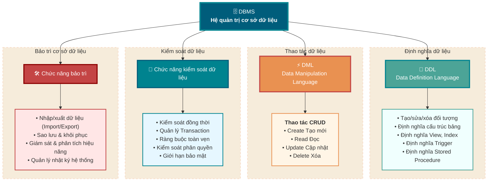
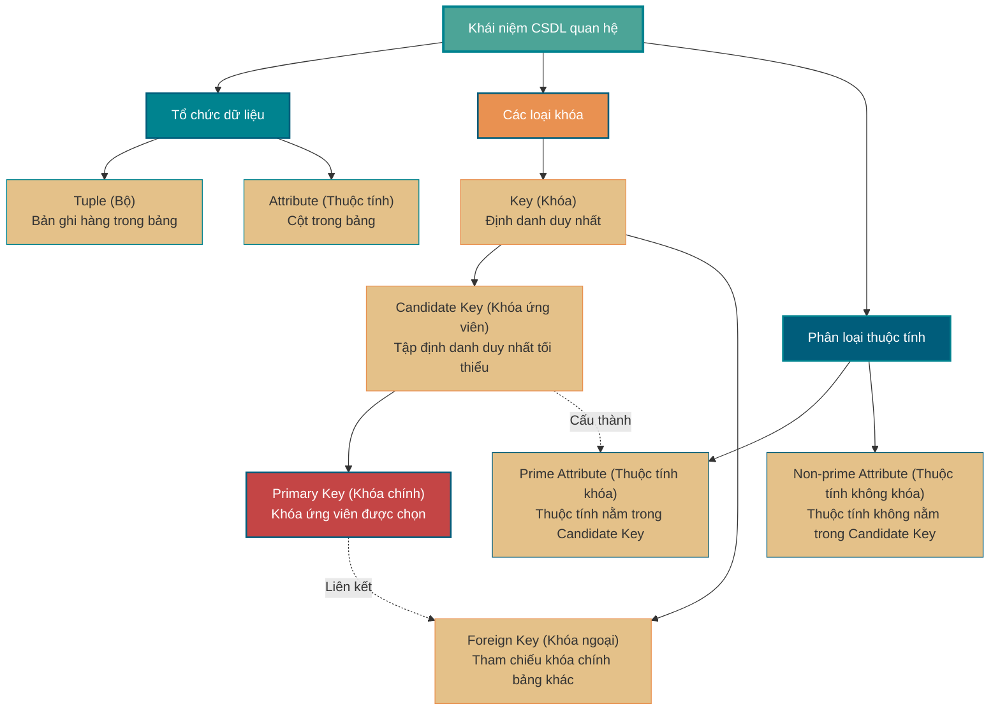
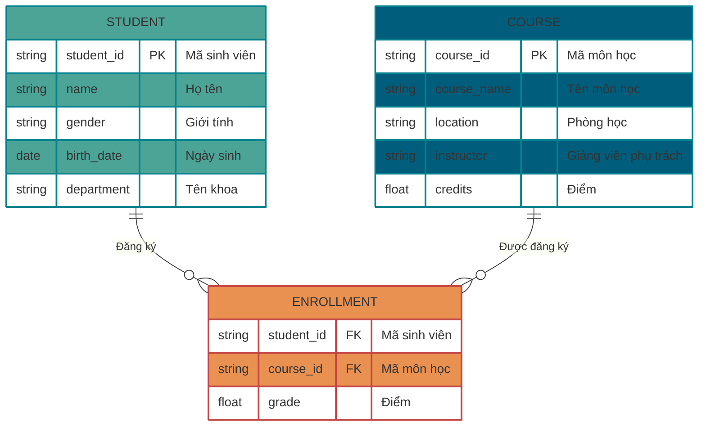
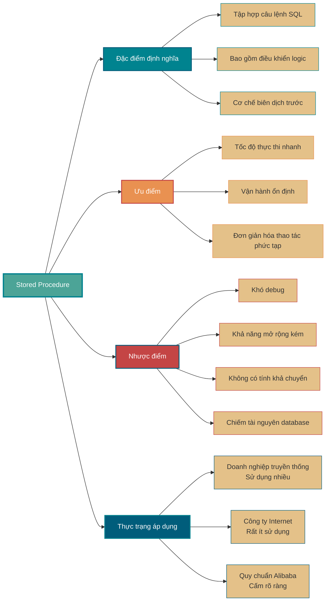
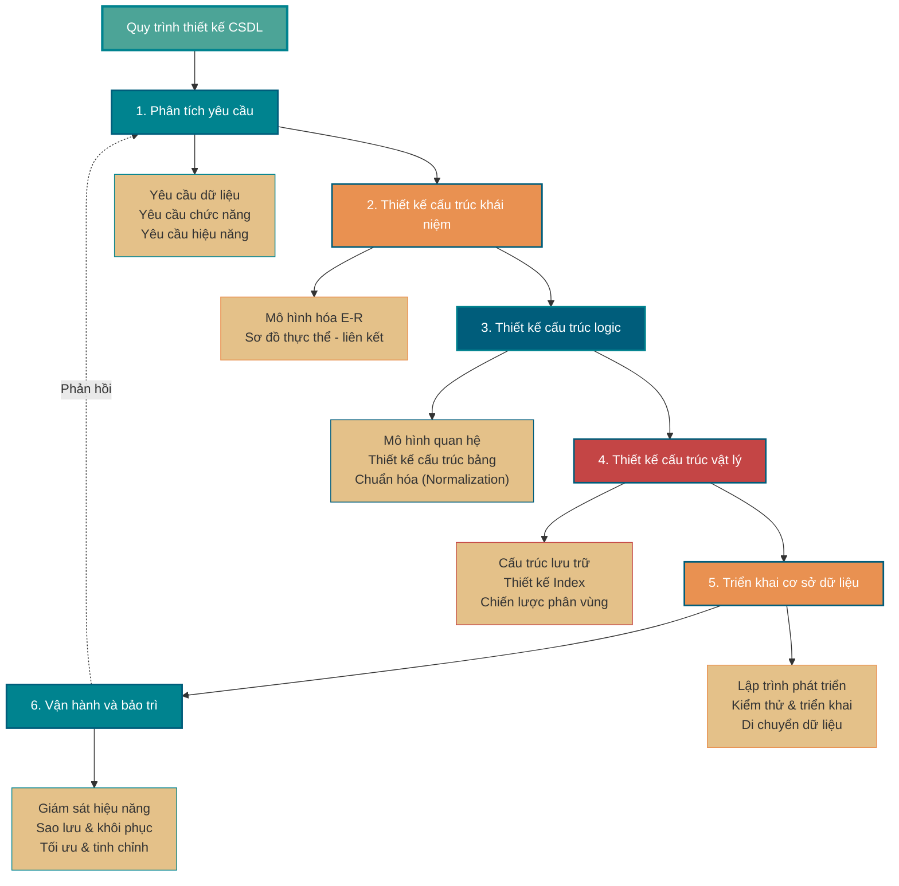

Kiến thức nền tảng về cơ sở dữ liệu là phần bạn nhất định phải hiểu và ghi nhớ. Tuy phần này chủ yếu là kiến thức lý thuyết nhưng rất quan trọng, vì đây là nền móng để học MySQL ở các phần sau. PS: Do phần này liên quan đến nhiều khái niệm học thuật nên có tham khảo mô tả tương ứng từ Wikipedia và Baidu Baike.

## Database, Database Management System, Database System và DBA là gì?

Bốn khái niệm này mô tả các tầng khác nhau từ bản thân dữ liệu cho tới việc quản lý toàn bộ hệ thống. Chúng ta thường dùng ví dụ về một thư viện để xâu chuỗi và hiểu rõ chúng.

- **Cơ sở dữ liệu (Database - DB):** Giống như toàn bộ sách vở và tài liệu được cất giữ trên các giá sách trong thư viện. Về mặt kỹ thuật, cơ sở dữ liệu là tập hợp dữ liệu có cấu trúc được tổ chức, mô tả và lưu trữ theo một mô hình dữ liệu nhất định, có thể chia sẻ cho nhiều người dùng khác nhau. Đó chính là thứ cốt lõi cuối cùng mà chúng ta lưu và đọc — bản thân thông tin.
- **Hệ quản trị cơ sở dữ liệu (Database Management System - DBMS):** Giống như toàn bộ hệ thống quản lý của thư viện, bao gồm quy tắc phân loại biên mục sách, quy trình mượn trả sách, hệ thống kiểm tra an toàn,... Về mặt kỹ thuật, DBMS là một phần mềm quy mô lớn, chẳng hạn như MySQL, Oracle, PostgreSQL mà chúng ta hay sử dụng. Trách nhiệm cốt lõi của nó là tổ chức và lưu trữ dữ liệu một cách khoa học, truy xuất và bảo trì dữ liệu hiệu quả; che giấu sự phức tạp của thao tác tệp ở tầng dưới, cung cấp một giao diện chuẩn (như SQL) để thao tác dữ liệu, đồng thời đảm nhận các bài toán phức tạp như kiểm soát đồng thời (Concurrency Control), quản lý Transaction, kiểm soát phân quyền,...
- **Hệ thống cơ sở dữ liệu (Database System - DBS):** Là toàn bộ thư viện đang vận hành bình thường. Đây là một khái niệm rộng hơn, không chỉ bao gồm sách (DB) và hệ thống quản lý (DBMS), mà còn bao gồm phần cứng, ứng dụng và con người sử dụng nó.
- **Quản trị viên cơ sở dữ liệu (Database Administrator - DBA):** Là người thủ thư trưởng phụ trách đảm bảo toàn bộ hệ thống cơ sở dữ liệu vận hành trơn tru. Trách nhiệm của DBA rất rộng, bao gồm thiết kế cơ sở dữ liệu, cài đặt, giám sát, tinh chỉnh hiệu năng (performance tuning), sao lưu và khôi phục (backup & recovery), quản lý bảo mật,... nhằm đảm bảo toàn bộ hệ thống ổn định, hiệu quả và an toàn.

Chúng ta thường nhầm lẫn giữa DB và DBMS, nên xin nhắc lại ngắn gọn: **Thông thường khi nói "dùng cơ sở dữ liệu MySQL", thực chất là đang dùng MySQL (DBMS) để quản lý một hoặc nhiều cơ sở dữ liệu (DB).**

## DBMS có những chức năng chính nào?

DBMS thường cung cấp bốn nhóm chức năng cốt lõi:

1. **Định nghĩa dữ liệu:** Đây là nền tảng của DBMS. Nó cung cấp Ngôn ngữ định nghĩa dữ liệu (Data Definition Language - DDL) cho phép tạo, sửa đổi và xóa các đối tượng khác nhau trong cơ sở dữ liệu. Không chỉ định nghĩa cấu trúc bảng (như tên trường, kiểu dữ liệu), mà còn bao gồm định nghĩa View, Index, Trigger, Stored Procedure,...
2. **Thao tác dữ liệu:** Đây là chức năng mà lập trình viên chúng ta sử dụng nhiều nhất hằng ngày. Nó cung cấp Ngôn ngữ thao tác dữ liệu (Data Manipulation Language - DML), với hạt nhân là các thao tác quen thuộc Tạo, Đọc, Cập nhật, Xóa (CRUD). Nó giúp chúng ta dễ dàng thao tác và truy xuất dữ liệu trong cơ sở dữ liệu.
3. **Kiểm soát dữ liệu:** Đây là yếu tố then chốt đảm bảo dữ liệu chính xác, an toàn và đáng tin cậy. Thường bao gồm kiểm soát đồng thời (Concurrency Control), quản lý Transaction, ràng buộc toàn vẹn (Integrity Constraints), kiểm soát phân quyền, giới hạn bảo mật,...
4. **Bảo trì cơ sở dữ liệu:** Nhóm chức năng này nhằm đảm bảo hệ thống cơ sở dữ liệu vận hành ổn định lâu dài. Nó bao gồm nhập/xuất dữ liệu, sao lưu và khôi phục cơ sở dữ liệu, giám sát và phân tích hiệu năng, cũng như quản lý nhật ký hệ thống.

## Bạn biết những loại DBMS nào?

### Cơ sở dữ liệu quan hệ (Relational Database)

Đầu tiên là các cơ sở dữ liệu quan hệ (RDBMS) quen thuộc nhất như MySQL (lựa chọn mã nguồn mở hàng đầu), PostgreSQL (đầy đủ tính năng nhất), Oracle (cấp doanh nghiệp). Chúng dựa trên cấu trúc bảng nghiêm ngặt và SQL, rất phù hợp với dữ liệu có cấu trúc và các kịch bản đòi hỏi đảm bảo Transaction, ví dụ giao dịch ngân hàng, hệ thống đơn hàng.

Những năm gần đây, để đáp ứng nhu cầu lưu trữ dữ liệu khổng lồ, tính đồng thời cao (high concurrency) và cấu trúc dữ liệu đa dạng của các ứng dụng Internet, hàng loạt cơ sở dữ liệu NoSQL và NewSQL đã ra đời.

### Cơ sở dữ liệu NoSQL

Điểm chung của chúng là chấp nhận đánh đổi ở một số khía cạnh (thường là Transaction) để đạt hiệu năng cực cao và khả năng mở rộng theo chiều ngang (Scale Out).

**1. Cơ sở dữ liệu Key-Value, tiêu biểu là Redis.**

- **Đặc điểm:** Mô hình dữ liệu cực kỳ đơn giản — giống như một Map khổng lồ, lưu và truy xuất Value thông qua Key. Thao tác trên bộ nhớ (in-memory), hiệu năng cực cao.
- **Kịch bản áp dụng:** Rất phù hợp làm Cache, lưu trữ Session, bộ đếm (counter) và các kịch bản đòi hỏi hiệu năng đọc/ghi cực cao.

**2. Cơ sở dữ liệu Document, tiêu biểu là MongoDB.**

- **Đặc điểm:** Lưu trữ các tài liệu bán cấu trúc (như JSON/BSON), cấu trúc linh hoạt, không cần định nghĩa trước cấu trúc bảng.
- **Kịch bản áp dụng:** Đặc biệt phù hợp với các nghiệp vụ có cấu trúc dữ liệu hay thay đổi và cần phát triển lặp nhanh, như hồ sơ người dùng (user profile), hệ thống quản lý nội dung (CMS), lưu trữ log,...

**3. Cơ sở dữ liệu dạng cột (Columnar / Wide-Column), tiêu biểu là HBase, Cassandra.**

- **Đặc điểm:** Dữ liệu được lưu trữ theo nhóm cột (Column Family) thay vì theo hàng. Điều này giúp đạt hiệu năng rất cao khi đọc một vài cột trên số lượng hàng cực lớn.
- **Kịch bản áp dụng:** Được thiết kế chuyên cho lưu trữ và phân tích dữ liệu khổng lồ, rất thích hợp cho phân tích dữ liệu lớn (Big Data), lưu trữ dữ liệu giám sát, hệ thống gợi ý và các kịch bản cần thông lượng ghi cao và quét theo khoảng (range scan).

**4. Cơ sở dữ liệu đồ thị (Graph Database), tiêu biểu là Neo4j.**

- **Đặc điểm:** Mô hình dữ liệu gồm các nút (Nodes) và cạnh (Edges), chuyên dùng để lưu trữ và truy vấn các mối quan hệ phức tạp giữa các thực thể.
- **Kịch bản áp dụng:** Trong các kịch bản như mạng xã hội (quan hệ bạn bè), hệ thống gợi ý (quan hệ người dùng - sản phẩm), đồ thị tri thức (knowledge graph), phát hiện gian lận (luồng luân chuyển dòng tiền), hiệu quả vượt xa cơ sở dữ liệu quan hệ.

### Cơ sở dữ liệu NewSQL

Do NoSQL không hỗ trợ đầy đủ Transaction, nhiều hệ thống có yêu cầu cực cao về độ an toàn dữ liệu (như hệ thống tài chính, hệ thống đơn hàng, hệ thống giao dịch) không thể sử dụng tốt. Tuy nhiên, các hệ thống này lại thường có nhu cầu lưu trữ lượng dữ liệu rất lớn.

Trước đây, những hệ thống như vậy chỉ có thể nâng cấp máy chủ mạnh hơn, hoặc dùng Database Middleware để tăng khả năng lưu trữ. Nhưng cách đầu tốn quá nhiều chi phí tiền bạc, còn cách sau tốn quá nhiều chi phí phát triển.

Và thế là **NewSQL** ra đời!

Nói một cách đơn giản, NewSQL là: **Lưu trữ phân tán + SQL + Transaction**. NewSQL vừa có năng lực lưu trữ và quản lý dữ liệu khổng lồ của NoSQL, vừa giữ lại các đặc tính hỗ trợ ACID và SQL của cơ sở dữ liệu truyền thống. Vì vậy, NewSQL còn có thể gọi là **cơ sở dữ liệu quan hệ phân tán (Distributed Relational Database)**.

Một số mục tiêu thiết kế của cơ sở dữ liệu NewSQL:

1. Mở rộng theo chiều ngang (Scale Out): Tăng năng lực chịu tải của hệ thống bằng cách thêm máy chủ. Tương ứng với nó là Scale Up (mở rộng theo chiều dọc) — nâng cấp phần cứng thiết bị để tăng khả năng chịu tải.
2. Tính nhất quán mạnh (Strict Consistency): Tại mọi thời điểm, dữ liệu trên tất cả các node là giống nhau.
3. Tính sẵn sàng cao (High Availability): Hệ thống gần như có thể cung cấp dịch vụ liên tục mọi lúc.
4. Hỗ trợ chuẩn SQL (Structured Query Language): Tương tự PostgreSQL, MySQL, Oracle và các cơ sở dữ liệu quan hệ khác đều hỗ trợ SQL.
5. Transaction (ACID): Atomicity (Tính nguyên tử), Consistency (Tính nhất quán), Isolation (Tính cô lập), Durability (Tính bền vững).
6. Tương thích với các cơ sở dữ liệu quan hệ phổ biến: Tương thích với MySQL, Oracle, PostgreSQL,...
7. Cloud Native: Có thể triển khai tự động hóa và công cụ hóa trên Public Cloud, Private Cloud và Hybrid Cloud.
8. HTAP (Hybrid Transactional/Analytical Processing): Hỗ trợ xử lý kết hợp cả OLTP và OLAP.

Các đại diện tiêu biểu của NewSQL: F1/Spanner của Google, [OceanBase](https://open.oceanbase.com/) của Alibaba, [TiDB](https://pingcap.com/zh/product-community/) của PingCAP.

## Tuple, Key, Candidate Key, Primary Key, Foreign Key, Prime Attribute, Non-prime Attribute là gì?

Trong lý thuyết cơ sở dữ liệu quan hệ, việc hiểu các khái niệm cốt lõi gồm bộ (Tuple), khóa (Key), khóa ứng viên (Candidate Key), khóa chính (Primary Key), khóa ngoại (Foreign Key), thuộc tính khóa (Prime Attribute) và thuộc tính không khóa (Non-prime Attribute) là cực kỳ quan trọng cho thiết kế và chuẩn hóa cơ sở dữ liệu. Những khái niệm này cấu thành nền tảng lý thuyết của cơ sở dữ liệu quan hệ.

### Khái niệm cơ bản

- **Tuple (Bộ):** Tuple là đơn vị cơ bản trong cơ sở dữ liệu quan hệ, tương ứng với một hàng bản ghi trong bảng hai chiều. Mỗi tuple chứa đầy đủ thông tin của một thực thể. Ví dụ, trong bảng sinh viên, toàn bộ thông tin của mỗi sinh viên (mã sinh viên, họ tên, tuổi,...) tạo thành một tuple.
- **Key (Khóa):** Key là tập hợp một hoặc nhiều thuộc tính có thể xác định duy nhất một tuple trong một quan hệ. Vai trò chính của khóa là đảm bảo tính duy nhất và tính toàn vẹn của dữ liệu.

### Phân loại khóa

- **Candidate Key (Khóa ứng viên):** Candidate Key là tập thuộc tính tối thiểu có thể xác định duy nhất một tuple, sao cho bất kỳ tập con thực sự nào của nó đều không thể xác định duy nhất tuple. Một quan hệ có thể có nhiều Candidate Key. Ví dụ, trong bảng sinh viên, nếu "mã sinh viên" xác định duy nhất một sinh viên, đồng thời "số căn cước công dân" cũng xác định duy nhất sinh viên đó, thì `{mã sinh viên}` và `{số căn cước công dân}` đều là Candidate Key.
- **Primary Key (Khóa chính):** Primary Key là một Candidate Key được lựa chọn để xác định duy nhất các tuple trong một quan hệ. Mỗi quan hệ chỉ có thể có một Primary Key, nhưng có thể có nhiều Candidate Key. Khi chọn khóa chính thường cân nhắc các yếu tố như: tính đơn giản, tính ổn định và không mang ý nghĩa nghiệp vụ.
- **Foreign Key (Khóa ngoại):** Foreign Key là một thuộc tính hoặc nhóm thuộc tính trong một quan hệ tương ứng với khóa chính của một quan hệ khác. Khóa ngoại dùng để thiết lập và duy trì mối liên hệ giữa hai quan hệ, là cơ chế quan trọng để thực thi toàn vẹn tham chiếu (Referential Integrity). Ví dụ, nếu "mã sinh viên" trong bảng đăng ký môn học tham chiếu đến khóa chính "mã sinh viên" của bảng sinh viên, thì "mã sinh viên" trong bảng đăng ký môn học là khóa ngoại.

### Phân loại thuộc tính

- **Prime Attribute (Thuộc tính khóa):** Prime Attribute là thuộc tính nằm trong bất kỳ Candidate Key nào. Nếu một quan hệ có nhiều Candidate Key, thì mọi thuộc tính xuất hiện trong các Candidate Key đó đều là Prime Attribute. Ví dụ, trong quan hệ công nhân `(mã nhân viên, số căn cước, họ tên, giới tính, phòng ban)`, nếu `{mã nhân viên}` và `{số căn cước}` đều là Candidate Key, thì "mã nhân viên" và "số căn cước" đều là Prime Attribute.
- **Non-prime Attribute (Thuộc tính không khóa):** Non-prime Attribute là thuộc tính không nằm trong bất kỳ Candidate Key nào. Các thuộc tính này phụ thuộc hoàn toàn vào Candidate Key để xác định giá trị của chúng. Trong quan hệ công nhân nêu trên, "họ tên", "giới tính", "phòng ban" đều là Non-prime Attribute.

## Sơ đồ ER là gì?

Khi thực hiện một dự án, chúng ta nhất định nên thử vẽ sơ đồ ER để làm rõ thiết kế cơ sở dữ liệu — đây cũng là điều nhà tuyển dụng thường hay hỏi khi trao đổi về dự án của bạn.

**Sơ đồ ER** tên đầy đủ là **Entity Relationship Diagram** (Sơ đồ thực thể - liên kết), cung cấp phương pháp biểu diễn các loại thực thể, thuộc tính và mối quan hệ.

Sơ đồ ER bao gồm 3 thành phần sau:

- **Thực thể (Entity):** Thường là các đối tượng nghiệp vụ trong thế giới thực, tất nhiên cũng có thể dùng một số đối tượng logic. Chẳng hạn đối với hệ thống quản lý trường học, sẽ liên quan đến các thực thể như sinh viên, giảng viên, môn học, lớp học,... Trong sơ đồ ER, thực thể được biểu diễn bằng hình chữ nhật.
- **Thuộc tính (Attribute):** Là các đặc điểm mà một thực thể sở hữu, dùng để mô tả các yếu tố cấu thành thực thể; đối với thiết kế sản phẩm có thể hiểu là các trường/cột (field). Trong sơ đồ ER, thuộc tính được biểu diễn bằng hình bầu dục (elip).
- **Liên kết / Mối quan hệ (Relationship):** Là mối liên hệ giữa thực thể này với thực thể khác, trong sơ đồ ER được biểu diễn bằng hình thoi. Mối quan hệ này không chỉ thể hiện liên kết nghiệp vụ mà còn có thể dùng các con số để biểu diễn tương quan số lượng (bản số) giữa các thực thể. Ví dụ, một lớp học có nhiều sinh viên chính là một mối quan hệ giữa các thực thể.

Hình dưới đây là sơ đồ ER cho việc đăng ký môn học của sinh viên. Mỗi sinh viên có thể chọn nhiều môn học, và cùng một môn học cũng có thể được nhiều người chọn, nên quan hệ giữa chúng là nhiều-nhiều (`M:N`). Ngoài ra, hai dạng quan hệ khác giữa các thực thể là: một-một (`1:1`) và một-nhiều (`1:N`).

## Bạn có nắm về các dạng chuẩn cơ sở dữ liệu (Normal Form) không?

Có 3 dạng chuẩn cơ sở dữ liệu phổ biến:

- 1NF (Dạng chuẩn 1): Thuộc tính không thể chia nhỏ hơn được nữa.
- 2NF (Dạng chuẩn 2): Trên nền tảng 1NF, loại bỏ phụ thuộc hàm bộ phận của các thuộc tính không khóa đối với khóa.
- 3NF (Dạng chuẩn 3): Trên nền tảng 2NF, loại bỏ phụ thuộc hàm bắc cầu của các thuộc tính không khóa đối với khóa.

### 1NF (Dạng chuẩn 1)

Thuộc tính (tương ứng với cột trong bảng) không thể bị tách nhỏ hơn nữa, tức là cột này chỉ chứa một giá trị nguyên tử, không thể tách thành nhiều trường khác. **1NF là yêu cầu tối thiểu đối với mọi cơ sở dữ liệu quan hệ**, nghĩa là các bảng được tạo trong cơ sở dữ liệu quan hệ chắc chắn thỏa mãn dạng chuẩn 1.

### 2NF (Dạng chuẩn 2)

2NF trên cơ sở của 1NF loại bỏ phụ thuộc hàm bộ phận của các thuộc tính không khóa vào khóa. Như minh họa dưới đây về quá trình chuyển đổi từ dạng chuẩn 1 sang dạng chuẩn 2, dạng chuẩn 2 bổ sung thêm một cột gọi là khóa chính trên nền tảng dạng chuẩn 1, để mọi thuộc tính không khóa đều phụ thuộc vào toàn bộ khóa chính.

Một số khái niệm quan trọng:

- **Phụ thuộc hàm (Functional Dependency):** Nếu trong một bảng, khi biết chắc giá trị của thuộc tính (hoặc nhóm thuộc tính) $X$, chắc chắn xác định được giá trị của thuộc tính $Y$, thì ta nói $Y$ phụ thuộc hàm vào $X$, ký hiệu là $X \rightarrow Y$.
- **Phụ thuộc hàm bộ phận (Partial Functional Dependency):** Nếu $X \rightarrow Y$ và tồn tại một tập con thực sự $X_0$ của $X$ sao cho $X_0 \rightarrow Y$, thì gọi $Y$ phụ thuộc hàm bộ phận vào $X$. Ví dụ trong bảng thông tin cơ bản sinh viên $R(\text{mã sinh viên}, \text{số CCCD}, \text{họ tên})$, tất nhiên giá trị thuộc tính mã sinh viên là duy nhất; trong quan hệ $R$, $(\text{mã sinh viên}, \text{số CCCD}) \rightarrow (\text{họ tên})$, $(\text{mã sinh viên}) \rightarrow (\text{họ tên})$, $(\text{số CCCD}) \rightarrow (\text{họ tên})$; vì vậy `họ tên` phụ thuộc hàm bộ phận vào $(\text{mã sinh viên}, \text{số CCCD})$.
- **Phụ thuộc hàm đầy đủ (Full Functional Dependency):** Trong một quan hệ, nếu một thuộc tính không khóa phụ thuộc vào toàn bộ khóa (không phụ thuộc vào tập con thực sự nào của khóa), gọi là phụ thuộc hàm đầy đủ. Ví dụ bảng thông tin cơ bản sinh viên $R(\text{mã sinh viên}, \text{lớp}, \text{họ tên})$, giả sử các lớp khác nhau có thể trùng mã sinh viên, còn trong nội bộ một lớp thì mã sinh viên không được trùng; trong quan hệ $R$, $(\text{mã sinh viên}, \text{lớp}) \rightarrow (\text{họ tên})$, nhưng $(\text{mã sinh viên}) \rightarrow (\text{họ tên})$ không đúng và $(\text{lớp}) \rightarrow (\text{họ tên})$ cũng không đúng, nên `họ tên` phụ thuộc hàm đầy đủ vào $(\text{mã sinh viên}, \text{lớp})$.
- **Phụ thuộc hàm bắc cầu (Transitive Functional Dependency):** Trong lược đồ quan hệ $R(U)$, đặt $X, Y, Z$ là các tập con thuộc tính khác nhau của $U$; nếu $X$ xác định $Y$, $Y$ xác định $Z$, đồng thời $X$ không chứa $Y$, $Y$ không xác định $X$, và $(X \cup Y) \cap Z = \emptyset$ (tập rỗng), thì gọi $Z$ phụ thuộc hàm bắc cầu vào $X$. Phụ thuộc hàm bắc cầu sẽ dẫn đến dư thừa dữ liệu và các bất thường. Các tập con $Y$ và $Z$ trong phụ thuộc hàm bắc cầu thường cùng thuộc về một sự vật, do đó có thể gộp chúng đặt vào một bảng riêng. Ví dụ trong quan hệ $R(\text{mã sinh viên}, \text{họ tên}, \text{tên khoa}, \text{trưởng khoa})$, $\text{mã sinh viên} \rightarrow \text{tên khoa}$ và $\text{tên khoa} \rightarrow \text{trưởng khoa}$, nên tồn tại phụ thuộc hàm bắc cầu của thuộc tính không khóa `trưởng khoa` đối với `mã sinh viên`.

### 3NF (Dạng chuẩn 3)

3NF trên cơ sở của 2NF loại bỏ phụ thuộc hàm bắc cầu của các thuộc tính không khóa vào khóa. Thiết kế cơ sở dữ liệu đáp ứng yêu cầu 3NF **về cơ bản** giải quyết được các vấn đề dư thừa dữ liệu quá mức, bất thường khi chèn (insertion anomaly), bất thường khi sửa (update anomaly) và bất thường khi xóa (deletion anomaly). Ví dụ trong quan hệ $R(\text{mã sinh viên}, \text{họ tên}, \text{tên khoa}, \text{trưởng khoa})$, $\text{mã sinh viên} \rightarrow \text{tên khoa}$ và $\text{tên khoa} \rightarrow \text{trưởng khoa}$, nên tồn tại phụ thuộc hàm bắc cầu của thuộc tính không khóa `trưởng khoa` đối với `mã sinh viên`; do đó thiết kế bảng này chưa đạt yêu cầu của 3NF.

## Primary Key và Foreign Key khác nhau như thế nào?

Xét về định nghĩa và tính chất, sự khác biệt giữa chúng là:

- **Khóa chính (Primary Key):** Vai trò cốt lõi của nó là xác định duy nhất từng hàng dữ liệu trong bảng. Vì vậy, giá trị của cột khóa chính phải là duy nhất (`Unique`) và không được rỗng (`Not Null`). Một bảng chỉ có thể có một khóa chính. Khóa chính đảm bảo tính toàn vẹn thực thể (Entity Integrity).
- **Khóa ngoại (Foreign Key):** Vai trò cốt lõi của nó là thiết lập và ép buộc mối quan hệ liên kết giữa hai bảng. Giá trị của cột khóa ngoại trong một bảng phải tương ứng với giá trị khóa ứng viên của một hàng ở bảng khác (thường là khóa chính, hoặc cũng có thể là khóa duy nhất Unique Key), hoặc là giá trị `NULL`. Do đó, giá trị của khóa ngoại có thể trùng lặp và cũng có thể rỗng. Một bảng có thể có nhiều khóa ngoại, lần lượt liên kết tới các bảng khác nhau. Khóa ngoại đảm bảo tính toàn vẹn tham chiếu (Referential Integrity).

Hãy minh họa bằng một ví dụ thương mại điện tử đơn giản: giả sử chúng ta có hai bảng `users` (bảng người dùng) và `orders` (bảng đơn hàng).

- Trong bảng `users`, cột `user_id` là **khóa chính**. `user_id` của mỗi người dùng là duy nhất, chúng ta dùng nó để phân biệt Alice và Bob.
- Trong bảng `orders`, `order_id` là **khóa chính** của chính nó. Đồng thời, bảng này có một cột `user_id` đóng vai trò là **khóa ngoại**, tham chiếu tới khóa chính `user_id` của bảng `users`.

Ràng buộc khóa ngoại này đảm bảo:

1. Bạn không thể tạo một đơn hàng không thuộc về bất kỳ người dùng nào đã biết (`user_id` không tồn tại trong bảng `users`).
2. Bạn không thể xóa một người dùng đã đặt đơn hàng (trừ khi có thiết lập các quy tắc đặc biệt như xóa theo tầng / Cascade Delete).

## Vì sao không khuyến nghị sử dụng Foreign Key và Cascade?

Đối với khóa ngoại (Foreign Key) và cập nhật theo tầng (Cascade), sổ tay phát triển của Alibaba quy định như sau:

> [Bắt buộc] Không được sử dụng khóa ngoại và Cascade; mọi khái niệm khóa ngoại phải được xử lý ở tầng ứng dụng.
>
> Giải thích: Lấy mối quan hệ giữa sinh viên và điểm số làm ví dụ, `student_id` trong bảng sinh viên là khóa chính, còn `student_id` trong bảng điểm là khóa ngoại. Nếu cập nhật `student_id` trong bảng sinh viên đồng thời kích hoạt cập nhật `student_id` trong bảng điểm, thì đó là cập nhật theo tầng (Cascade Update). Khóa ngoại và Cascade Update chỉ phù hợp với hệ thống đơn máy (single-machine) tải đồng thời thấp, không phù hợp với cụm phân tán, đồng thời cao (high concurrency); Cascade Update gây khóa chặn mạnh (strong blocking), tiềm ẩn rủi ro bão cập nhật (update storm) trong cơ sở dữ liệu; khóa ngoại cũng làm giảm tốc độ chèn (insert) của cơ sở dữ liệu.

Vì sao không nên dùng khóa ngoại? Phần lớn mọi người thường trả lời như sau:

1. **Tăng độ phức tạp:** a. Mỗi lần `DELETE` hoặc `UPDATE` đều phải cân nhắc ràng buộc khóa ngoại, khiến quá trình phát triển rất vất vả, việc tạo dữ liệu test cực kỳ bất tiện; b. Quan hệ cha-con của khóa ngoại bị cố định, nếu ngày nào đó nghiệp vụ thay đổi và trường này trong database không cần liên kết với bảng khác nữa thì sẽ phát sinh rất nhiều rắc rối.
2. **Tăng thêm khối lượng công việc:** Cơ sở dữ liệu phải làm thêm việc bảo trì khóa ngoại, chẳng hạn khi thực hiện thêm, xóa, sửa liên quan đến cột khóa ngoại, database phải kích hoạt kiểm tra liên quan để đảm bảo tính nhất quán và đúng đắn của dữ liệu, gây tiêu tốn tài nguyên cơ sở dữ liệu. Nếu xử lý ở tầng ứng dụng thì có thể giảm tải cho cơ sở dữ liệu.
3. **Không thân thiện với phân tách DB và phân tách bảng (Sharding):** Vì khi Sharding, khóa ngoại không thể phát huy tác dụng.
4. ...

Cá nhân tôi thấy câu trả lời trên chưa thật sự toàn diện, vì mới chỉ nói đến các mặt hạn chế thường gặp của khóa ngoại. Thực tế, chúng ta đều biết khóa ngoại cũng có rất nhiều lợi ích, chẳng hạn:

1. Đảm bảo tính nhất quán và toàn vẹn dữ liệu ngay ở tầng cơ sở dữ liệu;
2. Thao tác theo tầng (Cascade) tiện lợi, giảm bớt lượng code ở tầng ứng dụng;
3. ...

Vì vậy, đừng vội gạt bỏ hoàn toàn khái niệm khóa ngoại; nó tồn tại đều có lý do của nó. Nếu hệ thống không liên quan đến Sharding và mức độ đồng thời (concurrency) không quá cao thì vẫn có thể cân nhắc sử dụng khóa ngoại.

## Stored Procedure (Thủ tục lưu trữ) là gì?

Stored Procedure (thủ tục lưu trữ) là một tập hợp các câu lệnh SQL được biên dịch sẵn trong cơ sở dữ liệu; nó đóng gói nhiều câu lệnh SQL cùng các câu lệnh điều khiển luồng chương trình (như `IF-ELSE`, vòng lặp `WHILE`,...) lại với nhau thành một đối tượng cơ sở dữ liệu có thể gọi tái sử dụng nhiều lần.

**Ưu điểm của Stored Procedure:**

Trong các ứng dụng doanh nghiệp truyền thống, Stored Procedure có giá trị thực tiễn nhất định. Khi logic nghiệp vụ phức tạp và cần thực thi hàng loạt câu lệnh SQL mới hoàn thành một thao tác nghiệp vụ, ta có thể đóng gói các câu lệnh đó thành Stored Procedure để đơn giản hóa việc gọi. Do Stored Procedure đã được biên dịch và lưu trong cơ sở dữ liệu ngay lúc tạo, nên khi thực thi không cần biên dịch lại, nhờ vậy có hiệu năng thực thi tốt hơn so với câu lệnh SQL động. Đồng thời, một khi Stored Procedure đã được debug xong thì quá trình vận hành khá ổn định và đáng tin cậy.

**Hạn chế của Stored Procedure:**

Tuy nhiên, trong kiến trúc Internet hiện đại, Stored Procedure ngày càng ít được sử dụng. Các nguyên nhân chính gồm: khó debug do thiếu công cụ debug hoàn thiện; khả năng mở rộng kém vì sửa đổi logic nghiệp vụ đòi hỏi phải chỉnh sửa trực tiếp đối tượng trong cơ sở dữ liệu; tính khả chuyển (portability) kém do cú pháp Stored Procedure giữa các hệ quản trị cơ sở dữ liệu khác nhau khá lớn; tiêu tốn tài nguyên cơ sở dữ liệu và làm tăng gánh nặng cho máy chủ database; khó quản lý phiên bản, gây bất tiện cho việc kiểm soát phiên bản mã nguồn (version control).

**Quy chuẩn ngành:**

Từ những lý do trên, quy chuẩn phát triển của nhiều công ty Internet hạn chế rõ ràng hoặc cấm sử dụng Stored Procedure. Ví dụ, *Alibaba Java Development Guidelines* quy định rõ cấm sử dụng Stored Procedure, khuyến nghị đặt logic nghiệp vụ ở tầng ứng dụng để giữ cho cơ sở dữ liệu đơn giản và hiệu quả.

## DROP, DELETE và TRUNCATE khác nhau như thế nào?

Trong thao tác cơ sở dữ liệu, `DROP`, `DELETE` và `TRUNCATE` là ba lệnh xóa dữ liệu thường dùng, và chúng có sự khác biệt rõ rệt về chức năng, hiệu năng cũng như kịch bản sử dụng.

**Lệnh DROP:**

- Cú pháp: `DROP TABLE table_name`
- Tác dụng: Xóa hoàn toàn toàn bộ bảng, bao gồm cấu trúc bảng, dữ liệu, Index, Trigger, ràng buộc và tất cả đối tượng liên quan.
- Kịch bản sử dụng: Dùng khi không còn cần đến bảng đó nữa.

**Lệnh TRUNCATE:**

- Cú pháp: `TRUNCATE TABLE table_name`
- Tác dụng: Xóa sạch toàn bộ dữ liệu trong bảng nhưng giữ lại cấu trúc bảng.
- Đặc điểm: Trường tự tăng (`AUTO_INCREMENT`) sẽ được đặt lại về giá trị ban đầu (thường là 1).
- Kịch bản sử dụng: Dùng khi cần làm sạch nhanh toàn bộ dữ liệu trong bảng mà vẫn giữ nguyên cấu trúc bảng.

**Lệnh DELETE:**

- Cú pháp: `DELETE FROM table_name WHERE condition`
- Tác dụng: Xóa các dòng dữ liệu thỏa mãn điều kiện; nếu không kèm mệnh đề `WHERE` thì sẽ xóa toàn bộ dữ liệu.
- Đặc điểm: Trường tự tăng không bị đặt lại, tiếp tục tăng từ giá trị trước đó.
- Kịch bản sử dụng: Dùng khi cần xóa có chọn lọc một phần dữ liệu.

`TRUNCATE`, `DELETE` không có mệnh đề `WHERE`, và `DROP` đều sẽ xóa dữ liệu bên trong bảng, nhưng **`TRUNCATE` và `DELETE` chỉ xóa dữ liệu chứ không xóa cấu trúc (định nghĩa) của bảng; còn khi thực thi lệnh `DROP`, cấu trúc của bảng này cũng bị xóa theo, tức là sau khi chạy `DROP` thì bảng tương ứng không còn tồn tại nữa.**

### Ảnh hưởng đến cấu trúc bảng

- `DROP`: Xóa cấu trúc bảng và toàn bộ dữ liệu, bảng sẽ không còn tồn tại.
- `TRUNCATE`: Chỉ xóa dữ liệu, giữ nguyên cấu trúc và định nghĩa bảng.
- `DELETE`: Chỉ xóa dữ liệu, giữ nguyên cấu trúc và định nghĩa bảng.

### Trigger

- Thao tác `DELETE` sẽ kích hoạt các `DELETE` Trigger liên quan.
- `TRUNCATE` và `DROP` không kích hoạt `DELETE` Trigger.

### Transaction và Rollback

- `DROP` và `TRUNCATE` thuộc nhóm thao tác DDL, có hiệu lực ngay sau khi thực thi và không thể Rollback.
- `DELETE` thuộc nhóm thao tác DML, có thể Rollback (bên trong một Transaction).

### Tốc độ thực thi

Nhìn chung: `DROP` > `TRUNCATE` > `DELETE` (điều này tôi chưa tự đo kiểm thử nghiệm thực tế).

- Khi thực thi lệnh `DELETE`, cơ sở dữ liệu sẽ ghi vào `binlog`, mà việc ghi log cần tiêu tốn thời gian; nhưng cũng có một lợi ích là thuận tiện cho việc Rollback và khôi phục dữ liệu.
- Khi thực thi lệnh `TRUNCATE`, không sinh ra log theo từng dòng như vậy nên nhanh hơn `DELETE`. Ngoài ra, nó còn đặt lại giá trị tự tăng của bảng và khôi phục kích thước Index về trạng thái ban đầu.
- Lệnh `DROP` sẽ giải phóng toàn bộ không gian lưu trữ mà bảng chiếm dụng.

Tips: Bạn nên quan tâm nhiều hơn đến kịch bản sử dụng thay vì chỉ chú ý vào hiệu năng thực thi.

## Câu lệnh DML và câu lệnh DDL khác nhau như thế nào?

- DML là viết tắt của Data Manipulation Language (Ngôn ngữ thao tác dữ liệu), chỉ các thao tác lên bản ghi trong bảng của cơ sở dữ liệu, chủ yếu bao gồm chèn, cập nhật, xóa và truy vấn bản ghi; đây là thao tác lập trình viên sử dụng thường xuyên nhất hằng ngày.
- DDL (Data Definition Language) là viết tắt của Ngôn ngữ định nghĩa dữ liệu; nói đơn giản, đây là ngôn ngữ dùng để tạo, xóa và chỉnh sửa các đối tượng bên trong cơ sở dữ liệu. Điểm khác biệt lớn nhất giữa nó và ngôn ngữ DML là DML chỉ thao tác trên dữ liệu bên trong bảng, không động đến định nghĩa hay sửa đổi cấu trúc bảng và càng không liên quan đến các đối tượng khác. Câu lệnh DDL thường được quản trị viên cơ sở dữ liệu (DBA) sử dụng nhiều hơn, còn lập trình viên thông thường ít dùng tới.

Ngoài ra, vì `SELECT` không làm thay đổi hay phá hủy bảng, nên ở một số tài liệu người ta cũng tách riêng `SELECT` ra gọi là Ngôn ngữ truy vấn dữ liệu DQL (Data Query Language).

## Thiết kế cơ sở dữ liệu thường được chia thành những bước nào?

### 1. Giai đoạn phân tích yêu cầu

**Mục tiêu:** Tìm hiểu và phân tích sâu yêu cầu người dùng, làm rõ ranh giới hệ thống.
**Công việc chính:**

- Thu thập và phân tích yêu cầu dữ liệu: Xác định cần lưu trữ những dữ liệu nào, dung lượng dữ liệu, tần suất cập nhật dữ liệu.
- Làm rõ yêu cầu chức năng: Hệ thống cần hỗ trợ những thao tác nghiệp vụ nào, độ ưu tiên của từng thao tác.
- Định nghĩa yêu cầu hiệu năng: Yêu cầu thời gian phản hồi, số lượng người dùng đồng thời, thông lượng dữ liệu.
- Xác định yêu cầu bảo mật: Phân quyền truy cập dữ liệu, yêu cầu mã hóa, yêu cầu kiểm toán (audit).
  **Đầu ra:** Đặc tả yêu cầu (SRS), bản thảo ban đầu của từ điển dữ liệu (Data Dictionary).

### 2. Giai đoạn thiết kế cấu trúc khái niệm

**Mục tiêu:** Chuyển hóa yêu cầu thành mô hình khái niệm trong thế giới thông tin.
**Công việc chính:**

- Nhận diện thực thể: Xác định các đối tượng chính trong hệ thống.
- Định nghĩa thuộc tính: Làm rõ đặc trưng của từng thực thể.
- Thiết lập liên kết: Xác định mối quan hệ giữa các thực thể (một-một, một-nhiều, nhiều-nhiều).
- Vẽ sơ đồ E-R (Sơ đồ thực thể - liên kết).
  **Đầu ra:** Sơ đồ E-R, tài liệu mô hình dữ liệu khái niệm.

### 3. Giai đoạn thiết kế cấu trúc logic

**Mục tiêu:** Chuyển đổi mô hình khái niệm sang mô hình logic được DBMS cụ thể hỗ trợ.
**Công việc chính:**

- Chuyển đổi sơ đồ E-R sang mô hình quan hệ: Chuyển thực thể thành bảng, thuộc tính thành cột/trường.
- Xử lý chuẩn hóa: Loại bỏ dư thừa dữ liệu và bất thường cập nhật thông qua chuẩn hóa (thường đạt tới 3NF).
- Định nghĩa ràng buộc toàn vẹn: Khóa chính, khóa ngoại, ràng buộc duy nhất (Unique), ràng buộc kiểm tra (Check).
- Tối ưu hóa mô hình: Thực hiện phi chuẩn hóa (Denormalization) hợp lý theo nhu cầu hiệu năng.
  **Đầu ra:** Mô hình dữ liệu logic, tài liệu thiết kế cấu trúc bảng.

### 4. Giai đoạn thiết kế cấu trúc vật lý

**Mục tiêu:** Xác định phương án lưu trữ vật lý và phương thức truy cập dữ liệu.
**Công việc chính:**

- Lựa chọn Storage Engine: Như InnoDB, MyISAM của MySQL,...
- Thiết kế chiến lược Index: Xác định loại Index và các cột cần tạo Index.
- Thiết kế phân vùng (Partitioning): Phân vùng các bảng lớn để nâng cao hiệu năng.
- Xác định tham số lưu trữ: Kích thước Tablespace, vị trí tệp dữ liệu, cấu hình bộ đệm (Buffer).
- Xây dựng chiến lược sao lưu: Tần suất và phương thức sao lưu toàn phần (Full Backup), sao lưu gia tăng (Incremental Backup).
  **Đầu ra:** Tài liệu thiết kế vật lý, phương án thiết kế Index.

### 5. Giai đoạn triển khai cơ sở dữ liệu

**Mục tiêu:** Chuyển thiết kế thành hệ thống cơ sở dữ liệu vận hành thực tế.
**Công việc chính:**

- Tạo cơ sở dữ liệu và cấu trúc bảng: Viết và thực thi các câu lệnh DDL.
- Phát triển Stored Procedure và Trigger (nếu cần).
- Viết các giao diện kết nối phía ứng dụng.
- Nhập dữ liệu khởi tạo (initial data).
- Kiểm thử tích hợp hệ thống: Kiểm thử chức năng, kiểm thử hiệu năng, kiểm thử chịu tải (stress test).
- Đào tạo người dùng và viết tài liệu hướng dẫn.
  **Đầu ra:** Script cơ sở dữ liệu, báo cáo kiểm thử, tài liệu hướng dẫn người dùng.

### 6. Giai đoạn vận hành và bảo trì

**Mục tiêu:** Đảm bảo hệ thống cơ sở dữ liệu vận hành ổn định và hiệu quả.
**Công việc chính:**

- Giám sát hằng ngày: Giám sát hiệu năng, giám sát dung lượng, phân tích log lỗi.
- Tối ưu hiệu năng: Tối ưu truy vấn, điều chỉnh Index, tinh chỉnh tham số.
- Sao lưu và khôi phục dữ liệu: Sao lưu định kỳ, diễn tập khôi phục.
- Quản lý bảo mật: Quản lý phân quyền, cập nhật bản vá bảo mật, kiểm toán (audit).
- Hoạch định dung lượng (Capacity Planning): Dự báo tăng trưởng dữ liệu, mở rộng tài nguyên trước khi quá tải.
- Quản lý thay đổi: Đánh giá và triển khai các thay đổi yêu cầu.
  **Đầu ra:** Báo cáo vận hành, phương án tối ưu, nhật ký thay đổi.

### Nguyên tắc thiết kế

Trong suốt quá trình thiết kế cần tuân thủ: nguyên tắc độc lập dữ liệu, nguyên tắc toàn vẹn, nguyên tắc bảo mật, nguyên tắc khả năng mở rộng và nguyên tắc chuẩn hóa.

## Tài liệu tham khảo

- <https://blog.csdn.net/rl529014/article/details/48391465>
- <https://www.zhihu.com/question/24696366/answer/29189700>
- <https://blog.csdn.net/bieleyang/article/details/77149954>
