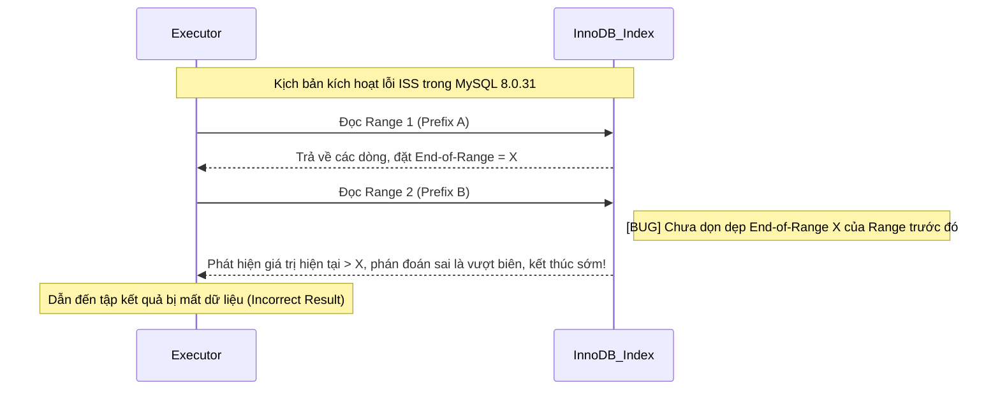

Trong tối ưu hóa hiệu năng cơ sở dữ liệu, index là một trong những công cụ trực tiếp và hiệu quả nhất. Tuy nhiên, **tạo index không đồng nghĩa với việc truy vấn chắc chắn sẽ sử dụng index**. Trong thực tế phát triển, chúng ta thường gặp phải băn khoăn: rõ ràng đã tạo index trên trường dữ liệu, nhưng truy vấn vẫn chậm chạp như rùa bò, khi phân tích bằng lệnh `EXPLAIN` thì phát hiện hệ thống đang thực hiện quét toàn bộ bảng (full table scan).

Nguyên nhân dẫn đến việc mất tác dụng của index vô cùng đa dạng, bắt nguồn từ cách viết câu lệnh SQL cho đến cách thiết kế index chưa chuẩn. Có những trường hợp mất index rất rõ ràng (như vi phạm nguyên tắc tiền tố ngoài cùng bên trái), nhưng cũng có những trường hợp cực kỳ tiềm ẩn (như ép kiểu ngầm định). Nếu không hiểu sâu về các tình huống này, bạn rất dễ để lại các điểm nghẽn hiệu năng nghiêm trọng trên môi trường production.

Bài viết này sẽ hệ thống hóa các trường hợp mất tác dụng của index phổ biến trong MySQL, phân tích cơ chế bản chất đằng sau và đưa ra các khuyến nghị tối ưu tương ứng, giúp bạn nhanh chóng định vị và xử lý triệt để vấn đề trong công việc hàng ngày.

### Truy vấn SELECT * (Cân nhắc chi phí)

- **Định nghĩa cốt lõi**: Bản thân `SELECT *` **không trực tiếp làm mất tác dụng của index**. Đây là một truy vấn dạng "không bao phủ index" (non-covering index); nếu điều kiện trong mệnh đề `WHERE` trúng index, index đó ban đầu vẫn được bộ tối ưu hóa (optimizer) xem xét.
- **Quyết định chi phí hồi biểu (Table Lookup)**: Khi các trường cần lấy ra không có sẵn trong cây index, MySQL bắt buộc phải cầm khóa chính quay lại Clustered Index để tra cứu toàn bộ dòng dữ liệu (thao tác tra cứu lại bảng gốc / table lookup). Optimizer sẽ so sánh chi phí giữa "Quét Index + Hồi biểu" với "Quét trực tiếp toàn bộ bảng" (Full Table Scan). Nếu lượng dữ liệu thỏa mãn chiếm tỷ lệ cao trong tổng số bản ghi (ngưỡng thông thường khoảng 20%~30%), optimizer sẽ nhận định rằng thao tác I/O tuần tự của quét toàn bộ bảng có hiệu suất cao hơn I/O ngẫu nhiên của việc hồi biểu nhiều lần, từ đó **chủ động từ bỏ việc dùng index**.
- **Cân nhắc theo ngữ cảnh**:
  - **Trường hợp Covering Index**: Nếu câu truy vấn chỉ cần các trường đã nằm trọn trong index, việc sử dụng Covering Index sẽ tránh được hoàn toàn thao tác hồi biểu, mang lại hiệu năng tối ưu nhất.
  - **Khi không thể tránh khỏi hồi biểu**: Nếu nghiệp vụ thực sự cần nhiều trường dữ liệu không nằm trong index, hãy chỉ định rõ `SELECT các_trường_cần_thiết`. Khi cần lấy hầu hết các trường của bảng, tính rõ ràng và dễ bảo trì của code có thể quan trọng hơn việc vi tối ưu "bớt đi vài trường", khi đó dùng `SELECT *` cũng không sao.
- **Khuyến nghị thực tế**: Ưu tiên `SELECT các_trường_cần_thiết`, tốt nhất là đạt được Covering Index; nếu cần nhiều trường và thao tác hồi biểu là bắt buộc, không cần quá cứng nhắc trong việc "tiết kiệm từng trường".

### Vi phạm nguyên tắc tiền tố ngoài cùng bên trái (Leftmost Prefix Rule)

- **Định nghĩa cốt lõi**: Nguyên tắc tiền tố ngoài cùng bên trái chỉ ra rằng khi sử dụng Composite Index (chỉ mục kết hợp), MySQL sẽ căn cứ vào thứ tự các trường được định nghĩa trong index để so khớp tuần tự từ trái qua phải với các trường trong điều kiện truy vấn. Nếu điều kiện truy vấn khớp với trường ngoài cùng bên trái của index, MySQL mới có thể dùng index để lọc dữ liệu.
- **Hiệu ứng gián đoạn của truy vấn theo dải (Range Query)**: Trong Composite Index, nếu một trường sử dụng điều kiện truy vấn theo dải (ví dụ `>`, `<`, `BETWEEN`, so khớp tiền tố `LIKE 'abc%'`), thì bản thân trường đó cùng các trường đứng trước nó vẫn có thể khớp và được dùng để định vị chính xác vị trí trong index (tìm kiếm nhị phân dạng `ref`/`range`). Tuy nhiên, các trường nằm sau trường dải đó sẽ không thể tiếp tục tận dụng index để định vị nhanh. Điều này là do trong cấu trúc cây B+Tree, các cột phía sau chỉ được sắp xếp thứ tự khi các cột phía trước hoàn toàn bằng nhau. Một khi cột đứng trước trở thành một dải giá trị, các cột phía sau sẽ ở trạng thái không có thứ tự trong suốt khoảng quét đó, từ đó phá vỡ khả năng định vị chính xác. Mặc dù vậy, từ MySQL 5.6 trở lên, các cột phía sau không bị mất tác dụng hoàn toàn mà được chuyển sang sử dụng cơ chế **Index Condition Pushdown (ICP)** để lọc điều kiện trực tiếp trong quá trình quét dải ở tầng storage engine, nhằm giảm bớt số lần hồi biểu.
- **Index Skip Scan (ISS)**: MySQL 8.0.13 giới thiệu tính năng **Index Skip Scan**, cho phép hệ thống quét nhảy cóc qua cây index ngay cả khi thiếu trường tiền tố ngoài cùng bên trái, bằng cách duyệt qua (enumerate) toàn bộ các giá trị phân biệt (distinct) của cột tiền tố.
  - **Lưu ý cảnh báo phiên bản**: Trong phiên bản **MySQL 8.0.31**, ISS gặp phải một lỗi nghiêm trọng ([Bug #109145](https://bugs.mysql.com/bug.php?id=109145)): khi đọc qua các Range khác nhau, hệ thống không dọn dẹp các giá trị biên cũ, dẫn đến việc câu truy vấn bị kết thúc sớm và **làm mất dữ liệu trong kết quả trả về**!
  - **Khuyến nghị thực tế**: ISS đạt hiệu năng tốt nhất khi cột tiền tố có độ chọn lọc cực thấp (Cardinality rất nhỏ, như giới tính hoặc enum trạng thái), vì optimizer cần duyệt qua từng giá trị distinct để nhảy cóc — càng ít giá trị distinct thì số lần nhảy càng ít. Tuy nhiên, "cardinality thấp" không phải là điều kiện ràng buộc chính thức; optimizer sẽ tính toán chi phí để quyết định có kích hoạt ISS hay không. Trong môi trường production, **tuyệt đối không dựa dẫm vào ISS để cứu vãn một thiết kế index tồi**, bắt buộc phải đáp ứng nguyên tắc tiền tố bên trái bằng cách điều chỉnh thứ tự cột trong Composite Index hoặc bổ sung điều kiện cho cột tiền tố.

**Sơ đồ lỗi Index Skip Scan:**



Ví dụ minh họa mất tác dụng:

```sql
-- Index: (sname, s_code, address)
SELECT * FROM students WHERE s_code = 1;                  -- Bỏ qua cột ngoài cùng bên trái sname, index mất tác dụng
SELECT * FROM students WHERE sname = 'A' AND address = 'Shanghai'; -- Bỏ qua cột ở giữa, chỉ có sname dùng index (ICP hỗ trợ lọc)
SELECT * FROM students WHERE sname = 'A' AND s_code > 1 AND address = 'Shanghai'; -- Sau truy vấn dải, address không thể dùng để định vị, chỉ dùng để lọc
```

### Thực hiện tính toán, hàm hoặc ép kiểu trên cột Index

- **Định nghĩa cốt lõi**: Cây B+Tree của index luôn lưu trữ **giá trị nguyên bản** của trường dữ liệu. Một khi bạn áp dụng hàm (như `ABS()`, `DATE()`) hoặc phép toán số học lên cột index trong mệnh đề `WHERE`, giá trị của cột đó đã bị biến đổi về mặt logic.
- **Tác động phá vỡ trật tự sắp xếp**: Do B+Tree được sắp xếp dựa trên giá trị gốc, nên kết quả sau khi qua hàm xử lý sẽ **mất tính thứ tự** trong cây index. Cơ sở dữ liệu không thể dùng thuật toán tìm kiếm nhị phân để định vị nhanh, buộc phải chuyển sang quét toàn bộ bảng.
- **Functional Index (Index hàm)**: MySQL 8.0 đã hỗ trợ index trên hàm (Functional Index), cho phép tạo index trên giá trị sau khi tính toán, nhưng phạm vi áp dụng có giới hạn; ưu tiên hàng đầu vẫn là tối ưu cách viết câu lệnh SQL.

Ví dụ minh họa mất tác dụng:

```sql
SELECT * FROM students WHERE height + 1 = 170;            -- Thực hiện phép tính trên cột index
SELECT * FROM students WHERE DATE(create_time) = '2022-01-01'; -- Áp dụng hàm trên cột index
```

Khuyến nghị tối ưu:

```sql
SELECT * FROM students WHERE height = 169;                -- Chuyển phép tính sang vế phải của dấu bằng
SELECT * FROM students WHERE create_time BETWEEN '2022-01-01 00:00:00' AND '2022-01-01 23:59:59';
```

### Truy vấn mờ LIKE bắt đầu bằng ký tự đại diện (Wildcard)

- **Định nghĩa cốt lõi**: Truy vấn `LIKE` bắt buộc phải bắt đầu bằng các ký tự cụ thể thì mới tận dụng được tính thứ tự của B+Tree, ví dụ `WHERE sname LIKE 'Guide%';`. Điều này bắt nguồn từ việc B+Tree được sắp xếp tuần tự theo ký tự từ trái qua phải. Ký tự đại diện ở đầu (`%`) phá vỡ tính tuần tự này, khiến hệ thống không thể xác định được điểm bắt đầu tìm kiếm.
- **Cơ chế mất index khi có wildcard ở đầu**: Nếu bắt đầu bằng `%` (như `'%abc'`), do tính bất định của phần tiền tố, chuỗi cần tìm có thể xuất hiện ở bất kỳ vị trí nào trên cây index, dẫn đến optimizer không thể khoanh vùng khoảng quét.
- **Khuyến nghị thực tế**:
  - Nếu bắt buộc phải tìm kiếm mờ toàn phần, hãy cố gắng chỉ truy vấn các cột đã được index bao phủ. Khi đó `EXPLAIN` sẽ hiển thị `type: index` (**Index Full Scan**), tuy phải duyệt toàn bộ cây index nhưng không cần hồi biểu, hiệu năng vẫn vượt trội hơn `type: ALL`.
  - Với các tính năng tìm kiếm mờ quy mô lớn trong nghiệp vụ cốt lõi, nên triển khai thông qua **Elasticsearch** hoặc các công cụ tìm kiếm chuyên dụng.

Ví dụ minh họa mất tác dụng:

```sql
SELECT * FROM students WHERE sname LIKE '%Guide';          -- Mờ ở tiền tố, quét toàn bộ bảng
SELECT * FROM students WHERE sname LIKE '%Guide%';         -- Mờ cả trước lẫn sau, quét toàn bộ bảng
```

### Mệnh đề OR và cơ chế Index Merge

- **Định nghĩa cốt lõi**: Trong các điều kiện kết nối bằng `OR`, chỉ cần có **bất kỳ một cột nào không có index**, MySQL sẽ từ bỏ toàn bộ các index còn lại và chuyển sang quét toàn bộ bảng.
- **Cơ chế Index Merge**: Nếu cả hai vế của `OR` đều có index, MySQL 5.1+ có thể kích hoạt cơ chế tối ưu **Index Merge** (gộp chỉ mục), quét độc lập từng index rồi lấy hợp (union) kết quả. Tuy nhiên, nếu lượng dữ liệu sau khi lọc của cả hai index đều quá lớn, chi phí gộp kết quả có thể cao hơn quét toàn bộ bảng, khi đó hệ thống vẫn sẽ từ bỏ index.
- **Khuyến nghị thực tế**:
  - Ưu tiên viết lại `OR` thành `UNION ALL`. `UNION ALL` cho phép mỗi nhánh truy vấn sử dụng index độc lập, đồng thời triệt tiêu rủi ro optimizer ước lượng sai chi phí của `OR`.
  - Lưu ý: Chỉ sử dụng `UNION ALL` khi chắc chắn kết quả của các nhánh không trùng lặp, nếu không phải dùng `UNION` (phát sinh chi phí tạo bảng tạm để khử trùng lặp).

Ví dụ minh họa mất tác dụng:

```sql
-- Giả sử sname và address đều có index, nhưng mỗi bên khớp hơn 30% dữ liệu
SELECT * FROM students WHERE sname = 'Học sinh 1' OR address = 'Hà Nội'; -- Có thể từ bỏ index, quét toàn bảng

-- Khuyến nghị viết lại thành
SELECT * FROM students WHERE sname = 'Học sinh 1'
UNION ALL
SELECT * FROM students WHERE address = 'Hà Nội'; -- Mỗi nhánh tự chạy index riêng
```

**Cách xác minh**: Nếu trong kết quả `EXPLAIN` xuất hiện `type: index_merge` và `Extra: Using union; Using where`, điều đó chứng tỏ truy vấn đang sử dụng Index Merge.

### Sử dụng IN / NOT IN không hợp lý

**Độ dài danh sách `IN`**:

- Biến hệ thống `eq_range_index_dive_limit` (mặc định là **200**) không trực tiếp làm mất tác dụng của index, mà nó quyết định **chiến lược ước lượng số dòng**:
  - **<= 200**: MySQL dùng kỹ thuật **Index Dive** (thăm dò trực tiếp vào các trang lá của cây index) để ước lượng chính xác số dòng. Chi phí ước lượng chuẩn xác, index có xác suất rất cao được lựa chọn.
  - **> 200**: Khi độ dài danh sách `IN` vượt quá `eq_range_index_dive_limit` (mặc định là 200 từ MySQL 5.7.4 trở đi), optimizer chuyển từ Index Dive chính xác sang ước lượng dựa trên thống kê `index_statistics`. Nếu số liệu thống kê độ chọn lọc (Cardinality) của bảng bị cũ, chi phí ước lượng có thể bị sai lệch nghiêm trọng, khiến optimizer từ bỏ quét dải (Range Scan) và chọn quét toàn bộ bảng.
- Có thể khắc phục bằng cách nâng giá trị `eq_range_index_dive_limit` lên hoặc viết lại câu lệnh thành `JOIN` với một bảng tạm.

**`NOT IN`**:

- **Danh sách hằng số** (ví dụ `NOT IN (1, 2, 3)`): Thường dẫn đến quét toàn bộ bảng, vì hệ thống phải duyệt qua toàn bộ cây B+Tree để chứng minh giá trị "không nằm trong tập hợp".
- **Subquery liên kết tới cột có index**: `WHERE id NOT IN (SELECT user_id FROM orders WHERE user_id > 1000)` vẫn có thể tận dụng index `user_id` của bảng `orders`.
- **Phương án thay thế khuyến nghị**: Ưu tiên sử dụng `NOT EXISTS` hoặc `LEFT JOIN ... WHERE ... IS NULL`, mang lại hiệu năng cao hơn và ngữ nghĩa trong sáng hơn.

Ví dụ minh họa mất tác dụng:

```sql
SELECT * FROM students WHERE s_code IN (1, 2, 3, ..., 500); -- Danh sách quá dài, có thể chuyển sang ước lượng thống kê gây phán đoán sai
SELECT * FROM students WHERE s_code NOT IN (1, 2, 3);     -- Danh sách hằng số, quét toàn bộ bảng
```

### Ép kiểu ngầm định (Implicit Type Conversion)

Đây là cái bẫy tiềm ẩn và dễ gặp nhất trong quá trình phát triển; **chiều hướng chuyển đổi kiểu dữ liệu sẽ quyết định sự sống còn của index**.

| Trường hợp | Ví dụ | Chiều hướng ép kiểu | Index có hoạt động không? |
| --- | --- | --- | --- |
| **Cột kiểu chuỗi + Giá trị kiểu số** | `varchar_col = 123` | Chuỗi chuyển sang số (xảy ra trên cột index) | ❌ Mất tác dụng |
| **Cột kiểu số + Giá trị kiểu chuỗi** | `int_col = '123'` | Chuỗi chuyển sang số (xảy ra trên hằng số) | ✅ Vẫn hoạt động |

**Điểm mấu chốt**:

- Chỉ khi **quá trình ép kiểu diễn ra trên chính cột index** thì index mới bị mất tác dụng.
- Khi so sánh chuỗi với số, mặc định MySQL sẽ chuyển đổi chuỗi thành **số thực dấu phẩy động (`DOUBLE`)** để so sánh (xem chi tiết tại [Quy tắc 7 trong tài liệu chính thức của MySQL](https://dev.mysql.com/doc/refman/8.0/en/type-conversion.html)). Ép kiểu ngầm định trên cột index tương đương với việc bọc một hàm chuyển đổi không thể nghịch đảo lên cột đó, phá hủy tính thứ tự của B+Tree và buộc hệ thống phải quét toàn bộ bảng.
- Ngược lại, `int_col = '123'` sẽ được chuyển đổi thành `int_col = CAST('123' AS DOUBLE)`; việc ép kiểu diễn ra ở vế hằng số nên hoàn toàn không ảnh hưởng đến việc sử dụng index trên `int_col`.

**Phân tích chi tiết**: [Hiện tượng mất index do ép kiểu ngầm định trong MySQL](https://javaguide.cn/database/mysql/index-invalidation-caused-by-implicit-conversion.html)

### Cạm bẫy tối ưu sắp xếp ORDER BY

Ngay cả khi điều kiện `WHERE` được lọc rất chuẩn xác, nếu mệnh đề `ORDER BY` xử lý không khéo, câu lệnh vẫn có thể rơi vào tình trạng truy vấn chậm.

**Điều kiện làm phát sinh `Using filesort`**:

- Trường cần sắp xếp không nằm trong index.
- Thứ tự trường trong index không đồng nhất với mệnh đề `ORDER BY` (ví dụ index là `(a, b)` nhưng câu lệnh lại `ORDER BY b, a`).
- Mệnh đề `WHERE` và `ORDER BY` sử dụng hai index khác nhau, xung đột lẫn nhau.
- Cột sắp xếp chứa các trường không nằm trong index được lấy ra từ `SELECT *` (phải thực hiện hồi biểu rồi mới sắp xếp).

**Giải pháp tối ưu**:

- Tận dụng **Covering Index** để vừa thỏa mãn điều kiện `WHERE` vừa đáp ứng việc sắp xếp của `ORDER BY`. Ví dụ index là `(name, age)`, truy vấn `SELECT name, age FROM users WHERE name = 'A' ORDER BY age`.
- Điều chỉnh thứ tự các trường trong index cho khớp với thứ tự sắp xếp của `ORDER BY`.

**Cách xác minh**: Nếu cột `Extra` trong kết quả `EXPLAIN` hiển thị `Using filesort`, điều đó có nghĩa là hệ thống đang phải thực hiện thao tác sắp xếp bổ sung.

### Tổng kết

Bài viết đã hệ thống hóa các trường hợp mất tác dụng của index trong MySQL. Xét về mặt cơ chế tầng dưới, chúng ta có thể quy nạp thành hai nhóm nguyên nhân cốt lõi sau:

**1. Cách viết SQL xung đột với cấu trúc bên dưới (Phá vỡ tính thứ tự của B+Tree)**

Nhóm nguyên nhân này phổ biến nhất, bản chất là điều kiện truy vấn làm cây B+Tree mất đi khả năng định vị tìm kiếm nhị phân nhanh chóng:

- **Vi phạm nguyên tắc tiền tố ngoài cùng bên trái**: Bỏ qua cột tiền tố của Composite Index, hoặc gặp truy vấn theo dải (`>`, `<`, `BETWEEN`, `LIKE 'abc%'`) khiến các cột phía sau bị ngắt khả năng định vị chính xác, phải hạ cấp thành quét dải kết hợp lọc.
- **Xử lý tính toán trên cột index**: Thực hiện phép toán số học hoặc gọi hàm trên cột index ở vế trái mệnh đề `WHERE`, làm dữ liệu gốc bị thay đổi logic và trở nên mất trật tự trong cây index.
- **Ép kiểu ngầm định (nguy hiểm và khó nhận biết)**: Khi đem cột kiểu chuỗi so sánh với giá trị kiểu số, MySQL tự động áp hàm chuyển đổi lên cột, phá hủy trực tiếp tính tuần tự của cây index.
- **LIKE có ký tự đại diện ở đầu**: Các mẫu như `LIKE '%abc'` mang tiền tố bất định, khiến optimizer không thể xác định được điểm bắt đầu của khoảng quét.
- **Cạm bẫy sắp xếp ORDER BY**: Cột sắp xếp không trúng index hoặc hướng sắp xếp không ăn khớp với cấu trúc index khiến hệ thống phải kích hoạt thao tác sắp xếp tốn kém trên RAM hoặc đĩa (`Using filesort`).

**2. Quyết định chi phí của bộ tối ưu hóa (Cân nhắc dựa trên chi phí I/O)**

Trong các trường hợp này, bản thân index hoàn toàn khả dụng, nhưng optimizer sau khi tính toán chi phí nhận thấy việc "không dùng index" lại tốn ít chi phí hơn. **Cần đặc biệt nhấn mạnh rằng: Việc optimizer lựa chọn quét toàn bộ bảng hoặc hồi biểu thường là một quyết định chi phí hoàn toàn chuẩn xác, chứ không nhất thiết là "lỗi hiệu năng"**.

- **Hồi biểu (Table Lookup) là hiện tượng hoàn toàn bình thường**: Khi truy vấn cần các trường không được index bao phủ, thao tác hồi biểu là bắt buộc. Lọc qua index + hồi biểu lấy dữ liệu nghiệp vụ là mô hình truy vấn tiêu chuẩn, không phải dấu hiệu của hiệu năng kém. Chúng ta chỉ cần lưu tâm khi số lần hồi biểu quá nhiều (ví dụ lượng bản ghi thỏa mãn vượt 20%~30%) và phương án quét toàn bảng thực tế lại tối ưu hơn.
- **Quét toàn bảng có thể là lựa chọn tối ưu nhất**: Optimizer chọn quét toàn bộ bảng dựa trên bài toán chi phí hợp lý. Khi độ chọn lọc của index thấp (lượng dữ liệu trúng khớp quá lớn), I/O tuần tự của quét toàn bảng thường nhanh hơn nhiều so với I/O ngẫu nhiên của việc hồi biểu từng dòng qua index. Đây không phải index "bị lỗi", mà là optimizer đã chọn được con đường thực thi hiệu quả hơn.
- **Cân nhắc trong bài toán `SELECT *`**: Ưu tiên `SELECT các_trường_cần_thiết`, chạm được Covering Index là tốt nhất. Nếu thực sự cần nhiều trường và hồi biểu là bắt buộc, không cần giáo điều việc "tiết kiệm trường" — khi cần hầu hết các trường, tính trong sáng của code có thể quan trọng hơn chút vi tối ưu nhỏ nhặt.
- **Điều kiện `OR` gây quét toàn bảng**: Chỉ cần một vế của `OR` không có index, toàn bộ bảng sẽ bị quét. Ngay cả khi hai vế đều có index, nếu chi phí dự kiến của việc hợp nhất chỉ mục (Index Merge) quá cao, index vẫn sẽ bị bỏ qua.
- **Danh sách `IN` quá dài gây sai lệch ước lượng**: Khi danh sách `IN` vượt quá ngưỡng quy định (mặc định 200), optimizer sẽ chuyển từ thăm dò chính xác (Index Dive) sang ước lượng thống kê sơ bộ, rất dễ dẫn đến đánh giá sai chi phí thực thi do thông tin thống kê bị cũ.

**Khuyến nghị thực chiến**:

1. **Rèn luyện thói quen phân tích với `EXPLAIN`**: Sau khi viết các câu SQL phức tạp, nhất định phải dùng `EXPLAIN` để kiểm tra execution plan, đặc biệt chú ý đến các cột `type`, `key`, `rows`, `Extra`. **Lưu ý**: `type: ALL` chưa chắc đã là lỗi, có thể đó là quyết định tối ưu đúng đắn của optimizer.
2. **Lựa chọn chiến lược truy vấn theo từng ngữ cảnh**:
   - Nếu các trường truy vấn có thể được index bao phủ, hãy ưu tiên dùng Covering Index để triệt tiêu bước hồi biểu.
   - Nếu bắt buộc phải lấy nhiều trường không nằm trong index, tránh vì muốn "tiết kiệm cột" mà chia thành nhiều lần truy vấn rời rạc, hãy hạn chế số vòng truyền tải mạng (round trips).
3. **Chuẩn hóa kiểu dữ liệu**: Giữ kiểu dữ liệu trong điều kiện truy vấn hoàn toàn khớp với kiểu định nghĩa của cột để tránh ép kiểu ngầm định.
4. **Thiết kế Composite Index hợp lý**: Sắp xếp thứ tự các cột dựa trên tần suất truy vấn và độ chọn lọc, ưu tiên phục vụ các kịch bản truy vấn tần suất cao.
5. **Cân nhắc ElasticSearch cho tìm kiếm mờ quy mô lớn**: Với các truy vấn mờ cả hai đầu (`%keyword%`), khuyến nghị nên sử dụng công cụ tìm kiếm chuyên dụng như Elasticsearch.

Tối ưu hóa index là kỹ năng nền tảng trong tối ưu hiệu năng cơ sở dữ liệu, đòi hỏi sự cân bằng linh hoạt dựa trên dữ liệu và nghiệp vụ thực tế. Chỉ khi hiểu rõ nguyên nhân gốc rễ của việc mất tác dụng index, bạn mới có thể nhanh chóng định vị và xử lý tận gốc khi gặp phải sự cố hiệu năng.

**Tài liệu đọc thêm**:

- [Chi tiết về Index trong MySQL](https://javaguide.cn/database/mysql/mysql-index.html)
- [Phân tích Execution Plan trong MySQL](https://javaguide.cn/database/mysql/mysql-query-execution-plan.html)
- [Hiện tượng mất index do ép kiểu ngầm định trong MySQL](https://javaguide.cn/database/mysql/index-invalidation-caused-by-implicit-conversion.html)
