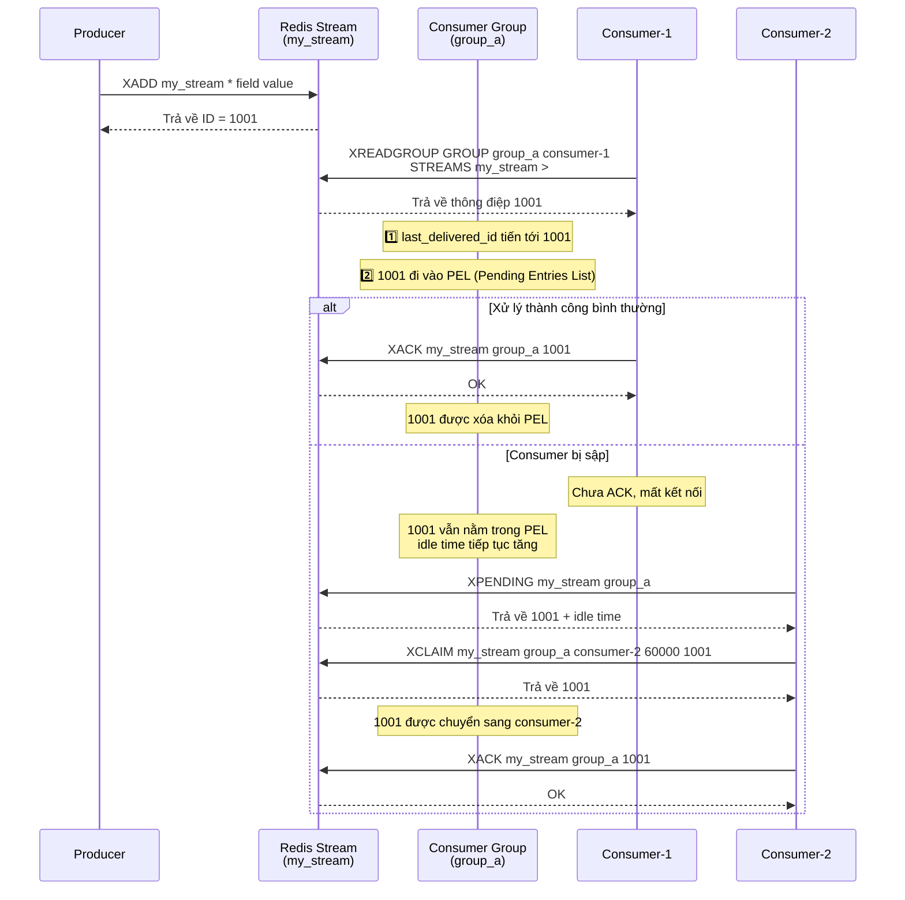

Nói kết luận trước: **Có thể làm được, nhưng còn tùy thuộc vào kịch bản cụ thể. So với các Message Queue chuyên nghiệp (như Kafka, RabbitMQ), vẫn còn một số điểm thiếu sót.**

Trước khi bắt đầu giới thiệu chính thức, chúng ta hãy xem: **Một MQ cấp production cần có những năng lực cốt lõi nào?**

| Khía cạnh năng lực          | Định nghĩa                                                              | Chỉ số / Đặc trưng then chốt                                      |
| :-------------------------- | :---------------------------------------------------------------------- | :---------------------------------------------------------------- |
| **Tính bền vững (Persistence)** | Thông điệp sau khi ghi không bị mất do sự cố tiến trình/node         | Flush đĩa đồng bộ / xác nhận đa bản sao, RPO ≈ 0                  |
| **Gửi ít nhất một lần (At-least-once Delivery)** | Thông điệp cuối cùng chắc chắn được tiêu thụ, cho phép trùng lặp | Cần kết hợp với tính lũy đẳng (idempotency) ở phía consumer      |
| **Xác nhận tiêu thụ (Consumption Ack)** | Consumer chủ động báo đã xử lý thành công                    | Cơ chế ACK, thử lại khi timeout, Dead-Letter Queue (DLQ)          |
| **Thử lại thông điệp (Message Retry)** | Khi tiêu thụ thất bại có thể tự động gửi lại                 | Chiến lược backoff, số lần thử lại tối đa, chuyển vào Dead-Letter |
| **Consumer Group**          | Nhiều consumer phối hợp tiêu thụ, tự động chuyển đổi khi có sự cố       | Cân bằng tải nội bộ nhóm, phân bổ partition, Rebalance            |
| **Khả năng chịu tồn đọng (Backlog)** | Khả năng đệm khi tốc độ sản xuất > tốc độ tiêu thụ              | Lưu trữ trên đĩa, TTL, cảnh báo tồn đọng                          |
| **Đảm bảo thứ tự (Ordering)** | Thông điệp được tiêu thụ đúng theo thứ tự gửi đi                       | Có thứ tự theo partition / toàn cục, xử lý phạt khi sai thứ tự    |
| **Khả năng mở rộng (Scalability)** | Mở rộng theo chiều ngang để tăng thông lượng hoặc chống thảm họa | Cơ chế sharding, Broker phi trạng thái (stateless), co giãn động  |

Redis cung cấp nhiều cách để triển khai MQ, từ `List` ở giai đoạn đầu đến `Pub/Sub`, rồi đến cấu trúc dữ liệu `Stream` được bổ sung trong Redis 5.0 (triển khai dựa trên danh sách liên kết có thứ tự, hỗ trợ Consumer Group và cơ chế ACK, có thể dùng để xây dựng Message Queue hạng nhẹ).

### Giai đoạn 1: Giai đoạn đầu dùng cấu trúc dữ liệu List

**Trước Redis 2.0, nếu muốn dùng Redis làm Message Queue thì chỉ có thể triển khai thông qua List.**

Thông qua `RPUSH/LPOP` hoặc `LPUSH/RPOP` là có thể triển khai một phiên bản Message Queue đơn giản:

```bash
# Producer tạo thông điệp
> RPUSH myList msg1 msg2
(integer) 2
> RPUSH myList msg3
(integer) 3
# Consumer tiêu thụ thông điệp
> LPOP myList
"msg1"
```

Tuy nhiên, cách làm qua `RPUSH/LPOP` hoặc `LPUSH/RPOP` gặp vấn đề về hiệu năng: chúng ta phải liên tục polling (thăm dò) để gọi `RPOP` hoặc `LPOP` nhằm lấy thông điệp tiêu thụ. Khi List rỗng, phần lớn các request polling đều là request vô ích, cách này gây lãng phí rất nhiều tài nguyên hệ thống.

Do đó, Redis cũng cung cấp các lệnh đọc chặn (blocking) như `BLPOP`, `BRPOP` (những lệnh có chữ B-Blocking đều là dạng chặn), đồng thời hỗ trợ tham số thời gian chờ (timeout). Nếu List rỗng, máy chủ Redis sẽ không trả về kết quả ngay mà chờ đến khi List có dữ liệu mới hoặc chờ tối đa hết thời gian timeout rồi mới trả về rỗng. Nếu đặt thời gian chờ bằng 0, lệnh có thể chờ vô hạn cho đến khi lấy được thông điệp ra.

```bash
# Thời gian timeout là 10s
# Nếu có dữ liệu sẽ trả về ngay, ngược lại chờ tối đa 10 giây
> BRPOP myList 10
null
```

Việc triển khai Message Queue bằng List quá đơn giản, các tính năng như cơ chế xác nhận thông điệp vẫn cần chúng ta tự cài đặt. **Điểm chí mạng nhất là nó không hỗ trợ một thông điệp được tiêu thụ bởi nhiều consumer (broadcast/phát quảng bá), hơn nữa thông điệp một khi đã bị lấy ra là mất khỏi danh sách; nếu consumer xử lý thất bại thì thông điệp sẽ mất vĩnh viễn.**

### Giai đoạn 2: Giới thiệu mô hình Pub/Sub (Publish/Subscribe)

**Redis 2.0 giới thiệu tính năng Publish/Subscribe (`Pub/Sub`), giải quyết vấn đề Message Queue triển khai bằng List không có cơ chế broadcast.**


`Pub/Sub` đưa vào một khái niệm gọi là **Channel (kênh)**, và việc triển khai cơ chế publish-subscribe dựa trên chính Channel này.

`Pub/Sub` liên quan đến hai vai trò là Publisher (bên phát hành) và Subscriber (bên đăng ký, cũng gọi là consumer):

- Publisher gửi thông điệp tới Channel chỉ định thông qua lệnh `PUBLISH`.
- Subscriber đăng ký các Channel mà mình quan tâm thông qua lệnh `SUBSCRIBE`. Hơn nữa, một Subscriber có thể đăng ký một hoặc nhiều Channel.

Nói cách khác, nhiều consumer có thể cùng đăng ký một Channel; khi producer phát hành thông điệp vào Channel này, tất cả subscriber đều nhận được.

Ở đây chúng ta khởi chạy 3 Redis client để minh họa nhanh:


`Pub/Sub` vừa có thể gửi đơn điểm (unicast) vừa có thể phát quảng bá (broadcast), đồng thời còn hỗ trợ khớp biểu thức chính quy đơn giản cho Channel.

`Pub/Sub` có một khiếm khuyết chí mạng: **nó gửi xong là quên (fire-and-forget), hoàn toàn không có tính bền vững (persistence) và đảm bảo độ tin cậy.** Nếu tại thời điểm thông điệp được phát hành, một consumer nào đó không trực tuyến hoặc mạng bị chập chờn nhẹ, thì thông điệp đó đối với consumer kia sẽ bị mất vĩnh viễn. Ngoài ra, nó cũng **không có cơ chế ACK**, không thể biết consumer đã xử lý thành công hay chưa, càng không thể xử lý vấn đề **tồn đọng thông điệp (message backlog)**. Vì vậy, `Pub/Sub` chỉ phù hợp làm các thông báo thời gian thực có yêu cầu độ tin cậy cực thấp, tuyệt đối không được dùng cho bất kỳ Message Queue nghiệp vụ nghiêm túc nào.

### Giai đoạn 3: Redis 5.0 bổ sung Stream

Redis 5.0 bổ sung cấu trúc dữ liệu `Stream`. Đây là một nhật ký thông điệp có thứ tự được cài đặt dựa trên Radix Tree (cây cơ số), hỗ trợ bẩm sinh Consumer Group và cơ chế ACK, có thể dùng để xây dựng Message Queue hạng nhẹ.

**Tại sao lại dùng Radix Tree?** Nhiều người tò mò tại sao không tiếp tục dùng `List/LinkedList`?

1. **Nén bộ nhớ cực mạnh**: ID thông điệp của `Stream` (như `1625000000000-0`) có tính thứ tự rất cao và tiền tố trùng lặp rất nhiều. Radix Tree là một cây tiền tố nén, nó sẽ gộp các node có chung tiền tố lại với nhau. Trong khi đó `List/LinkedList` phải chịu chi phí node danh sách liên kết đầy đủ cho từng phần tử và không thể tận dụng đặc tính lặp tiền tố của ID để tiết kiệm không gian.
2. **Truy xuất hiệu quả**: Khi xử lý hàng triệu thông điệp bị tồn đọng, Radix Tree vẫn duy trì được hiệu suất truy vấn rất cao — đây chính là nền tảng để `Stream` có thể hỗ trợ truy vấn theo khoảng dữ liệu lớn (`XRANGE`). Ngược lại, `List/LinkedList` chỉ thao tác được ở hai đầu, không thể truy vấn hiệu quả theo khoảng ID; khi thực hiện `XRANGE` sẽ phải duyệt toàn bộ danh sách.

Nó học hỏi các khái niệm cốt lõi từ các MQ chuyên nghiệp như Kafka:

1. **Consumer Group (Nhóm consumer)**: Thực hiện cân bằng tải thông điệp giữa nhiều consumer, hỗ trợ tự động chuyển đổi khi có sự cố (failover).
2. **Tính bền vững (Persistence)**: Có thể thông qua RDB và AOF để đảm bảo thông điệp không bị mất sau khi Redis khởi động lại (tùy thuộc vào cấu hình `appendfsync`, ở chế độ `everysec` thông thường mất tối đa 1 giây dữ liệu).
3. **Cơ chế ACK**: Sau khi consumer xử lý xong thông điệp cần gọi `XACK` thủ công để xác nhận, nếu không thông điệp sẽ vẫn nằm trong `Pending List`. Điều này đảm bảo thông điệp được tiêu thụ thành công ít nhất một lần.
4. **Truy hồi và chuyển giao thông điệp**: Hỗ trợ `XRANGE` truy xuất lại thông điệp theo khoảng thời gian, cũng như `XCLAIM` để chuyển thông điệp đang treo sang cho consumer khác xử lý.

> 🌈 Quá trình phát triển theo phiên bản:
>
> - Redis 8.2: Các lệnh `XACKDEL`, `XDELEX`, `XADD` và `XTRIM` cung cấp khả năng kiểm soát chi tiết cách các thao tác trên stream tương tác với nhiều consumer group, giúp đơn giản hóa việc điều phối xử lý thông điệp giữa các ứng dụng khác nhau.
> - Redis 8.6: Hỗ trợ xử lý thông điệp lũy đẳng (sản xuất tối đa một lần — at-most-once production), ngăn ngừa bản ghi trùng lặp khi sử dụng chế độ gửi ít nhất một lần (at-least-once delivery). Tính năng này giúp gửi thông điệp đáng tin cậy kèm khử trùng lặp tự động.

Cấu trúc của `Stream` như sau:


Đây là một danh sách thông điệp có thứ tự, mỗi thông điệp đều có một ID duy nhất và nội dung tương ứng. ID là tổ hợp của timestamp và số thứ tự (sequence number), dùng để đảm bảo tính duy nhất và tăng dần của thông điệp. Nội dung là một hoặc nhiều cặp key-value (tương tự kiểu dữ liệu cơ bản Hash), dùng để lưu dữ liệu của thông điệp.

Dưới đây là giải thích ngắn gọn cho một số khái niệm xuất hiện trong hình:

- `Consumer Group`: Nhóm consumer dùng để tổ chức và quản lý nhiều consumer. Bản thân Consumer Group không xử lý thông điệp mà phân phối thông điệp cho các consumer để thực hiện việc tiêu thụ thực sự.
- `last_delivered_id`: Con trỏ đánh dấu vị trí tiêu thụ hiện tại của Consumer Group; bất kỳ consumer nào trong nhóm đọc thông điệp đều làm `last_delivered_id` tiến lên phía trước.
- `pending_ids`: Lưu ID của các thông điệp đã được client tiêu thụ nhưng chưa `ACK`.

Dưới đây là các lệnh thường dùng khi sử dụng `Stream` làm Message Queue:

- `XADD`: Thêm thông điệp mới vào stream.
- `XREAD`: Đọc thông điệp từ stream.
- `XREADGROUP`: Đọc thông điệp từ một consumer group.
- `XRANGE`: Đọc các thông điệp trong stream theo khoảng ID thông điệp.
- `XREVRANGE`: Tương tự `XRANGE`, nhưng trả về kết quả theo thứ tự ngược lại.
- `XDEL`: Xóa thông điệp khỏi stream.
- `XTRIM`: Cắt bớt độ dài của stream, có thể chỉ định chiến lược cắt (`MAXLEN`/`MINID`).
- `XLEN`: Lấy độ dài của stream.
- `XGROUP CREATE`: Tạo consumer group.
- `XGROUP DESTROY`: Xóa consumer group.
- `XGROUP DELCONSUMER`: Xóa một consumer khỏi consumer group.
- `XGROUP SETID`: Đặt lại ID thông điệp được phân phối cuối cùng mới cho consumer group.
- `XACK`: Xác nhận thông điệp trong consumer group đã được xử lý.
- `XPENDING`: Truy vấn các thông điệp đang treo (chưa được xác nhận) trong consumer group.
- `XCLAIM`: Chuyển quyền sở hữu thông điệp đang treo từ consumer này sang consumer khác.
- `XINFO`: Lấy thông tin chi tiết của stream (`XINFO STREAM`), consumer group (`XINFO GROUPS`) hoặc consumer (`XINFO CONSUMERS`).

Sơ đồ tuần tự dưới đây minh họa luồng luân chuyển thông điệp và cơ chế ACK của Stream Consumer Group:



Nhìn chung, `Stream` đã có thể đáp ứng các yêu cầu cơ bản của một Message Queue. Tuy nhiên, khi sử dụng `Stream` trong thực tế cần lưu ý một số điểm sau:

1. **Hạn chế về Persistence**: Stream của Redis 5.0 phụ thuộc vào cơ chế lưu trữ bất đồng bộ RDB/AOF, nên khi khôi phục sự cố vẫn có thể mất các thông điệp chưa kịp ghi xuống đĩa gần nhất (tùy cấu hình `appendfsync`). Ở chế độ `everysec` của AOF thông thường mất tối đa 1 giây dữ liệu.
2. **Giới hạn khả năng tồn đọng thông điệp**: Dữ liệu của Redis Stream được lưu trên RAM, bị giới hạn bởi dung lượng bộ nhớ của máy chủ. So với việc lưu trữ trên đĩa của Kafka, Redis Stream không phù hợp cho các kịch bản tồn đọng dữ liệu khổng lồ.
3. **Quản lý Consumer Group**: Thông tin trạng thái của Consumer Group (như `last_delivered_id`) cần được bảo trì định kỳ; các thông điệp Pending chưa được xử lý trong thời gian dài sẽ chiếm dụng bộ nhớ.

Bảng dưới đây so sánh Redis Stream với các MQ phổ biến:

| Tiêu chí                 | Redis Stream                                    | RabbitMQ                                               | Kafka                                                         | Hàng đợi trong bộ nhớ (In-Memory Queue) |
| :----------------------- | :---------------------------------------------- | :----------------------------------------------------- | :------------------------------------------------------------ | :-------------------------------------- |
| **Thông lượng**          | Cao (hàng trăm nghìn QPS)                       | Trung bình (hàng chục nghìn QPS)                       | **Cực cao (hàng triệu QPS, mở rộng ngang qua partition)**     | Cực cao (giới hạn bởi CPU/RAM)          |
| **Độ trễ**               | **Cực thấp (dưới mili-giây)**                   | **Thấp (micro-giây/mili-giây, tính thời gian thực cao)** | Trung bình (mili-giây, chịu ảnh hưởng bởi batching)          | Cực thấp (nano-giây/micro-giây)         |
| **Persistence**          | Có hỗ trợ (RDB/AOF bất đồng bộ)                 | Có hỗ trợ (lưu trên đĩa)                               | **Hỗ trợ rất mạnh (ghi tuần tự trực tiếp trên đĩa)**         | Không                                   |
| **Khả năng tồn đọng**    | Trung bình (giới hạn bởi RAM)                   | Trung bình (khi tồn đọng nhiều hiệu năng giảm rõ rệt)  | **Cực mạnh (lưu đĩa quy mô TB, hiệu năng ổn định)**           | Kém (dễ gây `OOM`)                      |
| **Truy hồi thông điệp**  | Có hỗ trợ (theo ID/thời gian)                   | **Không hỗ trợ (ở chế độ queue truyền thống)**         | **Hỗ trợ rất mạnh (theo Offset/thời gian)**                   | Không hỗ trợ                            |
| **Độ tin cậy**           | Trung bình (rủi ro mất dữ liệu AOF)             | **Cao (cơ chế Confirm/xác nhận hoàn thiện)**           | **Cực cao (đa bản sao + cấu hình nhất quán mạnh)**            | Thấp                                    |
| **Độ phức tạp vận hành** | Thấp (chỉ cần vận hành Redis)                   | Trung bình (môi trường Erlang, quản trị cluster)       | Cao (phụ thuộc ZK hoặc KRaft)                                 | Cực thấp                                |
| **Kịch bản phù hợp**     | Hạng nhẹ, độ trễ thấp, hệ thống đã có sẵn Redis | **Định tuyến phức tạp, độ tin cậy cao, nghiệp vụ tài chính** | **Big Data, thu thập log, xử lý stream thông lượng cao** | Tách rời nội bộ tiến trình, yêu cầu hiệu năng cực hạn |

### Tổng kết

**Quay lại câu hỏi ban đầu: Redis rốt cuộc có làm MQ được không?**

- **Nếu nghiệp vụ đơn giản, sản lượng nhỏ, theo đuổi hiệu năng tối đa**, và có thể chấp nhận xác suất mất dữ liệu cực nhỏ, thì sử dụng **Redis Stream** là giải pháp tối ưu nhất vì nó tiết kiệm chi phí triển khai và vận hành riêng một MQ, đồng thời tận dụng lại hạ tầng Redis sẵn có (đa số các dự án cần đến MQ thường cũng sẽ cần dùng Redis).
- **Nếu là nghiệp vụ cấp tài chính, dữ liệu khổng lồ, yêu cầu đảm bảo tuyệt đối không mất thông điệp**, bắt buộc phải lựa chọn các MQ trưởng thành hơn như **Kafka, RabbitMQ**, v.v.

Để xem thêm nhiều kiến thức trọng tâm và câu hỏi phỏng vấn thường gặp về Redis, bạn có thể đọc các bài viết sau của tác giả:

- [Tổng hợp câu hỏi phỏng vấn Redis thường gặp (Phần 1)](https://javaguide.cn/database/redis/redis-questions-01.html "Tổng hợp câu hỏi phỏng vấn Redis thường gặp (Phần 1)") (Nền tảng Redis, ứng dụng, kiểu dữ liệu, cơ chế persistence, mô hình luồng, v.v.)
- [Tổng hợp câu hỏi phỏng vấn Redis thường gặp (Phần 2)](https://javaguide.cn/database/redis/redis-questions-02.html "Tổng hợp câu hỏi phỏng vấn Redis thường gặp (Phần 2)") (Transaction trong Redis, tối ưu hiệu năng, sự cố production, cluster, quy chuẩn sử dụng, v.v.)
- [Làm thế nào để triển khai tác vụ trễ (Delayed Task) dựa trên Redis](https://javaguide.cn/database/redis/redis-delayed-task.html "Làm thế nào để triển khai tác vụ trễ dựa trên Redis")
- [Giải thích chi tiết 5 kiểu dữ liệu cơ bản của Redis](https://javaguide.cn/database/redis/redis-data-structures-01.html "Giải thích chi tiết 5 kiểu dữ liệu cơ bản của Redis")
- [Giải thích chi tiết 3 kiểu dữ liệu đặc biệt của Redis](https://javaguide.cn/database/redis/redis-data-structures-02.html "Giải thích chi tiết 3 kiểu dữ liệu đặc biệt của Redis")
- [Tại sao Redis dùng Skip List để triển khai Sorted Set](https://javaguide.cn/database/redis/redis-skiplist.html "Tại sao Redis dùng Skip List để triển khai Sorted Set")
- [Giải thích chi tiết cơ chế Persistence của Redis](https://javaguide.cn/database/redis/redis-persistence.html "Giải thích chi tiết cơ chế Persistence của Redis")
- [Giải thích chi tiết phân mảnh bộ nhớ (Memory Fragmentation) trong Redis](https://javaguide.cn/database/redis/redis-memory-fragmentation.html "Giải thích chi tiết phân mảnh bộ nhớ trong Redis")
- [Tổng hợp các nguyên nhân gây block thường gặp trong Redis](https://javaguide.cn/database/redis/redis-common-blocking-problems-summary.html "Tổng hợp các nguyên nhân gây block thường gặp trong Redis")

Dự án [*Nền tảng phỏng vấn thông minh SpringAI + RAG Knowledge Base*](https://javaguide.cn/zhuanlan/interview-guide.html) của tôi cũng sử dụng Redis Stream làm Message Queue. Trong bối cảnh của dự án này, nó gần như là lựa chọn phù hợp nhất và hoàn toàn đáp ứng đủ nhu cầu.


