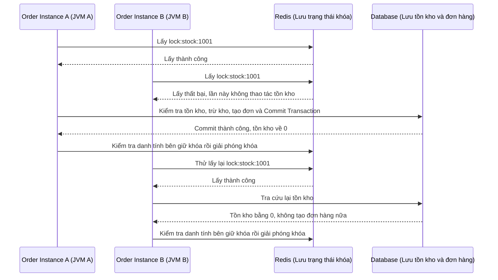

Bài viết này xuất phát từ kịch bản triển khai cùng một service trên nhiều instance, qua đó giới thiệu phạm vi tác dụng của khóa cục bộ (Local Lock), bài toán mà Distributed Lock giải quyết và những ranh giới cần lưu ý khi sử dụng.

## Vì sao cần Distributed Lock?

**Khi nhiều tiến trình (Process) cần thao tác loại trừ lẫn nhau (mutually exclusive) lên cùng một tài nguyên dùng chung bên ngoài, khóa cục bộ không thể điều phối giữa các tiến trình này; Distributed Lock cung cấp khả năng loại trừ lẫn nhau xuyên tiến trình.**

"Tài nguyên dùng chung" ở đây có thể là bản ghi tồn kho của cùng một sản phẩm trong Database, cùng một mục Cache trong Redis,... **Các JVM khác nhau thường không dùng chung bộ nhớ Heap của Java, nhưng có thể truy cập cùng một dữ liệu bên ngoài thông qua mạng.** Thứ cần điều phối chính là thao tác của các tiến trình đó lên dữ liệu bên ngoài.

### Vì sao Local Lock không kiểm soát được nhiều instance service?

Giả sử Order Service xử lý yêu cầu mua hàng theo quy trình "tra cứu tồn kho → kiểm tra còn hàng → trừ tồn kho → tạo đơn hàng". Trước hết giả định truy vấn tồn kho là truy vấn thông thường, và khi trừ tồn kho cũng không có điều kiện `count > 0` hay kiểm tra phiên bản (version).

Khi chỉ triển khai một instance, nếu mọi yêu cầu mua hàng đều dùng chung một đối tượng khóa `synchronized` hoặc một instance `ReentrantLock`, và hoàn tất các thao tác trên cùng việc Commit Transaction ngay bên trong khóa, thì các yêu cầu này có thể thực thi tuần tự. Đoạn code bên trong khóa cần thực thi loại trừ lẫn nhau chính là **vùng găng (Critical Section)**. Local Lock giới hạn các Thread dùng chung cùng một khóa trong phạm vi JVM hiện tại; dữ liệu được thao tác bên trong khóa cũng có thể nằm trong Database.

Bây giờ triển khai Order Service thành hai instance A và B, mỗi instance chạy trên một JVM riêng và cùng kết nối tới một Database. Dù code giống hệt nhau, **Local Lock bên trong A và B vẫn là hai đối tượng khóa độc lập**, hoàn toàn không nhận biết được đối phương có đang giữ khóa hay không. Ngay cả khi dùng `static` để khai báo biến khóa, nó cũng chỉ dùng chung trong phạm vi từng JVM riêng lẻ.

Khi trong Database sản phẩm `sku_id = 1001` chỉ còn đúng 1 đơn vị tồn kho, thứ tự thực thi dưới đây có thể xảy ra:

| Thứ tự | Instance A (JVM A) | Instance B (JVM B) |
| --- | --- | --- |
| 1 | Lấy Local Lock trong A, thành công | |
| 2 | | Lấy Local Lock trong B, cũng thành công |
| 3 | Tra cứu tồn kho bằng 1, vượt qua kiểm tra | |
| 4 | | Tra cứu tồn kho cũng bằng 1, vượt qua kiểm tra |
| 5 | Thực hiện trừ không điều kiện, tạo đơn & Commit, giải phóng Local Lock | |
| 6 | | Thực hiện trừ không điều kiện, tạo đơn & Commit, giải phóng Local Lock |

Cả hai yêu cầu đều thành công dù thực tế chỉ có 1 sản phẩm, dẫn đến tình trạng bán vượt tồn kho (overselling). Ở đây Local Lock vẫn ràng buộc được các Thread bên trong từng JVM, nhưng không thể làm cho request ở JVM khác phải chờ.

### Distributed Lock giúp nhiều instance loại trừ lẫn nhau bằng cách nào?

Để A và B cùng cạnh tranh một khóa duy nhất, cần đưa trạng thái khóa ra một hệ thống bên ngoài mà cả hai đều truy cập được — chẳng hạn Redis, ZooKeeper hoặc Database — và để hệ thống này quyết định một cách nguyên tử (atomic) xem bên nào lấy được khóa.

Lấy Redis Lock làm ví dụ: hai instance quy ước trước khi thao tác với sản phẩm `1001` đều phải lấy khóa `lock:stock:1001`. Sơ đồ dưới đây minh họa trường hợp A lấy được khóa trước và khóa luôn còn hiệu lực trong suốt thời gian thực thi nghiệp vụ:



Trong hình, Redis lưu **trạng thái khóa**, còn Database lưu **dữ liệu nghiệp vụ**. Sau khi lấy được khóa, instance vẫn tự mình truy cập Database. Khóa Redis không tự động khóa bản ghi trong Database; mọi bên cần loại trừ lẫn nhau đều phải tuân thủ cùng một quy ước lấy khóa — bất kỳ request nào đi vòng qua khóa để sửa trực tiếp tồn kho sẽ không chịu sự ràng buộc của khóa đó.

Khóa phải bao phủ trọn vẹn vùng găng (Critical Section): từ lúc kiểm tra tồn kho tới khi trừ kho, tạo đơn hàng và Commit Transaction, chứ không thể chỉ khóa mỗi bước truy vấn. Request không lấy được khóa có thể chờ, fail-fast hoặc Retry; sau đó khi lấy được khóa, cần phải kiểm tra lại trạng thái nghiệp vụ. Việc khóa hết hạn và sự cố phía Client sẽ ảnh hưởng tới đảm bảo loại trừ lẫn nhau; mục tiếp theo sẽ trình bày các ranh giới này.

### Triển khai đa instance có nhất thiết luôn phải dùng Distributed Lock không?

Không hẳn. **Cần loại trừ lẫn nhau xuyên tiến trình không đồng nghĩa bắt buộc phải đưa thêm các dịch vụ Distributed Lock như Redis vào hệ thống.** Nếu bản thân Database đã đảm bảo được ràng buộc nghiệp vụ thì thường có thể tận dụng trực tiếp năng lực của Database.

Ví dụ, để ngăn tồn kho bị trừ thành số âm, có thể sử dụng cập nhật có điều kiện (Conditional Update):

```sql
UPDATE stock SET count = count - 1 WHERE sku_id = ? AND count > 0;
```

Lấy MySQL InnoDB làm ví dụ: khi cập nhật đồng thời cùng một dòng sẽ được điều phối bằng khóa dòng (Row Lock). Chỉ khi số dòng bị ảnh hưởng bằng 1 mới xem là trừ thành công và tiếp tục tạo đơn; thao tác trừ kho và ghi đơn hàng nên đặt trong cùng một Transaction cục bộ để cùng Rollback khi thất bại. Như vậy, dù có nhiều instance service thì lần trừ tồn kho này cũng không cần gắn thêm khóa Redis.

Tương tự, mỗi User chỉ được mua tối đa 1 sản phẩm trong cùng một chương trình khuyến mãi có thể đảm bảo bằng ràng buộc duy nhất (Unique Constraint) trên `user_id + activity_id`; gửi trùng đơn hàng có thể xử lý bằng Idempotency Key. Các ràng buộc này cần được thiết kế tách bạch riêng, không thể chỉ dựa vào một khóa tồn kho để giải quyết tất cả.

Chỉ khi nghiệp vụ thực sự cần một đoạn logic trên nhiều tiến trình phải chạy tuần tự, mà các biện pháp như cập nhật có điều kiện hay ràng buộc duy nhất của Database không phù hợp, lúc đó mới cân nhắc Distributed Lock. Nó làm tăng thêm lời gọi mạng và độ phức tạp xử lý lỗi, đồng thời làm giảm mức độ đồng thời trên cùng một tài nguyên.

## Distributed Lock cần đáp ứng những điều kiện nào?

Một Distributed Lock cơ bản nhất cần thỏa mãn:

- **Loại trừ lẫn nhau (Mutual Exclusion)**: Với cùng một `lock key` tương ứng cùng một tài nguyên, tại một thời điểm chỉ có duy nhất một bên giữ khóa hợp lệ. `lock key` cần thiết kế theo độ mịn tài nguyên, ví dụ `stock:{skuId}`, `order:{orderId}`, tránh dồn mọi tài nguyên không liên quan vào một khóa tổng khổng lồ.
- **Tính sẵn sàng cao (High Availability) và chống Deadlock**: Bản thân dịch vụ khóa phải sẵn sàng cao; đồng thời cần có thời gian hết hạn (TTL), cơ chế Session hoặc cơ chế Lease để tránh việc Client sập khiến khóa không bao giờ được giải phóng. Tuy nhiên thời gian hết hạn phải được thiết kế đồng bộ với thời gian thực thi nghiệp vụ và cơ chế gia hạn, nếu không có thể xảy ra tình trạng khóa hết hạn sớm khiến hai Client cùng lúc đi vào vùng găng.
- **Giải phóng khóa an toàn (Safe Release)**: Khi giải phóng khóa bắt buộc phải kiểm tra danh tính bên giữ khóa, chỉ được giải phóng khóa do chính mình nắm giữ. Lấy Redis làm ví dụ: khi lấy khóa ghi kèm một giá trị ngẫu nhiên (`owner token`), khi giải phóng dùng Lua Script so sánh giá trị trước rồi mới xóa key.

Ngoài ba điều kiện cơ bản trên, một Distributed Lock tốt còn nên đáp ứng các điều kiện sau:

- **Khả năng tái nhập (Reentrant)**: Không phải kịch bản nào cũng bắt buộc, nhưng nếu cùng một Thread/chuỗi lời gọi có thể đi vào lại cùng một vùng găng, cần ghi nhận chủ sở hữu khóa và số lần tái nhập để tránh tự khóa chính mình.
- **Hiệu năng cao**: Thao tác lấy và giải phóng khóa cần hoàn tất nhanh chóng, không gây ảnh hưởng lớn tới hiệu năng chung của toàn hệ thống.
- **Ngữ nghĩa lấy khóa rõ ràng**: Lấy khóa có thể là chờ chặn (blocking wait), chờ giới hạn thời gian, hoặc thất bại ngay lập tức. Trên production thường phải đặt thời gian chờ tối đa và backoff khi Retry, không được chờ vô hạn.
- **Cơ chế gia hạn (Renewal)**: TTL của khóa cần đặt dựa trên thời gian thực thi P99 của vùng găng; khi vùng găng có khả năng vượt quá TTL, cần cơ chế Watchdog / gia hạn Lease hoặc thu ngắn vùng găng lại.
- **Fencing Token**: Các kịch bản chặt chẽ hơn còn cần Fencing Token. Mỗi lần lấy khóa thành công sẽ sinh ra một token tăng đơn điệu; tài nguyên hạ nguồn chỉ chấp nhận thao tác ghi có token lớn hơn để chặn các lượt ghi đến muộn từ bên giữ khóa cũ sau khi khóa đã hết hạn.

## Các cách triển khai Distributed Lock phổ biến là gì?

Các phương án triển khai Distributed Lock phổ biến gồm:

- Triển khai Distributed Lock dựa trên cơ sở dữ liệu quan hệ như MySQL.
- Triển khai Distributed Lock dựa trên dịch vụ điều phối phân tán ZooKeeper.
- Triển khai Distributed Lock dựa trên kho lưu trữ Key-Value hiệu năng cao như Redis, hoặc kho lưu trữ Key-Value nhất quán phân tán như etcd.

Phương án dùng Database có thể chia đại khái thành ba dạng: chèn vào bảng khóa có Unique Index, khóa dòng `SELECT ... FOR UPDATE` dựa trên Transaction, và khóa định danh như `GET_LOCK()` của MySQL. Cả ba đều đạt được mức độ loại trừ lẫn nhau nhất định, nhưng khác nhau về hiệu năng, thời điểm giải phóng, ngữ nghĩa Timeout và cách khôi phục sau sự cố.

Không phải phương án Database không làm được cơ chế hết hạn, mà là ngữ nghĩa hết hạn và hiệu năng thường không tự nhiên bằng Redis/ZooKeeper/etcd. Chẳng hạn bảng khóa có thể thêm cột thời gian hết hạn, nhưng phải xử lý việc tranh chiếm khóa đã hết hạn, tính nhất quán đồng hồ, tác vụ dọn dẹp và mức cô lập giao dịch (Transaction Isolation); còn `GET_LOCK()` phụ thuộc vào ngữ nghĩa Connection/Session của MySQL nên không phù hợp với mọi luồng nghiệp vụ.

Redis Lock thường được dùng nhiều hơn ở các kịch bản đòi hỏi hiệu năng cao, vùng găng ngắn và cho phép dùng Tính lũy đẳng (Idempotency) ở tầng nghiệp vụ làm lớp bảo vệ cuối. ZooKeeper/etcd phù hợp hơn với các kịch bản điều phối cần ngữ nghĩa Session, Sequential Node, Lease và tính nhất quán mạnh hơn, nhưng thông lượng, độ trễ và chi phí vận hành thường cao hơn. Tôi đã viết riêng một bài để trình bày chi tiết hai phương án Redis và ZooKeeper này: [Tổng hợp các giải pháp triển khai Distributed Lock phổ biến](./distributed-lock-implementations.md).

Lưu ý cuối cùng: **Distributed Lock không phải là Distributed Transaction. Khóa chỉ kiểm soát việc đi vào vùng găng đồng thời, không đảm bảo Commit Database chắc chắn thành công, cũng không đảm bảo việc gửi message và ghi đơn hàng nhất quán nguyên tử với nhau. Tính nhất quán nghiệp vụ vẫn phải dựa vào Local Transaction, Idempotency, State Machine và tác vụ bù trừ (Compensation).**

Nếu muốn tìm hiểu sâu hơn mối quan hệ giữa Leader/Quorum, Lease và Fencing Token, bạn có thể đọc [Giải thích chi tiết Điều phối phân tán](./protocol/centralized-and-decentralized.md).

## Tổng kết

Trong bài viết này chúng ta đã tìm hiểu chủ yếu về:

- **Công dụng của Distributed Lock**: Điều phối quyền truy cập loại trừ lẫn nhau của nhiều tiến trình lên cùng một tài nguyên dùng chung bên ngoài. Local Lock chỉ điều phối được các Thread dùng chung cùng một khóa trong phạm vi một JVM; nếu cập nhật có điều kiện hoặc ràng buộc duy nhất của Database đã đảm bảo được ràng buộc nghiệp vụ thì không cần đưa thêm dịch vụ Distributed Lock vào.
- **Điều kiện cần có của Distributed Lock**: Loại trừ lẫn nhau (Mutual Exclusion), tính sẵn sàng cao & chống Deadlock, giải phóng khóa an toàn, khả năng tái nhập (Reentrant), hiệu năng cao, ngữ nghĩa lấy khóa rõ ràng và cơ chế gia hạn. Các kịch bản đòi hỏi chặt chẽ hơn còn phải kết hợp Fencing Token.
- **Các cách triển khai phổ biến**: Cơ sở dữ liệu quan hệ như MySQL, dịch vụ điều phối phân tán ZooKeeper, kho lưu trữ Key-Value hiệu năng cao như Redis và kho lưu trữ Key-Value nhất quán phân tán như etcd.
