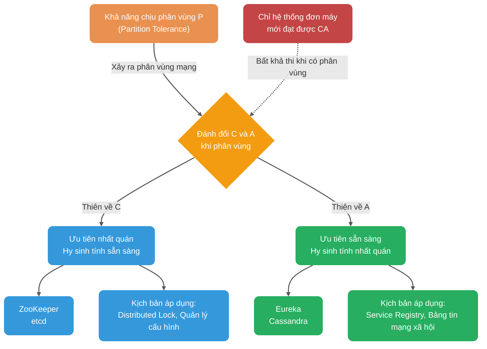
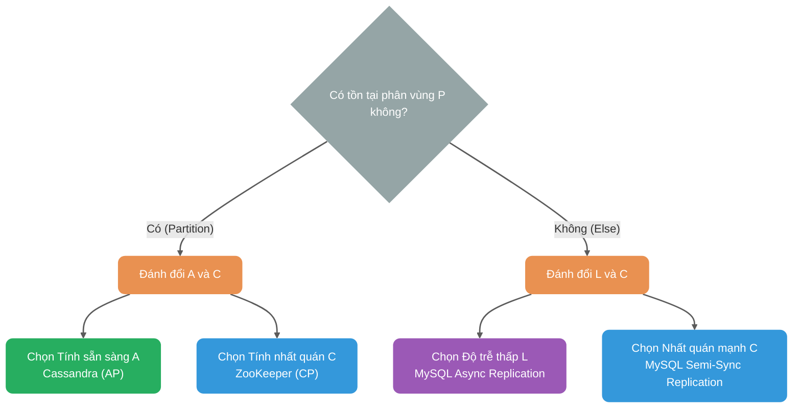
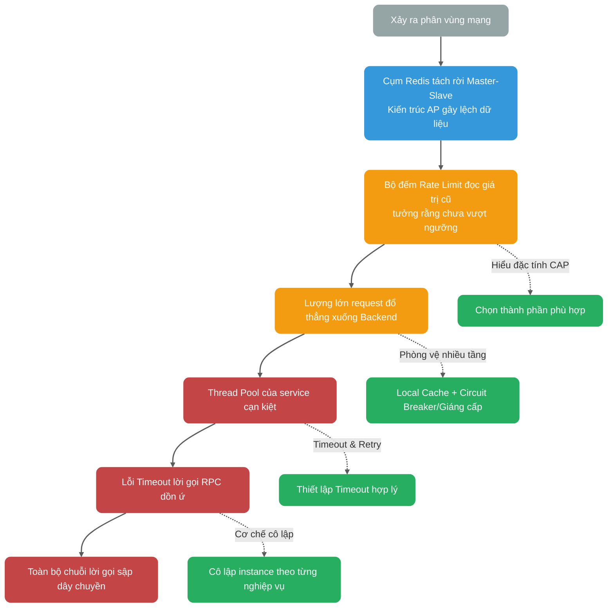
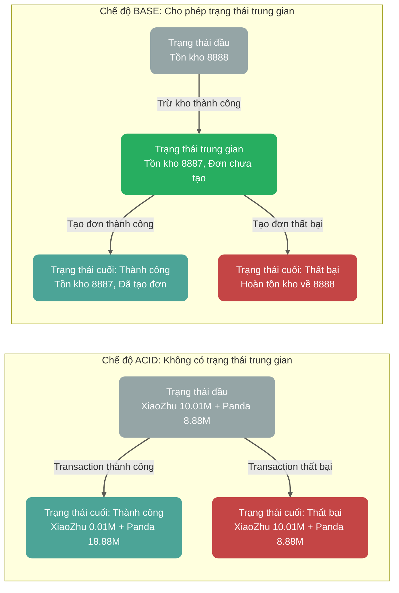
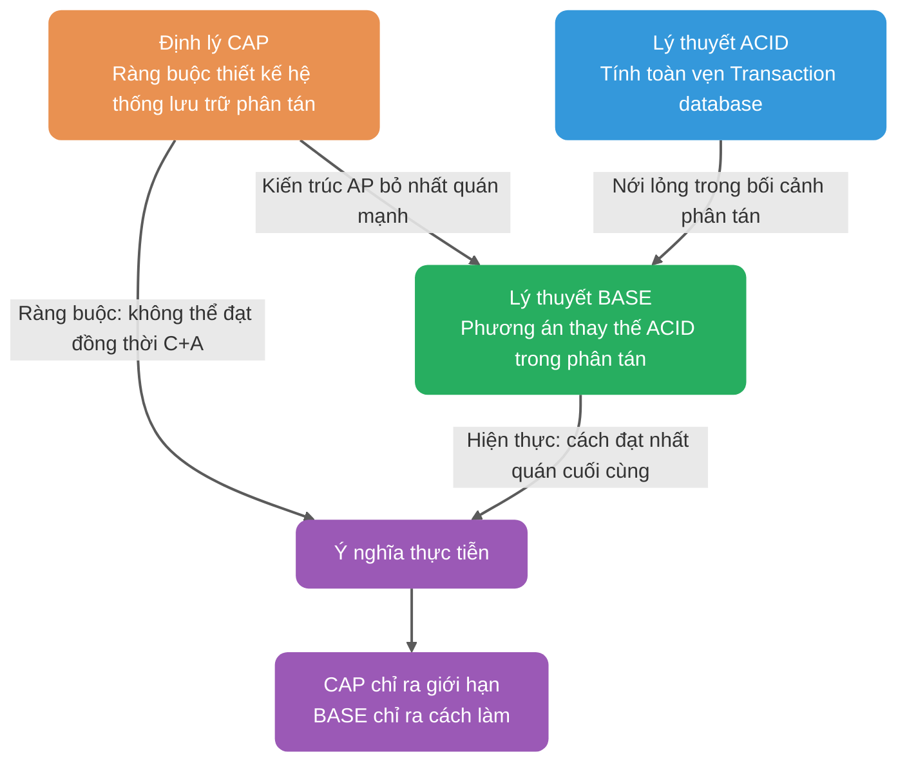

Những bạn đã từng trải qua phỏng vấn kỹ thuật chắc hẳn không còn xa lạ gì với hai lý thuyết CAP & BASE này!

Hồi tôi đi phỏng vấn, không hề nói quá chứ hễ cứ hỏi tới kiến thức phân tán là gần như nhà tuyển dụng nào cũng hỏi hai lý thuyết nền tảng này. Một là vì đây là nền móng bắt buộc phải nắm khi học hệ thống phân tán, hai là vì chính nhiều người phỏng vấn cũng quen thuộc với nó (rất tiện để đặt câu hỏi).

Chúng ta rất cần hiểu thấu đáo hai lý thuyết này và có thể diễn đạt lại bằng cách hiểu của chính mình cho người khác nghe.

Bài viết này chủ yếu giải quyết câu hỏi "khi xảy ra phân vùng mạng (Partition), hệ thống phải đánh đổi ra sao". Nếu muốn tìm hiểu tiếp vì sao các thiết kế như Leader, Quorum, Lease, Gossip lại ra đời, bạn có thể đọc tiếp [Giải thích chi tiết Điều phối phân tán](./centralized-and-decentralized.md); nếu muốn xem phía nghiệp vụ áp dụng tính nhất quán cuối cùng (Eventual Consistency) như thế nào, bạn có thể đọc tiếp [Giải thích chi tiết Các giải pháp Distributed Transaction](../distributed-transaction.md).

## Định lý CAP

[Định lý CAP](https://zh.wikipedia.org/wiki/CAP%E5%AE%9A%E7%90%86) bắt nguồn từ năm 2000, được Giáo sư Eric Brewer thuộc Đại học California tại Berkeley đề xuất tại Hội nghị Nguyên lý Tính toán Phân tán (PODC), vì vậy định lý CAP còn được gọi là **Định lý Brewer (Brewer’s theorem)**.

Hai năm sau, Seth Gilbert và Nancy Lynch tại MIT đã công bố bài chứng minh cho phỏng đoán của Brewer, giúp lý thuyết CAP chính thức trở thành một định lý trong lĩnh vực hệ thống phân tán.

### Giới thiệu

Định lý CAP bàn về Consistency (Tính nhất quán), Availability (Tính sẵn sàng) và Partition Tolerance (Khả năng chịu phân vùng mạng).

> **Lưu ý quan trọng**: Phần bên dưới sử dụng cách nói "thiên về CP / thiên về AP" chỉ để mô tả mang tính trực giác. Nếu xét chặt chẽ theo định nghĩa CAP (C = Linearizability, A = mọi node không lỗi đều phải phản hồi), nhiều hệ thống không thể xếp loại rạch ròi — các thao tác khác nhau trong cùng một hệ thống có đặc tính nhất quán/sẵn sàng khác nhau, và rất nhiều hệ thống không thỏa mãn cả CAP-C lẫn CAP-A.


Khi đề xuất phỏng đoán CAP, Brewer chưa đưa ra định nghĩa hình thức chặt chẽ cho **Consistency**, **Availability** và **Partition Tolerance**.

Vì thế có rất nhiều cách diễn giải dân gian về CAP; dưới đây là cách hiểu phổ biến và chuẩn xác hơn cả.

Trong khoa học máy tính lý thuyết, định lý CAP chỉ ra rằng đối với một hệ thống phân tán, khi thiết kế các thao tác đọc và ghi, tại cùng một thời điểm chỉ có thể thỏa mãn tối đa hai trong ba yếu tố sau:

- **Tính nhất quán (Consistency)**: Trong ngữ cảnh chứng minh của Gilbert/Lynch (2002), chữ C của CAP chỉ **Atomic Consistency**, thường tương đương với **Linearizability (Tính nhất quán tuyến tính)**. Nghĩa là mọi thao tác được sắp xếp tuyến tính theo thứ tự thời gian thực: một thao tác ghi vừa hoàn tất thì tất cả thao tác đọc sau đó bắt buộc phải trả về đúng giá trị vừa ghi đó (hoặc giá trị mới hơn). **Lưu ý:** Consistency ở đây khác với Consistency (ràng buộc toàn vẹn) trong ACID của cơ sở dữ liệu — thứ chỉ việc trạng thái database trước và sau Transaction phải thỏa mãn các ràng buộc toàn vẹn.
- **Tính sẵn sàng (Availability)**: Mọi node không bị lỗi bắt buộc phải trả về phản hồi hợp lệ (non-error response) cho từng request (không bàn tới việc phản hồi nhanh hay chậm). **Lưu ý**: Đây là định nghĩa chặt chẽ trong định lý CAP, không bao gồm các chỉ số độ trễ/SLA trong thực tế kỹ thuật (như "phản hồi trong 1 giây").
- **Khả năng chịu phân vùng mạng (Partition Tolerance)**: Chữ P trong CAP thực chất đang giả định một mạng bất đồng bộ (có thể trễ, mất gói tin hoặc phân vùng), chứ không phải một tính năng để bạn "chọn bật hay tắt". Sự đánh đổi thực sự nằm ở chỗ: khi phân vùng xảy ra, bạn buộc phải chọn giữa **tính nhất quán tuyến tính (CAP Consistency = Linearizability)** và **tính sẵn sàng theo CAP (CAP-Availability — mọi node không lỗi đều phải trả về phản hồi hợp lệ cho request)**.

**Phân vùng mạng (Network Partition) là gì?**

Trong hệ thống phân tán, mạng giữa các node vốn thông suốt với nhau, nhưng vì một số sự cố (ví dụ một vài node gặp trục trặc mạng) khiến một số node không còn liên lạc được với nhau nữa, toàn bộ mạng bị chia cắt thành nhiều vùng tách biệt — hiện tượng này gọi là **Phân vùng mạng (Network Partition)**.


### Không phải kiểu "Chọn 2 trong 3" như lời đồn

Đa số mọi người khi giải thích định lý này thường phát biểu đơn giản hóa thành: "Giữa Tính nhất quán, Tính sẵn sàng và Khả năng chịu phân vùng mạng, bạn chỉ có thể đạt được tối đa hai yếu tố cùng lúc chứ không thể đạt cả ba". Thực tế cách nói này rất dễ gây hiểu lầm — và 12 năm sau khi định lý CAP ra đời, chính cha đẻ của CAP cũng đã viết lại bài báo giải thích rõ hơn vào năm 2012.

> **Khi xảy ra phân vùng mạng, nếu hệ thống muốn tiếp tục phục vụ, thì chỉ có thể chọn 1 trong 2 giữa tính nhất quán mạnh và tính sẵn sàng.**
>
> Nói ngắn gọn: Khả năng chịu phân vùng mạng P không phải là thứ có thể tùy ý từ bỏ trong mạng phân tán; dưới tiền đề chấp nhận P có thể xảy ra, khi bị phân vùng ta chỉ có thể chọn thỏa mãn A hoặc C.

**Tại sao không thể chọn kiến trúc CA?**

Bởi vì hệ thống phân tán không thể tách rời giao tiếp mạng, mà lỗi mạng lại là chuyện thường ngày:

- Kiểm tra Heartbeat có thể mất gói do mạng chập chờn, dẫn đến nhận định nhầm node bị sập.
- Quá trình đồng bộ dữ liệu có thể mất gói gây lệch dữ liệu; để đạt đồng thuận, hệ thống liên tục thử lại làm request bị chặn (block).

**Do đó, trong mô hình mạng bất đồng bộ (nơi phân vùng có thể xảy ra), khi phân vùng xuất hiện, bắt buộc phải đánh đổi giữa tính nhất quán tuyến tính và tính sẵn sàng theo CAP.** Hệ thống duy nhất đảm bảo được CA chỉ có hệ thống đơn máy (single-node) — vì chỉ có một node nên sau khi ghi thành công mọi request đều thấy cùng một dữ liệu; miễn node đó còn sống thì hệ thống luôn sẵn sàng.

Sơ đồ dưới đây thể hiện sự đánh đổi cốt lõi của định lý CAP và xu hướng của các hệ thống phổ biến:



Ở đây cần đưa thêm **Lý thuyết PACELC** (phần mở rộng của CAP) để giải thích toàn diện hơn:

Lý thuyết PACELC do Daniel J. Abadi đề xuất chỉ ra rằng: **Nếu tồn tại phân vùng (P), bắt buộc phải chọn giữa Tính sẵn sàng (A) và Tính nhất quán (C); ngược lại (E - Else), khi không có phân vùng, vẫn phải chọn giữa Độ trễ (L - Latency) và Tính nhất quán (C).**



Ý nghĩa thực tiễn: ngay cả khi không có phân vùng mạng, hệ thống phân tán vẫn phải cân nhắc giữa độ trễ thấp (sao chép bất đồng bộ) và tính nhất quán mạnh (sao chép đồng bộ). Ví dụ:

- **Cassandra**: Có thể điều chỉnh mức độ nhất quán đọc/ghi (`ONE`/`QUORUM`/`ALL`) để đánh đổi giữa độ trễ và tính nhất quán.
- **MySQL Master-Slave**: Có thể chọn sao chép bất đồng bộ (độ trễ thấp) hoặc sao chép bán đồng bộ (Semi-Sync, nhất quán cao hơn).

Chẳng hạn ZooKeeper, HBase là kiến trúc CP; Cassandra, Eureka là kiến trúc AP; còn Nacos hỗ trợ cả kiến trúc CP lẫn kiến trúc AP.

**Việc chọn CP hay AP phụ thuộc vào kịch bản nghiệp vụ hiện tại, không có đáp án cố định**: ví dụ các bài toán đòi hỏi nhất quán mạnh như Distributed Lock, quản lý cấu hình sẽ chọn CP; các bài toán đặt tính sẵn sàng cao lên hàng đầu như Service Registry trong Microservices thường chọn AP.

**Ngoài ra cần nói thêm một điểm**: khi không có phân vùng, hệ thống hoàn toàn có thể vừa đạt tính nhất quán tuyến tính vừa đạt tính sẵn sàng "có phản hồi" của CAP; nhưng về mặt kỹ thuật, ta vẫn thường phải đánh đổi giữa độ trễ và tính nhất quán (đây chính là phần ELC mà lý thuyết PACELC bàn tới).

### Phạm vi áp dụng của Định lý CAP

**Kết luận quan trọng**: Định lý CAP chủ yếu bàn về sự đánh đổi giữa tính nhất quán và tính sẵn sàng của một đối tượng dữ liệu đơn lẻ trong bối cảnh sao chép bản sao (Replica Replication).

| Sát với mô hình bàn luận của CAP | Cần tách nhỏ tới mức Shard / Đối tượng / Thao tác để phân tích |
| -------------------------------- | -------------------------------------------------------------- |
| Cụm Redis Master-Slave / Sentinel | Hệ thống nghiệp vụ (các service phi trạng thái - stateless) |
| Cụm MySQL Master-Slave / Multi-Master | Redis Cluster (mỗi shard vẫn có các bản sao) |
| MongoDB Replica Set | MongoDB Cluster (tồn tại song song Sharding + Replication) |
| ZooKeeper, etcd | Sharding database (giao dịch xuyên shard cần điều phối thêm) |
| Kafka, RocketMQ | Đa số ứng dụng Microservices\* |

**Giải thích**:

- **Mô hình bàn luận của CAP**: Ngữ nghĩa sao chép của một thanh ghi đọc/ghi đơn lẻ (single register).
- **Hệ thống phức tạp**: Cần bóc tách xuống ngữ nghĩa nhất quán của từng đối tượng, phân vùng và thao tác.
- **Sharding + Replication**: Trong hệ thống chia shard, mỗi shard thường vẫn có sao chép bản sao, nên sự đánh đổi giữa nhất quán và sẵn sàng vẫn tồn tại ở cấp độ shard.

> **Mối liên hệ sâu sắc giữa hệ thống nghiệp vụ và CAP**:
>
> Bản thân code nghiệp vụ tuy không trực tiếp xử lý đồng bộ bản sao, nhưng **chịu ảnh hưởng sâu sắc bởi đặc tính CAP của các thành phần hạ tầng bên dưới**. Xem nhẹ điều này sẽ khiến hệ thống gặp hiệu ứng sập dây chuyền (Cascading Failure) khi xảy ra phân vùng mạng.
>
> **Các kịch bản nghiệp vụ chịu ảnh hưởng bởi đặc tính CAP**:
>
> | Kịch bản nghiệp vụ | Thành phần bên dưới | Ảnh hưởng của thành phần CP | Ảnh hưởng của thành phần AP |
> | ------------------ | ------------------- | --------------------------- | --------------------------- |
> | Định tuyến RPC | Service Registry (như Nacos chế độ CP) | Không khả dụng trong thời gian đăng ký/phân vùng, request bị từ chối | Có thể định tuyến nhầm vào instance đã tắt, cần Retry |
> | Distributed Lock | Redis (AP) / ZooKeeper (CP) | Hiệu năng thấp hơn nhưng đáng tin cậy | Hiệu năng cao nhưng khóa có nguy cơ mất hiệu lực |
> | Giới hạn lưu lượng & Ngắt mạch (Rate Limiting / Circuit Breaking) | Bộ đếm Redis | Có thể đọc nhầm giá trị đếm cũ, làm hỏng cơ chế giới hạn lưu lượng | Giống cột trái |
> | Cập nhật Cache | Redis Master-Slave | Có thể mất dữ liệu khi chuyển đổi Master-Slave (Failover) | Giống cột trái |
> | Tiêu thụ thông điệp | Kafka | Đồng bộ Offset tiêu thụ chậm, dẫn tới xử lý trùng lặp | Giống cột trái |
>
> **Khuyến nghị thực tế**: Lập trình viên nghiệp vụ tuy không trực tiếp "hiện thực" định lý CAP, nhưng **bắt buộc phải hiểu định lý CAP** để:
>
> - Chọn đúng thành phần (CP hoặc AP) cho từng bài toán nghiệp vụ.
> - Hiểu hành vi của thành phần đã chọn khi xảy ra phân vùng mạng.
> - Thiết kế cơ chế chịu lỗi phù hợp nhu cầu nghiệp vụ (Retry, Circuit Breaking, Degradation).

Nhiều lập trình viên nghĩ rằng mình đang "thực hành định lý CAP", thực chất họ chỉ đang lựa chọn trên nền các thành phần có sẵn (dùng CP hay AP), chứ không phải trực tiếp cài đặt lý thuyết đó. Người thực sự phải thực hành CAP là các kỹ sư phát triển những hệ thống lưu trữ phân tán như Redis hay MySQL.

### Vận dụng tư tưởng CAP trong nghiệp vụ

Ngoài việc phát triển các thành phần lưu trữ phân tán, trong lập trình nghiệp vụ chủ yếu là **lựa chọn** kiến trúc phù hợp chứ không phải trực tiếp cài đặt định lý CAP:

| Kịch bản | Lựa chọn thiên về CP | Lựa chọn thiên về AP | Đánh đổi nghiệp vụ |
| -------- | -------------------- | -------------------- | ------------------ |
| Sao chép Master-Slave Database | Sao chép đồng bộ (Nhất quán mạnh) | Sao chép bất đồng bộ (Hiệu năng cao) | Tính nhất quán dữ liệu vs. Tốc độ phản hồi |
| Hiện thực Distributed Lock | ZooKeeper (Nhất quán mạnh) | Redis (Hiệu năng cao) | Độ tin cậy của khóa vs. Tốc độ lấy khóa |
| Service Registry | ZooKeeper, Consul (chế độ CP) | Eureka, Nacos (chế độ AP) | Độ chính xác danh sách đăng ký vs. Tính sẵn sàng khám phá dịch vụ |
| Bộ đếm giới hạn lưu lượng (Rate Limiter) | Redis (lệnh nhất quán mạnh) | Redis (chấp nhận dữ liệu quá hạn) | Độ chính xác giới hạn vs. Hiệu năng |

**Nguyên tắc chọn lựa**:

- **Ưu tiên hiệu năng**: Nghiêng về các thành phần cho phép sao chép bất đồng bộ; ghi vào node chính xong trả về thành công ngay, phản hồi nhanh, nhưng tiềm ẩn rủi ro mất dữ liệu hoặc đọc phải dữ liệu cũ, cần kết hợp cơ chế Retry.
- **Ưu tiên an toàn dữ liệu**: Nghiêng về các thành phần yêu cầu xác nhận từ đa số (Quorum); thao tác ghi phải đợi nhóm Quorum xác nhận, phản hồi chậm hơn nhưng giảm nguy cơ mất dữ liệu.

**Lưu ý**: Việc có mất dữ liệu hay không còn phụ thuộc nhiều hơn vào cơ chế ghi bền vững (Persistence), chính sách xác nhận sao chép và mô hình lỗi — không thể đánh giá đơn giản chỉ qua nhãn "CP/AP".

**Ví dụ điển hình về hiệu ứng sập dây chuyền (Cascading Failure)**:

Một kịch bản sập dây chuyền kinh điển do bỏ qua đặc tính CAP:



**Biện pháp phòng vệ**:

1. **Hiểu rõ đặc tính CAP của các thành phần hạ tầng**: Biết trước hành vi của thành phần khi xảy ra phân vùng mạng.
2. **Phòng vệ nhiều tầng**: Không phụ thuộc vào một thành phần duy nhất; kết hợp Local Cache, Circuit Breaker và giáng cấp dịch vụ.
3. **Timeout và Retry**: Thiết lập thời gian Timeout hợp lý để tránh chờ đợi vô hạn.
4. **Cơ chế cô lập (Isolation)**: Các nghiệp vụ khác nhau sử dụng các instance hạ tầng tách biệt để ngăn sự cố lan rộng.

### Ví dụ ứng dụng CAP trong thực tế

Ở đây tôi lấy Service Registry làm ví dụ để bàn về ứng dụng thực tế của CAP. Vì nhiều bạn có thể chưa rõ Service Registry dùng để làm gì, hãy lấy Dubbo minh họa ngắn gọn.

Dưới đây là sơ đồ kiến trúc của Dubbo. **Registry đóng vai trò gì trong đó và cung cấp dịch vụ gì?**

Registry phụ trách việc đăng ký và tra cứu địa chỉ dịch vụ, tương tự một dịch vụ danh bạ. Service Provider và Service Consumer chỉ tương tác với Registry lúc khởi động (hoặc khi có cập nhật); Registry không chuyển tiếp request nghiệp vụ nên áp lực lên nó tương đối nhỏ.


Các thành phần phổ biến dùng làm Service Registry gồm: ZooKeeper, Eureka, Nacos...

#### ZooKeeper 3.8.x (Kiến trúc CP)

ZooKeeper thiên về **kiến trúc CP**. ZooKeeper 3.x cung cấp **Linearizable Writes (ghi tuyến tính)** thông qua giao thức ZAB, nhưng hành vi đọc cần phân biệt rõ:

- **Đọc Sync**: Bắt buộc đồng bộ với Leader, đảm bảo tính nhất quán tuyến tính (Linearizability).
- **Đọc thông thường**: Mặc định cung cấp **Tính nhất quán tuần tự (Sequential Consistency)**, đảm bảo thứ tự toàn cục của các thao tác cập nhật; góc nhìn của client trong cùng một Session không bao giờ bị giật lùi, nhưng có thể đọc phải dữ liệu hơi cũ (có độ trễ đọc).

> **Phân biệt quan trọng**: Sequential Consistency ≠ Eventual Consistency. Đọc thông thường của ZooKeeper đảm bảo mọi client đều nhìn thấy cùng một **thứ tự cập nhật** (thứ tự `zxid` toàn cục), chỉ là có thể bị trễ; trong khi Eventual Consistency không đảm bảo thứ tự toàn cục mà chỉ đảm bảo cuối cùng sẽ hội tụ. Cơ chế đọc mặc định của ZK giống kiểu "stale-but-ordered" (đảm bảo thứ tự và Session rất mạnh) hơn là ngữ cảnh Eventual Consistency kiểu Dynamo.

Trong thời gian bầu chọn Leader hoặc khi số node Follower không đủ Quorum (`N/2 + 1`), ZooKeeper sẽ từ chối phục vụ thao tác ghi để duy trì tính nhất quán, biểu hiện ra ngoài là không khả dụng (hy sinh A).

Khi triển khai nhiều node, cụm hoạt động theo chế độ Quorum: đa số node (`n/2 + 1`) phải đồng ý thì thay đổi mới có hiệu lực.

ZooKeeper cung cấp cơ chế Watcher (thông báo thay đổi bất đồng bộ) và cơ chế số phiên bản (`zxid` kiểm tra độ mới của dữ liệu) để giảm nhẹ vấn đề đọc trễ.

Các nhánh lỗi và biểu hiện của máy trạng thái:

| Kịch bản sự cố | Trạng thái hệ thống | Biểu hiện phía Client |
| -------------- | ------------------- | --------------------- |
| Mất Quorum (hơn một nửa số node gặp lỗi) | Trạng thái **LOOKING**, đang bầu chọn Leader | Request ghi bị từ chối; request đọc có thể trả dữ liệu cũ hoặc Timeout |
| Follower bị phân vùng với Leader | Follower chuyển sang trạng thái **ELECTION** | Follower đó không thể bỏ phiếu, nhưng vẫn phục vụ được thao tác đọc (dữ liệu trễ) |
| Leader bị phân vùng khỏi nhóm đa số | Leader tự động hạ cấp, cụm bầu lại Leader mới | Dữ liệu ghi trên Leader cũ bị mất, client cần Retry (phát hiện `zxid` bị lùi) |
| Mất Watcher | Do mạng chập chờn hoặc áp lực GC | Client cần Retry (Exponential Backoff + Jitter), giám sát hàng đợi `Watches` tránh dồn ứ (Backpressure) |

#### Eureka (Kiến trúc AP)

Eureka áp dụng kiến trúc AP: các node ngang hàng (peer), giữ nhất quán dữ liệu thông qua Peer Replication/Synchronization (kéo toàn bộ định kỳ + cập nhật tăng dần), không có bầu chọn Leader. **Lưu ý**: Trong hệ sinh thái Spring Cloud trước đây thường gặp dạng dependency 1.x; nhánh 2.x của `Netflix/eureka` hiện vẫn được duy trì và phát hành liên tục.

Các nhánh lỗi và biểu hiện của máy trạng thái:

| Kịch bản sự cố | Trạng thái hệ thống | Biểu hiện phía Client | Cơ chế tự bảo vệ (Self-Preservation) |
| -------------- | ------------------- | --------------------- | ------------------------------------ |
| Phân vùng mạng (Split-brain) | Hai phía phân vùng **chạy độc lập**, đều đọc ghi được | Client có thể đọc thông tin đăng ký cũ (cửa sổ lệch = chu kỳ Heartbeat 30s + độ trễ lan truyền Gossip, P99 < 60s trong cụm 10 node) | Khi tỷ lệ gia hạn (renewal) < 85% sẽ kích hoạt **tự bảo vệ**, tạm dừng xóa instance để tránh "xóa nhầm" instance khỏe mạnh |
| Một nửa số node gặp sự cố | Các node còn lại vẫn phục vụ, nhưng dữ liệu có thể phân nhánh | Đọc bình thường, ghi có thể chỉ tồn tại trên nhóm thiểu số | Kích hoạt tự bảo vệ, đợi node phục hồi sẽ tự hợp nhất qua Gossip |
| Node khởi động lại ngắn hạn | Kéo hàng loạt bảng đăng ký từ Peer (Registry Fetch) | Service Discovery gián đoạn ngắn (< 1 phút), có cache đỡ đạn | Chế độ bình thường, tự động khôi phục |
| Bão đăng ký (lượng lớn instance đăng ký đồng thời) | Hàng đợi ghi dồn ứ, có thể rớt request | Một số request đăng ký Timeout, client cần Retry | Có thể cấu hình giới hạn lưu lượng và Backpressure (như chính sách Retry của Ribbon) |

**Giải thích chi tiết cơ chế tự bảo vệ (Self-Preservation)**:

Eureka Server dựa vào logic sau để quyết định có vào trạng thái tự bảo vệ hay không:

```
Số lần gia hạn kỳ vọng mỗi phút E = Số instance hiện tại N × (60 / chu kỳ Heartbeat tính bằng giây)
Ngưỡng T = E × 0.85
Nếu số lần gia hạn thực tế trong 1 phút gần nhất R < T, vào trạng thái tự bảo vệ: tạm dừng loại bỏ (eviction)
(E/T sẽ được cập nhật định kỳ dựa trên N, chu kỳ phổ biến khoảng 15 phút)
```

Với chu kỳ Heartbeat mặc định là 30 giây, số lần gia hạn kỳ vọng mỗi phút = số instance × 2.

Khi `tỷ lệ gia hạn thực tế < 85%`:

1. Chuyển vào chế độ **SELF PRESERVATION**.
2. Ngừng loại bỏ các instance quá hạn (`EvictionTask` tạm dừng).
3. Ghi log: `ENTER SELF PRESERVATION MODE`.

**Đánh đổi thiết kế**: Thà giữ lại các instance "xác sống" (zombie) còn hơn xóa nhầm các instance đang khỏe mạnh — bởi trong môi trường Microservices, giáng cấp dịch vụ tạm thời vẫn tốt hơn sập dịch vụ trên diện rộng. Client thường cấu hình thêm Retry và Circuit Breaker để tự né các instance không khả dụng.

#### Tóm tắt phần ví dụ

Chọn CP hay AP tùy vào kịch bản: ZooKeeper phù hợp với nhu cầu nhất quán mạnh như quản lý cấu hình; Eureka phù hợp với đăng ký dịch vụ sẵn sàng cao như Microservice Discovery.

Nacos hỗ trợ cả CP lẫn AP.

### Tổng kết về CAP

Định lý CAP chỉ dẫn cho chúng ta: dưới tiền đề hệ thống phân tán có khả năng xảy ra phân vùng mạng (P), ta bắt buộc phải đánh đổi giữa tính nhất quán mạnh (C) và tính sẵn sàng cao (A).

- **Kiến trúc CP**: Hy sinh tính sẵn sàng để đảm bảo tính nhất quán mạnh. Phù hợp với các bài toán đòi hỏi độ chính xác dữ liệu cực cao (như giao dịch tài chính, Distributed Lock).
- **Kiến trúc AP**: Hy sinh tính nhất quán mạnh để đảm bảo tính sẵn sàng cao. Phù hợp với các bài toán coi trọng khả năng phục vụ liên tục và chấp nhận dữ liệu sai lệch tạm thời (như bảng tin mạng xã hội, tìm kiếm sản phẩm).
- **PACELC**: Khi không có phân vùng (E), cần cân bằng đánh đổi giữa độ trễ (L) và tính nhất quán (C).

### Đọc thêm

1. [CAP Theorem Simplified](https://medium.com/@ravindraprasad/cap-theorem-simplified-28499a67eab4) (tiếng Anh, ví dụ thú vị)
2. [Định lý CAP thần thánh được ứng dụng ở đâu](https://juejin.im/post/6844903936718012430) (tiếng Trung, liệt kê nhiều ví dụ thực tế)
3. [Please Stop Calling Databases CP or AP](https://martin.kleppmann.com/2015/05/11/please-stop-calling-databases-cp-or-ap.html) (tiếng Anh, mang lại góc nhìn mới mẻ)

## Lý thuyết BASE

[Lý thuyết BASE](https://dl.acm.org/doi/10.1145/1394127.1394128) ra đời năm 2008, do Dan Pritchett — kiến trúc sư của eBay — công bố trên ACM với tựa đề *Base: An ACID Alternative*.

> **Điểm cốt lõi**: Ngay từ tiêu đề bài báo có thể thấy **BASE trước hết là phương án thay thế cho ACID**. Đồng thời cần lưu ý, BASE cũng có mối liên hệ mật thiết với định lý CAP — **tính nhất quán cuối cùng (Eventual Consistency) chính là nguyên tắc chỉ đạo để kiến trúc AP trong CAP đạt được sự hội tụ hệ thống trong thực tiễn kỹ thuật**.

### Giới thiệu

**BASE** là viết tắt của ba cụm từ: **Basically Available (Cơ bản khả dụng)**, **Soft-state (Trạng thái mềm)** và **Eventually Consistent (Nhất quán cuối cùng)**. Lý thuyết BASE bắt nguồn từ việc đúc kết kinh nghiệm thực tiễn triển khai các hệ thống phân tán Internet quy mô lớn.

### Mối quan hệ giữa BASE và ACID

Để hiểu lý thuyết BASE, trước tiên cần ôn lại **Tính nhất quán (Consistency)** trong lý thuyết ACID:

**Định nghĩa Consistency của ACID**: Trước và sau khi Transaction thực thi, cơ sở dữ liệu chỉ có thể chuyển từ một trạng thái nhất quán này sang một trạng thái nhất quán khác.

Lấy ví dụ chuyển khoản: XiaoZhu chuyển cho Panda 10M (10 triệu).

- **Trạng thái ban đầu**: XiaoZhu 10.01M, Panda 8.88M, tổng 18.89M
- **Trạng thái kết quả**: XiaoZhu 0.01M, Panda 18.88M, tổng 18.89M

Dù Transaction thành công hay thất bại, tổng thay đổi dữ liệu bắt buộc phải nhất quán — tương tự định luật bảo toàn năng lượng.

**Thách thức trong bối cảnh phân tán**:

Trong hệ thống phân tán, service sản phẩm và service đơn hàng được triển khai tách biệt; thao tác `[Trừ tồn kho, Tạo đơn hàng]` bắt buộc phải gọi qua mạng, do đó chắc chắn tồn tại khoảng trễ thời gian ở giữa:

```
Thời điểm T1: Tồn kho 8888 → 8887 (trừ thành công)
Thời điểm T2: Gọi mạng tới service đơn hàng...
Thời điểm T3: Tạo đơn hàng thành công
```

Trong khoảng T1~T3, hệ thống nằm ở **trạng thái trung gian**: tồn kho đã trừ nhưng đơn hàng chưa được tạo. Khi vượt ra ngoài ranh giới một service, ta không thể dùng ACID Transaction của một database đơn lẻ để đảm bảo commit nguyên tử và cô lập toàn cục, nên trạng thái trung gian tồn tại một cách khách quan; BASE chấp nhận trạng thái trung gian và dùng cơ chế bù trừ (Compensation) hoặc Retry để trạng thái cuối cùng hội tụ.

**Giải pháp của lý thuyết BASE**:

Lý thuyết BASE thừa nhận và cho phép sự tồn tại của trạng thái trung gian này:

- **Soft-state (Trạng thái mềm)**: Cho phép hệ thống tồn tại trạng thái trung gian, và trạng thái trung gian đó không làm ảnh hưởng đến tính sẵn sàng tổng thể của hệ thống.
- **Eventually consistent (Nhất quán cuối cùng)**: Trạng thái trung gian cuối cùng sẽ diễn tiến thành trạng thái kết thúc (hoặc thành công, hoặc Rollback).

Sơ đồ so sánh dưới đây giúp hình dung trực quan sự khác biệt giữa ACID và BASE trong xử lý giao dịch:



Do vậy, **lý thuyết BASE là phương án thay thế cho ACID trong bối cảnh phân tán**, chứ không phải phần bổ sung cho định lý CAP.

### Ba yếu tố của lý thuyết BASE


#### Cơ bản khả dụng (Basically Available)

Cơ bản khả dụng có nghĩa là khi hệ thống phân tán gặp phải sự cố không lường trước, cho phép hệ thống đánh mất một phần tính sẵn sàng. Tuy nhiên, điều này hoàn toàn không đồng nghĩa với việc hệ thống bị sập không dùng được.

**Thế nào là cho phép đánh mất một phần tính sẵn sàng?**

- **Tổn thất về thời gian phản hồi**: Bình thường xử lý một request người dùng chỉ mất 0.5s để trả kết quả, nhưng khi hệ thống gặp sự cố, thời gian xử lý tăng lên 3s.
- **Tổn thất về chức năng hệ thống**: Bình thường người dùng sử dụng được toàn bộ tính năng, nhưng khi lượng truy cập tăng vọt bất thường, một số tính năng không cốt lõi tạm thời không dùng được.

#### Trạng thái mềm (Soft State)

Trạng thái mềm (Soft State) là việc cho phép dữ liệu trong hệ thống tồn tại ở trạng thái trung gian, đồng thời coi sự tồn tại của trạng thái trung gian này không ảnh hưởng đến tính sẵn sàng chung của hệ thống.

> **Khác biệt với ACID**: Lý thuyết ACID yêu cầu sau khi thực thi Transaction phải đi thẳng vào trạng thái cuối (thành công hoặc thất bại), không cho phép trạng thái trung gian; còn lý thuyết BASE thừa nhận trạng thái trung gian là điều tất yếu khách quan trong hệ thống phân tán, miễn là trạng thái đó cuối cùng sẽ chuyển thành trạng thái kết thúc.

Ví dụ minh họa:

- **Chế độ ACID**: Trong giao dịch chuyển khoản ngân hàng, việc trừ tiền và cộng tiền bắt buộc phải cùng thành công hoặc cùng thất bại, không chấp nhận trạng thái trung gian "đã trừ tiền nhưng chưa cộng tiền".
- **Chế độ BASE**: Trong luồng đặt hàng thương mại điện tử, cho phép tồn tại trạng thái trung gian "đã trừ tồn kho nhưng đơn hàng chưa tạo", miễn là cuối cùng sẽ đạt được trạng thái nhất quán (hoặc đơn hàng được tạo thành công, hoặc tồn kho được hoàn trả).

#### Nhất quán cuối cùng (Eventually Consistent)

Nhất quán cuối cùng (Eventual Consistency) nhấn mạnh: **Nếu trong một khoảng thời gian không có thao tác cập nhật mới nào phát sinh, thì toàn bộ các bản sao cuối cùng sẽ hội tụ về cùng một giá trị.**

Cần lưu ý rằng cụm từ "nhất quán cuối cùng" mang ý nghĩa khác nhau trong hai ngữ cảnh khác nhau:

| Ngữ cảnh | Ý nghĩa | Kịch bản điển hình |
| -------- | ------- | ------------------ |
| **Lưu trữ dạng bản sao (Ngữ cảnh CAP)** | Các bản sao dữ liệu cuối cùng đồng bộ khớp nhau | Sao chép dữ liệu trên Cassandra |
| **Trạng thái giao dịch (Ngữ cảnh BASE/ACID)** | Trạng thái trung gian của Transaction cuối cùng diễn tiến thành trạng thái kết thúc | Distributed Transaction (như TCC, Saga) |

**Nhất quán cuối cùng trong lưu trữ bản sao**:

"Một khoảng thời gian" ở đây không cố định — có thể tính bằng mili-giây (đồng bộ trong mạng LAN) hoặc tính bằng phút (sao chép xuyên vùng địa lý). Trong môi trường Production cần chủ động đẩy nhanh quá trình hội tụ thông qua **Read Repair (sửa khi đọc)**, **Anti-Entropy (đồng bộ nền)** hoặc **Quorum Write**.

**Nhất quán cuối cùng của trạng thái giao dịch**:

Ví dụ một Distributed Transaction: `[Trừ tồn kho, Tạo đơn hàng, Trừ số dư]`

- Thời điểm T1: Đã trừ tồn kho (trạng thái trung gian)
- Thời điểm T2: Đã tạo đơn hàng (trạng thái trung gian)
- Thời điểm T3: Đã trừ số dư (trạng thái cuối: Transaction thành công)

Hoặc trong kịch bản thất bại:

- Thời điểm T1: Đã trừ tồn kho (trạng thái trung gian)
- Thời điểm T2: Tạo đơn hàng thất bại (kích hoạt Rollback)
- Thời điểm T3: Hoàn trả tồn kho (trạng thái cuối: Transaction thất bại)

Hệ thống đảm bảo sẽ đạt trạng thái nhất quán trong một khoảng thời gian nhất định, chứ không cần phải đảm bảo tính nhất quán mạnh theo thời gian thực cho mọi lúc.

3 cấp độ của tính nhất quán phân tán:

1. **Nhất quán mạnh (Strong Consistency)**: Hệ thống vừa ghi gì thì đọc ra đúng thứ đó.
2. **Nhất quán yếu (Weak Consistency)**: Không chắc chắn đọc được giá trị vừa ghi mới nhất, cũng không cam kết sau bao lâu sẽ đọc được dữ liệu mới nhất, chỉ cố gắng đưa dữ liệu về trạng thái nhất quán tại một thời điểm nào đó.
3. **Nhất quán cuối cùng (Eventual Consistency)**: Phiên bản nâng cấp của nhất quán yếu — hệ thống cam kết trong một khoảng thời gian nhất định dữ liệu sẽ hội tụ về trạng thái nhất quán.

**Giới kỹ thuật hiện nay khá chuộng mức nhất quán cuối cùng, tuy nhiên với những kịch bản đòi hỏi độ chính xác dữ liệu cực kỳ khắt khe như chuyển khoản ngân hàng thì vẫn phải đảm bảo nhất quán mạnh.**

Vậy các cách cụ thể để hiện thực tính nhất quán cuối cùng là gì?

- **Sửa khi đọc (Read Repair)**: Khi đọc dữ liệu, phát hiện bản sao bị lệch thì tiến hành sửa luôn. Phù hợp với kịch bản đọc nhiều ghi ít.
- **Sửa khi ghi (Hinted Handoff)**: Khi ghi dữ liệu, nếu node đích tạm thời không khả dụng thì lưu đệm dữ liệu lại, đợi node đó phục hồi rồi truyền bù. **Hinted Handoff** tối ưu độ trễ ghi, nhưng làm tăng rủi ro đọc lệch dữ liệu (dữ liệu có thể vẫn nằm trong hàng đợi đệm chứ chưa ghi xuống node đích).
- **Sửa bất đồng bộ (Anti-Entropy / Phản entropy)**: Chạy nền định kỳ đối chiếu sự sai khác giữa các bản sao rồi sửa bù. Thách thức kỹ thuật lớn nhất là **phát hiện sai lệch dữ liệu hiệu quả** — so sánh vét cạn từng bản ghi (`O(n)`) bất khả thi với tập dữ liệu lớn, nên các hệ thống thực tế dùng **Merkle Tree** để định vị điểm sai khác với chi phí thấp.

**Gợi ý lựa chọn**:

- **Hinted Handoff**: Hợp với kịch bản ghi nhiều đọc ít, tối ưu hiệu năng ghi nhưng đánh đổi bằng cửa sổ lệch dữ liệu rộng hơn.
- **Read Repair**: Hợp với kịch bản đọc nhiều ghi ít, đảm bảo độ chính xác khi đọc dữ liệu.
- **Anti-Entropy**: Lớp bảo đảm chạy nền, hợp với dữ liệu quy mô lớn nhưng yêu cầu độ tin cậy hội tụ cao.

### Vì sao nhiều người coi BASE là phần bổ sung cho CAP?

Đây là một phát biểu **đúng một phần nhưng chưa chính xác về mặt khái niệm**. Cách hiểu chuẩn xác hơn là:

1. **BASE trước hết là phương án thay thế cho ACID**: Nhìn từ tiêu đề bài báo [*Base: An ACID Alternative*](https://spawn-queue.acm.org/doi/10.1145/1394127.1394128), mục đích ban đầu của lý thuyết BASE là giải quyết vấn đề ACID quá khắt khe trong bối cảnh giao dịch phân tán.

2. **BASE có mối liên hệ nội tại với kiến trúc AP của CAP**:

   - Chọn kiến trúc AP đồng nghĩa với việc từ bỏ tính nhất quán mạnh (C).
   - Sau khi bỏ tính nhất quán mạnh, hệ thống hội tụ bằng cách nào? Đáp án là **nhất quán cuối cùng**.
   - Do đó, lý thuyết BASE (đặc biệt là nhất quán cuối cùng) chính là nguyên tắc chỉ đạo **bắt buộc phải áp dụng** trong thực tế kỹ thuật đối với kiến trúc AP.

3. **Nguồn gốc của sự hiểu nhầm**: Nhiều người hiểu nhầm "BASE liên quan đến AP" thành "BASE bổ sung cho CAP". Thực tế:
   - **BASE không phải là bản bổ sung hay chỉnh sửa cho định lý CAP.**
   - **BASE là cẩm nang thực hành kỹ thuật khi chọn kiến trúc AP** — khi bạn đã chọn AP, BASE chỉ cho bạn cách đưa hệ thống đi tới sự nhất quán trong thực tế triển khai.

**Cách hiểu đúng đắn**:



| Khía cạnh | Định lý CAP | Lý thuyết BASE |
| --------- | ----------- | -------------- |
| Lĩnh vực trọng tâm | Hệ thống lưu trữ phân tán (có bản sao) | Mọi hệ thống phân tán |
| Ý nghĩa tính nhất quán | Nhất quán dữ liệu (đồng bộ bản sao) | Nhất quán trạng thái (trạng thái cuối của Transaction) |
| Ý nghĩa tính sẵn sàng | Hệ thống vẫn sẵn sàng khi node lỗi | Một phần chức năng vẫn sẵn sàng khi một số node lỗi |
| Mối quan hệ cốt lõi | - | ① Thay thế ACID trong môi trường phân tán<br>② Cẩm nang thực hành kỹ thuật cho kiến trúc AP |

> **Ý nghĩa thực tiễn**: CAP cho chúng ta biết trong kiến trúc AP không thể đảm bảo nhất quán mạnh, còn BASE chỉ cho chúng ta cách giúp hệ thống hội tụ thông qua nhất quán cuối cùng dưới mô hình AP — hai thứ có quan hệ **ràng buộc và hiện thực**, không phải quan hệ bổ sung.

Nếu nói CAP là ràng buộc thiết kế của hệ thống lưu trữ phân tán (cho biết điều gì không thể làm), thì BASE chính là kim chỉ nam thực hành cho hệ thống phân tán, đặc biệt là các hệ thống nghiệp vụ (cho biết nên làm thế nào) — nó cho ta thấy: **Đại đa số bài toán ứng dụng không cần tính nhất quán mạnh; chấp nhận trạng thái trung gian để cuối cùng đạt nhất quán mới là lựa chọn thực tế hơn.**

### Tổng kết

**ACID là lý thuyết về tính toàn vẹn Transaction cơ sở dữ liệu, CAP là lý thuyết thiết kế hệ thống lưu trữ phân tán, còn BASE vừa là phương án thay thế cho ACID trong môi trường phân tán vừa là hướng dẫn thực hành kỹ thuật cho kiến trúc AP.**

> **Bảng ánh xạ cốt lõi**:
>
> - **Consistency của CAP** = Nhất quán dữ liệu (đồng bộ dữ liệu giữa các node bản sao)
> - **Consistency của BASE** = Nhất quán trạng thái (tính nhất quán của trạng thái cuối Transaction) = Consistency của ACID
> - **Availability của CAP** = Tính sẵn sàng của cụm Master-Slave (hệ thống vẫn hoạt động khi có node lỗi)
> - **Availability của BASE** = Tính sẵn sàng của cụm chia mảnh Sharding (lỗi một phần node chỉ ảnh hưởng một phần người dùng)
> - **Mối quan hệ giữa CAP và BASE**: Sau khi chọn kiến trúc AP, lý thuyết BASE hướng dẫn cách giúp hệ thống hội tụ trong thực tiễn kỹ thuật thông qua tính nhất quán cuối cùng
