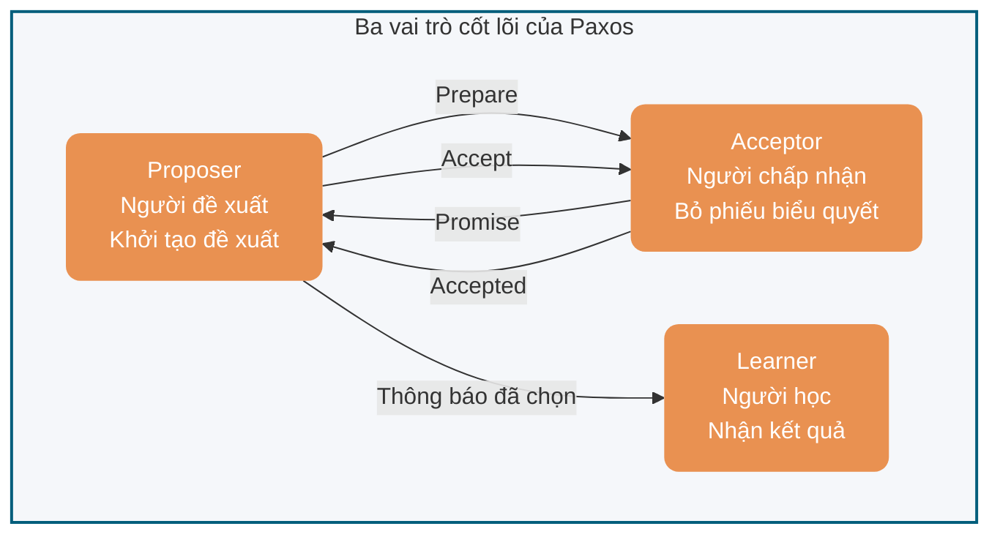
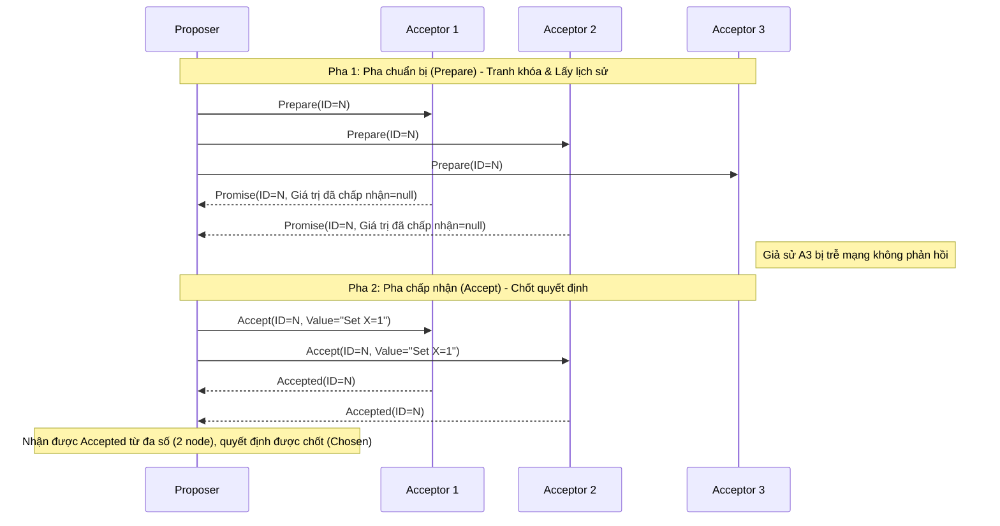
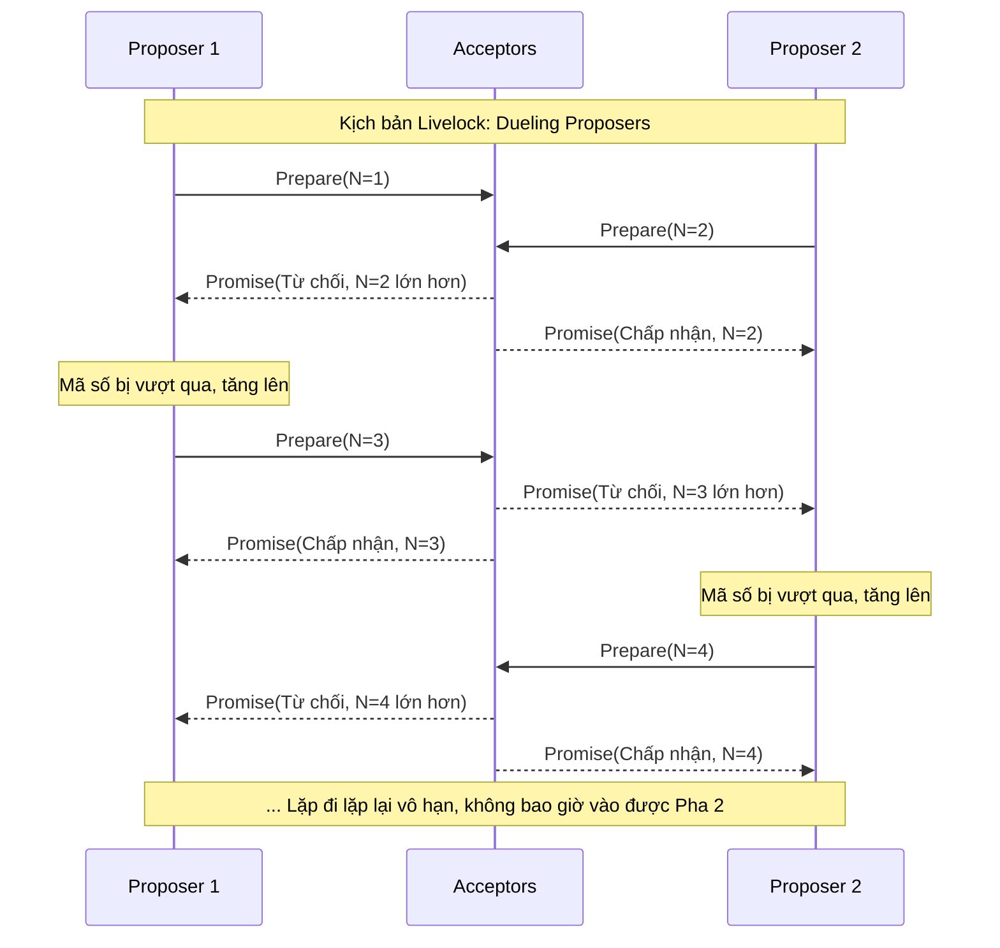
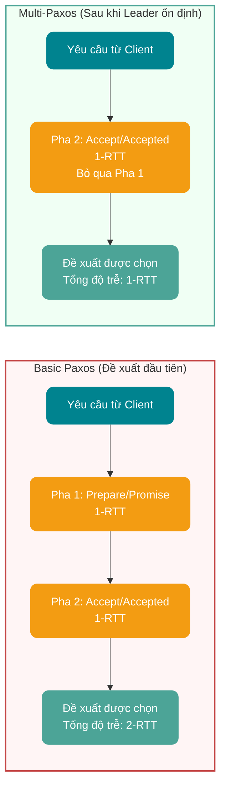
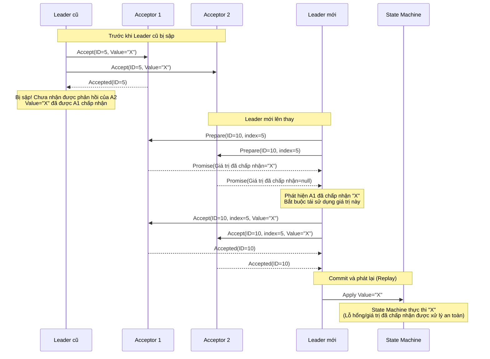
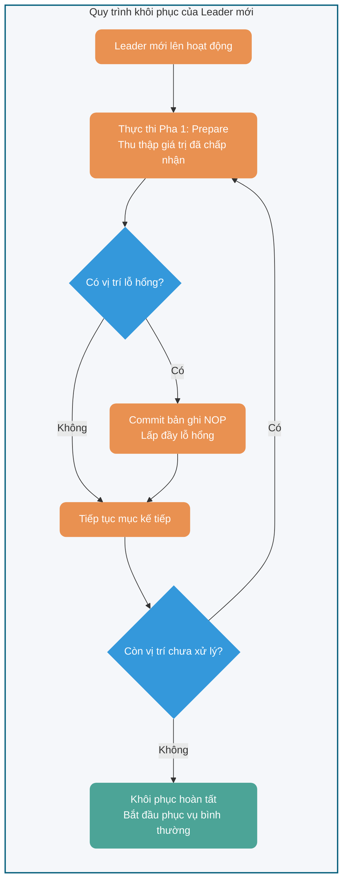

## Bối cảnh

Thuật toán Paxos là một thuật toán **đồng thuận (Consensus)** cho hệ thống phân tán do Leslie Lamport đề xuất vào năm **1990**. Đây là một trong những thuật toán đồng thuận phân tán được công nhận rộng rãi sớm nhất (với tiền đề không tồn tại Bài toán Các vị tướng Byzantine, tức không có node độc hại).

Để giới thiệu thuật toán Paxos, Lamport đã viết một bài báo rất dí dỏm và hài hước. Trong bài báo đó, ông hư cấu ra một thành bang Hy Lạp cổ đại tên là Paxos để minh họa thuật toán một cách sinh động hơn.

Tuy nhiên, các nhà phản biện lại không đón nhận sự hài hước của bài báo này. Họ nói với Lamport: "Nếu muốn công bố thành công bài báo này, ông phải xóa bỏ toàn bộ bối cảnh câu chuyện về thành bang Paxos". Nghe vậy, Lamport không vui chút nào: "Tại sao tôi phải sửa chứ? Mấy người phản biện các ông đúng là thiếu khiếu hài hước — không đăng được thì thôi!"

Thế là bài báo đề xuất thuật toán Paxos đã không được công bố vào thời điểm đó.

Mãi đến năm 1998, hai nhà nghiên cứu kỹ thuật tại Trung tâm Nghiên cứu Hệ thống (Systems Research Center, SRC) cần tìm các thuật toán phân tán phù hợp để phục vụ hệ thống phân tán mà họ đang xây dựng, và thuật toán Paxos vừa khéo giải quyết được một phần nhu cầu của họ. Vì vậy, Lamport đã gửi bài báo cho họ. Sau khi đọc xong, hai chuyên gia này thấy bài báo thực sự rất xuất sắc. Nhờ đó, vào năm **1998**, Lamport đã công bố lại bài báo [The Part-Time Parliament](http://lamport.azurewebsites.net/pubs/lamport-paxos.pdf).

Sau khi bài báo được xuất bản, giới học giả khắp nơi kêu trời vì đọc không hiểu, trong lời lẽ còn pha chút trêu chọc. Điều này sao mà nhịn nổi — đến năm **2001**, Lamport lại viết riêng một bài báo khác là [Paxos Made Simple](http://lamport.azurewebsites.net/pubs/paxos-simple.pdf) để đơn giản hóa phần giới thiệu về Paxos, chủ yếu trình bày giao thức đồng thuận hai pha, sẵn tiện "cà khịa" lại nhóm học giả kia một phen.

Bài báo *Paxos Made Simple* chỉ dài 14 trang, gọn nhẹ hơn hẳn so với 33 trang của *The Part-Time Parliament*. Đáng chú ý nhất là phần tóm tắt (Abstract) của bài báo chỉ vỏn vẹn đúng một câu:


> The Paxos algorithm, when presented in plain English, is very simple.

Dịch đại ý là: Khi được diễn đạt bằng tiếng Anh mộc mạc không hoa mỹ, thuật toán Paxos thực sự rất đơn giản!

Bạn có cảm nhận được "mùi cà khịa" đậm đặc từ bậc thầy Lamport không?

## Giới thiệu

Bài viết này chia Paxos thành hai phần để trình bày:

- **Thuật toán Basic Paxos**: Mô tả cách nhiều node đạt được đồng thuận trên một giá trị đơn lẻ (`value`).
- **Tư tưởng Multi-Paxos**: Thông qua việc thực thi nhiều thực thể (instance) Basic Paxos để đạt được đồng thuận cho một chuỗi các giá trị liên tiếp.

Vai trò của thuật toán đồng thuận là giúp nhiều node trong hệ thống phân tán thống nhất với nhau về một đề xuất (`proposal`). Trong các hệ thống khác nhau, "đề xuất" có thể đại diện cho rất nhiều đối tượng như bầu chọn Leader, sắp xếp thứ tự sự kiện, v.v.

Do thuật toán Paxos nổi tiếng là khó hiểu và khó hiện thực, năm 2013 đã ra đời [Thuật toán Raft](./raft-algorithm.md) dễ tiếp cận hơn.

**Về mối quan hệ giữa Raft và Paxos**: Ở góc độ học thuật, Raft không phải là một biến thể thuần túy của Paxos — cả hai có sự khác biệt bản chất trong triết lý thiết kế nền tảng (như lỗ hổng log hay quyền hạn của Leader). Nhưng ở góc độ thực tiễn kỹ thuật, Raft lấy cảm hứng từ Multi-Paxos, có thể hiểu là "một thiết kế lại được truyền cảm hứng từ Multi-Paxos". Phần sau của bài viết sẽ so sánh chi tiết sự khác biệt giữa hai thuật toán này.

Đối với kịch bản phi Byzantine (không có node độc hại), ngoài Raft ra, **giao thức ZAB**, **Fast Paxos** đều là các thuật toán đồng thuận được cải tiến dựa trên Paxos.

Đối với kịch bản Byzantine (tồn tại node độc hại), người ta thường dùng các thuật toán đồng thuận như **Proof-of-Work (PoW)**, **Proof-of-Stake (PoS)**, với ứng dụng tiêu biểu là các hệ thống Blockchain.

## Thuật toán Basic Paxos

### Định nghĩa các vai trò

Trong Basic Paxos tồn tại 3 vai trò quan trọng:

1. **Proposer (Người đề xuất)**: Còn gọi là Coordinator (điều phối viên), chịu trách nhiệm tiếp nhận yêu cầu từ client và khởi tạo đề xuất (`proposal`). Thông tin đề xuất thường bao gồm mã số đề xuất (`proposal ID`) và giá trị đề xuất (`value`).
2. **Acceptor (Người chấp nhận)**: Còn gọi là Voter (người bỏ phiếu), chịu trách nhiệm bỏ phiếu cho các đề xuất, đồng thời phải ghi nhớ lịch sử bỏ phiếu của chính mình.
3. **Learner (Người học)**: Chịu trách nhiệm học (`learn`) giá trị đã được chọn (`chosen`). Trong mô hình Replicated State Machine (RSM — máy trạng thái sao chép), giá trị này thường tương ứng với một lệnh chờ thực thi, được State Machine áp dụng (`apply`) theo thứ tự rồi mới trả kết quả ra bên ngoài thông qua tầng dịch vụ.


**Sơ đồ tương tác giữa các vai trò**:



Để giảm số lượng node cần thiết khi triển khai thuật toán, một node có thể kiêm nhiệm nhiều vai trò cùng lúc. Ngoài ra, một đề xuất muốn được chọn cần phải được quá bán (hơn một nửa) số Acceptor chấp nhận. Nhờ vậy, Basic Paxos còn có khả năng chịu lỗi: khi ít hơn một nửa số node gặp sự cố, cụm vẫn có thể hoạt động bình thường.

### Quy trình thực thi của Basic Paxos

Basic Paxos đạt đồng thuận thông qua hai pha: **Pha Prepare/Promise (Chuẩn bị/Cam kết)** và **Pha Accept/Accepted (Chấp nhận/Đã chấp nhận)**.



#### Pha 1: Prepare/Promise (Chuẩn bị / Cam kết)

Proposer chọn một mã số đề xuất `n` (bắt buộc phải duy nhất toàn cục và tăng dần) và gửi yêu cầu `Prepare(n)` tới quá bán số Acceptor.

**Logic xử lý của Acceptor** (với mỗi mã số đề xuất `n`):

- Nếu `n > max_n` (mã số đề xuất lớn nhất mà Acceptor này từng thấy):
  - Trả về `Promise(n, max_v)`, trong đó `max_v` là giá trị của đề xuất có mã số lớn nhất mà nó từng chấp nhận trước đó (nếu có).
  - Cam kết không chấp nhận bất kỳ đề xuất nào có mã số `< n` nữa.
- Nếu `n ≤ max_n`:
  - Từ chối hoặc bỏ qua yêu cầu này.

**Mục đích**: Giúp Proposer nắm được các đề xuất đã hoặc sắp được chấp nhận trong hệ thống hiện tại, tránh đưa ra giá trị xung đột.

#### Pha 2: Accept/Accepted (Chấp nhận / Đã chấp nhận)

Khi Proposer nhận được phản hồi `Promise` từ quá bán số Acceptor, nó chọn giá trị `max_v` tương ứng với mã số đề xuất lớn nhất trong các phản hồi (nếu không có giá trị nào từng được chấp nhận thì tự do chọn một giá trị), rồi gửi yêu cầu `Accept(n, v)` tới quá bán số Acceptor.

**Logic xử lý của Acceptor**:

- Nếu `n ≥ max_n` (mã số mà Acceptor này đã cam kết ở Pha 1):
  - Chấp nhận đề xuất, ghi nhận `(n, v)` và trả về `Accepted(n, v)`.
- Ngược lại:
  - Từ chối yêu cầu này.

#### Điều kiện hội tụ

Khi Proposer nhận được phản hồi `Accepted` từ quá bán số Acceptor cho `Accept(n, v)`, đề xuất `v` chính thức **được chọn (chosen)**. Proposer thông báo tới tất cả Learner rằng đề xuất đã được chọn.

### Đảm bảo tính an toàn (Safety)

Basic Paxos đảm bảo các tính chất an toàn sau:

1. **Tính nhất quán (Consistency)**: Một khi một giá trị đã được chọn, mọi giá trị được chọn về sau đều phải là chính giá trị đó.
2. **Tính kết thúc (Termination)**: Nếu không có sự cạnh tranh giữa các Proposer và giao tiếp mạng ổn định, hệ thống cuối cùng chắc chắn chọn được một giá trị.

**Cơ chế cốt lõi**: Thông qua việc thu thập `Promise` ở Pha 1, Proposer chỉ có thể lựa chọn giá trị đã được các Acceptor cam kết/chấp nhận trước đó (hoặc chọn giá trị mới nếu chưa có), đảm bảo không bao giờ có hai giá trị xung đột cùng được chọn.

### Vấn đề tính sống (Liveness)

Basic Paxos tồn tại nguy cơ **Livelock (khóa sống)**:

- Nếu nhiều Proposer đồng thời khởi tạo đề xuất với mã số tăng xen kẽ nhau,
- Có thể dẫn đến không có đề xuất nào giành được `Accept` từ quá bán Acceptor,
- Khiến hệ thống rơi vào cạnh tranh vô tận và không thể đạt đồng thuận.

**Ví dụ Livelock (Dueling Proposers — Các Proposer đấu tay đôi)**:

Giả sử có hai Proposer `P1` và `P2` cùng lúc gửi đề xuất:

1. `P1` gửi `Prepare(1)`, `P2` gửi `Prepare(2)`.
2. Các Acceptor cam kết với `P2` vì có mã số lớn hơn.
3. `P1` thấy mã số bị vượt qua liền gửi `Prepare(3)`.
4. `P2` thấy mã số bị vượt qua liền gửi `Prepare(4)`.
5. ... Vòng lặp cứ thế tiếp diễn mãi, không bao giờ đi tới được Pha 2.

**Biểu đồ tuần tự minh họa Livelock**:



**Giải pháp**: Đưa vào cơ chế Leader ổn định thông qua Multi-Paxos.

**Thuật toán lùi theo hàm mũ ngẫu nhiên (Randomized Exponential Backoff)**:

Để ngăn chặn nhiều Proposer cạnh tranh gây ra Livelock, các bản triển khai cấp Production thường áp dụng cơ chế lùi ngẫu nhiên:

Khi yêu cầu `Prepare` của Proposer bị từ chối (do mã số quá nhỏ):

1. Chờ một khoảng thời gian ngẫu nhiên: `base_delay * random(1, 2^attempt)`.
2. Chọn mã số đề xuất lớn hơn (ví dụ: `n = n + k`, `k > 0`).
3. Thử lại Pha `Prepare`.

Ví dụ tham số:

- `base_delay`: `10ms`
- `attempt`: số lần thử lại (`1, 2, 3...`)
- Thời gian chờ tối đa: `max(1s, base_delay * 2^10)`

Cơ chế này đảm bảo các bên cạnh tranh không thử lại cùng một lúc, giúp cuối cùng một Proposer có thể hoàn tất Pha 1.

**Xử lý phân vùng mạng**: Nếu xảy ra phân vùng mạng, phía đa số (majority) vẫn có thể tiếp tục bầu chọn Leader và commit các đề xuất mới; phía thiểu số (minority) không thể tạo đủ `quorum` nên buộc phải chờ phân vùng được khôi phục.

## Tư tưởng Multi-Paxos

### Tư tưởng cốt lõi

Thuật toán Basic Paxos chỉ có thể đạt đồng thuận cho một giá trị đơn lẻ. Để đạt đồng thuận cho cả một chuỗi giá trị, chúng ta cần đến tư tưởng Multi-Paxos.

Tư tưởng tối ưu cốt lõi của Multi-Paxos là **tái sử dụng Leader**: thông qua Basic Paxos bầu ra một Proposer ổn định làm Leader, các đề xuất về sau sẽ do chính Leader này trực tiếp phát đi và bỏ qua Pha 1 (`Prepare/Promise`).

### Các cơ chế tối ưu

#### 1. Bầu chọn Leader ổn định

- Bầu ra một Proposer duy nhất làm Leader thông qua Basic Paxos.
- Sau khi Leader bị sập, tiến hành bầu Leader mới thông qua một vòng Basic Paxos mới.
- Tránh Livelock do nhiều Proposer cạnh tranh gây ra.

#### 2. Bỏ qua Pha 1

- Sau khi Leader đã ổn định, các đề xuất tiếp theo đi thẳng vào Pha 2 (`Accept`).
- Không cần thực hiện `Prepare/Promise` cho mỗi lần, giảm đi một vòng RPC.
- **Tối ưu độ trễ**: Mỗi đề xuất ở Basic Paxos cần 2-RTT (`Prepare` + `Accept`), còn các đề xuất tiếp theo trong Multi-Paxos chỉ cần 1-RTT (chỉ `Accept`), **giảm 50% độ trễ commit đề xuất** (`2-RTT → 1-RTT`).

**Biểu đồ so sánh tối ưu hiệu năng**:



#### 3. Chỉ mục Log (Log Index)

- Gán cho mỗi đề xuất một **chỉ mục log (`log index`)** tăng dần.
- Đảm bảo thứ tự toàn cục: Leader ghi nối tiếp log theo thứ tự, Acceptor chấp nhận theo số thứ tự.
- Hỗ trợ **lỗ hổng log (gap)**: đề xuất tại một vị trí nào đó có thể tạm thời bị thiếu do chuyển đổi Leader và sẽ được bù lại sau.

#### 4. Lỗ hổng Log (Gap) và lấp đầy bằng NOP

**Mô tả bài toán**: Khi một Leader mới lên thay, nó có thể gặp một kịch bản hóc búa — Leader tiền nhiệm đã đạt được đồng thuận ở một vị trí log nào đó, nhưng Leader mới lại không biết giá trị này. Nếu Leader mới cố gắng commit một giá trị mới tại vị trí đó, nó sẽ ghi đè lên giá trị đã được chọn, phá vỡ tính nhất quán.

**Giải pháp: Bản ghi log NOP (No-Operation)**

Multi-Paxos giải quyết vấn đề này bằng cách đưa vào bản ghi `NOP`:

1. **Phát hiện ngữ cảnh**: Trong Pha 1 (`Prepare`), Leader mới thu thập các giá trị đã được chấp nhận do Acceptor trả về.
2. **Bắt buộc tái sử dụng**: Nếu phát hiện một vị trí đã có giá trị được chấp nhận/chọn, Leader mới **bắt buộc** phải tái sử dụng giá trị đó, không được đề xuất giá trị mới.
3. **Chiếm chỗ bằng NOP**: Với các vị trí bị khuyết (không có bất kỳ giá trị nào đã được chấp nhận), Leader mới có thể commit một giá trị đặc biệt — `NOP` (thao tác rỗng).
4. **State Machine bỏ qua**: Dù bản ghi `NOP` chiếm một vị trí trong log, khi State Machine chạy lại (replay) sẽ bỏ qua nó và không thực thi bất kỳ logic nghiệp vụ nào.

**Ví dụ quy trình**:

```
Trước khi Leader tiền nhiệm bị sập:
Index 1: Value=A (chosen)
Index 2: Value=B (chosen)
Index 3: <Gap> (chưa hoàn tất)

Sau khi Leader mới lên hoạt động:
Index 1: Tái sử dụng Value=A
Index 2: Tái sử dụng Value=B
Index 3: Commit NOP (lấp đầy lỗ hổng, không thực thi logic nghiệp vụ)
Index 4: Commit Value=C (log nghiệp vụ bình thường)
```

**Quy trình khôi phục lỗ hổng và giá trị đã được chấp nhận**:



### Quy trình thực thi Multi-Paxos

1. **Bầu chọn Leader**: Bầu ra Leader thông qua Basic Paxos.
2. **Sao chép Log**: Leader nhận yêu cầu từ client, ghi nối tiếp vào log cục bộ và cấp phát chỉ mục tăng dần.
3. **Accept trực tiếp**: Leader gửi `Accept(index, value)` tới các Acceptor (bỏ qua `Prepare`).
4. **Xử lý phản hồi**: Acceptor chấp nhận log theo số thứ tự và lưu xuống cục bộ.
5. **Xác nhận Commit**: Khi quá bán số Acceptor đã chấp nhận log tại một vị trí, vị trí đó có thể được commit.

### Khả năng chịu lỗi và khôi phục

- **Leader sập**: Leader mới đối chiếu log để tìm ra các vị trí đã commit và bổ sung phần log chưa commit.
- **Phân vùng mạng**: Phía đa số tiếp tục phục vụ, phía thiểu số chờ khôi phục.
- **Lỗ hổng Log**: Leader mới có thể lấp đầy các vị trí log chưa được Leader tiền nhiệm commit.

**Lưu đồ quy trình khôi phục của Leader mới**:



⚠️ **Lưu ý**: Multi-Paxos chỉ là một tư tưởng, và cốt lõi của tư tưởng này là thông qua nhiều thực thể Basic Paxos để đạt đồng thuận cho một chuỗi các giá trị. Nói cách khác, Basic Paxos là hạt nhân của tư tưởng Multi-Paxos, còn Multi-Paxos chính là thực thi Basic Paxos nhiều lần.

Vì tư tưởng Multi-Paxos do Lamport đưa ra thiếu các chi tiết cần thiết để hiện thực hóa thành mã nguồn (chẳng hạn cách bầu Leader hay cách xử lý lỗ hổng log), nên việc hiểu và lập trình nó khá khó khăn.

Tuy nhiên, bạn cũng không cần lo lắng: chúng ta không cần phải tự tay code thuật toán đồng thuận dựa trên Multi-Paxos, bởi giới công nghệ đã có nhiều bản cài đặt rất nổi tiếng. Ví dụ, tuy thuật toán Raft không phải biến thể thuần túy của Paxos nhưng nó kế thừa tư tưởng cốt lõi (bầu Leader, sao chép log) và đơn giản hóa chi tiết triển khai, giúp dễ hiểu và dễ hiện thực hơn nhiều; trong các dự án thực tế bạn nên ưu tiên cân nhắc Raft.

## So sánh Paxos vs Raft

Từ sau năm 2014, thuật toán Raft đã trở thành cái tên được ưa chuộng hàng đầu trong công nghiệp nhờ tính dễ hiểu vượt trội. Cần khẳng định rõ: Raft không phải là biến thể của Paxos, cả hai tồn tại những khác biệt căn bản trong triết lý thiết kế nền tảng.

| **Khía cạnh so sánh**              | **Multi-Paxos**                                                           | **Raft**                                                                                  | **Ảnh hưởng kỹ thuật cốt lõi**                                                                 |
| ---------------------------------- | ------------------------------------------------------------------------- | ----------------------------------------------------------------------------------------- | ---------------------------------------------------------------------------------------------- |
| **Luồng Log & Ràng buộc**          | Cho phép commit sai thứ tự (out-of-order), cho phép xuất hiện **lỗ hổng log**. | Bắt buộc ghi nối tiếp theo thứ tự (`Append-Only`), **tuyệt đối không cho phép lỗ hổng log**. | Raft dễ hiện thực, State Machine replay cực kỳ mượt mà; Paxos có trần xử lý đồng thời cao hơn nhưng độ khó triển khai tăng theo cấp số nhân. |
| **Bầu chọn & Quyền hạn Leader**    | Leader chỉ là một phương tiện tối ưu hiệu năng (bỏ qua Pha 1), không phải vai trò bắt buộc. | **Mô hình Leader mạnh (Strong Leader)**. Mọi dữ liệu lấy Leader làm chuẩn, log chỉ chảy một chiều từ Leader sang Follower. | Raft đơn giản hóa logic khôi phục dữ liệu bằng cách giới hạn chỉ node có "log đầy đủ nhất" mới được bầu làm Leader. |
| **Phòng chống Livelock**           | Phải tự bổ sung cơ chế lùi ngẫu nhiên hoặc thuật toán bầu Leader bên ngoài. | Tích hợp sẵn cơ chế phòng vệ bầu chọn dựa trên thời gian chờ ngẫu nhiên (`Randomized Timeout`). | Khả năng dùng ngay (`Out-of-the-box`) của Raft cao hơn hẳn Paxos.                              |
| **Đại diện triển khai công nghiệp**| Apache ZooKeeper (dựa trên ZAB, tương tự Multi-Paxos), Google Spanner     | etcd, HashiCorp Consul, TiKV                                                              | Hạ tầng microservices hiện đại có xu hướng lựa chọn Raft.                                      |

## Ứng dụng thực tế

Các hệ thống dựa trên thuật toán Paxos hoặc các biến thể của nó bao gồm:

- **Google Chubby**: Dịch vụ khóa phân tán (Distributed Lock) được hiện thực dựa trên Paxos.
- **Apache ZooKeeper 3.8+**: Dựa trên giao thức ZAB (tương tự Multi-Paxos, thao tác ghi được phát tán qua Leader, hỗ trợ thứ tự FIFO).
- **etcd 3.5+**: Dựa trên thuật toán Raft (đồng thuận nhất quán mạnh, hỗ trợ thay đổi thành viên cụm động và giao dịch nhẹ `Txn`).
- **HashiCorp Consul**: Dựa trên thuật toán Raft (Service Discovery và quản lý cấu hình).

Các hệ thống này đóng vai trò then chốt trong điều phối phân tán, quản lý cấu hình, khám phá dịch vụ (Service Discovery) và nhiều lĩnh vực khác.

> **Lưu ý về phiên bản**: Các hệ thống trên liên tục được tối ưu giao thức qua từng phiên bản (ví dụ etcd 3.4 bổ sung tối ưu lease Keep-Alive, ZooKeeper 3.5 bổ sung tái cấu hình động). Trước khi triển khai Production, bạn nên tham khảo Release Notes của phiên bản tương ứng.

## Khuyến nghị triển khai Production

### Các chỉ số quan sát (Observability Checklist)

| Nhóm           | Chỉ số trọng tâm               | Ngưỡng cảnh báo đề xuất | Giải thích                                                 |
| -------------- | ------------------------------ | ----------------------- | ---------------------------------------------------------- |
| **Độ trễ**     | Độ trễ commit đề xuất (`p99`)  | `> 100ms`               | Từ lúc nhận request của client đến khi nhận xác nhận đa số |
| **Thông lượng**| Tốc độ xử lý đề xuất           | `< 50%` QPS kỳ vọng     | Có thể do phân vùng mạng hoặc sập node                     |
| **Bầu chọn**   | Số lần chuyển đổi Leader       | `> 3` lần/giờ           | Đổi Leader liên tục cho thấy cụm đang bất ổn               |
| **Lỗ hổng**    | Số vị trí log chưa commit      | `> 100`                 | Quá nhiều lỗ hổng ảnh hưởng đến việc replay State Machine  |
| **Split-Brain**| Sự kiện nhiều Leader cạnh tranh| `= 0`                   | Tuyệt đối không được phép xảy ra                           |

### Khuyến nghị Chaos Engineering

| Kịch bản kiểm thử   | Mục tiêu xác minh                                         | Công cụ đề xuất          |
| ------------------- | --------------------------------------------------------- | ------------------------ |
| **Leader sập**      | Kiểm chứng bầu Leader mới nhanh chóng và không mất dữ liệu| Chaos Mesh, Chaos Monkey |
| **Phân vùng mạng**  | Kiểm chứng phía đa số tiếp tục phục vụ, phía thiểu số chờ | Toxiproxy                |
| **Rung lắc mạng**   | Kiểm chứng cơ chế lùi ngẫu nhiên tránh Livelock           | `tc` (`netem`)           |
| **Trôi đồng hồ**    | Kiểm chứng tính duy nhất của mã số đề xuất không bị ảnh hưởng | `--`                  |

### Các Anti-Pattern thường gặp

1. **Bỏ qua xử lý lỗ hổng**: Bỏ qua trực tiếp vị trí lỗ hổng khi State Machine replay có thể khiến request của client bị thất lạc.
2. **Mã số đề xuất cố định**: Dùng timestamp hoặc ID node làm mã số đề xuất không thể đảm bảo tính tăng dần toàn cục.
3. **Thiếu cơ chế timeout**: Để các yêu cầu `Prepare`/`Accept` chờ vô thời hạn khiến hệ thống bị treo.
4. **Bỏ qua giá trị đã được chấp nhận**: Leader mới ép buộc commit giá trị của riêng mình sẽ phá vỡ tính nhất quán.

## Tổng kết

- Thuật toán Paxos do Lamport đề xuất năm 1990 là nền tảng lý thuyết của đồng thuận nhất quán mạnh trong hệ thống phân tán.
- Basic Paxos đạt đồng thuận trên một giá trị đơn lẻ thông qua hai pha (`Prepare/Promise`, `Accept/Accepted`).
- Multi-Paxos đạt đồng thuận cho một chuỗi các giá trị nhờ tái sử dụng Leader và tối ưu bỏ qua Pha 1 (giảm độ trễ đề xuất từ `2-RTT` xuống `1-RTT`).
- Thuật toán Raft kế thừa tư tưởng Multi-Paxos nhưng thiết kế lại chi tiết hiện thực (mô hình Leader mạnh, cấm lỗ hổng log), giúp dễ hiểu và dễ triển khai thực tế hơn.
- Trong dự án thực tế, nên ưu tiên lựa chọn các giải pháp đã hoàn thiện như Raft, etcd, ZooKeeper.

## Tài liệu tham khảo

- [Paxos Made Simple](http://lamport.azurewebsites.net/pubs/paxos-simple.pdf) - Lamport, 2001
- [The Part-Time Parliament](http://lamport.azurewebsites.net/pubs/lamport-paxos.pdf) - Lamport, 1998
- [In Search of an Understandable Consensus Algorithm](https://raft.github.io/raft.pdf) - Ongaro & Ousterhout, 2014 (Bài báo Raft)
- <https://zh.wikipedia.org/wiki/Paxos>
- Tính nhất quán và các thuật toán đồng thuận trong hệ thống phân tán: <http://www.xuyasong.com/?p=1970>
