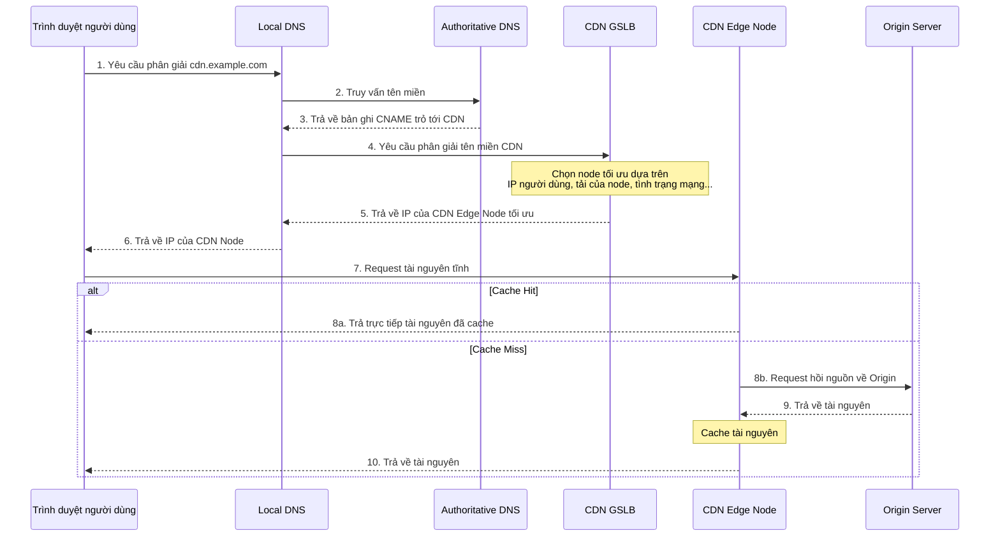

## CDN là gì?

**CDN** là viết tắt của **Content Delivery Network** (hoặc Content Distribution Network), dịch sang tiếng Việt là **Mạng phân phối nội dung**.

Chúng ta có thể tách cụm từ "Mạng phân phối nội dung" ra để hiểu rõ hơn:

- **Nội dung (Content)**: chỉ các tài nguyên tĩnh (static resources), bao gồm hình ảnh, video, tài liệu, JS, CSS, HTML...
- **Mạng phân phối (Delivery Network)**: chỉ việc phân phối các tài nguyên tĩnh này tới những server đặt tại nhiều trung tâm dữ liệu ở các vị trí địa lý khác nhau, qua đó thực hiện **truy cập gần nhất (proximity access)** — ví dụ người dùng ở Hà Nội sẽ truy cập trực tiếp dữ liệu từ node đặt tại Hà Nội.

Nói một cách đơn giản, **CDN là việc phân phối tài nguyên tĩnh đến nhiều địa điểm khác nhau nhằm giúp người dùng truy cập từ nơi gần nhất, từ đó tăng tốc độ tải tài nguyên tĩnh và giảm tải cho server gốc (Origin) cũng như băng thông.**

Điều này rất giống với hệ thống kho vận khổng lồ của JD.com (hoặc các sàn thương mại điện tử lớn): hệ thống logistics có kho hàng phủ khắp hầu hết các khu vực. Nhờ vậy, ngay khi người dùng đặt hàng, sản phẩm sẽ được xuất trực tiếp từ kho gần người dùng nhất tới bưu cục tương ứng rồi giao tận tay khách hàng.


Bạn có thể coi CDN như một **dịch vụ Cache đặc biệt** nằm phía trên tầng service, phân bố rộng khắp nhiều khu vực và chủ yếu dùng để xử lý các request tài nguyên tĩnh.


Chúng ta thường đem Tăng tốc toàn trang (Whole-Site Acceleration) ra so sánh với CDN — đừng nhầm lẫn hai khái niệm này! **Tăng tốc toàn trang** (tên gọi ở các hãng cloud khác nhau: Tencent Cloud gọi là ECDN, Alibaba Cloud gọi là DCDN) có thể tăng tốc cả tài nguyên tĩnh lẫn tài nguyên động, trong khi **Mạng phân phối nội dung (CDN)** chủ yếu tập trung vào **tài nguyên tĩnh**.


Phần lớn các công ty đều sử dụng dịch vụ CDN trong dự án, nhưng rất ít công ty tự xây dựng hạ tầng CDN riêng. Xét trên góc độ chi phí, độ ổn định và tính dễ sử dụng, bạn nên lựa chọn trực tiếp dịch vụ CDN dùng sẵn của các hãng cloud lớn (như Alibaba Cloud, Tencent Cloud, Huawei Cloud, QingCloud) hoặc các nhà cung cấp CDN chuyên nghiệp (như Wangsu, ChinaCache).

## Tại sao không triển khai thẳng service ở nhiều địa điểm khác nhau?

Nhiều bạn có thể thắc mắc: **Đã là để truy cập từ nơi gần nhất, tại sao không triển khai thẳng service ở nhiều khu vực khác nhau luôn?**

Vấn đề này liên quan đến **sự tách biệt kiến trúc giữa tài nguyên tĩnh và request động**:

1. **Vấn đề chi phí**: Triển khai toàn bộ service ở nhiều nơi đòi hỏi phải dựng nhiều bộ ứng dụng, Database và Middleware hoàn chỉnh, chi phí cực kỳ đắt đỏ; trong khi CDN chỉ cần lưu trữ tài nguyên tĩnh nên chi phí hoàn toàn nằm trong tầm kiểm soát.
2. **Đặc tính tài nguyên khác nhau**: Tài nguyên tĩnh (ảnh, JS, CSS) có đặc điểm là **dung lượng lớn, tần suất truy cập cao và nội dung ít thay đổi**, rất phù hợp để cache và phân phối; còn request động cần tính toán thời gian thực nên bắt buộc phải quay về Origin xử lý.
3. **Tiêu tốn tài nguyên hệ thống**: Nếu dùng trực tiếp Application Server để phục vụ request tài nguyên tĩnh, lượng CPU, bộ nhớ và băng thông bị chiếm dụng sẽ rất lớn, dễ làm ảnh hưởng đến hoạt động của nghiệp vụ cốt lõi.
4. **Tối ưu chuyên sâu**: CDN được tối ưu rất nhiều cho việc truyền tải tài nguyên tĩnh (như nén thông minh, tối ưu giao thức, Edge Computing) — những năng lực mà Application Server thông thường không có.

> **Lưu ý**: Việc triển khai cùng một service thành nhiều bản sao ở các vị trí khác nhau (như dự phòng thảm họa cùng thành phố, dự phòng khác vùng địa lý, Multi-Active cùng thành phố hoặc liên vùng) là để đạt **High Availability (độ sẵn sàng cao)** cho hệ thống, chứ không phải để truy cập gần nhất cho nội dung tĩnh.

## Nguyên lý hoạt động của CDN là gì?

Để hiểu nguyên lý hoạt động của CDN, cần làm rõ ba câu hỏi cốt lõi sau:

1. Tài nguyên tĩnh được cache vào các node CDN bằng cách nào?
2. Làm sao tìm được node CDN phù hợp nhất cho người dùng?
3. Làm thế nào để ngăn chặn tài nguyên tĩnh bị đánh cắp băng thông (hotlink)?

Trong môi trường production, cần theo dõi thêm hai chỉ số nữa:

- **Tỷ lệ Cache Hit (Cache Hit Rate)**: Tỷ lệ hit càng cao, người dùng càng ít phải hồi nguồn (Origin Pull), áp lực lên Origin càng nhỏ.
- **Thời gian hồi nguồn và tỷ lệ lỗi hồi nguồn**: Một khi đường truyền hồi nguồn bị chậm hoặc lỗi ở Origin tăng lên, node CDN cũng bị kéo chậm theo.

Vì vậy, CDN không phải cứ "gắn vào là chắc chắn nhanh". Nếu cấu hình quy tắc Cache không hợp lý, URL tài nguyên tĩnh không ổn định hoặc liên tục xóa Cache (purge), một lượng lớn request có thể dồn về Origin cùng lúc, khiến áp lực lên Origin còn lớn hơn cả khi chưa dùng CDN.

### Tài nguyên tĩnh được cache vào node CDN như thế nào?

CDN cache tài nguyên tĩnh chủ yếu qua hai cơ chế: **Làm nóng (Prefetch)** và **Hồi nguồn (Origin Pull)**.

- **Làm nóng (Prefetch)**: Chủ động đẩy tài nguyên từ server gốc (Origin) lên các node CDN. Nhờ đó, ngay từ request đầu tiên người dùng đã có thể lấy dữ liệu trực tiếp từ node CDN mà không cần hồi nguồn — rất phù hợp cho các dịp khuyến mãi lớn, phát hành nội dung hot...
- **Hồi nguồn (Origin Pull)**: Khi trên node CDN chưa có tài nguyên người dùng yêu cầu hoặc bản cache của tài nguyên đó đã hết hạn, node CDN cần quay về Origin để lấy nội dung mới nhất.

> **Lưu ý**: Khi request của người dùng kích hoạt cơ chế hồi nguồn (Origin Pull), tốc độ phản hồi của request đó sẽ chậm hơn so với việc truy cập thẳng Origin, vì phải đi qua thêm một tầng gọi node CDN. Do đó, nâng cao **tỷ lệ Cache Hit** chính là mục tiêu then chốt khi tối ưu CDN.

Vòng đời đầy đủ của CDN Cache được minh họa như hình dưới đây:


Nếu tài nguyên có cập nhật, có thể thực hiện thao tác **làm mới / xóa cache (Purge / Refresh)** để xóa bản cache cũ trên các node CDN và ép node CDN hồi nguồn lấy tài nguyên mới nhất ở lần truy cập tiếp theo.

Hầu hết các nhà cung cấp CDN trên cloud đều hỗ trợ sẵn tính năng làm mới (purge) và làm nóng (prefetch) Cache (hình dưới là tính năng tương ứng trên Alibaba Cloud CDN):


**Tỷ lệ Hit (Hit Rate)** và **tỷ lệ Hồi nguồn (Origin-Pull Rate)** là hai chỉ số cốt lõi đánh giá chất lượng dịch vụ CDN:

- **Tỷ lệ Hit**: Tỷ lệ request của người dùng được node CDN phản hồi trực tiếp — **càng cao càng tốt**.
- **Tỷ lệ Hồi nguồn**: Tỷ lệ request của người dùng bắt buộc phải quay về Origin lấy dữ liệu — **càng thấp càng tốt**.

Các biện pháp tối ưu tỷ lệ Hit phổ biến:

- **Gắn content hash vào tên file tài nguyên tĩnh**: Ví dụ `app.8f3a1c.js`; khi nội dung đổi thì tên file cũng đổi, rất phù hợp để đặt thời gian cache dài.
- **Đặt thời gian cache ngắn cho file đầu vào (entry files)**: Các file như HTML, sitemap, robots không nên cache dài hạn để tránh tình trạng HTML cũ tham chiếu tới các tài nguyên cũ đã bị xóa.
- **Làm nóng (Prefetch) trước các tài nguyên hot**: Trước các đợt flash sale, trang sự kiện hoặc phát hành bộ cài đặt, hãy đẩy trước các tài nguyên hot lên node CDN.
- **Hạn chế làm mới toàn bộ không cần thiết**: Purge toàn site sẽ khiến hàng loạt Edge Node hồi nguồn cùng lúc; nên làm mới chính xác theo URL hoặc theo thư mục.
- **Giữ lại tài nguyên phiên bản cũ một thời gian**: Sau khi deploy phiên bản mới, đừng xóa ngay các file hash cũ để tránh việc HTML cũ gọi tới tài nguyên cũ bị lỗi 404.

Nếu tỷ lệ Hit đột ngột sụt giảm, hãy ưu tiên kiểm tra xem quy tắc Cache có bị thay đổi không, URL tài nguyên có dính tham số ngẫu nhiên không, có vừa thực hiện purge toàn bộ không, hoặc Origin có trả về header cấm cache hay không.

### Làm sao tìm được node CDN phù hợp nhất?

**GSLB (Global Server Load Balance — Cân bằng tải máy chủ toàn cục)** là bộ não của CDN, chịu trách nhiệm điều phối giữa nhiều node CDN với nhau; cách triển khai phổ biến nhất là **GSLB dựa trên DNS**.

Quy trình điều phối đầy đủ của một request qua CDN được minh họa như sơ đồ dưới đây:



**Giải thích chi tiết quy trình**:

1. Trình duyệt của người dùng gửi yêu cầu phân giải tên miền tới máy chủ Local DNS.
2. Local DNS truy vấn Authoritative DNS và thấy tên miền này được cấu hình bản ghi bí danh **CNAME (Canonical Name)** trỏ về tên miền của nhà cung cấp CDN.
3. Local DNS tiếp tục gửi yêu cầu phân giải tới **GSLB** của CDN.
4. GSLB dựa vào **địa chỉ IP của người dùng, trạng thái các node CDN (tải, hiệu năng, thời gian phản hồi, băng thông)**... để đánh giá tổng hợp và trả về địa chỉ IP của node CDN tối ưu nhất.
5. Trình duyệt gửi thẳng request lấy tài nguyên tới node CDN (Edge Server) đó.
6. Node CDN kiểm tra Cache cục bộ: nếu Hit thì trả về ngay; nếu Miss hoặc đã hết hạn thì hồi nguồn lấy từ Origin rồi trả về cho người dùng.

> **Bổ sung**: Sơ đồ trên đã được đơn giản hóa. Thực tế bên trong GSLB có thể xem như sự kết hợp giữa **DNS server chuyên dụng của CDN** và **hệ thống Cân bằng tải (Load Balancing)**. DNS server chuyên dụng của CDN sẽ trả về IP của hệ thống Cân bằng tải, trình duyệt gửi request qua IP đó để tới đúng node CDN tương ứng.

### Làm thế nào để chống đánh cắp tài nguyên và băng thông (Hotlink Protection)?

Nếu tài nguyên tĩnh bị người dùng hoặc website khác nhúng trái phép (hotlinking), chi phí băng thông phát sinh sẽ rất lớn. Các cơ chế chống đánh cắp băng thông phổ biến gồm:

| Cơ chế chống Hotlink           | Nguyên lý                                                                 | Mức độ bảo mật | Chi phí triển khai | Độ khó vượt qua                            |
| ------------------------------ | ------------------------------------------------------------------------- | -------------- | ------------------ | ------------------------------------------ |
| **Chống Hotlink qua Referer**  | Dựa vào trường `Referer` trong HTTP Header để xác định nguồn gốc request  | Thấp           | Thấp               | Thấp (có thể giả mạo hoặc để trống Referer) |
| **Chống Hotlink qua Timestamp** | URL mang chữ ký và thời gian hết hạn; quá hạn URL sẽ mất hiệu lực        | Trung bình     | Trung bình         | Trung bình (cần biết thuật toán ký)        |
| **Whitelist / Blacklist IP**   | Chặn hoặc chỉ cho phép các địa chỉ IP cụ thể truy cập                     | Trung bình     | Thấp               | Trung bình (có thể qua mặt bằng proxy)     |
| **Xác thực bằng Token**        | Server nghiệp vụ sinh Token, node CDN thực hiện kiểm tra hợp lệ           | Cao            | Cao                | Cao                                        |

#### Chống Hotlink qua Referer

Kiểm tra trường **Referer** trong HTTP Request Header để đánh giá nguồn gốc request có hợp lệ hay không. Bạn có thể cấu hình danh sách tên miền được phép (Whitelist); những request không nằm trong Whitelist sẽ bị từ chối.

Hầu như mọi nhà cung cấp dịch vụ CDN đều hỗ trợ cơ chế chống hotlink cơ bản này:


> **Lưu ý**: Nếu cấu hình cho phép `Referer` rỗng, kẻ tấn công có thể qua mặt bằng cách ẩn `Referer`. Vì vậy, cơ chế `Referer` thường cần kết hợp cùng các cơ chế khác.

#### Chống Hotlink qua Timestamp

**Chống hotlink qua Timestamp** có độ an toàn cao hơn. Nguyên lý cốt lõi là: URL mang theo **chuỗi chữ ký (signature)** và **thời gian hết hạn**; khi xử lý request, node CDN sẽ kiểm tra chữ ký và thời hạn, các URL quá hạn sẽ bị từ chối truy cập.

Chuỗi chữ ký thường được tính bằng cách băm MD5 từ **khóa bí mật (secret key) + đường dẫn request + thời gian hết hạn**.

Ví dụ URL chống hotlink bằng Timestamp:

```plain
http://cdn.example.com/video/123.mp4?wsSecret=79aead3bd7b5db4adeffb93a010298b5&wsTime=1601026312
```

- `wsSecret`: Chuỗi chữ ký do phía server tính toán tạo ra dựa trên khóa bí mật và thông tin request.
- `wsTime`: Mốc thời gian hết hạn (định dạng Unix Timestamp).


Phần lớn các nhà cung cấp CDN đều hỗ trợ sẵn cơ chế chống hotlink bằng Timestamp:


> **Khuyến nghị thực tế**: Trên môi trường production, nên kết hợp **Referer + Timestamp** để cân bằng giữa tính bảo mật và chi phí triển khai. Với những kịch bản yêu cầu bảo mật cực cao (như nội dung trả phí), có thể bổ sung thêm cơ chế xác thực Token.

## CDN tăng tốc tài nguyên động như thế nào?

CDN truyền thống chủ yếu cache các tài nguyên tĩnh (như ảnh, CSS, JS). Còn đối với **tài nguyên động** (như API endpoint, truy vấn thời gian thực, request thanh toán, trang động `.jsp`/`.asp`/`.php`), nội dung thay đổi liên tục nên không thể cache; CDN truyền thống thường chuyển thẳng về Origin nên hiệu quả tăng tốc rất hạn chế.

**Tăng tốc nội dung động (Dynamic Content Acceleration)** ra đời để giải quyết chính vấn đề này. Nó không cache nội dung mà dùng định tuyến thông minh, tối ưu giao thức... để nâng cao tốc độ và độ ổn định khi truyền tải request động.

Cơ chế tăng tốc động chủ yếu dựa vào ba kỹ thuật sau:

1. **Định tuyến thông minh (Dò đường truyền tối ưu)**: Request động sau khi gửi từ phía người dùng sẽ tới node CDN biên gần nhất trước. Bên trong mạng lưới CDN sử dụng **công nghệ giám sát mạng theo thời gian thực** để dò chất lượng toàn mạng (độ trễ, tỷ lệ mất gói, tải băng thông), né tránh các node nghẽn hoặc chất lượng kém trên mạng công cộng và chọn tuyến đường truyền tối ưu nhất về tới Origin.
2. **Tối ưu giao thức truyền tải**:
   - **Tối ưu TCP**: Tối ưu các thuật toán TCP Slow Start và kiểm soát tắc nghẽn (congestion control), giúp cải thiện hiệu suất truyền trong điều kiện độ trễ cao hoặc mất gói.
   - **Tái sử dụng kết nối (Connection Reuse)**: Duy trì kết nối dài (`Keep-Alive`) giữa Edge Node và Origin Server, giảm độ trễ do bắt tay (handshake) liên tục.
3. **Tăng tốc kết hợp động - tĩnh**: Các CDN hiện đại (như Alibaba Cloud DCDN, Tencent Cloud ECDN) có khả năng tự động nhận diện loại tài nguyên mà người dùng yêu cầu:
   - **Tài nguyên tĩnh**: Trả trực tiếp từ Cache tại Edge Node.
   - **Tài nguyên động**: Đi qua tuyến định tuyến thông minh để hồi nguồn về Origin.

> **Tóm tắt một câu**: Tăng tốc động = dò đường thông minh + định tuyến động + tối ưu giao thức, giúp các request động chạy vừa nhanh vừa ổn định.

Tăng tốc động cũng có giới hạn của nó: nó chỉ tối ưu đường truyền mạng, chứ không làm giảm thời gian tính toán nghiệp vụ, truy vấn Database hay gọi API bên thứ ba. Nếu bản thân API bị chậm ở SQL, tranh chấp khóa hay phụ thuộc hạ nguồn, chỉ dựa vào tăng tốc động sẽ không giải quyết được nguyên nhân gốc rễ. Khi phỏng vấn có thể trả lời như sau: tài nguyên tĩnh ưu tiên dựa vào Cache Hit, còn request động chủ yếu dựa vào tối ưu đường truyền và cải thiện hiệu năng tự thân của Origin — đây là hai bài toán khác nhau.

## CDN tối ưu tốc độ truy cập HTTPS như thế nào?

Tuy HTTPS an toàn nhưng quá trình bắt tay TLS và mã hóa/giải mã sẽ làm tăng độ trễ. CDN áp dụng nhiều kỹ thuật để tăng tốc HTTPS, vừa đảm bảo an toàn vừa cải thiện tốc độ truy cập.

| Kỹ thuật tối ưu      | Nguyên lý hoạt động                                                                                                                  | Hiệu quả                                                 |
| -------------------- | ------------------------------------------------------------------------------------------------------------------------------------ | -------------------------------------------------------- |
| **Session Resumption** | Sau khi người dùng thiết lập kết nối HTTPS lần đầu, node lưu lại thông tin phiên; lần truy cập sau dùng lại tham số phiên đó để giảm TLS handshake đầy đủ | Giảm độ trễ bắt tay (handshake)                          |
| **OCSP Stapling**    | Node CDN định kỳ cache trạng thái chứng chỉ và gửi kèm trong quá trình TLS handshake, giúp trình duyệt không phải tự truy vấn lại CA | Nâng cao hiệu quả bắt tay                                |
| **False Start**      | Bắt đầu truyền dữ liệu mã hóa ngay khi quá trình TLS handshake chưa hoàn tất hoàn toàn                                                | Tiết kiệm được 1 RTT                                     |
| **HTTP/2**           | Hỗ trợ ghép kênh (multiplexing) và nén header                                                                                        | Giảm số lượng kết nối và độ trễ truyền tải               |
| **QUIC**             | Giao thức truyền tải trên nền UDP, thiết lập kết nối 0-RTT                                                                           | Giảm thời gian thiết lập kết nối, cải thiện mạng yếu     |

**Lợi thế của việc ủy thác chứng chỉ SSL trên CDN**:

Các nhà cung cấp CDN (như Tencent Cloud, Alibaba Cloud) thường cung cấp dịch vụ **chứng chỉ SSL miễn phí** và **tự động gia hạn**, mang lại các lợi ích sau:

- **Không tốn công vận hành**: Người dùng không cần gia hạn chứng chỉ thủ công, tránh sự cố gián đoạn truy cập do chứng chỉ hết hạn.
- **Cấu hình linh hoạt**: Hỗ trợ tải chứng chỉ lên từ giao diện quản trị CDN hoặc đăng ký chứng chỉ miễn phí chỉ bằng một cú nhấp chuột.
- **Nhiều chế độ mã hóa**: Có thể chọn "**Mã hóa nửa chặng**" (từ người dùng tới CDN dùng HTTPS, từ CDN tới Origin dùng HTTP) hoặc "**Mã hóa toàn chặng**" (cả hai chặng đều dùng HTTPS).

**Gợi ý cấu hình tăng tốc HTTPS**:

1. **Cấu hình cơ bản**: Bật HTTPS trên bảng điều khiển CDN và gắn chứng chỉ.
2. **Tối ưu hiệu năng**: Bật **OCSP Stapling** và **HTTP/2**.
3. **Tăng cường bảo mật**: Nếu cần mức độ bảo mật cao hơn, có thể bật **HSTS** (bắt buộc trình duyệt truy cập bằng HTTPS).
4. **Tối ưu mạng yếu**: Bật hỗ trợ giao thức **QUIC** để cải thiện trải nghiệm trên thiết bị di động ở môi trường mạng chập chờn.

Trên production cũng cần chú ý tính nhất quán giữa chứng chỉ và giao thức hồi nguồn. Nếu từ người dùng tới CDN dùng HTTPS nhưng từ CDN tới Origin lại đi HTTP, đoạn giữa đường truyền vẫn tồn tại nguy cơ lộ dữ liệu dạng rõ (plaintext); ngược lại, nếu Origin bắt buộc HTTPS thì phía hồi nguồn của CDN cũng phải cấu hình đúng việc xác thực chứng chỉ và SNI, nếu không rất dễ xảy ra lỗi hồi nguồn.

## Tổng kết

- **Giá trị cốt lõi của CDN**: Phân phối tài nguyên tĩnh đến nhiều địa điểm khác nhau nhằm thực hiện **truy cập gần nhất**, tăng tốc tải tài nguyên tĩnh và giảm tải cho server gốc cũng như băng thông.
- **Lựa chọn dịch vụ CDN**: Xét về chi phí, độ ổn định và sự tiện lợi, nên chọn trực tiếp dịch vụ dùng sẵn từ các hãng cloud chuyên nghiệp (như Alibaba Cloud, Tencent Cloud, Huawei Cloud) hoặc nhà cung cấp CDN (như Wangsu, ChinaCache).
- **Vai trò của GSLB**: GSLB (Global Server Load Balance) là bộ não của CDN, dựa vào vị trí người dùng, trạng thái node và các yếu tố mạng để điều phối request tới **node CDN tối ưu nhất**.
- **Chỉ số cốt lõi**: **Tỷ lệ Hit** càng cao càng tốt, **tỷ lệ Hồi nguồn** càng thấp càng tốt.
- **Cơ chế chống đánh cắp băng thông**: Khuyến nghị kết hợp **Referer + Timestamp** để cân bằng giữa bảo mật và chi phí triển khai.
- **Tăng tốc động**: Sử dụng ba kỹ thuật là **định tuyến thông minh**, **tối ưu giao thức truyền tải** và **tăng tốc kết hợp động - tĩnh** để nâng cao tốc độ và độ ổn định cho các request động (API, truy vấn thời gian thực...).
- **Tăng tốc HTTPS**: Tối ưu quá trình bắt tay TLS và truyền tải thông qua **Session Resumption**, **OCSP Stapling**, **False Start**, **HTTP/2**, **QUIC**, giúp vừa bảo mật vừa tăng tốc độ truy cập.

## Tham khảo

- Chống hotlink bằng Timestamp - Qiniu Cloud CDN: <https://developer.qiniu.com/fusion/kb/1670/timestamp-hotlinking-prevention>
- CDN là cái gì? Giải thích rõ trong một bài viết: <https://mp.weixin.qq.com/s/Pp0C8ALUXsmYCUkM5QnkQw>
- *Thấu thị giao thức HTTP* - 37 | CDN: Tăng tốc dịch vụ mạng của chúng ta: <http://gk.link/a/11yOG>
