> Bài viết này được đóng góp bởi FrancisQ! So với bài gốc, nội dung đã được bổ sung và hoàn thiện ở các điểm sau:
>
> - [Phân tích nguyên nhân đọc/ghi hiệu năng cao của RocketMQ và cách triển khai cụ thể việc tiêu thụ theo thứ tự](https://github.com/Snailclimb/JavaGuide/pull/2133)
> - [Bổ sung phần giới thiệu về các loại message, loại Consumer, Consumer Group và Producer Group](https://github.com/Snailclimb/JavaGuide/pull/2134)
> - [RocketMQ 5.x hỗ trợ phân bổ theo mức độ từng message](https://github.com/Snailclimb/JavaGuide/issues/2778)

## Khái quát về Message Queue

Các buổi phỏng vấn về RocketMQ thường không dừng lại ở câu hỏi "Message Queue là gì". Những câu hỏi xoáy sâu phổ biến hơn là: tại sao NameServer có thể thiết kế gọn nhẹ như vậy, Broker Master-Slave đồng bộ với nhau ra sao, CommitLog và ConsumeQueue mỗi thành phần chịu trách nhiệm gì, và Ordered Message, Transaction Message hay Scheduled Message được triển khai dựa trên cơ chế nào.

Nếu bạn chưa từng sử dụng MQ một cách hệ thống, trước hết hãy ghi nhớ ba kịch bản chính: **xử lý bất đồng bộ (Async), giảm phụ thuộc (Decoupling), cắt đỉnh tải (Peak Shaving)**. Sau này khi đi vào kiến trúc, cơ chế lưu trữ và mô hình tiêu thụ của RocketMQ, hầu như mọi vấn đề đều xoay quanh ba bài toán này.

### Tại sao Message Queue ra đời?

Trong ứng dụng nguyên khối (Monolith), việc các interface gọi trực tiếp lẫn nhau là đơn giản nhất; nhưng khi hệ thống được tách thành nhiều service, chuỗi lời gọi (call chain) trở nên dài hơn, và các lời gọi đồng bộ sẽ lan truyền thời gian phản hồi, lỗi hệ thống cũng như đỉnh lưu lượng xuyên suốt toàn bộ chuỗi. Message Queue chen vào giữa để lưu trữ tạm thời các message trước, giúp hệ thống hạ nguồn tự tiêu thụ theo nhịp độ xử lý của riêng mình.

### Message Queue dùng để làm gì?

#### Xử lý bất đồng bộ (Async)

Có thể bạn sẽ thắc mắc: giao tiếp giữa các ứng dụng đâu nhất thiết phải dùng Message Queue mới giải quyết được, sao cứ phải nhét thêm một Message Queue vào giữa? Giao tiếp trực tiếp không được sao?

Điều này dẫn đến một khái niệm khác — **giao tiếp đồng bộ (Synchronous Communication)**. Ví dụ, Dubbo được sử dụng rất phổ biến trong thực tế là một RPC framework phù hợp cho giao tiếp đồng bộ giữa các hệ thống.

Lấy hệ thống đặt vé làm ví dụ: yêu cầu đặt ra là sau khi người dùng mua vé thành công, hệ thống sẽ gửi tin nhắn SMS thông báo hoàn tất giao dịch.


Tạm bỏ qua thời gian truyền tải mạng ở giữa, giả sử hệ thống đặt vé cần 150ms để xử lý, còn hệ thống SMS cần 200ms, thì tổng thời gian xử lý của cả luồng sẽ là 150ms + 200ms = 350ms.

Thoạt nhìn có vẻ không có vấn đề gì. Nhưng phân tích kỹ sẽ thấy bất cập: hành động mua vé của người dùng thực chất đã hoàn tất ngay khi hệ thống đặt vé xử lý xong, vậy mà do gọi đồng bộ nên toàn bộ request lại bị kéo dài thêm. Hệ thống SMS chỉ là chức năng phụ trợ nhằm nâng cao trải nghiệm người dùng, không phải nghiệp vụ cốt lõi. Toàn bộ luồng gọi trở nên **mất cân đối ("đầu nhẹ đuôi nặng")** — thao tác đặt vé vốn không tốn nhiều thời gian, nhưng vì gọi đồng bộ nên bắt buộc phải chờ thao tác gửi SMS vốn mất nhiều thời gian hơn hoàn tất thì mới trả về kết quả được. Vậy nếu thêm cả yêu cầu gửi Email thì sao?


Khi đó chuỗi lời gọi của toàn hệ thống lại dài ra thêm, tổng thời gian xử lý tăng lên thành 550ms.

Khi chúng ta xếp hàng lấy cơm ở căng-tin, giữa chúng ta và nhân viên căng-tin chính là một mô hình đồng bộ.

Chúng ta cần nói với nhân viên: "Làm ơn cho thêm một cái đùi gà, thêm một phần khoai tây xào chua cay, lấy nhiều cơm một chút".

Sau đó nhân viên gắp thức ăn và đơm cơm cho chúng ta, còn chúng ta phải đứng chờ quá trình này hoàn tất.

Cuối cùng chúng ta nhận khay cơm từ tay nhân viên rồi mới đi tìm chỗ ngồi.

Hãy nhớ lại xem, sau khi đưa ra yêu cầu, chúng ta đã phải **đợi đồng bộ cho nhân viên chuẩn bị xong đồ ăn**. Nếu gọi thêm nhiều món hơn, quy trình chuẩn bị của nhân viên kéo dài ra, thời gian chúng ta phải đứng chờ cũng tăng lên tương ứng.

Ngược lại, khi ăn ở nhà hàng, chúng ta gọi nhân viên phục vụ mang ra một tô mì bò thêm một quả trứng ốp la **(truyền đạt một message)**, sau đó có thể ngồi tại bàn làm việc riêng của mình **(làm các việc khác)**, đợi đến khi mì bò được bưng lên bàn thì mới bắt đầu ăn. Dù thời gian nấu mì không hề ngắn đi, nhưng chúng ta chỉ cần truyền đạt một message là có thể rảnh tay làm việc khác — đây chính là khái niệm **bất đồng bộ (Asynchronous)**.

Do đó, để giải quyết vấn đề này, các lập trình viên thông minh đã đặt thêm một middleware đóng vai trò tương tự như nhân viên phục vụ vào giữa — đó là Message Queue. Lúc này chúng ta có thể cải tiến mô hình như sau.


Như vậy, sau khi lưu message vào Message Queue, chúng ta có thể trả về kết quả ngay lập tức (giống như việc gọi món với phục vụ xong rồi ngồi bấm điện thoại), nên tổng thời gian phản hồi chỉ còn 150ms + 10ms = 160ms.

> Tuy nhiên bạn cần lưu ý rằng, tổng thời lượng thực thi của toàn bộ quy trình thực tế không hề thay đổi, giống như việc bạn chỉ báo cho nhân viên phục vụ món muốn ăn sẽ không làm tốc độ nấu mì nhanh hơn được.

#### Giảm phụ thuộc (Decoupling)

Quay lại quá trình gọi đồng bộ ban đầu, hãy viết một đoạn mã giả (pseudocode) để khái quát đơn giản.


Đến bước thứ hai, nếu bổ sung thêm tính năng gửi Email, ta phải sửa lại code; nếu tiếp tục thêm một yêu cầu nữa: sau khi người dùng mua vé xong cần cộng điểm thưởng cho họ, lúc này chẳng phải lại phải sửa code nữa sao?


Nếu chừng đó vẫn thấy chấp nhận được, vậy khi cần gỡ bỏ service gửi Email thì sao — chẳng phải lại phải sửa code và khởi động lại ứng dụng nữa hay sao?


Việc phải sửa code thường xuyên như vậy rõ ràng rất phiền phức; lúc này có thể **sử dụng Message Queue để giảm phụ thuộc (decouple)**. Cần lưu ý rằng các thao tác phía sau như gửi SMS, gửi Email, cộng điểm thưởng đều phụ thuộc vào `result`, tức là kết quả xử lý việc đặt vé (như mã đơn hàng, tài khoản người dùng, v.v.), nghĩa là các service hạ nguồn đều cần cùng một dữ liệu message đó để xử lý. Vì vậy có thể triển khai thông qua mô hình **"broadcast message"**.

Khái niệm "broadcast" nói ở đây không phải là phát quảng bá theo nghĩa thuần túy, mà là các hệ thống hạ nguồn đóng vai trò Consumer đi **đăng ký (subscribe)** một Topic cụ thể. Ví dụ, Topic có thể đặt tên là `dat-ve`; hệ thống mua vé đóng vai trò Producer gửi message vào Message Queue, còn các Consumer sau khi subscribe Topic đó sẽ kéo (pull) message từ Message Queue về để tiêu thụ. Ở phía Producer chỉ cần quan tâm đến việc **tạo message gửi vào đúng Topic chỉ định**, còn **Consumer chỉ cần quan tâm đến việc lấy message từ Topic chỉ định đó**.


> Nếu không có Message Queue, mỗi khi tích hợp thêm một nghiệp vụ mới, ta đều phải sửa hệ thống chính để gọi API mới; hoặc khi hủy bỏ một nghiệp vụ nào đó, ta lại phải xóa lời gọi API tương ứng ở hệ thống chính. Khi có Message Queue, ta chỉ cần quan tâm message đã được gửi tới queue hay chưa; còn ai muốn subscribe và xử lý message nhận được thế nào là việc của hệ thống hạ nguồn, qua đó giảm thiểu đáng kể khối lượng công việc phát triển và tích hợp liên kết.

#### Cắt đỉnh tải (Peak Shaving)

Quay lại kịch bản hệ thống gọi đồng bộ, hãy suy nghĩ thử: nếu lúc này có lượng lớn người dùng gửi request đặt vé cùng lúc, toàn bộ hệ thống sẽ ra sao?


Giả sử có 10.000 request đổ vào hệ thống đặt vé; các server chạy nghiệp vụ chính thường có cấu hình tốt nên hệ thống đặt vé có thể chịu được 10.000 request này. Nhưng điều đó đồng nghĩa cùng lúc sẽ phát sinh 10.000 lời gọi tới service SMS. Hệ thống SMS không phải nghiệp vụ trọng tâm nên tài nguyên phần cứng được cấp không cao. Lúc này hệ thống SMS liệu có chịu nổi đỉnh tải 10.000 request không? Rất có thể hệ thống sẽ **sập ngay lập tức**.

Nghiệp vụ SMS không phải nghiệp vụ chính, liệu có thể **xử lý dung hòa** được không? Nếu chúng ta gửi thông tin hoàn tất mua vé vào Message Queue, rồi để hệ thống SMS **lấy và tiêu thụ message theo đúng khả năng chịu tải của mình**, dù tốc độ xử lý có chậm hơn một chút cũng không sao, miễn hệ thống không bị sập là chấp nhận được.

Tính khả dụng (Availability) của hệ thống là quan trọng nhất; tin nhắn SMS mã xác thực đến điện thoại người dùng chậm vài giây thông thường hoàn toàn có thể chấp nhận được.

### Message Queue mang lại những lợi ích gì?

Tóm lại chỉ gói gọn trong ba từ khóa: **Xử lý bất đồng bộ (Async), Giảm phụ thuộc (Decoupling), Cắt đỉnh tải (Peak Shaving)**. Đây không chỉ là giá trị cốt lõi của Message Queue mà còn là tư tưởng quan trọng trong thiết kế kiến trúc phân tán.

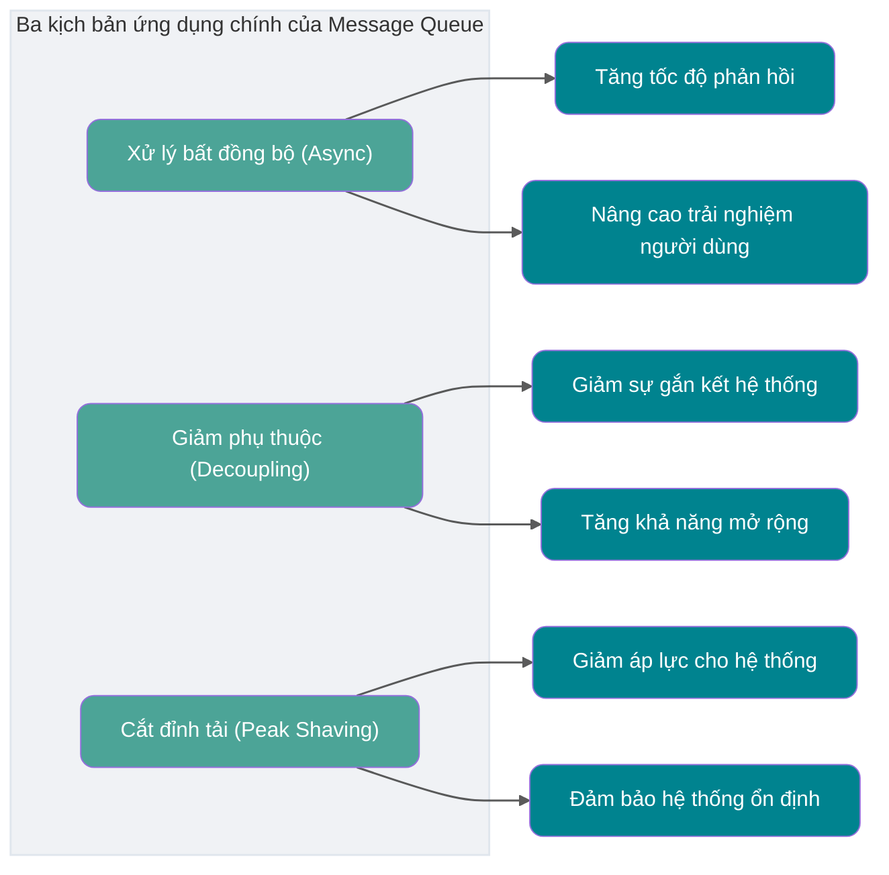

### Message Queue có gây ra tác dụng phụ nào không?

Không có công nghệ nào là "viên đạn bạc" (silver bullet), Message Queue cũng có những mặt trái riêng.

Ví dụ, vốn dĩ hai hệ thống đang gọi nhau bình thường, ta lại nhét thêm một Message Queue vào giữa; nhỡ Message Queue bị sập thì sao? Chẳng phải điều đó đã **làm giảm tính khả dụng (Availability) của hệ thống** sao?

Vậy lúc này có cần đảm bảo HA (High Availability - tính sẵn sàng cao) không? Có phải dựng Cluster không? Thế thì **độ phức tạp của toàn hệ thống chẳng phải đã tăng lên** hay sao?

Tạm gác các vấn đề trên sang một bên, lỡ bên gửi gửi thất bại rồi thực hiện retry, điều đó có thể tạo ra các message trùng lặp.

Hoặc phía tiêu thụ xử lý thất bại rồi yêu cầu gửi lại, điều này cũng sẽ sinh ra message trùng lặp.

Đối với một số microservice, việc tiêu thụ message trùng lặp sẽ gây ra rắc rối lớn hơn; chẳng hạn nghiệp vụ cộng điểm thưởng, nếu cộng nhiều lần thì chẳng phải bất công với các người dùng khác sao?

Vậy thì **làm thế nào để giải quyết vấn đề tiêu thụ message trùng lặp (Duplicate Consumption)**?

Nếu lúc này message cần đảm bảo thứ tự nghiêm ngặt thì sao? Chẳng hạn Producer tạo ra một chuỗi message có thứ tự (thực hiện xóa, thêm, sửa trên cùng một bản ghi có id là 1), nhưng ta biết trong mô hình Publish-Subscribe, bản thân Topic không đảm bảo thứ tự, nên lúc đó Consumer khi tiêu thụ message có thể không theo đúng thứ tự gửi của Producer; ví dụ thứ tự tiêu thụ biến thành sửa -> xóa -> thêm, nếu bản ghi đó liên quan đến tiền bạc thì chẳng phải xảy ra sự cố nghiêm trọng sao?

Vậy thì **làm thế nào để giải quyết bài toán tiêu thụ message theo thứ tự (Ordered Consumption)**?

Lấy ngay ví dụ hệ thống phân tán vừa đề cập: sau khi người dùng mua vé xong thì cần cộng điểm thưởng vào tài khoản đúng không? Trong cùng một hệ thống, ta thường dùng Transaction để giải quyết; nếu dùng `Spring` thì trong đoạn pseudocode trên chỉ cần thêm annotation `@Transactional` là xong. Nhưng giữa các hệ thống khác nhau thì đảm bảo Transaction thế nào? Không thể để hệ thống này trừ tiền thành công mà hệ thống tích điểm bên kia lại chưa cộng điểm; hay bên này rõ ràng trừ tiền thất bại mà hệ thống tích điểm bên kia lại cộng điểm cho người dùng được.

Vậy thì làm thế nào để **giải quyết bài toán giao dịch phân tán (Distributed Transaction)**?

Chúng ta vừa nói Message Queue có thể thực hiện cắt đỉnh tải; vậy nếu Consumer tiêu thụ quá chậm hoặc Producer tạo message quá nhanh, thì các message có bị tồn đọng trong Message Queue không?

Vậy thì làm thế nào để **giải quyết vấn đề tồn đọng message (Message Backlog)**?

Tính khả dụng giảm xuống, độ phức tạp tăng lên, đồng thời còn kéo theo hàng loạt vấn đề như tiêu thụ trùng lặp, tiêu thụ theo thứ tự, giao dịch phân tán, tồn đọng message. Giải quyết những vấn đề này như thế nào?


Dưới đây chúng ta sẽ lần lượt thảo luận giải pháp cho từng vấn đề này.

## RocketMQ là gì?


Trước khi bàn đến giải pháp cho các vấn đề nêu trên, hãy cùng tìm hiểu cấu trúc bên trong của RocketMQ. Bạn nên mang theo những câu hỏi đó trong đầu khi đọc và tìm hiểu.

RocketMQ là một **hệ thống message theo mô hình Publish-Subscribe dựa trên Topic**; dưới một Topic có thể chứa nhiều MessageQueue, và MessageQueue là đơn vị hàng đợi nhỏ nhất để lưu trữ và truyền tải message. RocketMQ sở hữu các đặc điểm **hiệu năng cao, độ tin cậy cao, thời gian thực cao và phân tán**, được phát triển bằng ngôn ngữ Java, do đội ngũ Alibaba đóng góp cho Apache vào cuối năm 2016 và trở thành dự án cấp cao (Top-Level Project) của Apache. Trong nội bộ Alibaba, RocketMQ phục vụ rất tốt hàng nghìn ứng dụng lớn nhỏ của tập đoàn; riêng trong ngày lễ mua sắm 11/11 hàng năm, có tới hàng nghìn tỷ message luân chuyển qua RocketMQ.

RocketMQ có ưu điểm thông lượng cao (High Throughput), độ trễ thấp (Low Latency), tính sẵn sàng cao (High Availability), và đã được kiểm chứng qua các kịch bản quy mô cực lớn như ngày hội 11/11.

Từ RocketMQ 5.x trở đi, phía dự án chính thức nhấn mạnh hơn vào kiến trúc Cloud-Native: tầng Proxy hỗ trợ gRPC, SDK đa ngôn ngữ và kết nối đa giao thức, còn Broker tập trung hơn vào việc lưu trữ message và đảm bảo tính sẵn sàng cao. Điều này có nghĩa là khi chọn công nghệ cho dự án mới, bên cạnh các thành phần truyền thống như NameServer, Broker, Producer, Consumer, bạn cũng cần chú ý xem có cần dùng Proxy, gRPC SDK, triển khai trên Kubernetes và khả năng quan sát (Observability) chuẩn Cloud-Native hay không.

## Mô hình Queue và mô hình Topic là gì?

Trước khi nói về kiến trúc kỹ thuật của RocketMQ, hãy tìm hiểu trước hai khái niệm thuật ngữ — **Mô hình Queue (Queue Model)** và **Mô hình Topic (Topic Model)**.

Đầu tiên, tại sao Message Queue lại được gọi là "hàng đợi tin nhắn"?

Thực chất, các message middleware đời đầu được xây dựng dựa trên mô hình **Queue (hàng đợi)**; có lẽ do thói quen lịch sử nên chúng ta thường gọi chung message middleware là Message Queue.

Tuy nhiên, ngày nay những message middleware xuất sắc như RocketMQ hay Kafka không chỉ đơn thuần lưu trữ message bằng một **hàng đợi** duy nhất.

### Mô hình Queue (Queue Model)

Đúng như cách chúng ta hiểu về cấu trúc hàng đợi, mô hình Queue của message middleware thực sự chỉ là một hàng đợi duy nhất.


Đặc điểm của mô hình Queue: **một message chỉ có thể được tiêu thụ bởi một Consumer**.

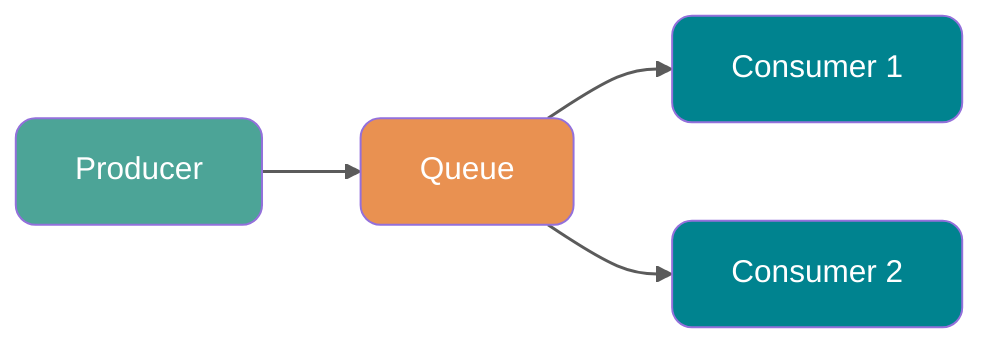

Ngay từ đầu mình đã nhắc đến khái niệm **"broadcast"**, tức là nếu lúc này ta cần gửi cùng một message cho nhiều Consumer (ví dụ cần gửi thông tin cho cả hệ thống SMS và hệ thống Email), thì một Queue đơn lẻ không thể đáp ứng được nhu cầu đó.

Tất nhiên bạn có thể để Producer tạo message rồi đẩy vào nhiều Queue khác nhau, mỗi Queue tương ứng với một Consumer. Cách này giải quyết được bài toán, nhưng việc tạo nhiều Queue và nhân bản nhiều bản sao của message sẽ ảnh hưởng rất lớn đến tài nguyên và hiệu năng. Hơn nữa, làm như vậy khiến Producer phải biết chính xác có bao nhiêu Consumer để nhân bản bấy nhiêu Queue tương ứng, điều này đi ngược lại nguyên tắc **giảm phụ thuộc (Decoupling)** của message middleware.

### Mô hình Topic (Topic Model)

Vậy có cách nào tốt hơn để giải quyết vấn đề này không? Có, đó chính là **Mô hình Topic (Topic Model)** hay còn gọi là **Mô hình Publish-Subscribe (Pub/Sub Model)**.

> Các bạn quan tâm có thể tìm hiểu thêm về Observer Pattern trong Design Patterns và thử tự cài đặt lại, chắc chắn sẽ thu hoạch được rất nhiều.

Trong mô hình Topic, bên tạo message gọi là **Publisher**, bên tiêu thụ message gọi là **Subscriber**, còn nơi chứa message gọi là **Topic**.

Trong đó, Publisher gửi message vào một Topic chỉ định, còn Subscriber cần **đăng ký (subscribe) Topic đó trước** mới có thể nhận được message thuộc Topic ấy.


Đặc điểm của mô hình Topic: **một Topic có thể được nhiều Consumer Group cùng subscribe, mỗi Consumer Group có tiến độ tiêu thụ độc lập với nhau**. Ở chế độ Clustering (tiêu thụ theo cụm), thông thường chỉ có một instance Consumer trong cùng Consumer Group xử lý một message nào đó; còn ở chế độ Broadcasting (tiêu thụ quảng bá), mọi Consumer trong cùng Consumer Group đều sẽ nhận được message.

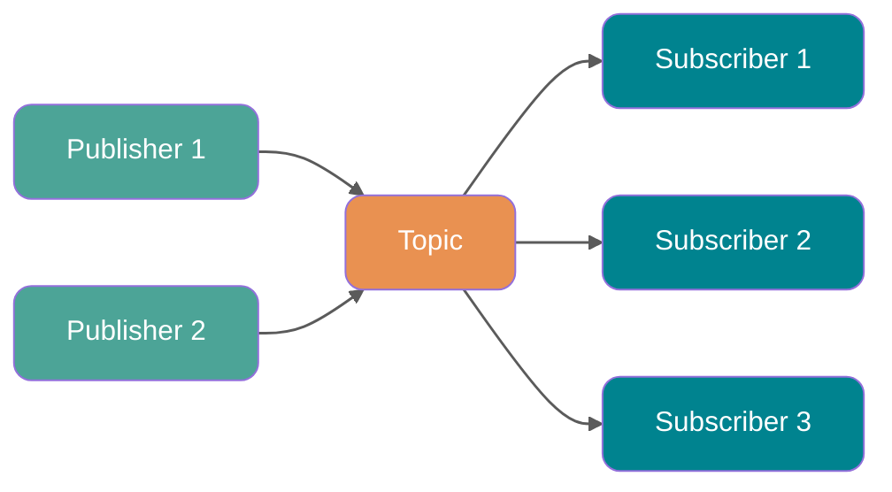

### Mô hình Message trong RocketMQ

Mô hình message trong RocketMQ được hiện thực hóa theo **Mô hình Topic**. Vậy rốt cuộc **Topic** được triển khai bên dưới như thế nào?

Thực tế, cách triển khai mô hình Topic ở tầng dưới của mỗi message middleware là khác nhau: ví dụ trong Kafka là **Partition**, trong RocketMQ là **Queue**, còn trong RabbitMQ là **Exchange**. Có thể hiểu **Topic Model / Publish-Subscribe Model** là một chuẩn mô hình, còn các middleware chỉ việc hiện thực hóa theo chuẩn đó.

Vậy mô hình **Topic** trong RocketMQ được triển khai cụ thể ra sao? Trước hết hãy xem bức ảnh dưới đây:


Trong sơ đồ này có ba vai trò là `Producer Group`, `Topic` và `Consumer Group`. Sơ đồ này gần với mô hình phiên bản cũ và chế độ tương thích hơn; khi tìm hiểu RocketMQ 5.x cần nhớ rằng: trong Domain Model mới, bản thân Producer là thực thể nhẹ và ẩn danh, Producer Group không còn là khái niệm trọng tâm nữa.

- `Producer Group` (Nhóm Producer): Trong các client đời đầu và kịch bản tương thích, nó đại diện cho một nhóm Producer cùng loại; ví dụ ta có nhiều hệ thống Flash Sale đóng vai trò Producer, gộp chung lại tạo thành một `Producer Group`, thường cùng tạo ra một loại message giống nhau.
- `Consumer Group` (Nhóm Consumer): Đại diện cho một nhóm Consumer cùng loại; ví dụ ta có nhiều instance hệ thống SMS đóng vai trò Consumer, gộp lại tạo thành một `Consumer Group`, thường tiêu thụ cùng một loại message.
- Topic: Đại diện cho một nhóm/chủng loại message, chẳng hạn message đơn hàng, message vận chuyển, v.v.

Bạn có thể thấy trong sơ đồ rằng các Producer thuộc Producer Group sẽ gửi message vào Topic, mà **bên trong Topic có nhiều Queue**; mỗi lần tạo message, Producer sẽ gửi message đó vào một Queue nào đó thuộc Topic chỉ định.

Mỗi Topic đều có nhiều Queue (phân bố trên các Broker khác nhau; nếu chạy Cluster thì các Broker lại nằm trên các server khác nhau). Ở chế độ Clustering, nhiều máy thuộc một cụm Consumer sẽ cùng tiêu thụ nhiều Queue của một `topic`.

**So sánh chiến lược Load Balancing (Cân bằng tải)**

Phần so sánh dưới đây xét trong trường hợp **Clustering Consumption (Shared Consumption) trong cùng một Consumer Group**. Mức độ hạt (granularity) của Load Balancing phụ thuộc vào loại client và giao thức tiêu thụ, không thể chỉ nhìn vào phiên bản Broker: Consumer của Remoting SDK truyền thống 3.x/4.x sử dụng mức độ Queue (Queue-level); PushConsumer và SimpleConsumer của SDK 5.x mới sử dụng mức độ Message (Message-level); còn PullConsumer vẫn sử dụng mức độ Queue.

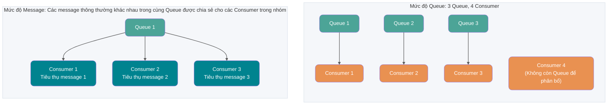

- **Load Balancing mức độ Queue (Queue-level)**: Khi việc phân bổ đã ổn định, trong cùng một Consumer Group, một Queue chỉ được gán cho một instance Consumer duy nhất; một Consumer có thể được chia nhiều Queue. Nếu một Consumer bị sập, quá trình Rebalance sẽ phân bổ lại các Queue của nó cho các Consumer khác trong nhóm. Nếu số lượng Consumer nhiều hơn số Queue thì sẽ có Consumer không được chia Queue nào. Cơ chế này dễ dẫn đến mất cân bằng tải: nếu một Consumer xử lý chậm hoặc các Queue nó phụ trách có lượng message lớn hơn, có thể xảy ra tình trạng Consumer đó bị tồn đọng trong khi các Consumer khác nhàn rỗi. Các Consumer Group khác nhau vẫn có thể tiêu thụ cùng một Queue một cách độc lập, không bị giới hạn phân bổ độc quyền như trong nội bộ một nhóm.
- **Load Balancing mức độ Message (Message-level)**: PushConsumer và SimpleConsumer của SDK 5.x mới cho phép nhiều Consumer trong cùng một Consumer Group cùng chia sẻ việc xử lý các message khác nhau nằm trong cùng một Queue. Hình vẽ trên chỉ là một ví dụ phân bổ tại một thời điểm, message sẽ không bị gắn chết vào một Consumer cố định nào. Sau khi message được lấy đi, trong khoảng thời gian ẩn (Invisible Time) nó sẽ không bị gửi lại cho các Consumer khác **trong cùng nhóm**; nếu tiêu thụ thất bại hoặc timeout thì vẫn có thể kích hoạt retry, do đó không có nghĩa là tuyệt đối không bao giờ bị tiêu thụ trùng lặp. Cơ chế này giúp giảm bớt tình trạng tồn đọng do phân bổ Queue không đều và sự chênh lệch năng lực xử lý giữa các Consumer, nhưng không thể triệt tiêu mọi nút thắt cổ chai như nghiệp vụ xử lý chậm. Ngoài ra, Ordered Message vẫn chịu ràng buộc thứ tự theo MessageGroup nên không thể xử lý song song tùy ý các message thuộc cùng một MessageGroup.

Sơ đồ dưới đây chỉ áp dụng cho **Load Balancing mức độ Queue**. Số lượng Consumer ít hơn số lượng Queue không phải là vấn đề vì một Consumer có thể tiêu thụ nhiều Queue; nhưng nếu muốn các Consumer được scale-out thêm đều có Queue để xử lý thì hệ thống phải có đủ số lượng Queue. Còn với Load Balancing mức độ Message, số lượng instance Consumer không bị giới hạn trực tiếp bởi số lượng Queue.


**Tại sao các Consumer Group khác nhau phải ghi nhận riêng tiến độ tiêu thụ của từng Queue?**

Vì khi nhiều Consumer Group khác nhau cùng subscribe một Topic, chúng cần tiêu thụ độc lập các message đó và tốc độ tiêu thụ cũng có thể khác nhau. Lấy chế độ Clustering với Load Balancing mức độ Queue truyền thống làm ví dụ: Consumer Offset được lưu riêng theo tổ hợp **Consumer Group + Topic + Queue**, các Consumer trong cùng nhóm dùng chung tiến độ này; khi xảy ra Rebalance, Consumer mới tiếp nhận Queue có thể đọc tiếp từ vị trí Offset đã commit.

Consumer Offset biểu thị vị trí tiếp theo mà nhóm đó sẽ tiếp tục tiêu thụ trên Queue tương ứng. Nó không phải Message ID, cũng không phải số thứ tự dùng chung cho toàn bộ Topic. Giả sử hai nhóm cùng subscribe một Topic, không dùng bộ lọc và không có retry, message được tiêu thụ theo thứ tự Queue và đã commit Offset:

| Consumer Group | Tiến độ tiêu thụ Queue Q0                    | Tiến độ tiêu thụ Queue Q1                    |
| -------------- | --------------------------------------------- | --------------------------------------------- |
| Group A        | offset là 3: đã tiêu thụ 0~2, tiếp theo từ 3  | offset là 1: đã tiêu thụ 0, tiếp theo từ 1    |
| Group B        | offset là 1: đã tiêu thụ 0, tiếp theo từ 1    | offset là 4: đã tiêu thụ 0~3, tiếp theo từ 4  |

Offset của Q0 và Q1 tăng tịnh tiến độc lập trong từng Queue. Việc Group A đẩy tiến độ của Q0 lên sẽ không làm thay đổi Offset của Group B, cũng không làm thay đổi Offset của Q1 thuộc chính Group A.

**Không thể hiểu đơn giản việc cập nhật Offset là "cứ thành công một message thì cộng 1", và cơ chế này cũng không đảm bảo tránh hoàn toàn việc tiêu thụ trùng lặp.** Việc pull theo lô (batch pull), xử lý đồng thời (concurrent processing), lọc message và commit Offset đều ảnh hưởng đến tiến độ dịch chuyển Offset; ví dụ nếu các message phía trước chưa xử lý xong, thì các message phía sau dù hoàn thành trước cũng không thể nhảy cóc qua message phía trước để commit tiến độ. Nếu việc tiêu thụ đã thành công nhưng Offset chưa kịp lưu xuống đĩa bền vững mà xảy ra sự cố, message vẫn có thể bị tiêu thụ lại. Với PushConsumer và SimpleConsumer của SDK 5.x mới, việc xác nhận diễn ra theo từng message và Server tự quản lý trạng thái tiêu thụ, nên lại càng không thể áp dụng cách hiểu "client cứ xử lý xong một message là tăng offset lên 1".

Sau khi được một nhóm tiêu thụ thành công, message sẽ không bị xóa ngay khỏi nơi lưu trữ, và cũng không bắt buộc phải chờ tất cả các nhóm tiêu thụ hết mới xóa. RocketMQ thu hồi message dựa trên chính sách dọn dẹp theo thời gian lưu giữ, dung lượng lưu trữ, v.v., nên ngay cả message chưa được tiêu thụ cũng có thể bị dọn dẹp khi quá hạn. Quản lý tiến độ tiêu thụ, chính sách lưu giữ message và tính lũy đẳng (Idempotency) ở tầng nghiệp vụ là các bài toán hoàn toàn tách biệt.

Tham khảo tài liệu chính thức: [Cân bằng tải Consumer (Consumer Load Balancing)](https://rocketmq.apache.org/zh/docs/featureBehavior/08consumerloadbalance/), [Quản lý tiến độ tiêu thụ (Consumer Progress)](https://rocketmq.apache.org/zh/docs/featureBehavior/09consumerprogress/), [Cơ chế lưu trữ và dọn dẹp message (Message Store Policy)](https://rocketmq.apache.org/zh/docs/featureBehavior/11messagestorepolicy/).

Có thể bạn vẫn còn một câu hỏi: **tại sao một Topic cần duy trì nhiều Queue**?

Câu trả lời là **để nâng cao khả năng xử lý đồng thời (Concurrency)**. Việc mỗi Topic chỉ có một Queue hoàn toàn khả thi, các Consumer Group khác nhau vẫn có thể subscribe và duy trì tiến độ tiêu thụ riêng. Hình dưới đây minh họa kịch bản một Queue duy nhất dưới cơ chế Load Balancing mức độ Queue.


Khi chỉ có một Queue, mọi message của Producer đều ghi vào duy nhất Queue này, không thể tận dụng nhiều Queue để phân tán tải sang các Broker khác nhau. Dưới chế độ Load Balancing mức độ Queue, trong cùng một nhóm cũng chỉ có duy nhất một instance Consumer được chia Queue đó, các instance khác không thể chia sẻ tải; đây là giới hạn của chiến lược phân bổ Queue, chứ không phải hệ quả tất yếu của việc duy trì Consumer Offset. Load Balancing mức độ Message cho phép nhiều Consumer trong cùng nhóm chia sẻ các message khác nhau trong một Queue đơn lẻ, tuy nhiên nhiều Queue vẫn có lợi cho việc phân tán tải lưu trữ và đọc/ghi.

Vì vậy tóm lại, RocketMQ hiện thực hóa **Topic Model / Publish-Subscribe Model** bằng cách **cấu hình nhiều Queue trong một Topic và mỗi Queue duy trì vị trí tiêu thụ (Offset) riêng cho từng Consumer Group**.

## Kiến trúc RocketMQ

Sau khi hiểu xong mô hình message, việc nắm bắt kiến trúc kỹ thuật của RocketMQ sẽ trở nên dễ dàng hơn nhiều.

Các thành phần cốt lõi của RocketMQ bao gồm **NameServer, Broker, Producer, Consumer**, và từ phiên bản 5.0 đã bổ sung thêm thành phần **Proxy**.

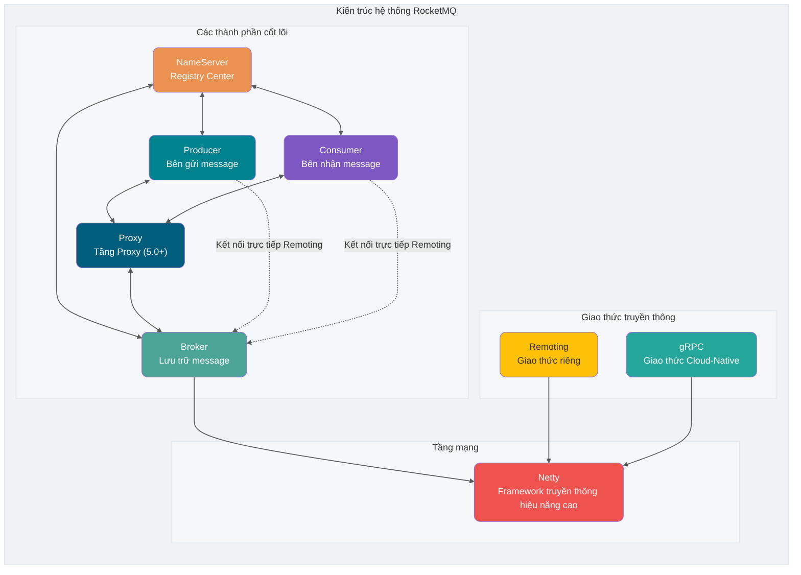

### Điểm trọng tâm của các thành phần cốt lõi

| Thành phần     | Điểm trọng tâm kỹ thuật                                                    |
| -------------- | -------------------------------------------------------------------------- |
| **NameServer** | Registry Center gọn nhẹ, không đồng bộ dữ liệu giữa các node               |
| **Broker**     | Lưu trữ và gửi message, hỗ trợ triển khai Master-Slave                     |
| **Proxy**      | Bổ sung từ 5.0, chuyển đổi giao thức và tách tải tính toán (tùy chọn)      |
| **Producer**   | Nhiều phương thức gửi: Sync, Async, Oneway                                 |
| **Consumer**   | Ba mô hình tiêu thụ: Push / Pull / Simple                                  |

### NameServer (Registry Center)

NameServer chịu trách nhiệm lưu trữ metadata, đóng vai trò như "hệ thần kinh trung ương" của cụm (Cluster). Tác dụng cốt lõi của nó là cung cấp thông tin định tuyến (routing) cho Producer và Consumer, giúp chúng tìm đúng địa chỉ Broker tương ứng.

**Chức năng cốt lõi:**

1. **Quản lý Broker**: Khi Broker khởi động sẽ chủ động kết nối tới NameServer và báo cáo thông tin metadata.
2. **Quản lý thông tin định tuyến**: Producer và Consumer lấy bảng định tuyến Broker từ NameServer.

**Cơ chế Heartbeat:**

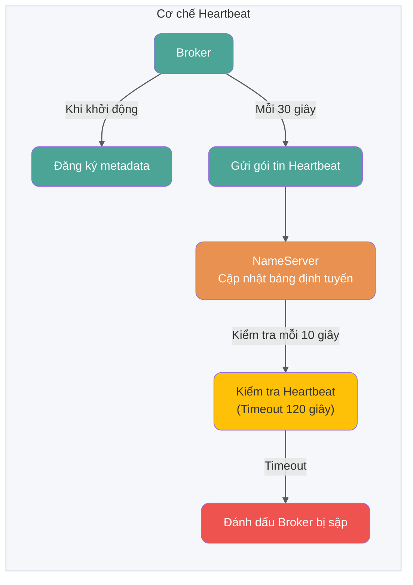

**Metadata bao gồm:**

- Địa chỉ, tên và BrokerId của Broker
- Địa chỉ node Master
- Cấu hình Queue của toàn bộ Topic trên Broker đó

### Broker (Lưu trữ message)

Broker đảm nhận việc lưu trữ, gửi message, truy vấn message cũng như đảm bảo tính sẵn sàng cao của dịch vụ.

**Cơ chế lưu trữ:**

1. **Ghi message**: Sau khi nhận được message sẽ ghi nối đuôi tuần tự vào file CommitLog
2. **Chia nhỏ file**: Khi file vượt quá kích thước cố định (mặc định 1GB) sẽ tạo file mới
3. **Phân mảnh logic**: MessageQueue là phân mảnh logic (logical shard), còn ConsumeQueue là chỉ mục message (index)

**Một Topic được phân bố trên nhiều Broker, một Broker có thể cấu hình nhiều Topic — giữa chúng là quan hệ nhiều-nhiều (Many-to-Many)**.

Nếu lượng message của một Topic nào đó rất lớn, nên cấu hình cho nó nhiều Queue hơn (như đã đề cập ở trên nhằm tăng khả năng xử lý đồng thời), đồng thời **phân bố tối đa trên nhiều Broker khác nhau để giảm áp lực cho từng Broker cụ thể**.

Trong trường hợp lượng message giữa các Topic tương đối đồng đều, Broker nào chứa càng nhiều Queue thì áp lực lên Broker đó càng lớn.


### Producer (Bên gửi message)

**Luồng gửi message:**

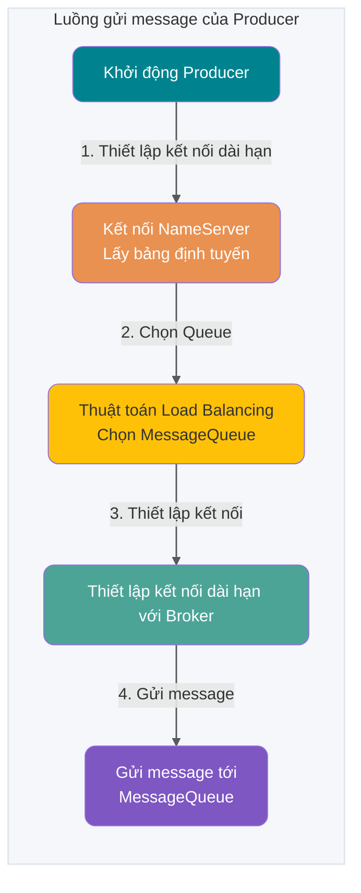

**Ba phương thức gửi message:**

- **Gửi một chiều (Oneway)**: Gửi xong trả về ngay lập tức, không quan tâm có thành công hay không
- **Gửi đồng bộ (Sync)**: Gửi xong sẽ chờ phản hồi từ Broker
- **Gửi bất đồng bộ (Async)**: Gửi xong trả về ngay, xử lý phản hồi bên trong hàm callback

### Consumer (Bên nhận message)

**Luồng tiêu thụ message:**

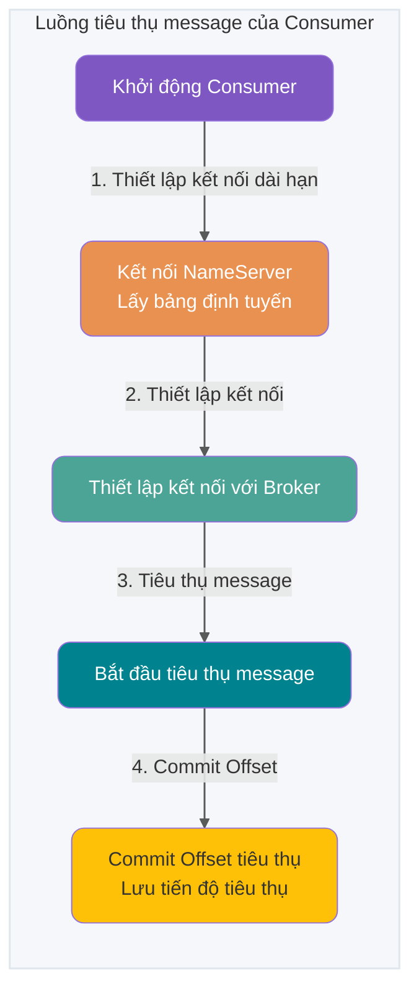

**Ba mô hình tiêu thụ:**

- **Chế độ Pull**: Consumer chủ động gửi request kéo message tới Broker
- **Chế độ Push**: Cơ chế Long Polling, Broker chỉ trả về khi có message mới
- **Chế độ không trạng thái (Pop)**: Bổ sung ở RocketMQ 5.0, Server tự quản lý Rebalance và Offset

### Giao thức mạng

Hiện nay RocketMQ phổ biến với hai cách kết nối chính là Remoting và gRPC:

| Tiêu chí so sánh | Remoting (Giao thức truyền thống)                      | gRPC (SDK mới 5.x)                                                |
| ---------------- | ------------------------------------------------------ | ----------------------------------------------------------------- |
| **Độ chín muồi** | Dùng lâu năm trong hệ sinh thái Java, đường truyền ngắn | Phù hợp đa ngôn ngữ và Cloud-Native, thường đi qua Proxy          |
| **Khả năng mở rộng** | Hỗ trợ đa ngôn ngữ cần tự thích ứng riêng từng ngôn ngữ | Dựa trên giao thức chuẩn, thân thiện với hệ sinh thái client và quản trị Gateway |
| **Đánh đổi**     | Phù hợp với client 4.x sẵn có và luồng hiệu năng cao nội bộ | Khi đường truyền thêm tầng Proxy, cần chú ý thêm về độ trễ và dung lượng chịu tải |

### Module mạng (Dựa trên Netty)

Giao tiếp RPC của RocketMQ sử dụng Netty làm thư viện truyền thông tầng dưới, được mở rộng và tối ưu hóa sâu dựa trên mô hình Reactor đa luồng (Multi-threaded Reactor Model).

**Tóm tắt Thread Model:**

- **Reactor Main Thread**: 1 Thread, chịu trách nhiệm lắng nghe kết nối (Accept)
- **Reactor Thread Pool**: Mặc định 3 Thread, chịu trách nhiệm xử lý dữ liệu mạng (I/O)
- **Business Thread Pool**: Điều chỉnh động, dựa theo số lượng nhân CPU

### Proxy (Tầng Proxy, bổ sung từ 5.0)

RocketMQ 5.0 giới thiệu thành phần **Proxy**, đây là hiện thân cốt lõi của kiến trúc **tách rời tính toán và lưu trữ (Compute-Storage Separation)**. Đóng vai trò lớp trung gian giữa Client và Broker, Proxy tách các logic tính toán như chuyển đổi giao thức client, quản lý phân quyền, quản lý tiêu thụ ra khỏi Broker, giúp Broker tập trung hơn vào việc lưu trữ message và đảm bảo tính sẵn sàng cao. Thiết kế này cực kỳ quan trọng đối với kiến trúc Cloud-Native, cho phép tầng tính toán có thể co giãn linh hoạt độc lập.

**Hai chế độ triển khai:**

| Chế độ           | Mô tả                                                        | Kịch bản phù hợp                                             |
| ---------------- | ------------------------------------------------------------ | ------------------------------------------------------------ |
| **Local Mode**   | Proxy và Broker chạy trong cùng một Process, chỉ cần thêm cấu hình Proxy | Nâng cấp mượt mà từ bản cũ hoặc kịch bản không có yêu cầu đặc biệt |
| **Cluster Mode** | Proxy và Broker triển khai tách biệt độc lập                 | Cần co giãn linh hoạt hoặc có nhu cầu tùy biến chuyển đổi giao thức |

**Tác dụng cốt lõi:**

- **Chuyển đổi giao thức**: Hỗ trợ kết nối qua giao thức gRPC, thuận tiện cho các client đa ngôn ngữ
- **Giảm tải tính toán**: Tách logic xác thực/phân quyền, quản lý tiêu thụ ra khỏi Broker, giảm tải cho Broker
- **Co giãn linh hoạt**: Proxy không trạng thái (Stateless), có thể scale ngang (Horizontal Scaling) độc lập

> **Lưu ý**: Trong phiên bản 5.0, client sử dụng SDK mới (giao thức gRPC) cần kết nối thông qua Proxy, trong khi client dùng SDK cũ (giao thức Remoting) vẫn có thể kết nối trực tiếp tới Broker.

Giá trị của Proxy không chỉ nằm ở việc "thêm một lớp trung gian". Trong bối cảnh Cloud-Native, nó tách các logic tính toán như tiếp nhận giao thức, xác thực/phân quyền, điều phối lưu lượng, quản lý tiêu thụ ra khỏi Broker, để Broker đảm nhận vai trò lưu trữ một cách ổn định hơn. Đổi lại, đường truyền thêm một hop mạng, nên cần chú ý thêm đến việc scale ngang, độ trễ, giới hạn lưu lượng (Rate Limiting) và giám sát (Monitoring) cho Proxy.

### Tại sao bắt buộc phải có NameServer?

Trước hết hãy xem một mô hình kiến trúc đơn giản:


Có thể bạn sẽ nảy ra thắc mắc: NameServer làm gì vậy? Cho Producer, Consumer kết nối thẳng với Broker để gửi và nhận message không được sao?

Broker cần đảm bảo tính sẵn sàng cao; nếu toàn bộ hệ thống chỉ dựa vào một Broker duy nhất để duy trì, áp lực sẽ rất lớn, nên bắt buộc phải dùng nhiều Broker để đảm bảo **Load Balancing**. Nếu Consumer và Producer kết nối trực tiếp tới nhiều Broker, mỗi khi thông tin Broker thay đổi sẽ kéo theo mọi Producer và Consumer đều bị ảnh hưởng, tạo ra sự phụ thuộc chặt (coupling). NameServer với vai trò Registry Center ra đời chính là để giải quyết vấn đề này.

**Triết lý thiết kế của NameServer:**

NameServer **không trạng thái (Stateless) và các node không giao tiếp với nhau**. Điều này tạo nên sự tương phản rõ rệt với tính nhất quán mạnh (Strong Consistency, cần cơ chế bầu chọn Leader) của ZooKeeper, thể hiện triết lý thiết kế theo đuổi **hiệu năng tối đa và kiến trúc đơn giản** của RocketMQ. Mỗi Broker duy trì kết nối dài hạn tới tất cả các NameServer và định kỳ gửi báo cáo thông tin của mình, nên kể cả khi một node NameServer nào đó bị sập cũng không làm ảnh hưởng đến tính khả dụng của toàn bộ Cluster.

Dưới đây là sơ đồ kiến trúc từ trang chủ chính thức:


So với sơ đồ kiến trúc đơn giản hóa phía trên, điểm khác biệt chủ yếu nằm ở một số chi tiết sau:

Thứ nhất, Broker **được triển khai theo cụm Cluster và theo mô hình Master-Slave**. Vì message phân bố trên nhiều Broker khác nhau, nếu một Broker nào đó bị sập thì cả việc đọc lẫn ghi message trên Broker đó đều bị ảnh hưởng. Do đó RocketMQ cung cấp cấu trúc `master/slave`, trong đó `slave` định kỳ đồng bộ dữ liệu từ `master` (Sync Flush hoặc Async Flush); nếu `master` bị sập, **`slave` vẫn cung cấp dịch vụ đọc/tiêu thụ message, nhưng không thể ghi message mới** (phần sau sẽ giải thích chi tiết hơn).

Thứ hai, để đảm bảo HA, NameServer cũng được triển khai theo Cluster, nhưng mang tính **phi tập trung (Decentralized)**. Nghĩa là nó không có node Master, có thể thấy rõ giữa các node NameServer không thực hiện `Info Replicate`. Trong RocketMQ, **một Broker duy trì kết nối dài hạn tới tất cả NameServer**, và **cứ mỗi 30 giây** Broker sẽ gửi Heartbeat tới toàn bộ NameServer, trong gói tin Heartbeat chứa thông tin cấu hình Topic của chính nó. NameServer **cứ mỗi 10 giây** lại kiểm tra Heartbeat một lần; nếu một Broker nào đó **quá 120 giây** không có Heartbeat thì sẽ bị coi là đã sập.

Thứ ba, khi Producer cần gửi message tới Broker, nó **cần lấy thông tin định tuyến của Broker từ NameServer trước**, rồi thông qua phương thức **Round-Robin (luân phiên)** để đẩy dữ liệu vào từng Queue nhằm đạt hiệu quả **Load Balancing**.

Thứ tư, sau khi Consumer lấy thông tin định tuyến của tất cả Broker qua NameServer, nó sẽ gửi request `Pull` tới Broker để lấy dữ liệu message. Consumer có thể khởi chạy dưới hai chế độ — **Broadcasting và Clustering**. Ở chế độ Broadcasting, một message sẽ được gửi đến **tất cả Consumer trong cùng một Consumer Group**, còn ở chế độ Clustering thì message chỉ được gửi tới duy nhất một Consumer.

## Message trong RocketMQ

### Message thông thường (Normal Message)

Message thông thường (Normal Message) được ứng dụng rộng rãi trong các kịch bản như tách phụ thuộc microservice (decoupling), kiến trúc hướng sự kiện (event-driven), tích hợp dữ liệu, v.v. Phần lớn các kịch bản này yêu cầu kênh truyền tải dữ liệu có độ tin cậy cao, và không có yêu cầu đặc biệt về thời điểm xử lý hay thứ tự xử lý message. Lấy ví dụ kịch bản giao dịch thương mại điện tử trực tuyến: hệ thống đơn hàng thượng nguồn đóng gói sự kiện nghiệp vụ người dùng đặt hàng thanh toán thành một Normal Message độc lập rồi gửi lên Server RocketMQ; hệ thống hạ nguồn subscribe message theo nhu cầu và xử lý các tác vụ hạ nguồn theo logic tiêu thụ nội bộ. Mỗi message hoàn toàn độc lập với nhau và không cần liên kết phụ thuộc lẫn nhau. Ngoài ra còn có hệ thống log: trong kịch bản thu thập log offline, thông qua thành phần tracking (gắn điểm theo dõi) thu thập log thao tác của ứng dụng frontend rồi chuyển tiếp vào RocketMQ.

**Vòng đời của Normal Message**


- Khởi tạo: Trạng thái message đã được Producer khởi tạo xong và chờ gửi lên Server.
- Chờ tiêu thụ: Message đã được gửi lên Server, hiển thị với Consumer và đang chờ Consumer tiêu thụ.
- Đang tiêu thụ: Quá trình message được Consumer lấy về và xử lý theo logic nghiệp vụ nội bộ của Consumer. Lúc này Server sẽ chờ Consumer xử lý xong và commit kết quả tiêu thụ; nếu quá một khoảng thời gian nhất định vẫn chưa nhận được phản hồi từ Consumer, RocketMQ sẽ thực hiện retry message đó.
- Commit tiêu thụ: Consumer hoàn tất xử lý tiêu thụ và gửi kết quả lên Server; nếu tiêu thụ thất bại hoặc timeout, message sẽ được gửi lại theo chiến lược retry, và sau khi vượt quá số lần retry tối đa có thể đi vào Dead Letter Queue (hàng đợi thư chết). RocketMQ sẽ không xóa ngay message chỉ vì một Consumer Group nào đó đã tiêu thụ thành công, mà sẽ dọn dẹp cuốn chiếu theo cơ chế lưu giữ message; trước khi message bị xóa do hết thời gian lưu giữ hoặc thiếu dung lượng lưu trữ, Consumer vẫn có thể tua lại (backtrack) để tiêu thụ lại message.
- Xóa message: Apache RocketMQ dọn dẹp cuốn chiếu các dữ liệu message cũ nhất theo cơ chế lưu giữ message, xóa bỏ message khỏi file vật lý.

### Message hẹn giờ / Message trễ (Scheduled / Delayed Message)

> **Ghi chú: Scheduled Message (message hẹn giờ) và Delayed Message (message trễ) về bản chất là giống nhau; cả hai đều do Server căn cứ theo mốc thời gian đã thiết lập trên message để gửi message tới Consumer tại một thời điểm cố định.**

Trong các kịch bản như kích hoạt lịch chạy phân tán (distributed scheduled trigger) hay xử lý timeout tác vụ, hệ thống cần kích hoạt sự kiện định giờ một cách chính xác và đáng tin cậy. Việc sử dụng Scheduled Message của RocketMQ giúp đơn giản hóa logic phát triển các tác vụ hẹn giờ, đồng thời mang lại khả năng kích hoạt định thời hiệu năng cao, dễ mở rộng và độ tin cậy cao.

**Kịch bản điển hình 1: Lập lịch định giờ phân tán**

Trong kịch bản lập lịch định giờ phân tán, hệ thống cần thực thi các tác vụ định kỳ với nhiều mức độ chính xác khác nhau, chẳng hạn 5 giờ sáng mỗi ngày thực hiện dọn file, hoặc cứ mỗi 2 phút kích hoạt đẩy thông báo một lần. Các giải pháp lập lịch định giờ dựa trên Database truyền thống khi áp dụng vào môi trường phân tán thường có hiệu năng không cao và cách triển khai phức tạp.

**Kịch bản điển hình 2: Xử lý timeout tác vụ**

Lấy kịch bản giao dịch thương mại điện tử làm ví dụ: sau khi đơn hàng được đặt nhưng chưa thanh toán, lúc này không thể đóng đơn ngay mà cần chờ một khoảng thời gian nhất định mới đóng đơn. Dùng Scheduled Message của RocketMQ có thể hiện thực hóa cơ chế kích hoạt kiểm tra tác vụ timeout.

Xử lý tác vụ timeout dựa trên Scheduled Message có các ưu điểm sau:

- **Độ chính xác linh hoạt hơn, rào cản phát triển thấp**: Phiên bản 5.x không còn chỉ phụ thuộc vào các mức trễ cố định mà có thể thiết lập thời gian gửi theo Timestamp; tuy nhiên độ hạt (granularity) kích hoạt mặc định vẫn ở mức giây, không thể hiểu là kích hoạt chính xác tuyệt đối đến từng mili-giây.
- **Hiệu năng cao, dễ mở rộng**: Phương pháp quét Database truyền thống khá phức tạp, phải gọi query quét liên tục nên dễ sinh ra điểm nghẽn hiệu năng. Scheduled Message của RocketMQ có khả năng chịu tải đồng thời cao và mở rộng theo chiều ngang (Horizontal Scaling).

**Nguyên tắc thiết lập thời gian hẹn giờ**

Thời gian hẹn giờ thiết lập cho Scheduled Message của RocketMQ là một Timestamp hệ thống dự kiến sẽ kích hoạt; thời gian trễ (delay) cũng cần quy đổi thành một mốc Timestamp sau thời điểm hiện tại của hệ thống, chứ không phải truyền một khoảng thời lượng trễ đơn thuần.

- **Định dạng thời gian**: Unix Timestamp tính bằng mili-giây
- **Thời gian hẹn giờ tối đa**: Mặc định là 24 giờ, không hỗ trợ tự chỉnh sửa
- **Thời gian hẹn giờ bắt buộc phải đặt sau thời điểm hiện tại**, nếu không thiết lập hẹn giờ sẽ không có hiệu lực và Server sẽ gửi message đi ngay lập tức

**Ví dụ**:

- Scheduled Message: Thời gian hệ thống hiện tại là 2022-06-09 17:30:00, muốn message được gửi vào lúc 19:20:00, thì Timestamp hẹn giờ sẽ là `1654773600000`
- Delayed Message: Thời gian hệ thống hiện tại là 2022-06-09 17:30:00, muốn gửi trễ sau 1 giờ, thì Timestamp hẹn giờ sẽ là `1654770600000`

**Sự khác biệt giữa phiên bản 4.x và 5.x**

- **Phiên bản 4.x**: Chỉ hỗ trợ Delayed Message với 18 mức mặc định (`1s 5s 10s 30s 1m 2m 3m 4m 5m 6m 7m 8m 9m 10m 20m 30m 1h 2h`), cũng có thể thêm các mức trễ và thời lượng tùy chỉnh trong file cấu hình.
- **Phiên bản 5.x**: Hỗ trợ thiết lập thời gian gửi bằng Unix Timestamp mức mili-giây, linh hoạt hơn nhiều so với các mức trễ cố định của 4.x; nhưng độ chính xác hẹn giờ mặc định là 1000ms, thời điểm gửi thực tế còn chịu ảnh hưởng bởi tải của Server, quá trình khôi phục lưu trữ và các yếu tố khác, không thể hiểu là kích hoạt chuẩn xác từng mili-giây.

**Vòng đời của Scheduled Message**


- **Khởi tạo**: Trạng thái message đã được Producer khởi tạo xong và chờ gửi lên Server.
- **Đang chờ hẹn giờ**: Message được gửi lên Server; khác với Normal Message ở chỗ Server sẽ không tạo ngay chỉ mục (index) cho message mà **lưu trữ riêng Scheduled Message vào hệ thống lưu trữ hẹn giờ**, chờ đến đúng mốc thời gian đã hẹn.
- **Chờ tiêu thụ**: Khi thời điểm hẹn giờ đã đến, Server sẽ ghi lại message vào storage engine thông thường, hiển thị với Consumer hạ nguồn và chờ Consumer tiêu thụ.
- **Đang tiêu thụ**: Quá trình message được Consumer lấy về và xử lý theo logic nghiệp vụ nội bộ. Lúc này Server sẽ chờ Consumer xử lý xong và commit kết quả tiêu thụ; nếu quá thời gian mà chưa nhận được phản hồi từ Consumer, RocketMQ sẽ retry message.
- **Commit tiêu thụ**: Consumer hoàn tất xử lý tiêu thụ và gửi kết quả lên Server; nếu tiêu thụ thất bại hoặc timeout, message sẽ được gửi lại theo chiến lược retry, và vượt quá số lần retry tối đa có thể đi vào Dead Letter Queue. RocketMQ sẽ không xóa ngay message khi một Consumer Group tiêu thụ thành công, mà dọn dẹp cuốn chiếu theo cơ chế lưu giữ.
- **Xóa message**: Apache RocketMQ dọn dẹp cuốn chiếu các dữ liệu message cũ nhất theo cơ chế lưu giữ message, xóa bỏ message khỏi file vật lý.

**Giới hạn sử dụng**

1. **Tính nhất quán của loại message**: Scheduled Message chỉ hỗ trợ sử dụng trong các Topic có `MessageType` là `Delay`.
2. **Ràng buộc độ chính xác hẹn giờ**: Tham số thời gian hẹn giờ nhận giá trị đến mức mili-giây, nhưng độ chính xác mặc định là 1000ms (mức giây).

**Khuyến nghị sử dụng**

Logic triển khai của Scheduled Message đòi hỏi phải đi qua hệ thống lưu trữ hẹn giờ để chờ kích hoạt, chỉ khi tới thời điểm hẹn mới được đẩy cho Consumer. Do đó, nếu đặt thời gian hẹn giờ của một lượng lớn Scheduled Message vào cùng một thời điểm, khi đến mốc thời gian đó sẽ có lượng lớn message cần xử lý cùng lúc, gây áp lực quá tải cho hệ thống, dẫn đến trễ phân phối message và ảnh hưởng đến độ chính xác của việc hẹn giờ.

### Message theo thứ tự (Ordered / FIFO Message)

**Ordered Message là gì**

Ordered Message là một loại message nâng cao do Apache RocketMQ cung cấp, hỗ trợ Consumer nhận message đúng theo thứ tự trước sau mà Producer đã gửi đi, qua đó hiện thực hóa việc xử lý tuần tự theo đúng ngữ cảnh nghiệp vụ.

**Kịch bản ứng dụng**

Trong các kịch bản như xử lý sự kiện có thứ tự, khớp lệnh giao dịch, đồng bộ dữ liệu tăng dần theo thời gian thực (real-time incremental sync), các hệ thống không đồng nhất cần duy trì đồng bộ trạng thái nhất quán chặt chẽ, và các thay đổi sự kiện từ thượng nguồn cần được truyền xuống hạ nguồn xử lý theo đúng thứ tự phát sinh.

- **Khớp lệnh giao dịch**: Lấy ví dụ kịch bản khớp lệnh chứng khoán, cổ phiếu: với các lệnh đặt cùng mức giá, cần tuân thủ nghiêm ngặt nguyên tắc ai đặt trước khớp trước (price-time priority), nên hệ thống xử lý đơn hàng ở hạ nguồn bắt buộc phải xử lý đơn theo đúng thứ tự đặt lệnh.
- **Đồng bộ dữ liệu tăng dần thời gian thực**: Lấy ví dụ kịch bản đồng bộ thay đổi Database tăng dần: Database nguồn ở thượng nguồn thực hiện các thao tác thêm/xóa/sửa theo nhu cầu, lấy binary log (binlog) làm message truyền qua RocketMQ xuống hệ thống tìm kiếm ở hạ nguồn; hệ thống hạ nguồn khôi phục dữ liệu message theo đúng thứ tự để làm mới trạng thái dữ liệu tuần tự.

**Làm thế nào để đảm bảo tính thứ tự của message**

Tính thứ tự của message trong RocketMQ được chia làm hai phần: **tính thứ tự khi sản xuất (Production Ordering)** và **tính thứ tự khi tiêu thụ (Consumption Ordering)**.

**Tính thứ tự khi sản xuất (Production Ordering)**

Để đảm bảo tính thứ tự khi tạo message, bắt buộc phải thỏa mãn các điều kiện sau:

1. **Producer đơn lẻ**: Tính thứ tự trong quá trình tạo message chỉ hỗ trợ một Producer duy nhất.
2. **Gửi tuần tự (Serial Sending)**: Khi một Producer sử dụng nhiều Thread gửi song song, các message được tạo ra ở các Thread khác nhau sẽ không thể xác định được thứ tự trước sau.

Producer thỏa mãn các điều kiện trên khi gửi Ordered Message lên RocketMQ sẽ đảm bảo các message được gán cùng một **MessageGroup** được lưu trữ vào cùng một Queue đúng theo thứ tự gửi.

**Nhóm message (MessageGroup)**

Quan hệ thứ tự của Ordered Message trong RocketMQ được xác định và nhận diện thông qua MessageGroup; khi gửi Ordered Message cần thiết lập MessageGroup mà mỗi message thuộc về.

- Nhiều message thuộc **cùng một MessageGroup** tuân theo quan hệ thứ tự vào trước ra trước (FIFO).
- Các message thuộc **MessageGroup khác nhau** hoặc không có MessageGroup thì không ràng buộc thứ tự với nhau.

Dựa trên logic xác định thứ tự theo MessageGroup, hệ thống hỗ trợ chia nhỏ theo logic nghiệp vụ ở mức độ mịn (fine-grained), vừa đáp ứng được thứ tự cục bộ theo nghiệp vụ vừa nâng cao mức độ song song và thông lượng của hệ thống.

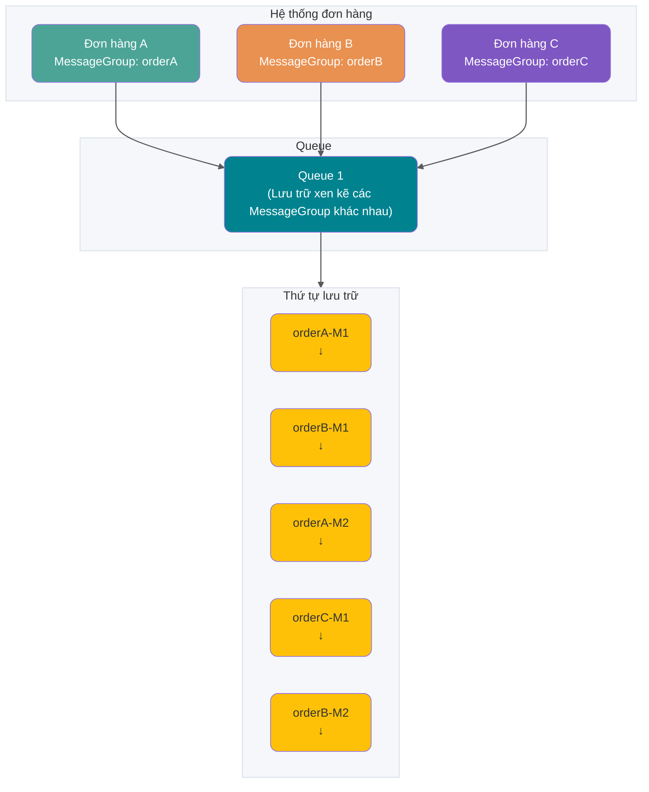

**Giải thích**:

- M1, M2 thuộc MessageGroup `orderA` giữ nguyên thứ tự
- M1, M2 thuộc MessageGroup `orderB` giữ nguyên thứ tự
- Các MessageGroup khác nhau có thể lưu trữ xen kẽ trong cùng một Queue

**Tính thứ tự khi tiêu thụ (Consumption Ordering)**

Để đảm bảo tính thứ tự khi tiêu thụ message, bắt buộc phải thỏa mãn các điều kiện sau:

1. **Thứ tự gửi tới Consumer**: RocketMQ thông qua SDK client và giao thức truyền thông với Server để đảm bảo message được gửi tới Consumer đúng theo thứ tự lưu trữ trên Server.
2. **Retry hữu hạn**: Việc gửi Ordered Message chỉ retry trong giới hạn số lần cho phép; nếu vượt quá số lần retry tối đa, hệ thống sẽ không retry nữa và bỏ qua message này để tiêu thụ tiếp.

**Ảnh hưởng của loại Consumer đến việc tiêu thụ theo thứ tự**

- **PushConsumer**: RocketMQ đảm bảo gửi từng message một cho Consumer đúng theo thứ tự lưu trữ.
- **SimpleConsumer**: Consumer có thể kéo (pull) nhiều message cùng một lúc, lúc này thứ tự tiêu thụ message cần do phía nghiệp vụ tự đảm bảo.

**Tổ hợp giữa thứ tự sản xuất và thứ tự tiêu thụ**

| Thứ tự sản xuất                                                  | Thứ tự tiêu thụ   | Hiệu quả thứ tự                                                         |
| ---------------------------------------------------------------- | ----------------- | ----------------------------------------------------------------------- |
| Thiết lập MessageGroup, đảm bảo gửi message tuần tự              | Tiêu thụ tuần tự  | Đảm bảo nghiêm ngặt thứ tự message theo mức độ từng MessageGroup        |
| Thiết lập MessageGroup, đảm bảo gửi message tuần tự              | Tiêu thụ đồng thời| Tiêu thụ đồng thời, cố gắng xử lý theo thứ tự thời gian nhiều nhất có thể |
| Không thiết lập MessageGroup, gửi message không theo thứ tự      | Tiêu thụ tuần tự  | Chỉ đảm bảo thứ tự lưu trữ trong Queue, không đảm bảo thứ tự gửi nghiệp vụ |
| Không thiết lập MessageGroup, gửi message không theo thứ tự      | Tiêu thụ đồng thời| Tiêu thụ đồng thời, cố gắng xử lý theo thứ tự thời gian nhiều nhất có thể |

**Giới hạn sử dụng**

1. **Tính nhất quán của loại message**: Ordered Message chỉ hỗ trợ sử dụng trong Topic có `MessageType` là `FIFO`; trong RocketMQ 5.x còn phải thiết lập `MessageGroup` cho Ordered Message và cấu hình Consumer Group ở chế độ gửi tuần tự, nếu không message vẫn có thể được gửi theo kiểu đồng thời (concurrent).
2. Khi tiêu thụ Ordered Message bị thất bại và thực hiện retry, để bảo toàn thứ tự message, các message phía sau sẽ không thể được tiêu thụ mà bắt buộc phải chờ message phía trước xử lý xong mới được xử lý tiếp.

**Khuyến nghị sử dụng**

1. **Tiêu thụ tuần tự (Serial Consumption)**: Nên xử lý tiêu thụ tuần tự từng message, tránh tiêu thụ nhiều message cùng lúc gây đảo lộn thứ tự.
2. **Phân tán MessageGroup tối đa có thể**: Nên chia nhỏ theo mức độ MessageGroup dựa trên ngữ cảnh nghiệp vụ, ví dụ dùng Order ID hoặc User ID làm khóa MessageGroup, giúp các message của cùng một người dùng cuối được xử lý theo thứ tự, còn message giữa các người dùng khác nhau thì không cần ràng buộc thứ tự với nhau.

### Message giao dịch (Transaction Message)

**Transaction Message là gì**

Transaction Message là một loại message nâng cao do Apache RocketMQ cung cấp, hỗ trợ đảm bảo tính nhất quán cuối cùng (Eventual Consistency) giữa việc tạo message và Local Transaction trong các kịch bản phân tán. Nói đơn giản, đó là gộp Local Transaction (các thao tác DML trên Database) và việc gửi message vào cùng một giao dịch logic.

**Kịch bản ứng dụng**

Đặc điểm của lời gọi trong hệ thống phân tán là khi một logic nghiệp vụ cốt lõi thực thi, đồng thời cần gọi nhiều nghiệp vụ hạ nguồn khác cùng xử lý. Làm thế nào để đảm bảo kết quả thực thi giữa nghiệp vụ cốt lõi và nhiều nghiệp vụ hạ nguồn hoàn toàn nhất quán với nhau là bài toán chính mà Distributed Transaction cần giải quyết.

Lấy kịch bản giao dịch thương mại điện tử làm ví dụ: thao tác cốt lõi là người dùng thanh toán đơn hàng, đồng thời kéo theo sự thay đổi ở nhiều hệ thống con ở hạ nguồn như xuất kho vận chuyển, cộng/trừ điểm thưởng, làm trống giỏ hàng:

- **Cập nhật trạng thái hệ thống đơn hàng (nhánh chính)**: Chuyển từ chưa thanh toán sang thanh toán thành công
- **Thêm mới trạng thái hệ thống vận chuyển**: Thêm bản ghi chờ giao hàng, tạo bản ghi vận đơn
- **Thay đổi trạng thái hệ thống điểm thưởng**: Thay đổi điểm thưởng người dùng, cập nhật bảng điểm người dùng
- **Thay đổi trạng thái hệ thống giỏ hàng**: Làm trống giỏ hàng, cập nhật bản ghi giỏ hàng của người dùng

**Vấn đề của các giải pháp truyền thống**

- **Giải pháp XA Transaction truyền thống**: Hệ thống Distributed Transaction dựa trên giao thức XA có thể đảm bảo tính nhất quán, nhưng trong môi trường nhiều nhánh thì phạm vi khóa tài nguyên lớn, độ đồng thời (Concurrency) thấp.
- **Giải pháp dựa trên Normal Message**: Không thể đảm bảo tính nhất quán giữa Normal Message và Transaction đơn hàng, rất dễ xảy ra tình trạng message đã gửi thành công nhưng đơn hàng chưa thực thi thành công, hoặc đơn hàng thực thi thành công nhưng message lại chưa gửi được.

**Giải pháp Transaction Message của RocketMQ**

Giải pháp Transaction Message của RocketMQ có ưu điểm hiệu năng cao, dễ mở rộng, phát triển nghiệp vụ đơn giản, hỗ trợ khả năng Two-Phase Commit (2PC), gắn kết quá trình commit hai pha với Local Transaction để đạt được tính nhất quán cuối cùng giữa **Local Transaction và việc gửi message**.

**Luồng xử lý Transaction Message**

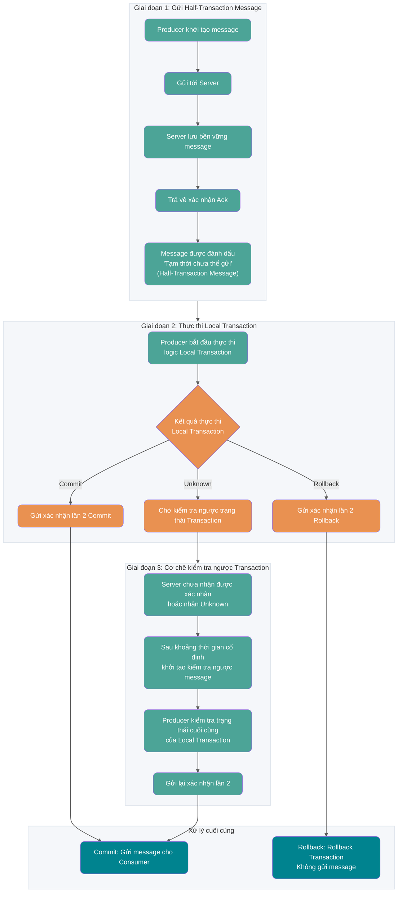

1. Producer gửi message tới Server RocketMQ.
2. Sau khi lưu bền vững message thành công, Server trả về Ack xác nhận cho Producer rằng message đã gửi thành công; lúc này message được đánh dấu là "tạm thời chưa thể gửi tới Consumer" — message ở trạng thái này gọi là **Half-Transaction Message (Half Message)**.
3. Producer bắt đầu thực thi logic Local Transaction.
4. Dựa vào kết quả thực thi Local Transaction, Producer gửi xác nhận lần hai (`Commit` hoặc `Rollback`) lên Server.
5. Nếu Server không nhận được kết quả xác nhận lần hai, hoặc kết quả nhận được là `Unknown`, sau một khoảng thời gian cố định, Server sẽ gửi yêu cầu **kiểm tra ngược message (Transaction Check)** về cho Producer.
6. Khi nhận được yêu cầu kiểm tra ngược, Producer cần kiểm tra lại kết quả thực thi cuối cùng của Local Transaction tương ứng với message đó.
7. Producer căn cứ vào trạng thái cuối cùng kiểm tra được để gửi lại xác nhận lần hai cho Server.

**Vòng đời của Transaction Message**

- **Khởi tạo**: Trạng thái Half-Transaction Message đã được Producer khởi tạo xong và chờ gửi lên Server.
- **Transaction chờ Commit**: Sau khi Half-Transaction Message được gửi lên Server, nó được lưu bền vững vào vùng lưu trữ dành riêng cho Transaction, nhưng chưa chuyển thẳng sang trạng thái có thể tiêu thụ thông thường; nó phải chờ giai đoạn hai (Local Transaction) trả về `Commit` hoặc `Rollback` mới quyết định có gửi cho Consumer hay không. Lúc này message vô hình đối với Consumer hạ nguồn.
- **Rollback message**: Nếu kết quả thực thi Transaction ở giai đoạn hai trả về rõ ràng là Rollback, Server sẽ rollback Half-Transaction Message và quy trình Transaction Message kết thúc.
- **Commit chờ tiêu thụ**: Nếu kết quả thực thi Transaction ở giai đoạn hai trả về rõ ràng là Commit, Server sẽ ghi lại Half-Transaction Message vào hệ thống lưu trữ thông thường, lúc này message trở nên khả kiến đối với Consumer hạ nguồn.
- **Đang tiêu thụ**: Quá trình message được Consumer lấy về và xử lý theo logic nghiệp vụ nội bộ của Consumer.
- **Commit tiêu thụ**: Consumer hoàn tất xử lý và gửi kết quả lên Server; nếu tiêu thụ thất bại hoặc timeout, message vẫn sẽ đi vào quy trình retry, Dead Letter Queue hoặc bù trừ (Compensation).
- **Xóa message**: RocketMQ dọn dẹp cuốn chiếu các dữ liệu message cũ nhất theo cơ chế lưu giữ message.

**Giới hạn sử dụng**

1. **Tính nhất quán của loại message**: Transaction Message chỉ hỗ trợ sử dụng trong các Topic có `MessageType` là `Transaction`.
2. **Tính chất Transaction ở phía tiêu thụ**: Transaction Message của RocketMQ đảm bảo tính nhất quán giữa Local Transaction ở nhánh chính và việc gửi message xuống hạ nguồn, nhưng **không đảm bảo** tính nhất quán giữa kết quả tiêu thụ message ở hạ nguồn với Transaction ở thượng nguồn.
3. **Tính khả kiến ở trạng thái trung gian**: Transaction Message đảm bảo tính nhất quán cuối cùng (Eventual Consistency), nghĩa là trước khi message được commit và xử lý xong ở phía Consumer hạ nguồn, trạng thái giữa nhánh hạ nguồn và Transaction thượng nguồn sẽ tạm thời chưa nhất quán.
4. **Cơ chế Timeout của Transaction**: Vòng đời của Transaction Message có cơ chế timeout; sau khi Half-Transaction Message được Producer gửi lên Server, nếu trong khoảng thời gian quy định Server không thể xác nhận trạng thái Commit hay Rollback thì message mặc định sẽ bị Rollback.
5. **Cơ chế kiểm tra ngược Transaction**: Server mặc định **cứ mỗi 60 giây** lại khởi tạo kiểm tra ngược đối với các Half-Transaction Message chưa được xác nhận; thời gian timeout tối đa mặc định của Half-Transaction Message là **4 giờ**, quá hạn sẽ bị cưỡng chế Rollback. Các phiên bản cũ hoặc bản triển khai của một số nhà cung cấp Cloud có thể có thêm tham số số lần kiểm tra ngược tối đa, khi phỏng vấn và cấu hình production cần đối chiếu theo phiên bản thực tế.

**Khuyến nghị sử dụng**

1. **Tránh để quá nhiều Transaction tồn đọng chưa dứt điểm dẫn đến timeout**: Producer nên hạn chế tối đa việc Local Transaction trả về kết quả `Unknown`, vì lượng lớn lượt kiểm tra ngược Transaction sẽ làm suy giảm hiệu năng hệ thống.
2. **Xử lý đúng các Transaction "đang thực thi"**: Khi kiểm tra ngược, đối với những Transaction vẫn đang chạy dở thì không được vội trả về `Rollback` hay `Commit`, mà phải tiếp tục giữ trạng thái `Unknown`.
3. **Trạng thái Local Transaction phải truy vấn được**: Việc kiểm tra ngược dựa vào việc Producer tra cứu trạng thái cuối cùng của Local Transaction, nên khuyến nghị ghi xuống Database hoặc nơi lưu trữ tin cậy, tuyệt đối không chỉ giữ trong bộ nhớ của tiến trình (in-memory).
4. **Phía Consumer hạ nguồn vẫn phải đảm bảo Idempotency**: Transaction Message chỉ giải quyết tính nhất quán giữa "Local Transaction và việc gửi message", không đảm bảo nghiệp vụ của Consumer chắc chắn thành công, nên phía Consumer vẫn phải có cơ chế retry, Idempotency và bù trừ (Compensation).

### Lưu ý khi gửi message

#### Không nên tạo quá nhiều Producer trong một Process

Quan hệ giữa Producer và Topic trong Apache RocketMQ là nhiều-nhiều (Many-to-Many), hỗ trợ cùng một Producer gửi message tới nhiều Topic khác nhau. Đối với việc khởi tạo Producer, khuyến nghị tuân theo nguyên tắc "đủ dùng và tái sử dụng tối đa"; nếu có nhu cầu gửi message vào nhiều Topic thì không cần tạo riêng một Producer cho mỗi Topic.

#### Không nên tạo mới và hủy Producer liên tục

Producer của Apache RocketMQ là tài nguyên tầng dưới có thể tái sử dụng, tương tự như Connection Pool của Database. Do đó không cần mỗi lần gửi message lại khởi tạo động một Producer rồi hủy đi ngay sau khi gửi xong. Việc tạo và hủy liên tục như vậy sẽ sinh ra lượng lớn kết nối ngắn hạn (short-lived connections) tới Server, làm ảnh hưởng nghiêm trọng đến hiệu năng hệ thống.

Ví dụ đúng:

```java
Producer p = ProducerBuilder.build();
for (int i =0;i<n;i++){
    Message m= MessageBuilder.build();
    p.send(m);
 }
p.shutdown();
```

## Phân loại Consumer

### PushConsumer (Consumer chế độ đẩy)

**Đặc điểm cốt lõi:**

Là loại Consumer được đóng gói ở mức cao; việc tiêu thụ message chỉ thực hiện bằng cách lắng nghe qua Message Listener và trả về kết quả. Việc lấy message, commit trạng thái tiêu thụ cũng như retry tiêu thụ đều do SDK client của RocketMQ tự động thực hiện.

**Kịch bản phù hợp:**

- Thời gian xử lý message có thể ước lượng trước
- Không có nhu cầu xử lý bất đồng bộ hay tùy biến nâng cao
- Kịch bản muốn phát triển nhanh chóng

**Ví dụ sử dụng:**

```java
public static void main(String[] args) throws InterruptedException, MQClientException {
    // Tạo Consumer chế độ Push
    DefaultMQPushConsumer consumer = new DefaultMQPushConsumer("CID_JODIE_1");

    // Subscribe Topic
    consumer.subscribe("TopicTest", "*");

    // Thiết lập vị trí bắt đầu tiêu thụ
    consumer.setConsumeFromWhere(ConsumeFromWhere.CONSUME_FROM_FIRST_OFFSET);

    // Đăng ký Message Listener
    consumer.registerMessageListener(new MessageListenerConcurrently() {
        @Override
        public ConsumeConcurrentlyStatus consumeMessage(
                List<MessageExt> msgs,
                ConsumeConcurrentlyContext context) {
            System.out.printf("Receive New Messages: %s %n", msgs);
            // Logic xử lý nghiệp vụ
            return ConsumeConcurrentlyStatus.CONSUME_SUCCESS;
        }
    });

    consumer.start();
}
```

**Kết quả thực thi của Message Listener:**

- **Trả về tiêu thụ thành công**: Biểu thị message đó đã xử lý thành công, Server sẽ cập nhật tiến độ tiêu thụ theo kết quả này
- **Trả về tiêu thụ thất bại**: Biểu thị message đó xử lý thất bại, cần căn cứ vào logic retry để quyết định có tiêu thụ lại hay không
- **Ném ra Exception**: Được xử lý tương đương như tiêu thụ thất bại, căn cứ vào logic retry để quyết định có tiêu thụ lại hay không

**Lưu ý khi sử dụng:**

Khi tiêu thụ bằng PushConsumer, nghiêm cấm xử lý message theo các cách sau:

1. **Cách sai 1**: Message chưa xử lý xong đã trả về kết quả tiêu thụ thành công (`CONSUME_SUCCESS`) trước. Lúc này nếu việc tiêu thụ message thực chất bị lỗi, Server RocketMQ hoàn toàn không thể nhận biết được nên sẽ không thực hiện retry.

2. **Cách sai 2**: Bên trong Message Listener lại đem message đẩy tiếp sang một Thread tự tạo khác xử lý, rồi Listener trả về kết quả thành công ngay lập tức. Khi đó nếu việc xử lý ở Thread kia thất bại, Server RocketMQ cũng không thể biết được và sẽ không thực hiện retry.

**Nguyên lý hoạt động của chế độ Push trong Remoting SDK truyền thống (tương ứng với ví dụ `DefaultMQPushConsumer` ở trên):**

1. **Load Balancing**: Thread `RebalanceService` căn cứ vào số lượng Queue và số lượng Consumer để thực hiện cân bằng tải, tạo `pullRequest` cho các Queue được phân bổ đưa vào `pullRequestQueue`
2. **Pull message**: Thread `PullMessageService` liên tục lấy `pullRequest` từ `pullRequestQueue`, kéo message từ Broker về và cache vào `ProcessQueue`
3. **Tiêu thụ message**: Thread `ConsumeMessageService` lấy message từ `ProcessQueue`, gọi Listener để xử lý logic nghiệp vụ
4. **Commit Offset**: Sau khi tiêu thụ xong tự động commit Consumer Offset
5. **Bảo vệ kiểm soát lưu lượng (Flow Control)**: Trước khi pull sẽ kiểm tra ngưỡng cache (1000 message hoặc 100MB), nếu vượt ngưỡng sẽ tạm hoãn việc pull lại

### SimpleConsumer

SimpleConsumer là loại Consumer dạng atomic API; việc lấy message, commit trạng thái tiêu thụ cũng như retry tiêu thụ đều do logic nghiệp vụ của phía Consumer chủ động gọi API thực hiện.

**Thời gian ẩn message (Invisible Time):**

Cơ chế cốt lõi của SimpleConsumer là **Invisible Time**. Khi Consumer lấy một message về, trong khoảng Invisible Time đã chỉ định, message đó sẽ ở trạng thái ẩn đối với các Consumer khác. Nếu trong khoảng Invisible Time mà Consumer hoàn tất xử lý và gửi ACK, message được đánh dấu là đã tiêu thụ; nếu quá thời gian mà chưa gửi ACK, message sẽ chuyển lại sang trạng thái khả kiến (visible) để các Consumer khác có thể lấy về xử lý. Cơ chế này khác với hàng đợi retry định giờ của PushConsumer: SimpleConsumer cho phép điều chỉnh linh hoạt hơn bằng cách thay đổi động Invisible Time.

Một ví dụ từ tài liệu chính thức:

```java
// Ví dụ tiêu thụ: dùng SimpleConsumer tiêu thụ Normal Message, chủ động lấy message xử lý và commit.
ClientServiceProvider provider = ClientServiceProvider.loadService();
String topic = "YourTopic";
FilterExpression filterExpression = new FilterExpression("YourFilterTag", FilterExpressionType.TAG);
SimpleConsumer simpleConsumer = provider.newSimpleConsumerBuilder()
        // Thiết lập Consumer Group.
        .setConsumerGroup("YourConsumerGroup")
        // Thiết lập Endpoint kết nối.
        .setClientConfiguration(ClientConfiguration.newBuilder().setEndpoints("YourEndpoint").build())
        // Thiết lập quan hệ subscribe gắn sẵn.
        .setSubscriptionExpressions(Collections.singletonMap(topic, filterExpression))
        // Thiết lập thời gian chờ tối đa khi nhận message từ Server
        .setAwaitDuration(Duration.ofSeconds(1))
        .build();
try {
    // SimpleConsumer cần chủ động gọi lấy message rồi xử lý.
    List<MessageView> messageViewList = simpleConsumer.receive(10, Duration.ofSeconds(30));
    messageViewList.forEach(messageView -> {
        System.out.println(messageView);
        // Sau khi xử lý xong cần chủ động gọi ACK để commit kết quả tiêu thụ.
        try {
            simpleConsumer.ack(messageView);
        } catch (ClientException e) {
            logger.error("Failed to ack message, messageId={}", messageView.getMessageId(), e);
        }
    });
} catch (ClientException e) {
    // Nếu gặp lỗi lấy message do kiểm soát lưu lượng hệ thống..., cần gọi lại yêu cầu lấy message.
    logger.error("Failed to receive message", e);
}
```

SimpleConsumer phù hợp với các kịch bản sau:

- Thời lượng xử lý message không kiểm soát được: Nếu không thể dự đoán trước thời gian xử lý message, thường xuyên có các message tốn rất nhiều thời gian xử lý, khuyến nghị dùng SimpleConsumer. Có thể tự định nghĩa thời gian xử lý dự kiến cho message khi tiêu thụ, và nếu thời gian xử lý thực tế vượt ngoài dự kiến cũng có thể gọi API gia hạn trước.
- Kịch bản cần tùy biến nâng cao như bất đồng bộ, tiêu thụ theo lô (batch consumption): Bên trong SDK của SimpleConsumer không đóng gói Thread Pool phức tạp, hoàn toàn để logic nghiệp vụ tự do tùy biến, có thể triển khai phân phát bất đồng bộ, xử lý theo lô, v.v.
- Cần tự điều chỉnh tốc độ tiêu thụ: Do logic nghiệp vụ chủ động gọi API để lấy message nên có thể tự do điều chỉnh tần suất gọi lấy message nhằm kiểm soát tốc độ tiêu thụ theo ý muốn.

**Nguyên lý hoạt động của SimpleConsumer:**

1. **Chủ động lấy message**: Phía nghiệp vụ gọi phương thức `receive()` để chủ động kéo message
2. **Xử lý nghiệp vụ**: Phía nghiệp vụ tự xử lý các message lấy được
3. **Chủ động commit ACK**: Sau khi xử lý xong, phía nghiệp vụ chủ động gọi `ack()` để commit kết quả tiêu thụ
4. **Tính kiểm soát cao**: Phía nghiệp vụ toàn quyền kiểm soát thời điểm xử lý message và tốc độ tiêu thụ

### PullConsumer (Consumer chế độ kéo)

**Đặc điểm cốt lõi:**

Ở chế độ Pull, **ứng dụng tham gia sâu vào quá trình kéo message và có khả năng kiểm soát rất mạnh**, có thể tự quyết định khi nào kéo message và kéo từ vị trí `offset` nào.

**So sánh với chế độ Push:**

| Đặc tính                | Chế độ Push                              | Chế độ Pull                         |
| ----------------------- | ---------------------------------------- | ----------------------------------- |
| **Quyền kiểm soát**     | Client SDK tự động pull                  | Ứng dụng chủ động pull              |
| **Tính khả kiểm**       | Khả năng kiểm soát hạn chế               | Khả năng kiểm soát cao              |
| **Độ phức tạp phát triển**| Đơn giản, chỉ cần cài đặt Listener     | Cần tự quản lý quá trình pull       |
| **Kịch bản phù hợp**    | Thời gian xử lý message ước lượng được   | Cần kiểm soát tinh vi quá trình pull|

**Ví dụ sử dụng (`DefaultMQPullConsumer`):**

```java
@Test
public void testPullConsumer() throws Exception {
    DefaultMQPullConsumer consumer = new DefaultMQPullConsumer("group1_pull");
    consumer.setNamesrvAddr(this.nameServer);
    String topic = "topic1";
    consumer.start();

    // Lấy danh sách MessageQueue tương ứng với Topic
    Set<MessageQueue> messageQueues = consumer.fetchSubscribeMessageQueues(topic);
    int maxNums = 10; // Số lượng message tối đa mỗi lần pull

    while (true) {
        boolean found = false;
        for (MessageQueue messageQueue : messageQueues) {
            // Lấy vị trí tiêu thụ
            long offset = consumer.fetchConsumeOffset(messageQueue, false);
            // Pull message
            PullResult pullResult = consumer.pull(messageQueue, "tag8", offset, maxNums);

            switch (pullResult.getPullStatus()) {
                case FOUND:
                    found = true;
                    List<MessageExt> msgs = pullResult.getMsgFoundList();
                    System.out.println("收到消息，数量----" + msgs.size());
                    // Xử lý message
                    for (MessageExt msg : msgs) {
                        System.out.println("处理消息——" + msg.getMsgId());
                    }
                    // Cập nhật vị trí tiêu thụ
                    long nextOffset = pullResult.getNextBeginOffset();
                    consumer.updateConsumeOffset(messageQueue, nextOffset);
                    break;
                case NO_NEW_MSG:
                    System.out.println("没有新消息");
                    break;
                case NO_MATCHED_MSG:
                    System.out.println("没有匹配的消息");
                    break;
                case OFFSET_ILLEGAL:
                    System.err.println("offset 错误");
                    break;
            }
        }
        if (!found) {
            // Không có Queue nào có message mới thì tạm nghỉ một lát
            TimeUnit.MILLISECONDS.sleep(5000);
        }
    }
}
```

**Ví dụ sử dụng (`DefaultLitePullConsumer` - Khuyến nghị):**

```java
DefaultLitePullConsumer litePullConsumer =
        new DefaultLitePullConsumer("lite_pull_consumer_test");
litePullConsumer.setConsumeFromWhere(ConsumeFromWhere.CONSUME_FROM_FIRST_OFFSET);
litePullConsumer.subscribe("TopicTest", "*");
litePullConsumer.start();

try {
    while (running) {
        // Ứng dụng chủ động gọi phương thức poll để kéo message
        List<MessageExt> messageExts = litePullConsumer.poll();
        System.out.printf("%s%n", messageExts);
    }
} finally {
    litePullConsumer.shutdown();
}
```

**Kịch bản phù hợp:**

- **Cần kiểm soát tinh vi thời điểm pull**: Có thể tự quyết định lúc nào kéo message dựa trên nhu cầu nghiệp vụ
- **Cần kiểm soát tốc độ tiêu thụ**: Có thể linh hoạt điều chỉnh tần suất pull
- **Kịch bản tiêu thụ theo lô (Batch Consumption)**: Có thể pull một lượng lớn message cùng lúc để xử lý hàng loạt
- **Nhu cầu tiêu thụ đặc biệt**: Như cần bắt đầu tiêu thụ từ một offset chỉ định, cần tạm dừng tiêu thụ, v.v.

**Nguyên lý hoạt động của chế độ Pull:**

1. **Load Balancing**: Khi Thread `RebalanceService` phát hiện snapshot tiêu thụ thay đổi, nó sẽ khởi chạy Thread kéo message
2. **Pull message**: Sau khi `PullTaskImpl` kéo được message sẽ đặt vào `consumeRequestCache`
3. **Tiêu thụ message**: Ứng dụng gọi phương thức `poll` để liên tục lấy message từ `consumeRequestCache` ra xử lý nghiệp vụ

### So sánh ba loại Consumer

| Tiêu chí so sánh              | PushConsumer                                                                                       | SimpleConsumer                                                                     | PullConsumer                                                                       |
| ----------------------------- | -------------------------------------------------------------------------------------------------- | ---------------------------------------------------------------------------------- | ---------------------------------------------------------------------------------- |
| Cách thức giao tiếp API       | Dùng callback Listener để trả kết quả tiêu thụ, chỉ cho phép xử lý logic tiêu thụ bên trong phạm vi Listener. | Phía nghiệp vụ tự cài đặt xử lý message và chủ động gọi API trả kết quả tiêu thụ. | Phía nghiệp vụ tự kéo message theo từng Queue và tùy chọn commit kết quả tiêu thụ  |
| Quản lý mức độ đồng thời      | Do SDK quản lý mức độ đồng thời khi tiêu thụ.                                                      | Do logic tiêu thụ của phía nghiệp vụ tự quản lý Thread tiêu thụ.                   | Do logic tiêu thụ của phía nghiệp vụ tự quản lý Thread tiêu thụ.                   |
| Mức độ hạt của Load Balancing | SDK 5.x mặc định theo mức độ Message, các phiên bản cũ theo mức độ Queue                           | SDK 5.x mặc định theo mức độ Message                                               | Theo mức độ Queue, gom lô đạt thông lượng tốt hơn nhưng dễ mất cân bằng tải        |
| Độ linh hoạt API              | Đóng gói mức cao, kém linh hoạt.                                                                   | API nguyên tử (Atomic), tùy biến linh hoạt.                                        | API nguyên tử (Atomic), tùy biến linh hoạt.                                        |
| Kịch bản phù hợp              | Phù hợp cho phát triển nghiệp vụ tiêu thụ message không có luồng xử lý tùy biến.                   | Phù hợp cho phát triển nghiệp vụ cần tùy biến sâu luồng xử lý.                     | Chỉ khuyến nghị tích hợp sử dụng trong các kịch bản Stream Processing Framework    |

**Gợi ý lựa chọn:**

- **Kịch bản thông thường**: Ưu tiên dùng **PushConsumer**, phát triển đơn giản, SDK tự động quản lý việc kéo và commit
- **Thời lượng xử lý message không kiểm soát được**: Dùng **SimpleConsumer**, có thể tự định nghĩa thời gian xử lý
- **Cần kiểm soát tinh vi**: Dùng **PullConsumer**, tự chủ hoàn toàn quá trình kéo message

**Lưu ý**: Trong môi trường Production, nghiêm cấm trộn lẫn PullConsumer với hai loại Consumer còn lại dưới cùng một `ConsumerGroup`, nếu không sẽ gây ra lỗi tiêu thụ message bất thường.

## Consumer Group và Producer Group

### Producer Group

Trong Domain Model mới của RocketMQ 5.x, **Producer là thực thể vận hành nhẹ và ẩn danh**, thông thường không còn cần quản lý trọng tâm Producer Group như các phiên bản cũ nữa. Tuy nhiên, trong client 3.x/4.x, hệ sinh thái Spring hoặc chế độ tương thích, bạn vẫn có thể bắt gặp cấu hình `ProducerGroup`; khi di chuyển phiên bản không nên xóa bừa mà phải xác nhận theo phiên bản client thực tế.

### Consumer Group

Consumer Group là nhóm cân bằng tải gồm nhiều Consumer có hành vi tiêu thụ đồng nhất với nhau. Consumer Group không phải một thực thể cụ thể mà là một tài nguyên logic. Thông qua Consumer Group, hệ thống đạt được khả năng mở rộng ngang hiệu năng tiêu thụ và chịu lỗi sẵn sàng cao (HA Disaster Recovery).

**Vai trò cốt lõi của Consumer Group:**

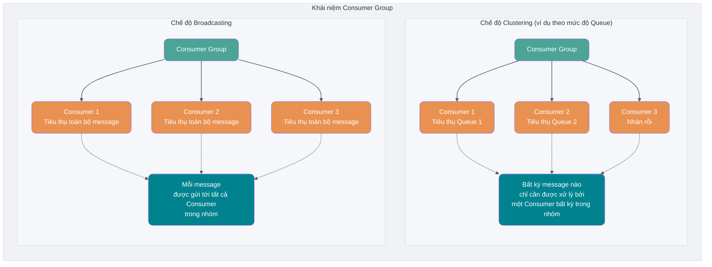

Trong một Consumer Group, quan hệ subscribe, tính thứ tự gửi message và chiến lược retry tiêu thụ đều thống nhất với nhau:

- Quan hệ subscribe: Apache RocketMQ quản lý quan hệ subscribe theo mức độ Consumer Group, giúp quản lý và truy vết các đăng ký dễ dàng.
- Tính thứ tự gửi message: Khi Server Apache RocketMQ gửi message tới Consumer để tiêu thụ, nó hỗ trợ gửi tuần tự (Orderly) và gửi đồng thời (Concurrently); phương thức gửi được cấu hình thống nhất trên Consumer Group.
- Chiến lược retry tiêu thụ: Chiến lược thử lại khi Consumer xử lý message thất bại, bao gồm số lần retry, cấu hình Dead Letter Queue, v.v.

Phiên bản Server RocketMQ 5.x: Các hành vi tiêu thụ nêu trên của Consumer được lấy thống nhất từ Consumer Group liên kết, do đó hành vi tiêu thụ của tất cả Consumer trong cùng một nhóm chắc chắn nhất quán với nhau, client không cần bận tâm.

Các phiên bản cũ Server RocketMQ 3.x/4.x: Các logic tiêu thụ nêu trên do giao diện của client Consumer tự định nghĩa, vì vậy bạn phải tự đảm bảo khi cấu hình ở phía client rằng hành vi tiêu thụ của các Consumer trong cùng một nhóm phải giống hệt nhau (theo tài liệu chính thức).

**So sánh hai chế độ tiêu thụ:**

| Tiêu chí so sánh | Chế độ Clustering                                                          | Chế độ Broadcasting                                                  |
| ---------------- | -------------------------------------------------------------------------- | -------------------------------------------------------------------- |
| **Tiêu thụ message** | Bất kỳ message nào chỉ cần được xử lý bởi một Consumer bất kỳ trong nhóm | Mỗi message được đẩy tới tất cả các Consumer trong nhóm              |
| **Scale Up/Down**| Có thể tăng/giảm năng lực tiêu thụ bằng cách tăng/giảm số lượng Consumer   | Tăng/giảm số lượng Consumer không làm tăng/giảm năng lực tiêu thụ    |
| **Kịch bản phù hợp** | Cần nâng cao năng lực tiêu thụ, tránh tiêu thụ trùng lặp                 | Cần tất cả các Consumer đều nhận được message                        |

## Làm thế nào để giải quyết vấn đề tiêu thụ theo thứ tự và tiêu thụ trùng lặp?

Thực ra, đây đều là những vấn đề mình đã nhắc tới ở phần tác dụng phụ khi giới thiệu về Message Queue — tức là không chỉ riêng RocketMQ mà mọi message middleware đều cần phải giải quyết các bài toán này.

Ở phần giới thiệu kiến trúc kỹ thuật RocketMQ phía trên, mình đã trình bày **cách nó đảm bảo tính sẵn sàng cao (HA)**; bài viết sẽ không đi sâu vào phần vận hành dựng hệ thống, nếu quan tâm bạn có thể lên trang chủ chính thức làm theo hướng dẫn để tự dựng một cụm RocketMQ Cluster cho riêng mình.

> Thực ra kiến trúc của Kafka về cơ bản khá giống với RocketMQ, chỉ khác ở chỗ các bản Kafka đời đầu phụ thuộc vào ZooKeeper để quản lý metadata, và **Partition** của nó tương đương với **Queue** trong RocketMQ. Ngoài ra còn một số chi tiết nhỏ khác sẽ được đề cập ở phần sau.
>
> Bổ sung: Các bản Kafka đời đầu dùng ZooKeeper để quản lý metadata, còn các phiên bản mới đã giới thiệu chế độ KRaft. Điểm so sánh ở đây nằm ở tư tưởng kiến trúc "dùng Partition/Queue để tăng mức độ song song", không nên mặc định đơn giản rằng Kafka lúc nào cũng phải phụ thuộc vào ZooKeeper.

### Tiêu thụ theo thứ tự (Ordered Consumption)

Qua phần giới thiệu kiến trúc kỹ thuật ở trên, chúng ta đã biết **RocketMQ không đảm bảo thứ tự ở cấp độ toàn Topic, mà chỉ đảm bảo thứ tự ở cấp độ từng Queue**.

Điều này lại dẫn đến hai khái niệm — **Thứ tự thông thường (Normal Order)** và **Thứ tự nghiêm ngặt (Strict Order)**.

Thứ tự thông thường có nghĩa là **các message mà Consumer nhận được thông qua cùng một Queue tiêu thụ sẽ có thứ tự**, còn message nhận từ các Queue khác nhau có thể không theo thứ tự. Normal Order Message **sẽ không đảm bảo được thứ tự message trong trường hợp Broker khởi động lại** (trong một khoảng thời gian ngắn).

Thứ tự nghiêm ngặt có nghĩa là **toàn bộ message** mà Consumer nhận được đều đảm bảo đúng thứ tự. Strict Order Message **vẫn đảm bảo được tính thứ tự của message ngay cả khi có sự cố bất thường xảy ra**.

Tuy nhiên, Strict Order nghe thì rất lý tưởng, nhưng cái giá phải trả để hiện thực hóa nó là cực kỳ lớn. Nếu bạn sử dụng chế độ Strict Order, chỉ cần một máy trong cụm Broker không khả dụng thì toàn bộ cụm sẽ ngừng khả dụng. Lúc đó còn dùng thế nào được nữa? Hiện nay kịch bản ứng dụng chính của chế độ này chủ yếu chỉ nằm ở việc đồng bộ `binlog`.

Thông thường, hệ thống dùng `MQ` đều có thể chấp nhận sự đảo lộn thứ tự trong thời gian ngắn, nên khuyến nghị sử dụng chế độ Normal Order.

Vậy khi chúng ta đã sử dụng **chế độ Normal Order**, qua phần trước ta biết rằng lúc Producer tạo message sẽ thực hiện Round-Robin (tùy thuộc vào chiến lược Load Balancing của bạn) để gửi message vào các Queue khác nhau trong cùng một Topic. Vậy nếu lúc này mình có một chuỗi message là: tạo đơn hàng, thanh toán đơn hàng và xuất kho giao hàng của cùng một đơn hàng, thì dưới chiến lược Round-Robin **ba message này sẽ bị gửi vào các Queue khác nhau**; vì nằm ở các Queue khác nhau nên lúc này không thể tận dụng đặc tính có thứ tự trong từng Queue của RocketMQ để đảm bảo thứ tự message nữa.


Vậy giải quyết thế nào?

Thực ra rất đơn giản: việc ta cần làm chỉ là đưa các message có cùng ngữ cảnh nghiệp vụ vào cùng một Queue (ví dụ ở đây là cùng một đơn hàng), do đó ta chỉ cần sử dụng **phương pháp băm chia lấy dư (Hash Modulo)** để đảm bảo cùng một đơn hàng luôn đi vào cùng một Queue là được.

**Phiên bản 4.x: Sử dụng `MessageQueueSelector`**

RocketMQ phiên bản 4.x tùy biến logic chọn Queue thông qua việc hiện thực hóa `MessageQueueSelector`:

```java
SendResult sendResult = producer.send(msg, new MessageQueueSelector() {
    @Override
    public MessageQueue select(List<MessageQueue> mqs, Message msg, Object arg) {
        // Tính chỉ số Queue dựa theo khóa nghiệp vụ như Order ID
        Long orderId = (Long) arg;
        int index = Math.floorMod(Long.hashCode(orderId), mqs.size());
        return mqs.get(index);
    }
}, orderId);
```

**Phiên bản 5.x: Sử dụng nhóm message (`MessageGroup`)**

RocketMQ phiên bản 5.x giới thiệu khái niệm **MessageGroup**, đảm bảo tính thứ tự của các message trong cùng một nhóm bằng cách thiết lập `MessageGroup`:

```java
Message message = messageBuilder.setTopic("topic")
        .setTag("messageTag")
        // Thiết lập nhóm sắp xếp cho Ordered Message
        .setMessageGroup("fifoGroup001")  // Ví dụ dùng Order ID làm MessageGroup
        .setBody("messageBody".getBytes())
        .build();
```

**Thuật toán chọn Queue**

RocketMQ cài đặt sẵn hai thuật toán chọn Queue:

- **Thuật toán Round-Robin (mặc định)**: Lần lượt gửi message vào các Queue thuộc Topic đã chỉ định, đảm bảo message phân bố đồng đều
- **Thuật toán độ trễ gửi nhỏ nhất (Minimum Delivery Latency)**: Mỗi lần gửi message sẽ thống kê độ trễ khi gửi, lúc chọn Queue sẽ ưu tiên các Queue có độ trễ thấp hơn

```java
// Bật thuật toán chọn Queue theo độ trễ gửi nhỏ nhất
producer.setSendLatencyFaultEnable(true);
```

### Xử lý một số tình huống đặc biệt

#### Lỗi khi gửi message

Sau khi chọn Queue, Producer sẽ thiết lập kết nối với Broker và gửi message qua request mạng; nếu Broker bị sập hoặc mạng chập chờn gây timeout khi gửi message, lúc này RocketMQ sẽ thực hiện retry.

Hệ thống sẽ chọn lại một MessageQueue ở Broker khác để gửi lại; mặc định retry 2 lần, có thể tự cấu hình thủ công:

```java
producer.setRetryTimesWhenSendFailed(5);
```

#### Message quá lớn

Ở đây cần phân biệt hai ngưỡng giới hạn: phía client có thể cấu hình nén phần thân message khi vượt quá một ngưỡng nhất định (ví dụ giá trị mặc định phổ biến ở client Java 4.x là 4KB), còn kích thước thân message tối đa mặc định trong tham số chính thức của RocketMQ 5.x là 4MB, và kích thước này chưa tính hiệu quả bổ sung sau khi nén. Với các file lớn, không nên nhét thẳng vào thân message mà thông thường nên đưa file lên Object Storage hoặc hệ thống file, trong MQ chỉ truyền Business ID và đường dẫn file.

### Tiêu thụ trùng lặp (Duplicate Consumption)

RocketMQ cũng giống như đa số các Message Queue khác, về mặt kỹ thuật thường được thiết kế theo ngữ nghĩa **At-Least-Once Delivery (gửi ít nhất một lần)**: chỉ cần xảy ra tình huống tiêu thụ thất bại, timeout, client khởi động lại hoặc mạng chập chờn, cùng một message nghiệp vụ hoàn toàn có thể bị gửi lại lần nữa. Do đó, tư tưởng cốt lõi để giải quyết tiêu thụ trùng lặp gói gọn trong hai từ — **Tính lũy đẳng (Idempotency)**. Trong lập trình, đặc điểm của một thao tác *lũy đẳng (idempotent)* là dù thực thi bất kỳ bao nhiêu lần đi nữa thì tác động tạo ra đều giống hệt như khi thực thi đúng một lần. Ví dụ, ta có một hệ thống cộng điểm thưởng theo đơn hàng: cứ mỗi lần có message đến, nó chịu trách nhiệm cộng số điểm tương ứng cho người dùng đã tạo đơn đó. Nhưng có một lần, Message Queue gửi cho hệ thống đơn hàng thông tin đơn hàng của FrancisQ yêu cầu cộng thêm 500 điểm. Sau khi hệ thống tích điểm nhận được thông tin đơn hàng của FrancisQ và xử lý xong, lúc gửi phản hồi thành công về cho Message Queue thì mạng gặp sự cố chập chờn (tất nhiên còn nhiều tình huống khác như Broker bất ngờ khởi động lại, v.v.), khiến phản hồi đó không gửi tới được.

Khi đó, Message Queue không nhận được phản hồi từ hệ thống tích điểm thì có thử gửi lại message này không? Vấn đề nảy sinh ngay: nếu gửi lại message đó, nhỡ hệ thống lại cộng thêm 500 điểm nữa vào tài khoản của FrancisQ thì sao?

Vì vậy, chúng ta cần cài đặt **Tính lũy đẳng (Idempotency)** cho phía Consumer, tức là với cùng một message thì kết quả xử lý dù chạy bao nhiêu lần cũng không thay đổi.

Vậy làm sao để cài đặt Idempotency cho nghiệp vụ? Điều này vẫn cần kết hợp với bài toán nghiệp vụ cụ thể. Lệnh `SETNX` của Redis có thể dùng để chống trùng lặp ngắn hạn hoặc kiểm soát Idempotency mức yếu, nhưng không nên xem nó là căn cứ duy nhất cho mọi kịch bản; đối với các kịch bản đòi hỏi tính nhất quán mạnh như đơn hàng, thanh toán, tồn kho, nên ưu tiên dùng **Unique Key của Database, bảng Idempotency (Idempotency Table) hoặc máy trạng thái nghiệp vụ (State Machine)** để làm chốt chặn cuối cùng, đảm bảo message trùng lặp sẽ không gây ghi trùng hoặc trừ trùng dữ liệu.

Tuy nhiên, quan trọng nhất vẫn là **áp dụng giải pháp phù hợp cho từng kịch bản cụ thể**; bạn cần biết nghiệp vụ tiêu thụ message của mình là hoàn toàn không được phép trùng lặp hay có thể dung thứ một mức độ trùng lặp nào đó, rồi mới chọn phương thức kiểm tra mạnh hay yếu. Dù sao trong lĩnh vực khoa học máy tính cũng hiếm khi có thứ gọi là "viên đạn bạc".

Việc đảm bảo Idempotency ở phía Consumer của RocketMQ nên ưu tiên thiết kế theo **khóa duy nhất nghiệp vụ (Business Unique Key)** thay vì chỉ dựa vào Message ID. Chẳng hạn, message thanh toán đơn hàng dùng mã giao dịch thanh toán hoặc mã đơn hàng làm khóa duy nhất, còn message trừ kho dùng mã luồng nghiệp vụ làm khóa duy nhất. Như vậy, ngay cả khi message bị retry, bù trừ hoặc gửi lại, miễn là khóa duy nhất nghiệp vụ không đổi thì vẫn tránh được việc ghi trùng dữ liệu.

Và trong toàn bộ ngành Internet, Idempotency không chỉ áp dụng cho bài toán tiêu thụ trùng lặp của Message Queue; các phương pháp hiện thực hóa Idempotency này cũng áp dụng tương tự để **giải quyết vấn đề request trùng lặp hoặc lời gọi trùng lặp ở nhiều kịch bản khác**. Ví dụ như thiết kế HTTP service có tính lũy đẳng để **giải quyết tình trạng frontend hoặc App gửi trùng form dữ liệu**, hay thiết kế một microservice có tính lũy đẳng để xử lý **vấn đề gọi trùng do cơ chế tự động retry của RPC framework**.

## RocketMQ hiện thực hóa Distributed Transaction như thế nào?

Giải thích thế nào về Distributed Transaction (giao dịch phân tán)? Mọi người đều biết Transaction rồi đúng không? **Hoặc tất cả cùng thực thi thành công, hoặc tất cả cùng không thực thi**. Trong cùng một hệ thống ta có thể cài đặt Transaction rất dễ dàng, nhưng trong kiến trúc phân tán, ta có rất nhiều service triển khai trên các hệ thống khác nhau mà giữa các service đó lại cần gọi lẫn nhau. Ví dụ khi đặt đơn hàng xong rồi cộng điểm thưởng: nếu không đảm bảo được Distributed Transaction thì sẽ xảy ra cảnh hệ thống A đã tạo đơn hàng nhưng hệ thống B cộng điểm thất bại, hoặc hệ thống A chưa hề tạo đơn hàng nhưng hệ thống B lại đã cộng điểm. Trường hợp đầu bất lợi cho người dùng, trường hợp sau gây thiệt hại cho đơn vị vận hành — cả hai đều là điều chúng ta không muốn thấy.

Vậy giải quyết bài toán này như thế nào?

Hiện nay các phương án triển khai Distributed Transaction phổ biến gồm có 2PC, TCC và Transaction Message (cơ chế Half Message). Mỗi phương án đều có kịch bản áp dụng riêng, nhưng cũng có nhược điểm riêng, **không có giải pháp nào là hoàn hảo tuyệt đối**.

Trong RocketMQ sử dụng **Transaction Message kết hợp với cơ chế kiểm tra ngược Transaction (Transaction Check)** để giải quyết bài toán Distributed Transaction. Mình đã vẽ một sơ đồ dưới đây, các bạn có thể đối chiếu theo hình để dễ hiểu hơn.


**Giải thích chi tiết luồng xử lý Transaction Message**

1. **Gửi Half-Transaction Message**: Producer gửi message tới Server RocketMQ.
2. **Server xác nhận**: Sau khi lưu bền vững message thành công, Server trả về Ack xác nhận cho Producer rằng message đã gửi thành công; lúc này message được đánh dấu là "tạm thời chưa thể gửi tới Consumer" — message ở trạng thái này chính là **Half-Transaction Message**.
3. **Thực thi Local Transaction**: Producer bắt đầu thực thi logic Local Transaction.
4. **Gửi xác nhận lần hai**: Producer căn cứ vào kết quả thực thi Local Transaction để gửi kết quả xác nhận lần hai (`Commit` hoặc `Rollback`) lên Server.
5. **Kiểm tra ngược Transaction**: Nếu Server chưa nhận được kết quả xác nhận lần hai, hoặc kết quả nhận được là `Unknown`, sau một khoảng thời gian cố định, Server sẽ chủ động gửi yêu cầu **kiểm tra ngược message** về phía Producer.
6. **Kiểm tra Local Transaction**: Sau khi nhận được yêu cầu kiểm tra ngược, Producer cần tra cứu kết quả thực thi cuối cùng của Local Transaction tương ứng với message đó.
7. **Gửi lại xác nhận lần hai**: Producer căn cứ vào trạng thái cuối cùng kiểm tra được của Local Transaction để gửi lại xác nhận lần hai lên Server.

Ở bước thứ nhất khi gửi Half Message, ý nghĩa của nó là **trước khi Transaction được commit, đối với Consumer thì message này ở trạng thái vô hình (chưa nhìn thấy được)**.

> Vậy làm sao để ghi message xuống rồi mà vẫn ẩn với người dùng? Cách làm đối với Transaction Message của RocketMQ là: nếu message là Half Message, RocketMQ sẽ sao lưu lại Topic gốc và MessageQueue gốc của message đó, sau đó **đổi Topic** thành `RMQ_SYS_TRANS_HALF_TOPIC`. Do các Consumer Group không subscribe Topic nội bộ này nên phía Consumer không thể tiêu thụ các message loại Half; **sau đó RocketMQ sẽ bật một tác vụ định kỳ (scheduled task), kéo message từ Topic `RMQ_SYS_TRANS_HALF_TOPIC` ra xử lý**, tìm một nhà cung cấp dịch vụ (service provider) theo Producer Group để gửi request kiểm tra ngược trạng thái Transaction, rồi căn cứ vào trạng thái Transaction trả về để quyết định Commit hay Rollback message.

Bạn hãy thử hình dung xem: nếu không có **cơ chế kiểm tra ngược Transaction** bắt đầu từ bước 5, khi mạng chập chờn làm bước 4 không gửi đi được, thì MQ sẽ rơi vào tình trạng không biết có nên giao message cho Consumer tiêu thụ hay không. Trong RocketMQ giải quyết việc này bằng cơ chế kiểm tra ngược Transaction như trên, còn trong Kafka thông thường sẽ ném ra thẳng một Exception để người dùng tự xử lý.

Bạn cũng cần lưu ý rằng, thao tác từ `MQ Server` trỏ tới hệ thống B đã không còn liên quan trực tiếp đến hệ thống A nữa; tức là Distributed Transaction trong Message Queue thực chất là — **Local Transaction và việc lưu message vào Message Queue mới nằm chung trong một Transaction**. Nhờ vậy mới tạo ra **tính nhất quán cuối cùng (Eventual Consistency)** của giao dịch, bởi toàn bộ quá trình diễn ra bất đồng bộ, **mỗi hệ thống chỉ cần đảm bảo phần Transaction của chính mình là đủ**.

Vấn đề hay gặp trong thực tế triển khai: Transaction Message cần một `TransactionListener` để lắng nghe xem Local Transaction có thành công hay không, và interface `TransactionListener` đó chỉ cho phép hiện thực hóa một lần duy nhất (trên một Producer/Template). Điều đó đồng nghĩa với việc nếu dồn toàn bộ Local Transaction của đủ loại Transaction Message vào chung một phương thức của interface đó thì chắc chắn sẽ phát sinh sự phụ thuộc chặt (coupling) và hàng loạt câu lệnh rẽ nhánh kiểm tra kiểu. Có thể dùng Functional Interface `Function` để gói toàn bộ quy trình nghiệp vụ lại, truyền như một tham số vào phương thức của Listener, rồi gọi `function.apply()` để chạy nghiệp vụ — Transaction cũng sẽ thực thi bên trong `apply()`. Cách này giúp tách rời (decouple) giữa Listener và nghiệp vụ, giúp giải pháp trở nên khả thi trong môi trường Production thực tế.

Ngoài ra, khi kiểm tra ngược Transaction không nên chỉ kiểm tra mỗi Redis. Trạng thái cuối cùng của Transaction phải lấy chuẩn theo trạng thái trong bảng Transaction hoặc bảng nghiệp vụ được commit cùng một Database với Local Transaction; Redis tối đa chỉ nên đóng vai trò lớp Cache hoặc bản sao tăng tốc truy vấn. Ví dụ dưới đây giữ lại cách viết với Redis nhằm minh họa ý tưởng; trong môi trường Production cần lưu trạng thái Local Transaction xuống nơi lưu trữ tin cậy, đồng thời dùng Business Unique Key hoặc ràng buộc Database để đảm bảo Idempotency ở phía Consumer.

1. Mô phỏng yêu cầu thêm lịch sử xem của người dùng

```java
@PostMapping("/add")
@ApiOperation("添加用户浏览记录")
public Result<TransactionSendResult> add(Long userId, Long forecastLogId) {

        // Lập trình hàm (Functional): lưu lịch sử xem vào DB
        Function<String, Boolean> function = transactionId -> viewHistoryHandler.addViewHistory(transactionId, userId, forecastLogId);

        Map<String, Long> hashMap = new HashMap<>();
        hashMap.put("userId", userId);
        hashMap.put("forecastLogId", forecastLogId);
        String jsonString = JSON.toJSONString(hashMap);

        // Gửi Transaction Message; gói thao tác Local Transaction bằng Function interface và truyền vào như một tham số
        TransactionSendResult transactionSendResult = mqProducerService.sendTransactionMessage(jsonString, MQDestination.TAG_ADD_VIEW_HISTORY, function);
        return Result.success(transactionSendResult);
}
```

2. Phương thức gửi Transaction Message

```java
/**
 * Gửi Transaction Message
 *
 * @param msgBody
 * @param tag
 * @param function
 * @return
 */
public TransactionSendResult sendTransactionMessage(String msgBody, String tag, Function<String, Boolean> function) {
    // Khởi tạo thân message
    Message<String> message = buildMessage(msgBody);

    // Khởi tạo thông tin đích gửi message
    String destination = buildDestination(tag);

    TransactionSendResult result = rocketMQTemplate.sendMessageInTransaction(destination, message, function);
    return result;
}
```

3. Message Listener phía Producer, chỉ cho phép một lớp hiện thực hóa Listener này

```java
@Slf4j
@RocketMQTransactionListener
public class TransactionMsgListener implements RocketMQLocalTransactionListener {

    @Autowired
    private RedisService redisService; // Cache minh họa, môi trường Production không dùng làm nguồn duy nhất cho trạng thái Transaction

    /**
     * Thực thi Local Transaction (chạy khi gửi Half Message thành công)
     *
     * @param message
     * @param o
     * @return commit or rollback or unknown
     */
    @Override
    public RocketMQLocalTransactionState executeLocalTransaction(Message message, Object o) {

        // 1. Lấy Transaction ID
        String transactionId = null;
        try {
            transactionId = message.getHeaders().get("rocketmq_TRANSACTION_ID").toString();
            // 2. Kiểm tra đối tượng Function truyền vào có null không; nếu null nghĩa là không có nghiệp vụ cần xử lý, hủy bỏ message
            if (o == null) {
                // Message trả về trạng thái ROLLBACK sẽ bị loại bỏ
                log.info("事务消息回滚，没有需要处理的业务 transactionId={}", transactionId);
                return RocketMQLocalTransactionState.ROLLBACK;
            }
            // Ép kiểu Object o sang đối tượng Function
            Function<String, Boolean> function = (Function<String, Boolean>) o;
            // Thực thi nghiệp vụ; Transaction cũng sẽ chạy bên trong function.apply
            Boolean apply = function.apply(transactionId);
            if (apply) {
                log.info("事务提交，消息正常处理 transactionId={}", transactionId);
                // Message trả về trạng thái COMMIT sẽ được Consumer tiêu thụ ngay
                return RocketMQLocalTransactionState.COMMIT;
            }
        } catch (Exception e) {
            log.info("出现异常 返回ROLLBACK transactionId={}", transactionId);
            return RocketMQLocalTransactionState.ROLLBACK;
        }
        return RocketMQLocalTransactionState.ROLLBACK;
    }

    /**
     * Cơ chế kiểm tra ngược, tra cứu trạng thái của Local Transaction
     *
     * @param message
     * @return
     */
    @Override
    public RocketMQLocalTransactionState checkLocalTransaction(Message message) {

        String transactionId = message.getHeaders().get("rocketmq_TRANSACTION_ID").toString();

        // Ví dụ minh họa tra cứu Redis; môi trường Production nên truy vấn trạng thái cuối cùng từ bảng Transaction nội bộ hoặc bảng nghiệp vụ
        MqTransaction mqTransaction = redisService.getCacheObject("mqTransaction:" + transactionId);
        if (Objects.isNull(mqTransaction)) {
            return RocketMQLocalTransactionState.ROLLBACK;
        }
        return RocketMQLocalTransactionState.COMMIT;
    }
}
```

4. Mô phỏng kịch bản nghiệp vụ; phương thức ở đây bắt buộc phải tách ra đặt ở một class khác. Nếu bên gọi và bên được gọi nằm trong cùng một class thì sẽ xảy ra lỗi mất hiệu lực Transaction (`@Transactional` self-invocation).

```java
@Component
public class ViewHistoryHandler {

    @Autowired
    private IViewHistoryService viewHistoryService;

    @Autowired
    private IMqTransactionService mqTransactionService;

    @Autowired
    private RedisService redisService; // Cache minh họa, trạng thái Transaction vẫn phải lấy Database làm chuẩn

    /**
     * Lưu lịch sử xem vào Database
     *
     * @param transactionId
     * @param userId
     * @param forecastLogId
     * @return
     */
    @Transactional
    public Boolean addViewHistory(String transactionId, Long userId, Long forecastLogId) {
        // Tạo bản ghi lịch sử xem
        ViewHistory viewHistory = new ViewHistory();
        viewHistory.setUserId(userId);
        viewHistory.setForecastLogId(forecastLogId);
        viewHistory.setCreateTime(LocalDateTime.now());
        boolean save = viewHistoryService.save(viewHistory);

        // Thông tin Local Transaction
        MqTransaction mqTransaction = new MqTransaction();
        mqTransaction.setTransactionId(transactionId);
        mqTransaction.setCreateTime(new Date());
        mqTransaction.setStatus(MqTransaction.StatusEnum.VALID.getStatus());

        // Trạng thái Transaction cần được lưu vào DB trong cùng một Transaction với dữ liệu nghiệp vụ nội bộ
        mqTransactionService.save(mqTransaction);

        // Redis chỉ nên đóng vai trò bản sao Cache, không thể làm nguồn duy nhất cho trạng thái Transaction
        redisService.setCacheObject("mqTransaction:" + transactionId, mqTransaction, 4L, TimeUnit.HOURS);

        // Bỏ comment để mô phỏng ngoại lệ làm Transaction Rollback
        // int i = 10 / 0;

        return save;
    }
}
```

5. Tiêu thụ message và xử lý Idempotency

```java
@Service
@RocketMQMessageListener(topic = MQDestination.TOPIC, selectorExpression = MQDestination.TAG_ADD_VIEW_HISTORY, consumerGroup = MQDestination.TAG_ADD_VIEW_HISTORY)
public class ConsumerAddViewHistory implements RocketMQListener<Message> {
    // Phương thức này sẽ được thực thi khi lắng nghe thấy message
    @Override
    public void onMessage(Message message) {
        // Kiểm tra Idempotency
        String transactionId = message.getTransactionId();

        // Ví dụ minh họa tra cứu Redis; kịch bản nhất quán mạnh nên dùng Business Unique Key, bảng Idempotency hoặc ràng buộc DB để đảm bảo cuối cùng
        MqTransaction mqTransaction = redisService.getCacheObject("mqTransaction:" + transactionId);

        // Không tồn tại bản ghi Transaction
        if (Objects.isNull(mqTransaction)) {
            return;
        }

        // Đã tiêu thụ rồi
        if (Objects.equals(mqTransaction.getStatus(), MqTransaction.StatusEnum.CONSUMED.getStatus())) {
            return;
        }

        String msg = new String(message.getBody());
        Map<String, Long> map = JSON.parseObject(msg, new TypeReference<HashMap<String, Long>>() {
        });
        Long userId = map.get("userId");
        Long forecastLogId = map.get("forecastLogId");

        // Xử lý nghiệp vụ hạ nguồn
        // TODO Ghi nhận sở thích người dùng, cập nhật chân dung người dùng

        // TODO Cập nhật lượt xem bài viết dự báo chứng khoán, tính lại thứ hạng hiển thị bài viết

        // Cập nhật trạng thái thành đã tiêu thụ
        mqTransaction.setUpdateTime(new Date());
        mqTransaction.setStatus(MqTransaction.StatusEnum.CONSUMED.getStatus());
        redisService.setCacheObject("mqTransaction:" + transactionId, mqTransaction, 4L, TimeUnit.HOURS);
        log.info("监听到消息：msg={}", JSON.toJSONString(map));
    }
}
```

## Làm thế nào để giải quyết vấn đề tồn đọng message (Message Backlog)?

Ở trên chúng ta đã đề cập đến một tính năng rất quan trọng của Message Queue — **Cắt đỉnh tải (Peak Shaving)**. Vậy nếu đỉnh lưu lượng đó quá lớn khiến message bị tồn đọng (backlog) trong hàng đợi thì phải làm sao?

Thực chất có thể khái quát hóa bài toán này lại, bởi gốc rễ sinh ra tồn đọng message chỉ có đúng hai nguyên nhân — Producer tạo message quá nhanh hoặc Consumer tiêu thụ quá chậm.

Chúng ta có thể tiếp cận giải quyết vấn đề này từ nhiều góc độ: khi lưu lượng chạm đỉnh do Producer tạo message quá nhanh, ta có thể dùng các biện pháp **giới hạn lưu lượng / giảm tải (Rate Limiting & Degradation)**, đồng thời cũng có thể tăng thêm nhiều instance Consumer để mở rộng ngang (Horizontal Scaling), nâng cao năng lực tiêu thụ cho khớp với tốc độ tăng đột biến của bên gửi. Còn nếu Consumer tiêu thụ quá chậm, trước tiên cần kiểm tra **xem Consumer có đang gặp lỗi tiêu thụ hàng loạt hay không**, hoặc in log ra để rà soát xem có Thread nào bị treo, xảy ra tình trạng chiếm giữ Lock không nhả tài nguyên hay không.

> Việc tăng số lượng instance Consumer thường giúp giảm tình trạng tồn đọng do thiếu năng lực tiêu thụ, nhưng có cần tăng thêm Queue hay không thì còn phụ thuộc vào chiến lược Load Balancing và số lượng Queue hiện có.
>
> **Lưu ý**: Với cơ chế Load Balancing mức độ Queue của Remoting SDK truyền thống, **trong cùng một nhóm thì mỗi Queue chỉ được gán cho một instance Consumer**. Chỉ khi số Consumer sau khi scale vượt quá số Queue khả dụng thì mới xuất hiện tình trạng một số Consumer không có Queue nào để tiêu thụ.
>
> PushConsumer và SimpleConsumer của RocketMQ 5.x mặc định sử dụng **chiến lược Load Balancing mức độ Message**, cho phép nhiều Consumer trong cùng một Consumer Group cùng tiêu thụ các message nằm trong cùng một Queue theo mức độ từng message; do đó ngay cả khi số lượng Consumer nhiều hơn số Queue thì vẫn tăng được mức độ song song khi tiêu thụ. Riêng PullConsumer vẫn theo mức độ Queue, nên khi scale vẫn cần chú ý đến số lượng Queue.


Khi điều tra xử lý tồn đọng message trên Production, có thể đi theo trình tự sau:

1. **Xác định phạm vi tồn đọng trước**: Là chỉ một Topic, một Queue đơn lẻ, hay toàn bộ Broker đều đang bị tồn đọng.
2. **Xem tốc độ sản xuất và tốc độ tiêu thụ**: Nếu lượng sản xuất tăng đột biến thì cần Rate Limiting hoặc cắt đỉnh, nếu tốc độ tiêu thụ sụt giảm thì kiểm tra Consumer.
3. **Kiểm tra thời gian xử lý tại Consumer**: Tập trung rà soát slow SQL, API bên ngoài chậm, tranh chấp Lock (Lock Contention), Thread Pool và kích thước batch.
4. **Kiểm tra mối tương quan giữa Queue và Consumer**: Với 4.x và PullConsumer cần chú ý xem số Queue có đang bóp nghẹt khả năng xử lý đồng thời không; với PushConsumer/SimpleConsumer 5.x cần xem thêm chiến lược Load Balancing mức độ Message.
5. **Thực hiện scale tạm thời và bù trừ**: Khi cần thiết có thể scale nóng Consumer, tăng thêm Queue, tách Topic; phần tồn đọng lịch sử có thể dùng tác vụ xử lý lô (batch job) để tiêu thụ đuổi dần.

Đừng chỉ chăm chăm vào việc "thêm Consumer". Nếu một Queue tiêu thụ tuần tự (FIFO) bị kẹt, hoặc bản thân logic xử lý nghiệp vụ vốn đã quá chậm, thì việc thêm Consumer cũng không cải thiện được bao nhiêu.

## Tiêu thụ hồi tố (Backtrack Consumption) là gì?

Tiêu thụ hồi tố là tình huống những message mà Consumer đã tiêu thụ thành công trước đó, nay do nhu cầu nghiệp vụ lại cần tiêu thụ lại. Trong RocketMQ, sau khi Broker gửi thành công message cho Consumer, **message vẫn được giữ lại**. Và việc tiêu thụ lại thông thường được thực hiện theo chiều thời gian: ví dụ do hệ thống Consumer gặp sự cố, sau khi khôi phục cần tiêu thụ lại toàn bộ dữ liệu từ 1 giờ trước, thì Broker phải cung cấp cơ chế cho phép lùi lại tiến độ tiêu thụ theo mốc thời gian. RocketMQ hỗ trợ tiêu thụ hồi tố theo thời gian với độ chính xác đến từng mili-giây.

## RocketMQ đảm bảo đọc/ghi hiệu năng cao như thế nào?

### Phương thức I/O truyền thống


Đọc/ghi I/O truyền thống thực chất là tổ hợp thao tác `read` + `write`, toàn bộ quá trình được chia thành các bước sau:

- Người dùng gọi hàm `read()` để bắt đầu đọc dữ liệu; lúc này xảy ra một lần chuyển đổi ngữ cảnh (Context Switch) từ User Space sang Kernel Space, chính là lần chuyển đổi 1 trên hình minh họa.
- Dữ liệu từ đĩa cứng được DMA copy vào bộ đệm Kernel (Kernel Buffer).
- Dữ liệu từ Kernel Buffer được CPU copy sang bộ đệm người dùng (User Buffer), nhờ đó phía ứng dụng — tức là code do chúng ta viết — mới lấy được dữ liệu từ file.
- Hàm `read()` trả về, lúc này ngữ cảnh chuyển từ Kernel Space về lại User Space, chính là lần chuyển đổi 2 trên hình.
- Sau khi có được dữ liệu, ta có thể gọi hàm `write()`, lúc này ngữ cảnh lại chuyển từ User Space sang Kernel Space, tức lần chuyển đổi 3.
- CPU copy dữ liệu từ User Buffer sang Socket Buffer.
- Dữ liệu từ Socket Buffer được copy ra card mạng (NIC).
- Hàm `write()` trả về, ngữ cảnh chuyển ngược từ Kernel Space về lại User Space, tức lần chuyển đổi 4.

Toàn bộ quá trình diễn ra 4 lần chuyển đổi ngữ cảnh (Context Switch) và 4 lần copy dữ liệu; trong kịch bản đồng thời cao (High Concurrency), điều này chắc chắn ảnh hưởng nặng nề đến hiệu năng đọc/ghi, vì thế kỹ thuật Zero-Copy đã ra đời.

### Kỹ thuật Zero-Copy

#### mmap

`mmap` (Memory Map) là một phương pháp ánh xạ file vào bộ nhớ, tức là ánh xạ một file hoặc đối tượng khác vào không gian địa chỉ của tiến trình (Process), tạo ra quan hệ ánh xạ 1-1 giữa địa chỉ file trên đĩa và một đoạn địa chỉ ảo trong không gian địa chỉ ảo của tiến trình.

Nói đơn giản là Kernel Buffer và Application Buffer dùng chung vùng nhớ với nhau, qua đó giảm đi 1 lần CPU copy từ Read Buffer sang User Buffer. Dựa vào đó, sơ đồ kiến trúc trên trở thành:


Đọc/ghi I/O dựa trên `mmap` thực chất biến thành thao tác `mmap` + `write`, tức là dùng `mmap` thay thế cho thao tác `read` trong I/O truyền thống.

Khi người dùng gọi `mmap`, nhân hệ điều hành (Kernel) chủ yếu thiết lập quan hệ ánh xạ giữa file và không gian địa chỉ ảo của tiến trình, chứ không copy toàn bộ nội dung file vào bộ nhớ ngay tại bước này. Chỉ khi thực sự truy cập vào vùng ánh xạ, nếu trang bộ nhớ (Page) tương ứng chưa có trong Page Cache, hệ thống mới kích hoạt lỗi trang (Page Fault) để nạp dữ liệu từ đĩa vào bộ nhớ; sau đó người dùng gọi `write` vẫn cần ghi dữ liệu từ Kernel Buffer sang Socket Buffer.

Quá trình này xảy ra 4 lần Context Switch và 3 lần copy I/O; cách hiện thực hóa trong Java như sau:

```java
FileChannel fileChannel = new RandomAccessFile("test.txt", "rw").getChannel();
MappedByteBuffer mappedByteBuffer = fileChannel.map(FileChannel.MapMode.READ_WRITE, 0, fileChannel.size());
```

#### sendfile

`sendfile()` cũng giống `mmap()` ở chỗ giảm được 1 lần CPU copy, nhưng đồng thời nó còn giảm được thêm 2 lần Context Switch.


Như trên hình, khi người dùng gọi `sendfile()` sẽ xảy ra lần chuyển đổi 1, sau đó dữ liệu được DMA copy vào Kernel Buffer, tiếp đến Kernel đẩy dữ liệu vào vùng đệm liên quan tới Socket rồi ghi ra card mạng; khi `sendfile()` trả về thì xảy ra lần chuyển đổi 2. Tùy theo hệ điều hành và năng lực của card mạng mà số lần copy cụ thể có thể khác nhau đôi chút, nhưng lợi ích cốt lõi là giảm bớt việc copy dữ liệu và chuyển đổi ngữ cảnh giữa User Space và Kernel Space. Java cũng cung cấp API tương ứng:

```java
FileChannel channel = FileChannel.open(Paths.get("./test.txt"), StandardOpenOption.WRITE, StandardOpenOption.CREATE);
// Gọi phương thức transferTo để truyền dữ liệu tới đích
channel.transferTo(position, len, target);
```

Trong đoạn code trên hoàn toàn không có thao tác đọc/ghi dữ liệu trên User Space, mà truyền thẳng dữ liệu từ file sang vùng đệm đích `target`; nghĩa là `sendfile` không thể biết hay chỉnh sửa nội dung cụ thể bên trong file. Ngược lại, `mmap` thì khác, nó có thể sửa trực tiếp dữ liệu trong Kernel Buffer. Giả sử cần chỉnh sửa nội dung file rồi mới truyền đi, chỉ có `mmap` mới đáp ứng được.

Qua những phân tích trên, có thể rút ra kết luận rằng kỹ thuật Zero-Copy giúp giảm bớt số lần CPU copy và Context Switch, từ đó nâng cao hiệu suất đọc/ghi file và truyền tải mạng.

RocketMQ nhanh không chỉ nhờ `mmap`. Quan trọng hơn nữa là cơ chế ghi nối đuôi tuần tự (Sequential Append Write) trên CommitLog, tận dụng Page Cache, cấu trúc chỉ mục độ dài cố định của ConsumeQueue, cùng sự đánh đổi hợp lý giữa chiến lược Flush đĩa và Replication. `mmap` chủ yếu giúp giảm chi phí copy thừa và System Call trên đường dẫn đọc/ghi file — đó là một mắt xích quan trọng trong tổng thể thiết kế.

## Cơ chế Flush đĩa của RocketMQ

Sau khi nắm được kiến trúc và nguyên lý thiết kế của RocketMQ, tiếp theo hãy cùng đi sâu vào vài câu hỏi cốt lõi:

- **Các Queue bên trong Topic tồn tại dưới hình thức nào?**
- **Message trong Queue được lưu trữ bền vững (Persist) như thế nào?**
- **Sync Flush và Async Flush là gì?** Chúng ảnh hưởng thế nào đến việc lưu trữ bền vững?

### Sync Flush và Async Flush


Như minh họa ở trên, trong chế độ **Sync Flush (Flush đồng bộ)**, hệ thống bắt buộc phải chờ nhận được ACK xác nhận đã ghi xuống đĩa thành công rồi mới trả kết quả; Sync Flush là sự đảm bảo rất tốt cho độ tin cậy của message trong `MQ`, nhưng sẽ **ảnh hưởng tương đối lớn đến hiệu năng**, nên thường chỉ dùng cho các kịch bản nghiệp vụ đặc thù như tài chính, ngân hàng.

Còn **Async Flush (Flush bất đồng bộ)** thường mở một Thread riêng chạy ngầm để thực hiện Flush xuống đĩa bất đồng bộ. Việc Flush message thông qua Thread nền giúp **giảm độ trễ đọc/ghi**, nâng cao hiệu năng và thông lượng của `MQ`, phù hợp với các kịch bản không yêu cầu quá khắt khe về độ đảm bảo tuyệt đối cho từng message, ví dụ như gửi SMS mã xác thực.

Thông thường, **Async Flush chỉ bị mất một phần dữ liệu khi Broker bị sập đột ngột**; bạn có thể cấu hình tham số `FlushDiskType` của Broker để điều chỉnh chiến lược Flush đĩa (`ASYNC_FLUSH` hoặc `SYNC_FLUSH`).

### Sync Replication và Async Replication

Sync Flush và Async Flush ở trên nằm ở tầng một node đơn lẻ, còn **Sync Replication (sao chép đồng bộ)** và **Async Replication (sao chép bất đồng bộ)** chủ yếu nói về việc trong mô hình Master-Slave của `Broker`, khi node Master trả kết quả ghi thành công về cho client thì có cần đợi đồng bộ xong sang node Slave hay không.

- Sync Replication: Hay còn gọi là "ghi đôi đồng bộ", nghĩa là **chỉ khi message đã được ghi đồng bộ lên cả node Master và node Slave thì mới trả về ghi thành công**.
- Async Replication: **Sau khi message được ghi vào node Master thì trả về ghi thành công ngay lập tức**.

Tuy nhiên, hiếm có phương án nào hoàn hảo tuyệt đối: số lượng node ghi message càng nhiều thì độ tin cậy của message càng được đảm bảo, nhưng hiệu năng theo đó cũng giảm xuống; do đó lập trình viên cần căn cứ vào kịch bản nghiệp vụ cụ thể để lựa chọn chiến lược sao chép Master-Slave phù hợp.

Vậy **Async Replication liệu có làm ảnh hưởng đến độ tin cậy của message giống như Async Flush không?**

Câu trả lời là **có ảnh hưởng**. Chiến lược Flush quyết định xem message đã thực sự ghi xuống đĩa cứng cục bộ hay chưa, còn chiến lược Replication quyết định xem message đã được đồng bộ sang bản sao (Replica) hay chưa. Dưới chế độ Async Replication, khi Master trả về thành công thì message có thể vẫn chưa kịp sao chép sang Slave; nếu đúng lúc đó Master bị sập và dữ liệu không thể khôi phục, phía Slave sẽ bị thiếu hụt phần message này. Vì vậy, khi yêu cầu độ tin cậy cao hơn, hệ thống thường chọn **Sync Flush + Sync Replication**, hoặc sử dụng các giải pháp sao chép theo đa số (Majority Replication) như DLedger.

Chẳng hạn khi dùng Async Replication, Master đã báo thành công cho Producer nhưng phần message đó chưa kịp đồng bộ sang Slave. Nếu Master chỉ mất kết nối tạm thời rồi khôi phục lại thì vẫn có thể tiếp tục đồng bộ bù; nhưng nếu dữ liệu trên Master bị mất hoặc gặp sự cố không thể đảo ngược thì Slave có thể bị mất vĩnh viễn phần message này. Điều bị ảnh hưởng ở đây không chỉ là tính khả dụng (Availability) mà còn là độ tin cậy (Reliability).

Trong kiến trúc một cặp Master-Slave đơn lẻ, nếu node Master bị sập thì toàn bộ hệ thống sẽ không thể tạo message mới được nữa. Vậy bài toán tính khả dụng này có giải quyết được không? **Có thể giải quyết thông qua kiến trúc Multi-Master-Slave**; ở sơ đồ kiến trúc ban đầu ta thấy mỗi Topic đều được phân bố trên nhiều Broker khác nhau.


Nhưng cách sao chép này cũng kéo theo một vấn đề khác, đó là không đảm bảo được **Strict Order (thứ tự nghiêm ngặt)**. Ở trên ta đã đề cập cách đảm bảo thứ tự message là gửi các message có cùng ngữ cảnh vào cùng một Queue, tận dụng Queue dưới Topic để giữ thứ tự. Nếu lúc này node Master A đang phụ trách chuỗi message theo ngữ cảnh của đơn hàng A rồi bị sập, thì các node khác không thể tự thay thế node Master A được; bởi nếu bất kỳ node nào cũng có thể ghi nhận mọi message thì không còn tính thứ tự để nói nữa.

Do đó RocketMQ đã áp dụng DLedger để giải quyết vấn đề này. DLedger yêu cầu khi ghi message, **ít nhất message phải được sao chép tới quá bán (trên 50%) số node** rồi mới trả về ghi thành công cho client, đồng thời hỗ trợ chuyển đổi node Master động thông qua cơ chế bầu chọn (Leader Election).

> DLedger cũng không phải giải pháp hoàn hảo: trong lúc đang bầu chọn Leader thì cụm không thể cung cấp dịch vụ; bắt buộc phải dùng từ 3 node trở lên; nếu quá bán số node cùng sập một lúc thì cũng không thể đảm bảo tính khả dụng; việc yêu cầu message sao chép sang hơn một nửa số node chắc chắn có hiệu suất kém hơn một khoảng đáng kể so với Async Replication trực tiếp.

### Cơ chế lưu trữ

Đến đây, bài toán về Flush đĩa và Replication đã được giải quyết.

Tiếp theo hãy bàn xem **Queue tồn tại dưới hình thức nào? Message trong Queue được lưu trữ bền vững ra sao?** Điều này liên quan đến thiết kế cấu trúc lưu trữ của RocketMQ. Trước hết hãy làm quen với ba nhân vật chính trong kiến trúc lưu trữ message của RocketMQ — `CommitLog`, `ConsumeQueue` và `IndexFile`.

**Ba thành phần chính trong kiến trúc lưu trữ:**

- **CommitLog**: **Thành phần lưu trữ chính chứa phần thân message và metadata**, lưu toàn bộ nội dung message do phía Producer ghi lên; độ dài các message không cố định. Kích thước mặc định của mỗi file là **1GB**, độ dài tên file gồm 20 chữ số, chèn thêm số 0 ở bên trái, phần số biểu thị offset bắt đầu của file; ví dụ `00000000000000000000` đại diện cho file đầu tiên với offset bắt đầu là 0; sau khi file đầu tiên ghi đầy, file thứ hai sẽ là `00000000001073741824` với offset bắt đầu là `1073741824`, cứ thế tiếp tục. Message chủ yếu được **ghi tuần tự vào file log**, khi đầy một file thì chuyển sang ghi tiếp ở file kế tiếp.
- **ConsumeQueue**: Là file chỉ mục vật lý (physical index file) của một MessageQueue nào đó thuộc một Topic chỉ định, **được đưa vào chủ yếu nhằm nâng cao hiệu năng tiêu thụ message**. Vì RocketMQ hoạt động theo mô hình Subscribe dựa trên Topic, nếu phải quét toàn bộ file CommitLog để tìm message theo Topic và Queue thì sẽ cực kỳ kém hiệu quả. ConsumeQueue lưu giữ **offset vật lý bắt đầu của message trong CommitLog**, kích thước message (`size`) và giá trị HashCode của Tag. Cấu trúc thư mục của ConsumeQueue được tổ chức theo 3 cấp `topic/queue/file`, đường dẫn lưu trữ cụ thể là: `$HOME/store/consumequeue/{topic}/{queueId}/{fileName}`. File ConsumeQueue được thiết kế với độ dài bản ghi cố định: mỗi entry chiếm tổng cộng **20 byte** (8 byte offset vật lý trong CommitLog + 4 byte độ dài message + 8 byte Tag HashCode); mỗi file gồm **300.000 entry**, kích thước mỗi file ConsumeQueue vào khoảng **5,72MB**.
- **IndexFile**: File chỉ mục cung cấp phương thức truy vấn message dựa theo Key hoặc khoảng thời gian.

Tóm lại, toàn bộ cấu trúc lưu trữ message chủ yếu xoay quanh `CommitLog` và `ConsumeQueue`. `MessageQueue` là hàng đợi logic dưới Topic, còn `ConsumeQueue` là file chỉ mục vật lý tương ứng với hàng đợi logic đó — không nên đánh đồng hoàn toàn hai khái niệm này với nhau.


RocketMQ áp dụng **cấu trúc lưu trữ hỗn hợp (Mixed Storage)**, tức là toàn bộ các Queue trên một instance Broker dùng chung một file dữ liệu log duy nhất (`CommitLog`) để lưu message. Trong khi đó, Kafka lại cấp phát một file lưu trữ riêng biệt cho mỗi Partition.

Lý do RocketMQ làm như vậy là để **nâng cao hiệu suất ghi dữ liệu**: việc không tách file theo Topic đồng nghĩa có xác suất cao hơn để gom **từng lô (batch)** message ghi nối đuôi tuần tự vào đĩa, nhưng đổi lại cũng phát sinh một vấn đề: khi đọc message mà quét toàn bộ file CommitLog thì hiệu suất lại rất thấp.

Vì thế, RocketMQ dùng `ConsumeQueue` làm file chỉ mục cho từng Queue nhằm **nâng cao hiệu suất đọc message**. Hệ thống có thể căn cứ trực tiếp vào số thứ tự message trong Queue để tính ra vị trí toàn cục của entry chỉ mục (`số thứ tự chỉ mục × độ dài cố định 20 byte`), đọc thẳng entry chỉ mục đó rồi dựa vào vị trí vật lý toàn cục ghi trong chỉ mục để tìm đúng message trong CommitLog.

Dưới đây hãy kết hợp với sơ đồ kiến trúc để nắm rõ cấu trúc lưu trữ:


> Nếu đọc phần trên chưa hiểu rõ thì bạn nhất định phải đọc kỹ phần phân tích luồng dưới đây!

Đầu tiên, ở phần trên cùng của hình vẽ, bạn có thể hiểu `ConsumeQueue` là file chỉ mục của một `MessageQueue` nào đó, chứ không phải bản thân phần thân message.

Ở phía bên trái của hình vẽ có chú thích ô vuông màu đỏ đại diện cho message đã được ghi xong, ô vuông nét đứt đại diện cho message đang chờ được ghi. Producer ở bên trái gửi message có chỉ định Topic, `QueueId` và nội dung message cụ thể; khi sang tới Broker, Broker không phân biệt loại message mà **ghi tuần tự toàn bộ vào CommitLog**. Sau đó căn cứ vào Topic và `QueueId` do Producer chỉ định, hệ thống ghi offset của message đó trong CommitLog, kích thước message và giá trị Hash của Tag vào file chỉ mục `ConsumeQueue` tương ứng.

Trong mỗi Queue đều lưu lại `ConsumeOffset`, tức vị trí tiêu thụ của từng Consumer Group; khi Consumer kéo message để tiêu thụ chỉ cần dựa vào `ConsumeOffset` để lấy message tiếp theo chưa được tiêu thụ là xong.

Trên đây là toàn bộ nguyên lý cốt lõi trong kiến trúc lưu trữ của RocketMQ.

Cuối cùng xin để lại một câu hỏi suy ngẫm: **Tại sao file CommitLog lại được thiết kế với kích thước độ dài cố định?** Gợi ý: có liên quan đến **cơ chế ánh xạ bộ nhớ (`mmap`)**.

## Tổng kết

Bài viết này đã giới thiệu một cách hệ thống các kiến thức cốt lõi của RocketMQ; dưới đây là phần tổng kết lại các nội dung trọng tâm:

**Giá trị cốt lõi của Message Queue**

- **Xử lý bất đồng bộ (Async)**: Nâng cao tốc độ phản hồi của hệ thống, đưa các luồng không cốt lõi sang xử lý bất đồng bộ
- **Giảm phụ thuộc (Decoupling)**: Giảm mức độ gắn kết giữa các hệ thống, đạt được kết nối lỏng lẻo thông qua mô hình Publish-Subscribe
- **Cắt đỉnh tải (Peak Shaving)**: Làm dịu áp lực lưu lượng tức thời, bảo vệ hệ thống hạ nguồn không bị đánh sập

**Các điểm cốt lõi trong kiến trúc RocketMQ**

| Thành phần     | Trách nhiệm cốt lõi                                                                       |
| -------------- | ----------------------------------------------------------------------------------------- |
| **NameServer** | Registry Center không trạng thái (Stateless), các node không giao tiếp với nhau, hướng tới đơn giản và hiệu quả |
| **Broker**     | Lưu trữ và gửi message, hỗ trợ kiến trúc Master-Slave và chế độ DLedger                   |
| **Proxy**      | Bổ sung từ 5.0, tách rời tính toán và lưu trữ, hỗ trợ giao thức gRPC                     |
| **Producer**   | Bên gửi message, hỗ trợ gửi theo kiểu Sync, Async và Oneway                               |
| **Consumer**   | Bên tiêu thụ message, hỗ trợ ba mô hình Push, Pull và Simple                              |

**So sánh các loại Message**

| Loại Message            | Kịch bản phù hợp                          | Đặc tính then chốt                                   |
| ----------------------- | ----------------------------------------- | ---------------------------------------------------- |
| **Normal Message**      | Tách phụ thuộc microservice, Event-Driven | Không yêu cầu thứ tự, các message độc lập với nhau   |
| **Ordered Message**     | Xử lý đơn hàng, đồng bộ dữ liệu           | Đảm bảo thứ tự nghiêm ngặt trong cùng MessageGroup   |
| **Scheduled Message**   | Tác vụ trễ, xử lý timeout                 | Phiên bản 5.x hỗ trợ đặt thời gian gửi theo Timestamp|
| **Transaction Message** | Giao dịch phân tán                        | Cơ chế Half Message + Kiểm tra ngược Transaction     |

**Các nâng cấp cốt lõi ở phiên bản 5.x**

- **Load Balancing mức độ Message**: PushConsumer/SimpleConsumer trên 5.x mặc định sử dụng, giúp giảm bớt tình trạng mất cân bằng tải ở mức độ Queue
- **Tách rời tính toán và lưu trữ**: Thành phần Proxy gánh vác việc chuyển đổi giao thức và logic tính toán, giúp Broker tập trung vào lưu trữ
- **Nâng cấp Scheduled Message**: Không còn chỉ bị bó buộc vào các mức trễ cố định, có thể thiết lập thời điểm gửi theo Timestamp mức mili-giây với độ hạt mặc định là mức giây
- **SDK đa ngôn ngữ qua gRPC**: Giảm chi phí tích hợp cho các client đa ngôn ngữ, phù hợp hơn cho kịch bản Cloud-Native và đa giao thức

**Thiết kế hiệu năng cao**

- **Ghi tuần tự (Sequential Write)**: CommitLog áp dụng ghi tuần tự, tận dụng tối đa hiệu năng cao của I/O tuần tự trên đĩa cứng
- **Zero-Copy**: Kết hợp cơ chế `mmap`, Page Cache, v.v., giúp giảm chi phí copy dữ liệu và System Call
- **Thiết kế chỉ mục (Index)**: Dùng ConsumeQueue làm chỉ mục message, tránh việc phải quét toàn bộ CommitLog

**Đảm bảo độ tin cậy**

- **Chiến lược Flush đĩa**: Sync Flush nâng cao độ tin cậy lưu trữ bền vững trên máy cục bộ, Async Flush giúp tối ưu hiệu năng
- **Sao chép Master-Slave**: Sync Replication tăng độ tin cậy của bản sao (Replica), Async Replication tăng thông lượng nhưng có thể mất các message chưa kịp sao chép
- **DLedger**: Dựa trên giao thức Raft để tự động chuyển đổi Master-Slave (failover), nâng cao tính sẵn sàng cao (High Availability)
