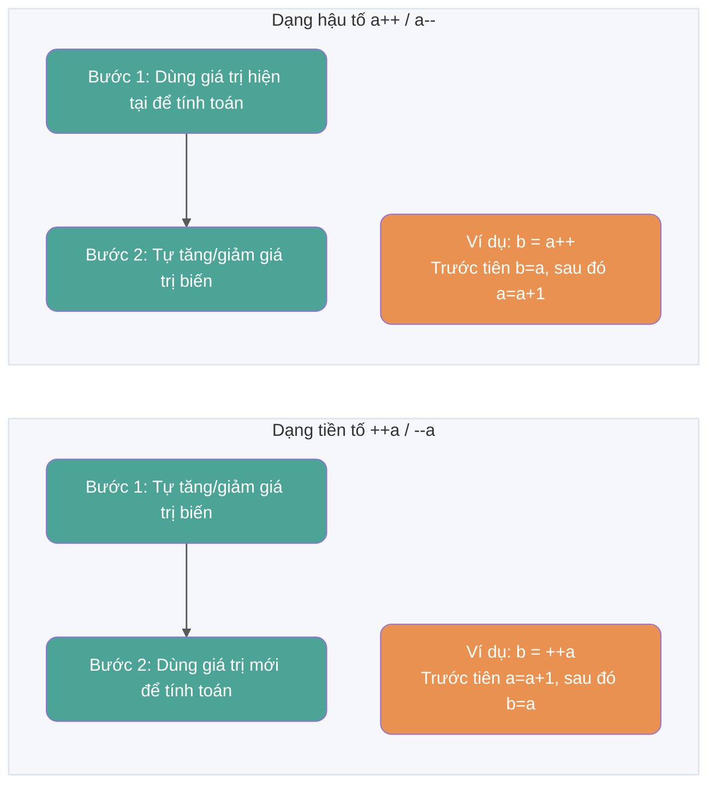
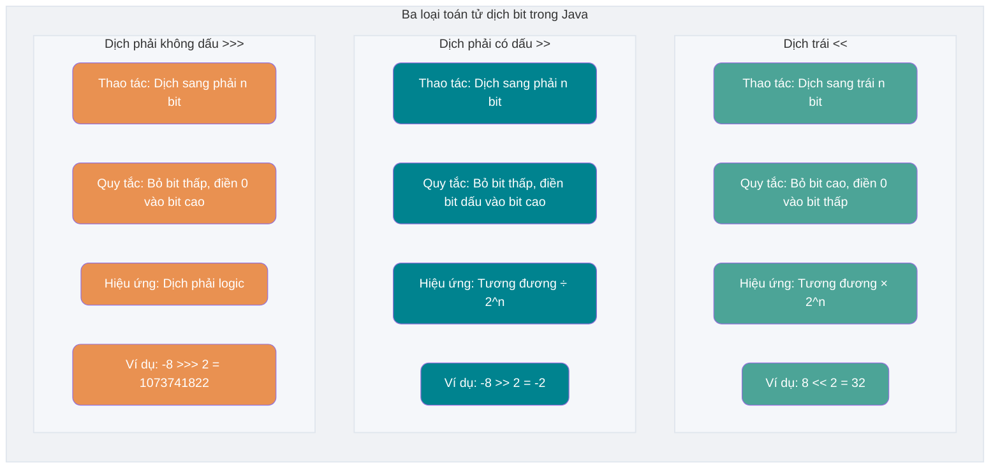
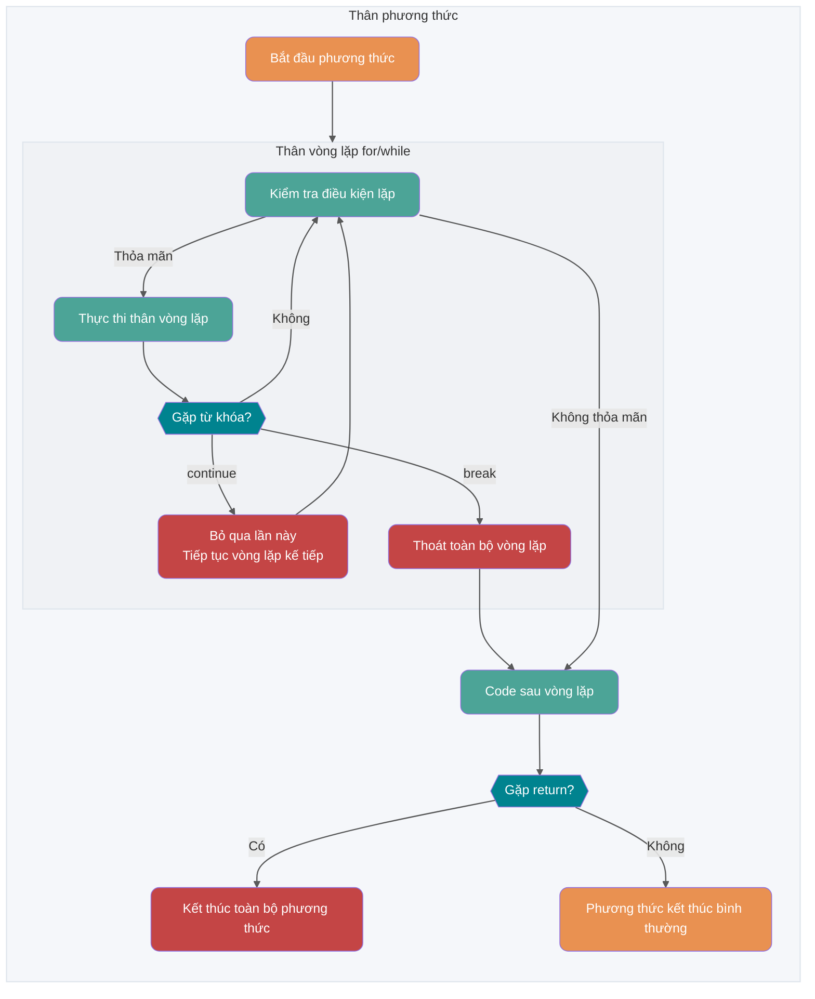
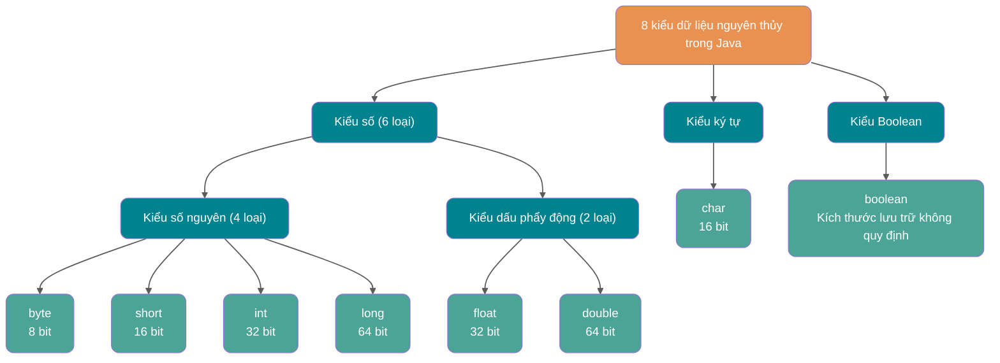
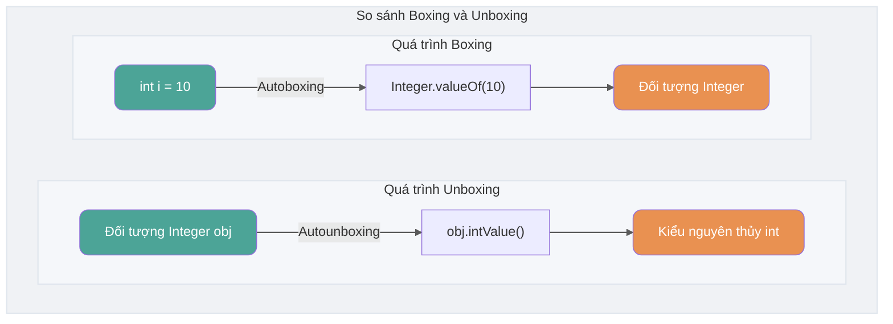

## Khái niệm cơ bản và kiến thức nền tảng

### Ngôn ngữ Java có những đặc điểm nào?

1. Đơn giản, dễ học (cú pháp gọn gàng, dễ tiếp cận);
2. Hướng đối tượng (Đóng gói, Kế thừa, Đa hình);
3. Độc lập nền tảng (JVM giúp đạt được tính độc lập nền tảng);
4. Hỗ trợ đa luồng (trước đây ngôn ngữ C++ không có cơ chế đa luồng tích hợp sẵn nên bắt buộc phải gọi tính năng đa luồng của hệ điều hành để lập trình đa luồng, trong khi ngôn ngữ Java cung cấp sẵn hỗ trợ đa luồng);
5. Độ tin cậy cao (có cơ chế xử lý ngoại lệ và quản lý bộ nhớ tự động);
6. Tính bảo mật (bản thân thiết kế của ngôn ngữ Java cung cấp nhiều tầng bảo vệ an toàn như các từ khóa phạm vi truy cập, hạn chế chương trình truy cập trực tiếp tài nguyên hệ điều hành);
7. Hiệu năng cao (nhờ các tối ưu hóa như trình biên dịch Just-In-Time (JIT), hiệu năng thực thi của Java rất tốt);
8. Hỗ trợ lập trình mạng rất thuận tiện;
9. Kết hợp giữa biên dịch và thông dịch;
10. ……

> **🐛 Đính chính (xem: [issue#544](https://github.com/Snailclimb/JavaGuide/issues/544))**: Kể từ C++11 (năm 2011), C++ đã đưa vào thư viện đa luồng chuẩn; trên Windows, Linux và macOS đều có thể sử dụng `std::thread` và `std::async` để tạo Thread (luồng). Liên kết tham khảo: <http://www.cplusplus.com/reference/thread/thread/?kw=thread>

🌈 Mở rộng thêm:

Khẩu hiệu quảng bá "Write Once, Run Anywhere (Viết một lần, chạy mọi nơi)" thực sự rất kinh điển và đã lưu truyền suốt nhiều năm! Đến mức ngay cả ngày nay, vẫn có rất nhiều người cho rằng khả năng đa nền tảng là ưu thế lớn nhất của ngôn ngữ Java. Thực tế thì đa nền tảng không còn là điểm mạnh bán hàng lớn nhất của Java nữa, và các tính năng mới của JDK cũng không phải. Hiện nay công nghệ ảo hóa đã rất hoàn thiện — ví dụ, thông qua Docker bạn có thể dễ dàng đạt được tính đa nền tảng. Theo quan điểm của tôi, hệ sinh thái (ecosystem) hùng mạnh của Java mới là điểm cốt lõi!

### Java SE vs Java EE

- Java SE (Java Platform, Standard Edition): Phiên bản chuẩn của nền tảng Java, là nền tảng cơ bản của ngôn ngữ lập trình Java, bao gồm các thư viện lớp cốt lõi và máy ảo hỗ trợ phát triển cũng như vận hành ứng dụng Java. Java SE có thể dùng để xây dựng ứng dụng desktop hoặc các ứng dụng server đơn giản.
- Java EE (Java Platform, Enterprise Edition): Phiên bản doanh nghiệp của nền tảng Java, được xây dựng trên nền tảng Java SE, bao gồm các tiêu chuẩn và đặc tả hỗ trợ phát triển và triển khai ứng dụng cấp doanh nghiệp (như Servlet, JSP, EJB, JDBC, JPA, JTA, JavaMail, JMS). Java EE có thể dùng để xây dựng các ứng dụng Java phía server có tính phân tán, khả chuyển, bền vững, dễ mở rộng và an toàn, chẳng hạn như ứng dụng Web.

Nói một cách đơn giản, Java SE là phiên bản nền tảng của Java, còn Java EE là phiên bản nâng cao của Java. Java SE phù hợp hơn để phát triển ứng dụng desktop hoặc ứng dụng server đơn giản, trong khi Java EE phù hợp hơn để phát triển các ứng dụng doanh nghiệp phức tạp hoặc ứng dụng Web.

Ngoài Java SE và Java EE, còn có Java ME (Java Platform, Micro Edition). Java ME là phiên bản thu gọn của Java, chủ yếu dùng để phát triển ứng dụng cho các thiết bị điện tử tiêu dùng nhúng như điện thoại, PDA, set-top box, tủ lạnh, điều hòa, v.v. Bạn không cần tập trung vào Java ME, chỉ cần biết sự tồn tại của nó là được vì hiện nay gần như không còn được sử dụng.

### ⭐️ JVM vs JDK vs JRE

#### JVM

Java Virtual Machine (JVM) là máy ảo dùng để thực thi Java bytecode. JVM có các bản cài đặt chuyên biệt cho từng hệ điều hành khác nhau (Windows, Linux, macOS), với mục tiêu là khi sử dụng cùng một bytecode, chúng đều cho ra kết quả giống nhau. Bytecode cùng với các bản cài đặt JVM theo từng hệ điều hành chính là chìa khóa cho khả năng "biên dịch một lần, chạy mọi nơi" của ngôn ngữ Java.

Như minh họa trong hình dưới đây, các ngôn ngữ lập trình khác nhau (Java, Groovy, Kotlin, JRuby, Clojure...) được biên dịch thông qua compiler riêng của chúng thành các file `.class`, và cuối cùng chạy trên nhiều nền tảng khác nhau (Windows, Mac, Linux) thông qua JVM.


**Không chỉ có duy nhất một JVM! Chỉ cần tuân thủ đặc tả JVM (JVM Specification), bất kỳ công ty, tổ chức hay cá nhân nào cũng có thể tự phát triển JVM riêng của mình.** Điều đó có nghĩa là HotSpot VM mà chúng ta thường tiếp xúc chỉ là một trong những bản cài đặt của đặc tả JVM mà thôi.

Ngoài HotSpot VM phổ biến nhất mà chúng ta thường dùng, còn có J9 VM, Zing VM, JRockit VM và nhiều JVM khác. Wikipedia có bảng so sánh các JVM phổ biến: [Comparison of Java virtual machines](https://en.wikipedia.org/wiki/Comparison_of_Java_virtual_machines), nếu quan tâm bạn có thể xem thêm. Đồng thời, bạn có thể tìm thấy đặc tả JVM tương ứng với từng phiên bản JDK tại [Java SE Specifications](https://docs.oracle.com/javase/specs/index.html).


#### JDK và JRE

JDK (Java Development Kit) là bộ công cụ phát triển Java đầy đủ tính năng dành cho lập trình viên để tạo và biên dịch chương trình Java. Nó bao gồm JRE (Java Runtime Environment), trình biên dịch `javac` và các công cụ khác như `javadoc` (công cụ tạo tài liệu), `jdb` (trình gỡ lỗi), `jconsole` (công cụ giám sát), `javap` (công cụ dịch ngược bytecode), v.v.

JRE là môi trường cần thiết để chạy các chương trình Java đã được biên dịch, chủ yếu gồm hai phần sau:

1. **JVM**: Chính là Java Virtual Machine mà chúng ta đã đề cập ở trên.
2. **Thư viện lớp cơ bản của Java (Class Library)**: Tập hợp các thư viện lớp chuẩn cung cấp các tính năng và API thường dùng (như thao tác I/O, giao tiếp mạng, cấu trúc dữ liệu, v.v.).

Nói ngắn gọn, JRE chỉ chứa môi trường và thư viện lớp cần thiết để chạy chương trình Java, trong khi JDK không chỉ bao gồm JRE mà còn chứa các công cụ phục vụ phát triển và debug chương trình Java.

Nếu cần viết, biên dịch chương trình Java hoặc sử dụng các công cụ phát triển đi kèm JDK, bạn cần cài đặt JDK. Một số ứng dụng biên dịch mã nguồn Java tại thời điểm runtime (chẳng hạn chuyển đổi JSP thành Servlet) cũng có thể cần tới JDK. API Reflection cốt lõi của Java thuộc về thư viện lớp runtime, nên bản thân việc sử dụng Reflection không yêu cầu phải cài đặt đầy đủ JDK.

Hình dưới đây minh họa rõ ràng mối quan hệ giữa JDK, JRE và JVM.


Tuy nhiên, kể từ JDK 9 trở đi, không còn cần phân biệt rạch ròi mối quan hệ giữa JDK và JRE nữa; thay vào đó là hệ thống module (JDK được tổ chức lại thành 94 module) + công cụ [jlink](http://openjdk.java.net/jeps/282) (công cụ dòng lệnh mới phát hành cùng Java 9, dùng để tạo Java runtime image tùy chỉnh chỉ chứa các module cần thiết cho một ứng dụng cụ thể). Hơn nữa, từ JDK 11 trở đi, Oracle không còn cung cấp gói tải JRE riêng lẻ nữa.

Trong bài viết [Tổng quan các tính năng mới của Java 9](https://javaguide.cn/java/new-features/java9.html), khi giới thiệu hệ thống module hóa, tôi đã đề cập:

> Sau khi đưa vào hệ thống module, JDK được tổ chức lại thành 94 module. Ứng dụng Java có thể sử dụng công cụ `jlink` mới để tạo ra một runtime image tùy chỉnh chỉ chứa các module JDK mà ứng dụng phụ thuộc. Nhờ đó có thể giảm đáng kể kích thước của môi trường Java runtime.

Nói cách khác, bạn có thể dùng `jlink` để tự tạo ra một runtime nhỏ gọn hơn theo đúng nhu cầu của mình, thay vì ứng dụng nào cũng phải dùng chung một JRE đầy đủ như nhau.

Một Java runtime image tùy chỉnh theo hướng module hóa giúp đơn giản hóa việc triển khai ứng dụng Java, tiết kiệm bộ nhớ, đồng thời tăng cường tính bảo mật và khả năng bảo trì. Điều này rất quan trọng để đáp ứng nhu cầu của các kiến trúc ứng dụng hiện đại như ảo hóa, container hóa, microservices và phát triển cloud-native.

### ⭐️ Bytecode là gì? Lợi ích của việc sử dụng bytecode là gì?

Trong Java, mã mà JVM có thể hiểu được gọi là bytecode (tức các file có phần mở rộng `.class`); nó không hướng đến bất kỳ bộ vi xử lý cụ thể nào mà chỉ hướng đến máy ảo. Thông qua bytecode, ngôn ngữ Java phần nào giải quyết được vấn đề hiệu năng thực thi thấp của các ngôn ngữ thông dịch truyền thống, đồng thời vẫn giữ được ưu điểm khả chuyển của ngôn ngữ thông dịch. Vì vậy, chương trình Java khi chạy có hiệu năng tương đối tốt (tuy nhiên vẫn còn khoảng cách nhất định so với các ngôn ngữ như C, C++, Rust, Go), và do bytecode không gắn với một loại máy cụ thể nào nên chương trình Java không cần biên dịch lại mà vẫn có thể chạy trên nhiều máy tính với các hệ điều hành khác nhau.

**Quá trình từ mã nguồn đến khi chạy của một chương trình Java được minh họa như sau**:


Chúng ta cần đặc biệt chú ý đến bước `.class -> mã máy`. Lấy HotSpot làm ví dụ: sau khi nạp bytecode, JVM có thể thông dịch để thực thi trước và nhận diện các phương thức cũng như khối mã được gọi thường xuyên (gọi là mã nóng / hotspot code), sau đó trình biên dịch **JIT (Just in Time Compilation)** sẽ biên dịch phần bytecode nóng đó thành mã máy. Trong các lần thực thi tiếp theo của đoạn mã này ở cùng tiến trình JVM hiện tại, máy ảo có thể sử dụng trực tiếp mã máy đã biên dịch. Điều này cũng giải thích vì sao chúng ta thường nói **Java là ngôn ngữ kết hợp giữa biên dịch và thông dịch**. Tuy nhiên, đặc tả JVM không bắt buộc một bản cài đặt cụ thể phải có trình thông dịch hay trình biên dịch JIT.

> 🌈 Đọc mở rộng:
>
> - [Kiến thức nền tảng | Phân tích nguyên lý và thực tiễn trình biên dịch JIT trong Java - Đội ngũ kỹ thuật Meituan](https://mp.weixin.qq.com/s/7PH8o1tbjLsM4-nOnjbwLw)
> - [Xây dựng ứng dụng Microservice dựa trên biên dịch tĩnh - Alibaba Middleware](https://mp.weixin.qq.com/s/4haTyXUmh8m-dBQaEzwDJw)


> HotSpot áp dụng cách tiếp cận Lazy Evaluation (đánh giá lười): theo quy luật 80/20, chỉ có một phần nhỏ mã nguồn (hot code) tiêu tốn phần lớn tài nguyên hệ thống, và đó chính là phần mà JIT cần biên dịch. JVM sẽ thu thập thông tin qua mỗi lần đoạn mã được thực thi để thực hiện các tối ưu hóa tương ứng; vì vậy số lần thực thi càng nhiều thì tốc độ chạy càng nhanh.

Mối quan hệ giữa bốn thành phần JDK, JRE, JVM và JIT được thể hiện trong sơ đồ dưới đây.


Hình dưới đây là mô hình cấu trúc tổng quát của JVM.


### ⭐️ Vì sao nói ngôn ngữ Java "vừa biên dịch vừa thông dịch"?

Thực ra câu hỏi này chúng ta đã nhắc đến khi nói về bytecode, nhưng vì khá quan trọng nên chúng ta sẽ nhấn mạnh lại ở đây.

Chúng ta có thể chia các ngôn ngữ lập trình bậc cao thành hai loại dựa theo cách thức thực thi chương trình:

- **Ngôn ngữ biên dịch (Compiled)**: [Ngôn ngữ biên dịch](https://zh.wikipedia.org/wiki/%E7%B7%A8%E8%AD%AF%E8%AA%9E%E8%A8%80) sử dụng [trình biên dịch](https://zh.wikipedia.org/wiki/%E7%B7%A8%E8%AD%AF%E5%99%A8) để dịch toàn bộ mã nguồn một lần thành mã máy có thể thực thi trực tiếp trên nền tảng đó. Thông thường, ngôn ngữ biên dịch có tốc độ thực thi nhanh nhưng hiệu suất phát triển thấp hơn. Các ngôn ngữ biên dịch phổ biến gồm C, C++, Go, Rust, v.v.
- **Ngôn ngữ thông dịch (Interpreted)**: [Ngôn ngữ thông dịch](https://zh.wikipedia.org/wiki/%E7%9B%B4%E8%AD%AF%E8%AA%9E%E8%A8%80) sử dụng [trình thông dịch](https://zh.wikipedia.org/wiki/%E7%9B%B4%E8%AD%AF%E5%99%A8) để dịch từng câu lệnh thành mã máy rồi thực thi ngay. Ngôn ngữ thông dịch thường có tốc độ phát triển nhanh nhưng tốc độ thực thi chậm hơn. Các ngôn ngữ thông dịch phổ biến gồm Python, JavaScript, PHP, v.v.


Theo giới thiệu trên Wikipedia:

> Kỹ thuật [biên dịch tức thời (JIT)](https://zh.wikipedia.org/wiki/%E5%8D%B3%E6%99%82%E7%B7%A8%E8%AD%AF) ra đời nhằm cải thiện hiệu năng của các ngôn ngữ thông dịch, qua đó thu hẹp khoảng cách giữa hai loại ngôn ngữ này. Kỹ thuật này kết hợp ưu điểm của cả ngôn ngữ biên dịch và ngôn ngữ thông dịch: giống như ngôn ngữ biên dịch, nó biên dịch mã nguồn chương trình thành [bytecode](https://zh.wikipedia.org/wiki/%E5%AD%97%E8%8A%82%E7%A0%81) trước; đến thời điểm thực thi, bytecode đó mới được dịch và thực thi. [Java](https://zh.wikipedia.org/wiki/Java) và [LLVM](https://zh.wikipedia.org/wiki/LLVM) là những đại diện tiêu biểu của kỹ thuật này.
>
> Đọc thêm: [Kiến thức nền tảng | Phân tích nguyên lý và thực tiễn trình biên dịch JIT trong Java](https://mp.weixin.qq.com/s/7PH8o1tbjLsM4-nOnjbwLw)

**Vì sao nói ngôn ngữ Java "vừa biên dịch vừa thông dịch"?**

Đó là vì các bản cài đặt Java phổ biến sử dụng đồng thời cả kỹ thuật biên dịch và thông dịch: mã nguồn Java trước tiên được trình biên dịch tạo thành bytecode (file `.class`), sau đó bytecode có thể được JVM thông dịch để thực thi, hoặc được JIT biên dịch thành mã máy ở thời điểm runtime. Bytecode không bắt buộc phải do trình thông dịch thực thi; chiến lược thực thi cụ thể do bản cài đặt JVM quyết định.

### AOT có ưu điểm gì? Tại sao không dùng hoàn toàn AOT?

JDK 9 từng đưa vào công cụ AOT (Ahead of Time Compilation) thử nghiệm là `jaotc` thông qua JEP 295, nhưng công cụ này đã bị loại bỏ trong JDK 17. Do đó, từ JDK 17 trở đi, JDK chuẩn không còn tích hợp trình biên dịch AOT này nữa; phần thảo luận dưới đây đề cập đến AOT nói chung cũng như các toolchain độc lập như GraalVM Native Image (Native Image là một công nghệ AOT do GraalVM cung cấp, sẽ được giới thiệu thêm ở phần sau). Khác với JIT, AOT biên dịch mã thành mã máy trước khi chương trình thực thi, giúp giảm chi phí làm nóng (warm-up) khi chạy và cải thiện tốc độ khởi động; tuy nhiên mức tiêu thụ bộ nhớ, hiệu năng đỉnh và kịch bản phù hợp cụ thể còn phụ thuộc vào bản cài đặt AOT được sử dụng và tải thực tế của ứng dụng.

Bảng so sánh dưới đây lấy HotSpot JIT và GraalVM Native Image phổ biến làm ví dụ. Cách triển khai của các công cụ AOT khác nhau không hoàn toàn giống nhau, và hiệu năng thực tế còn chịu ảnh hưởng bởi tham số build, tải ứng dụng cũng như việc có sử dụng PGO (Profile-Guided Optimization — tức sử dụng thông tin hiệu năng thu thập được khi chương trình chạy thực tế để hỗ trợ tối ưu hóa) hay không.

| Tiêu chí so sánh            | JIT (Biên dịch tức thời)                                                                | AOT (Biên dịch trước khi chạy)                                                       |
| --------------------------- | --------------------------------------------------------------------------------------- | ------------------------------------------------------------------------------------ |
| **Thời điểm biên dịch**     | Biên dịch tại thời điểm runtime dựa trên tình hình thực thi mã                          | Biên dịch trước trong giai đoạn build                                                |
| **Khởi động & làm nóng**    | Sau khi khởi động thường cần thông dịch và biên dịch mã nóng                            | Thường khởi động nhanh hơn, không cần chờ JIT làm nóng (warm-up)                     |
| **Hiệu năng chạy dài hạn**  | Có thể tận dụng thông tin thu thập lúc runtime để liên tục tối ưu hóa mã nóng           | Thiếu thông tin runtime đầy đủ, hiệu năng cụ thể phụ thuộc vào cài đặt & cấu hình build |
| **Bộ nhớ lúc runtime**      | Cần lưu trữ trình biên dịch, dữ liệu thống kê hiệu năng và mã máy được sinh ra          | Các bản cài đặt như Native Image thường chiếm ít bộ nhớ runtime hơn                  |
| **Phụ thuộc khi chạy**      | Cần có JVM và môi trường runtime tương ứng                                              | Native Image có thể tạo ra file thực thi native độc lập                              |
| **Tính năng động**          | Hỗ trợ nạp lớp lúc runtime, Reflection và sinh bytecode động                            | Công cụ phân tích thế giới đóng thường cần metadata hoặc xử lý ở thời điểm build      |
| **Kịch bản phổ biến**       | Các dịch vụ chạy lâu dài, chú trọng thông lượng ổn định                                 | CLI, Serverless, co giãn linh hoạt và các dịch vụ nhạy cảm với cold start            |


Ưu thế của AOT thể hiện chủ yếu ở tốc độ khởi động và mức chiếm dụng bộ nhớ lúc runtime, khá phù hợp cho các ứng dụng thường xuyên cold start, vòng đời instance ngắn hoặc cần mở rộng nhanh. Trong khi đó, JIT tối ưu hóa mã nóng dựa trên thông tin thu thập trong quá trình chương trình chạy, nên các dịch vụ chạy dài hạn thường dễ phát huy lợi thế này hơn. Hiệu năng về thông lượng và độ trễ của cả hai phương thức không thể kết luận chỉ dựa vào cách biên dịch, mà cần kết hợp kiểm thử với toolchain cụ thể và tải thực tế.

Nhắc đến AOT thì không thể không nhắc tới [GraalVM](https://www.graalvm.org/)! GraalVM là một JDK hiệu năng cao (một bản phân phối JDK hoàn chỉnh), có thể chạy Java và các ngôn ngữ JVM khác, cũng như các ngôn ngữ phi JVM như JavaScript, Python. GraalVM không chỉ cung cấp biên dịch AOT mà còn hỗ trợ cả biên dịch JIT. Nếu quan tâm, bạn có thể xem tài liệu chính thức của GraalVM tại: <https://www.graalvm.org/latest/docs/>. Nếu thấy tài liệu gốc hơi khó tiếp cận, bạn có thể tham khảo thêm một số bài viết như:

- [Xây dựng ứng dụng Microservice dựa trên biên dịch tĩnh](https://mp.weixin.qq.com/s/4haTyXUmh8m-dBQaEzwDJw)
- [Hướng tới Native: Ví dụ thực tế và giải thích nguyên lý AOT trong Spring & Dubbo](https://cn.dubbo.apache.org/zh-cn/blog/2023/06/28/%e8%b5%b0%e5%90%91-native-%e5%8c%96springdubbo-aot-%e6%8a%80%e6%9c%af%e7%a4%ba%e4%be%8b%e4%b8%8e%e5%8e%9f%e7%90%86%e8%ae%b2%e8%a7%a3/)

**Nếu AOT có nhiều ưu điểm như vậy, tại sao không dùng hoàn toàn phương thức biên dịch này?**

Lấy GraalVM Native Image làm ví dụ: khi build file thực thi native, nó thực hiện phân tích thế giới đóng (closed-world analysis): trình build bắt đầu từ điểm vào của chương trình, phân tích xem những lớp, phương thức và trường nào có thể được truy cập ở thời điểm runtime, rồi chỉ đưa mã có thể chạm tới (reachable code) cùng metadata cần thiết vào sản phẩm cuối cùng. Chương trình vẫn có thể nhận dữ liệu đầu vào động và tạo đối tượng; còn những đoạn mã hoàn toàn không được biết trước ở giai đoạn build sẽ không tự động nằm trong kết quả phân tích.

Trong đoạn mã dưới đây, tên lớp đến từ tham số truyền vào lúc runtime, nên trình build không thể chỉ dựa vào quan hệ lời gọi tĩnh để xác định cần giữ lại những lớp nào:

```java
String className = args[0];
Class<?> clazz = Class.forName(className);
Object instance = clazz.getDeclaredConstructor().newInstance();
```

Reflection, Dynamic Proxy và JNI vẫn có thể sử dụng được trong Native Image. Đối với các truy cập động mà phân tích tĩnh không thể suy luận ra, thường cần đến [metadata khả năng tiếp cận (reachability metadata)](https://www.graalvm.org/latest/reference-manual/native-image/metadata/) để khai báo trước những lớp, phương thức, trường, interface proxy và thành phần JNI có khả năng được truy cập lúc runtime. Việc nạp động các lớp chưa biết trước hoặc sinh và nạp bytecode mới ở thời điểm runtime sẽ bị hạn chế chặt chẽ hơn, bởi mã tương ứng không tồn tại ở giai đoạn build.

Spring sử dụng xử lý AOT để thích ứng với phương thức thực thi này. Ở giai đoạn build, Spring phân tích ngữ cảnh ứng dụng (application context), sinh mã nguồn Java, bytecode proxy cũng như `RuntimeHints` cần thiết cho Reflection, tài nguyên và proxy. CGLIB thường nhờ ASM để sinh lớp proxy lúc runtime; sang kịch bản Native Image, công việc này có thể được đẩy lên thực hiện trước ở giai đoạn build. Sau khi framework hoặc ứng dụng cung cấp cơ chế thích ứng tương ứng ở thời điểm build, Spring, CGLIB và ASM vẫn có thể tham gia vào quá trình build và chạy ứng dụng AOT. Cơ chế chi tiết có thể tham khảo tại [tài liệu chính thức Spring AOT](https://docs.spring.io/spring-framework/reference/core/aot.html).

AOT dịch chuyển một phần công việc và thông tin từ lúc runtime sang giai đoạn build, đồng thời làm tăng thời gian build, chi phí duy trì metadata và chi phí thích ứng tương thích. Đối với các ứng dụng phụ thuộc vào nạp lớp động lúc runtime, Java Agent hoặc sinh nhiều bytecode động, chế độ JIT thường tiện lợi hơn; còn với những ứng dụng nhạy cảm với cold start và mức chiếm dụng bộ nhớ, AOT sẽ hấp dẫn hơn.

### Oracle JDK vs OpenJDK

Có lẽ trước khi đọc câu hỏi này, nhiều người giống như tôi trước đây chưa từng tiếp xúc hay sử dụng OpenJDK. Vậy giữa Oracle JDK và OpenJDK có tồn tại sự khác biệt lớn nào không? Dưới đây, thông qua những tài liệu đã tổng hợp được, tôi sẽ giải đáp vấn đề mà nhiều người thường bỏ qua này.

Trước tiên, năm 2006 công ty SUN đã mã nguồn mở hóa Java, từ đó ra đời OpenJDK. Năm 2009, Oracle mua lại SUN và tự xây dựng Oracle JDK dựa trên nền tảng OpenJDK. Oracle JDK không phải mã nguồn mở, và ở những phiên bản đầu tiên (Java 8 ~ Java 11) còn bổ sung thêm một số tính năng và công cụ riêng biệt so với OpenJDK.

Thứ hai, đối với Java 7, OpenJDK và Oracle JDK rất gần nhau. Oracle JDK được xây dựng dựa trên OpenJDK 7, chỉ bổ sung thêm một vài tính năng nhỏ và có sự tham gia bảo trì của các kỹ sư Oracle.

Đoạn trích dưới đây được lấy từ một bài blog chính thức do Oracle công bố năm 2012:

> Hỏi: Mã nguồn trong kho lưu trữ OpenJDK và mã nguồn dùng để build Oracle JDK có gì khác nhau?
>
> Đáp: Rất gần nhau — quy trình build phiên bản Oracle JDK của chúng tôi được xây dựng trên nền tảng OpenJDK 7, chỉ thêm một vài phần như mã triển khai (bao gồm bản cài đặt Java Plugin và Java WebStart của Oracle), một số thành phần đóng nguồn của bên thứ ba như bộ raster hóa đồ họa, một số thành phần mã nguồn mở của bên thứ ba như Rhino, cùng một vài thứ lẻ tẻ như tài liệu bổ sung hoặc phông chữ bên thứ ba. Trong tương lai, mục tiêu của chúng tôi là mã nguồn mở tất cả các phần của Oracle JDK, ngoại trừ những phần được xem là tính năng thương mại.

Cuối cùng, hãy tóm tắt ngắn gọn sự khác biệt giữa Oracle JDK và OpenJDK:

1. **Có mã nguồn mở hay không**: OpenJDK là một mô hình tham chiếu và hoàn toàn mã nguồn mở, còn Oracle JDK được phát triển dựa trên OpenJDK và không hoàn toàn mã nguồn mở (Quan điểm cá nhân: như mọi người đều biết, JDK ban đầu do công ty SUN phát triển, sau đó SUN bán lại cho Oracle. Oracle nổi tiếng với cơ sở dữ liệu Oracle vốn là phần mềm đóng nguồn, nên khi đó Oracle không muốn giữ nguyên việc mở nguồn hoàn toàn; nhưng SUN trước đó đã mở nguồn JDK rồi. Nếu sau khi mua lại mà Oracle đóng nguồn ngay lập tức, chắc chắn sẽ khiến nhiều lập trình viên Java bất mãn, làm mất niềm tin vào Java và khiến thương vụ mua lại trở thành thảm họa! Thế là Oracle nghĩ ra một nước đi khéo léo: mở nguồn một phần mã cốt lõi cho cộng đồng tự do phát triển dưới tên OpenJDK, còn bản của mình gọi là Oracle JDK — các bạn cứ dùng bản của các bạn, tôi phát hành bản của tôi, nếu cộng đồng làm ra tính năng hay ho thì sau này Oracle JDK cũng lấy về tích hợp, một công đôi việc!). Dự án mã nguồn mở OpenJDK: [https://github.com/openjdk/jdk](https://github.com/openjdk/jdk).
2. **Có miễn phí hay không**: Giấy phép của Oracle JDK phụ thuộc vào phiên bản và bản cập nhật cụ thể. Một số bản cập nhật nhất định của Oracle JDK 21 trở về sau cho phép sử dụng miễn phí — bao gồm cả cho mục đích thương mại trên môi trường production — trong thời hạn hiệu lực của NFTC; ví dụ, Oracle dự kiến áp dụng NFTC cho các bản cập nhật JDK 21 đến tháng 9 năm 2026 và cho các bản cập nhật JDK 25 đến tháng 9 năm 2028. Sau khi hết giai đoạn miễn phí, điều thay đổi là giấy phép của các bản cập nhật về sau; các phiên bản đã tải trước đó vẫn tiếp tục sử dụng theo giấy phép tại thời điểm tải về. Các bản build OpenJDK của Oracle sử dụng giấy phép GPLv2 + Classpath Exception.
3. **Tính năng**: Oracle JDK bổ sung thêm một số tính năng và công cụ riêng biệt trên nền tảng OpenJDK, chẳng hạn như Java Flight Recorder (JFR, một công cụ giám sát) và Java Mission Control (JMC, một công cụ giám sát). Tuy nhiên, từ sau Java 11, tính năng của Oracle JDK và OpenJDK cơ bản là giống nhau, vì phần lớn các thành phần đóng nguồn trước đây trong Oracle JDK đã được đóng góp lại cho cộng đồng mã nguồn mở.
4. **Hỗ trợ dài hạn (LTS)**: Bản thân dự án OpenJDK không cam kết dịch vụ LTS thương mại; Oracle và nhiều nhà cung cấp bản phân phối OpenJDK sẽ cung cấp hỗ trợ dài hạn cho các phiên bản nhất định. Java 8, 11, 17, 21 và 25 là các phiên bản LTS của Oracle, và Oracle dự kiến trong tương lai cứ mỗi hai năm sẽ phát hành một phiên bản LTS.
5. **Giấy phép (License)**: Giấy phép của Oracle JDK thay đổi tùy theo phiên bản và bản cập nhật, có thể là NFTC hoặc OTN; BCL chỉ áp dụng cho các phiên bản phát hành trước ngày 16 tháng 4 năm 2019. Oracle OpenJDK sử dụng GPLv2 + Classpath Exception.

> Nếu Oracle JDK tốt như vậy, tại sao vẫn cần phải có OpenJDK?
>
> Trả lời:
>
> 1. OpenJDK là mã nguồn mở, đồng nghĩa với việc bạn có thể chỉnh sửa và tối ưu hóa nó theo nhu cầu của riêng mình — ví dụ Alibaba đã phát triển Dragonwell8 dựa trên OpenJDK: [https://github.com/alibaba/dragonwell8](https://github.com/alibaba/dragonwell8)
> 2. OpenJDK miễn phí cho mục đích thương mại (đó cũng là lý do khi cài đặt mặc định qua trình quản lý gói `yum`, bản JDK được cài là OpenJDK chứ không phải Oracle JDK). Mặc dù Oracle JDK cũng có phiên bản miễn phí thương mại (như JDK 8), nhưng không phải mọi phiên bản đều miễn phí.
> 3. Các phiên bản tính năng của cả OpenJDK và Oracle JDK đều tuân theo chu kỳ phát hành 6 tháng; tuy nhiên chu kỳ cập nhật và hỗ trợ của từng bản phân phối có thể khác nhau.
>
> Vì những lý do trên, OpenJDK vẫn rất cần thiết để tồn tại!


**Nên lựa chọn như thế nào giữa Oracle JDK và OpenJDK?**

Khuyến nghị chọn OpenJDK hoặc các bản phân phối dựa trên OpenJDK, chẳng hạn như Amazon Corretto của AWS hoặc Alibaba Dragonwell của Alibaba.

🌈 Mở rộng thêm:

- Thỏa thuận BCL (Oracle Binary Code License Agreement): Có thể sử dụng JDK (hỗ trợ thương mại), nhưng không được phép chỉnh sửa.
- Thỏa thuận OTN (Oracle Technology Network License Agreement): Các bản JDK mới phát hành từ 11 trở đi đều dùng thỏa thuận này; cá nhân có thể tự dùng miễn phí, nhưng sử dụng cho mục đích thương mại cần phải trả phí.

### Sự khác biệt giữa Java và C++ là gì?

Tôi biết có nhiều bạn chưa học C++, nhưng nhà tuyển dụng lại rất thích đem Java ra so sánh với C++! Đành chịu thôi!!! Dù chưa học C++ thì cũng nên ghi nhớ lại nhé.

Mặc dù cả Java và C++ đều là ngôn ngữ hướng đối tượng và đều hỗ trợ Đóng gói, Kế thừa và Đa hình, nhưng giữa chúng vẫn có khá nhiều điểm khác biệt:

- Java không cung cấp con trỏ (pointer) để truy cập trực tiếp bộ nhớ, giúp bộ nhớ của chương trình an toàn hơn.
- Lớp trong Java chỉ hỗ trợ đơn kế thừa, còn C++ hỗ trợ đa kế thừa; tuy lớp trong Java không thể đa kế thừa nhưng interface có thể kế thừa nhiều interface.
- Java có cơ chế tự động quản lý bộ nhớ Garbage Collection (GC), lập trình viên không cần giải phóng thủ công vùng nhớ không còn dùng nữa.
- C++ hỗ trợ cả nạp chồng phương thức (`Overload`) và nạp chồng toán tử (operator overloading), còn Java chỉ hỗ trợ nạp chồng phương thức (nạp chồng toán tử làm tăng độ phức tạp, đi ngược lại tư tưởng thiết kế ban đầu của Java).
- ……

## Cú pháp cơ bản

### Trong Java có những dạng chú thích (comment) nào?

Trong Java có 3 dạng comment:

1. **Comment một dòng (`//`)**: Thường dùng để giải thích tác dụng của một dòng code cụ thể bên trong phương thức.

2. **Comment nhiều dòng (`/* ... */`)**: Thường dùng để giải thích tác dụng của một đoạn code.

3. **Comment tài liệu (`/** ... */`)**: Thường dùng để tạo tài liệu phát triển Java (Javadoc).

Hai loại được sử dụng nhiều nhất vẫn là comment một dòng và comment tài liệu; comment nhiều dòng trong phát triển thực tế ít được dùng hơn.


Khi chúng ta viết code, nếu lượng code còn ít thì bản thân hoặc đồng đội có thể đọc hiểu rất dễ dàng; nhưng một khi cấu trúc dự án trở nên phức tạp, chúng ta cần đến comment. Comment không bao giờ được thực thi (trước khi biên dịch mã nguồn, trình biên dịch sẽ xóa bỏ toàn bộ comment và không giữ lại trong bytecode); chúng là phần ghi chú lập trình viên viết cho chính mình và người đọc sau xem — đóng vai trò như bản hướng dẫn sử dụng của mã nguồn, giúp người đọc nhanh chóng nắm bắt logic liên kết giữa các đoạn code. Do đó, vừa viết chương trình vừa thêm comment là một thói quen rất tốt.

Cuốn sách *Clean Code* chỉ rõ:

> **Comment trong code không phải càng chi tiết càng tốt. Thực chất, code tốt tự nó đã là một comment rồi; chúng ta nên cố gắng chuẩn hóa và làm đẹp code của mình để giảm bớt những comment không cần thiết.**
>
> **Nếu ngôn ngữ lập trình đủ giàu sức biểu đạt thì không cần tới comment — hãy cố gắng diễn đạt ý định thông qua chính mã nguồn.**
>
> Lấy một ví dụ:
>
> Để bỏ đoạn comment phức tạp bên dưới, bạn chỉ cần tạo một hàm diễn đạt đúng điều mà comment đang nói tới:
>
> ```java
> // check to see if the employee is eligible for full benefits
> if ((employee.flags & HOURLY_FLAG) && (employee.age > 65))
> ```
>
> Nên thay thế bằng:
>
> ```java
> if (employee.isEligibleForFullBenefits())
> ```

### Sự khác biệt giữa định danh (identifier) và từ khóa (keyword) là gì?

Khi viết chương trình, chúng ta cần đặt tên cho rất nhiều thành phần như chương trình, lớp, biến, phương thức, v.v., từ đó sinh ra khái niệm **định danh (identifier)**. Nói đơn giản, **định danh chính là một cái tên**.

Có một số định danh mà ngôn ngữ Java đã gán sẵn ý nghĩa đặc biệt cho chúng và chỉ được phép dùng ở những vị trí nhất định; những định danh đặc biệt này được gọi là **từ khóa (keyword)**. Nói đơn giản, **từ khóa là những định danh đã được gán ý nghĩa đặc biệt**. Ví dụ trong đời sống hàng ngày, nếu muốn mở một cửa hàng thì ta phải đặt cho nó một cái tên — "tên" đó chính là định danh. Nhưng cửa hàng của ta không thể đặt tên là "Đồn công an", bởi cái tên "Đồn công an" đã được gán ý nghĩa đặc biệt rồi, và "Đồn công an" chính là từ khóa trong đời sống hàng ngày.

### Ngôn ngữ Java có những từ khóa nào?

| Phân loại                     | Từ khóa  |            |          |              |            |           |        |
| :---------------------------- | -------- | ---------- | -------- | ------------ | ---------- | --------- | ------ |
| Kiểm soát truy cập            | private  | protected  | public   |              |            |           |        |
| Bổ nghĩa lớp, phương thức, biến | abstract | class      | extends  | final        | implements | interface | native |
|                               | new      | static     | strictfp | synchronized | transient  | volatile  | enum   |
| Điều khiển luồng chương trình | break    | continue   | return   | do           | while      | if        | else   |
|                               | for      | instanceof | switch   | case         | default    | assert    |        |
| Xử lý lỗi                     | try      | catch      | throw    | throws       | finally    |           |        |
| Liên quan đến package         | import   | package    |          |              |            |           |        |
| Kiểu dữ liệu nguyên thủy      | boolean  | byte       | char     | double       | float      | int       | long   |
|                               | short    |            |          |              |            |           |        |
| Tham chiếu biến               | super    | this       | void     |              |            |           |        |
| Từ dành riêng (reserved)      | goto     | const      |          |              |            |           |        |

> Tips: Tất cả các từ khóa đều viết thường toàn bộ và sẽ hiển thị bằng màu sắc đặc biệt trong IDE.
>
> Từ khóa `default` rất đặc biệt: nó vừa thuộc nhóm điều khiển luồng chương trình, vừa thuộc nhóm bổ nghĩa lớp/phương thức/biến, lại vừa thuộc nhóm kiểm soát truy cập.
>
> - Trong điều khiển luồng chương trình, khi không khớp với nhánh nào trong `switch`, có thể dùng `default` để viết trường hợp mặc định.
> - Trong bổ nghĩa lớp, phương thức và biến, từ JDK 8 trở đi đã bổ sung default method, cho phép dùng từ khóa `default` để định nghĩa phần cài đặt mặc định cho phương thức trong interface.
> - Trong kiểm soát truy cập, nếu một thành viên không có bất kỳ từ khóa phạm vi nào đứng trước thì mặc định sẽ mang mức truy cập gói (`default`), nhưng nếu viết tường minh từ khóa `default` vào vị trí bổ nghĩa truy cập thì sẽ bị báo lỗi biên dịch.

⚠️ Lưu ý: Mặc dù `true`, `false` và `null` trông giống như từ khóa nhưng thực chất chúng là giá trị hằng (literal), đồng thời bạn cũng không thể dùng chúng làm định danh.

Tài liệu chính thức: [https://docs.oracle.com/javase/tutorial/java/nutsandbolts/\_keywords.html](https://docs.oracle.com/javase/tutorial/java/nutsandbolts/_keywords.html)

### ⭐️ Toán tử tăng và giảm tự động (`++` / `--`)

Trong quá trình viết code, một tình huống thường gặp là cần tăng thêm 1 hoặc giảm đi 1 cho một biến kiểu số nguyên. Java cung cấp toán tử tăng (`++`) và toán tử giảm (`--`) để đơn giản hóa thao tác này.

Hai toán tử `++` và `--` có thể đặt trước biến hoặc đặt sau biến:

- **Dạng tiền tố (Prefix)** (ví dụ `++a` hoặc `--a`): Tăng/giảm giá trị của biến trước rồi mới sử dụng biến đó. Chẳng hạn, `b = ++a` sẽ tăng `a` lên 1 trước, rồi mới gán giá trị sau khi tăng cho `b`.
- **Dạng hậu tố (Suffix/Postfix)** (ví dụ `a++` hoặc `a--`): Sử dụng giá trị hiện tại của biến trước rồi mới tăng/giảm giá trị của biến đó. Chẳng hạn, `b = a++` sẽ gán giá trị hiện tại của `a` cho `b` trước, rồi sau đó mới tăng `a` lên 1.

Để dễ ghi nhớ, bạn có thể áp dụng câu thần chú sau: **dấu đứng trước thì cộng/trừ trước, dấu đứng sau thì cộng/trừ sau**.



Hãy cùng xem một bài kiểm tra viết rất hay gặp về toán tử tăng/giảm: sau khi thực thi đoạn code dưới đây, giá trị của `a`, `b`, `c`, `d` và `e` là bao nhiêu?

```java
int a = 9;
int b = a++;
int c = ++a;
int d = c--;
int e = --d;
```

Đáp án: `a = 11`, `b = 9`, `c = 11`, `d = 10`, `e = 10`.

### ⭐️ Toán tử dịch bit (Shift Operators)

Toán tử dịch bit là một trong những toán tử cơ bản nhất và hầu như ngôn ngữ lập trình nào cũng có. Trong phép dịch bit, dữ liệu được thao tác được xem như một số nhị phân, và phép dịch bit là phép toán di chuyển các bit của nó sang trái hoặc sang phải một số vị trí nhất định.

Toán tử dịch bit được dùng rất phổ biến trong nhiều framework cũng như trong mã nguồn của chính JDK; chẳng hạn, mã nguồn phương thức `hash` trong `HashMap` (JDK 1.8) đã sử dụng toán tử dịch bit:

```java
static final int hash(Object key) {
    int h;
    // key.hashCode(): trả về giá trị băm, tức hashcode
    // ^: phép XOR theo từng bit
    // >>>: dịch phải không dấu, bỏ qua bit dấu, các bit trống điền bằng 0
    return (key == null) ? 0 : (h = key.hashCode()) ^ (h >>> 16);
  }

```

**Những lý do chính để sử dụng toán tử dịch bit**:

1. **Hiệu quả cao**: Toán tử dịch bit ánh xạ trực tiếp tới lệnh dịch bit của bộ vi xử lý. Các vi xử lý hiện đại đều có lệnh phần cứng chuyên dụng để thực thi các phép dịch này, thường hoàn thành chỉ trong một chu kỳ xung nhịp. Ngược lại, các phép toán số học như nhân và chia ở mức phần cứng cần nhiều chu kỳ xung nhịp hơn để hoàn tất.
2. **Tiết kiệm bộ nhớ**: Thông qua thao tác dịch bit, có thể sử dụng một số nguyên (như `int` hoặc `long`) để lưu trữ nhiều giá trị boolean hoặc cờ trạng thái (flag), qua đó tiết kiệm bộ nhớ.

Toán tử dịch bit thường được dùng nhất để nhân hoặc chia nhanh cho lũy thừa của 2. Ngoài ra, nó còn đóng vai trò quan trọng trong các lĩnh vực sau:

- **Quản lý trường bit (Bit-field)**: Ví dụ lưu trữ và thao tác nhiều giá trị boolean.
- **Thuật toán băm và mã hóa/giải mã**: Trộn dữ liệu thông qua dịch bit kết hợp với các phép AND, OR, v.v.
- **Nén dữ liệu**: Ví dụ mã hóa Huffman có thể xử lý và thao tác nhanh với dữ liệu nhị phân bằng toán tử dịch bit để tạo định dạng nén gọn.
- **Kiểm tra toàn vẹn dữ liệu**: Ví dụ CRC (Cyclic Redundancy Check) tạo và kiểm tra tính toàn vẹn dữ liệu thông qua dịch bit và phép chia đa thức.
- **Căn chỉnh bộ nhớ (Memory alignment)**: Nhờ phép dịch bit, có thể tính toán và điều chỉnh dễ dàng địa chỉ căn chỉnh bộ nhớ.

Việc nắm vững kiến thức cơ bản về toán tử dịch bit là rất cần thiết — không chỉ giúp chúng ta áp dụng trong code của mình, mà còn giúp đọc hiểu các đoạn mã nguồn có sử dụng toán tử dịch bit.



Java có ba loại toán tử dịch bit:

- `<<`: Toán tử dịch trái; dịch sang trái một số bit nhất định, bỏ đi các bit cao và điền 0 vào các bit thấp. `x << n` tương đương với `x` nhân $2^n$ (trong trường hợp không bị tràn số).
- `>>`: Dịch phải có dấu; dịch sang phải một số bit nhất định, điền bit dấu vào các bit cao và bỏ đi các bit thấp. Với số dương điền 0 vào bit cao, với số âm điền 1 vào bit cao. `x >> n` tương đương với `x` chia $2^n$.
- `>>>`: Dịch phải không dấu; bỏ qua bit dấu, mọi bit trống đều được điền bằng 0.

Mặc dù về bản chất phép dịch bit có thể chia thành dịch trái và dịch phải, nhưng trong thực tế khi dịch phải cần cân nhắc cách xử lý bit dấu.

Do cách biểu diễn nhị phân của `double` và `float` khá đặc biệt nên không thể thực hiện thao tác dịch bit trên chúng.

Toán tử dịch bit trên thực tế chỉ hỗ trợ hai kiểu là `int` và `long`; trước khi thực hiện dịch bit trên các kiểu `short`, `byte`, `char`, trình biên dịch đều chuyển chúng sang kiểu `int` rồi mới thao tác.

**Nếu số bit cần dịch vượt quá số bit mà kiểu số đó chiếm giữ thì sao?**

Khi kiểu `int` dịch trái/dịch phải từ 32 bit trở lên, hệ thống sẽ lấy phần dư (`%`) trước rồi mới thực hiện dịch trái/dịch phải. Điều này có nghĩa là dịch trái/phải 32 bit tương đương với không dịch (`32%32=0`), còn dịch trái/phải 42 bit tương đương với dịch trái/phải 10 bit (`42%32=10`). Khi kiểu `long` thực hiện dịch trái/dịch phải, vì dạng nhị phân tương ứng của `long` có 64 bit nên cơ số của phép lấy phần dư cũng trở thành 64.

Nói cách khác: `x<<42` tương đương `x<<10`, `x>>42` tương đương `x>>10`, `x >>>42` tương đương `x >>> 10`.

**Ví dụ code toán tử dịch trái**:

```java
int i = -1;
System.out.println("初始数据：" + i);
System.out.println("初始数据对应的二进制字符串：" + Integer.toBinaryString(i));
i <<= 10;
System.out.println("左移 10 位后的数据 " + i);
System.out.println("左移 10 位后的数据对应的二进制字符 " + Integer.toBinaryString(i));
```

Kết quả đầu ra:

```plain
初始数据：-1
初始数据对应的二进制字符串：11111111111111111111111111111111
左移 10 位后的数据 -1024
左移 10 位后的数据对应的二进制字符 11111111111111111111110000000000
```

Vì khi số bit dịch trái lớn hơn hoặc bằng 32, phép lấy phần dư (`%`) được thực hiện trước rồi mới dịch trái, nên đoạn code dịch trái 42 bit dưới đây tương đương dịch trái 10 bit (`42%32=10`), và cho kết quả đầu ra giống hệt đoạn code phía trên.

```java
int i = -1;
System.out.println("初始数据：" + i);
System.out.println("初始数据对应的二进制字符串：" + Integer.toBinaryString(i));
i <<= 42;
System.out.println("左移 10 位后的数据 " + i);
System.out.println("左移 10 位后的数据对应的二进制字符 " + Integer.toBinaryString(i));
```

Toán tử dịch phải hoạt động tương tự; do giới hạn độ dài bài viết nên xin phép không minh họa thêm ở đây.

### Sự khác biệt giữa `continue`, `break` và `return` là gì?

Trong cấu trúc vòng lặp, khi điều kiện lặp không còn thỏa mãn hoặc số lần lặp đạt yêu cầu, vòng lặp sẽ kết thúc bình thường. Tuy nhiên, đôi khi trong quá trình lặp, khi xảy ra một điều kiện nào đó, ta cần dừng sớm vòng lặp; lúc này cần dùng đến các từ khóa sau:

1. `continue`: Thoát khỏi lần lặp hiện tại và chuyển ngay sang lần lặp kế tiếp.
2. `break`: Thoát khỏi toàn bộ thân vòng lặp và tiếp tục thực thi các câu lệnh bên dưới vòng lặp.

`return` được dùng để thoát khỏi phương thức hiện tại và kết thúc quá trình thực thi của phương thức đó. `return` thường có hai cách dùng:

1. `return;`: Dùng `return` trực tiếp để kết thúc phương thức, áp dụng cho phương thức không có giá trị trả về (`void`).
2. `return value;`: Trả về một giá trị cụ thể, áp dụng cho phương thức có kiểu dữ liệu trả về.



Hãy thử suy nghĩ: kết quả chạy của đoạn lệnh sau là gì?

```java
public static void main(String[] args) {
    boolean flag = false;
    for (int i = 0; i <= 3; i++) {
        if (i == 0) {
            System.out.println("0");
        } else if (i == 1) {
            System.out.println("1");
            continue;
        } else if (i == 2) {
            System.out.println("2");
            flag = true;
        } else if (i == 3) {
            System.out.println("3");
            break;
        } else if (i == 4) {
            System.out.println("4");
        }
        System.out.println("xixi");
    }
    if (flag) {
        System.out.println("haha");
        return;
    }
    System.out.println("heihei");
}
```

Kết quả chạy:

```plain
0
xixi
1
2
xixi
3
haha
```

## ⭐️ Kiểu dữ liệu nguyên thủy (Primitive Data Types)

### Bạn có biết Java có những kiểu dữ liệu nguyên thủy nào không?

Trong Java có 8 kiểu dữ liệu nguyên thủy, bao gồm:

- 6 kiểu số:
  - 4 kiểu số nguyên: `byte`, `short`, `int`, `long`
  - 2 kiểu số thực dấu phẩy động: `float`, `double`
- 1 kiểu ký tự: `char`
- 1 kiểu boolean: `boolean`.



Giá trị mặc định và kích thước không gian lưu trữ của 8 kiểu dữ liệu nguyên thủy này như sau:

| Kiểu nguyên thủy | Số bit         | Số byte        | Giá trị mặc định | Phạm vi giá trị                                                                                          |
| :--------------- | :------------- | :------------- | :--------------- | -------------------------------------------------------------------------------------------------------- |
| `byte`           | 8              | 1              | 0                | -128 ~ 127                                                                                               |
| `short`          | 16             | 2              | 0                | -32768 (-2^15) ~ 32767 (2^15 - 1)                                                                        |
| `int`            | 32             | 4              | 0                | -2147483648 ~ 2147483647                                                                                 |
| `long`           | 64             | 8              | 0L               | -9223372036854775808 (-2^63) ~ 9223372036854775807 (2^63 - 1)                                            |
| `char`           | 16             | 2              | '\u0000'         | 0 ~ 65535 (2^16 - 1)                                                                                     |
| `float`          | 32             | 4              | 0f               | Khoảng -3.4028235E38 ~ 3.4028235E38, số dương khác 0 nhỏ nhất khoảng 1.4E-45, ngoài ra có ±0, ±∞, NaN    |
| `double`         | 64             | 8              | 0d               | Khoảng -1.7976931348623157E308 ~ 1.7976931348623157E308, số dương khác 0 nhỏ nhất khoảng 4.9E-324, ngoài ra có ±0, ±∞, NaN |
| `boolean`        | Không quy định | Không quy định | false            | true, false                                                                                              |

Có thể thấy các số dương lớn nhất mà `byte`, `short`, `int`, `long` biểu diễn được đều bị trừ đi 1. Tại sao lại như vậy? Bởi vì trong biểu diễn bù hai (two's complement) dạng nhị phân, bit cao nhất được dùng để biểu diễn dấu (`0` là số dương, `1` là số âm), các bit còn lại biểu diễn phần giá trị. Do đó, để biểu diễn số dương lớn nhất, chúng ta cần đặt toàn bộ các bit ngoại trừ bit cao nhất thành `1`. Nếu cộng thêm `1` nữa thì sẽ gây tràn số (overflow) và biến thành một số âm.

Đối với `boolean`, tài liệu chính thức không định nghĩa rõ kích thước mà phụ thuộc vào bản cài đặt cụ thể của nhà cung cấp JVM. Về mặt logic có thể hiểu là chiếm 1 bit, nhưng trong thực tế còn phải cân nhắc đến yếu tố lưu trữ hiệu quả trên máy tính.

Ngoài ra, kích thước không gian lưu trữ của mỗi kiểu nguyên thủy trong Java không thay đổi theo kiến trúc phần cứng của máy tính như phần lớn các ngôn ngữ khác. Sự bất biến về kích thước lưu trữ này chính là một trong những lý do giúp chương trình Java có tính khả chuyển cao hơn so với chương trình viết bằng hầu hết các ngôn ngữ khác (được đề cập trong mục 2.2 của cuốn *Thinking in Java*).

**Lưu ý:**

1. Literal số nguyên mặc định được phân tích theo kiểu `int`; khi vượt quá phạm vi `int` hoặc cần viết tường minh literal kiểu `long`, cần thêm **L** vào sau giá trị. Literal kiểu `int` có thể biểu diễn qua phép chuyển đổi gán thì có thể gán trực tiếp cho `long`, ví dụ `long n = 1;`.
2. Literal số thực có dấu chấm thập phân hoặc số mũ mặc định là `double`, khi gán cho `float` thường cần thêm **f hoặc F**; literal số nguyên khi có thể chuyển đổi thì gán trực tiếp được cho `float`, ví dụ `float n = 1;`.
3. `char a = 'h'` (`char`: dấu nháy đơn), `String a = "hello"` (dấu nháy kép).

Tám kiểu nguyên thủy này đều có các lớp wrapper tương ứng lần lượt là: `Byte`, `Short`, `Integer`, `Long`, `Float`, `Double`, `Character`, `Boolean`.

### Sự khác biệt giữa kiểu nguyên thủy và kiểu wrapper là gì?

- **Mục đích sử dụng**: Ngoài việc định nghĩa hằng số và biến cục bộ, ở những chỗ khác như tham số phương thức hay thuộc tính đối tượng chúng ta ít khi dùng kiểu nguyên thủy để khai báo biến. Hơn nữa, kiểu wrapper dùng được cho Generics, còn kiểu nguyên thủy thì không.
- **Cách lưu trữ**: Biến cục bộ kiểu nguyên thủy được lưu trong bảng biến cục bộ (local variable table) của stack frame hiện tại; trường thực thể (instance field) kiểu nguyên thủy thuộc về trạng thái của đối tượng. Kiểu wrapper thuộc kiểu đối tượng, các thể hiện của nó thường được cấp phát trên Heap, nhưng JIT có thể loại bỏ việc cấp phát thực tế thông qua phân tích thoát (Escape Analysis) và thay thế vô hướng (Scalar Replacement).
- **Dung lượng chiếm dụng**: So với kiểu wrapper (kiểu đối tượng), kiểu dữ liệu nguyên thủy thường chiếm rất ít bộ nhớ.
- **Giá trị mặc định**: Biến thành viên kiểu wrapper nếu không gán giá trị sẽ là `null`, còn kiểu nguyên thủy có giá trị mặc định riêng và không phải là `null`.
- **Cách so sánh**: Với kiểu dữ liệu nguyên thủy, `==` so sánh giá trị. Với kiểu dữ liệu wrapper, `==` so sánh xem hai tham chiếu có trỏ tới cùng một đối tượng (hoặc cả hai đều là `null`) hay không. Để so sánh giá trị số mà đối tượng wrapper đại diện thường sử dụng phương thức `equals()` hoặc `compare()`/`compareTo()` tương ứng.

**Tại sao nói thể hiện đối tượng thường nằm trên Heap?** Đặc tả JVM định nghĩa Heap là vùng dữ liệu runtime dùng để cấp phát các thể hiện lớp và mảng. Tuy nhiên, JIT có thể thông qua phân tích thoát (Escape Analysis) và thay thế vô hướng (Scalar Replacement) để loại bỏ việc cấp phát thực tế cho một số đối tượng; điều này không đồng nghĩa với việc bắt buộc phải cấp phát cả đối tượng hoàn chỉnh lên Stack.

⚠️ Lưu ý: **Nói "kiểu dữ liệu nguyên thủy được lưu trên Stack" là một hiểu nhầm rất phổ biến!** Vị trí lưu trữ của biến kiểu nguyên thủy phụ thuộc vào loại biến: biến cục bộ được lưu trong bảng biến cục bộ của stack frame; trường thực thể (instance field) là một phần của đối tượng nằm trên Heap; trường tĩnh (static field) thuộc về lớp, cách lưu trữ cụ thể do bản cài đặt JVM quyết định và không thể nói chung chung là nằm trong Method Area hay Metaspace.

```java
public class Test {
    // Biến thành viên, lưu trữ trong Heap
    int a = 10;
    // Việc lưu trữ trường static thuộc về chi tiết cài đặt của JVM; trong HotSpot từ JDK 8 trở đi nó nằm trên Java Heap.
    // Biến thuộc về lớp, không thuộc về đối tượng.
    static int b = 20;

    public void method() {
        // Biến cục bộ, lưu trữ trên Stack
        int c = 30;
        static int d = 40; // Lỗi biên dịch, không thể dùng static để khai báo biến cục bộ trong phương thức
    }
}
```

### Bạn có biết cơ chế cache của kiểu wrapper không?

Phần lớn các kiểu wrapper của kiểu dữ liệu nguyên thủy trong Java đều sử dụng cơ chế cache để cải thiện hiệu năng.

4 lớp wrapper `Byte`, `Short`, `Integer`, `Long` mặc định tạo sẵn dữ liệu cache trong khoảng giá trị **[-128, 127]**; `Character` tạo dữ liệu cache trong khoảng **[0, 127]**; còn `Boolean` trực tiếp trả về `TRUE` hoặc `FALSE`.

Đối với `Integer`, có thể sửa giới hạn trên của cache bằng tham số JVM `-XX:AutoBoxCacheMax=<size>`, nhưng không thể sửa giới hạn dưới -128. Khi sử dụng thực tế, không nên thiết lập giá trị quá lớn để tránh lãng phí bộ nhớ, thậm chí gây Tràn bộ nhớ (`OOM`).

Đối với `Byte`, `Short`, `Long`, `Character`, không có tham số tương tự `-XX:AutoBoxCacheMax` để điều chỉnh, nên phạm vi cache là cố định và không thể chỉnh qua tham số JVM. `Boolean` thì trực tiếp trả về hai thể hiện định nghĩa sẵn là `TRUE` và `FALSE`, không có khái niệm phạm vi cache.

**Mã nguồn cache của `Integer`:**

```java
public static Integer valueOf(int i) {
    if (i >= IntegerCache.low && i <= IntegerCache.high)
        return IntegerCache.cache[i + (-IntegerCache.low)];
    return new Integer(i);
}
private static class IntegerCache {
    static final int low = -128;
    static final int high;
    static {
        // Giá trị high có thể được cấu hình thông qua property
        int h = 127;
    }
}
```

**Mã nguồn cache của `Character`:**

```java
public static Character valueOf(char c) {
    if (c <= 127) { // must cache
      return CharacterCache.cache[(int)c];
    }
    return new Character(c);
}

private static class CharacterCache {
    private CharacterCache(){}
    static final Character cache[] = new Character[127 + 1];
    static {
        for (int i = 0; i < cache.length; i++)
            cache[i] = new Character((char)i);
    }

}
```

**Mã nguồn cache của `Boolean`:**

```java
public static Boolean valueOf(boolean b) {
    return (b ? TRUE : FALSE);
}
```

Nếu vượt quá khoảng giá trị tương ứng thì vẫn sẽ tạo đối tượng mới; kích thước khoảng cache chỉ là sự đánh đổi giữa hiệu năng và tài nguyên.

Hai lớp wrapper cho số thực dấu phẩy động là `Float` và `Double` không cài đặt cơ chế cache.

```java
Integer i1 = 33;
Integer i2 = 33;
System.out.println(i1 == i2);// In ra true

Float i11 = 333f;
Float i22 = 333f;
System.out.println(i11 == i22);// In ra false

Double i3 = 1.2;
Double i4 = 1.2;
System.out.println(i3 == i4);// In ra false
```

Bây giờ hãy xem một câu hỏi: kết quả in ra của đoạn code dưới đây là `true` hay `false`?

```java
Integer i1 = 40;
Integer i2 = new Integer(40);
System.out.println(i1==i2);
```

Ở dòng `Integer i1=40`, quá trình autoboxing sẽ xảy ra, tức là dòng này tương đương với `Integer i1=Integer.valueOf(40)`. Do đó, `i1` sử dụng trực tiếp đối tượng trong cache. Trong khi đó `Integer i2 = new Integer(40)` sẽ trực tiếp tạo ra một đối tượng mới.

Vì vậy đáp án là `false`. Bạn trả lời đúng chứ?

Hãy nhớ: **mọi phép so sánh giá trị giữa các đối tượng wrapper số nguyên đều phải dùng phương thức `equals`**.


### Bạn có hiểu về autoboxing và unboxing không? Nguyên lý là gì?

**Autoboxing và unboxing là gì?**

- **Boxing (đóng gói)**: Bọc kiểu dữ liệu nguyên thủy bằng kiểu tham chiếu (wrapper) tương ứng của nó;
- **Unboxing (mở gói)**: Chuyển đổi kiểu wrapper trở lại thành kiểu dữ liệu nguyên thủy;



Ví dụ:

```java
Integer i = 10;  // boxing
int n = i;   // unboxing
```

Bytecode tương ứng với hai dòng code trên là:

```java
   L1

    LINENUMBER 8 L1

    ALOAD 0

    BIPUSH 10

    INVOKESTATIC java/lang/Integer.valueOf (I)Ljava/lang/Integer;

    PUTFIELD AutoBoxTest.i : Ljava/lang/Integer;

   L2

    LINENUMBER 9 L2

    ALOAD 0

    ALOAD 0

    GETFIELD AutoBoxTest.i : Ljava/lang/Integer;

    INVOKEVIRTUAL java/lang/Integer.intValue ()I

    PUTFIELD AutoBoxTest.n : I

    RETURN
```

Từ bytecode, ta phát hiện ra rằng boxing thực chất là gọi phương thức `valueOf()` của lớp wrapper, còn unboxing thực chất là gọi phương thức `xxxValue()`.

Do đó:

- `Integer i = 10` tương đương với `Integer i = Integer.valueOf(10)`
- `int n = i` tương đương với `int n = i.intValue()`;

Lưu ý: **Nếu boxing và unboxing diễn ra quá thường xuyên, hiệu năng hệ thống sẽ bị ảnh hưởng nghiêm trọng. Chúng ta nên cố gắng tránh các thao tác boxing/unboxing không cần thiết.**

```java
private static long sum() {
    // Nên dùng long thay vì Long
    Long sum = 0L;
    for (long i = 0; i <= Integer.MAX_VALUE; i++)
        sum += i;
    return sum;
}
```

### Tại sao phép toán số thực dấu phẩy động lại có nguy cơ mất độ chính xác?

Minh họa bằng code việc mất độ chính xác trong phép toán số thực dấu phẩy động:

```java
float a = 2.0f - 1.9f;
float b = 1.8f - 1.7f;
System.out.printf("%.9f",a);// 0.100000024
System.out.println(b);// 0.099999905
System.out.println(a == b);// false
```

**Tại sao lại xuất hiện vấn đề này?**

Điều này liên quan rất lớn đến cơ chế lưu trữ số thực dấu phẩy động của máy tính. Máy tính sử dụng định dạng nhị phân có độ rộng bit hữu hạn để biểu diễn `float` và `double`; nhiều số thập phân sau khi chuyển sang hệ nhị phân sẽ lặp vô hạn và chỉ có thể làm tròn thành số chữ số hữu hạn, nên tồn tại nguy cơ mất độ chính xác. Tuy nhiên, những giá trị như `0.5` hay `0.25` có thể biểu diễn thành số thập phân nhị phân hữu hạn thì vẫn được lưu trữ chính xác.

Chẳng hạn như số `0.2` ở hệ thập phân không thể chuyển đổi chính xác sang số thập phân nhị phân:

```java
// Quá trình chuyển đổi 0.2 sang số nhị phân là liên tục nhân với 2 cho đến khi không còn phần thập phân nữa,
// Trong quá trình tính toán này, các phần nguyên thu được xếp từ trên xuống dưới chính là kết quả nhị phân.
0.2 * 2 = 0.4 -> 0
0.4 * 2 = 0.8 -> 0
0.8 * 2 = 1.6 -> 1
0.6 * 2 = 1.2 -> 1
0.2 * 2 = 0.4 -> 0 (bắt đầu lặp lại)
...
```

Để tìm hiểu thêm về số thực dấu phẩy động, bạn nên đọc bài viết [Nền tảng hệ thống máy tính (4): Số thực dấu phẩy động](http://kaito-kidd.com/2018/08/08/computer-system-float-point/).

### Làm thế nào để giải quyết vấn đề mất độ chính xác khi tính toán số thực dấu phẩy động?

`BigDecimal` có thể biểu diễn chính xác số thập phân và cung cấp các phép toán cho phép chỉ định tường minh độ chính xác và quy tắc làm tròn. Việc làm tròn vẫn có thể xảy ra khi dùng độ chính xác hữu hạn, thực hiện phép chia có làm tròn hoặc chuyển đổi sang `float`, `double`. Thông thường, phần lớn các kịch bản nghiệp vụ đòi hỏi kết quả tính toán thập phân chính xác (ví dụ các bài toán liên quan đến tiền tệ) đều sử dụng `BigDecimal`.

```java
BigDecimal a = new BigDecimal("1.0");
BigDecimal b = new BigDecimal("1.00");
BigDecimal c = new BigDecimal("0.8");

BigDecimal x = a.subtract(c);
BigDecimal y = b.subtract(c);

System.out.println(x); /* 0.2 */
System.out.println(y); /* 0.20 */
// So sánh nội dung (cả scale), không phải so sánh giá trị số học
System.out.println(Objects.equals(x, y)); /* false */
// Muốn so sánh hai giá trị bằng nhau thì dùng compareTo, bằng nhau trả về 0
System.out.println(0 == x.compareTo(y)); /* true */
```

Để xem hướng dẫn chi tiết về `BigDecimal`, bạn có thể đọc bài viết của tôi: [Giải thích chi tiết về BigDecimal](https://javaguide.cn/java/basis/bigdecimal.html).

### Dữ liệu vượt quá kiểu số nguyên `long` thì nên biểu diễn như thế nào?

Các kiểu số nguyên thủy đều có một phạm vi biểu diễn nhất định; nếu vượt quá phạm vi này sẽ có nguy cơ tràn số (overflow).

Trong Java, kiểu số nguyên `long` 64 bit là kiểu số nguyên lớn nhất.

```java
long l = Long.MAX_VALUE;
System.out.println(l + 1); // -9223372036854775808
System.out.println(l + 1 == Long.MIN_VALUE); // true
```

`BigInteger` bên trong sử dụng mảng `int[]` để lưu trữ dữ liệu số nguyên có kích thước tùy ý.

So với các phép toán trên kiểu số nguyên thông thường, hiệu năng tính toán của `BigInteger` sẽ thấp hơn tương đối.

## Biến

### ⭐️ Sự khác biệt giữa biến thành viên (member variable) và biến cục bộ (local variable) là gì?

| Tiêu chí so sánh  | Biến thành viên (Field)                                                                                                  | Biến cục bộ (Local Variable)                                                                             |
| ----------------- | ------------------------------------------------------------------------------------------------------------------------ | -------------------------------------------------------------------------------------------------------- |
| Vị trí khai báo   | Khai báo bên trong lớp, bên ngoài phương thức; chia thành biến thực thể (instance variable) và biến tĩnh (static variable) | Khai báo bên trong phương thức, constructor hoặc khối code                                               |
| Từ khóa bổ nghĩa  | Có thể dùng từ khóa kiểm soát truy cập, `static`, `final`, v.v.                                                          | Không thể dùng từ khóa kiểm soát truy cập và `static`, có thể dùng `final`                               |
| Cách lưu trữ      | Trường instance thuộc trạng thái đối tượng; trường static thuộc về lớp, cách lưu trữ cụ thể do JVM quyết định            | Trong mô hình thực thi của JVM, được lưu trong bảng biến cục bộ của stack frame                          |
| Thời gian tồn tại | Biến instance tồn tại theo đối tượng; biến static tồn tại theo lớp cho đến khi lớp bị giải nạp (unloaded)                | Gắn với quá trình thực thi và phạm vi của khối code chứa nó; stack frame bị hủy sau khi phương thức kết thúc |
| Giá trị mặc định  | Có giá trị mặc định theo kiểu dữ liệu như `0`, `false`, `null`; trường `final` còn phải tuân thủ quy tắc gán xác định    | Không có giá trị mặc định; có thể khai báo trước chưa gán, nhưng trước khi đọc bắt buộc phải được gán rõ ràng |

Tham số của phương thức và tham số của constructor trong JLS thuộc về một nhóm biến riêng, được khởi tạo từ đối số thực tế khi gọi hàm, không thể đánh đồng với biến cục bộ chưa gán giá trị bên trong thân phương thức. Ngoài ra, cũng cần phân biệt giữa biến tham chiếu cục bộ và đối tượng mà nó trỏ tới: tham chiếu được lưu trong bảng biến cục bộ, còn đối tượng thường được cấp phát trên Heap (tối ưu hóa của JIT có thể loại bỏ một phần việc lưu trữ thực tế).

**Tại sao biến thành viên có giá trị mặc định?**

JLS quy định rằng biến lớp (class variable), biến thực thể (instance variable) và phần tử mảng khi được tạo sẽ được khởi tạo thành giá trị mặc định của kiểu dữ liệu tương ứng — ví dụ kiểu số là `0`, `boolean` là `false`, kiểu tham chiếu là `null`. Biến cục bộ không được khởi tạo mặc định và chịu ràng buộc bởi quy tắc "gán xác định" (definite assignment): trước khi đọc biến cục bộ, trình biên dịch phải xác định được rằng nó đã được gán giá trị. Đây là hai bộ quy tắc khởi tạo được đặc tả ngôn ngữ quy định trực tiếp, chứ không phải vì trình biên dịch không thể dự đoán thời điểm biến thành viên được gán giá trị.

**Biến thành viên `final` không phải là ngoại lệ của quá trình khởi tạo mặc định.** Khởi tạo mặc định và kiểm tra gán xác định của trình biên dịch là hai việc khác nhau: trường `final` vẫn phải được chương trình gán giá trị tường minh một lần, có thể khởi tạo ngay lúc khai báo; trường instance `final` chưa khởi tạo lúc khai báo bắt buộc phải hoàn tất việc gán trước khi mọi constructor kết thúc bình thường (hoặc thông qua khối khởi tạo instance), còn trường `static final` bắt buộc phải được gán trong khối khởi tạo static.

Biến cục bộ có thể khai báo trước rồi gán sau, hoặc không bao giờ đọc tới:

```java
int unused; // Hợp lệ: chỉ khai báo, không đọc, không bắt buộc gán giá trị
int count;
// System.out.println(count); // Lỗi biên dịch: chưa được gán xác định trước khi đọc
count = 10;
System.out.println(count); // Hợp lệ
```

Tham khảo: [JLS §4.12.5 Initial Values of Variables](https://docs.oracle.com/javase/specs/jls/se21/html/jls-4.html#jls-4.12.5), [JLS §8.3.1.2 `final` Fields](https://docs.oracle.com/javase/specs/jls/se21/html/jls-8.html#jls-8.3.1.2).

Ví dụ code về biến thành viên và biến cục bộ:

```java
public class VariableExample {

    // Biến thành viên
    private String name;
    private int age;

    // Biến cục bộ trong phương thức
    public void method() {
        int num1 = 10; // Biến cục bộ được cấp phát trên stack
        String str = "Hello, world!"; // Biến cục bộ được cấp phát trên stack
        System.out.println(num1);
        System.out.println(str);
    }

    // Biến cục bộ trong phương thức có tham số
    public void method2(int num2) {
        int sum = num2 + 10; // Biến cục bộ được cấp phát trên stack
        System.out.println(sum);
    }

    // Biến cục bộ trong constructor
    public VariableExample(String name, int age) {
        this.name = name; // Gán giá trị cho biến thành viên
        this.age = age; // Gán giá trị cho biến thành viên
        int num3 = 20; // Biến cục bộ được cấp phát trên stack
        String str2 = "Hello, " + this.name + "!"; // Biến cục bộ được cấp phát trên stack
        System.out.println(num3);
        System.out.println(str2);
    }
}

```

### Biến tĩnh (static variable) có tác dụng gì?

Biến tĩnh chính là biến được bổ nghĩa bởi từ khóa `static`. Nó được chia sẻ giữa tất cả các thể hiện (instance) của lớp; dù một lớp tạo ra bao nhiêu đối tượng đi nữa thì tất cả đều dùng chung một biến tĩnh duy nhất đó. Nói cách khác, biến tĩnh chỉ được cấp phát bộ nhớ một lần dù tạo nhiều đối tượng, nhờ vậy giúp tiết kiệm bộ nhớ.


Biến tĩnh được truy cập thông qua tên lớp, ví dụ `StaticVariableExample.staticVar` (nếu bị gắn `private` thì sẽ không thể truy cập theo cách này).

```java
public class StaticVariableExample {
    // Biến tĩnh
    public static int staticVar = 0;
}
```

Thông thường, biến tĩnh sẽ được kết hợp với từ khóa `final` để trở thành hằng số.

```java
public class ConstantVariableExample {
    // Hằng số
    public static final int constantVar = 0;
}
```

### Sự khác biệt giữa hằng ký tự và hằng chuỗi là gì?

- **Hình thức**: Hằng ký tự là một ký tự được bọc trong dấu nháy đơn, còn hằng chuỗi là 0 hoặc nhiều ký tự được bọc trong dấu nháy kép.
- **Ý nghĩa**: Hằng ký tự là một giá trị `char` biểu diễn đơn vị mã UTF-16 và có thể tham gia vào các phép toán số học; hằng chuỗi là một tham chiếu tới đối tượng `String`, chứ không phải địa chỉ bộ nhớ được phơi bày ở tầng ngôn ngữ.
- **Dung lượng chiếm dụng**: Giá trị `char` là số nguyên không dấu 16 bit. Mức chiếm dụng bộ nhớ của đối tượng `String` thuộc về chi tiết cài đặt của JVM, không thể suy ra trực tiếp từ số byte sau khi mã hóa chuỗi.

⚠️ Lưu ý `char` trong Java chiếm 2 byte.

Ví dụ code về hằng ký tự và hằng chuỗi:

```java
public class StringExample {
    // Hằng ký tự
    public static final char LETTER_A = 'A';

    // Hằng chuỗi
    public static final String GREETING_MESSAGE = "Hello, world!";
    public static void main(String[] args) {
        System.out.println("字符型常量占用的字节数为："+Character.BYTES);
        System.out.println("字符串使用 UTF-8 编码后的字节数为："+GREETING_MESSAGE.getBytes(java.nio.charset.StandardCharsets.UTF_8).length);
    }
}
```

Kết quả đầu ra:

```plain
字符型常量占用的字节数为：2
字符串使用 UTF-8 编码后的字节数为：13
```

## Phương thức (Method)

### Giá trị trả về của phương thức là gì? Phương thức có những loại nào?

**Giá trị trả về của phương thức** là kết quả mà chúng ta thu được sau khi đoạn code bên trong thân phương thức được thực thi (với điều kiện phương thức đó có tạo ra kết quả). Tác dụng của giá trị trả về là tiếp nhận kết quả ra ngoài để dùng cho các thao tác khác!

Chúng ta có thể phân loại phương thức dựa theo giá trị trả về và kiểu tham số thành các dạng dưới đây:

**1. Phương thức không có tham số, không có giá trị trả về**

```java
public void f1() {
    //......
}
// Phương thức dưới đây cũng không có giá trị trả về, mặc dù có dùng return
public void f(int a) {
    if (...) {
        // Biểu thị kết thúc việc thực thi phương thức, câu lệnh in bên dưới sẽ không chạy
        return;
    }
    System.out.println(a);
}
```

**2. Phương thức có tham số, không có giá trị trả về**

```java
public void f2(Parameter 1, ..., Parameter n) {
    //......
}
```

**3. Phương thức có giá trị trả về, không có tham số**

```java
public int f3() {
    //......
    return x;
}
```

**4. Phương thức có giá trị trả về và có tham số**

```java
public int f4(int a, int b) {
    return a * b;
}
```

### Tại sao phương thức tĩnh (static method) không thể gọi trực tiếp thành viên không tĩnh (non-static member)?

Phương thức `static` thực thi trong ngữ cảnh tĩnh (static context), không có tham chiếu ngầm định tới thể hiện hiện tại `this`, nên không thể truy cập trực tiếp các thành viên instance. Tuy nhiên, phương thức `static` vẫn có thể truy cập thành viên instance của một đối tượng thông qua một tham chiếu đối tượng tường minh — điều này không liên quan đến thứ tự nạp lớp hay việc thành viên đã "được cấp phát bộ nhớ" hay chưa.

```java
public class Example {
    // Định nghĩa một hằng ký tự
    public static final char LETTER_A = 'A';

    // Định nghĩa một hằng chuỗi
    public static final String GREETING_MESSAGE = "Hello, world!";

    public static void main(String[] args) {
        // In ra giá trị hằng ký tự
        System.out.println("字符型常量的值为：" + LETTER_A);

        // In ra giá trị hằng chuỗi
        System.out.println("字符串常量的值为：" + GREETING_MESSAGE);
    }
}
```

### ⭐️ Phương thức tĩnh (static method) và phương thức thực thể (instance method) khác nhau như thế nào?

**1. Cách gọi**

Khi gọi phương thức `static` từ bên ngoài lớp, bạn có thể dùng cách `TenLop.tenPhuongThuc` hoặc `doiTuong.tenPhuongThuc`, còn phương thức instance chỉ có cách thứ hai. Nói cách khác, **gọi phương thức `static` không cần phải tạo đối tượng**.

Tuy nhiên, cần lưu ý là thông thường không khuyến nghị dùng cách `doiTuong.tenPhuongThuc` để gọi phương thức `static`. Cách viết này rất dễ gây nhầm lẫn vì phương thức `static` không thuộc về một đối tượng cụ thể nào của lớp mà thuộc về chính lớp đó.

Vì vậy, thông thường nên dùng cách `TenLop.tenPhuongThuc` để gọi phương thức `static`.

```java
public class Person {
    public void method() {
      //......
    }

    public static void staicMethod(){
      //......
    }
    public static void main(String[] args) {
        Person person = new Person();
        // Gọi phương thức instance
        person.method();
        // Gọi phương thức static
        Person.staicMethod()
    }
}
```

**2. Có bị giới hạn khi truy cập thành viên trong lớp hay không**

Khi truy cập các thành viên của chính lớp đó, phương thức `static` chỉ được phép truy cập các thành viên `static` (tức biến thành viên `static` và phương thức `static`), không được phép truy cập các thành viên instance (tức biến thành viên instance và phương thức instance); trong khi đó phương thức instance không có giới hạn này.

### ⭐️ Nạp chồng (`Overload`) và Ghi đè (`Override`) khác nhau như thế nào?

> Nạp chồng (`Overload`) là cùng một phương thức nhưng có thể xử lý khác nhau tùy vào dữ liệu đầu vào khác nhau.
>
> Ghi đè (`Override`) là khi lớp con kế thừa cùng một phương thức từ lớp cha với dữ liệu đầu vào giống nhau, nhưng cần phản hồi khác với lớp cha thì bạn phải ghi đè phương thức của lớp cha.

#### Nạp chồng (`Overload`)

Xảy ra trong cùng một lớp (hoặc giữa lớp cha và lớp con): tên phương thức bắt buộc phải giống nhau, còn kiểu tham số, số lượng tham số hoặc thứ tự tham số phải khác nhau; kiểu trả về và từ khóa phạm vi truy cập có thể khác nhau.

Cuốn sách *Core Java* giới thiệu về nạp chồng như sau:

> Nếu nhiều phương thức (ví dụ như các constructor của `StringBuilder`) có cùng tên nhưng khác tham số, thì xảy ra nạp chồng (`Overload`).
>
> ```java
> StringBuilder sb = new StringBuilder();
> StringBuilder sb2 = new StringBuilder("HelloWorld");
> ```
>
> Trình biên dịch phải chọn ra chính xác phương thức nào sẽ được thực thi bằng cách đối khớp kiểu tham số được khai báo ở các phương thức với kiểu giá trị được truyền vào ở lời gọi cụ thể. Nếu trình biên dịch không tìm được tham số khớp, sẽ phát sinh lỗi thời điểm biên dịch (compile-time error) vì hoàn toàn không có phương thức khớp hoặc không có phương thức nào khớp tốt hơn các phương thức còn lại (quá trình này gọi là phân giải nạp chồng — overloading resolution).
>
> Java cho phép nạp chồng bất kỳ phương thức nào, chứ không chỉ riêng constructor.

Tóm lại: nạp chồng là việc trong cùng một lớp có nhiều phương thức cùng tên, dựa theo tham số truyền vào khác nhau để thực thi các logic xử lý khác nhau.

#### Ghi đè (`Override`)

Ghi đè (`Override`) là mối quan hệ khai báo giữa phương thức instance của lớp con và phương thức instance có thể truy cập của lớp cha, được trình biên dịch kiểm tra theo quy tắc; còn điều diễn ra ở thời điểm runtime là điều phối động (dynamic dispatch) tới phương thức ghi đè.

1. Tên phương thức và danh sách tham số phải giống nhau; kiểu trả về của phương thức lớp con phải nhỏ hơn hoặc bằng kiểu trả về của phương thức lớp cha, phạm vi ngoại lệ ném ra phải nhỏ hơn hoặc bằng lớp cha, và phạm vi truy cập phải lớn hơn hoặc bằng lớp cha.
2. Nếu phương thức lớp cha có từ khóa truy cập là `private/final/static` thì lớp con không thể ghi đè phương thức đó, tuy nhiên phương thức có từ khóa `static` có thể được khai báo lại (che khuất / hiding) ở lớp con.
3. Constructor không thể bị ghi đè.

#### Tổng kết

Tóm lại: **Ghi đè (`Override`) chính là việc lớp con cải tạo lại phương thức của lớp cha — vẻ ngoài (chữ ký) không được thay đổi, nhưng logic bên trong có thể thay đổi.**

| Điểm khác biệt            | Nạp chồng (`Overload`)                                                                                                 | Ghi đè (`Override`)                                                                                                  |
| ------------------------- | ---------------------------------------------------------------------------------------------------------------------- | -------------------------------------------------------------------------------------------------------------------- |
| **Phạm vi xảy ra**        | Trong cùng một lớp.                                                                                                    | Giữa lớp cha và lớp con (có quan hệ kế thừa).                                                                        |
| **Chữ ký phương thức**    | Tên phương thức **phải giống nhau**, nhưng **danh sách tham số phải khác nhau** (ít nhất một trong kiểu, số lượng hoặc thứ tự khác). | Tên phương thức và danh sách tham số **phải giống nhau hoàn toàn**.                                                  |
| **Kiểu trả về**           | **Không liên quan** đến kiểu trả về, có thể sửa tùy ý.                                                                 | Kiểu trả về của phương thức lớp con phải **giống** hoặc là **lớp con** của kiểu trả về ở phương thức lớp cha.         |
| **Từ khóa truy cập**      | **Không liên quan** đến từ khóa truy cập, có thể sửa tùy ý.                                                            | Quyền truy cập của phương thức lớp con **không được thấp hơn** lớp cha (`public > protected > default > private`).   |
| **Thời điểm liên kết**    | Liên kết lúc biên dịch (static binding)                                                                                | Liên kết lúc chạy (run-time binding / dynamic binding)                                                               |

**Ghi đè phương thức phải tuân thủ quy tắc "Hai giống, hai nhỏ, một lớn"** (nội dung sau trích từ *Crazy Java* / [issue#892](https://github.com/Snailclimb/JavaGuide/issues/892)):

- "Hai giống" tức là tên phương thức giống nhau, danh sách tham số hình thức giống nhau;
- "Hai nhỏ" chỉ kiểu trả về của phương thức lớp con phải nhỏ hơn (là kiểu con) hoặc bằng kiểu trả về của phương thức lớp cha, và các lớp ngoại lệ khai báo ném ra bởi phương thức lớp con phải nhỏ hơn hoặc bằng các lớp ngoại lệ của phương thức lớp cha;
- "Một lớn" chỉ quyền truy cập của phương thức lớp con phải lớn hơn hoặc bằng quyền truy cập của phương thức lớp cha.

⭐️ Về **kiểu dữ liệu trả về khi ghi đè (`Override`)**, ở đây cần giải thích thêm vì diễn đạt phía trên chưa hoàn toàn chính xác: nếu kiểu trả về của phương thức là `void` hoặc kiểu dữ liệu nguyên thủy, thì khi ghi đè không thể thay đổi kiểu trả về. Nhưng nếu giá trị trả về của phương thức là kiểu tham chiếu, khi ghi đè có thể trả về lớp con của kiểu tham chiếu đó.

```java
public class Hero {
    public String name() {
        return "超级英雄";
    }
}
public class SuperMan extends Hero{
    @Override
    public String name() {
        return "超人";
    }
    public Hero hero() {
        return new Hero();
    }
}

public class SuperSuperMan extends SuperMan {
    @Override
    public String name() {
        return "超级超级英雄";
    }

    @Override
    public SuperMan hero() {
        return new SuperMan();
    }
}
```

### Tham số độ dài biến đổi (Varargs) là gì?

Bắt đầu từ Java 5, Java hỗ trợ định nghĩa tham số có độ dài biến đổi (variable-length arguments / varargs), tức là cho phép truyền vào số lượng tham số không cố định khi gọi phương thức. Ví dụ phương thức dưới đây có thể nhận 0 hoặc nhiều tham số.

```java
public static void method1(String... args) {
   //......
}
```

Ngoài ra, tham số biến đổi chỉ có thể là tham số cuối cùng của hàm, nhưng phía trước nó có thể có hoặc không có các tham số khác.

```java
public static void method2(String arg1, String... args) {
   //......
}
```

**Khi gặp trường hợp nạp chồng (`Overload`) phương thức thì sao? Java sẽ ưu tiên khớp phương thức có tham số cố định hay phương thức có tham số biến đổi?**

Đáp án là sẽ ưu tiên khớp phương thức có tham số cố định, vì phương thức tham số cố định có độ khớp chính xác hơn.

Chúng ta hãy chứng minh điều đó qua ví dụ dưới đây.

```java
/**
 * Tìm JavaGuide trên WeChat và nhắn "Interview Sprint" để nhận miễn phí sổ tay phỏng vấn Java tự biên soạn
 *
 * @author Guide
 * @date 2021/12/13 16:52
 **/
public class VariableLengthArgument {

    public static void printVariable(String... args) {
        for (String s : args) {
            System.out.println(s);
        }
    }

    public static void printVariable(String arg1, String arg2) {
        System.out.println(arg1 + arg2);
    }

    public static void main(String[] args) {
        printVariable("a", "b");
        printVariable("a", "b", "c", "d");
    }
}
```

Kết quả đầu ra:

```plain
ab
a
b
c
d
```

Ngoài ra, tham số biến đổi trong Java sau khi biên dịch thực tế sẽ được chuyển thành một mảng; chỉ cần xem file `.class` sinh ra sau biên dịch là có thể thấy rõ điều này.

```java
public class VariableLengthArgument {

    public static void printVariable(String... args) {
        String[] var1 = args;
        int var2 = args.length;

        for(int var3 = 0; var3 < var2; ++var3) {
            String s = var1[var3];
            System.out.println(s);
        }

    }
    // ......
}
```

## Tài liệu tham khảo

- What is the difference between JDK and JRE?: <https://stackoverflow.com/questions/1906445/what-is-the-difference-between-jdk-and-jre>
- Oracle vs OpenJDK: <https://www.educba.com/oracle-vs-openjdk/>
- Differences between Oracle JDK and OpenJDK: <https://stackoverflow.com/questions/22358071/differences-between-oracle-jdk-and-openjdk>
- Hiểu thấu đáo các toán tử dịch bit trong Java: <https://juejin.cn/post/6844904025880526861>
