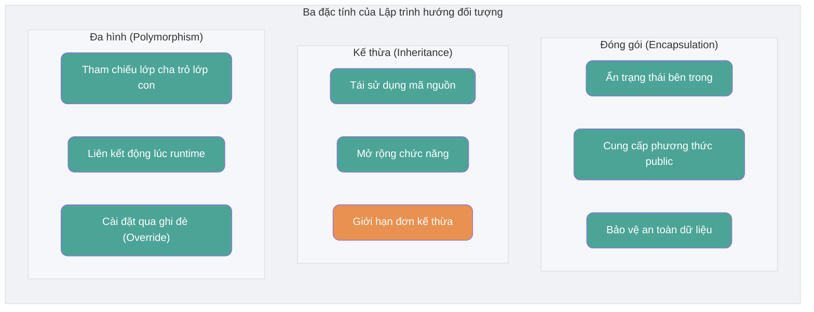
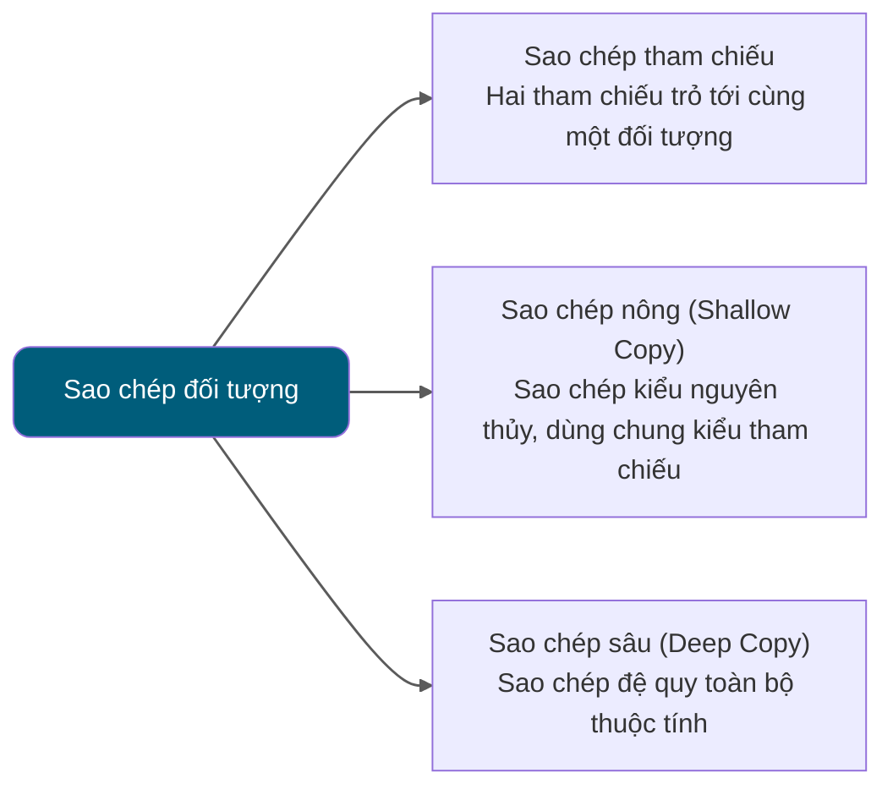

## Cơ bản về Lập trình hướng đối tượng (OOP)

### ⭐️ Sự khác biệt giữa Lập trình hướng đối tượng (OOP) và Lập trình hướng thủ tục (POP)

Lập trình hướng thủ tục (Procedural-Oriented Programming, POP) và lập trình hướng đối tượng (Object-Oriented Programming, OOP) là hai mô hình lập trình phổ biến. Điểm khác biệt chính giữa chúng nằm ở cách tiếp cận giải quyết vấn đề:

- **Lập trình hướng thủ tục (POP)**: Chia quá trình giải quyết vấn đề thành từng hàm/phương thức riêng lẻ, sau đó giải quyết vấn đề bằng cách lần lượt thực thi các phương thức đó.
- **Lập trình hướng đối tượng (OOP)**: Trước tiên trừu tượng hóa thành các đối tượng (`object`), sau đó giải quyết vấn đề thông qua việc các đối tượng thực thi phương thức của mình.

So với POP, các chương trình phát triển bằng OOP thường có những ưu điểm sau:

- **Dễ bảo trì**: Nhờ cấu trúc rõ ràng và tính đóng gói, chương trình OOP thường dễ bảo trì hơn.
- **Dễ tái sử dụng**: Thông qua kế thừa và đa hình, thiết kế OOP giúp mã nguồn có tính tái sử dụng cao hơn và thuận tiện cho việc mở rộng tính năng.
- **Dễ mở rộng**: Thiết kế dạng module giúp việc mở rộng hệ thống trở nên dễ dàng và linh hoạt hơn.

Cách lập trình POP thường đơn giản và trực tiếp hơn, phù hợp để xử lý các tác vụ tương đối đơn giản.

Sự khác biệt về hiệu năng giữa POP và OOP chủ yếu phụ thuộc vào cơ chế vận hành của chúng, chứ không chỉ đơn thuần do bản thân mô hình lập trình. Vì vậy, việc so sánh đơn giản hiệu năng giữa hai mô hình là một hiểu nhầm phổ biến (issue liên quan: [Lập trình hướng thủ tục: Hiệu năng lập trình hướng thủ tục cao hơn lập trình hướng đối tượng??](https://github.com/Snailclimb/JavaGuide/issues/431)).


Khi lựa chọn mô hình lập trình, hiệu năng không phải là yếu tố duy nhất cần cân nhắc. Tính dễ bảo trì, khả năng mở rộng của mã nguồn và hiệu suất phát triển cũng quan trọng không kém.

Các ngôn ngữ lập trình hiện đại về cơ bản đều hỗ trợ nhiều mô hình lập trình: vừa có thể dùng để lập trình hướng thủ tục, vừa có thể dùng để lập trình hướng đối tượng.

Dưới đây là một ví dụ tính diện tích và chu vi hình tròn, minh họa ngắn gọn hai giải pháp khác nhau theo hướng đối tượng và hướng thủ tục.

**Hướng đối tượng (OOP)**:

```java
public class Circle {
    // Định nghĩa bán kính hình tròn
    private double radius;

    // Hàm tạo (Constructor)
    public Circle(double radius) {
        this.radius = radius;
    }

    // Tính diện tích hình tròn
    public double getArea() {
        return Math.PI * radius * radius;
    }

    // Tính chu vi hình tròn
    public double getPerimeter() {
        return 2 * Math.PI * radius;
    }

    public static void main(String[] args) {
        // Tạo một hình tròn có bán kính bằng 3
        Circle circle = new Circle(3.0);

        // In ra diện tích và chu vi hình tròn
        System.out.println("Diện tích hình tròn là: " + circle.getArea());
        System.out.println("Chu vi hình tròn là: " + circle.getPerimeter());
    }
}
```

Chúng ta đã định nghĩa lớp `Circle` để biểu diễn hình tròn; lớp này chứa thuộc tính bán kính cùng các phương thức tính diện tích và chu vi.

**Hướng thủ tục (POP)**:

```java
public class Main {
    public static void main(String[] args) {
        // Định nghĩa bán kính hình tròn
        double radius = 3.0;

        // Tính diện tích và chu vi hình tròn
        double area = Math.PI * radius * radius;
        double perimeter = 2 * Math.PI * radius;

        // In ra diện tích và chu vi hình tròn
        System.out.println("Diện tích hình tròn là: " + area);
        System.out.println("Chu vi hình tròn là: " + perimeter);
    }
}
```

Ở đây chúng ta định nghĩa trực tiếp bán kính hình tròn rồi dùng bán kính đó tính thẳng ra diện tích và chu vi.

### Dùng toán tử nào để tạo đối tượng? Instance của đối tượng và tham chiếu đối tượng khác nhau như thế nào?

Có thể sử dụng toán tử `new` để tạo instance của đối tượng. Vùng nhớ Heap của JVM được dùng để cấp phát các instance của lớp và mảng; giá trị tham chiếu có thể được lưu trong biến cục bộ, trường của đối tượng, trường `static` hoặc phần tử mảng, chứ không nhất thiết phải nằm trên Stack.

- Một tham chiếu đối tượng có thể trỏ tới 0 hoặc 1 đối tượng (một sợi dây có thể không buộc quả bóng bay nào, hoặc buộc một quả bóng bay);
- Một đối tượng có thể có `n` tham chiếu cùng trỏ tới nó (có thể dùng `n` sợi dây để buộc cùng một quả bóng bay).

### ⭐️ Sự khác biệt giữa bằng nhau về đối tượng (Object Equality) và bằng nhau về tham chiếu (Reference Equality)

- Bằng nhau về đối tượng thường được định nghĩa bởi `equals()`, dùng để so sánh trạng thái logic hoặc giá trị theo quy ước của kiểu dữ liệu.
- Bằng nhau về tham chiếu được kiểm tra bằng `==`, cho biết hai tham chiếu có cùng trỏ tới một đối tượng hay không (hoặc cả hai đều là `null`); ngôn ngữ Java không phơi bày hay so sánh địa chỉ bộ nhớ vật lý.

Ví dụ minh họa:

```java
String str1 = "hello";
String str2 = new String("hello");
String str3 = "hello";
// Dùng == để so sánh bằng nhau về tham chiếu của chuỗi
System.out.println(str1 == str2);
System.out.println(str1 == str3);
// Dùng phương thức equals để so sánh bằng nhau của chuỗi
System.out.println(str1.equals(str2));
System.out.println(str1.equals(str3));

```

Kết quả đầu ra:

```plain
false
true
true
true
```

Từ kết quả chạy đoạn mã trên, có thể thấy:

- `str1` và `str2` không bằng nhau, còn `str1` và `str3` thì bằng nhau. Nguyên nhân là do toán tử `==` so sánh xem tham chiếu của các chuỗi có trỏ tới cùng một đối tượng hay không.
- Nội dung của cả ba chuỗi `str1`, `str2` và `str3` đều bằng nhau. Nguyên nhân là do phương thức `equals` so sánh nội dung của chuỗi: dù tham chiếu đối tượng của các chuỗi khác nhau, chỉ cần nội dung giống nhau thì chúng được coi là bằng nhau.

### Nếu một lớp không khai báo hàm tạo (Constructor), chương trình có chạy đúng không?

Hàm tạo (`Constructor`) là một phương thức đặc biệt có nhiệm vụ chính là thực hiện công việc khởi tạo đối tượng.

Nếu một lớp không khai báo hàm tạo, chương trình vẫn chạy bình thường! Bởi vì ngay cả khi không khai báo hàm tạo, lớp đó vẫn có một hàm tạo mặc định không tham số. Nếu bạn tự thêm hàm tạo cho lớp (dù có tham số hay không), Java sẽ không tự động tạo hàm tạo mặc định không tham số nữa.

Chúng ta vẫn luôn vô tình sử dụng hàm tạo mỗi ngày—đó là lý do vì sao khi tạo đối tượng chúng ta phải thêm cặp dấu ngoặc đơn ở phía sau (vì cần gọi hàm tạo không tham số). Nếu bạn nạp chồng (`Overload`) hàm tạo có tham số, hãy nhớ viết luôn cả hàm tạo không tham số (kể cả có dùng tới hay không), vì điều này giúp bạn tránh gặp nhiều lỗi bất ngờ khi khởi tạo đối tượng.

### Hàm tạo (Constructor) có những đặc điểm gì? Có thể bị ghi đè (`Override`) không?

Hàm tạo có các đặc điểm sau:

- **Tên trùng với tên lớp**: Tên của hàm tạo bắt buộc phải khớp hoàn toàn với tên lớp.
- **Không có giá trị trả về**: Hàm tạo không có kiểu trả về và cũng không được phép khai báo bằng `void`.
- **Tự động thực thi**: Khi tạo đối tượng của lớp, hàm tạo sẽ tự động chạy mà không cần gọi tường minh.

Hàm tạo **không thể bị ghi đè (`Override`)**, nhưng **có thể bị nạp chồng (`Overload`)**. Do đó, một lớp có thể có nhiều hàm tạo với danh sách tham số khác nhau nhằm cung cấp các cách khởi tạo đối tượng khác nhau.

### ⭐️ Ba đặc tính của Lập trình hướng đối tượng

#### Đóng gói (Encapsulation)

Đóng gói là việc ẩn thông tin trạng thái của đối tượng (tức là các thuộc tính/trường) ở bên trong đối tượng, không cho phép các đối tượng bên ngoài truy cập trực tiếp vào thông tin nội bộ đó. Thay vào đó, có thể cung cấp một số phương thức cho phép bên ngoài truy cập để thao tác trên thuộc tính. Giống như chúng ta không thể nhìn thấy các linh kiện bên trong chiếc điều hòa treo trên tường (thuộc tính), nhưng có thể dùng điều khiển từ xa (phương thức) để điều khiển điều hòa. Nếu một thuộc tính không muốn cho bên ngoài truy cập, chúng ta hoàn toàn có thể không cung cấp phương thức cho bên ngoài gọi. Tuy nhiên, nếu một lớp không cung cấp bất kỳ phương thức nào cho bên ngoài truy cập thì lớp đó cũng không còn nhiều ý nghĩa—giống như nếu không có điều khiển điều hòa, ta không thể bật cho máy làm lạnh, khiến bản thân chiếc điều hòa mất đi ý nghĩa sử dụng (tất nhiên hiện nay còn nhiều cách điều khiển khác, ở đây chỉ lấy làm ví dụ minh họa).

```java
public class Student {
    private int id;// Đặt thuộc tính id thành private
    private String name;// Đặt thuộc tính name thành private

    // Phương thức lấy giá trị id
    public int getId() {
        return id;
    }

    // Phương thức thiết lập giá trị id
    public void setId(int id) {
        this.id = id;
    }

    // Phương thức lấy giá trị name
    public String getName() {
        return name;
    }

    // Phương thức thiết lập giá trị name
    public void setName(String name) {
        this.name = name;
    }
}
```

#### Kế thừa (Inheritance)

Các loại đối tượng khác nhau thường có một số điểm chung nhất định. Ví dụ: bạn Xiao Ming, bạn Xiao Hong và bạn Xiao Li đều có chung những đặc điểm của học sinh (lớp học, mã học sinh, v.v.). Đồng thời, mỗi đối tượng lại định nghĩa thêm các đặc điểm riêng giúp chúng khác biệt nhau—chẳng hạn Xiao Ming học giỏi Toán, Xiao Hong có tính cách dễ mến, còn Xiao Li có sức khỏe tốt. Kế thừa là kỹ thuật sử dụng định nghĩa của một lớp đã có làm nền tảng để xây dựng lớp mới; lớp mới có thể bổ sung thêm dữ liệu mới hoặc chức năng mới, đồng thời sử dụng lại các chức năng của lớp cha, nhưng không thể kế thừa một cách chọn lọc từ lớp cha. Nhờ kế thừa, ta có thể nhanh chóng tạo lớp mới, tăng tính tái sử dụng mã nguồn, cải thiện khả năng bảo trì chương trình, tiết kiệm rất nhiều thời gian tạo lớp mới và nâng cao hiệu suất phát triển.

**Hãy ghi nhớ 3 điểm sau về kế thừa:**

1. Đối tượng lớp con chứa trạng thái instance do lớp cha khai báo, nhưng các thành viên `private` của lớp cha không được lớp con kế thừa và lớp con cũng không thể truy cập trực tiếp các thành viên này.
2. Lớp con có thể có các thuộc tính và phương thức riêng của mình, tức là lớp con có thể mở rộng lớp cha.
3. Lớp con có thể cài đặt phương thức của lớp cha theo cách riêng của mình (sẽ giới thiệu ở phần sau).

#### Đa hình (Polymorphism)

Đa hình, đúng như tên gọi, nghĩa là một đối tượng có thể mang nhiều trạng thái khác nhau, biểu hiện cụ thể qua việc biến tham chiếu kiểu lớp cha trỏ tới instance của lớp con.

**Đặc điểm của đa hình:**

- Giữa kiểu đối tượng thực tế và kiểu của biến tham chiếu phải có quan hệ kế thừa (lớp) hoặc triển khai (interface);
- Lời gọi phương thức phát ra từ biến kiểu tham chiếu thực chất sẽ chạy phương thức của lớp nào phải đến lúc chương trình chạy (`runtime`) mới xác định được;
- Đa hình không thể gọi những phương thức "chỉ tồn tại ở lớp con mà không tồn tại ở lớp cha";
- Nếu lớp con đã ghi đè (`Override`) phương thức của lớp cha, phương thức thực sự được thực thi là phương thức đã ghi đè ở lớp con; nếu lớp con chưa ghi đè phương thức của lớp cha, phương thức của lớp cha sẽ được thực thi.



### ⭐️ Interface và Abstract Class có điểm gì giống và khác nhau?

#### Điểm giống nhau giữa Interface và Abstract Class

- **Khởi tạo đối tượng**: Cả `interface` và `abstract class` đều không thể khởi tạo trực tiếp (`new`), mà chỉ có thể tạo đối tượng cụ thể sau khi được triển khai (với `interface`) hoặc kế thừa (với `abstract class`).
- **Phương thức trừu tượng**: Cả `interface` và `abstract class` đều có thể chứa phương thức trừu tượng (`abstract method`). Phương thức trừu tượng không có phần thân hàm và bắt buộc phải được cài đặt trong lớp con hoặc lớp triển khai.

#### Điểm khác nhau giữa Interface và Abstract Class

- **Mục đích thiết kế**: `Interface` chủ yếu dùng để ràng buộc hành vi của lớp—bạn triển khai một `interface` nào đó nghĩa là bạn có hành vi tương ứng. `Abstract class` chủ yếu dùng để tái sử dụng mã nguồn, nhấn mạnh mối quan hệ phụ thuộc/kế thừa ("is-a").
- **Kế thừa và triển khai**: Một lớp chỉ có thể kế thừa duy nhất một lớp khác (bao gồm cả `abstract class`) vì Java không hỗ trợ đa kế thừa lớp. Tuy nhiên, một lớp có thể triển khai nhiều `interface`, và một `interface` cũng có thể kế thừa nhiều `interface` khác.
- **Biến thành viên**: Biến thành viên trong `interface` chỉ có thể mang kiểu `public static final`, không thể bị thay đổi và bắt buộc phải có giá trị khởi tạo ban đầu. Biến thành viên trong `abstract class` có thể dùng bất kỳ từ khóa bổ nghĩa truy cập nào (`private`, `protected`, `public`), và có thể được định nghĩa lại hoặc gán lại giá trị trong lớp con.
- **Phương thức**:
  - Trước Java 8, phương thức trong `interface` mặc định là `public abstract`, tức là chỉ được phép khai báo chữ ký phương thức. Từ Java 8 trở đi, có thể định nghĩa phương thức `default` (mặc định) và phương thức `static` (tĩnh) trong `interface`. Từ Java 9 trở đi, `interface` có thể chứa phương thức `private`.
  - `Abstract class` có thể chứa cả phương thức trừu tượng và phương thức không trừu tượng. Phương thức trừu tượng không có thân hàm và bắt buộc phải được cài đặt trong lớp con. Phương thức không trừu tượng có phần cài đặt cụ thể, có thể dùng trực tiếp trong `abstract class` hoặc ghi đè (`Override`) trong lớp con.

Java 8 đã bổ sung phương thức `default` và `static` cho `interface`, và Java 9 tiếp tục cho phép `interface` khai báo phương thức `private`. Những cơ chế này giúp việc sử dụng `interface` trở nên linh hoạt hơn nhiều.

Phương thức `default` được giới thiệu trong Java 8 dùng để cung cấp phần cài đặt mặc định cho phương thức của `interface`, và có thể bị ghi đè trong lớp triển khai. Nhờ vậy, ta có thể bổ sung tính năng mới vào một `interface` hiện có mà không cần sửa đổi các lớp triển khai cũ, từ đó tăng khả năng mở rộng và tính tương thích ngược của `interface`.

```java
public interface MyInterface {
    default void defaultMethod() {
        System.out.println("This is a default method.");
    }
}
```

Phương thức `static` được giới thiệu trong Java 8 không thể bị ghi đè trong lớp triển khai mà chỉ có thể gọi trực tiếp thông qua tên `interface` (`MyInterface.staticMethod()`), tương tự như phương thức tĩnh trong lớp. Phương thức `static` thường dùng để định nghĩa một số phương thức tiện ích dùng chung gắn với `interface`, nhìn chung khá ít dùng.

```java
public interface MyInterface {
    static void staticMethod() {
        System.out.println("This is a static method in the interface.");
    }
}
```

Java 9 cho phép dùng phương thức `private` trong `interface`. Phương thức `private` có thể dùng để chia sẻ mã nguồn nội bộ bên trong `interface` mà không để lộ ra bên ngoài.

```java
public interface MyInterface {
    // Phương thức default
    default void defaultMethod() {
        commonMethod();
    }

    // Phương thức static
    static void staticMethod() {
        commonMethod();
    }

    // Phương thức private static, có thể được gọi bởi cả phương thức static và default
    private static void commonMethod() {
        System.out.println("This is a private method used internally.");
    }

      // Phương thức private của instance, chỉ có thể được gọi bởi phương thức default.
    private void instanceCommonMethod() {
        System.out.println("This is a private instance method used internally.");
    }
}
```

### Bạn có hiểu sự khác biệt giữa Sao chép sâu (Deep Copy) và Sao chép nông (Shallow Copy) không? Sao chép tham chiếu (Reference Copy) là gì?



Về sự khác biệt giữa sao chép sâu và sao chép nông, trước tiên tôi xin đưa ra kết luận:

- **Sao chép nông (Shallow Copy)**: Sao chép nông sẽ tạo một đối tượng mới trên Heap (đây là điểm khác với sao chép tham chiếu). Tuy nhiên, nếu thuộc tính bên trong đối tượng gốc là kiểu tham chiếu, sao chép nông sẽ sao chép trực tiếp địa chỉ tham chiếu của đối tượng bên trong đó—nghĩa là đối tượng bản sao và đối tượng gốc vẫn dùng chung cùng một đối tượng bên trong.
- **Sao chép sâu (Deep Copy)**: Sao chép sâu sẽ sao chép hoàn toàn toàn bộ đối tượng, bao gồm cả các đối tượng bên trong mà đối tượng đó chứa.

Nếu chưa hoàn toàn hiểu kết luận trên cũng không sao, chúng ta hãy xem một ví dụ cụ thể!

#### Sao chép nông (Shallow Copy)

Mã nguồn minh họa sao chép nông như bên dưới: ở đây chúng ta triển khai `interface` `Cloneable` và ghi đè (`Override`) phương thức `clone()`.

Phần cài đặt `clone()` rất đơn giản, chỉ gọi thẳng phương thức `clone()` của lớp cha `Object`.

```java
public class Address implements Cloneable{
    private String name;
    // Lược bỏ constructor và các phương thức Getter/Setter
    @Override
    public Address clone() {
        try {
            return (Address) super.clone();
        } catch (CloneNotSupportedException e) {
            throw new AssertionError();
        }
    }
}

public class Person implements Cloneable {
    private Address address;
    // Lược bỏ constructor và các phương thức Getter/Setter
    @Override
    public Person clone() {
        try {
            Person person = (Person) super.clone();
            return person;
        } catch (CloneNotSupportedException e) {
            throw new AssertionError();
        }
    }
}
```

Kiểm thử:

```java
Person person1 = new Person(new Address("Wuhan"));
Person person1Copy = person1.clone();
// true
System.out.println(person1.getAddress() == person1Copy.getAddress());
```

Từ kết quả đầu ra có thể thấy, đối tượng nhân bản của `person1` và bản thân `person1` vẫn đang sử dụng chung một đối tượng `Address`.

#### Sao chép sâu (Deep Copy)

Ở đây chúng ta chỉ cần sửa lại một chút phương thức `clone()` của lớp `Person` để nhân bản luôn cả đối tượng `Address` bên trong đối tượng `Person`.

```java
@Override
public Person clone() {
    try {
        Person person = (Person) super.clone();
        person.setAddress(person.getAddress().clone());
        return person;
    } catch (CloneNotSupportedException e) {
        throw new AssertionError();
    }
}
```

Kiểm thử:

```java
Person person1 = new Person(new Address("Wuhan"));
Person person1Copy = person1.clone();
// false
System.out.println(person1.getAddress() == person1Copy.getAddress());
```

Từ kết quả đầu ra, rõ ràng đối tượng nhân bản của `person1` và `person1` hiện đã chứa hai đối tượng `Address` khác nhau.

**Vậy sao chép tham chiếu (Reference Copy) là gì?** Nói đơn giản, sao chép tham chiếu là khi hai biến tham chiếu khác nhau cùng trỏ tới một đối tượng duy nhất.

Tôi đã vẽ riêng một hình minh họa để mô tả sao chép nông, sao chép sâu và sao chép tham chiếu:


## ⭐️ Object

### Các phương thức phổ biến của lớp `Object` là gì?

Lớp `Object` là một lớp đặc biệt, là lớp cha của tất cả các lớp khác và cung cấp chủ yếu các phương thức dưới đây. Cần lưu ý rằng `finalize()` đã bị đánh dấu deprecated từ JDK 9 và được đánh dấu chờ loại bỏ từ JDK 18, không nên sử dụng trong mã nguồn mới:

```java
/**
 * Phương thức native, trả về đối tượng Class của đối tượng tại thời điểm runtime hiện tại; được khai báo với từ khóa final nên lớp con không được phép ghi đè.
 */
public final native Class<?> getClass()
/**
 * Phương thức native, trả về mã băm (hash code) của đối tượng, chủ yếu dùng trong bảng băm (hash table) như HashMap trong JDK.
 */
public native int hashCode()
/**
 * Dùng để so sánh 2 tham chiếu có trỏ tới cùng một đối tượng hay không; lớp String đã ghi đè phương thức này để so sánh giá trị chuỗi có bằng nhau hay không.
 */
public boolean equals(Object obj)
/**
 * Phương thức native, dùng để tạo và trả về một bản sao của đối tượng hiện tại.
 */
protected native Object clone() throws CloneNotSupportedException
/**
 * Trả về chuỗi gồm tên lớp và mã băm dạng thập lục phân của instance. Khuyến nghị tất cả các lớp con của Object đều nên ghi đè phương thức này.
 */
public String toString()
/**
 * Phương thức native và không thể ghi đè. Đánh thức một Thread đang chờ trên monitor của đối tượng này (monitor tương đương với khái niệm khóa/lock). Nếu có nhiều Thread đang chờ thì chỉ đánh thức ngẫu nhiên một Thread.
 */
public final native void notify()
/**
 * Phương thức native và không thể ghi đè. Tương tự notify, điểm khác duy nhất là nó đánh thức tất cả các Thread đang chờ trên monitor của đối tượng này thay vì chỉ một Thread.
 */
public final native void notifyAll()
/**
 * Phương thức native và không thể ghi đè. Tạm dừng thực thi Thread. Lưu ý: phương thức sleep không giải phóng khóa (lock), còn phương thức wait sẽ giải phóng khóa; timeout là thời gian chờ.
 */
public final native void wait(long timeout) throws InterruptedException
/**
 * Bổ sung thêm tham số nanos biểu thị thời gian phụ thêm (tính bằng nano giây, phạm vi 0-999999), do đó tổng thời gian chờ tối đa sẽ cộng thêm nanos nano giây.
 */
public final void wait(long timeout, int nanos) throws InterruptedException
/**
 * Tương tự 2 phương thức wait ở trên, chỉ khác là phương thức này chờ vô thời hạn, không có khái niệm timeout.
 */
public final void wait() throws InterruptedException
/**
 * Thao tác được kích hoạt khi instance bị Garbage Collector thu hồi.
 */
protected void finalize() throws Throwable { }
```

### Sự khác biệt giữa `==` và `equals()`

**`==`** có tác dụng khác nhau đối với kiểu nguyên thủy và kiểu tham chiếu:

- Đối với kiểu dữ liệu nguyên thủy (`primitive type`), `==` so sánh giá trị.
- Đối với kiểu dữ liệu tham chiếu (`reference type`), `==` so sánh xem các tham chiếu có trỏ tới cùng một đối tượng hay không (hoặc cả hai đều là `null`), chứ không phải so sánh địa chỉ bộ nhớ vật lý.

> Đối với `==`, bất kể so sánh kiểu nguyên thủy hay kiểu tham chiếu, nó luôn so sánh giá trị của các toán hạng; giá trị tham chiếu mô tả đối tượng mà nó trỏ tới, nhưng ngôn ngữ Java không định nghĩa giá trị này là một địa chỉ bộ nhớ vật lý có thể quan sát được.

**`equals()`** không thể dùng để kiểm tra biến kiểu dữ liệu nguyên thủy, mà chỉ dùng để kiểm tra xem hai đối tượng có bằng nhau hay không. Phương thức `equals()` nằm trong lớp `Object`, mà `Object` là lớp cha trực tiếp hoặc gián tiếp của mọi lớp, nên tất cả các lớp đều có phương thức `equals()`.

Phương thức `equals()` của lớp `Object`:

```java
public boolean equals(Object obj) {
     return (this == obj);
}
```

Phương thức `equals()` có hai trường hợp sử dụng:

- **Lớp chưa ghi đè (`Override`) phương thức `equals()`**: Khi so sánh hai đối tượng của lớp đó bằng `equals()`, tác dụng tương đương với so sánh bằng `==`, tức là dùng phương thức `equals()` mặc định của lớp `Object`.
- **Lớp đã ghi đè (`Override`) phương thức `equals()`**: Thông thường chúng ta ghi đè phương thức `equals()` để so sánh xem các thuộc tính bên trong hai đối tượng có bằng nhau hay không; nếu các thuộc tính bằng nhau thì trả về `true` (tức là coi hai đối tượng này bằng nhau).

Ví dụ minh họa (ở đây chỉ dùng để lấy ví dụ; thực tế nếu bạn viết như bên dưới, các IDE thông minh như IDEA đều sẽ nhắc bạn đổi `==` thành `equals()`):

```java
String a = new String("ab"); // a là một tham chiếu
String b = new String("ab"); // b là một tham chiếu khác, nội dung đối tượng giống nhau
String aa = "ab"; // Đặt trong Constant Pool
String bb = "ab"; // Tìm kiếm từ Constant Pool
System.out.println(aa == bb);// true
System.out.println(a == b);// false
System.out.println(a.equals(b));// true
System.out.println(42 == 42.0);// true
```

Phương thức `equals` trong `String` đã được ghi đè: phương thức `equals` của `Object` kiểm tra hai tham chiếu có trỏ tới cùng một đối tượng hay không, còn phương thức `equals` của `String` so sánh giá trị của chuỗi.

Khi tạo đối tượng kiểu `String` bằng chuỗi hằng (`string literal`, như `String aa = "ab"`), máy ảo sẽ tìm trong Constant Pool xem đã có đối tượng nào có giá trị giống với giá trị cần tạo hay chưa; nếu có thì gán nó cho tham chiếu hiện tại, còn nếu chưa thì tạo một đối tượng `String` trong Constant Pool rồi gán cho tham chiếu hiện tại. Ngược lại, khi tạo đối tượng bằng từ khóa `new` (như `String a = new String("ab")`), máy ảo luôn **tạo một đối tượng mới** trong bộ nhớ Heap và dùng giá trị trong Constant Pool (nếu chưa có sẽ tạo trước đối tượng chuỗi `"ab"` trong String Constant Pool) để khởi tạo, rồi gán cho tham chiếu hiện tại.

Phương thức `equals()` của lớp `String`:

```java
public boolean equals(Object anObject) {
    if (this == anObject) {
        return true;
    }
    if (anObject instanceof String) {
        String anotherString = (String)anObject;
        int n = value.length;
        if (n == anotherString.value.length) {
            char v1[] = value;
            char v2[] = anotherString.value;
            int i = 0;
            while (n-- != 0) {
                if (v1[i] != v2[i])
                    return false;
                i++;
            }
            return true;
        }
    }
    return false;
}
```

### `hashCode()` có tác dụng gì?

Tác dụng của `hashCode()` là lấy mã băm (số nguyên `int`), còn gọi là hash code / scatter code. Mã băm này có vai trò xác định vị trí chỉ mục (index) của đối tượng đó trong bảng băm (`hash table`).


`hashCode()` được định nghĩa trong lớp `Object` của JDK, điều này có nghĩa là bất kỳ lớp nào trong Java đều có hàm `hashCode()`. Ngoài ra cần lưu ý: phương thức `hashCode()` của `Object` là phương thức `native`, tức là được cài đặt bằng ngôn ngữ C hoặc C++.

> ⚠️ Lưu ý: Trong **Oracle OpenJDK 8**, phương thức này mặc định "sử dụng trạng thái cục bộ của Thread để sinh số ngẫu nhiên Marsaglia's xor-shift", KHÔNG phải là "địa chỉ" hay "chuyển đổi từ địa chỉ", và các JDK/VM khác nhau có thể khác nhau. Trong **Oracle OpenJDK 8** có 6 cách sinh (trong đó cách thứ 5 trả về địa chỉ), có thể bật cách thứ 5 bằng cách thêm tham số VM: `-XX:hashCode=4`. Mã nguồn tham khảo:
>
> - <https://hg.openjdk.org/jdk8u/jdk8u/hotspot/file/87ee5ee27509/src/share/vm/runtime/globals.hpp> (dòng 1127)
> - <https://hg.openjdk.org/jdk8u/jdk8u/hotspot/file/87ee5ee27509/src/share/vm/runtime/synchronizer.cpp> (bắt đầu từ dòng 537)

```java
public native int hashCode();
```

Bảng băm lưu trữ các cặp khóa-giá trị (key-value) và có đặc điểm là: **có thể truy xuất nhanh chóng "giá trị" tương ứng dựa vào "khóa". Trong đó có sự đóng góp của mã băm! (giúp tìm ra nhanh chóng đối tượng cần thiết)**

### Tại sao cần phải có `hashCode`?

Chúng ta lấy ví dụ "cách `HashSet` kiểm tra trùng lặp" để giải thích tại sao cần phải có `hashCode`.

Khi chúng ta thêm một đối tượng vào `HashSet`, `HashSet` sẽ gọi phương thức `hashCode()` của đối tượng trước để nhận được một "giá trị băm", rồi thông qua hàm băm nội bộ thực hiện thêm một phép biến đổi đơn giản lên giá trị băm đó (ví dụ phép chia lấy dư) để quyết định xem dữ liệu này nên đặt vào bucket nào trong mảng nền (tương ứng với một vị trí trong mảng nền):

1. Nếu bucket đó hiện đang trống, node tương ứng với đối tượng sẽ được chèn thẳng vào bucket này.
2. Nếu trong bucket đó đã có phần tử khác, `HashSet` sẽ duyệt qua danh sách liên kết hoặc cây đỏ-đen (`Red-Black Tree`) tương ứng với bucket này và so sánh từng phần tử:
   - Đối với các node có **giá trị băm khác nhau**, bỏ qua trực tiếp;
   - Đối với các node có **giá trị băm giống nhau**, sẽ tiếp tục gọi phương thức `equals()` để kiểm tra xem hai đối tượng có "bằng nhau" hay không:
     – Nếu `equals()` trả về `true`, chứng tỏ trong tập hợp đã tồn tại phần tử tương đương với đối tượng hiện tại, nên `HashSet` sẽ không thêm vào nữa;
     – Nếu trả về `false`, coi đây là phần tử mới và sẽ thêm đối tượng này như một node mới vào danh sách liên kết hoặc cây đỏ-đen của **cùng bucket đó**.

Bằng cách dùng `hashCode()` trước để thu hẹp phạm vi ứng viên vào trong cùng một bucket, sau đó mới gọi `equals()` để kiểm tra chính xác trên một lượng nhỏ phần tử trong bucket, `HashSet` giảm đáng kể số lần gọi `equals()`, qua đó nâng cao hiệu suất tìm kiếm và chèn phần tử.

**Vậy tại sao JDK lại cung cấp đồng thời cả hai phương thức này?**

Bởi vì trong một số container (như `HashMap`, `HashSet`), nhờ có `hashCode()` nên hiệu quả kiểm tra xem phần tử có tồn tại trong container tương ứng hay không sẽ cao hơn nhiều (tham khảo quy trình thêm phần tử vào `HashSet`).

Như chúng ta đã đề cập ở quy trình thêm phần tử vào `HashSet`, nếu khi đối chiếu trong `HashSet` có nhiều đối tượng có cùng `hashCode`, nó sẽ tiếp tục dùng `equals()` để xác định xem chúng có thực sự giống nhau hay không. Tức là `hashCode` giúp chúng ta giảm đáng kể chi phí tìm kiếm.

**Vậy tại sao không chỉ cung cấp mỗi phương thức `hashCode()`?**

Bởi vì hai đối tượng có giá trị `hashCode` bằng nhau không đồng nghĩa với việc hai đối tượng đó bằng nhau.

**Tại sao hai đối tượng có cùng giá trị `hashCode` vẫn chưa chắc đã bằng nhau?**

Bởi vì thuật toán băm mà `hashCode()` sử dụng có thể vô tình trả về cùng một giá trị băm cho nhiều đối tượng khác nhau. Thuật toán băm càng kém thì càng dễ xảy ra va chạm, nhưng điều này cũng phụ thuộc vào đặc tính phân bố miền giá trị của dữ liệu (khái niệm xung đột băm / Hash Collision chính là chỉ việc các đối tượng khác nhau cho ra cùng một giá trị `hashCode`).

Tóm lại:

- Nếu hai đối tượng có giá trị `hashCode` bằng nhau thì hai đối tượng đó chưa chắc đã bằng nhau (xung đột băm / Hash Collision).
- Nếu hai đối tượng có giá trị `hashCode` bằng nhau VÀ phương thức `equals()` cũng trả về `true`, khi đó chúng ta mới coi hai đối tượng này bằng nhau.
- Nếu hai đối tượng có giá trị `hashCode` khác nhau, chúng ta có thể kết luận ngay là hai đối tượng này không bằng nhau.

Tin rằng sau khi xem xong phần giới thiệu về `hashCode()` và `equals()` vừa rồi, câu hỏi tiếp theo dưới đây sẽ không thể làm khó được bạn.

### Tại sao khi ghi đè (`Override`) `equals()` bắt buộc phải ghi đè cả phương thức `hashCode()`?

Bởi vì hai đối tượng bằng nhau bắt buộc phải có giá trị `hashCode` bằng nhau. Nói cách khác, nếu phương thức `equals` đánh giá hai đối tượng là bằng nhau, thì giá trị `hashCode` của hai đối tượng đó cũng phải bằng nhau.

Nếu khi ghi đè `equals()` mà không ghi đè `hashCode()`, rất có thể dẫn tới tình trạng hai đối tượng được `equals` kết luận là bằng nhau nhưng giá trị `hashCode` lại khác nhau.

**Suy ngẫm**: Nếu ghi đè `equals()` mà không ghi đè `hashCode()`, khi dùng `HashMap` có thể xảy ra vấn đề gì?

**Tổng kết**:

- Nếu phương thức `equals` đánh giá hai đối tượng bằng nhau, thì giá trị `hashCode` của hai đối tượng đó cũng phải bằng nhau.
- Hai đối tượng có giá trị `hashCode` giống nhau chưa chắc đã bằng nhau (xung đột băm / Hash Collision).

Để xem thêm nội dung về `hashCode()` và `equals()`, bạn có thể tham khảo: [Giải đáp một số câu hỏi về Java hashCode() và equals()](https://www.cnblogs.com/skywang12345/p/3324958.html)

## String

### ⭐️ Sự khác biệt giữa `String`, `StringBuffer` và `StringBuilder` là gì?

**Tính khả biến (Mutability)**

`String` là bất biến (phần sau sẽ phân tích kỹ nguyên nhân): mỗi lần chỉnh sửa đều tạo ra đối tượng mới và trỏ tham chiếu tới instance mới đó. Còn `StringBuffer` và `StringBuilder` đều là khả biến: khi chỉnh sửa chuỗi, chúng không tạo đối tượng mới mà thao tác trực tiếp trên mảng ký tự sẵn có.

Cả `StringBuilder` và `StringBuffer` đều kế thừa từ lớp `AbstractStringBuilder`. Trong `AbstractStringBuilder` cũng dùng mảng ký tự để lưu chuỗi, nhưng không dùng từ khóa `final` và `private` để bổ nghĩa; quan trọng nhất là lớp `AbstractStringBuilder` này còn cung cấp nhiều phương thức chỉnh sửa chuỗi như phương thức `append`.

```java
abstract class AbstractStringBuilder implements Appendable, CharSequence {
    char[] value;
    public AbstractStringBuilder append(String str) {
        if (str == null)
            return appendNull();
        int len = str.length();
        ensureCapacityInternal(count + len);
        str.getChars(0, len, value, count);
        count += len;
        return this;
    }
    //...
}
```

**Tính an toàn luồng (Thread Safety)**

Đối tượng trong `String` là bất biến, nên cũng có thể hiểu là hằng số và an toàn luồng (thread-safe). `AbstractStringBuilder` là lớp cha chung của `StringBuilder` và `StringBuffer`, định nghĩa một số thao tác cơ bản trên chuỗi như `expandCapacity`, `append`, `insert`, `indexOf`, v.v. `StringBuffer` có gắn khóa đồng bộ lên các phương thức hoặc lên các phương thức được gọi bên trong, nên là thread-safe. `StringBuilder` không gắn khóa đồng bộ cho các phương thức nên không an toàn luồng (non-thread-safe).


**Hiệu năng (Performance)**

Sự khác biệt về hiệu năng giữa hai lớp này chủ yếu bắt nguồn từ cơ chế đảm bảo an toàn luồng:

- Các phương thức của `StringBuffer` thường được đồng bộ hóa (thread-safe), do đó phát sinh thêm một phần chi phí hiệu năng;
- `StringBuilder` không có chi phí đồng bộ (non-thread-safe), nên trong kịch bản đơn luồng thường đạt hiệu năng tốt hơn.
  Trong cùng điều kiện, dùng `StringBuilder` so với dùng `StringBuffer` chỉ mang lại mức cải thiện hiệu năng khoảng 10%~15%, nhưng lại phải chấp nhận rủi ro mất an toàn trong môi trường đa luồng.
  Ngoài ra, mức chênh lệch hiệu năng cụ thể không phải cố định; trong JVM hiện đại, nhờ các cơ chế tối ưu hóa khóa (như loại bỏ khóa - lock elision), khoảng cách hiệu năng giữa hai lớp trong một số tình huống có thể khá nhỏ.

**Tổng kết cách sử dụng cho cả ba lớp:**

- Thao tác với lượng dữ liệu ít: dùng `String`
- Thao tác lượng lớn dữ liệu trên bộ đệm chuỗi trong kịch bản đơn luồng: dùng `StringBuilder`
- Thao tác lượng lớn dữ liệu trên bộ đệm chuỗi trong kịch bản đa luồng: dùng `StringBuffer`

### ⭐️ Vì sao `String` là bất biến (Immutable)?

Lớp `String` sử dụng từ khóa `final` để bổ nghĩa cho mảng ký tự dùng để lưu chuỗi, ~~vì vậy đối tượng `String` là bất biến.~~

```java
public final class String implements java.io.Serializable, Comparable<String>, CharSequence {
    private final char value[];
  //...
}
```

> 🐛 Đính chính: Chúng ta biết rằng lớp có từ khóa `final` không thể bị kế thừa, phương thức có `final` không thể bị ghi đè (`Override`), biến `final` kiểu nguyên thủy không thể thay đổi giá trị, còn biến `final` kiểu tham chiếu không thể trỏ sang đối tượng khác nữa. Do đó, việc mảng lưu chuỗi có từ khóa `final` KHÔNG phải là nguyên nhân gốc rễ khiến `String` bất biến, bởi vì nội dung chuỗi lưu trong mảng này vẫn có thể thay đổi được (trường hợp `final` áp dụng cho biến kiểu tham chiếu).
>
> Nguyên nhân thực sự khiến `String` bất biến gồm các điểm sau:
>
> 1. Mảng lưu chuỗi được khai báo vừa là `final` vừa là `private`, đồng thời lớp `String` không cung cấp hay phơi bày bất kỳ phương thức nào cho phép sửa đổi chuỗi này.
> 2. Bản thân lớp `String` được khai báo `final` khiến nó không thể bị kế thừa, qua đó ngăn chặn lớp con phá vỡ tính bất biến của `String`.
>
> Đọc thêm: [Làm sao hiểu được tính bất biến của giá trị kiểu String? - Câu trả lời trên Zhihu](https://www.zhihu.com/question/20618891/answer/114125846)
>
> Bổ sung (từ [issue 675](https://github.com/Snailclimb/JavaGuide/issues/675)): Kể từ sau Java 9, phần cài đặt của `String`, `StringBuilder` và `StringBuffer` đã chuyển sang dùng mảng `byte` để lưu chuỗi.
>
> ```java
> public final class String implements java.io.Serializable,Comparable<String>, CharSequence {
>     // Annotation @Stable biểu thị biến bị sửa đổi tối đa một lần, gọi là "ổn định".
>     @Stable
>     private final byte[] value;
> }
>
> abstract class AbstractStringBuilder implements Appendable, CharSequence {
>     byte[] value;
>
> }
> ```
>
> **Vì sao Java 9 lại đổi cài đặt tầng dưới của `String` từ `char[]` sang `byte[]`?**
>
> Phiên bản `String` mới hỗ trợ nội bộ hai phương án mã hóa: Latin-1 và UTF-16. Nếu mọi ký tự trong chuỗi đều có thể biểu diễn bằng Latin-1 thì dùng Latin-1; nếu không thì dùng UTF-16. Ký tự chữ Hán không nằm trong phạm vi ký tự của Latin-1. Với phương án Latin-1, mỗi ký tự chỉ dùng một byte để lưu trữ, giúp tiết kiệm một nửa không gian dữ liệu ký tự so với `char[]` trước đây.
>
> Phía JDK chính thức từng nêu rằng đại đa số đối tượng `String` chỉ chứa các ký tự biểu diễn được bằng Latin-1.
>
> 
>
> Nếu chuỗi chứa ký tự mà Latin-1 không thể biểu diễn (ví dụ chữ Hán), bên trong sẽ dùng UTF-16, mỗi đơn vị mã (code unit) sử dụng hai byte.
>
> Đây là tài liệu giới thiệu chính thức: <https://openjdk.java.net/jeps/254>.

### ⭐️ Nối chuỗi nên dùng `"+"` hay `StringBuilder`?

Java không hỗ trợ người dùng tự định nghĩa nạp chồng toán tử (`operator overloading`), nhưng đặc tả ngôn ngữ đã định nghĩa riêng toán tử `+` và `+=` cho phép nối chuỗi.

```java
String str1 = "he";
String str2 = "llo";
String str3 = "world";
String str4 = str1 + str2 + str3;
```

Bytecode tương ứng của đoạn mã trên như sau:


Đối với bytecode JDK 8 minh họa ở đây, phép nối chuỗi `"+"` được `javac` chuyển đổi thành các lời gọi `StringBuilder.append()`. Từ JDK 9 trở đi, `javac` mặc định chuyển sang dùng `invokedynamic` và `StringConcatFactory`, vì vậy không thể coi `StringBuilder` là cách cài đặt bắt buộc ở mọi phiên bản.

Tuy nhiên, nếu dùng `"+"` để nối chuỗi bên trong vòng lặp thì sẽ tồn tại một nhược điểm rất rõ ràng: **trình biên dịch không tạo một `StringBuilder` duy nhất để tái sử dụng, dẫn đến việc tạo ra quá nhiều đối tượng `StringBuilder`**.

```java
String[] arr = {"he", "llo", "world"};
String s = "";
for (int i = 0; i < arr.length; i++) {
    s += arr[i];
}
System.out.println(s);
```

Đối tượng `StringBuilder` được tạo ngay bên trong vòng lặp, nghĩa là cứ mỗi vòng lặp lại tạo mới một đối tượng `StringBuilder`.


Nếu sử dụng trực tiếp đối tượng `StringBuilder` để nối chuỗi thì sẽ không gặp vấn đề này.

```java
String[] arr = {"he", "llo", "world"};
StringBuilder s = new StringBuilder();
for (String value : arr) {
    s.append(value);
}
System.out.println(s);
```


Nếu bạn dùng IntelliJ IDEA, cơ chế kiểm tra mã tích hợp sẵn của IDEA cũng sẽ nhắc bạn sửa lại đoạn mã đó.

Trong JDK 9, phép cộng chuỗi `"+"` được chuyển sang thực hiện bằng phương thức động `makeConcatWithConstants()`, giúp cấp phát trước không gian để giảm bớt việc tạo một số đối tượng tạm thời. Tuy nhiên, tối ưu này chủ yếu hướng tới các phép nối chuỗi đơn giản như `a + b + c`. Với các thao tác nối chuỗi số lượng lớn trong vòng lặp, bộ nhớ vẫn bị cấp phát động từng bước một (tương tự khái niệm `append` từng cặp hai chuỗi một), không hiệu quả bằng việc chủ động dùng `StringBuilder` để nối chuỗi. Cải tiến này được đề xuất trong [JEP 280](https://openjdk.org/jeps/280) của JDK 9; để tìm hiểu chi tiết phần cải tiến này, bạn nên đọc bài viết: [Vẫn dùng StringBuilder một cách máy móc? Hãy ôn lại cơ chế nối chuỗi nào](https://juejin.cn/post/7182872058743750715) và tham khảo thêm [issue#2442](https://github.com/Snailclimb/JavaGuide/issues/2442).

### `String#equals()` và `Object#equals()` khác nhau như thế nào?

Phương thức `equals` trong `String` đã được ghi đè (`Override`), dùng để so sánh xem giá trị của hai chuỗi `String` có bằng nhau hay không. Còn phương thức `equals` của `Object` kiểm tra xem hai tham chiếu có cùng trỏ tới một đối tượng hay không.

### ⭐️ Bạn có nắm rõ vai trò của String Constant Pool không?

**String Constant Pool** (bể hằng số chuỗi) là một vùng nhớ do JVM tách riêng ra dành cho chuỗi (lớp `String`) nhằm nâng cao hiệu năng và giảm tiêu thụ bộ nhớ, với mục đích chính là tránh việc tạo trùng lặp chuỗi.

```java
// 1. Tìm đối tượng chuỗi "ab" trong String Constant Pool; nếu chưa có thì tạo "ab" và đưa vào String Constant Pool
// 2. Gán tham chiếu của đối tượng chuỗi "ab" cho aa
String aa = "ab";
// Trả về trực tiếp đối tượng chuỗi "ab" trong String Constant Pool và gán cho tham chiếu bb
String bb = "ab";
System.out.println(aa==bb); // true
```

Để biết thêm thông tin về String Constant Pool, bạn có thể xem bài viết [Giải thích chi tiết các vùng nhớ trong Java](https://javaguide.cn/java/jvm/memory-area.html).

### ⭐️ Câu lệnh `String s1 = new String("abc");` tạo ra mấy đối tượng chuỗi?

Trả lời ngắn gọn trước: sẽ tạo ra 1 hoặc 2 đối tượng chuỗi.

1. Trong String Constant Pool chưa tồn tại `"abc"`: sẽ tạo ra 2 đối tượng chuỗi. Một đối tượng nằm trong String Constant Pool, được kích hoạt tạo bởi lệnh `ldc`. Đối tượng còn lại nằm trên Heap, được tạo bởi `new String()` và khởi tạo bằng chuỗi `"abc"` trong Constant Pool.
2. Trong String Constant Pool đã tồn tại `"abc"`: sẽ tạo ra 1 đối tượng chuỗi. Đối tượng này nằm trên Heap, được tạo bởi `new String()` và khởi tạo bằng chuỗi `"abc"` trong Constant Pool.

Dưới đây bắt đầu phân tích chi tiết.

1. Nếu trong String Constant Pool chưa tồn tại đối tượng chuỗi `"abc"`, thì trước tiên nó sẽ tạo đối tượng chuỗi `"abc"` trong String Constant Pool, sau đó tạo tiếp một đối tượng chuỗi `"abc"` nữa trong bộ nhớ Heap.

Mã nguồn minh họa (JDK 1.8):

```java
String s1 = new String("abc");
```

Bytecode tương ứng:

```java
// Cấp phát một đối tượng String chưa được khởi tạo trong bộ nhớ Heap.
// #2 là một tham chiếu ký hiệu (symbolic reference) trong Constant Pool, trỏ tới lớp java/lang/String.
// Trong giai đoạn phân giải (Resolution) của quá trình nạp lớp, tham chiếu ký hiệu này sẽ được phân giải thành tham chiếu trực tiếp trỏ tới lớp java/lang/String thực tế.
0 new #2 <java/lang/String>
// Nhân đôi tham chiếu đối tượng String trên đỉnh Operand Stack để chuẩn bị cho lời gọi hàm tạo tiếp theo.
// Lúc này trên Operand Stack có hai tham chiếu đối tượng giống nhau: một dùng để truyền vào hàm tạo, một dùng để giữ tham chiếu tới đối tượng mới nhằm lưu vào Local Variable Table sau đó.
3 dup
// JVM kiểm tra trước xem "abc" đã tồn tại trong String Constant Pool hay chưa.
// Nếu trong Constant Pool đã có "abc", trả về trực tiếp tham chiếu của chuỗi đó;
// Nếu trong Constant Pool chưa có "abc", JVM sẽ tạo chuỗi hằng này trong Constant Pool và trả về tham chiếu của nó.
// Tham chiếu này được đẩy lên Operand Stack để làm tham số cho hàm tạo.
4 ldc #3 <abc>
// Gọi hàm tạo, sử dụng chuỗi "abc" vừa nạp từ Constant Pool để khởi tạo đối tượng String trên Heap.
// Đối tượng String mới sẽ có nội dung giống với "abc" trong Constant Pool, nhưng là một đối tượng độc lập nằm trên Heap.
6 invokespecial #4 <java/lang/String.<init> : (Ljava/lang/String;)V>
// Lưu tham chiếu tới đối tượng String trên Heap vào Local Variable Table
9 astore_1
// Trả về, kết thúc phương thức
10 return
```

Lệnh `ldc (load constant)` đúng là dùng để nạp các loại hằng số khác nhau từ Constant Pool, bao gồm hằng chuỗi, hằng số nguyên, hằng số thực và thậm chí cả tham chiếu lớp. Đối với hằng chuỗi, hành vi của lệnh `ldc` như sau:

1. **Nạp chuỗi từ Constant Pool**: Trước tiên `ldc` kiểm tra xem trong String Constant Pool đã có đối tượng chuỗi nào có nội dung giống vậy hay chưa.
2. **Tái sử dụng đối tượng chuỗi đã có**: Nếu trong String Constant Pool đã tồn tại đối tượng chuỗi có nội dung giống nhau, `ldc` sẽ nạp tham chiếu của đối tượng đó lên Operand Stack.
3. **Chưa có thì tạo mới và đưa vào Constant Pool**: Nếu trong String Constant Pool chưa có đối tượng chuỗi cùng nội dung, JVM sẽ tạo một đối tượng chuỗi mới trong Constant Pool và nạp tham chiếu của nó lên Operand Stack.

2. Nếu trong String Constant Pool đã tồn tại đối tượng chuỗi `"abc"`, thì chỉ tạo ra 1 đối tượng chuỗi `"abc"` trên Heap.

Mã nguồn minh họa (JDK 1.8):

```java
// Trong String Constant Pool đã tồn tại đối tượng chuỗi "abc"
String s1 = "abc";
// Đoạn mã dưới đây chỉ tạo 1 đối tượng chuỗi "abc" trên Heap
String s2 = new String("abc");
```

Bytecode tương ứng:

```java
0 ldc #2 <abc>
2 astore_1
3 new #3 <java/lang/String>
6 dup
7 ldc #2 <abc>
9 invokespecial #4 <java/lang/String.<init> : (Ljava/lang/String;)V>
12 astore_2
13 return
```

Ở đây không chú thích chi tiết phần bytecode trên nữa: lệnh `ldc` ở vị trí `7` sẽ không tạo mới đối tượng chuỗi `"abc"` trên Heap, bởi vì ở vị trí `0` đã thực thi một lệnh `ldc` và đã tạo đối tượng chuỗi `"abc"` một lần rồi. Khi thực thi lệnh `ldc` tại vị trí `7`, nó sẽ trả về trực tiếp tham chiếu tương ứng với đối tượng chuỗi `"abc"` trong String Constant Pool.

### Phương thức `String#intern` có tác dụng gì?

`String.intern()` là một phương thức `native`, dùng để xử lý tham chiếu đối tượng chuỗi trong String Constant Pool. Quy trình hoạt động của nó có thể tóm gọn trong hai trường hợp sau:

1. **Trong Constant Pool đã có đối tượng chuỗi cùng nội dung**: Nếu trong String Constant Pool đã tồn tại một đối tượng `String` có nội dung giống với chuỗi gọi phương thức `intern()`, thì `intern()` sẽ trả về trực tiếp tham chiếu của đối tượng đó trong Constant Pool.
2. **Trong Constant Pool chưa có đối tượng chuỗi cùng nội dung**: Nếu trong String Constant Pool chưa có đối tượng nào có nội dung giống với chuỗi gọi `intern()`, thì `intern()` sẽ thêm tham chiếu của đối tượng chuỗi hiện tại vào String Constant Pool rồi trả về tham chiếu đó.

Tổng kết:

- Tác dụng chính của phương thức `intern()` là đảm bảo tính duy nhất của tham chiếu chuỗi trong Constant Pool.
- Khi gọi `intern()`, nếu trong Constant Pool đã tồn tại chuỗi có nội dung giống hệt thì trả về tham chiếu của đối tượng đã có trong Constant Pool; ngược lại, thêm chuỗi đó vào Constant Pool rồi trả về tham chiếu của nó.

Mã nguồn minh họa (JDK 1.8):

```java
// s1 trỏ tới đối tượng "Java" trong String Constant Pool
String s1 = "Java";
// s2 cũng trỏ tới đối tượng "Java" trong String Constant Pool, cùng một đối tượng với s1
String s2 = s1.intern();
// Tạo mới một đối tượng "Java" trên Heap, s3 trỏ tới đối tượng đó
String s3 = new String("Java");
// s4 trỏ tới đối tượng "Java" trong String Constant Pool, cùng một đối tượng với s1
String s4 = s3.intern();
// s1 và s2 trỏ tới cùng một đối tượng trong Constant Pool
System.out.println(s1 == s2); // true
// s3 trỏ tới đối tượng trên Heap, s4 trỏ tới đối tượng trong Constant Pool nên khác nhau
System.out.println(s3 == s4); // false
// s1 và s4 đều trỏ tới cùng một đối tượng trong Constant Pool
System.out.println(s1 == s4); // true
```

### Chuyện gì xảy ra khi thực hiện phép toán `"+"` giữa biến kiểu `String` và hằng số?

Trước hết hãy xem trường hợp nối chuỗi không gắn từ khóa `final` (JDK 1.8):

```java
String str1 = "str";
String str2 = "ing";
String str3 = "str" + "ing";
String str4 = str1 + str2;
String str5 = "string";
System.out.println(str3 == str4);//false
System.out.println(str3 == str5);//true
System.out.println(str4 == str5);//false
```

> **Lưu ý**: Để so sánh xem giá trị của hai chuỗi `String` có bằng nhau hay không, có thể dùng phương thức `equals()`. Phương thức `equals` trong `String` đã được ghi đè: phương thức `equals` của `Object` kiểm tra hai tham chiếu có trỏ tới cùng một đối tượng hay không, còn phương thức `equals` của `String` so sánh xem giá trị chuỗi có bằng nhau hay không. Nếu bạn dùng `==` để so sánh hai chuỗi có bằng nhau không, IDEA cũng sẽ nhắc bạn thay bằng phương thức `equals()`.


**Đối với các biểu thức chuỗi có thể xác định được giá trị tại thời điểm biên dịch, trình biên dịch sẽ thực hiện gộp hằng số (`Constant Folding`) và ghi kết quả dưới dạng hằng chuỗi vào Constant Pool của tệp class; đối tượng `String` tương ứng sẽ được tạo tại thời điểm runtime và lưu vào String Pool.**

Trong quá trình biên dịch, trình biên dịch `javac` (sau đây gọi tắt là trình biên dịch) sẽ thực hiện một bước tối ưu hóa mã nguồn gọi là **Gộp hằng số (Constant Folding)**. Điều này cũng được giới thiệu trong cuốn *Understanding the JVM (Hiểu sâu về máy ảo Java)*:


Gộp hằng số sẽ tính sẵn giá trị của biểu thức hằng và nhúng kết quả dưới dạng hằng số trực tiếp vào mã nguồn được sinh ra cuối cùng; đây là một trong số rất ít biện pháp tối ưu mà trình biên dịch `javac` thực hiện trên mã nguồn (gần như mọi tối ưu hóa mã đều được thực hiện trong trình biên dịch JIT).

Đối với `String str3 = "str" + "ing";`, trình biên dịch sẽ tối ưu thành `String str3 = "string";`.

Không phải mọi hằng số đều được gộp hằng—chỉ những hằng số mà trình biên dịch có thể xác định được giá trị ngay trong thời điểm biên dịch mới được áp dụng:

- Các kiểu dữ liệu nguyên thủy (`byte`, `boolean`, `short`, `char`, `int`, `float`, `long`, `double`) và hằng chuỗi.
- Các biến kiểu nguyên thủy và biến `String` được khai báo với từ khóa `final`.
- Chuỗi thu được từ việc nối chuỗi bằng `"+"`, các phép toán số học giữa các kiểu dữ liệu nguyên thủy (cộng, trừ, nhân, chia), và các phép toán bit của kiểu dữ liệu nguyên thủy (`<<`, `\>>`, `\>>>`).

**Giá trị của biến tham chiếu không thể xác định được ở thời điểm biên dịch, nên trình biên dịch không thể tối ưu hóa được.**

Cách nối chuỗi giữa tham chiếu đối tượng và `"+"` thực chất được thực hiện thông qua việc `StringBuilder` gọi phương thức `append()`, sau khi nối xong thì gọi `toString()` để thu được một đối tượng `String`.

```java
String str4 = new StringBuilder().append(str1).append(str2).toString();
```

Khi viết code hằng ngày, hãy cố gắng tránh nối nhiều đối tượng chuỗi như vậy vì làm thế sẽ tạo ra đối tượng mới. Nếu cần thay đổi chuỗi, có thể sử dụng `StringBuilder` hoặc `StringBuffer`.

Tuy nhiên, sau khi khai báo `String` với từ khóa `final`, trình biên dịch có thể xử lý nó như một hằng số.

Mã nguồn minh họa:

```java
final String str1 = "str";
final String str2 = "ing";
// Hai biểu thức dưới đây thực chất tương đương nhau
String c = "str" + "ing";// Đối tượng trong Constant Pool
String d = str1 + str2; // Đối tượng trong Constant Pool
System.out.println(c == d);// true
```

Biến `String` được khai báo với từ khóa `final` sẽ được trình biên dịch xử lý như hằng số: trình biên dịch có thể xác định được giá trị của nó ngay tại thời điểm biên dịch, hiệu quả tương đương như truy cập trực tiếp hằng số.

Nếu trình biên dịch phải đến thời điểm runtime mới biết được giá trị chính xác của nó, thì sẽ không thể tối ưu hóa được.

Mã nguồn minh họa (`str2` chỉ xác định được giá trị tại thời điểm runtime):

```java
final String str1 = "str";
final String str2 = getStr();
String c = "str" + "ing";// Đối tượng trong Constant Pool
String d = str1 + str2; // Đối tượng mới được tạo trên Heap
System.out.println(c == d);// false
public static String getStr() {
      return "ing";
}
```

## Tham khảo

- Phân tích chuyên sâu `String#intern`: <https://tech.meituan.com/2014/03/06/in-depth-understanding-string-intern.html>
- Đọc hiểu mã nguồn Java `String`: <http://keaper.cn/2020/09/08/java-string-mian-mian-guan/>
- Câu trả lời của RednaxelaFX về gộp hằng số (`Constant Folding`): <https://www.zhihu.com/question/55976094/answer/147302764>
