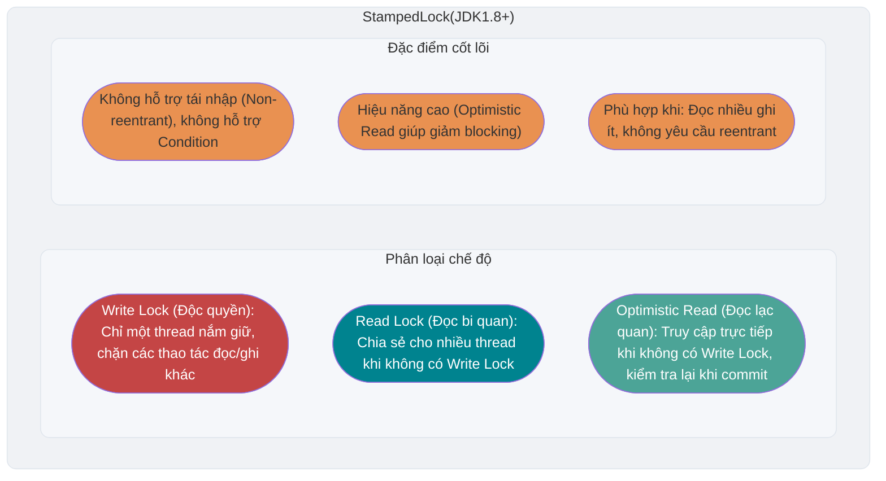

## ⭐️ JMM (Java Memory Model)

Các câu hỏi liên quan đến JMM (Java Memory Model) khá nhiều và cũng rất quan trọng, nên tôi đã tách riêng một bài viết để tổng hợp các kiến thức và câu hỏi về JMM: [Giải thích chi tiết JMM (Java Memory Model)](https://javaguide.cn/java/concurrent/jmm.html).

## ⭐️ Từ khóa `volatile`

### Làm thế nào `volatile` đảm bảo tính khả kiến (`Visibility`) của biến?

Trong Java, từ khóa `volatile` có thể đảm bảo tính khả kiến của biến. Thao tác ghi vào một biến `volatile` có quan hệ `happens-before` với các thao tác đọc tiếp theo trên cùng biến đó, do đó Thread đọc có thể nhìn thấy kết quả của thao tác ghi đó cũng như các kết quả trước đó được truyền qua tính bắc cầu của `happens-before`. Đây là ngữ nghĩa do JMM quy định, không đồng nghĩa với việc bắt buộc mọi lần truy cập đều phải bỏ qua CPU Cache để đọc/ghi trực tiếp bộ nhớ chính vật lý.


Từ khóa `volatile` không phải chỉ riêng ngôn ngữ Java mới có, nhưng ngữ nghĩa trong các ngôn ngữ khác nhau là không giống nhau. `volatile` của Java do JMM định nghĩa các đảm bảo về tính khả kiến (`Visibility`) và tính tuần tự (`Ordering`), không thể giải thích là "vô hiệu hóa CPU Cache".

Từ khóa `volatile` có thể đảm bảo tính khả kiến của dữ liệu, nhưng không thể đảm bảo tính nguyên tử (`Atomicity`) của dữ liệu. Từ khóa `synchronized` đảm bảo được cả hai.

### Làm thế nào để cấm sắp xếp lại lệnh (Instruction Reordering)?

**Trong Java, ngoài việc đảm bảo tính khả kiến của biến, từ khóa `volatile` còn có một tác dụng quan trọng khác là ngăn chặn việc sắp xếp lại lệnh (Instruction Reordering) của JVM.** Nếu chúng ta khai báo một biến là **`volatile`**, khi thực hiện thao tác đọc và ghi đối với biến này, JVM sẽ chèn các **Rào cản bộ nhớ (Memory Barrier)** đặc biệt để cấm sắp xếp lại lệnh.

Trong Java, lớp `Unsafe` cung cấp sẵn ba phương thức liên quan đến Memory Barrier, che giấu đi sự khác biệt ở tầng dưới của hệ điều hành:

```java
public native void loadFence();
public native void storeFence();
public native void fullFence();
```

Về mặt lý thuyết, bạn cũng có thể dùng ba phương thức này để đạt được hiệu quả cấm sắp xếp lại lệnh giống như `volatile`, chỉ là sẽ rườm rà hơn một chút.

#### 4 loại Rào cản bộ nhớ (Memory Barrier)

Khi giảng giải về cách hiện thực của JVM, người ta thường dùng 4 loại Memory Barrier dưới đây để mô tả các quan hệ sắp xếp lại lệnh cần ràng buộc. Đây là mô hình ở tầng triển khai giúp dễ hiểu, chứ không phải quy định của JLS ép buộc JVM phải chèn từng lệnh rào cản cụ thể nào:

| Loại rào cản | Ví dụ lệnh | Giải thích |
| --- | --- | --- |
| **LoadLoad** | `Load1; LoadLoad; Load2` | Đảm bảo thao tác đọc `Load1` hoàn thành trước `Load2` và các thao tác đọc tiếp theo sau đó. |
| **StoreStore** | `Store1; StoreStore; Store2` | Ràng buộc thứ tự hai thao tác ghi, sao cho hiệu lực của `Store1` không hiển thị với các bộ xử lý khác muộn hơn `Store2`. |
| **LoadStore** | `Load1; LoadStore; Store2` | Đảm bảo thao tác đọc `Load1` hoàn thành trước khi `Store2` và các thao tác ghi tiếp theo được đẩy (flush) vào bộ nhớ. |
| **StoreLoad** | `Store1; StoreLoad; Load2` | Đảm bảo thao tác ghi của `Store1` hiển thị với các bộ xử lý khác trước `Load2` và các thao tác đọc tiếp theo. Chi phí của rào cản `StoreLoad` là lớn nhất trong bốn loại, nó mang đồng thời hiệu lực của ba loại rào cản còn lại nên còn được gọi là **Rào cản toàn năng (Full Barrier)**. |

#### Chiến lược chèn Memory Barrier cho thao tác đọc/ghi `volatile`

Dưới đây là một chiến lược chèn rào cản bảo thủ giúp dễ hiểu ngữ nghĩa của `volatile`. Trên thực tế, JVM sẽ lựa chọn, gộp hoặc lược bỏ các rào cản cụ thể dựa trên mô hình bộ nhớ của bộ xử lý đích, miễn sao hành vi cuối cùng đáp ứng JMM:

**Chiến lược chèn Memory Barrier cho thao tác ghi `volatile`:**

Chèn một rào cản `StoreStore` vào **phía trước** mỗi thao tác ghi `volatile`, và chèn một rào cản `StoreLoad` vào **phía sau**.

```
Rào cản StoreStore
Thao tác ghi volatile
Rào cản StoreLoad
```

- Rào cản `StoreStore` phía trước: đảm bảo các thao tác ghi thông thường trước khi ghi `volatile` không bị sắp xếp lại xuống phía sau thao tác ghi `volatile` đó.
- Rào cản `StoreLoad` phía sau: đảm bảo sau khi ghi `volatile`, giá trị vừa ghi sẽ hiển thị đối với các thao tác đọc/ghi `volatile` tiếp theo. Đây là rào cản tốn kém nhất nhưng cũng then chốt nhất — nó ngăn thao tác ghi `volatile` bị sắp xếp lại với các thao tác đọc/ghi `volatile` có thể xảy ra phía sau.

**Chiến lược chèn Memory Barrier cho thao tác đọc `volatile`:**

Chèn một rào cản `LoadLoad` và một rào cản `LoadStore` vào **phía sau** mỗi thao tác đọc `volatile`.

```
Thao tác đọc volatile
Rào cản LoadLoad
Rào cản LoadStore
```

- Rào cản `LoadLoad`: đảm bảo các thao tác đọc thông thường phía sau thao tác đọc `volatile` không bị sắp xếp lại lên trước thao tác đọc `volatile`.
- Rào cản `LoadStore`: đảm bảo các thao tác ghi thông thường phía sau thao tác đọc `volatile` không bị sắp xếp lại lên trước thao tác đọc `volatile`.

Nhờ vậy, cặp thao tác ghi - đọc `volatile` đã thiết lập một ngữ nghĩa tương tự như **giải phóng - chiếm giữ khóa (lock release-acquire)**: **kết quả của mọi thao tác trước khi ghi `volatile` đều khả kiến đối với mọi thao tác sau khi đọc biến `volatile` đó.**

Dưới đây tôi sẽ lấy một câu hỏi phỏng vấn phổ biến làm ví dụ để giải thích hiệu quả cấm sắp xếp lại lệnh của từ khóa `volatile`.

Trong phỏng vấn, người phỏng vấn thường hỏi: "Bạn có biết Singleton Pattern không? Viết tay cho tôi xem nào! Và giải thích nguyên lý triển khai Singleton bằng Double-Checked Locking giúp tôi nhé!"

**Triển khai Singleton bằng Double-Checked Locking (DCL) (an toàn Thread)**:

```java
public class Singleton {

    private volatile static Singleton uniqueInstance;

    private Singleton() {
    }

    public static Singleton getUniqueInstance() {
       // Kiểm tra trước xem đối tượng đã được khởi tạo chưa; chưa khởi tạo mới vào khối đồng bộ khóa
        if (uniqueInstance == null) {
            // Khóa trên đối tượng Class
            synchronized (Singleton.class) {
                if (uniqueInstance == null) {
                    uniqueInstance = new Singleton();
                }
            }
        }
        return uniqueInstance;
    }
}
```

Việc dùng từ khóa `volatile` để bổ nghĩa cho `uniqueInstance` cũng rất cần thiết. Đoạn mã `uniqueInstance = new Singleton();` thực chất được thực thi theo ba bước:

1. Cấp phát không gian bộ nhớ cho `uniqueInstance`
2. Khởi tạo đối tượng `uniqueInstance`
3. Trỏ `uniqueInstance` tới địa chỉ bộ nhớ vừa cấp phát

Tuy nhiên, do JVM có đặc tính sắp xếp lại lệnh (Instruction Reordering), thứ tự thực thi có khả năng biến thành 1 -> 3 -> 2. Sắp xếp lại lệnh không gây ra vấn đề trong môi trường đơn luồng (single-threaded), nhưng trong môi trường đa luồng (multithreaded) sẽ dẫn đến việc một Thread nhận được một instance chưa được khởi tạo hoàn chỉnh. Ví dụ, Thread T1 đã thực thi bước 1 và 3, lúc này T2 gọi `getUniqueInstance()` phát hiện `uniqueInstance` không null nên trả về `uniqueInstance`, nhưng thực tế lúc này `uniqueInstance` vẫn chưa được khởi tạo.

#### Hiểu lý do DCL bắt buộc dùng `volatile` từ góc độ Memory Barrier

Ở trên, chúng ta đã giải thích vì sao `uniqueInstance` trong DCL Singleton cần bổ nghĩa bằng `volatile` dưới góc độ sắp xếp lại lệnh. Dưới đây sẽ phân tích sâu hơn từ góc độ Memory Barrier xem `volatile` giải quyết vấn đề này như thế nào.

Trong ba bước của dòng mã `uniqueInstance = new Singleton();` (cấp phát bộ nhớ, khởi tạo đối tượng, gán tham chiếu), nếu không thêm `volatile`, bước 2 và bước 3 có thể bị sắp xếp lại thành 1 → 3 → 2. Sau khi thêm `volatile`, do `uniqueInstance` là biến `volatile`, thao tác ghi vào nó (bước 3: gán tham chiếu cho `uniqueInstance`) sẽ được xử lý theo chiến lược chèn Memory Barrier cho thao tác ghi `volatile` đã giới thiệu ở trên:

1. Chèn rào cản `StoreStore` **trước** thao tác ghi `volatile`: đảm bảo các thao tác ghi của bước 1 (cấp phát bộ nhớ) và bước 2 (khởi tạo đối tượng) hoàn thành trước bước 3 (gán tham chiếu), **cấm việc sắp xếp lại giữa bước 2 và bước 3**.
2. Chèn rào cản `StoreLoad` **sau** thao tác ghi `volatile`: ràng buộc sự sắp xếp lại giữa thao tác ghi này với các thao tác đọc/ghi tiếp theo, đồng thời kết hợp với thao tác đọc `volatile` để thiết lập tính khả kiến mà JMM yêu cầu.

Như vậy, khi Thread T2 đọc `uniqueInstance` (thao tác đọc `volatile`), nếu thấy `uniqueInstance != null`, có thể đảm bảo đối tượng này chắc chắn đã được khởi tạo hoàn toàn.

### Mối quan hệ giữa `volatile` và `happens-before`

Nguyên tắc `happens-before` trong JMM là căn cứ quan trọng để phán đoán xem dữ liệu có tồn tại tranh chấp (data race) và có an toàn Thread (thread-safe) hay không. Thao tác đọc và ghi biến `volatile` có mối quan hệ mật thiết với nguyên tắc `happens-before`.

> Để xem giới thiệu chi tiết về nguyên tắc `happens-before`, có thể tham khảo bài viết [Giải thích chi tiết JMM (Java Memory Model)](https://javaguide.cn/java/concurrent/jmm.html).

Quy tắc trong `happens-before` liên quan trực tiếp đến `volatile` là **Quy tắc biến volatile (Volatile Variable Rule)**:

> **Thao tác ghi vào một biến `volatile` happens-before thao tác đọc tiếp theo đối với biến `volatile` đó.**

Nói cách khác, nếu Thread A ghi vào một biến `volatile` và Thread B sau đó đọc cùng biến `volatile` đó, thì mọi sửa đổi mà Thread A thực hiện trước khi ghi biến `volatile` (bao gồm cả sửa đổi đối với biến không phải `volatile`) đều khả kiến với Thread B.

Quy tắc này kết hợp với **Quy tắc tính bắc cầu (Transitivity Rule)** của `happens-before` (nếu A happens-before B, B happens-before C thì A happens-before C) có thể thực hiện một cơ chế giao tiếp liên Thread nhẹ nhàng. Dưới đây minh họa bằng một ví dụ:

```java
public class VolatileHappensBeforeDemo {
    private int a = 0;
    private int b = 0;
    private volatile boolean flag = false;

    // Thread A thực thi
    public void writer() {
        a = 1;           // Thao tác 1: ghi thông thường
        b = 2;           // Thao tác 2: ghi thông thường
        flag = true;     // Thao tác 3: ghi volatile
    }

    // Thread B thực thi
    public void reader() {
        if (flag) {      // Thao tác 4: đọc volatile
            int x = a;   // Thao tác 5: đọc thông thường, x chắc chắn bằng 1
            int y = b;   // Thao tác 6: đọc thông thường, y chắc chắn bằng 2
            System.out.println("x=" + x + ", y=" + y);
        }
    }
}
```

Trong đoạn mã trên, chuỗi quan hệ `happens-before` như sau:

1. Thao tác 1, Thao tác 2 happens-before Thao tác 3 (**Quy tắc thứ tự chương trình — Program Order Rule**: trong cùng một Thread, thao tác phía trước happens-before thao tác phía sau)
2. Thao tác 3 happens-before Thao tác 4 (**Quy tắc biến volatile**: ghi `volatile` happens-before đọc `volatile`)
3. Thao tác 4 happens-before Thao tác 5, Thao tác 6 (**Quy tắc thứ tự chương trình**)

Theo **tính bắc cầu**: Thao tác 1, Thao tác 2 happens-before Thao tác 5, Thao tác 6.

Do đó, khi Thread B đọc được `flag == true` ở Thao tác 4, các sửa đổi của Thread A đối với `a` và `b` trước Thao tác 3 chắc chắn khả kiến với Thread B. Điểm mấu chốt ở đây là: **thao tác ghi - đọc của biến `volatile` không chỉ đảm bảo tính khả kiến của chính biến `volatile`, mà còn thông qua tính bắc cầu của `happens-before` để "kéo theo" đảm bảo tính khả kiến cho các biến thông thường trước và sau nó.**

Điều này cũng giải thích vì sao trong phát triển thực tế, `volatile` thường xuyên được dùng làm **cờ trạng thái (status flag)** (như `flag` trong ví dụ trên): nó có thể truyền thông tin trạng thái một cách an toàn giữa các Thread mà không cần dùng khóa, đồng thời đảm bảo tính khả kiến của dữ liệu liên quan.

### `volatile` có thể đảm bảo tính nguyên tử (`Atomicity`) không?

**Từ khóa `volatile` có thể đảm bảo tính khả kiến của biến, nhưng không thể đảm bảo thao tác trên biến là nguyên tử.**

Chúng ta có thể chứng minh qua đoạn mã sau:

```java
/**
 * Tìm JavaGuide trên WeChat và nhắn "Interview Sprint" để nhận miễn phí cẩm nang phỏng vấn Java nguyên bản
 *
 * @author Guide
 * @date 2022/08/03 13:40
 **/
public class VolatileAtomicityDemo {
    public volatile static int inc = 0;

    public void increase() {
        inc++;
    }

    public static void main(String[] args) throws InterruptedException {
        ExecutorService threadPool = Executors.newFixedThreadPool(5);
        VolatileAtomicityDemo volatileAtomicityDemo = new VolatileAtomicityDemo();
        for (int i = 0; i < 5; i++) {
            threadPool.execute(() -> {
                for (int j = 0; j < 500; j++) {
                    volatileAtomicityDemo.increase();
                }
            });
        }
        // Chờ 1.5 giây để đảm bảo chương trình trên thực thi xong
        Thread.sleep(1500);
        System.out.println(inc);
        threadPool.shutdown();
    }
}
```

Theo lẽ thường, chạy đoạn mã trên lẽ ra phải in ra `2500`. Nhưng khi bạn thực sự chạy đoạn mã đó, bạn sẽ thấy mỗi lần kết quả in ra đều nhỏ hơn `2500`.

Tại sao lại xảy ra tình trạng như vậy? Chẳng phải đã nói `volatile` có thể đảm bảo tính khả kiến của biến sao!

Tức là, nếu `volatile` có thể đảm bảo tính nguyên tử của thao tác `inc++`, thì sau khi mỗi Thread tự tăng biến `inc`, các Thread khác có thể lập tức nhìn thấy giá trị sau khi sửa. 5 Thread mỗi Thread thực hiện 500 lần thao tác, vậy giá trị cuối cùng của `inc` phải là 5\*500=2500.

Nhiều người sẽ hiểu nhầm thao tác tự tăng `inc++` là nguyên tử, thực tế `inc++` là một thao tác phức hợp (compound operation) gồm ba bước:

1. Đọc giá trị của `inc`.
2. Cộng 1 vào `inc`.
3. Ghi giá trị mới của `inc` trở lại bộ nhớ.

`volatile` không thể đảm bảo ba thao tác này mang tính nguyên tử, dẫn đến khả năng xảy ra tình huống sau:

1. Thread 1 sau khi đọc giá trị của `inc` nhưng chưa kịp sửa đổi. Thread 2 lại đọc giá trị của `inc`, sửa đổi (+1), rồi ghi giá trị `inc` trở lại bộ nhớ.
2. Sau khi Thread 2 thao tác xong, Thread 1 sửa đổi giá trị `inc` mà nó đã đọc (+1), rồi ghi giá trị `inc` trở lại bộ nhớ.

Điều này dẫn đến việc cả hai Thread đều thực hiện một lần tự tăng trên `inc`, nhưng thực tế `inc` chỉ tăng thêm 1.

Thực ra, nếu muốn đoạn mã trên chạy đúng cũng rất đơn giản: dùng `synchronized`, `Lock` hoặc `AtomicInteger` đều được.

Cải tiến bằng `synchronized`:

```java
public synchronized void increase() {
    inc++;
}
```

Cải tiến bằng `AtomicInteger`:

```java
public AtomicInteger inc = new AtomicInteger();

public void increase() {
    inc.getAndIncrement();
}
```

Cải tiến bằng `ReentrantLock`:

```java
Lock lock = new ReentrantLock();
public void increase() {
    lock.lock();
    try {
        inc++;
    } finally {
        lock.unlock();
    }
}
```

## ⭐️ Khóa lạc quan (`Optimistic Lock`) và Khóa bi quan (`Pessimistic Lock`)

### Khóa bi quan (`Pessimistic Lock`) là gì?

Khóa bi quan luôn giả định tình huống xấu nhất, cho rằng mỗi lần tài nguyên chia sẻ được truy cập đều sẽ xảy ra vấn đề (ví dụ dữ liệu chia sẻ bị sửa đổi), nên mỗi lần lấy tài nguyên để thao tác đều sẽ khóa lại, khiến các Thread khác muốn lấy tài nguyên này sẽ bị chặn cho đến khi khóa được giải phóng bởi người giữ trước đó. Nói cách khác, **tài nguyên chia sẻ mỗi lần chỉ cấp cho một Thread sử dụng, các Thread khác bị chặn, dùng xong mới nhường tài nguyên cho Thread khác**.

Các khóa độc quyền trong Java như `synchronized` và `ReentrantLock` chính là hiện thực của tư tưởng khóa bi quan.

```java
public void performSynchronisedTask() {
    synchronized (this) {
        // Các thao tác cần đồng bộ
    }
}

private Lock lock = new ReentrantLock();
lock.lock();
try {
   // Các thao tác cần đồng bộ
} finally {
    lock.unlock();
}
```

Trong kịch bản đồng thời cao, tranh chấp khóa gay gắt sẽ gây chặn Thread, số lượng lớn Thread bị chặn sẽ dẫn đến chuyển đổi ngữ cảnh (context switch) của hệ thống, làm tăng chi phí hiệu năng của hệ thống. Hơn nữa, khóa bi quan còn có thể tồn tại vấn đề Deadlock, ảnh hưởng đến hoạt động bình thường của mã nguồn.

### Khóa lạc quan (`Optimistic Lock`) là gì?

Khóa lạc quan luôn giả định tình huống tốt nhất, cho rằng mỗi lần tài nguyên chia sẻ được truy cập sẽ không xảy ra vấn đề. Thread có thể thực thi liên tục không cần khóa cũng không cần chờ, chỉ khi xác nhận (commit) sửa đổi mới kiểm tra xem tài nguyên tương ứng (tức dữ liệu) có bị Thread khác sửa đổi hay không (cách cụ thể có thể dùng cơ chế số phiên bản hoặc thuật toán CAS).

Trong Java, các lớp biến nguyên tử nằm dưới package `java.util.concurrent.atomic` (như `AtomicInteger`, `LongAdder`) được triển khai bằng **CAS** — một cách hiện thực của khóa lạc quan.


```java
// LongAdder có hiệu năng tốt hơn AtomicInteger và AtomicLong trong kịch bản đồng thời cao
// Đánh đổi là tiêu tốn nhiều không gian bộ nhớ hơn (đổi không gian lấy thời gian)
LongAdder sum = new LongAdder();
sum.increment();
```

Trong kịch bản đồng thời cao, so với khóa bi quan, khóa lạc quan không có tình trạng tranh chấp khóa gây chặn Thread và cũng không có vấn đề Deadlock, nên về hiệu năng thường chiếm ưu thế hơn. Tuy nhiên, nếu xung đột xảy ra thường xuyên (trường hợp tỷ lệ ghi rất cao), thao tác sẽ liên tục thất bại và thử lại, điều này cũng ảnh hưởng nghiêm trọng đến hiệu năng và khiến CPU tăng vọt.

Tuy vậy, vấn đề thất bại và thử lại quá nhiều cũng có thể giải quyết được — như `LongAdder` mà chúng ta vừa nhắc tới giải quyết vấn đề này theo cách đổi không gian lấy thời gian.

Về mặt lý thuyết:

- Khóa bi quan thường dùng nhiều hơn cho các trường hợp ghi nhiều (kịch bản nhiều ghi, tranh chấp gay gắt), như vậy có thể tránh việc thất bại và thử lại liên tục gây ảnh hưởng hiệu năng, chi phí của khóa bi quan là cố định. Tuy nhiên, nếu khóa lạc quan giải quyết được vấn đề thất bại và thử lại liên tục (ví dụ `LongAdder`), cũng có thể cân nhắc dùng khóa lạc quan, tùy thuộc vào tình hình thực tế.
- Khóa lạc quan thường dùng nhiều hơn cho các trường hợp ghi ít (kịch bản nhiều đọc, ít tranh chấp), như vậy có thể tránh việc khóa liên tục ảnh hưởng hiệu năng. Tuy nhiên, đối tượng mà khóa lạc quan hướng đến chủ yếu là một biến chia sẻ đơn lẻ (tham khảo các lớp biến nguyên tử trong package `java.util.concurrent.atomic`).

### Làm thế nào để triển khai Khóa lạc quan?

Khóa lạc quan thường được triển khai bằng cơ chế số phiên bản (`version`) hoặc thuật toán CAS; thuật toán CAS tương đối phổ biến hơn, ở đây cần đặc biệt lưu ý.

#### Cơ chế số phiên bản (`version`)

Thông thường là thêm một trường số phiên bản dữ liệu `version` vào bảng dữ liệu, biểu thị số lần dữ liệu bị sửa đổi. Khi dữ liệu bị sửa đổi, giá trị `version` sẽ tăng lên 1. Khi Thread A muốn cập nhật giá trị dữ liệu, trong lúc đọc dữ liệu cũng sẽ đọc giá trị `version`; khi gửi cập nhật, chỉ khi giá trị `version` đọc được lúc nãy bằng với giá trị `version` hiện tại trong cơ sở dữ liệu thì mới cập nhật, nếu không thì thử lại thao tác cập nhật cho đến khi cập nhật thành công.

**Ví dụ đơn giản**: Giả sử trong bảng thông tin tài khoản của cơ sở dữ liệu có một trường `version`, giá trị hiện tại là 1; còn trường số dư tài khoản (`balance`) hiện tại là \$100.

1. Nhân viên thao tác A lúc này đọc dữ liệu ra (`version`=1), và trừ \$50 từ số dư tài khoản (\$100-\$50).
2. Trong quá trình nhân viên A thao tác, nhân viên thao tác B cũng đọc bản ghi người dùng này (`version`=1), và trừ \$20 từ số dư tài khoản (\$100-\$20).
3. Nhân viên A hoàn thành công việc sửa đổi, gửi số phiên bản dữ liệu (`version`=1) cùng số dư tài khoản sau khi trừ (`balance`=\$50) lên cơ sở dữ liệu để cập nhật. Lúc này do phiên bản dữ liệu gửi lên bằng phiên bản hiện tại của bản ghi trong cơ sở dữ liệu nên dữ liệu được cập nhật, `version` của bản ghi trong cơ sở dữ liệu được cập nhật thành 2.
4. Nhân viên B hoàn thành thao tác, cũng định gửi phiên bản (`version`=1) cùng dữ liệu (`balance`=\$80) lên cơ sở dữ liệu, nhưng lúc này khi đối chiếu với phiên bản bản ghi trong cơ sở dữ liệu thì phát hiện phiên bản dữ liệu nhân viên B gửi lên là 1, còn phiên bản hiện tại của bản ghi trong cơ sở dữ liệu là 2, không thỏa mãn chiến lược khóa lạc quan "phiên bản gửi lên phải bằng phiên bản hiện tại mới được thực hiện cập nhật", do đó yêu cầu gửi lên của nhân viên B bị từ chối.

Như vậy đã tránh được khả năng nhân viên B dùng kết quả sửa đổi dựa trên dữ liệu cũ có `version`=1 để ghi đè lên kết quả thao tác của nhân viên A.

#### Thuật toán CAS

CAS là viết tắt của **Compare And Swap (So sánh và Hoán đổi)**, dùng để triển khai khóa lạc quan và được ứng dụng rộng rãi trong các framework lớn. Tư tưởng của CAS rất đơn giản: lấy một giá trị kỳ vọng so sánh với giá trị biến cần cập nhật, hai giá trị bằng nhau mới tiến hành cập nhật.

CAS là một thao tác nguyên tử (`atomic operation`), ở tầng dưới dựa vào một lệnh nguyên tử của CPU.

> **Thao tác nguyên tử** tức là thao tác nhỏ nhất không thể chia tách được nữa, nghĩa là một khi thao tác đã bắt đầu thì không thể bị ngắt quãng cho đến khi thao tác hoàn tất.

CAS liên quan đến ba toán hạng:

- **V**: Giá trị biến cần cập nhật (Var)
- **E**: Giá trị kỳ vọng (Expected)
- **N**: Giá trị mới dự kiến ghi vào (New)

Khi và chỉ khi giá trị của V bằng E, CAS mới cập nhật giá trị của V thành giá trị mới N theo cách nguyên tử. Nếu không bằng, điều đó cho thấy đã có Thread khác cập nhật V, nên Thread hiện tại từ bỏ việc cập nhật.

**Ví dụ đơn giản**: Thread A muốn sửa giá trị của biến `i` thành 6, giá trị ban đầu của `i` là 1 (V = 1, E = 1, N = 6, giả sử không tồn tại vấn đề ABA).

1. So sánh `i` với 1, nếu bằng nhau chứng tỏ chưa bị Thread khác sửa đổi, có thể thiết lập thành 6.
2. So sánh `i` với 1, nếu không bằng nhau chứng tỏ đã bị Thread khác sửa đổi, Thread hiện tại từ bỏ cập nhật, thao tác CAS thất bại.

Khi nhiều Thread cùng sử dụng CAS thao tác trên một biến, chỉ có một Thread thắng và cập nhật thành công, các Thread còn lại đều thất bại; nhưng các Thread thất bại sẽ không bị tạm dừng (suspend), mà chỉ được thông báo thất bại và được phép thử lại, tất nhiên cũng cho phép Thread thất bại từ bỏ thao tác.

Mã Java có thể biểu đạt ngữ nghĩa CAS thông qua các lớp nguyên tử, `VarHandle` và các API khác. HotSpot thường nhận diện các lời gọi liên quan thành hàm nội tại của JVM (JVM intrinsics), sau đó ánh xạ sang lệnh nguyên tử mà bộ xử lý đích hỗ trợ hoặc cách hiện thực tương đương; đây không phải là quy định cứng của đặc tả Java kiểu "gọi inline assembly C++ qua JNI".

Lớp `Unsafe` trong package `sun.misc` cung cấp các phương thức `compareAndSwapObject`, `compareAndSwapInt`, `compareAndSwapLong` để thực hiện thao tác CAS cho các kiểu `Object`, `int`, `long`:

```java
/**
  *  CAS
  * @param o         Đối tượng chứa field cần sửa đổi
  * @param offset    Độ lệch bộ nhớ (offset) của field trong đối tượng
  * @param expected  Giá trị kỳ vọng
  * @param update    Giá trị cập nhật
  * @return          true | false
  */
public final native boolean compareAndSwapObject(Object o, long offset,  Object expected, Object update);

public final native boolean compareAndSwapInt(Object o, long offset, int expected,int update);

public final native boolean compareAndSwapLong(Object o, long offset, long expected, long update);
```

Để xem giới thiệu chi tiết về lớp `Unsafe`, bạn có thể đọc bài viết này: [Giải thích chi tiết lớp ma thuật Unsafe trong Java - JavaGuide - 2022](https://javaguide.cn/java/basis/unsafe.html).

### CAS được triển khai trong Java như thế nào?

Trong Java, một lớp then chốt để triển khai thao tác CAS (Compare-And-Swap, So sánh và Hoán đổi) là `Unsafe`.

Lớp `Unsafe` nằm trong package `sun.misc`, là một lớp cung cấp các thao tác cấp thấp và không an toàn. Do sức mạnh và mức độ rủi ro tiềm ẩn của nó, lớp này thường được dùng trong nội bộ JVM hoặc trong một số thư viện đòi hỏi hiệu năng cực cao và truy cập tầng thấp, chứ không khuyến khích lập trình viên thông thường dùng trong mã ứng dụng. Để xem chi tiết về lớp `Unsafe`, bạn có thể đọc bài viết này: 📌[Giải thích chi tiết lớp ma thuật Unsafe trong Java](https://javaguide.cn/java/basis/unsafe.html).

Lớp `Unsafe` trong package `sun.misc` cung cấp các phương thức `compareAndSwapObject`, `compareAndSwapInt`, `compareAndSwapLong` để thực hiện thao tác CAS cho các kiểu `Object`, `int`, `long`:

```java
/**
 * Cập nhật giá trị trường của đối tượng một cách nguyên tử.
 *
 * @param o        Đối tượng cần thao tác
 * @param offset   Độ lệch bộ nhớ của trường đối tượng
 * @param expected Giá trị cũ kỳ vọng
 * @param x        Giá trị mới cần thiết lập
 * @return Trả về true nếu giá trị được cập nhật thành công; ngược lại trả về false
 */
boolean compareAndSwapObject(Object o, long offset, Object expected, Object x);

/**
 * Cập nhật giá trị trường đối tượng kiểu int một cách nguyên tử.
 */
boolean compareAndSwapInt(Object o, long offset, int expected, int x);

/**
 * Cập nhật giá trị trường đối tượng kiểu long một cách nguyên tử.
 */
boolean compareAndSwapLong(Object o, long offset, long expected, long x);
```

Trong JDK 8, các phương thức CAS này của `Unsafe` là các phương thức `native`. Mã Java thông qua chúng để biểu đạt ngữ nghĩa so sánh và hoán đổi nguyên tử, còn HotSpot thường xử lý các lời gọi liên quan dưới dạng hàm nội tại của JVM (JVM intrinsics) và ánh xạ sang lệnh nguyên tử được bộ xử lý đích hỗ trợ hoặc cách triển khai tương đương. Cách hiện thực cụ thể phụ thuộc vào kiến trúc JVM và CPU, nhưng không thể khái quát đơn giản là "gọi inline assembly C++ qua JNI".

Package `java.util.concurrent.atomic` cung cấp một số lớp phục vụ thao tác nguyên tử. Những lớp này tận dụng các lệnh nguyên tử ở tầng thấp để đảm bảo các thao tác trong môi trường đa luồng là an toàn Thread.


Để tìm hiểu giới thiệu và cách sử dụng các lớp Atomic này, bạn có thể đọc bài viết: [Tổng hợp các lớp Atomic](https://javaguide.cn/java/concurrent/atomic-classes.html).

`AtomicInteger` là một trong các lớp nguyên tử của Java, chủ yếu dùng để thực hiện thao tác nguyên tử trên biến kiểu `int`. Nó tận dụng các phương thức thao tác nguyên tử cấp thấp do lớp `Unsafe` cung cấp để đạt được tính an toàn Thread không khóa (lock-free).

Dưới đây, thông qua việc đọc hiểu mã nguồn cốt lõi của `AtomicInteger` (JDK 1.8), chúng ta sẽ minh họa cách Java sử dụng phương thức của lớp `Unsafe` để thực hiện thao tác nguyên tử.

Mã nguồn cốt lõi của `AtomicInteger` như sau:

```java
// Lấy instance của Unsafe
private static final Unsafe unsafe = Unsafe.getUnsafe();
private static final long valueOffset;

static {
    try {
        // Lấy độ lệch bộ nhớ (offset) của trường "value" trong lớp AtomicInteger
        valueOffset = unsafe.objectFieldOffset
            (AtomicInteger.class.getDeclaredField("value"));
    } catch (Exception ex) { throw new Error(ex); }
}
// Đảm bảo tính khả kiến của trường "value"
private volatile int value;

// Nếu giá trị hiện tại bằng giá trị kỳ vọng, cập nhật nguyên tử thành giá trị update
// Sử dụng phương thức Unsafe#compareAndSwapInt để thực hiện thao tác CAS
public final boolean compareAndSet(int expect, int update) {
    return unsafe.compareAndSwapInt(this, valueOffset, expect, update);
}

// Cộng nguyên tử delta vào giá trị hiện tại và trả về giá trị cũ
public final int getAndAdd(int delta) {
    return unsafe.getAndAddInt(this, valueOffset, delta);
}

// Cộng nguyên tử 1 vào giá trị hiện tại và trả về giá trị trước khi cộng (giá trị cũ)
// Sử dụng phương thức Unsafe#getAndAddInt để thực hiện thao tác CAS.
public final int getAndIncrement() {
    return unsafe.getAndAddInt(this, valueOffset, 1);
}

// Trừ nguyên tử 1 khỏi giá trị hiện tại và trả về giá trị trước khi trừ (giá trị cũ)
public final int getAndDecrement() {
    return unsafe.getAndAddInt(this, valueOffset, -1);
}
```

Mã nguồn `Unsafe#getAndAddInt`:

```java
// Lấy và cộng giá trị số nguyên một cách nguyên tử
public final int getAndAddInt(Object o, long offset, int delta) {
    int v;
    do {
        // Lấy giá trị int tại độ lệch bộ nhớ offset của đối tượng o theo ngữ nghĩa volatile
        v = getIntVolatile(o, offset);
    } while (!compareAndSwapInt(o, offset, v, v + delta));
    // Trả về giá trị cũ
    return v;
}
```

Có thể thấy `getAndAddInt` sử dụng vòng lặp `do-while`: khi thao tác `compareAndSwapInt` thất bại, nó sẽ liên tục thử lại cho đến khi thành công. Nghĩa là phương thức `getAndAddInt` sẽ thử cập nhật giá trị `value` thông qua `compareAndSwapInt`; nếu cập nhật thất bại (giá trị hiện tại trong khoảng thời gian đó đã bị Thread khác sửa đổi), nó sẽ lấy lại giá trị hiện tại và thử cập nhật lại một lần nữa cho đến khi thao tác thành công.

Do thao tác CAS có thể thất bại vì xung đột đồng thời, nên nó thường được kết hợp với vòng lặp `while` để tiếp tục thử lại sau khi thất bại cho đến khi thành công. Đây chính là **cơ chế Spin Lock (khóa tự quay)**.

### Thuật toán CAS tồn tại những vấn đề nào?

Vấn đề ABA là vấn đề phổ biến nhất của thuật toán CAS.

#### Vấn đề ABA

Nếu một biến V ban đầu đọc được giá trị là A, và lúc chuẩn bị gán giá trị kiểm tra lại vẫn thấy nó là giá trị A, vậy chúng ta có thể kết luận giá trị của nó chưa từng bị Thread khác sửa đổi không? Rõ ràng là không thể, vì trong khoảng thời gian này giá trị của nó có thể đã bị đổi thành giá trị khác rồi lại đổi ngược về A, khi đó thao tác CAS sẽ hiểu nhầm rằng nó chưa từng bị sửa đổi. Vấn đề này được gọi là **vấn đề "ABA"** của thao tác CAS.

Hướng giải quyết vấn đề ABA là gắn thêm **số phiên bản (version) hoặc dấu thời gian (timestamp)** vào trước biến. Lớp `AtomicStampedReference` từ JDK 1.5 trở đi được dùng để giải quyết vấn đề ABA; phương thức `compareAndSet()` của nó trước tiên kiểm tra xem tham chiếu hiện tại có bằng tham chiếu kỳ vọng không và dấu (`stamp`) hiện tại có bằng dấu kỳ vọng không, nếu tất cả đều bằng thì mới thiết lập nguyên tử tham chiếu và dấu đó thành giá trị cập nhật chỉ định.

```java
public boolean compareAndSet(V   expectedReference,
                             V   newReference,
                             int expectedStamp,
                             int newStamp) {
    Pair<V> current = pair;
    return
        expectedReference == current.reference &&
        expectedStamp == current.stamp &&
        ((newReference == current.reference &&
          newStamp == current.stamp) ||
         casPair(current, Pair.of(newReference, newStamp)));
}
```

#### Thời gian vòng lặp dài gây chi phí lớn

CAS thường sử dụng thao tác tự quay (spin) để thử lại, tức là không thành công thì cứ lặp liên tục cho đến khi thành công. Nếu không thành công trong thời gian dài sẽ gây ra chi phí thực thi CPU rất lớn.

Nếu JVM có thể hỗ trợ lệnh `pause` do bộ xử lý cung cấp, hiệu suất của thao tác spin sẽ được nâng cao. Lệnh `pause` có hai vai trò quan trọng:

1. **Làm trễ việc thực thi lệnh theo pipeline**: Lệnh `pause` có thể trì hoãn việc thực thi lệnh, qua đó giảm tiêu thụ tài nguyên CPU. Thời gian trễ cụ thể phụ thuộc vào phiên bản triển khai của bộ xử lý; trên một số bộ xử lý, thời gian trễ có thể bằng 0.
2. **Tránh xung đột thứ tự bộ nhớ (memory order violation)**: Khi thoát khỏi vòng lặp, lệnh `pause` có thể tránh việc pipeline của CPU bị xóa sạch do xung đột thứ tự bộ nhớ, từ đó nâng cao hiệu suất thực thi của CPU.

#### Chỉ đảm bảo được thao tác nguyên tử cho một biến chia sẻ duy nhất

Thao tác CAS chỉ có hiệu lực đối với một biến chia sẻ đơn lẻ. Khi cần thao tác nhiều biến chia sẻ cùng lúc, CAS tỏ ra bất lực. Tuy nhiên, bắt đầu từ JDK 1.5, Java cung cấp lớp `AtomicReference`, giúp chúng ta có thể đảm bảo tính nguyên tử giữa các đối tượng tham chiếu. Bằng cách đóng gói nhiều biến vào trong một đối tượng, chúng ta có thể dùng `AtomicReference` để thực hiện thao tác CAS.

Ngoài cách dùng `AtomicReference` này, cũng có thể tận dụng cơ chế khóa (locking) để đảm bảo.

### Tổng kết

| **Khía cạnh so sánh** | **Khóa lạc quan (`Optimistic Lock`)** | **Khóa bi quan (`Pessimistic Lock`)** |
| --- | --- | --- |
| **Giả định cốt lõi** | Giả định xung đột rất ít xảy ra, chỉ xác minh khi commit. | Giả định xung đột chắc chắn xảy ra, ngay khi đọc đã khóa. |
| **Triển khai phổ biến** | **CAS (Compare And Swap)** hoặc cơ chế số phiên bản. | Monitor của Java, `Lock` hoặc khóa cơ sở dữ liệu; cài đặt cụ thể có thể bao gồm spin, xếp hàng (queuing) và tạm dừng (suspension). |
| **Hành vi khi tranh chấp** | Sau khi cập nhật thất bại, logic nghiệp vụ quyết định thử lại, từ bỏ hoặc rollback. | Thread lấy khóa thất bại có thể spin, xếp hàng hoặc bị tạm dừng, tùy thuộc vào cài đặt khóa cụ thể. |
| **Chi phí đồng thời** | **Tiêu tốn CPU** (liên tục spin thử lại khi ghi đồng thời cao). | **Chi phí chuyển đổi ngữ cảnh** (tạm dừng và đánh thức Thread). |
| **Nguy cơ Deadlock** | **Không có Deadlock** (vì không liên quan đến việc giữ khóa mà chờ đợi). | **Có nguy cơ Deadlock** (nhiều khóa chờ đợi lẫn nhau). |
| **Triển khai ở Database** | `UPDATE ... SET version = version + 1` | `SELECT ... FOR UPDATE` |
| **Lớp đại diện trong Java** | `AtomicInteger`, `LongAdder`, `StampedLock` | `synchronized`, `ReentrantLock` |
| **Kịch bản áp dụng** | Nghiệp vụ **đọc nhiều ghi ít**, xác suất xung đột đồng thời thấp. | Nghiệp vụ cốt lõi **ghi nhiều đọc ít**, yêu cầu tính nhất quán dữ liệu cực cao. |

## Từ khóa `synchronized`

### `synchronized` là gì? Có tác dụng gì?

`synchronized` là một từ khóa trong Java, dịch ra có nghĩa là đồng bộ, chủ yếu giải quyết tính đồng bộ khi nhiều Thread truy cập vào tài nguyên, có thể đảm bảo phương thức hoặc khối mã được nó bổ nghĩa tại bất kỳ thời điểm nào chỉ có thể có một Thread thực thi.

Trong các phiên bản Java đời đầu, `synchronized` thuộc loại **Heavyweight Lock** (khóa trọng lượng nặng), hiệu suất thấp. Đó là bởi vì khóa giám sát (`monitor`) dựa vào `Mutex Lock` ở tầng dưới của hệ điều hành để hiện thực, mà Thread của Java được ánh xạ lên Thread gốc (native thread) của hệ điều hành. Nếu muốn tạm dừng (suspend) hoặc đánh thức (wake up) một Thread đều cần hệ điều hành hỗ trợ hoàn thành, mà việc hệ điều hành thực hiện chuyển đổi giữa các Thread đòi hỏi chuyển từ chế độ người dùng (user mode) sang chế độ nhân (kernel mode); quá trình chuyển đổi trạng thái này tốn thời gian tương đối lâu và chi phí thời gian khá cao.

Tuy nhiên, từ sau Java 6, `synchronized` đã đưa vào hàng loạt tối ưu hóa như Spin Lock, Adaptive Spin Lock, Lock Elimination (loại bỏ khóa), Lock Coarsening (gộp khóa), Biased Lock, Lightweight Lock... nhằm giảm thiểu chi phí của các thao tác khóa; những tối ưu hóa này giúp hiệu suất của khóa `synchronized` cải thiện rất nhiều. Do đó, `synchronized` vẫn có thể dùng tốt trong dự án thực tế — ngay cả mã nguồn JDK và rất nhiều framework mã nguồn mở đều sử dụng rộng rãi `synchronized`.

Bổ sung thêm một chút về Biased Lock (khóa thiên vị): do Biased Lock làm tăng độ phức tạp của JVM, đồng thời cũng không mang lại cải thiện hiệu năng cho tất cả ứng dụng. Vì vậy, từ JDK 15, Biased Lock bị tắt mặc định (vẫn có thể dùng `-XX:+UseBiasedLocking` để bật lại), và từ JDK 18, Biased Lock đã bị loại bỏ hoàn toàn (không thể mở qua dòng lệnh nữa).

### Sử dụng `synchronized` như thế nào?

Từ khóa `synchronized` chủ yếu có 3 cách sử dụng dưới đây:

1. Bổ nghĩa cho phương thức instance (instance method)
2. Bổ nghĩa cho phương thức tĩnh (static method)
3. Bổ nghĩa cho khối mã (code block)

**1. Bổ nghĩa cho phương thức instance** (khóa instance đối tượng hiện tại)

Khóa vào instance đối tượng hiện tại; trước khi vào mã đồng bộ phải giành được **khóa của instance đối tượng hiện tại**.

```java
synchronized void method() {
    // Mã nghiệp vụ
}
```

**2. Bổ nghĩa cho phương thức tĩnh** (khóa Class hiện tại)

Khóa vào lớp hiện tại, sẽ có tác dụng lên tất cả các instance đối tượng của lớp đó; trước khi vào mã đồng bộ phải giành được **khóa của `Class` hiện tại**.

Sở dĩ như vậy là vì thành viên `static` không thuộc về bất kỳ instance đối tượng riêng lẻ nào, mà thuộc về toàn bộ lớp, không phụ thuộc vào instance cụ thể của lớp và được chia sẻ chung bởi tất cả các instance của lớp.

```java
synchronized static void method() {
    // Mã nghiệp vụ
}
```

Lời gọi giữa phương thức `synchronized` tĩnh (`static`) và phương thức `synchronized` không tĩnh (`non-static`) có loại trừ lẫn nhau (mutually exclusive) không? Không! Nếu một Thread A gọi một phương thức `synchronized` không tĩnh trên một instance đối tượng, trong khi Thread B cần gọi một phương thức `synchronized` tĩnh của lớp chứa instance đó, thì điều này là được phép và không xảy ra hiện tượng loại trừ lẫn nhau, bởi vì truy cập phương thức `synchronized` tĩnh chiếm giữ khóa của `Class` hiện tại, còn truy cập phương thức `synchronized` không tĩnh chiếm giữ khóa của instance đối tượng hiện tại.

**3. Bổ nghĩa cho khối mã** (khóa đối tượng / lớp chỉ định)

Khóa vào đối tượng / lớp được chỉ định trong dấu ngoặc đơn:

- `synchronized(object)` biểu thị trước khi vào khối mã đồng bộ phải giành được **khóa của đối tượng được chỉ định**.
- `synchronized(ClassName.class)` biểu thị trước khi vào khối mã đồng bộ phải giành được **khóa của `Class` được chỉ định**.

```java
synchronized(this) {
    // Mã nghiệp vụ
}
```

**Tổng kết:**

- Đặt từ khóa `synchronized` vào phương thức `static` và khối mã `synchronized(class)` đều là khóa đối tượng `Class`;
- Đặt từ khóa `synchronized` vào phương thức instance là khóa instance đối tượng;
- Cố gắng không dùng `synchronized(String a)` vì trong JVM, String Constant Pool có cơ chế lưu đệm (cache).

### Constructor có thể dùng `synchronized` bổ nghĩa không?

Constructor không thể dùng từ khóa `synchronized` để bổ nghĩa. Tuy nhiên, có thể dùng khối mã `synchronized` bên trong constructor.

Ngoài ra, bản thân constructor vốn an toàn Thread, nhưng nếu trong constructor có liên quan đến thao tác trên tài nguyên chia sẻ thì vẫn cần áp dụng biện pháp đồng bộ phù hợp để đảm bảo an toàn Thread cho toàn bộ quá trình khởi tạo.

### ⭐️ Bạn có nắm được nguyên lý tầng dưới của `synchronized` không?

Nguyên lý tầng dưới của từ khóa `synchronized` thuộc về tầng JVM.

#### Trường hợp khối câu lệnh đồng bộ `synchronized`

```java
public class SynchronizedDemo {
    public void method() {
        synchronized (this) {
            System.out.println("synchronized 代码块");
        }
    }
}
```

Xem thông tin bytecode liên quan của lớp `SynchronizedDemo` bằng lệnh `javap` đi kèm JDK: đầu tiên chuyển tới thư mục tương ứng của lớp, chạy lệnh `javac SynchronizedDemo.java` để tạo tệp `.class` sau biên dịch, rồi chạy `javap -c -s -v -l SynchronizedDemo.class`.


Từ hình trên chúng ta có thể thấy: **việc triển khai khối câu lệnh đồng bộ `synchronized` sử dụng hai chỉ thị `monitorenter` và `monitorexit`, trong đó chỉ thị `monitorenter` trỏ tới vị trí bắt đầu của khối mã đồng bộ, còn chỉ thị `monitorexit` chỉ rõ vị trí kết thúc của khối mã đồng bộ.**

Trong bytecode phía trên có một chỉ thị `monitorenter` và hai chỉ thị `monitorexit`; điều này là để đảm bảo khóa đều được giải phóng đúng cách trong cả hai trường hợp: khối mã đồng bộ thực thi bình thường và khi xảy ra ngoại lệ (`Exception`).

Khi thực thi chỉ thị `monitorenter`, Thread cố gắng giành lấy khóa, tức là giành quyền sở hữu **bộ giám sát đối tượng `monitor`**.

> Trong Máy ảo Java (HotSpot), `Monitor` được triển khai bằng C++ thông qua [ObjectMonitor](https://github.com/openjdk-mirror/jdk7u-hotspot/blob/50bdefc3afe944ca74c3093e7448d6b889cd20d1/src/share/vm/runtime/objectMonitor.cpp). Mỗi đối tượng đều tích hợp sẵn một đối tượng `ObjectMonitor`.
>
> Ngoài ra, các phương thức như `wait/notify` cũng phụ thuộc vào đối tượng `monitor`; đây là lý do vì sao chỉ trong khối đồng bộ hoặc phương thức đồng bộ mới có thể gọi `wait/notify`, nếu không sẽ ném ngoại lệ `java.lang.IllegalMonitorStateException`.

Khi thực thi `monitorenter`, nó sẽ thử giành khóa của đối tượng; nếu bộ đếm của khóa bằng 0 thì chứng tỏ khóa có thể được giành lấy, và sau khi giành được sẽ đặt bộ đếm khóa thành 1 (tức tăng thêm 1).


Chỉ Thread đang sở hữu khóa của đối tượng mới có thể thực thi chỉ thị `monitorexit` để giải phóng khóa. Sau khi thực thi chỉ thị `monitorexit`, bộ đếm khóa được đặt lại thành 0, báo hiệu khóa đã được giải phóng và các Thread khác có thể thử giành khóa.


Nếu việc giành khóa đối tượng thất bại, Thread hiện tại phải bị chặn chờ đợi cho đến khi khóa được Thread khác giải phóng.

#### Trường hợp `synchronized` bổ nghĩa cho phương thức

```java
public class SynchronizedDemo2 {
    public synchronized void method() {
        System.out.println("synchronized 方法");
    }
}

```


Phương thức được bổ nghĩa bằng `synchronized` không có chỉ thị `monitorenter` và `monitorexit`, mà thay vào đó là cờ `ACC_SYNCHRONIZED`; cờ này chỉ rõ phương thức đó là một phương thức đồng bộ. JVM thông qua cờ truy cập `ACC_SYNCHRONIZED` để nhận biết phương thức có được khai báo là đồng bộ hay không, từ đó thực hiện lời gọi đồng bộ tương ứng.

Nếu là phương thức instance, JVM sẽ thử giành khóa của instance đối tượng. Nếu là phương thức tĩnh (`static`), JVM sẽ thử giành khóa của `Class` hiện tại.

#### Tổng kết

Việc triển khai khối câu lệnh đồng bộ `synchronized` sử dụng chỉ thị `monitorenter` và `monitorexit`, trong đó `monitorenter` trỏ tới vị trí bắt đầu khối mã đồng bộ và `monitorexit` chỉ rõ vị trí kết thúc khối mã đồng bộ.

Phương thức được bổ nghĩa bằng `synchronized` không có chỉ thị `monitorenter` và `monitorexit`, thay vào đó là cờ `ACC_SYNCHRONIZED` để chỉ rõ đây là một phương thức đồng bộ.

**Tuy nhiên, bản chất của cả hai đều là việc giành lấy bộ giám sát đối tượng `monitor`.**

Đề xuất đọc thêm: [Những câu chuyện về khóa và Thread trong Java - Đội ngũ kỹ thuật Youzan](https://tech.youzan.com/javasuo-yu-xian-cheng-de-na-xie-shi/).

🧗🏻 Nâng cao hơn: Bạn nào còn thời gian và sức học có thể dành thời gian nghiên cứu sâu về bộ giám sát đối tượng `monitor`.

### Sau JDK 1.6, tầng dưới của `synchronized` đã được tối ưu hóa những gì? Bạn có biết nguyên lý nâng cấp khóa (Lock Escalation) không?

Từ sau Java 6, `synchronized` đã đưa vào nhiều tối ưu hóa như Spin Lock, Adaptive Spin Lock, Lock Elimination, Lock Coarsening, Biased Lock, Lightweight Lock... để giảm chi phí thao tác khóa; những tối ưu hóa này giúp hiệu suất của `synchronized` tăng lên rất nhiều (như đã nhắc ở trên, trong JDK 18, Biased Lock đã bị loại bỏ hoàn toàn).

Khóa chủ yếu tồn tại ở bốn trạng thái, theo thứ tự là: trạng thái không khóa (unlocked), trạng thái Biased Lock, trạng thái Lightweight Lock, trạng thái Heavyweight Lock; chúng sẽ nâng cấp dần theo mức độ gay gắt của tranh chấp. Lưu ý rằng khóa có thể nâng cấp chứ không thể hạ cấp — chiến lược này nhằm nâng cao hiệu quả giành khóa và giải phóng khóa.

Quá trình nâng cấp khóa của `synchronized` tương đối phức tạp và trong phỏng vấn cũng ít khi hỏi sâu; nếu bạn muốn tìm hiểu chi tiết có thể xem bài viết này: [Phân tích sơ lược nguyên lý và hiện thực nâng cấp khóa synchronized](https://www.cnblogs.com/star95/p/17542850.html).

### Tại sao Biased Lock của `synchronized` lại bị loại bỏ?

Tuyên bố chính thức của OpenJDK: [JEP 374: Deprecate and Disable Biased Locking](https://openjdk.org/jeps/374)

Trong JDK 15, Biased Lock bị tắt mặc định (vẫn có thể dùng `-XX:+UseBiasedLocking` để bật Biased Lock), còn trong JDK 18, Biased Lock đã bị loại bỏ hoàn toàn (không thể mở qua dòng lệnh).

Theo tuyên bố chính thức, có hai nguyên nhân chính:

- **Lợi ích hiệu năng không rõ rệt:**

Biased Lock là một kỹ thuật tối ưu hóa của máy ảo HotSpot, giúp cải thiện hiệu năng truy cập khối mã đồng bộ trong trường hợp đơn luồng.

Các ứng dụng hưởng lợi từ Biased Lock thường sử dụng các API Collection đời đầu của Java như `Hashtable`, `Vector`, vì trong các lớp Collection này dùng `synchronized` để kiểm soát đồng bộ; nhờ đó khi một Thread đơn lẻ truy cập thường xuyên, Biased Lock sẽ giúp giảm chi phí đồng bộ.

Cùng với sự phát triển của JDK, các lớp Collection hiệu năng cao như `ConcurrentHashMap` xuất hiện với rất nhiều tối ưu hóa hiệu năng bên trong, khiến lợi ích hiệu năng mà Biased Lock mang lại không còn rõ rệt nữa.

Biased Lock chỉ đạt được lợi ích hiệu năng trong kịch bản một Thread duy nhất truy cập khối mã đồng bộ.

Nếu tồn tại tranh chấp đa luồng thì cần phải **thu hồi Biased Lock (Biased Lock revocation)** — chi phí hiệu năng của thao tác này khá đắt đỏ. Việc thu hồi Biased Lock phải chờ đi vào điểm an toàn toàn cục (global safepoint), ở trạng thái đó mọi Thread đều bị tạm dừng để kiểm tra trạng thái Thread và tiến hành thu hồi Biased Lock.

- **Chi phí bảo trì mã nguồn nội bộ JVM quá cao:**

Biased Lock đưa vào rất nhiều mã nguồn phức tạp cho hệ thống con đồng bộ (synchronization subsystem), đồng thời có tính xâm lấn cao đối với các thành phần khác của HotSpot. Sự phức tạp này gây khó khăn cho việc đọc hiểu mã nguồn và tái cấu trúc hệ thống; do đó OpenJDK muốn vô hiệu hóa, khai tử và xóa bỏ Biased Lock.

### ⭐️ `synchronized` và `volatile` có gì khác nhau?

Từ khóa `synchronized` và từ khóa `volatile` là hai cơ chế bổ trợ cho nhau, chứ không phải đối lập nhau!

- Từ khóa `volatile` là cách hiện thực nhẹ nhàng của đồng bộ Thread, nên hiệu năng của `volatile` chắc chắn tốt hơn `synchronized`. Tuy nhiên `volatile` chỉ có thể dùng cho biến, còn `synchronized` có thể bổ nghĩa cho phương thức cũng như khối mã.
- Từ khóa `volatile` đảm bảo được tính khả kiến của dữ liệu, nhưng không đảm bảo tính nguyên tử của dữ liệu. Từ khóa `synchronized` đảm bảo được cả hai.
- Từ khóa `volatile` chủ yếu dùng để giải quyết tính khả kiến của biến giữa nhiều Thread, còn từ khóa `synchronized` giải quyết tính đồng bộ khi nhiều Thread cùng truy cập tài nguyên.

#### So sánh hiệu năng giữa `volatile` và `synchronized`

Ở trên có nhắc rằng `volatile` là cách hiện thực nhẹ của đồng bộ Thread và có hiệu năng tốt hơn `synchronized`. Dưới đây sẽ phân tích từ góc độ nguyên lý tầng dưới lý do vì sao `volatile` có hiệu năng tốt hơn, và nên chọn cái nào trong từng trường hợp.

Châu Chí Minh trong cuốn *Hiểu sâu về Máy ảo Java* (*Understanding the Java Virtual Machine*) có chỉ ra:

> Chi phí hiệu năng của thao tác đọc biến `volatile` hầu như không có khác biệt gì so với biến thông thường, nhưng thao tác ghi thì có thể chậm hơn một chút, vì nó cần chèn nhiều lệnh Memory Barrier vào mã máy cục bộ để đảm bảo bộ xử lý không thực thi sai thứ tự. Tuy vậy, trong đa số kịch bản, tổng chi phí của `volatile` vẫn thấp hơn so với khóa.

Nguyên nhân gốc rễ tạo nên sự khác biệt hiệu năng giữa hai cơ chế nằm ở cơ chế triển khai tầng dưới khác nhau:

| Khía cạnh so sánh | `volatile` | `synchronized` |
| --- | --- | --- |
| **Tầng triển khai** | Triển khai bằng cách chèn lệnh Memory Barrier, không liên quan đến chặn Thread và chuyển đổi ngữ cảnh | Dựa vào khóa tương hỗ (`Mutex Lock`) của hệ điều hành, liên quan đến chuyển đổi giữa user mode và kernel mode |
| **Chi phí thao tác đọc** | Gần như tương đương biến thông thường | Cần giành khóa monitor, ngay cả khi không tranh chấp vẫn có chi phí nhất định (Biased Lock / Lightweight Lock CAS) |
| **Chi phí thao tác ghi** | Cần chèn Memory Barrier `StoreStore` + `StoreLoad`, có chi phí nhất định nhưng không làm chặn Thread | Cần giành và giải phóng khóa monitor; khi có tranh chấp sẽ dẫn đến chặn Thread và chuyển đổi ngữ cảnh |
| **Biểu hiện khi tranh chấp** | Không dẫn đến chặn Thread, luôn là non-blocking | Khi Thread tranh chấp gay gắt, sẽ xảy ra chặn và đánh thức thường xuyên, chi phí chuyển đổi ngữ cảnh lớn |
| **Phạm vi chức năng** | Chỉ có thể bổ nghĩa cho biến, chỉ đảm bảo `Visibility` và `Ordering` | Có thể bổ nghĩa cho phương thức và khối mã, đảm bảo đồng thời `Visibility`, `Ordering` và `Atomicity` |

**Gợi ý lựa chọn:**

- Nếu chỉ cần đảm bảo tính khả kiến của biến (như cờ trạng thái, tham chiếu instance trong DCL Singleton), hãy ưu tiên dùng `volatile` vì chi phí của nó nhỏ hơn.
- Nếu cần đảm bảo tính nguyên tử cho thao tác phức hợp (như `i++`, kiểm tra rồi mới thực thi v.v.), bắt buộc phải dùng `synchronized`, `Lock` hoặc các lớp nguyên tử (`Atomic`), `volatile` không thể đảm đương được.

## ReentrantLock

### `ReentrantLock` là gì?

`ReentrantLock` hiện thực giao diện `Lock`, là một khóa có tính tái nhập (reentrant) và độc quyền (exclusive), tương tự như từ khóa `synchronized`. Tuy nhiên, `ReentrantLock` linh hoạt và mạnh mẽ hơn, bổ sung thêm các tính năng nâng cao như thăm dò (polling), hết thời gian chờ (timeout), ngắt (interruption), Fair Lock và Non-fair Lock.

```java
public class ReentrantLock implements Lock, java.io.Serializable {}
```

Bên trong `ReentrantLock` có một lớp nội bộ `Sync`, `Sync` kế thừa AQS (`AbstractQueuedSynchronizer`); phần lớn các thao tác thêm khóa và giải phóng khóa thực chất đều được triển khai trong `Sync`. `Sync` có hai lớp con là `FairSync` (Fair Lock) và `NonfairSync` (Non-fair Lock).


`ReentrantLock` mặc định sử dụng Non-fair Lock, cũng có thể chỉ định tường minh sử dụng Fair Lock thông qua constructor.

```java
// Truyền vào một giá trị boolean: true là Fair Lock, false là Non-fair Lock
public ReentrantLock(boolean fair) {
    sync = fair ? new FairSync() : new NonfairSync();
}
```

Từ nội dung trên có thể thấy tầng dưới của `ReentrantLock` được hiện thực bởi AQS. Về nội dung liên quan đến AQS, đề xuất đọc bài viết [Giải thích chi tiết AQS](https://javaguide.cn/java/concurrent/aqs.html).

### Fair Lock và Non-fair Lock có gì khác nhau?

- **Fair Lock**: Khi tồn tại tranh chấp, thường ưu tiên cho Thread đã chờ lâu nhất giành được khóa, nhưng không đảm bảo việc lập lịch Thread của hệ điều hành diễn ra nghiêm ngặt theo thứ tự thời gian; phương thức `tryLock()` không tham số của `ReentrantLock` cũng sẽ không tuân theo thiết lập công bằng.
- **Non-fair Lock**: Sau khi khóa được giải phóng, Thread xin cấp sau có thể giành được khóa trước, mang tính ngẫu nhiên hoặc sắp xếp theo mức độ ưu tiên khác. Hiệu năng tốt hơn, nhưng có thể khiến một số Thread không bao giờ giành được khóa.

### ⭐️ `synchronized` và `ReentrantLock` có gì khác nhau?

#### Cả hai đều là Reentrant Lock (khóa tái nhập)

**Reentrant Lock** còn gọi là khóa đệ quy, chỉ việc một Thread có thể giành lại khóa nội bộ của chính mình. Ví dụ một Thread đã giành được khóa của một đối tượng nào đó và lúc này khóa đối tượng đó vẫn chưa được giải phóng; khi nó muốn giành lại khóa của đối tượng này thêm lần nữa thì vẫn có thể giành được — nếu là khóa không tái nhập (non-reentrant lock) thì sẽ gây ra Deadlock.

Các khóa thường dùng trong JDK (như `synchronized`, `ReentrantLock`, `ReentrantReadWriteLock`) đều có tính tái nhập, nhưng không phải mọi hiện thực `Lock` đều hỗ trợ tái nhập, chẳng hạn `StampedLock` là không tái nhập.

Trong đoạn mã dưới đây, cả `method1()` và `method2()` đều được bổ nghĩa bằng từ khóa `synchronized`, và `method1()` gọi `method2()`.

```java
public class SynchronizedDemo {
    public synchronized void method1() {
        System.out.println("方法1");
        method2();
    }

    public synchronized void method2() {
        System.out.println("方法2");
    }
}
```

Do khóa `synchronized` có tính tái nhập, cùng một Thread khi gọi `method1()` có thể trực tiếp giành khóa của đối tượng hiện tại, đến khi thực thi `method2()` vẫn có thể giành lại khóa của đối tượng này mà không phát sinh vấn đề Deadlock. Giả sử `synchronized` là khóa không tái nhập, vì khóa của đối tượng này đang bị Thread hiện tại giữ và không thể giải phóng, điều đó sẽ dẫn đến việc Thread thất bại khi lấy khóa lúc thực thi `method2()`, gây ra lỗi Deadlock.

#### `synchronized` phụ thuộc vào JVM còn `ReentrantLock` phụ thuộc vào API

`synchronized` được triển khai dựa trên tầng JVM. Như chúng ta đã trình bày ở trên, đội ngũ phát triển máy ảo đã thực hiện rất nhiều tối ưu hóa cho từ khóa `synchronized` ở JDK 1.6, nhưng những tối ưu hóa đó đều được hiện thực ở tầng máy ảo và không phơi bày trực tiếp cho chúng ta.

`ReentrantLock` được hiện thực ở tầng JDK (tức là tầng API, cần dùng phương thức `lock()` và `unlock()` kết hợp với khối câu lệnh `try/finally`), nên chúng ta có thể xem mã nguồn của nó để biết nó được triển khai như thế nào.

#### `ReentrantLock` bổ sung thêm một số tính năng nâng cao so với `synchronized`

So với `synchronized`, `ReentrantLock` bổ sung thêm một số tính năng nâng cao. Chủ yếu có ba điểm sau:

- **Chờ có thể ngắt (Interruptible waiting)**: `ReentrantLock` cung cấp cơ chế có thể ngắt Thread đang chờ khóa thông qua `lock.lockInterruptibly()`. Nghĩa là trong lúc Thread hiện tại đang chờ giành khóa, nếu Thread khác ngắt Thread hiện tại (`interrupt()`), Thread hiện tại sẽ ném ra ngoại lệ `InterruptedException` và có thể bắt ngoại lệ đó để xử lý tương ứng.
- **Có thể cấu hình chiến lược công bằng**: `ReentrantLock` có thể chỉ định chiến lược công bằng (Fair) hoặc không công bằng (Non-fair), mặc định là không công bằng, cấu hình qua constructor `ReentrantLock(boolean fair)`. `synchronized` không cung cấp cấu hình tính công bằng và cũng không cam kết các Thread chờ sẽ nhận được monitor theo thứ tự đến trước sau.
- **Cơ chế thông báo mạnh mẽ hơn**: `ReentrantLock` thông qua việc liên kết nhiều đối tượng `Condition` có thể thực hiện đánh thức theo nhóm và thông báo có chọn lọc. Điều này giải quyết vấn đề hiệu suất của `synchronized` khi chỉ có thể đánh thức ngẫu nhiên một Thread hoặc đánh thức tất cả, cung cấp hỗ trợ mạnh mẽ cho các kịch bản phối hợp Thread phức tạp.
- **Hỗ trợ hết thời gian chờ (Timeout)**: `ReentrantLock` cung cấp phương thức `tryLock(timeout)` cho phép chỉ định thời gian chờ tối đa khi xin cấp khóa; nếu vượt quá thời gian chờ thì việc giành khóa sẽ thất bại mà không chờ vô thời hạn.

Nếu bạn muốn sử dụng các tính năng kể trên thì chọn `ReentrantLock` là một lựa chọn không tồi.

Bổ sung về giao diện `Condition`:

> `Condition` mới có từ JDK 1.5 trở đi, nó có độ linh hoạt rất tốt, ví dụ có thể thực hiện chức năng thông báo đa luồng, tức là trên một đối tượng `Lock` có thể tạo nhiều instance `Condition` (tức bộ giám sát đối tượng); **các đối tượng Thread có thể đăng ký vào `Condition` chỉ định, từ đó thực hiện thông báo Thread có chọn lọc, linh hoạt hơn nhiều trong việc điều phối Thread. Khi dùng `notify()/notifyAll()` để thông báo, Thread được thông báo là do JVM lựa chọn, còn dùng lớp `ReentrantLock` kết hợp với các instance `Condition` có thể thực hiện "thông báo có chọn lọc"** — tính năng này rất quan trọng và được giao diện `Condition` cung cấp mặc định. Còn từ khóa `synchronized` thì tương đương với việc toàn bộ đối tượng `Lock` chỉ có duy nhất một instance `Condition`, tất cả Thread đều đăng ký vào một mình nó. Nếu thực thi phương thức `notifyAll()` sẽ thông báo toàn bộ các Thread đang ở trạng thái chờ, gây ra vấn đề hiệu năng rất lớn. Trong khi đó, phương thức `signalAll()` của một instance `Condition` chỉ đánh thức tất cả các Thread đang chờ đã đăng ký trên đúng instance `Condition` đó.

Bổ sung về **Chờ có thể ngắt (Interruptible waiting)**:

> `lockInterruptibly()` cho phép Thread đang bị chặn chờ trong quá trình giành khóa có thể phản hồi lại tín hiệu ngắt; tức là khi Thread hiện tại thử giành khóa nhưng phát hiện khóa đang bị Thread khác giữ, nó sẽ bị chặn chờ.
>
> Trong quá trình bị chặn chờ, nếu Thread khác ngắt Thread hiện tại bằng `interrupt()`, sẽ ném ra ngoại lệ `InterruptedException` để có thể bắt ngoại lệ đó và thực hiện một số thao tác xử lý.
>
> Để hiểu rõ hơn phương thức này, mượn một ví dụ trên Stack Overflow để thấy rõ hơn cách `lockInterruptibly()` có thể phản hồi tín hiệu ngắt:
>
> ```JAVA
> public class MyReentrantLock {
>     Thread t = new Thread() {
>         @Override
>         public void run() {
>             ReentrantLock r = new ReentrantLock();
>             // 1.1. Lần đầu thử giành khóa, có thể giành thành công
>             r.lock();
>
>             // 1.2. Lúc này số lần tái nhập khóa là 1
>             System.out.println("lock() : lock count :" + r.getHoldCount());
>
>             // 2. Ngắt Thread hiện tại; qua Thread.currentThread().isInterrupted() thấy trạng thái ngắt là true
>             interrupt();
>             System.out.println("Current thread is interrupted");
>
>             // 3.1. Thử giành khóa, có thể giành thành công
>             r.tryLock();
>             // 3.2. Lúc này số lần tái nhập khóa là 2
>             System.out.println("tryLock() on interrupted thread lock count :" + r.getHoldCount());
>             try {
>                 // 4. In ra trạng thái ngắt của Thread là true, nên gọi lockInterruptibly() sẽ ném ngoại lệ InterruptedException
>                 System.out.println("Current Thread isInterrupted:" + Thread.currentThread().isInterrupted());
>                 r.lockInterruptibly();
>                 System.out.println("lockInterruptibly() --NOt executable statement" + r.getHoldCount());
>             } catch (InterruptedException e) {
>                 r.lock();
>                 System.out.println("Error");
>             } finally {
>                 r.unlock();
>             }
>
>             // 5. In ra số lần giữ khóa, có thể thấy lockInterruptibly() đã không giành được khóa thành công
>             System.out.println("lockInterruptibly() not able to Acqurie lock: lock count :" + r.getHoldCount());
>
>             r.unlock();
>             System.out.println("lock count :" + r.getHoldCount());
>             r.unlock();
>             System.out.println("lock count :" + r.getHoldCount());
>         }
>     };
>     public static void main(String str[]) {
>         MyReentrantLock m = new MyReentrantLock();
>         m.t.start();
>     }
> }
> ```
>
> Kết quả đầu ra:
>
> ```BASH
> lock() : lock count :1
> Current thread is interrupted
> tryLock() on interrupted thread lock count :2
> Current Thread isInterrupted:true
> Error
> lockInterruptibly() not able to Acqurie lock: lock count :2
> lock count :1
> lock count :0
> ```

Bổ sung về **Hỗ trợ hết thời gian chờ**:

> **Tại sao cần tính năng `tryLock(timeout)` này?**
>
> Phương thức `tryLock(timeout)` thử giành khóa trong khoảng thời gian timeout chỉ định. Nếu giành khóa thành công thì trả về `true`; nếu hết thời gian chờ trước khi khóa khả dụng thì trả về `false`. Tính năng này rất hữu ích trong các kịch bản sau:
>
> - **Ngăn chặn Deadlock:** Trong các kịch bản khóa phức tạp, `tryLock(timeout)` giúp ngăn ngừa Deadlock bằng cách cho phép Thread từ bỏ và thử lại trong một khoảng thời gian hợp lý.
> - **Nâng cao tốc độ phản hồi:** Ngăn không cho Thread bị chặn vô thời hạn.
> - **Xử lý các thao tác nhạy cảm về thời gian:** Với những thao tác có giới hạn thời gian nghiêm ngặt, `tryLock(timeout)` cho phép Thread tiếp tục thực thi phương án thay thế khi không thể giành khóa kịp thời.

### Khóa có thể ngắt (Interruptible Lock) và khóa không thể ngắt (Non-interruptible Lock) có gì khác nhau?

Sự khác biệt nằm ở: **khi Thread bị chặn trong quá trình giành khóa, nó có thể từ bỏ chờ đợi sớm do nhận tín hiệu ngắt hay không.**

- **Khóa không thể ngắt**: Thread trong thời gian chờ khóa dù nhận được tín hiệu ngắt cũng không thoát khỏi trạng thái bị chặn, mà cứ tiếp tục chờ cho đến khi lấy được khóa. Trạng thái ngắt sẽ được giữ lại, nhưng không ảnh hưởng đến quá trình giành khóa.
  - `synchronized` thuộc loại khóa không thể ngắt điển hình.
  - `ReentrantLock#lock()` cũng không thể ngắt.
- **Khóa có thể ngắt**: Thread trong lúc chờ khóa nếu nhận được tín hiệu ngắt sẽ lập tức ngừng chờ và ném ra `InterruptedException`, nhờ đó có cơ hội hủy thao tác hoặc xử lý lỗi.
  - `ReentrantLock#lockInterruptibly()` hiện thực khóa có thể ngắt.
  - `ReentrantLock#tryLock(long time, TimeUnit unit)` (thử giành khóa kèm timeout) cũng có thể ngắt.

## ReentrantReadWriteLock

`ReentrantReadWriteLock` trong dự án thực tế ít được sử dụng, trong phỏng vấn cũng ít hỏi, chỉ cần hiểu sơ bộ là được. JDK 1.8 đã đưa vào khóa đọc-ghi hiệu năng tốt hơn là `StampedLock`.

### `ReentrantReadWriteLock` là gì?

`ReentrantReadWriteLock` hiện thực `ReadWriteLock`, là một khóa đọc-ghi có tính tái nhập (reentrant read-write lock), vừa đảm bảo hiệu suất cho nhiều Thread đọc đồng thời, vừa đảm bảo an toàn Thread khi có thao tác ghi.

```java
public class ReentrantReadWriteLock
        implements ReadWriteLock, java.io.Serializable{
}
public interface ReadWriteLock {
    Lock readLock();
    Lock writeLock();
}
```

- Quy tắc kiểm soát đồng thời của khóa thông thường: đọc-đọc loại trừ lẫn nhau, đọc-ghi loại trừ lẫn nhau, ghi-ghi loại trừ lẫn nhau.
- Quy tắc kiểm soát đồng thời của khóa đọc-ghi: đọc-đọc không loại trừ lẫn nhau, đọc-ghi loại trừ lẫn nhau, ghi-ghi loại trừ lẫn nhau (chỉ có đọc-đọc là không loại trừ nhau).

`ReentrantReadWriteLock` thực chất là hai chiếc khóa: một là `WriteLock` (khóa ghi), một là `ReadLock` (khóa đọc). Khóa đọc là khóa chia sẻ (shared lock), khóa ghi là khóa độc quyền (exclusive lock). Khóa đọc có thể được đọc đồng thời và có thể được nhiều Thread nắm giữ cùng lúc, còn khóa ghi tối đa chỉ có thể được một Thread nắm giữ tại cùng một thời điểm.

Giống như `ReentrantLock`, tầng dưới của `ReentrantReadWriteLock` cũng được hiện thực dựa trên AQS.


`ReentrantReadWriteLock` cũng hỗ trợ Fair Lock và Non-fair Lock, mặc định dùng Non-fair Lock và có thể chỉ định tường minh qua constructor.

```java
// Truyền vào một giá trị boolean: true là Fair Lock, false là Non-fair Lock
public ReentrantReadWriteLock(boolean fair) {
    sync = fair ? new FairSync() : new NonfairSync();
    readerLock = new ReadLock(this);
    writerLock = new WriteLock(this);
}
```

### `ReentrantReadWriteLock` phù hợp với kịch bản nào?

Vì `ReentrantReadWriteLock` vừa đảm bảo hiệu suất nhiều Thread đọc đồng thời, vừa đảm bảo an toàn Thread khi có thao tác ghi, nên trong trường hợp đọc nhiều ghi ít, dùng `ReentrantReadWriteLock` có thể cải thiện rõ rệt hiệu năng hệ thống.

### Khóa chia sẻ (Shared Lock) và khóa độc quyền (Exclusive Lock) có gì khác nhau?

- **Khóa chia sẻ (Shared Lock)**: Một chiếc khóa có thể được nhiều Thread giành lấy cùng lúc.
- **Khóa độc quyền (Exclusive Lock)**: Một chiếc khóa chỉ có thể được một Thread giành lấy tại một thời điểm.

### Thread đang giữ khóa đọc có thể giành thêm khóa ghi không?

- Trong trường hợp Thread đang giữ khóa đọc, Thread đó không thể lấy được khóa ghi (vì khi lấy khóa ghi, nếu phát hiện khóa đọc hiện tại đang bị chiếm giữ thì lập tức lấy khóa thất bại, bất kể khóa đọc đó có phải do chính Thread hiện tại giữ hay không).
- Trong trường hợp Thread đang giữ khóa ghi, Thread đó có thể tiếp tục lấy khóa đọc (khi lấy khóa đọc nếu phát hiện khóa ghi bị chiếm giữ, chỉ khi khóa ghi không phải do Thread hiện tại chiếm giữ thì mới lấy khóa thất bại).

Về phân tích mã nguồn của khóa đọc-ghi, đề xuất đọc bài viết [Bàn về mấy chiếc khóa cấp JVM trong Java - Alibaba Middleware](https://mp.weixin.qq.com/s/h3VIUyH9L0v14MrQJiiDbw), viết rất hay.

### Tại sao khóa đọc không thể nâng cấp lên khóa ghi?

Khóa ghi có thể hạ cấp xuống khóa đọc, nhưng `ReentrantReadWriteLock` không hỗ trợ nâng cấp trực tiếp khóa đọc thành khóa ghi. Nguyên nhân cốt lõi là nhiều Thread có thể đang đồng thời giữ khóa đọc: nếu tất cả đều không giải phóng khóa đọc mà chờ khóa ghi, chúng sẽ chờ lẫn nhau và không thể thỏa mãn điều kiện độc quyền của khóa ghi. Khi cần nâng cấp, nên giải phóng khóa đọc trước, rồi mới giành khóa ghi, và kiểm tra lại trạng thái chia sẻ sau khi đã lấy được khóa ghi.

## StampedLock



`StampedLock` ít được hỏi trong phỏng vấn, không quá quan trọng, chỉ cần nắm sơ qua là được.

### `StampedLock` là gì?

`StampedLock` là khóa đọc-ghi có hiệu năng tốt hơn được đưa vào từ JDK 1.8, không hỗ trợ tái nhập (non-reentrant) và không hỗ trợ biến điều kiện `Condition`.

Khác với các lớp `Lock` thông thường, `StampedLock` không hiện thực trực tiếp giao diện `Lock` hay `ReadWriteLock`, mà được hiện thực độc lập dựa trên **CLH Lock** (AQS cũng dựa trên cơ chế này).

```java
public class StampedLock implements java.io.Serializable {
}
```

`StampedLock` cung cấp ba chế độ kiểm soát đọc-ghi: Read Lock (khóa đọc), Write Lock (khóa ghi) và Optimistic Read (đọc lạc quan).

- **Write Lock (khóa ghi)**: Khóa độc quyền, một khóa chỉ có thể được một Thread giành lấy. Khi một Thread đã giành được khóa ghi, các Thread khác yêu cầu khóa đọc và khóa ghi phải chờ. Tương tự khóa ghi của `ReentrantReadWriteLock`, chỉ khác là khóa ghi ở đây không tái nhập được.
- **Read Lock** (đọc bi quan): Khóa chia sẻ; trong trường hợp chưa có Thread nào giữ khóa ghi, nhiều Thread có thể đồng thời giữ khóa đọc. Nếu đã có Thread giữ khóa ghi thì các Thread khác yêu cầu giành khóa đọc này sẽ bị chặn. Tương tự khóa đọc của `ReentrantReadWriteLock`, chỉ khác là khóa đọc ở đây không tái nhập được.
- **Optimistic Read (đọc lạc quan)**: Cho phép nhiều Thread thực hiện đọc lạc quan cũng như giữ khóa đọc. Đồng thời cho phép một Thread ghi giành được khóa ghi.

Ngoài ra, `StampedLock` còn hỗ trợ chuyển đổi qua lại giữa ba loại khóa này trong những điều kiện nhất định.

```java
long tryConvertToWriteLock(long stamp){}
long tryConvertToReadLock(long stamp){}
long tryConvertToOptimisticRead(long stamp){}
```

`StampedLock` khi giành khóa sẽ trả về một con dấu dữ liệu (stamp) kiểu `long`, con dấu này dùng làm tham số giải phóng khóa sau đó; nếu con dấu trả về bằng 0 thì biểu thị giành khóa thất bại. Khi Thread hiện tại đã giữ khóa mà lại tiếp tục xin khóa nữa thì kết quả trả về tùy thuộc vào việc đang giữ khóa gì, xin lại khóa gì và dùng phương thức chặn hay phương thức `try`:

- **Thread hiện tại đang giữ khóa ghi và gọi lại `writeLock()`**: Do khóa ghi là khóa độc quyền, lần lấy thứ hai bắt buộc phải chờ, nhưng khóa ghi thứ nhất lại phải chờ lời gọi thứ hai trả về rồi mới giải phóng được, thế là Thread hiện tại tự khóa chính mình. Kết quả là bị chặn vĩnh viễn không thể trả về.
- **Khi dùng `tryWriteLock()`, sẽ trả về 0**: `tryWriteLock()` không chờ mãi mà thử ngay lập tức. Khi lấy thành công sẽ trả về con dấu khác 0; khi thất bại sẽ trả về 0.
- **Cùng một Thread lấy lại khóa đọc bi quan sẽ trả về con dấu mới**: Khóa đọc là khóa chia sẻ, giữa khóa đọc và khóa đọc không xung đột với nhau, nên vẫn trả về con dấu bình thường.

Một "Reentrant Lock" thực thụ sẽ nhận diện danh tính Thread. Dù ở đây trong `StampedLock`, cùng một Thread có thể lấy khóa đọc 2 lần và nhận được 2 con dấu, nhưng `StampedLock` không ghi nhận quyền sở hữu Thread đối với khóa. Đánh giá có tái nhập được hay không trọng tâm nằm ở khóa ghi độc quyền. Khóa ghi của `StampedLock` không thể được cùng một Thread giành lại lần nữa, nên nó không hỗ trợ tái nhập.

```java
// Khóa ghi
public long writeLock() {
    long s, next;  // bypass acquireWrite in fully unlocked case only
    return ((((s = state) & ABITS) == 0L &&
             U.compareAndSwapLong(this, STATE, s, next = s + WBIT)) ?
            next : acquireWrite(false, 0L));
}
// Khóa đọc
public long readLock() {
    long s = state, next;  // bypass acquireRead on common uncontended case
    return ((whead == wtail && (s & ABITS) < RFULL &&
             U.compareAndSwapLong(this, STATE, s, next = s + RUNIT)) ?
            next : acquireRead(false, 0L));
}
// Đọc lạc quan
public long tryOptimisticRead() {
    long s;
    return (((s = state) & WBIT) == 0L) ? (s & SBITS) : 0L;
}
```

### Tại sao hiệu năng của `StampedLock` lại tốt hơn?

Chế độ Optimistic Read (đọc lạc quan) có thêm so với khóa đọc-ghi truyền thống chính là nguyên nhân mấu chốt giúp `StampedLock` đạt hiệu năng tốt hơn `ReadWriteLock`. Optimistic Read của `StampedLock` cho phép một Thread ghi giành được khóa ghi, nên sẽ không làm tất cả các Thread ghi bị chặn; tức là khi đọc nhiều ghi ít, Thread ghi vẫn có cơ hội giành được khóa ghi, giảm thiểu vấn đề đói tài nguyên (`Starvation`) của Thread và nâng cao thông lượng lên rất nhiều.

### `StampedLock` phù hợp với kịch bản nào?

Giống như `ReentrantReadWriteLock`, `StampedLock` cũng phù hợp với các kịch bản nghiệp vụ đọc nhiều ghi ít, có thể dùng làm giải pháp thay thế cho `ReentrantReadWriteLock` với hiệu năng tốt hơn.

Tuy nhiên, cần lưu ý rằng `StampedLock` không tái nhập được, không hỗ trợ biến điều kiện `Condition`, và cũng không thân thiện với thao tác ngắt (dùng không đúng rất dễ khiến CPU tăng vọt). Nếu bạn cần dùng đến một số tính năng nâng cao của `ReentrantLock` thì không nên sử dụng `StampedLock`.

Ngoài ra, dù `StampedLock` hiệu năng rất tốt nhưng cách dùng tương đối phức tạp; một khi dùng sai sẽ phát sinh sự cố ở môi trường production. Rất khuyến khích bạn xem các [ví dụ trong tài liệu chính thức của StampedLock](https://docs.oracle.com/javase/8/docs/api/java/util/concurrent/locks/StampedLock.html) trước khi sử dụng `StampedLock`.

### Bạn có nắm được nguyên lý tầng dưới của `StampedLock` không?

`StampedLock` không hiện thực trực tiếp giao diện `Lock` hay `ReadWriteLock`, mà được hiện thực dựa trên **CLH Lock** (AQS cũng dựa trên cơ chế này). CLH Lock là một cải tiến đối với Spin Lock, là một hàng đợi danh sách liên kết ngầm (implicit linked-list queue). `StampedLock` quản lý các Thread thông qua hàng đợi CLH và dùng giá trị trạng thái đồng bộ `state` để biểu thị trạng thái và loại khóa.

Nguyên lý của `StampedLock` khá tương đồng với nguyên lý AQS nên ở đây không đi sâu chi tiết; bạn nào quan tâm có thể xem hai bài viết sau:

- [Giải thích chi tiết AQS](https://javaguide.cn/java/concurrent/aqs.html)
- [Phân tích nguyên lý tầng dưới của StampedLock](https://segmentfault.com/a/1190000015808032)

Nếu bạn chỉ đang chuẩn bị phỏng vấn, lời khuyên là hãy dành nhiều công sức nắm vững nguyên lý AQS là đủ — xác suất gặp câu hỏi về nguyên lý tầng dưới của `StampedLock` trong phỏng vấn là cực kỳ thấp.

## Các lớp nguyên tử Atomic

Phần nội dung về các lớp nguyên tử Atomic tôi đã viết riêng một bài để tổng kết: [Tổng hợp các lớp Atomic](./atomic-classes.md).

## Tài liệu tham khảo

- *Hiểu sâu về Máy ảo Java* (*Understanding the Java Virtual Machine*)
- *Thiết kế chương trình đồng thời cao Java thực chiến* (*Practical Java High-Concurrency Program Design*)
- Guide to the Volatile Keyword in Java - Baeldung: <https://www.baeldung.com/java-volatile>
- Những điều không thể không nói về "Khóa" trong Java - Đội ngũ kỹ thuật Meituan: <https://tech.meituan.com/2018/11/15/java-lock.html>
- Tại sao trong lớp ReadWriteLock khóa đọc không thể nâng cấp thành khóa ghi?: <https://cloud.tencent.com/developer/article/1176230>
- StampedLock: Vũ khí hiệu năng cao giải quyết tình trạng đói Thread: <https://mp.weixin.qq.com/s/2Acujjr4BHIhlFsCLGwYSg>
- Hiểu về ThreadLocal trong Java - Technical Darkroom: <https://droidyue.com/blog/2016/03/13/learning-threadlocal-in-java/>
- ThreadLocal (Java Platform SE 8) - Oracle Help Center: <https://docs.oracle.com/javase/8/docs/api/java/lang/ThreadLocal.html>
